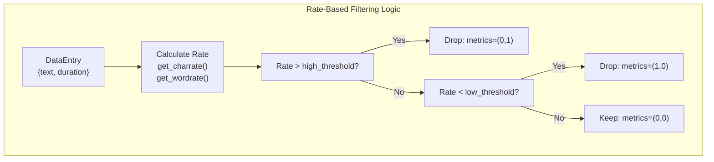
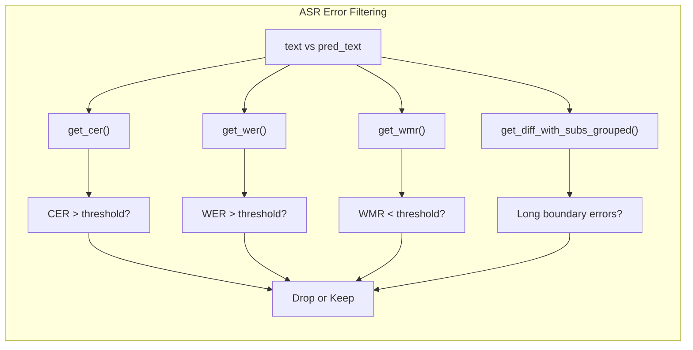
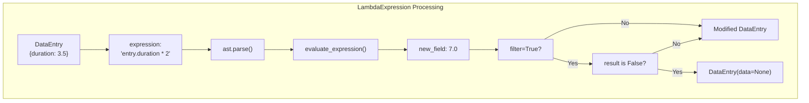

<!-- source: DeepWiki mcp.deepwiki.com · repo NVIDIA/NeMo-speech-data-processor · page 5 Data Processing and Transformation · fetched 2026-10-26 -->

# Data Processing and Transformation

<details>
<summary>Relevant source files</summary>

The following files were used as context for generating this wiki page:

- [.gitignore](.gitignore)
- [sdp/processors/datasets/voxpopuli/normalize_from_non_pc_text.py](sdp/processors/datasets/voxpopuli/normalize_from_non_pc_text.py)
- [sdp/processors/modify_manifest/create_manifest.py](sdp/processors/modify_manifest/create_manifest.py)
- [sdp/processors/modify_manifest/data_to_dropbool.py](sdp/processors/modify_manifest/data_to_dropbool.py)
- [sdp/utils/apply_operators.py](sdp/utils/apply_operators.py)
- [tests/test_data_to_data.py](tests/test_data_to_data.py)
- [tests/test_data_to_dropbool.py](tests/test_data_to_dropbool.py)

</details>


This page covers the core data processing and transformation capabilities within the NeMo Speech Data Processor (SDP). It focuses on the manipulation of manifest data through filtering, text processing, normalization, and quality control operations that transform raw datasets into training-ready speech data.

For information about dataset-specific processing workflows, see [Dataset Processing](#4). For details about ASR inference and quality estimation models used within pipelines, see [Inference and Quality Estimation](#5.3).

## Overview

The SDP system provides a comprehensive suite of processors for transforming speech dataset manifests. These processors operate on JSONL manifest files where each line represents a single data entry with fields like `audio_filepath`, `text`, `duration`, and various metadata. The transformation pipeline consists of three main categories:

### Data Processing Categories

```mermaid
graph TB
    subgraph "Data Processing and Transformation"
        subgraph "Filtering[Filtering & Quality Control]"
            DURATION["DropHighLowDuration<br/>DropHighLowCharrate<br/>DropHighLowWordrate"]
            QUALITY["DropHighCER<br/>DropHighWER<br/>DropLowWordMatchRate"]
            REGEX["DropIfRegexMatch<br/>DropIfNoneOfRegexMatch<br/>DropNonAlphabet"]
            ASR_ERROR["DropASRErrorBeginningEnd<br/>DropASRError<br/>DropIfSubstringInInsertion"]
            DEDUP["DropDuplicates<br/>DropRepeatedFields<br/>DropOnAttribute"]
            PRESERVE["PreserveByValue"]
        end
        
        subgraph "TEXT_PROC[Text Processing & Normalization]"
            BASIC["SubMakeLowercase<br/>SubRegex<br/>NormalizeText"]
            ASR_FIX["SubIfASRSubstitution<br/>InsIfASRInsertion"]
            ADVANCED["LambdaExpression<br/>ListToEntries"]
            CLEAN["CleanQwenGeneration<br/>DetectWhisperHallucinationFeatures"]
        end
        
        subgraph "MANIFEST[Manifest Creation & Manipulation]"
            CREATE["CreateInitialManifestByExt<br/>CreateCombinedManifests"]
            FIELDS["KeepOnlySpecifiedFields<br/>AddConstantFields"]
        end
    end
    
    subgraph "Base[Base Framework]"
        BPP["BaseParallelProcessor"]
        DE["DataEntry"]
        EXPR["evaluate_expression"]
    end
    
    BPP --> DURATION
    BPP --> QUALITY
    BPP --> REGEX
    BPP --> ASR_ERROR
    BPP --> DEDUP
    BPP --> PRESERVE
    BPP --> BASIC
    BPP --> ASR_FIX
    BPP --> ADVANCED
    BPP --> CLEAN
    BPP --> CREATE
    BPP --> FIELDS
    
    DE --> DURATION
    DE --> QUALITY
    DE --> TEXT_PROC
    
    EXPR --> ADVANCED
```



**Sources:** [sdp/processors/modify_manifest/data_to_dropbool.py:39-909](), [tests/test_data_to_data.py:20-28](), [sdp/processors/modify_manifest/create_manifest.py:23-89](), [sdp/utils/apply_operators.py:71-171]()

## Data Transformation Pipeline Flow

The typical data processing flow moves from raw manifest creation through quality filtering to final text normalization:

```mermaid
graph LR
    subgraph "Input Stage"
        RAW["Raw Dataset Files<br/>.wav, .mp3, .txt"]
        META["Metadata Files<br/>.tsv, .csv, .json"]
    end
    
    subgraph "Manifest Creation"
        CREATE_EXT["CreateInitialManifestByExt"]
        CREATE_COMB["CreateCombinedManifests"]
        INIT_MANIFEST["Initial Manifest<br/>manifest.jsonl"]
    end
    
    subgraph "Quality Filtering"
        DURATION_FILTER["DropHighLowDuration"]
        CHARRATE_FILTER["DropHighLowCharrate"]
        ALPHABET_FILTER["DropNonAlphabet"]
        DEDUP_FILTER["DropDuplicates"]
        FILTERED_MANIFEST["Filtered Manifest<br/>filtered.jsonl"]
    end
    
    subgraph "Text Processing"
        REGEX_SUB["SubRegex"]
        LOWERCASE["SubMakeLowercase"]
        LAMBDA_EXPR["LambdaExpression"]
        FINAL_MANIFEST["Final Manifest<br/>processed.jsonl"]
    end
    
    subgraph "Quality Estimation"
        ASR_METRICS["DropHighCER<br/>DropHighWER"]
        WMR_FILTER["DropLowWordMatchRate"]
        QE_MANIFEST["Quality Filtered<br/>qe_filtered.jsonl"]
    end
    
    RAW --> CREATE_EXT
    META --> CREATE_COMB
    CREATE_EXT --> INIT_MANIFEST
    CREATE_COMB --> INIT_MANIFEST
    
    INIT_MANIFEST --> DURATION_FILTER
    DURATION_FILTER --> CHARRATE_FILTER
    CHARRATE_FILTER --> ALPHABET_FILTER
    ALPHABET_FILTER --> DEDUP_FILTER
    DEDUP_FILTER --> FILTERED_MANIFEST
    
    FILTERED_MANIFEST --> REGEX_SUB
    REGEX_SUB --> LOWERCASE
    LOWERCASE --> LAMBDA_EXPR
    LAMBDA_EXPR --> FINAL_MANIFEST
    
    FINAL_MANIFEST --> ASR_METRICS
    ASR_METRICS --> WMR_FILTER
    WMR_FILTER --> QE_MANIFEST
```



**Sources:** [sdp/processors/modify_manifest/create_manifest.py:23-89](), [sdp/processors/modify_manifest/data_to_dropbool.py:214-271](), [sdp/processors/modify_manifest/data_to_dropbool.py:87-149](), [sdp/processors/modify_manifest/data_to_dropbool.py:875-909]()

## Filtering and Quality Control Processors

The SDP system provides extensive filtering capabilities for removing low-quality data entries from manifests. All filtering processors inherit from `BaseParallelProcessor` and return `DataEntry(data=None)` to drop entries or `DataEntry(data=data_entry)` to keep them.

### Duration and Rate-Based Filtering

| Processor | Purpose | Key Parameters | Metrics Tracked |
|-----------|---------|----------------|-----------------|
| `DropHighLowDuration` | Filters by audio duration | `high_duration_threshold`, `low_duration_threshold` | Duration thresholds |
| `DropHighLowCharrate` | Filters by character rate | `high_charrate_threshold`, `low_charrate_threshold` | Characters per second |
| `DropHighLowWordrate` | Filters by word rate | `high_wordrate_threshold`, `low_wordrate_threshold` | Words per second |



**Sources:** [sdp/processors/modify_manifest/data_to_dropbool.py:87-149](), [sdp/processors/modify_manifest/data_to_dropbool.py:152-211](), [sdp/processors/modify_manifest/data_to_dropbool.py:214-271]()

### ASR Error-Based Filtering

The system includes specialized processors for filtering based on ASR prediction quality:

- **`DropHighCER`**: Removes entries with character error rate above threshold
- **`DropHighWER`**: Removes entries with word error rate above threshold  
- **`DropLowWordMatchRate`**: Removes entries with word match rate below threshold
- **`DropASRErrorBeginningEnd`**: Removes entries with long ASR errors at utterance boundaries
- **`DropIfSubstringInInsertion`**: Removes entries containing specific substring insertions



**Sources:** [sdp/processors/modify_manifest/data_to_dropbool.py:501-550](), [sdp/processors/modify_manifest/data_to_dropbool.py:553-602](), [sdp/processors/modify_manifest/data_to_dropbool.py:605-655](), [sdp/processors/modify_manifest/data_to_dropbool.py:375-457]()

### Text Content Filtering

- **`DropNonAlphabet`**: Removes entries containing characters not in specified alphabet
- **`DropIfRegexMatch`**: Removes entries matching regex patterns
- **`DropIfNoneOfRegexMatch`**: Removes entries not matching any regex pattern
- **`DropRepeatedFields`**: Removes entries with text fields duplicated across manifests
- **`DropDuplicates`**: Removes duplicate entries within a single manifest

**Sources:** [sdp/processors/modify_manifest/data_to_dropbool.py:325-372](), [sdp/processors/modify_manifest/data_to_dropbool.py:658-707](), [sdp/processors/modify_manifest/data_to_dropbool.py:273-322](), [sdp/processors/modify_manifest/data_to_dropbool.py:806-873](), [sdp/processors/modify_manifest/data_to_dropbool.py:875-909]()

## Text Processing and Normalization

Text processing processors modify the content of manifest fields, typically the `text` field containing transcriptions.

### Basic Text Transformations

The most commonly used text processors include:

| Processor | Function | Example |
|-----------|----------|---------|
| `SubMakeLowercase` | Converts text to lowercase | `"Hello World"` → `"hello world"` |
| `SubRegex` | Applies regex substitutions | `"<cough> hello"` → `"hello"` |
| `NormalizeText` | Language-specific normalization | Punctuation, spacing cleanup |

### Advanced Text Processing

**`LambdaExpression`** enables dynamic field computation using safe expression evaluation:



**Sources:** [tests/test_data_to_data.py:122-204](), [sdp/utils/apply_operators.py:71-171]()

### ASR-Based Text Corrections

- **`InsIfASRInsertion`**: Inserts text from ASR predictions where appropriate
- **`SubIfASRSubstitution`**: Substitutes text based on ASR prediction differences

These processors use `get_diff()` and `get_diff_with_subs_grouped()` to analyze differences between reference text and ASR predictions, then selectively apply corrections.

**Sources:** [tests/test_data_to_data.py:35-50](), [tests/test_data_to_data.py:52-72]()

## Expression Evaluation System

The `LambdaExpression` processor uses a safe expression evaluator that restricts execution to a subset of Python operations:

### Supported Operations

| Category | Operations | Examples |
|----------|------------|----------|
| Arithmetic | `+`, `-`, `*`, `/`, `//`, `%`, `**` | `entry.a + entry.b` |
| Comparison | `==`, `!=`, `<`, `<=`, `>`, `>=` | `entry.duration > 10` |
| Logical | `and`, `or`, `not` | `entry.a > 0 and entry.b < 5` |
| Functions | `max`, `min`, `len`, `sum`, `abs` | `max(entry.a, entry.b)` |
| Conditionals | Ternary expressions | `'long' if entry.duration > 10 else 'short'` |

### Security Model

The expression evaluator in `apply_operators.py` uses AST parsing to restrict execution:

```python
OPERATORS = {
    ast.Add: operator.add,
    ast.Sub: operator.sub,
    # ... other safe operators
}

SAFE_FUNCTIONS = {
    'max': max,
    'min': min,
    'len': len,
    # ... other safe functions  
}
```

**Sources:** [sdp/utils/apply_operators.py:32-68](), [sdp/utils/apply_operators.py:71-171]()

## Manifest Creation and Manipulation

### Initial Manifest Creation

- **`CreateInitialManifestByExt`**: Creates manifests by recursively finding files with specified extensions
- **`CreateCombinedManifests`**: Combines multiple existing manifest files into a single manifest

### Data Structure Manipulation

- **`ListToEntries`**: Converts list fields (like segments) into separate manifest entries
- **`KeepOnlySpecifiedFields`**: Removes unwanted fields from manifest entries
- **`AddConstantFields`**: Adds constant values to all entries

**Sources:** [sdp/processors/modify_manifest/create_manifest.py:23-56](), [sdp/processors/modify_manifest/create_manifest.py:58-89](), [tests/test_data_to_data.py:104-119]()

## Specialized Processors

### Whisper Hallucination Detection

`DetectWhisperHallucinationFeatures` identifies common hallucination patterns:

- Repeated n-grams: `"yes yes yes yes yes"`
- Unusually long words: `"reallyreallyreallylong"`
- Known hallucinated phrases from training data

### LLM Generation Cleaning  

`CleanQwenGeneration` cleans outputs from language model inference:

- Removes prompt remnants and special tokens
- Replaces all-uppercase generations
- Falls back to reference text for high CER outputs

**Sources:** [tests/test_data_to_data.py:259-288](), [tests/test_data_to_data.py:207-256]()

---

