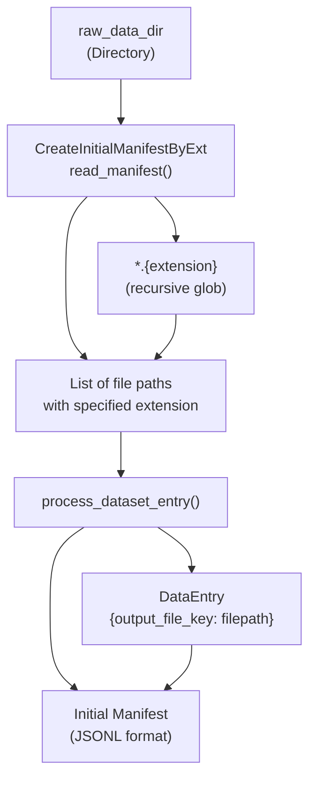
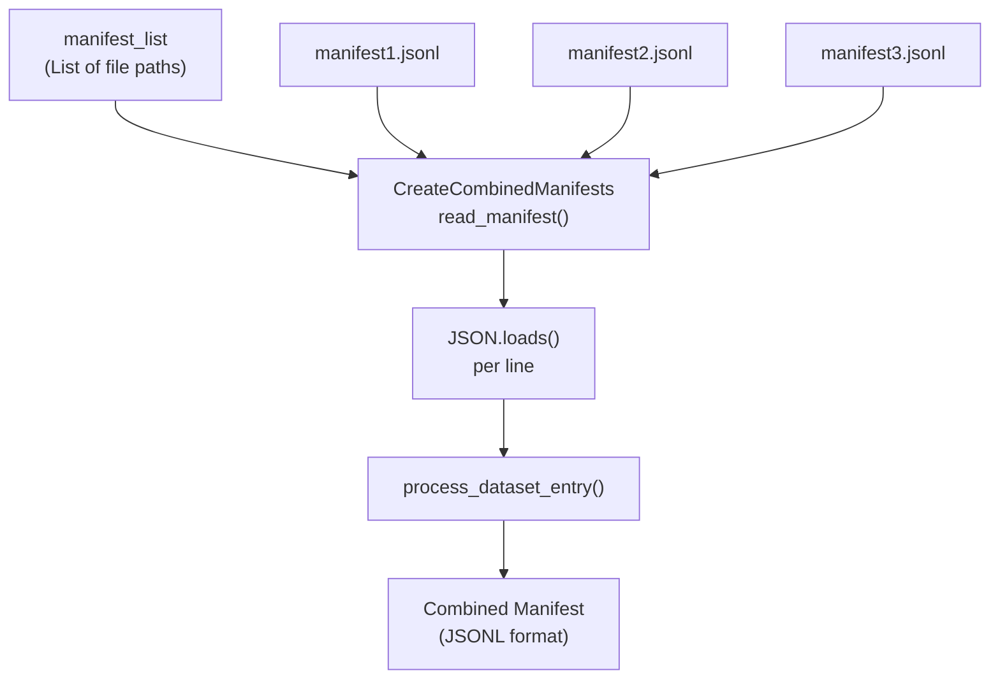
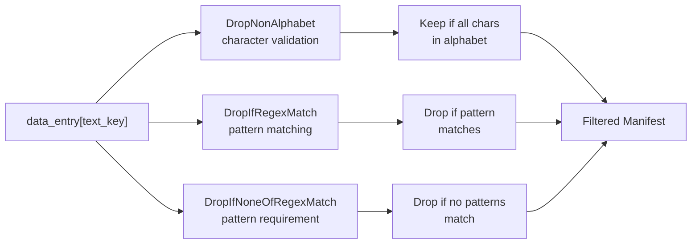
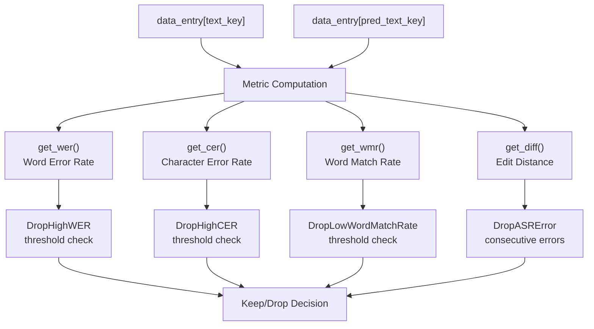
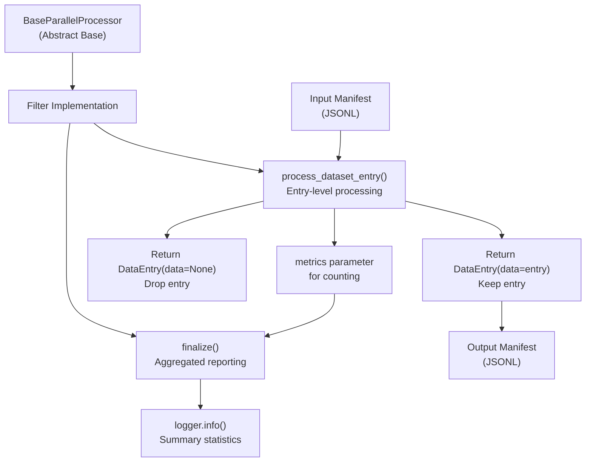

<!-- source: DeepWiki mcp.deepwiki.com · repo NVIDIA/NeMo-speech-data-processor · page 5.1 Manifest Creation and Filtering · fetched 2026-10-26 -->

# Manifest Creation and Filtering

Relevant source files

The following files were used as context for generating this wiki page:

- [sdp/processors/modify_manifest/create_manifest.py](sdp/processors/modify_manifest/create_manifest.py)
- [sdp/processors/modify_manifest/data_to_dropbool.py](sdp/processors/modify_manifest/data_to_dropbool.py)

This document covers the creation of initial dataset manifests and the application of various quality filtering criteria within the NeMo Speech Data Processor (SDP) system. Manifest creation involves generating structured JSONL files that catalog audio files and their metadata, while filtering applies data quality controls to remove problematic entries.

For information about text processing and normalization operations applied after filtering, see [Text Processing and Normalization](#5.2). For details about inference-based quality estimation, see [Inference and Quality Estimation](#5.3).

## Manifest Creation

The SDP system provides processors for creating initial manifests from raw audio datasets. These processors scan directories for audio files and generate the foundational manifest structure that subsequent processors can modify.

### File-Based Manifest Creation

The `CreateInitialManifestByExt` processor creates manifests by recursively scanning directories for files with specified extensions:

The processor accepts parameters for the root directory (`raw_data_dir`), output field name (`output_file_key`), and file extension (`extension`). It generates manifest entries with the specified key containing the full file path [sdp/processors/modify_manifest/create_manifest.py:47-55]().

### Combined Manifest Creation

The `CreateCombinedManifests` processor merges multiple existing manifest files into a single combined manifest:

This processor reads JSON lines from multiple input files and yields the parsed data, enabling the consolidation of separately processed manifest files [sdp/processors/modify_manifest/create_manifest.py:81-88]().

**Sources:** [sdp/processors/modify_manifest/create_manifest.py:23-89]()

## Data Quality Filtering

The SDP system includes a comprehensive set of filtering processors that apply quality controls to remove problematic entries from manifests. These filters operate on various aspects of the data including audio characteristics, text content, and ASR prediction quality.

### Audio-Based Filtering Processors

Audio-based filters evaluate temporal characteristics of speech recordings:

| Processor Class | Purpose | Key Parameters |
|-----------------|---------|----------------|
| `DropHighLowDuration` | Filters by audio duration | `high_duration_threshold`, `low_duration_threshold` |
| `DropHighLowCharrate` | Filters by character rate (chars/second) | `high_charrate_threshold`, `low_charrate_threshold` |
| `DropHighLowWordrate` | Filters by word rate (words/second) | `high_wordrate_threshold`, `low_wordrate_threshold` |

The duration filter removes utterances that are too short or too long based on the `duration` field [sdp/processors/modify_manifest/data_to_dropbool.py:245-252](). Character rate and word rate filters identify potential transcription mismatches by detecting unrealistic speaking rates [sdp/processors/modify_manifest/data_to_dropbool.py:121-129](), [sdp/processors/modify_manifest/data_to_dropbool.py:186-193]().

### Text Content Filtering

Text-based filters validate the content and format of transcriptions:

The `DropNonAlphabet` processor ensures all characters in transcriptions belong to a specified alphabet [sdp/processors/modify_manifest/data_to_dropbool.py:353-362](). Regex-based filters provide flexible pattern matching for both inclusion and exclusion criteria [sdp/processors/modify_manifest/data_to_dropbool.py:688-697](), [sdp/processors/modify_manifest/data_to_dropbool.py:303-313]().

### ASR Quality Filtering

ASR-based filters evaluate prediction quality when both ground truth and predicted transcriptions are available:

These processors compute error metrics between ground truth and predicted text, dropping utterances that exceed quality thresholds [sdp/processors/modify_manifest/data_to_dropbool.py:534-539](), [sdp/processors/modify_manifest/data_to_dropbool.py:586-591](), [sdp/processors/modify_manifest/data_to_dropbool.py:638-643]().

### Specialized Filtering Operations

Additional processors handle specific filtering scenarios:

- `PreserveByValue`: Keeps entries based on field value comparisons using configurable operators [sdp/processors/modify_manifest/data_to_dropbool.py:78-84]()
- `DropOnAttribute`: Filters based on boolean field values [sdp/processors/modify_manifest/data_to_dropbool.py:732-735]()
- `DropDuplicates`: Removes duplicate entries based on specified keys [sdp/processors/modify_manifest/data_to_dropbool.py:893-908]()
- `DropRepeatedFields`: Removes entries that appear in other manifest files [sdp/processors/modify_manifest/data_to_dropbool.py:859-865]()

**Sources:** [sdp/processors/modify_manifest/data_to_dropbool.py:39-909]()

## Filtering Pipeline Architecture

The filtering system follows a consistent processing pattern where each filter extends `BaseParallelProcessor` and implements standardized methods:

Each filtering processor follows this pattern:
1. **Initialization**: Configure thresholds and parameters [sdp/processors/modify_manifest/data_to_dropbool.py:51-76]()
2. **Entry Processing**: Evaluate each manifest entry and return `DataEntry` with data or `None` [sdp/processors/modify_manifest/data_to_dropbool.py:121-129]()
3. **Metrics Collection**: Track statistics about dropped entries [sdp/processors/modify_manifest/data_to_dropbool.py:125]()
4. **Finalization**: Report summary statistics via logging [sdp/processors/modify_manifest/data_to_dropbool.py:131-149]()

The system provides detailed logging for each filter, reporting the number of entries dropped and the reasons for dropping them. This enables data quality monitoring and threshold tuning.

**Sources:** [sdp/processors/modify_manifest/data_to_dropbool.py:23-27](), [sdp/processors/modify_manifest/data_to_dropbool.py:131-149]()

---

