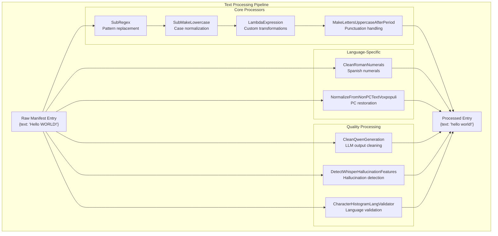
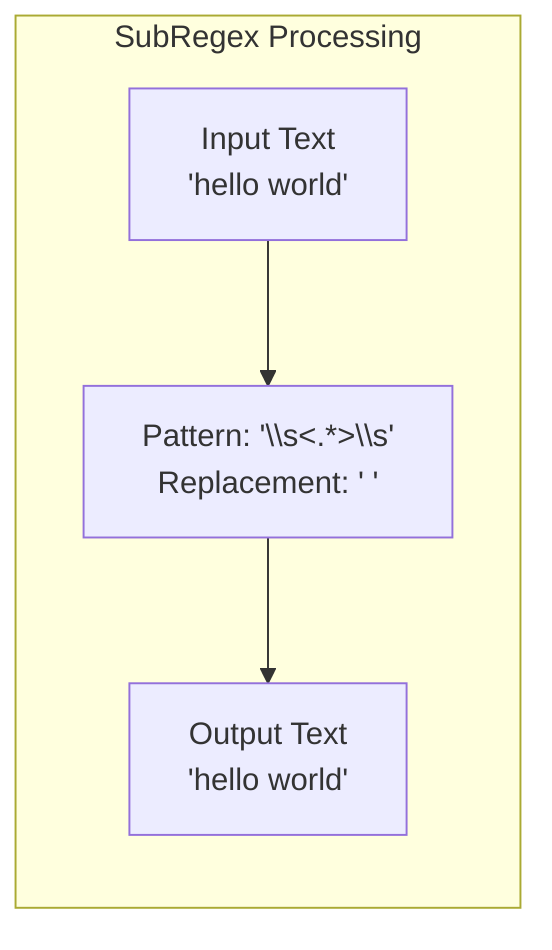
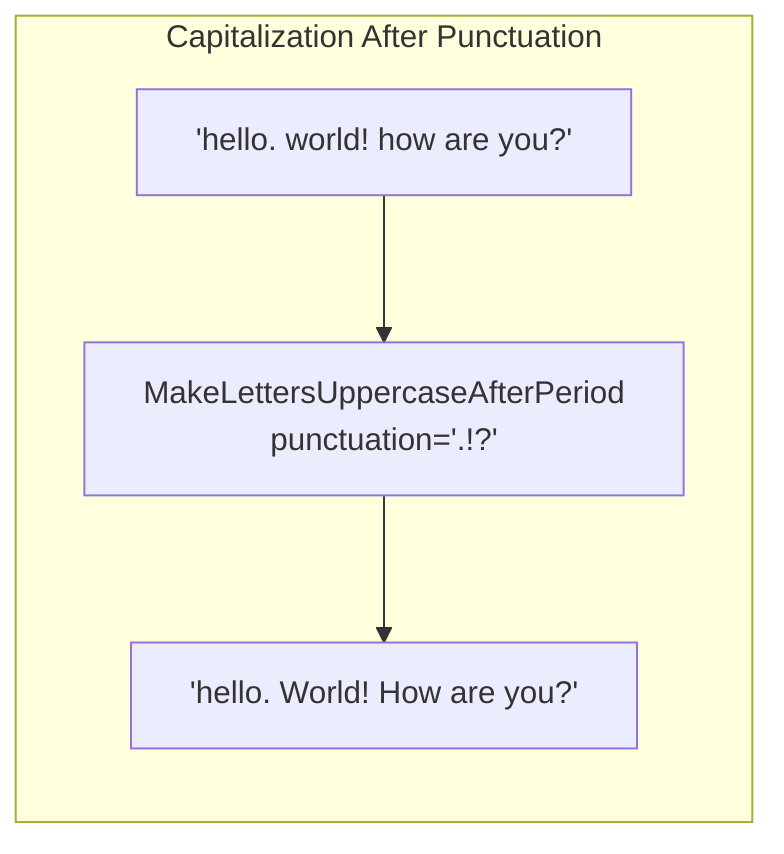
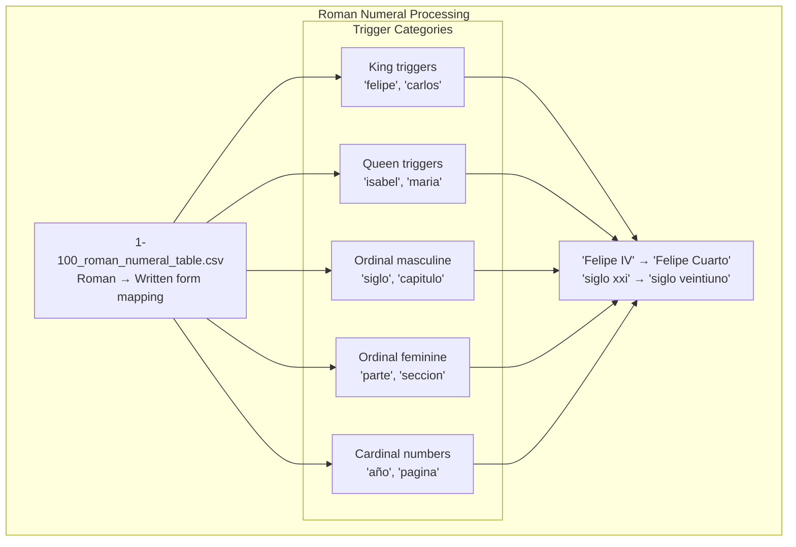
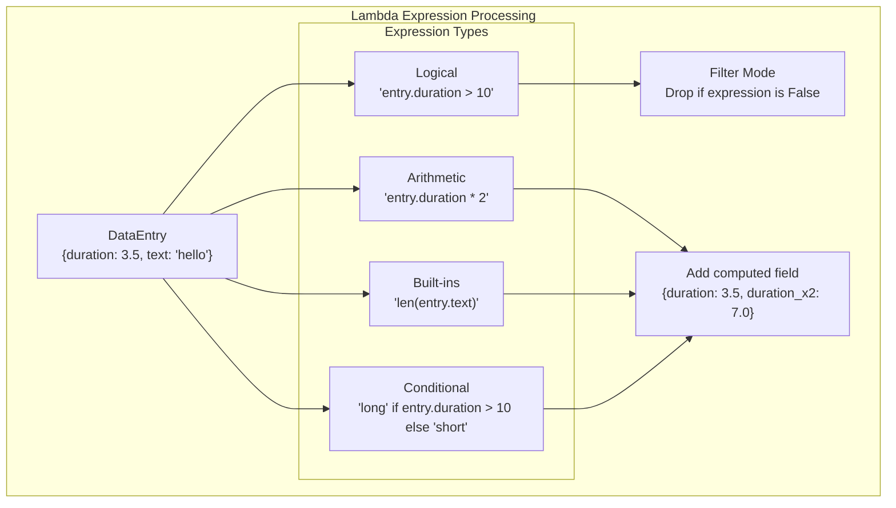
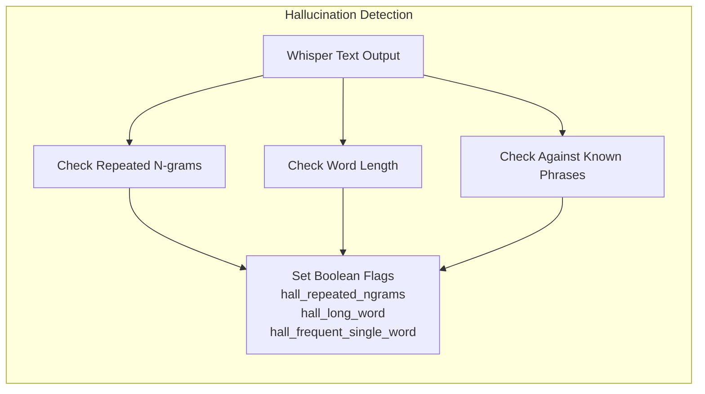

<!-- source: DeepWiki mcp.deepwiki.com · repo NVIDIA/NeMo-speech-data-processor · page 5.2 Text Processing and Normalization · fetched 2026-10-26 -->

# Text Processing and Normalization

<details>
<summary>Relevant source files</summary>

The following files were used as context for generating this wiki page:

- [.gitignore](.gitignore)
- [dataset_configs/spanish/mls/unique_processors/clean_roman_numerals.py](dataset_configs/spanish/mls/unique_processors/clean_roman_numerals.py)
- [sdp/processors/datasets/voxpopuli/normalize_from_non_pc_text.py](sdp/processors/datasets/voxpopuli/normalize_from_non_pc_text.py)
- [sdp/processors/modify_manifest/make_letters_uppercase_after_period.py](sdp/processors/modify_manifest/make_letters_uppercase_after_period.py)
- [sdp/utils/apply_operators.py](sdp/utils/apply_operators.py)
- [tests/test_data_to_data.py](tests/test_data_to_data.py)
- [tests/test_data_to_dropbool.py](tests/test_data_to_dropbool.py)

</details>


This document covers text processing and normalization capabilities within the NeMo Speech Data Processor (SDP) framework. Text processing and normalization are essential steps in preparing speech datasets, involving operations like regex substitutions, case handling, punctuation restoration, and language-specific text cleaning. These processors transform raw transcripts into standardized formats suitable for training speech models.

For information about manifest filtering and data quality control, see [Manifest Creation and Filtering](#5.1). For details about ASR inference and model-based text processing, see [Inference and Quality Estimation](#5.3).

## Core Text Processing Architecture

The text processing system in SDP is built around specialized processors that inherit from `BaseParallelProcessor`. These processors can be chained together to create comprehensive text normalization pipelines.



Sources: [tests/test_data_to_data.py:15-360](), [sdp/processors/base_processor.py]()

## Regular Expression Operations

The `SubRegex` processor provides powerful pattern-based text transformation capabilities using Python's `re` module. It applies a sequence of regex patterns and replacements to text fields.



**Key Parameters:**
- `regex_params_list`: List of dictionaries containing `pattern` and `repl` keys
- `text_key`: Field name to process (defaults to "text")

**Example Configuration:**
```yaml
- _target_: sdp.processors.modify_manifest.data_to_data.SubRegex
  regex_params_list:
    - pattern: "\\s<.*>\\s"
      repl: " "
    - pattern: "\\[.*\\]"
      repl: ""
```

Sources: [tests/test_data_to_data.py:92-100](), [sdp/processors/modify_manifest/data_to_data.py]()

## Case and Punctuation Handling

### Case Normalization

The `SubMakeLowercase` processor converts text to lowercase while preserving Unicode characters across different languages.

**Capabilities:**
- Handles multilingual text including Cyrillic, Latin, and other scripts
- Preserves numbers and special characters
- Configurable target field via `text_key` parameter

**Example Usage:**
```yaml
- _target_: sdp.processors.modify_manifest.data_to_data.SubMakeLowercase
  text_key: "text"
```

Sources: [tests/test_data_to_data.py:74-89]()

### Punctuation Restoration

The `MakeLettersUppercaseAfterPeriod` processor capitalizes letters following punctuation marks, useful for restoring proper sentence capitalization.



**Configuration Options:**
- `punctuation`: String of punctuation characters to consider (default: ".!?")
- `text_key`: Target text field (default: "text")

Sources: [sdp/processors/modify_manifest/make_letters_uppercase_after_period.py:24-81]()

## Language-Specific Processing

### Spanish Roman Numeral Cleaning

The `CleanRomanNumerals` processor handles Spanish-specific text normalization for Roman numerals in royal titles and ordinal numbers.



**Processing Logic:**
- Reads mapping from CSV file containing Roman numerals and their written equivalents
- Applies context-specific transformations based on trigger words
- Preserves capitalization patterns from original text
- Tracks substitution metrics for quality monitoring

Sources: [dataset_configs/spanish/mls/unique_processors/clean_roman_numerals.py:27-127]()

### VoxPopuli Punctuation Restoration

The `NormalizeFromNonPCTextVoxpopuli` processor restores punctuation and capitalization by mapping between normalized and non-normalized text versions.

**Algorithm:**
1. Tokenizes both original and normalized text
2. Aligns words using heuristic matching
3. Handles special cases like numbers and punctuation
4. Produces merged text with restored formatting

**Key Features:**
- Handles multilingual European text
- Manages number formatting inconsistencies  
- Preserves punctuation from original text
- Returns "n/a" for failed mappings

Sources: [sdp/processors/datasets/voxpopuli/normalize_from_non_pc_text.py:118-171]()

## Expression Evaluation and Lambda Operations

### LambdaExpression Processor

The `LambdaExpression` processor enables dynamic field computation and filtering using safe Python expression evaluation.



**Expression Safety:**
- Uses restricted AST evaluation via `apply_operators.py`
- Supports safe built-in functions: `max`, `min`, `len`, `sum`, `abs`, `sorted`
- Prevents arbitrary code execution
- Configurable variable prefix handling

**Configuration Example:**
```yaml
- _target_: sdp.processors.modify_manifest.data_to_data.LambdaExpression
  new_field: "duration_category"
  expression: "'long' if entry.duration > 10 else 'short'"
  filter: false
```

Sources: [tests/test_data_to_data.py:121-205](), [sdp/utils/apply_operators.py:70-171]()

### Safe Expression Evaluation

The `apply_operators.py` module provides secure expression evaluation with restricted AST operations:

| Operation Type | Supported Operations |
|----------------|---------------------|
| Arithmetic | `+`, `-`, `*`, `/`, `//`, `%`, `**` |
| Comparison | `==`, `!=`, `<`, `<=`, `>`, `>=`, `is`, `is not` |
| Logical | `and`, `or`, `not` |
| Data Access | Indexing, slicing, attribute access |
| Built-ins | `max`, `min`, `len`, `sum`, `abs`, `sorted` |

Sources: [sdp/utils/apply_operators.py:32-68]()

## Quality Assessment and Validation

### LLM Output Cleaning

The `CleanQwenGeneration` processor cleans and validates text generated by language models, particularly addressing common generation artifacts.

**Cleaning Operations:**
- Removes model-specific tokens like `<|endoftext|>`
- Strips prompt remnants and formatting artifacts
- Handles excessive uppercase text
- Validates output quality using Character Error Rate (CER)
- Replaces poor generations with reference text

**Quality Thresholds:**
- `cer_threshold`: Maximum acceptable CER between generation and reference
- `upper_case_threshold`: Maximum acceptable ratio of uppercase characters

Sources: [tests/test_data_to_data.py:207-257]()

### Whisper Hallucination Detection

The `DetectWhisperHallucinationFeatures` processor identifies potential hallucinations in Whisper ASR output by detecting:

**Hallucination Patterns:**
- `hall_repeated_ngrams`: Repetitive word sequences  
- `hall_long_word`: Unusually long words without spaces
- `hall_frequent_single_word`: Known hallucinated phrases from common phrases file

**Detection Logic:**


Sources: [tests/test_data_to_data.py:259-288]()

### Character Distribution Validation

The `CharacterHistogramLangValidator` processor validates text language consistency by comparing character distributions against language-specific histograms.

**Validation Process:**
1. Loads pre-computed character frequency histograms for target language
2. Calculates ratio of expected characters in input text
3. Outputs score indicating language match confidence
4. Supports caching of histogram data for efficiency

**Usage Example:**
```yaml
- _target_: sdp.processors.modify_manifest.data_to_data.CharacterHistogramLangValidator
  lang: "en"
  cache_dir: "/path/to/histograms"
  text_field: "text"
  output_score_field: "lang_score"
```

Sources: [tests/test_data_to_data.py:289-353]()

## Processing Pipeline Integration

Text processing and normalization processors integrate seamlessly into SDP processing pipelines through YAML configuration. Multiple processors can be chained to create comprehensive text cleaning workflows.

**Typical Pipeline Sequence:**
1. **Initial Cleaning**: Remove artifacts and standardize format
2. **Language Processing**: Apply language-specific rules
3. **Case Normalization**: Standardize capitalization
4. **Quality Validation**: Assess and filter poor quality text
5. **Final Formatting**: Apply final formatting rules

**Configuration Pattern:**
```yaml
processors:
  - _target_: sdp.processors.modify_manifest.data_to_data.SubRegex
    regex_params_list: [...]
  
  - _target_: sdp.processors.modify_manifest.data_to_data.SubMakeLowercase
    
  - _target_: sdp.processors.modify_manifest.data_to_data.LambdaExpression
    new_field: "text_length"
    expression: "len(entry.text)"
```

Sources: [tests/test_data_to_data.py:354-360](), [dataset_configs/]()

---

