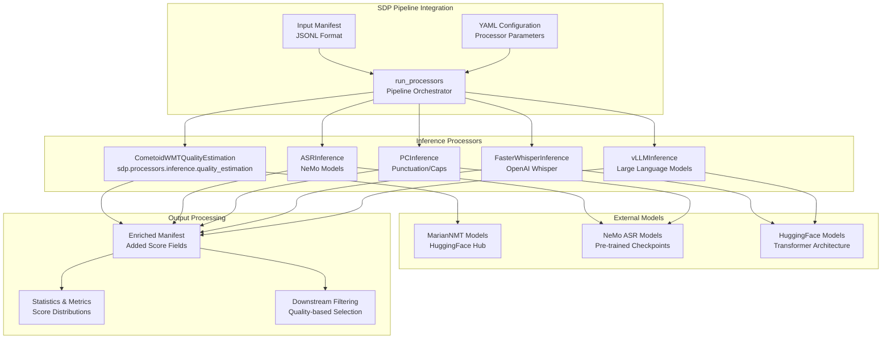
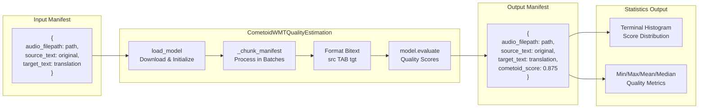
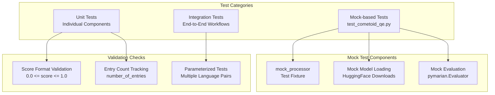

<!-- source: DeepWiki mcp.deepwiki.com · repo NVIDIA/NeMo-speech-data-processor · page 5.3 Inference and Quality Estimation · fetched 2026-10-26 -->

# Inference and Quality Estimation

<details>
<summary>Relevant source files</summary>

The following files were used as context for generating this wiki page:

- [requirements/docs.txt](requirements/docs.txt)
- [sdp/processors/datasets/slr83/__init__.py](sdp/processors/datasets/slr83/__init__.py)
- [sdp/processors/datasets/slr83/create_initial_manifest.py](sdp/processors/datasets/slr83/create_initial_manifest.py)
- [sdp/processors/inference/quality_estimation/pymarian.py](sdp/processors/inference/quality_estimation/pymarian.py)
- [tests/test_cometoid_qe.py](tests/test_cometoid_qe.py)

</details>


This document covers the inference and quality estimation capabilities within the NeMo Speech Data Processor (SDP). These processors leverage pre-trained models to enrich datasets with computed scores, predictions, and quality assessments during data processing pipelines.

The inference processors integrate seamlessly with SDP's manifest-based processing architecture, allowing users to apply various neural models for automatic speech recognition (ASR), quality estimation, and text processing tasks. For information about text processing and normalization without inference models, see [Text Processing and Normalization](#5.2).

## Architecture Overview

Inference processors in SDP extend the base processor framework to incorporate pre-trained models into data processing pipelines. These processors typically load models, process data in batches for efficiency, and append computed results to manifest entries.

### Inference Processor Integration



Sources: [sdp/processors/inference/quality_estimation/pymarian.py:1-232]()

## Quality Estimation with CometoidWMTQualityEstimation

The `CometoidWMTQualityEstimation` processor implements translation quality estimation using COMET-like models based on MarianNMT. This processor evaluates source-target text pairs (bitext) and provides quality scores that can be used for filtering or analysis.

### CometoidWMTQualityEstimation Workflow

```mermaid
graph TD
    subgraph "Initialization"
        INIT[CometoidWMTQualityEstimation<br/>Processor Instantiation]
        CONFIG_PARAMS[Configuration Parameters<br/>source_text_field, target_text_field<br/>model_name_or_path, device_type]
    end
    
    subgraph "Model Loading"
        ALIAS_CHECK[Check Model Alias<br/>MODEL_NAME_TO_HF_PATH]
        HF_DOWNLOAD[HuggingFace Download<br/>hf_hub_download]
        VOCAB_LOAD[Vocabulary Loading<br/>SentencePiece Model]
        MARIAN_INIT[pymarian.Evaluator<br/>Marian Arguments Assembly]
    end
    
    subgraph "Data Processing"
        CHUNK[Chunk Manifest<br/>chunksize batches]
        BITEXT[Format Bitext Pairs<br/>src_text TAB tgt_text]
        EVALUATE[model.evaluate()<br/>Batch Score Computation]
        APPEND[Append Scores<br/>output_field in manifest]
    end
    
    subgraph "Statistics Generation"
        HISTOGRAM[Score Histogram<br/>termplotlib visualization]
        METRICS[Statistical Metrics<br/>min, max, mean, median]
        OUTPUT[Enhanced Manifest<br/>Quality Scores Added]
    end
    
    INIT --> CONFIG_PARAMS
    CONFIG_PARAMS --> ALIAS_CHECK
    ALIAS_CHECK --> HF_DOWNLOAD
    HF_DOWNLOAD --> VOCAB_LOAD
    VOCAB_LOAD --> MARIAN_INIT
    
    MARIAN_INIT --> CHUNK
    CHUNK --> BITEXT
    BITEXT --> EVALUATE
    EVALUATE --> APPEND
    
    APPEND --> HISTOGRAM
    HISTOGRAM --> METRICS
    METRICS --> OUTPUT
```

Sources: [sdp/processors/inference/quality_estimation/pymarian.py:98-151](), [sdp/processors/inference/quality_estimation/pymarian.py:175-203]()

### Key Components and Configuration

| Component | Purpose | Configuration Options |
|-----------|---------|----------------------|
| **Model Loading** | Downloads and initializes MarianNMT models | `model_name_or_path`, `vocab_path`, `save_model_to` |
| **Text Processing** | Formats source-target pairs for evaluation | `source_text_field`, `target_text_field` |
| **Batch Processing** | Configures processing efficiency | `mini_batch`, `maxi_batch`, `chunksize` |
| **Device Management** | Controls CPU/GPU usage | `device_type`, `num_devices` |
| **Score Output** | Defines output field for quality scores | `output_field` |

The processor supports predefined model aliases that map to HuggingFace repository paths:

```python
MODEL_NAME_TO_HF_PATH = {
    "cometoid-wmt23": "marian-nmt/cometoid22-wmt23",
    "cometoid-wmt23-mqm": "marian-nmt/cometoid22-wmt23",
}
```

Sources: [sdp/processors/inference/quality_estimation/pymarian.py:59-62](), [sdp/processors/inference/quality_estimation/pymarian.py:68-94]()

### Device Configuration and Performance

The processor automatically configures device usage based on availability:

**CPU Configuration:**
- Uses `MARIAN_CPU_ARGS = "-w 2000 --cpu-threads {num_threads}"`
- Automatically detects available CPU cores
- Supports parallel processing across multiple threads

**GPU Configuration:**
- Uses `MARIAN_GPU_ARGS = "-w 8000 -d {device_indicies}"`
- Automatically detects available CUDA devices
- Supports multi-GPU processing

Sources: [sdp/processors/inference/quality_estimation/pymarian.py:65-66](), [sdp/processors/inference/quality_estimation/pymarian.py:127-146]()

## Processing Pipeline Integration

### Manifest Data Flow



Sources: [sdp/processors/inference/quality_estimation/pymarian.py:152-174](), [sdp/processors/inference/quality_estimation/pymarian.py:186-201]()

### Statistics and Visualization

The processor provides comprehensive statistics about computed quality scores:

- **Histogram Visualization**: Uses `termplotlib` to display score distributions in the terminal
- **Statistical Metrics**: Computes min, max, mean, and median scores
- **Binned Analysis**: Creates histogram bins from 0.0 to 1.0 in 0.1 increments

The `finalize` method generates these statistics automatically after processing all data entries.

Sources: [sdp/processors/inference/quality_estimation/pymarian.py:205-232]()

## Error Handling and Dependencies

The processor includes robust error handling for common issues:

| Error Type | Handling Approach |
|------------|------------------|
| **Missing Dependencies** | Checks for `pymarian` installation and provides installation instructions |
| **Invalid Model Paths** | Validates model file existence and provides clear error messages |
| **Missing Vocabulary** | Automatically downloads vocabulary files from HuggingFace when using model aliases |
| **Device Configuration** | Gracefully falls back to available resources when requested devices are unavailable |

The processor requires the `pymarian` library, which must be installed separately:

```bash
pip install pymarian
```

Sources: [sdp/processors/inference/quality_estimation/pymarian.py:99-102](), [sdp/processors/inference/quality_estimation/pymarian.py:116-123]()

## Testing and Validation

The quality estimation processor includes comprehensive test coverage:

### Test Structure



Sources: [tests/test_cometoid_qe.py:1-87]()

The test suite validates:
- Model loading with mocked HuggingFace downloads
- Score computation with expected ranges (0.0 to 1.0)
- Proper manifest entry processing and counting
- Multiple language pair scenarios through parameterized tests

Sources: [tests/test_cometoid_qe.py:35-43](), [tests/test_cometoid_qe.py:46-67](), [tests/test_cometoid_qe.py:70-87]()

---

