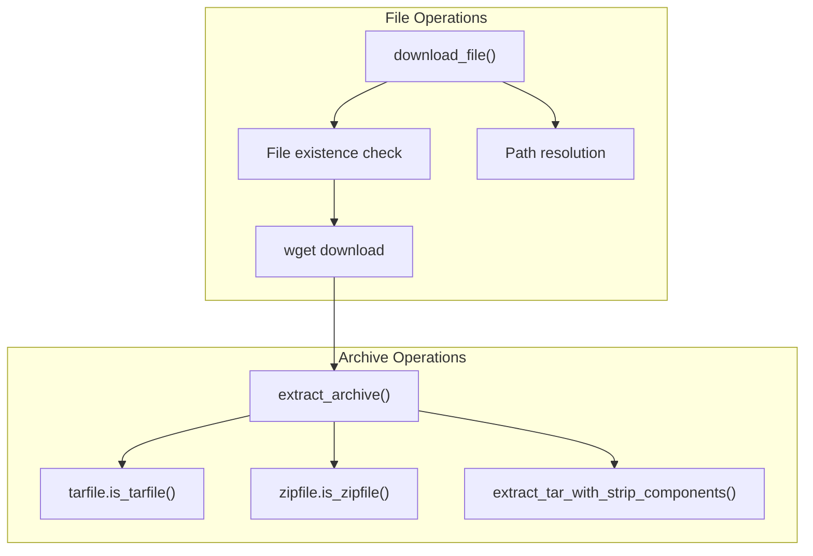
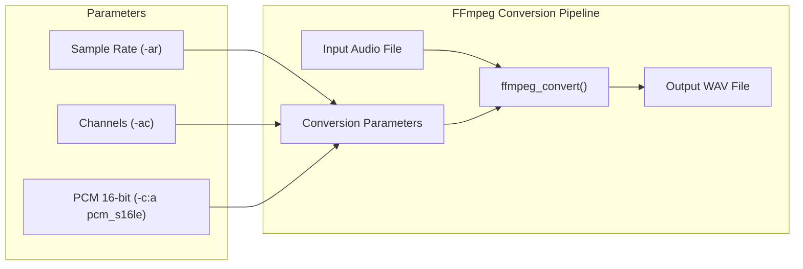
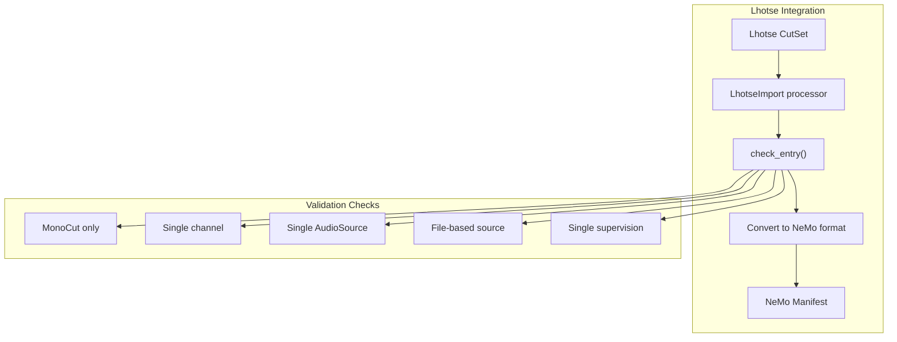

<!-- source: DeepWiki mcp.deepwiki.com · repo NVIDIA/NeMo-speech-data-processor · page 6 Utility Functions and Common Operations · fetched 2026-10-26 -->

# Utility Functions and Common Operations

Relevant source files

The following files were used as context for generating this wiki page:

- [dataset_configs/armenian/audio_books/config.yaml](dataset_configs/armenian/audio_books/config.yaml)
- [requirements/huggingface.txt](requirements/huggingface.txt)
- [requirements/tests.txt](requirements/tests.txt)
- [sdp/processors/datasets/lhotse.py](sdp/processors/datasets/lhotse.py)
- [sdp/utils/common.py](sdp/utils/common.py)
- [tests/test_lhotse.py](tests/test_lhotse.py)

This document covers the shared utility functions, file operations, and external tool integrations that support the NeMo Speech Data Processor framework. These utilities provide common functionality for manifest handling, file downloads, archive extraction, audio processing, and integration with external libraries and tools.

For information about processor-specific operations and transformations, see [Data Processing and Transformation](#5). For deployment and infrastructure utilities, see [Deployment and Infrastructure](#8).

## Core Utility Functions

The SDP framework provides a comprehensive set of utility functions through the `sdp.utils.common` module that handle fundamental operations required across all processor types.

### Manifest Operations

The framework provides standardized functions for reading and writing JSONL manifest files, which are the primary data format used throughout the processing pipeline.

| Function | Purpose | Input | Output |
|----------|---------|-------|--------|
| `load_manifest()` | Read JSONL manifest into memory | File path, optional encoding | List of dictionaries |
| `save_manifest()` | Write manifest data to JSONL file | List of dictionaries, file path | JSONL file |

The `load_manifest()` function at [sdp/utils/common.py:29-36]() reads NeMo manifest files as lists of dictionaries, with each line representing a single data entry. The `save_manifest()` function at [sdp/utils/common.py:38-42]() performs the inverse operation, writing manifest data back to JSONL format.

### File and Download Operations

The framework includes robust file handling capabilities for downloading external datasets and managing local file operations.

The `download_file()` function at [sdp/utils/common.py:44-68]() handles dataset downloads with intelligent caching, automatically skipping downloads if the target file already exists. The function uses `wget` for reliable downloading and maintains proper working directory handling.

### Archive Extraction

The framework supports multiple archive formats through unified extraction interfaces:

- **Standard extraction**: `extract_archive()` at [sdp/utils/common.py:71-98]() handles both tar and zip files
- **Strip components**: `extract_tar_with_strip_components()` at [sdp/utils/common.py:109-117]() provides tar extraction with path component stripping

The extraction functions include intelligent duplicate detection and support for force extraction when needed.

**Sources**: [sdp/utils/common.py:1-117]()

## Audio Processing Utilities

### FFmpeg Integration

The framework integrates with FFmpeg for audio format conversion and processing through the `ffmpeg_convert()` function.

The `ffmpeg_convert()` function at [sdp/utils/common.py:101-106]() provides a standardized interface for audio conversion with configurable sample rate and channel parameters. The function uses subprocess execution with suppressed output for batch processing efficiency.

**Sources**: [sdp/utils/common.py:101-106](), [dataset_configs/armenian/audio_books/config.yaml:53-60]()

## External Library Integration

### Lhotse Integration

The framework provides seamless integration with the Lhotse speech processing library through the `LhotseImport` processor.

The `LhotseImport` processor at [sdp/processors/datasets/lhotse.py:19-84]() enables importing datasets from Lhotse CutSet format into NeMo manifest format. The processor includes comprehensive validation through `check_entry()` to ensure compatibility with SDP requirements.

### External Tool Requirements

The framework integrates with various external tools and libraries as needed:

| Tool/Library | Purpose | Requirements File |
|--------------|---------|-------------------|
| Lhotse | Speech data processing | [requirements/tests.txt:6]() |
| PyTorch | Neural network operations | [requirements/tests.txt:7-8]() |
| HuggingFace | Model access and inference | [requirements/huggingface.txt:1-4]() |
| FFmpeg | Audio conversion | System dependency |

**Sources**: [sdp/processors/datasets/lhotse.py:1-84](), [tests/test_lhotse.py:1-63](), [requirements/tests.txt:1-8](), [requirements/huggingface.txt:1-4]()

## Common Operation Patterns

### File Path Management

The utility functions follow consistent patterns for file path handling:

- **Absolute path conversion**: Functions like `download_file()` convert relative paths to absolute paths to prevent directory-related bugs
- **Working directory preservation**: Download operations preserve the original working directory after temporary changes
- **Path validation**: Archive extraction includes path existence checks before processing

### Error Handling and Logging

The framework implements standardized error handling and logging patterns:

- **Structured logging**: All utility functions use the SDP logging framework for consistent output
- **Graceful degradation**: File operations include existence checks to avoid unnecessary work
- **Validation assertions**: External integrations include comprehensive validation with descriptive error messages

### Caching and Optimization

Common operations implement intelligent caching strategies:

- **Download caching**: Files are not re-downloaded if they already exist locally
- **Extraction caching**: Archives are not re-extracted if the target directory already exists
- **Subprocess optimization**: Audio conversion operations suppress unnecessary output for batch processing

**Sources**: [sdp/utils/common.py:44-68](), [sdp/utils/common.py:71-98](), [sdp/logging.py]()

---

