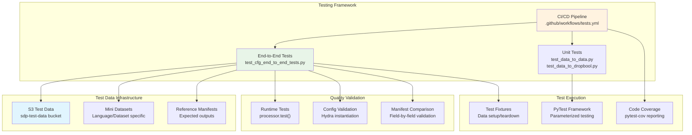
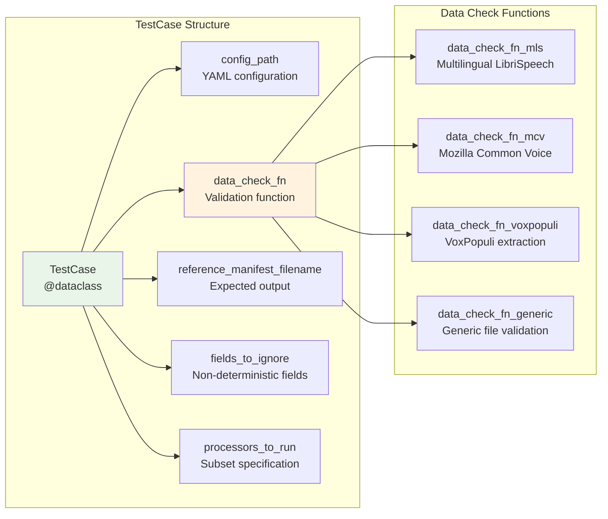
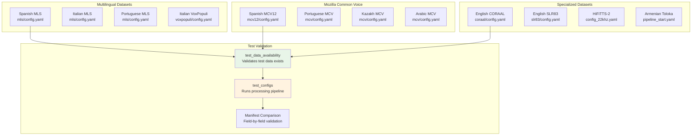
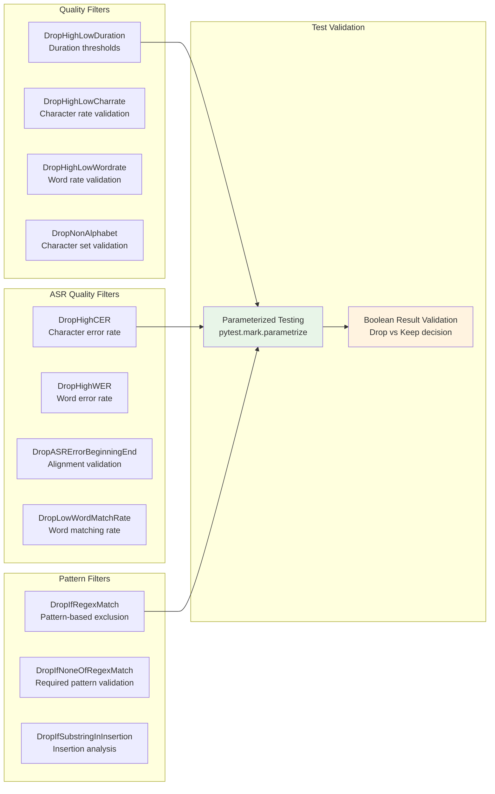
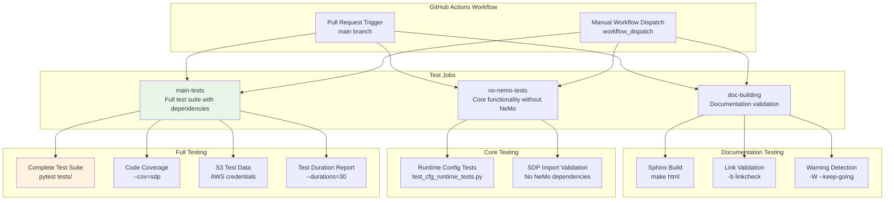
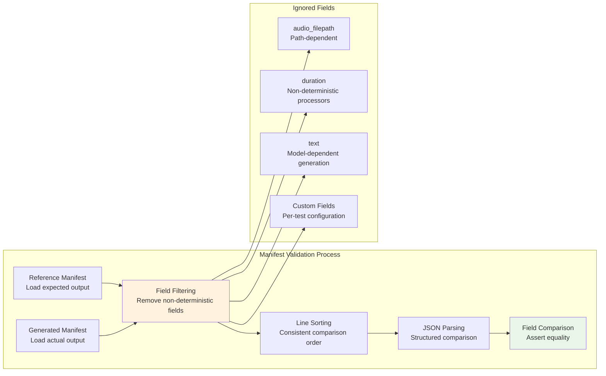

<!-- source: DeepWiki mcp.deepwiki.com · repo NVIDIA/NeMo-speech-data-processor · page 7 Testing and Quality Assurance · fetched 2026-10-26 -->

# Testing and Quality Assurance

<details>
<summary>Relevant source files</summary>

The following files were used as context for generating this wiki page:

- [.github/workflows/tests.yml](.github/workflows/tests.yml)
- [.gitignore](.gitignore)
- [requirements/main.txt](requirements/main.txt)
- [sdp/processors/datasets/voxpopuli/normalize_from_non_pc_text.py](sdp/processors/datasets/voxpopuli/normalize_from_non_pc_text.py)
- [sdp/utils/apply_operators.py](sdp/utils/apply_operators.py)
- [tests/test_cfg_end_to_end_tests.py](tests/test_cfg_end_to_end_tests.py)
- [tests/test_data_to_data.py](tests/test_data_to_data.py)
- [tests/test_data_to_dropbool.py](tests/test_data_to_dropbool.py)

</details>


The NeMo Speech Data Processor (SDP) employs a comprehensive testing and quality assurance framework to ensure reliable dataset processing across diverse speech datasets and configurations. This system validates processor functionality, configuration correctness, and output quality through multiple testing layers including end-to-end validation, unit testing, and continuous integration.

For information about processor development and implementation, see [Core Architecture](#2). For dataset-specific processing details, see [Dataset Processing](#4).

## Testing Architecture Overview

The SDP testing framework consists of three primary components: an end-to-end testing system that validates complete processing pipelines, unit tests for individual processor validation, and a CI/CD pipeline for automated quality assurance.



**Sources:** [tests/test_cfg_end_to_end_tests.py:1-502](), [.github/workflows/tests.yml:1-114](), [tests/test_data_to_data.py:1-360]()

## End-to-End Testing System

The end-to-end testing framework validates complete dataset processing pipelines using the `TestCase` dataclass and dataset-specific validation functions.

### Test Case Definition



**Sources:** [tests/test_cfg_end_to_end_tests.py:35-44](), [tests/test_cfg_end_to_end_tests.py:52-91]()

### Test Data Management

The system manages test data through S3 storage and automatic downloading, with support for both local and cloud-based test execution.

| Component | Function | File Location |
|-----------|----------|---------------|
| `check_e2e_test_data()` | Validates environment variables for test data access | [tests/test_cfg_end_to_end_tests.py:341-347]() |
| `get_e2e_test_data_path()` | Downloads test data from S3 if not available locally | [tests/test_cfg_end_to_end_tests.py:349-378]() |
| `setup_data` fixture | Configures test environment and data paths | [tests/test_cfg_end_to_end_tests.py:380-398]() |

### Supported Dataset Test Cases

The framework includes test cases for over 30 dataset configurations across multiple languages:



**Sources:** [tests/test_cfg_end_to_end_tests.py:179-331](), [tests/test_cfg_end_to_end_tests.py:400-411](), [tests/test_cfg_end_to_end_tests.py:412-499]()

## Unit Testing Framework

Unit tests validate individual processor functionality using pytest parameterization and systematic test case generation.

### Data Transformation Testing

The `test_data_to_data.py` module tests processors that modify manifest entries without filtering:

| Processor Class | Test Parameters | Validation Focus |
|----------------|-----------------|------------------|
| `InsIfASRInsertion` | `insert_words` list | ASR-based text insertion |
| `SubIfASRSubstitution` | `sub_words` dictionary | ASR-guided substitution |
| `SubMakeLowercase` | `text_key` field | Case normalization |
| `SubRegex` | `regex_params_list` | Pattern replacement |
| `ListToEntries` | `field_with_list`, `output_field` | List expansion |
| `LambdaExpression` | `expression`, `filter` | Dynamic expression evaluation |

**Sources:** [tests/test_data_to_data.py:35-205](), [tests/test_data_to_data.py:354-359]()

### Filtering Processor Testing

The `test_data_to_dropbool.py` module validates processors that filter manifest entries:



**Sources:** [tests/test_data_to_dropbool.py:31-256](), [tests/test_data_to_dropbool.py:258-269]()

### Advanced Quality Testing

The framework includes specialized testing for advanced features like hallucination detection and language validation:

| Test Function | Purpose | Key Components |
|---------------|---------|----------------|
| `test_detect_whisper_hallucinations` | Validates Whisper hallucination detection | `DetectWhisperHallucinationFeatures` processor |
| `test_character_hist_validator` | Tests character histogram language validation | S3-based histogram data, language scoring |
| `en_hist_dir` fixture | Manages histogram test data | S3 download, session-scoped caching |

**Sources:** [tests/test_data_to_data.py:272-288](), [tests/test_data_to_data.py:327-352](), [tests/test_data_to_data.py:289-325]()

## Continuous Integration Pipeline

The CI/CD system runs automated tests across multiple environments and dependency configurations through GitHub Actions.

### CI Workflow Structure



**Sources:** [.github/workflows/tests.yml:1-114]()

### Dependency Management

The CI system manages complex dependency installations across different testing scenarios:

| Test Job | Dependencies | Purpose |
|----------|-------------|---------|
| `doc-building` | `requirements/docs.txt`, `nemo_text_processing` | Documentation generation validation |
| `no-nemo-tests` | `requirements/main.txt`, `requirements/tests.txt` | Core SDP functionality without heavy ML dependencies |
| `main-tests` | Full NeMo toolkit, audio libraries, cloud dependencies | Complete functionality validation |

### Environment Configuration

The main test job configures extensive system dependencies and environment variables:

```bash
# Audio processing libraries
sudo apt-get install -y libsndfile1 ffmpeg sox libsox-fmt-mp3

# NeMo toolkit installation
pip install nemo-toolkit[asr,nlp]==2.2.1

# Cloud and specialized dependencies
pip install pymarian  # For quality estimation
pip install certifi   # For CORAAL dataset processing
```

**Sources:** [.github/workflows/tests.yml:67-81](), [.github/workflows/tests.yml:84-102]()

## Quality Validation Mechanisms

The testing framework implements multiple validation layers to ensure processing quality and consistency.

### Manifest Comparison System

The end-to-end tests perform detailed manifest validation through field-by-field comparison:



**Sources:** [tests/test_cfg_end_to_end_tests.py:481-495]()

### Runtime Testing Integration

Processors can implement optional `test()` methods for runtime validation during processing:

| Validation Type | Implementation | Purpose |
|-----------------|----------------|---------|
| Runtime Tests | `processor.test()` method | Real-time validation during processing |
| Config Validation | Hydra instantiation | Configuration correctness verification |
| Data Availability | `data_check_fn` functions | Input data validation |
| Output Consistency | Reference manifest comparison | Output quality assurance |

### Test Data Cleanup

The framework includes automated cleanup mechanisms to manage test artifacts:

```bash
# Environment variable controls
CLEAN_UP_TMP_PATH=1    # Remove temporary processing files
CLEAN_UP_DATA_DIR=0    # Preserve downloaded test data
USE_THREADING_BACKEND=1 # Enable parallel processing in tests
```

**Sources:** [tests/test_cfg_end_to_end_tests.py:397-398](), [tests/test_cfg_end_to_end_tests.py:497-498](), [.github/workflows/tests.yml:86-90]()

---

