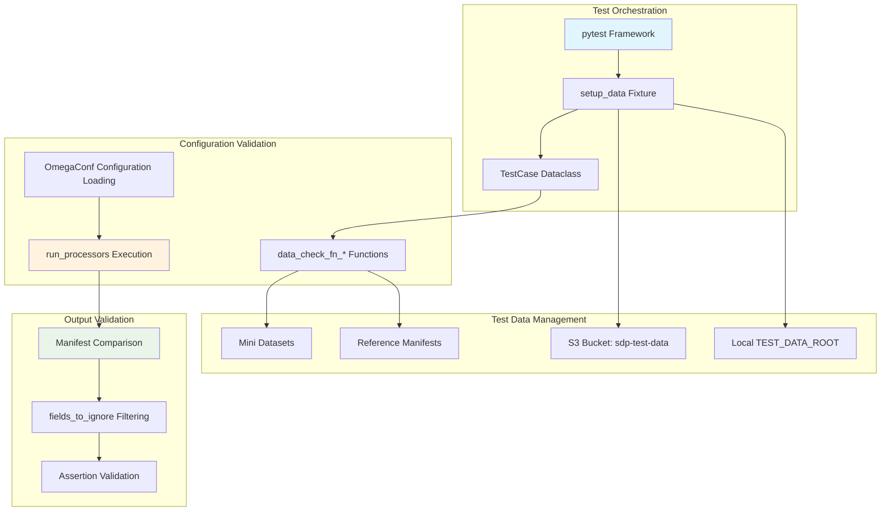
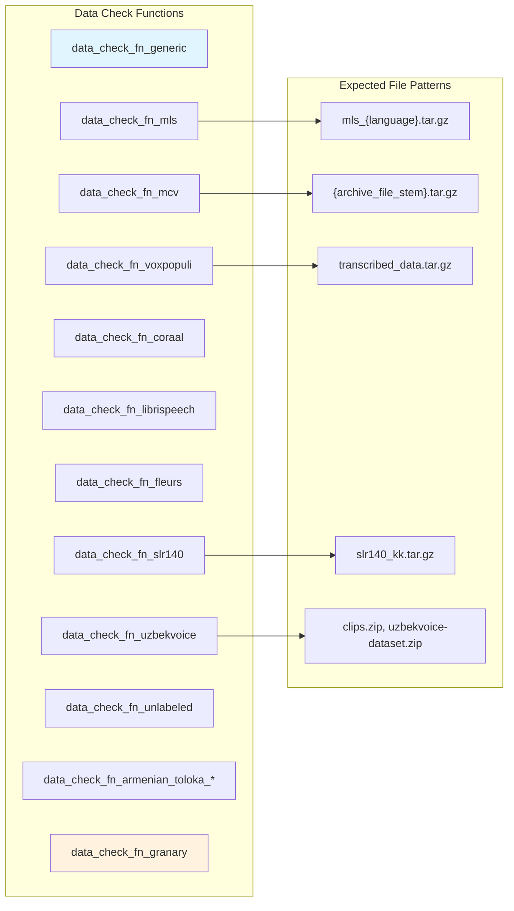
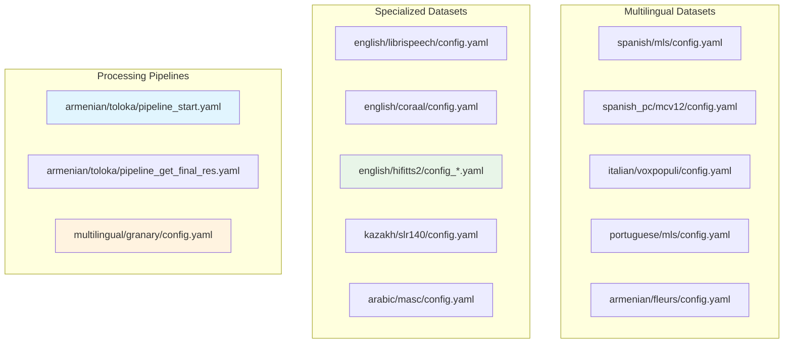
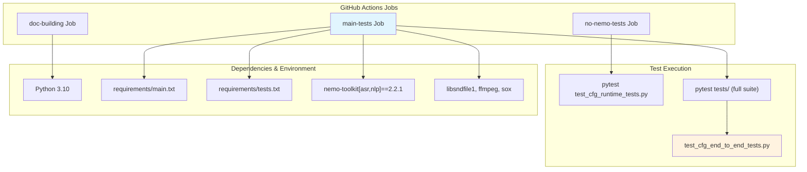
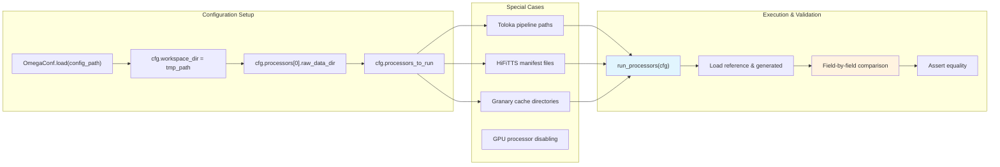

<!-- source: DeepWiki mcp.deepwiki.com · repo NVIDIA/NeMo-speech-data-processor · page 7.1 End-to-End Testing · fetched 2026-10-26 -->

# End-to-End Testing

<details>
<summary>Relevant source files</summary>

The following files were used as context for generating this wiki page:

- [.github/workflows/tests.yml](.github/workflows/tests.yml)
- [requirements/main.txt](requirements/main.txt)
- [tests/test_cfg_end_to_end_tests.py](tests/test_cfg_end_to_end_tests.py)

</details>


## Purpose and Scope

The end-to-end testing framework validates complete dataset processing pipelines by running actual processor configurations against mini datasets and comparing outputs with reference manifests. This system ensures that dataset configurations work correctly and produce consistent results across different environments.

For information about unit testing individual processors, see [Unit Testing and Validation](#7.2). For details about the processor architecture being tested, see [Core Architecture](#2).

## Testing Framework Overview

The end-to-end testing system validates dataset processing pipelines by executing complete configurations against curated test datasets. The framework automatically downloads test data from AWS S3, runs processor sequences, and compares generated manifests against reference outputs.



**Sources:** [tests/test_cfg_end_to_end_tests.py:35-44](), [tests/test_cfg_end_to_end_tests.py:380-396]()

## Test Case Structure

### TestCase Dataclass

The `TestCase` dataclass defines the structure for individual end-to-end tests, specifying configuration paths, data validation functions, and comparison parameters.

| Field | Type | Purpose |
|-------|------|---------|
| `config_path` | `str` | Path to YAML configuration file |
| `data_check_fn` | `Callable` | Function to validate test data availability |
| `reference_manifest_filename` | `str` | Expected output manifest file (default: "test_data_reference.json") |
| `fields_to_ignore` | `List[str]` | Manifest fields to ignore during comparison |
| `processors_to_run` | `str` | Processor range specification (e.g., "2:14") |

**Sources:** [tests/test_cfg_end_to_end_tests.py:35-44]()

### Dataset-Specific Data Check Functions

The framework includes specialized data validation functions for different dataset types:



**Sources:** [tests/test_cfg_end_to_end_tests.py:45-178]()

## Test Data Management

### Environment-Based Data Sources

The testing framework supports two modes for accessing test data:

| Mode | Environment Variables | Description |
|------|----------------------|-------------|
| Local | `TEST_DATA_ROOT` | Points to local directory with test data |
| AWS S3 | `AWS_SECRET_KEY`, `AWS_ACCESS_KEY` | Downloads from `sdp-test-data` bucket |

**Sources:** [tests/test_cfg_end_to_end_tests.py:341-347]()

### S3 Test Data Download

The `get_e2e_test_data_path` function implements automatic test data retrieval:

```python
# Key components from get_e2e_test_data_path function
s3_resource = boto3.resource("s3", 
    aws_access_key_id=os.getenv("AWS_ACCESS_KEY"),
    aws_secret_access_key=os.getenv("AWS_SECRET_KEY"))
bucket = s3_resource.Bucket("sdp-test-data")
```

**Sources:** [tests/test_cfg_end_to_end_tests.py:349-378]()

### Test Dataset Configurations

The framework validates configurations for multiple language-dataset combinations:



**Sources:** [tests/test_cfg_end_to_end_tests.py:179-331]()

## CI/CD Integration

### GitHub Actions Workflow Structure

The testing framework integrates with GitHub Actions through multiple job types defined in the CI workflow:



**Sources:** [.github/workflows/tests.yml:14-33](), [.github/workflows/tests.yml:57-102]()

### Environment Variables and Secrets

The CI system uses specific environment variables for test execution:

| Variable | Purpose | Usage |
|----------|---------|-------|
| `AWS_SECRET_KEY` | S3 authentication | Download test data |
| `AWS_ACCESS_KEY` | S3 authentication | Download test data |
| `CLEAN_UP_TMP_PATH` | Cleanup control | Remove temporary files |
| `USE_THREADING_BACKEND` | Execution mode | Enable parallel processing |

**Sources:** [.github/workflows/tests.yml:84-89]()

## Test Execution Flow

### Test Discovery and Parameterization

The framework uses pytest parameterization to generate individual tests for each dataset configuration:

```python
@pytest.fixture(scope="module", params=get_test_cases(), ids=get_test_names())
def setup_data(request):
    # Extract test case parameters
    config_path, data_check_fn, reference_manifest_filename, fields_to_ignore, processors_to_run = (
        request.param.config_path,
        request.param.data_check_fn, 
        request.param.reference_manifest_filename,  
        request.param.fields_to_ignore,
        request.param.processors_to_run
    )
```

**Sources:** [tests/test_cfg_end_to_end_tests.py:380-390]()

### Configuration Modification and Execution

The `test_configs` function modifies configurations for test execution:



**Sources:** [tests/test_cfg_end_to_end_tests.py:413-477](), [tests/test_cfg_end_to_end_tests.py:483-495]()

### Manifest Comparison Logic

The framework implements sophisticated manifest comparison that accounts for non-deterministic fields:

```python
# Key comparison logic
fields_to_ignore += ['audio_filepath']
for reference_line, generated_line in zip(reference_lines, generated_lines):
    reference_data = json.loads(reference_line)
    generated_data = json.loads(generated_line)
    for field in fields_to_ignore:
        reference_data.pop(field, None)
        generated_data.pop(field, None)
    assert reference_data == generated_data
```

**Sources:** [tests/test_cfg_end_to_end_tests.py:481-495]()

---

