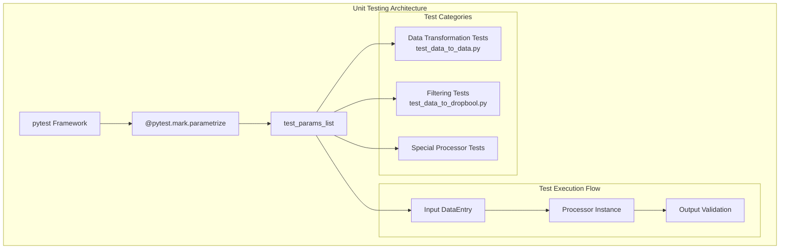
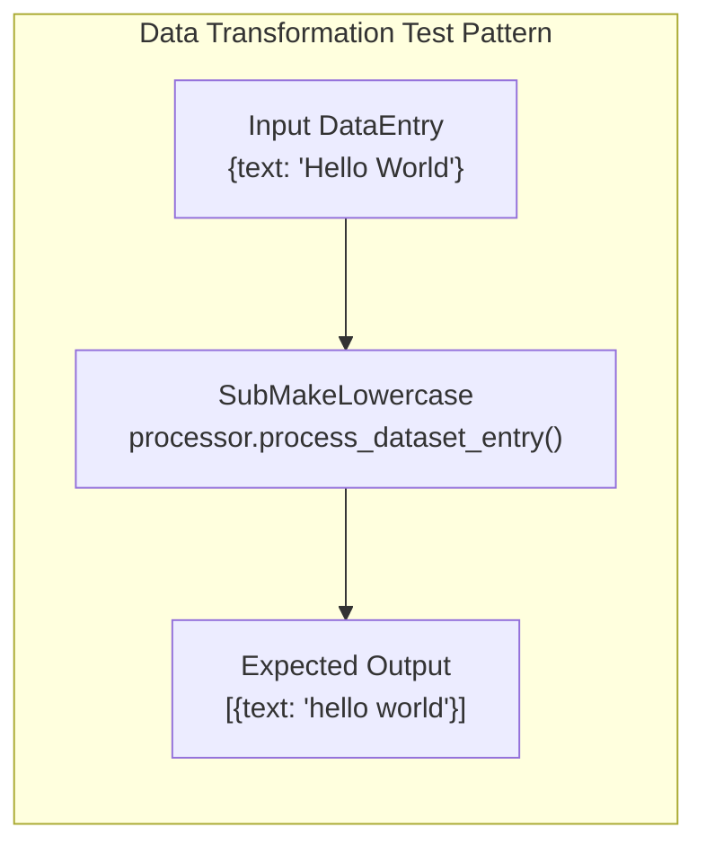
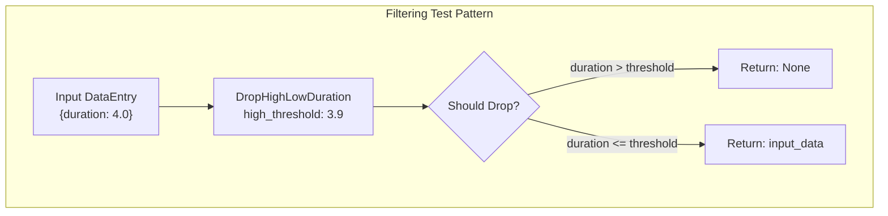
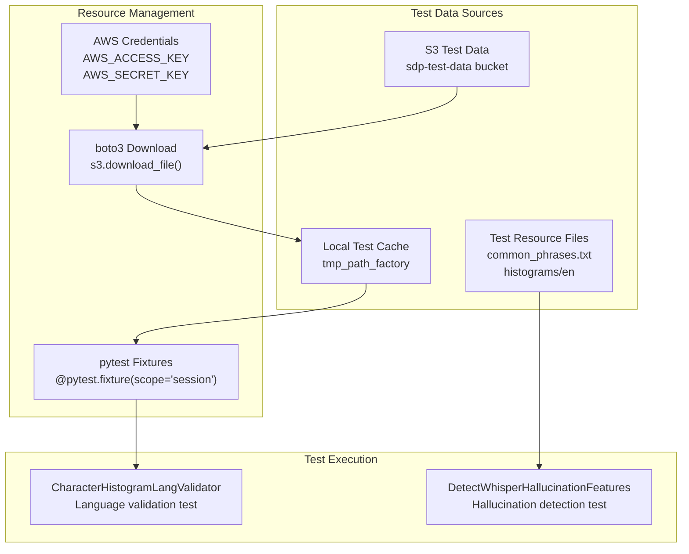
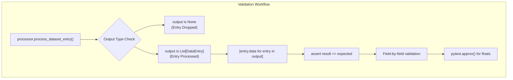

<!-- source: DeepWiki mcp.deepwiki.com · repo NVIDIA/NeMo-speech-data-processor · page 7.2 Unit Testing and Validation · fetched 2026-10-26 -->

# Unit Testing and Validation

<details>
<summary>Relevant source files</summary>

The following files were used as context for generating this wiki page:

- [.gitignore](.gitignore)
- [sdp/processors/datasets/voxpopuli/normalize_from_non_pc_text.py](sdp/processors/datasets/voxpopuli/normalize_from_non_pc_text.py)
- [sdp/utils/apply_operators.py](sdp/utils/apply_operators.py)
- [tests/test_data_to_data.py](tests/test_data_to_data.py)
- [tests/test_data_to_dropbool.py](tests/test_data_to_dropbool.py)

</details>


This document covers the unit testing framework and validation patterns used for individual processors in the NeMo Speech Data Processor (SDP). It focuses on testing individual processor components in isolation, validating their data transformation logic, and ensuring correct handling of edge cases. For comprehensive system-level testing using complete dataset configurations, see [End-to-End Testing](#7.1).

## Unit Testing Framework Overview

The SDP unit testing framework is built on pytest and follows a parametrized testing approach to validate processor behavior across multiple scenarios. The framework tests individual processors by providing controlled input data entries and validating the expected output transformations.



**Test Structure Pattern:**
```
(ProcessorClass, initialization_kwargs, input_data_entry, expected_output)
```

Sources: [tests/test_data_to_data.py:1-360](), [tests/test_data_to_dropbool.py:1-270]()

## Processor Test Categories

The unit testing framework organizes tests into distinct categories based on processor behavior and output patterns.

### Data Transformation Tests

Tests processors that modify input data entries and return transformed versions. These processors inherit from `BaseProcessor` or `BaseParallelProcessor` and implement data-to-data transformations.



**Key Processor Types Tested:**

| Processor Class | Test Focus | Example Test Case |
|-----------------|------------|-------------------|
| `SubRegex` | Pattern replacement | `{"pattern": r"\s<.*>\s", "repl": " "}` |
| `SubMakeLowercase` | Case conversion | `{"text": "Hello Привет 123"}` → `{"text": "hello привет 123"}` |
| `LambdaExpression` | Dynamic expressions | `{"expression": "entry.duration * 2"}` |
| `ListToEntries` | List expansion | Segments list → individual entries |
| `InsIfASRInsertion` | ASR-based insertion | Insert missing words based on pred_text |
| `CleanQwenGeneration` | LLM output cleaning | Clean generation artifacts |

Sources: [tests/test_data_to_data.py:35-257]()

### Filtering and Validation Tests

Tests processors that implement boolean filtering logic, where entries are either kept or dropped based on validation criteria.



**Filtering Processor Test Matrix:**

| Processor | Validation Logic | Test Parameters |
|-----------|------------------|-----------------|
| `DropHighLowDuration` | Duration thresholds | `high_duration_threshold`, `low_duration_threshold` |
| `DropHighCER` | Character Error Rate | `cer_threshold` with text/pred_text comparison |
| `DropHighWER` | Word Error Rate | `wer_threshold` with word-level comparison |
| `DropNonAlphabet` | Character validation | `alphabet` parameter for allowed characters |
| `DropIfRegexMatch` | Pattern matching | `regex_patterns` for text filtering |
| `DropASRErrorBeginningEnd` | ASR alignment errors | Character-level error thresholds |

Sources: [tests/test_data_to_dropbool.py:33-255]()

## Test Data Management and External Resources

The unit testing framework integrates with external test data sources and handles resource management for processors requiring additional files or models.



**External Resource Test Examples:**

1. **Character Histogram Validation**: Tests language detection using character frequency histograms downloaded from S3
2. **Whisper Hallucination Detection**: Tests hallucination pattern detection using local phrase files

Sources: [tests/test_data_to_data.py:289-352]()

## Validation Patterns and Test Assertions

The unit testing framework employs specific validation patterns to ensure processor correctness across different data transformation scenarios.

### Standard Validation Pattern

```python
def test_data_to_data(test_class, class_kwargs, test_input, expected_output):
    processor = test_class(**class_kwargs, output_manifest_file=None)
    result = [entry.data for entry in processor.process_dataset_entry(test_input)]
    assert result == expected_output
```

### Filtering Validation Pattern

```python
def test_data_to_dropbool(test_class, class_kwargs, test_input, should_drop):
    processor = test_class(**class_kwargs, output_manifest_file=None)
    output = processor.process_dataset_entry(test_input)
    
    if should_drop:
        assert output is None or len(output) == 0
    else:
        assert output[0].data == test_input
```

### Specialized Validation Patterns

**Approximate Numeric Validation:**
- Used for floating-point comparisons in processors like `CharacterHistogramLangValidator`
- Employs `pytest.approx()` for numerical tolerance

**Complex Output Validation:**
- Multi-field validation for processors with complex transformations
- Field-by-field assertion for processors that add computed fields



Sources: [tests/test_data_to_data.py:354-359](), [tests/test_data_to_dropbool.py:258-269]()

## Advanced Processor Testing

### Expression Evaluation Testing

The `LambdaExpression` processor tests demonstrate validation of dynamic expression evaluation with safety constraints.

**Test Categories:**
- **Arithmetic Operations**: `entry.duration * 2`, `entry.a + entry.b`
- **Conditional Logic**: `'long' if entry.duration > 10 else 'short'`
- **Filtering Applications**: `entry.duration > 10` with `filter=True`
- **Built-in Functions**: `len(entry.text)`, `max(entry.a, entry.b * 2)`
- **Boolean Logic**: `entry.a > 0 and entry.b < 5`

### Inference Processor Testing

Tests for processors that integrate with external models or services include additional validation for:

- **Model Output Cleaning**: `CleanQwenGeneration` with CER thresholds and case validation
- **Hallucination Detection**: `DetectWhisperHallucinationFeatures` with pattern matching
- **Quality Metrics**: Character/Word Error Rate calculations

### Multi-Language Processing

Tests ensure processors handle international text correctly:

- **Unicode Support**: Cyrillic text in `SubMakeLowercase` tests
- **Language Detection**: Character histogram validation across languages
- **Special Characters**: Punctuation and symbol handling

Sources: [tests/test_data_to_data.py:121-257](), [sdp/utils/apply_operators.py:71-171]()

---

