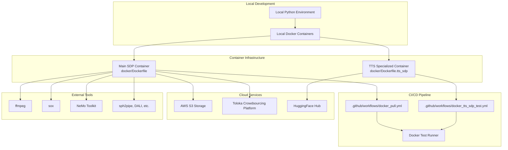
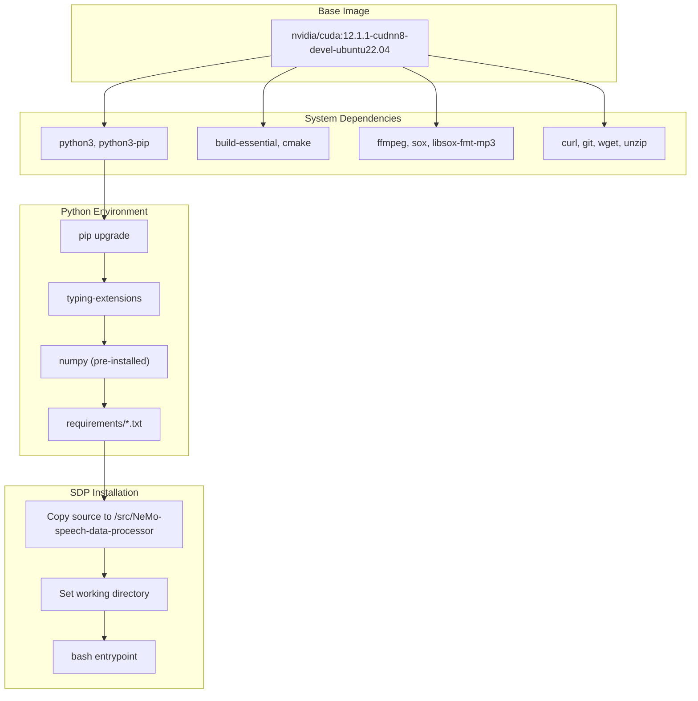
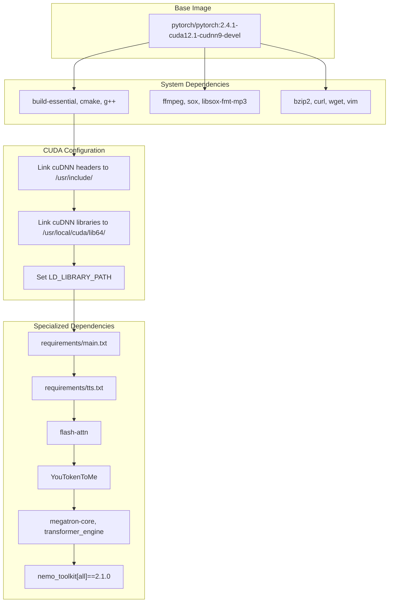
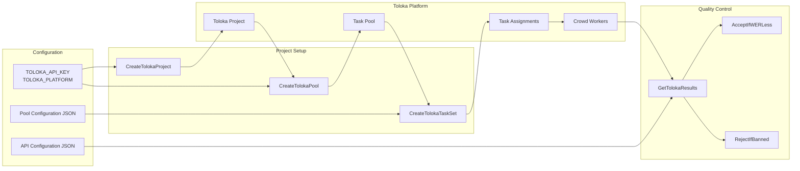
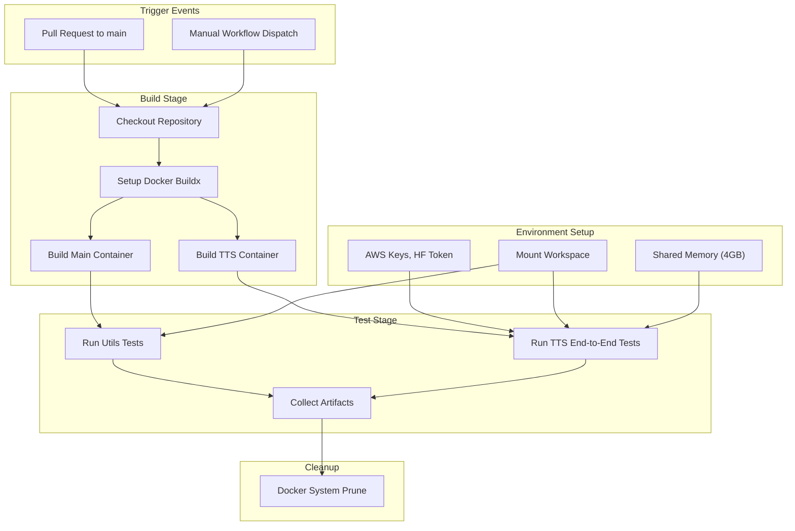

<!-- source: DeepWiki mcp.deepwiki.com · repo NVIDIA/NeMo-speech-data-processor · page 8 Deployment and Infrastructure · fetched 2026-10-26 -->

# Deployment and Infrastructure

<details>
<summary>Relevant source files</summary>

The following files were used as context for generating this wiki page:

- [.github/workflows/docker_pull.yml](.github/workflows/docker_pull.yml)
- [.github/workflows/docker_tts_sdp_test.yml](.github/workflows/docker_tts_sdp_test.yml)
- [dataset_configs/arabic/readme.md](dataset_configs/arabic/readme.md)
- [dataset_configs/tts/ytc/config.yaml](dataset_configs/tts/ytc/config.yaml)
- [docker/Dockerfile](docker/Dockerfile)
- [docker/Dockerfile.tts_sdp](docker/Dockerfile.tts_sdp)
- [sdp/processors/toloka/accept_if.py](sdp/processors/toloka/accept_if.py)
- [sdp/processors/toloka/create_pool.py](sdp/processors/toloka/create_pool.py)
- [sdp/processors/toloka/create_project.py](sdp/processors/toloka/create_project.py)
- [sdp/processors/toloka/create_task_set.py](sdp/processors/toloka/create_task_set.py)
- [sdp/processors/toloka/download_responses.py](sdp/processors/toloka/download_responses.py)
- [sdp/processors/toloka/reject_if.py](sdp/processors/toloka/reject_if.py)

</details>


This document covers the deployment options, containerization, cloud service integrations, and infrastructure requirements for the NeMo Speech Data Processor (SDP) system. It focuses on production deployment patterns, Docker containerization strategies, and integration with external cloud services for large-scale speech data processing workflows.

For information about testing infrastructure and quality assurance, see [Testing and Quality Assurance](#7). For configuration management and pipeline orchestration, see [Configuration System](#3).

## Overview

The SDP system supports multiple deployment patterns ranging from local development environments to large-scale cloud deployments. The infrastructure is designed around containerized deployments with support for both general speech processing and specialized Text-to-Speech (TTS) workflows.

**Deployment Infrastructure Architecture**



Sources: [docker/Dockerfile:1-41](), [docker/Dockerfile.tts_sdp:1-46](), [.github/workflows/docker_pull.yml:1-44](), [.github/workflows/docker_tts_sdp_test.yml:1-54]()

## Docker and Containerization

The SDP system provides two primary Docker containers optimized for different use cases. Both containers are based on NVIDIA CUDA images to support GPU-accelerated processing.

### Main SDP Container

The main container ([docker/Dockerfile:1-41]()) provides a general-purpose environment for speech data processing with comprehensive tool support.

**Main Container Architecture**



Key container features:
- **Base Image**: NVIDIA CUDA 12.1.1 with cuDNN 8 support
- **Audio Processing**: ffmpeg, sox with MP3 format support
- **Build Tools**: Complete C++ build environment for compiled dependencies
- **Python Environment**: Python 3 with pip and essential packages
- **Working Directory**: `/src/NeMo-speech-data-processor`

Sources: [docker/Dockerfile:1-41]()

### TTS Specialized Container

The TTS container ([docker/Dockerfile.tts_sdp:1-46]()) extends PyTorch's official image with specialized dependencies for Text-to-Speech workflows.

**TTS Container Architecture**



Key TTS container features:
- **Base Image**: PyTorch 2.4.1 with CUDA 12.1 and cuDNN 9
- **Enhanced CUDA Support**: Manual cuDNN library linking for runtime compatibility
- **TTS Dependencies**: Flash attention, Megatron-Core, Transformer Engine
- **NeMo Integration**: Full NeMo toolkit with all optional dependencies
- **Specialized Tools**: YouTokenToMe for tokenization

Sources: [docker/Dockerfile.tts_sdp:1-46]()

### Container Build and Testing

Both containers are automatically built and tested through GitHub Actions workflows:

| Container | Workflow | Test Command |
|-----------|----------|--------------|
| Main SDP | `docker_pull.yml` | `python -m pytest tests/test_utils.py -v` |
| TTS SDP | `docker_tts_sdp_test.yml` | `python -m pytest tests/test_tts_sdp_end_to_end.py -v` |

The workflows include:
- **Automated Building**: Docker Buildx for cross-platform builds
- **Test Execution**: Pytest-based validation in containerized environment
- **Artifact Collection**: Test results and coverage reports
- **Resource Management**: Automatic Docker cleanup

Sources: [.github/workflows/docker_pull.yml:1-44](), [.github/workflows/docker_tts_sdp_test.yml:1-54]()

## Cloud Services Integration

The SDP system integrates with several cloud services for scalable data processing and crowdsourcing workflows.

### Toloka Crowdsourcing Platform

The Toloka integration provides a complete workflow for crowdsourced speech data collection and quality control through specialized processors in the `sdp.processors.toloka` module.

**Toloka Integration Workflow**



#### Toloka Processor Classes

| Processor | Purpose | Key Methods |
|-----------|---------|-------------|
| `CreateTolokaProject` | Initialize crowdsourcing project | `process()` |
| `CreateTolokaPool` | Create task pool with filters | `process_dataset_entry()`, `setup_quality_control()` |
| `CreateTolokaTaskSet` | Upload tasks to pool | `read_manifest()`, `process()` |
| `GetTolokaResults` | Download completed assignments | `read_manifest()`, `process_dataset_entry()` |
| `AcceptIfWERLess` | Accept tasks based on WER threshold | `process()` |
| `RejectIfBanned` | Reject tasks from banned workers | `process()` |

Sources: [sdp/processors/toloka/create_project.py:31-132](), [sdp/processors/toloka/create_pool.py:32-156](), [sdp/processors/toloka/create_task_set.py:34-167](), [sdp/processors/toloka/download_responses.py:31-250](), [sdp/processors/toloka/accept_if.py:35-160](), [sdp/processors/toloka/reject_if.py:34-164]()

#### Environment Configuration

Toloka processors require environment variables for authentication:

```bash
export TOLOKA_API_KEY="your_api_key"
export TOLOKA_PLATFORM="PRODUCTION"  # or "SANDBOX"
```

Configuration files specify pool settings and API parameters in JSON format. All Toloka processors include graceful degradation when the `toloka` package is not available, logging warnings about limited functionality.

Sources: [sdp/processors/toloka/create_project.py:55-73](), [sdp/processors/toloka/create_pool.py:59-70]()

### AWS S3 Integration

S3 integration is primarily used for test data storage and CI/CD workflows, with the `sdp-test-data` bucket containing reference datasets for end-to-end testing.

### HuggingFace Hub Integration

HuggingFace integration supports model downloads and pyannote access for TTS workflows, requiring HF tokens for authenticated access to private models.

Sources: [.github/workflows/docker_tts_sdp_test.yml:28-31](), [dataset_configs/tts/ytc/config.yaml:40]()

## CI/CD and Testing Infrastructure

The system uses GitHub Actions for continuous integration with Docker-based testing environments.

**CI/CD Pipeline Architecture**



### Test Environment Configuration

The CI pipeline configures specialized test environments:

- **Resource Allocation**: 4GB shared memory for TTS tests ([.github/workflows/docker_tts_sdp_test.yml:36]())
- **Secrets Management**: AWS credentials and HuggingFace tokens
- **Volume Mounting**: Workspace directory mounted for test data access
- **Cleanup Variables**: `CLEAN_UP_TMP_PATH=1` for temporary file management

### Test Execution Patterns

| Workflow | Container | Test Suite | Environment |
|----------|-----------|------------|-------------|
| `docker_pull.yml` | Main SDP | `test_utils.py` | Standard Ubuntu |
| `docker_tts_sdp_test.yml` | TTS SDP | `test_tts_sdp_end_to_end.py` | Enhanced with secrets |

Both workflows include artifact collection for test results and coverage reports, with automatic Docker cleanup to prevent resource exhaustion.

Sources: [.github/workflows/docker_pull.yml:1-44](), [.github/workflows/docker_tts_sdp_test.yml:1-54]()

## Environment Configuration and Secrets Management

The SDP system uses environment variables for external service authentication and configuration management.

### Required Environment Variables

| Service | Variables | Purpose |
|---------|-----------|---------|
| Toloka | `TOLOKA_API_KEY`, `TOLOKA_PLATFORM` | Crowdsourcing API access |
| AWS | `AWS_ACCESS_KEY`, `AWS_SECRET_KEY` | S3 storage access |
| HuggingFace | `HF_SECRET_KEY` | Model and dataset access |
| System | `CLEAN_UP_TMP_PATH` | Temporary file management |

### Security Considerations

- **API Keys**: Stored as GitHub repository secrets for CI/CD
- **Environment Isolation**: Separate sandbox/production environments for Toloka
- **Graceful Degradation**: Processors continue with limited functionality when credentials are unavailable
- **Error Handling**: Clear error messages for missing required environment variables

All cloud service integrations include comprehensive error handling and logging for authentication failures and service availability issues.

Sources: [sdp/processors/toloka/create_project.py:55-61](), [.github/workflows/docker_tts_sdp_test.yml:27-31]()

---

