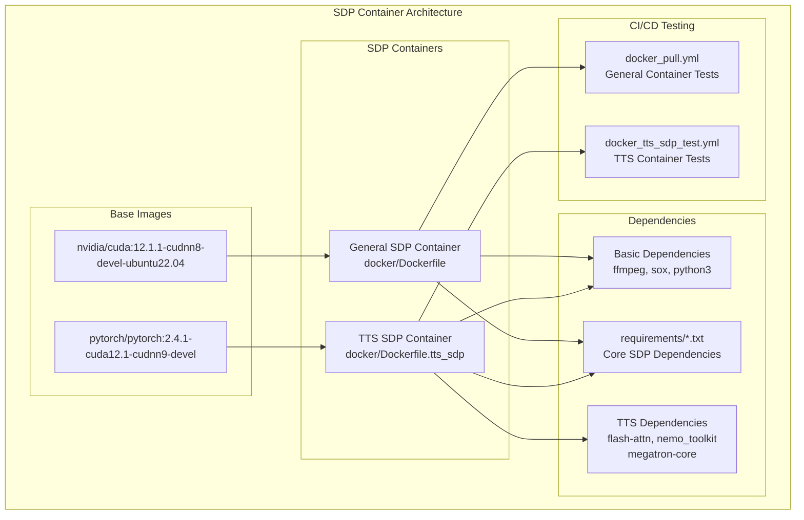
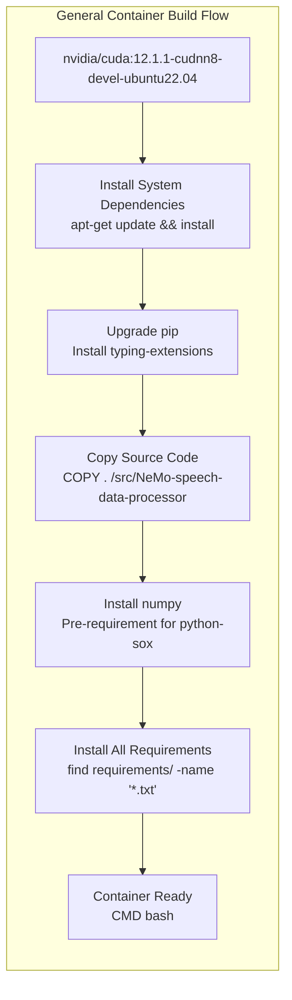
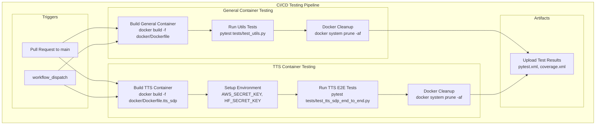

<!-- source: DeepWiki mcp.deepwiki.com · repo NVIDIA/NeMo-speech-data-processor · page 8.1 Docker and Containerization · fetched 2026-10-26 -->

# Docker and Containerization

<details>
<summary>Relevant source files</summary>

The following files were used as context for generating this wiki page:

- [.github/workflows/docker_pull.yml](.github/workflows/docker_pull.yml)
- [.github/workflows/docker_tts_sdp_test.yml](.github/workflows/docker_tts_sdp_test.yml)
- [dataset_configs/arabic/readme.md](dataset_configs/arabic/readme.md)
- [dataset_configs/tts/ytc/config.yaml](dataset_configs/tts/ytc/config.yaml)
- [docker/Dockerfile](docker/Dockerfile)
- [docker/Dockerfile.tts_sdp](docker/Dockerfile.tts_sdp)

</details>


This document covers the Docker containerization strategy for the NeMo Speech Data Processor (SDP), including container configurations, build processes, and CI/CD integration. The SDP system provides two specialized Docker containers: a general-purpose container for standard speech processing and a TTS-specific container for text-to-speech workloads.

For information about cloud services integration and distributed processing, see [Cloud Services Integration](#8.2). For details about the testing framework that validates these containers, see [Testing and Quality Assurance](#7).

## Container Architecture Overview

The SDP system uses a dual-container strategy to optimize for different processing workloads while maintaining reproducible environments across development and production.



Sources: [docker/Dockerfile:1-41](), [docker/Dockerfile.tts_sdp:1-46](), [.github/workflows/docker_pull.yml:1-44](), [.github/workflows/docker_tts_sdp_test.yml:1-54]()

## General SDP Container

The general SDP container provides a standardized environment for most speech processing tasks, including dataset preparation, ASR inference, and manifest manipulation.

### Container Specifications

| Component | Configuration |
|-----------|---------------|
| Base Image | `nvidia/cuda:12.1.1-cudnn8-devel-ubuntu22.04` |
| Python Version | Python 3 (via `python-is-python3`) |
| Audio Tools | `ffmpeg`, `sox`, `libsox-fmt-mp3` |
| Build Tools | `build-essential`, `curl`, `git`, `wget` |
| Working Directory | `/src/NeMo-speech-data-processor` |

### Build Process



Sources: [docker/Dockerfile:1-20](), [docker/Dockerfile:32-40]()

The container installation process handles several important considerations:

- **Dependency Order**: `numpy` is installed before other requirements because `python-sox` requires it during installation [docker/Dockerfile:33-34]()
- **Source Management**: The `.git` directory is removed to reduce container size [docker/Dockerfile:29]()
- **Requirements Discovery**: All requirement files are dynamically discovered and installed [docker/Dockerfile:35]()

## TTS-Specific Container

The TTS container extends the basic SDP functionality with specialized dependencies for text-to-speech processing, including advanced transformer models and audio quality metrics.

### Enhanced Specifications

| Component | Configuration |
|-----------|---------------|
| Base Image | `pytorch/pytorch:2.4.1-cuda12.1-cudnn9-devel` |
| Specialized Libraries | `flash-attn`, `YouTokenToMe`, `megatron-core` |
| NeMo Version | `nemo_toolkit[all]==2.1.0` |
| CUDA Libraries | Custom cuDNN linking for runtime |

### TTS Container Build Process

```mermaid
graph TB
    subgraph "TTS Container Build Flow"
        PYTORCH_BASE["pytorch/pytorch:2.4.1-cuda12.1-cudnn9-devel"]
        SYSTEM_DEPS["Install System Dependencies<br/>cmake, g++, vim, bzip2"]
        CUDA_SETUP["Setup CUDA Environment<br/>Link cuDNN libraries"]
        SDP_COPY["Copy SDP Source<br/>Remove .git directory"]
        MAIN_REQS["Install main.txt<br/>Core SDP requirements"]
        TTS_REQS["Install tts.txt<br/>TTS-specific requirements"]
        FLASH_ATTN["Install flash-attn<br/>--no-build-isolation"]
        YOUTOKENTOME["Install YouTokenToMe<br/>from GitHub master"]
        MEGATRON["Install megatron-core<br/>transformer_engine==2.4.0"]
        NEMO["Install nemo_toolkit[all]==2.1.0<br/>Complete NeMo suite"]
    end
    
    PYTORCH_BASE --> SYSTEM_DEPS
    SYSTEM_DEPS --> CUDA_SETUP
    CUDA_SETUP --> SDP_COPY
    SDP_COPY --> MAIN_REQS
    MAIN_REQS --> TTS_REQS
    TTS_REQS --> FLASH_ATTN
    FLASH_ATTN --> YOUTOKENTOME
    YOUTOKENTOME --> MEGATRON
    MEGATRON --> NEMO
```



Sources: [docker/Dockerfile.tts_sdp:1-46]()

### CUDA Library Configuration

The TTS container includes specialized CUDA setup for optimal performance:

```bash
# Link cuDNN headers and libraries for runtime access
ln -s /opt/conda/lib/python3.11/site-packages/nvidia/cudnn/include/cudnn*.h /usr/include/
ln -s /opt/conda/lib/python3.11/site-packages/nvidia/cudnn/lib/libcudnn*.so* /usr/local/cuda/lib64/
```

Sources: [docker/Dockerfile.tts_sdp:26-28]()

## CI/CD Integration and Testing

Both containers are automatically tested through GitHub Actions workflows that validate functionality and ensure reproducible builds.

### Testing Pipeline Architecture



Sources: [.github/workflows/docker_pull.yml:3-6](), [.github/workflows/docker_tts_sdp_test.yml:3-6]()

### Testing Configuration Details

**General Container Testing**:
- Builds using commit SHA as tag [.github/workflows/docker_pull.yml:24]()
- Runs basic utility tests to validate core functionality [.github/workflows/docker_pull.yml:32]()
- Uses workspace volume mounting for test access [.github/workflows/docker_pull.yml:29]()

**TTS Container Testing**:
- Requires environment variables for external service access [.github/workflows/docker_tts_sdp_test.yml:28-31]()
- Uses shared memory configuration (`--shm-size=4g`) for memory-intensive operations [.github/workflows/docker_tts_sdp_test.yml:36]()
- Runs comprehensive end-to-end TTS processing tests [.github/workflows/docker_tts_sdp_test.yml:42]()

## Usage Patterns and Deployment

### Container Selection Guidelines

| Use Case | Recommended Container | Key Dependencies |
|----------|----------------------|------------------|
| Standard Dataset Processing | General SDP | `ffmpeg`, `sox`, core requirements |
| ASR Inference and Filtering | General SDP | Basic NeMo models, manifest processing |
| TTS Dataset Preparation | TTS SDP | `flash-attn`, `nemo_toolkit[all]` |
| Advanced NLP Processing | TTS SDP | `megatron-core`, transformer models |
| Quality Estimation | TTS SDP | TorchSQUIM, advanced metrics |

### Common Deployment Commands

**General Container**:
```bash
docker build -t sdp:latest -f docker/Dockerfile .
docker run --rm -v /data:/data sdp:latest python sdp/run_processors.py <config>
```

**TTS Container**:
```bash
docker build -t sdp-tts:latest -f docker/Dockerfile.tts_sdp .
docker run --rm --gpus all --shm-size=4g -v /data:/data sdp-tts:latest python sdp/run_processors.py <tts_config>
```

The containerization strategy ensures reproducible environments across different deployment contexts while optimizing for specific processing workloads through targeted dependency management.

Sources: [docker/Dockerfile:40](), [docker/Dockerfile.tts_sdp:46](), [dataset_configs/tts/ytc/config.yaml:1-103]()

---

