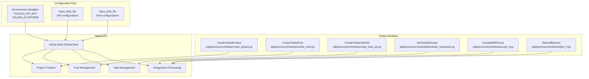
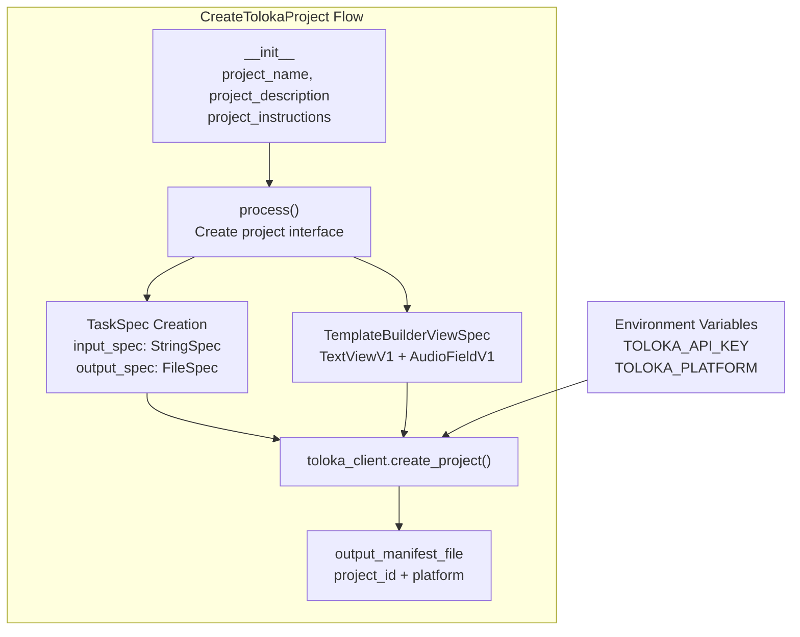
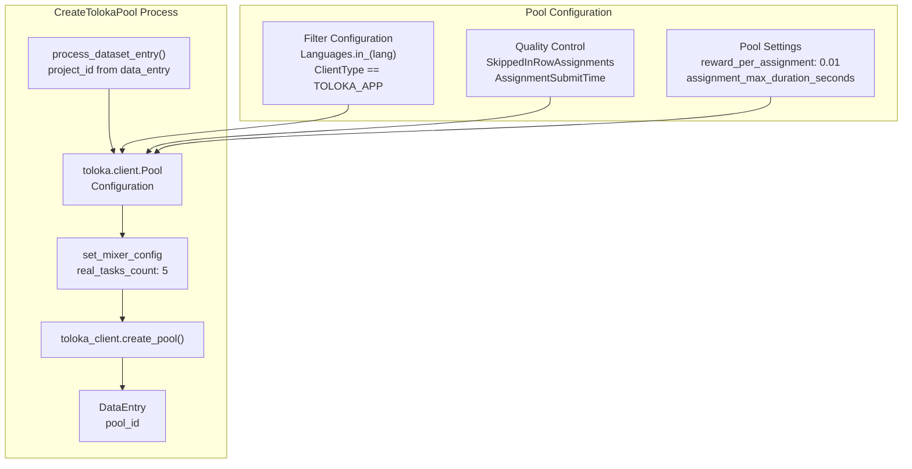
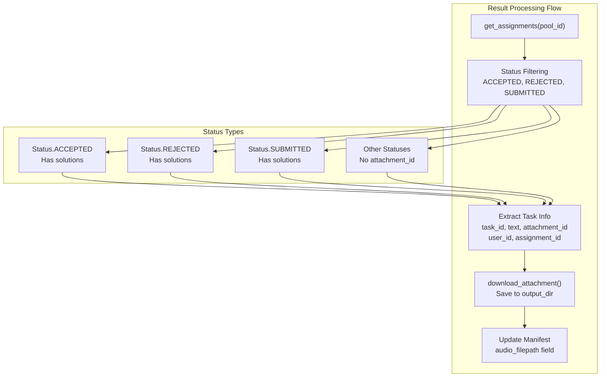
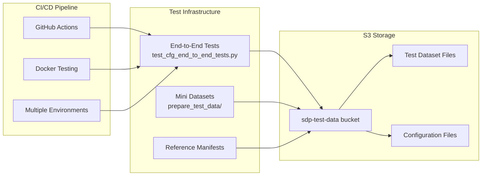

<!-- source: DeepWiki mcp.deepwiki.com · repo NVIDIA/NeMo-speech-data-processor · page 8.2 Cloud Services Integration · fetched 2026-10-26 -->

# Cloud Services Integration

<details>
<summary>Relevant source files</summary>

The following files were used as context for generating this wiki page:

- [sdp/processors/toloka/accept_if.py](sdp/processors/toloka/accept_if.py)
- [sdp/processors/toloka/create_pool.py](sdp/processors/toloka/create_pool.py)
- [sdp/processors/toloka/create_project.py](sdp/processors/toloka/create_project.py)
- [sdp/processors/toloka/create_task_set.py](sdp/processors/toloka/create_task_set.py)
- [sdp/processors/toloka/download_responses.py](sdp/processors/toloka/download_responses.py)
- [sdp/processors/toloka/reject_if.py](sdp/processors/toloka/reject_if.py)

</details>


This document covers the integration of external cloud services within the NeMo Speech Data Processor (SDP) system. The primary focus is on crowdsourcing platforms for data collection and validation, along with cloud storage for distributed processing and testing infrastructure.

For information about Docker containerization and deployment, see [Docker and Containerization](#8.1). For testing infrastructure that uses cloud resources, see [Testing and Quality Assurance](#7).

## Overview of Cloud Service Support

The SDP system integrates with several categories of cloud services to support large-scale speech data processing:

| Service Category | Implementation | Primary Use Case |
|------------------|----------------|------------------|
| Crowdsourcing | Toloka API | Data collection, quality validation |
| Cloud Storage | S3 Compatible | Test data, distributed processing |
| Authentication | Environment Variables | Secure API access |

## Toloka Crowdsourcing Platform Integration

### Architecture Overview

The Toloka integration provides a complete workflow for crowdsourced speech data collection and validation through specialized processors.



Sources: [sdp/processors/toloka/create_project.py:1-132](), [sdp/processors/toloka/create_pool.py:1-156](), [sdp/processors/toloka/create_task_set.py:1-167](), [sdp/processors/toloka/download_responses.py:1-250]()

### Project and Pool Management

#### CreateTolokaProject Processor

The `CreateTolokaProject` class establishes new crowdsourcing projects on the Toloka platform with audio recording capabilities.



Sources: [sdp/processors/toloka/create_project.py:31-132]()

Key configuration parameters:
- `project_name`: Public project name visible to workers
- `project_description`: Project description for workers  
- `project_instructions`: Detailed task instructions
- Output: Manifest with `project_id` for subsequent processors

#### CreateTolokaPool Processor

The `CreateTolokaPool` class creates task pools within existing projects with quality control mechanisms.



Sources: [sdp/processors/toloka/create_pool.py:32-156]()

### Task Management and Data Collection

#### CreateTolokaTaskSet Processor

The `CreateTolokaTaskSet` class populates pools with tasks based on manifest data.

Key functionality:
- Reads manifest entries up to specified `limit` percentage [sdp/processors/toloka/create_task_set.py:111-129]()
- Creates `toloka.client.Task` objects with text input values [sdp/processors/toloka/create_task_set.py:151-154]()
- Uploads tasks using `toloka_client.create_tasks()` [sdp/processors/toloka/create_task_set.py:157-161]()

#### GetTolokaResults Processor

The `GetTolokaResults` class retrieves completed assignments and downloads audio attachments.



Sources: [sdp/processors/toloka/download_responses.py:148-249]()

### Quality Control and Assignment Management

#### AcceptIfWERLess Processor

The `AcceptIfWERLess` class implements automated quality control based on Word Error Rate thresholds.

Processing logic:
- Evaluates WER against configurable threshold [sdp/processors/toloka/accept_if.py:148-150]()
- Accepts assignments with >= 3 tasks below threshold [sdp/processors/toloka/accept_if.py:154-156]()
- Uses `toloka_client.accept_assignment()` with public comments

#### RejectIfBanned Processor

The `RejectIfBanned` class automatically rejects assignments from banned users.

Key features:
- Retrieves banned user list via `get_user_restrictions(scope='ALL_PROJECTS')` [sdp/processors/toloka/reject_if.py:148-150]()
- Filters submitted assignments from banned users [sdp/processors/toloka/reject_if.py:155-158]()
- Bulk rejection with standardized comments [sdp/processors/toloka/reject_if.py:161-162]()

Sources: [sdp/processors/toloka/accept_if.py:35-160](), [sdp/processors/toloka/reject_if.py:34-164]()

## Authentication and Configuration Management

### Environment Variable Configuration

All Toloka processors require standardized environment variables for secure API access:

| Variable | Purpose | Required |
|----------|---------|----------|
| `TOLOKA_API_KEY` | API authentication token | Yes |
| `TOLOKA_PLATFORM` | Target environment (PRODUCTION/SANDBOX) | Yes |

Configuration loading pattern across processors:
```python
self.API_KEY = os.getenv('TOLOKA_API_KEY')
self.platform = os.getenv('TOLOKA_PLATFORM')
```

### File-Based Configuration

Input configuration files provide additional parameters:

- **input_data_file**: Contains API configurations and backup credentials
- **input_pool_file**: Pool-specific settings including `pool_id`
- **config_file**: Optional centralized configuration (JSON format)

Sources: [sdp/processors/toloka/create_task_set.py:65-74](), [sdp/processors/toloka/download_responses.py:90-95]()

## Cloud Storage Integration

### S3 Test Data Infrastructure

The testing framework utilizes S3-compatible storage for distributed test data access:



Sources: Referenced from system overview diagrams and testing infrastructure

## Error Handling and Availability

### Toloka Availability Checking

All Toloka processors implement graceful degradation when the Toloka client is unavailable:

```python
try:
    import toloka.client
    TOLOKA_AVAILABLE = True
except ImportError:
    TOLOKA_AVAILABLE = False
    toloka = None
```

Processors log warnings and continue with limited functionality when `TOLOKA_AVAILABLE != True`.

### Exception Handling Patterns

Common error handling across cloud service processors:
- File not found exceptions for configuration files
- JSON decode errors for malformed configuration
- API connection failures with descriptive error messages
- Environment variable validation with clear error messages

Sources: [sdp/processors/toloka/create_task_set.py:23-30](), [sdp/processors/toloka/download_responses.py:21-27](), [sdp/processors/toloka/create_pool.py:22-29]()

---

