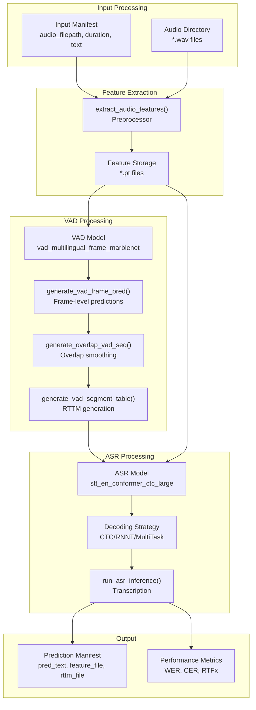
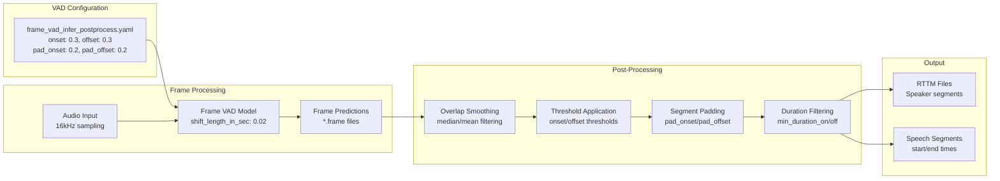
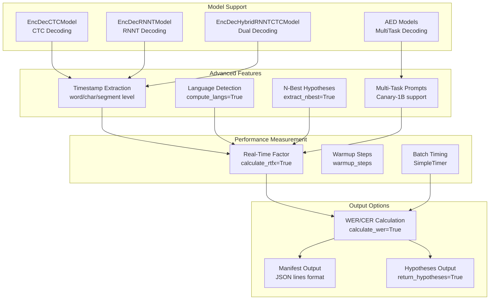
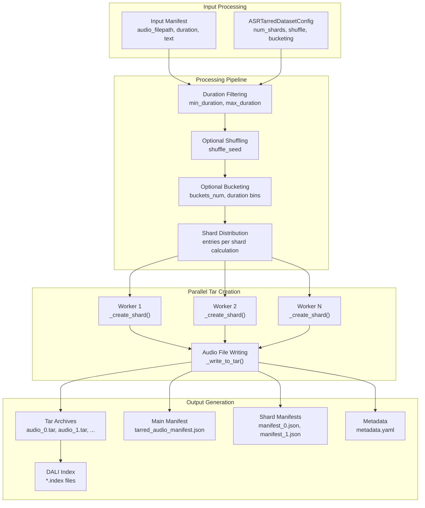
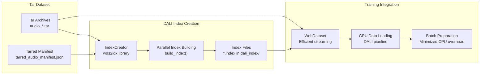
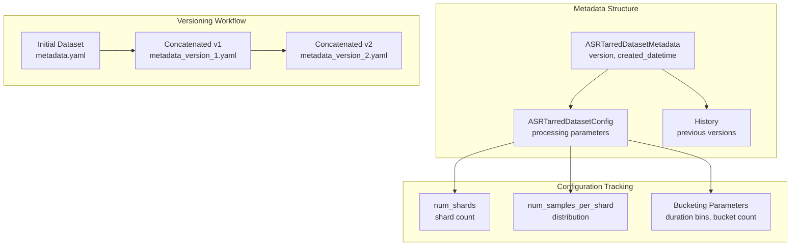
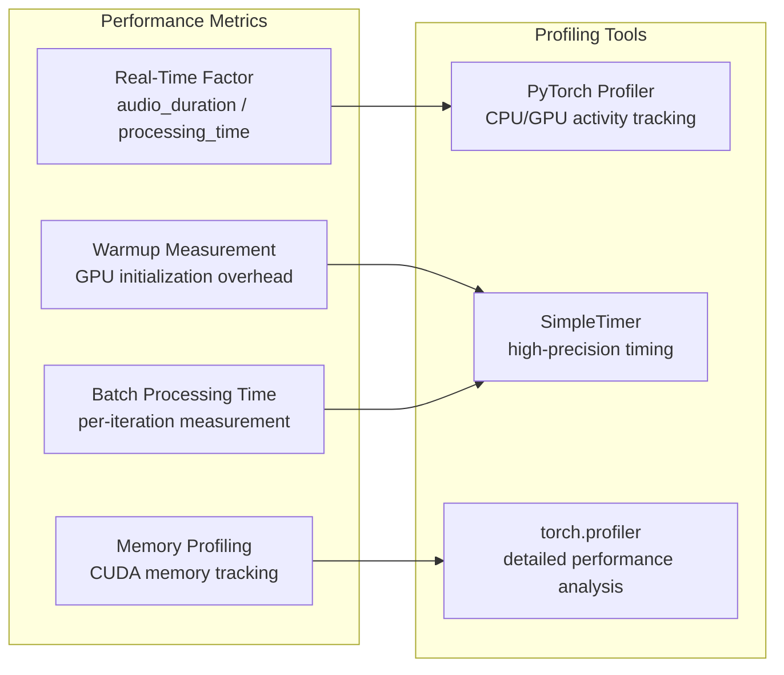

<!-- source: DeepWiki mcp.deepwiki.com · repo NVIDIA/NeMo-speech-data-processor · page 9 Advanced Features · fetched 2026-10-26 -->

# Advanced Features

Relevant source files

The following files were used as context for generating this wiki page:

- [sdp/processors/inference/asr/nemo/utils/frame_vad_infer_postprocess.yaml](sdp/processors/inference/asr/nemo/utils/frame_vad_infer_postprocess.yaml)
- [sdp/processors/inference/asr/nemo/utils/speech_to_text_with_vad.py](sdp/processors/inference/asr/nemo/utils/speech_to_text_with_vad.py)
- [sdp/processors/inference/asr/nemo/utils/transcribe_speech.py](sdp/processors/inference/asr/nemo/utils/transcribe_speech.py)
- [sdp/processors/manage_files/convert_to_tarred_audio_dataset.py](sdp/processors/manage_files/convert_to_tarred_audio_dataset.py)
- [sdp/processors/manage_files/utils/convert_to_tarred_audio_dataset.py](sdp/processors/manage_files/utils/convert_to_tarred_audio_dataset.py)
- [sdp/processors/manage_files/utils/create_dali_tarred_dataset_index.py](sdp/processors/manage_files/utils/create_dali_tarred_dataset_index.py)

## Purpose and Scope

This page covers advanced features of the NeMo Speech Data Processor (SDP) that extend beyond basic dataset processing workflows. These features include sophisticated audio-text processing pipelines, optimized dataset packaging for large-scale training, and integration with external high-performance tools.

For basic processor usage and pipeline configuration, see [Core Architecture](#2). For standard dataset processing workflows, see [Data Processing and Transformation](#5).

## Advanced ASR and VAD Integration

The SDP system provides sophisticated inference pipelines that combine Automatic Speech Recognition (ASR) with Voice Activity Detection (VAD) for robust audio processing workflows.

### Combined ASR+VAD Pipeline Architecture

**VAD+ASR Pipeline Integration**

Sources: [sdp/processors/inference/asr/nemo/utils/speech_to_text_with_vad.py:1-648]()

The system supports three operational modes through the `speech_to_text_with_vad.py` script:

| Mode | VAD Model | ASR Model | Use Case |
|------|-----------|-----------|----------|
| ASR Only | `None` | Specified | Pure transcription without VAD filtering |
| VAD Only | Specified | `None` | Speech activity detection and segmentation |
| Combined | Specified | Specified | VAD-filtered transcription with RTTM masking |

### Frame-Level VAD Processing

The system implements sophisticated frame-level VAD with configurable post-processing parameters:

**VAD Post-Processing Parameters**

Sources: [sdp/processors/inference/asr/nemo/utils/frame_vad_infer_postprocess.yaml:22-29]()

### Advanced Transcription Features

The `transcribe_speech.py` script provides comprehensive transcription capabilities with extensive configuration options:

**Advanced Transcription Configuration**

Sources: [sdp/processors/inference/asr/nemo/utils/transcribe_speech.py:118-215]()

Key advanced features include:

- **Multi-Model Support**: CTC, RNNT, Hybrid RNNT/CTC, and AED models through the `TranscriptionConfig` dataclass
- **Timestamp Extraction**: Configurable timestamp types (`all`, `char`, `word`, `segment`) via `ctc_timestamp_type` and `rnnt_timestamp_type`
- **Language Detection**: Multi-lingual model support with `compute_langs` parameter
- **Performance Profiling**: Real-time factor (RTFx) calculation with warmup and timing measurements

## Tarred Audio Dataset Conversion

The SDP system provides sophisticated dataset packaging capabilities for large-scale training through the tarred audio dataset conversion pipeline.

### Tarred Dataset Architecture

**Tarred Dataset Creation Pipeline**

Sources: [sdp/processors/manage_files/utils/convert_to_tarred_audio_dataset.py:159-890](), [sdp/processors/manage_files/convert_to_tarred_audio_dataset.py:73-162]()

### Advanced Dataset Features

The `ASRTarredDatasetBuilder` class provides sophisticated dataset management capabilities:

| Feature | Description | Configuration |
|---------|-------------|---------------|
| **Duration Bucketing** | Split datasets by duration ranges | `buckets_num`, `bucket_duration_bins` |
| **Dynamic Bucketing** | Automatic bucket estimation | `dynamic_buckets_num=30` |
| **Audio Transcoding** | On-the-fly codec conversion | `force_codec='flac'` |
| **Offset Slicing** | Extract audio segments | `slice_with_offset=True` |
| **File Grouping** | Keep file segments together | `keep_files_together=True` |
| **Parallel Processing** | Multi-worker tar creation | `workers=-1` |

### DALI Integration

The system provides GPU-accelerated data loading through NVIDIA DALI integration:

**DALI Index Generation**

Sources: [sdp/processors/manage_files/utils/create_dali_tarred_dataset_index.py:68-91]()

The DALI integration requires the `wds2idx` library and creates index files that enable:

- **Random Access**: Direct access to samples within tar archives
- **GPU Acceleration**: Elimination of CPU bottlenecks during data loading
- **Memory Efficiency**: Streaming data access without full dataset loading

### Metadata and Versioning

The system maintains comprehensive metadata through the `ASRTarredDatasetMetadata` class:

**Dataset Metadata Management**

Sources: [sdp/processors/manage_files/utils/convert_to_tarred_audio_dataset.py:132-157](), [sdp/processors/manage_files/utils/convert_to_tarred_audio_dataset.py:377-570]()

## Performance Optimization Features

### Audio Processing Optimization

The tarred dataset system includes several performance optimizations:

- **Codec Selection**: Automatic format detection with optional transcoding via `force_codec`
- **Parallel Tar Creation**: Multi-worker processing using joblib's `Parallel` backend
- **Memory Management**: Streaming audio processing to minimize memory footprint
- **Shard Sorting**: Duration-based sorting within shards to reduce training padding

### Inference Performance Measurement

The ASR/VAD pipeline provides comprehensive performance profiling:

**Performance Profiling Integration**

Sources: [sdp/processors/inference/asr/nemo/utils/speech_to_text_with_vad.py:149-188](), [sdp/processors/inference/asr/nemo/utils/transcribe_speech.py:386-501]()

The performance measurement features enable:

- **RTFx Calculation**: Real-time factor measurement for production deployment planning
- **Memory Profiling**: CUDA memory usage tracking for optimization
- **Detailed Timing**: Per-component timing analysis for bottleneck identification