# Page: Overview

# Overview

<details>
<summary>Relevant source files</summary>

The following files were used as context for generating this wiki page:

- [README.md](README.md)
- [docs/src/sdp/api.rst](docs/src/sdp/api.rst)
- [sdp/processors/__init__.py](sdp/processors/__init__.py)
- [sdp/processors/modify_manifest/data_to_data.py](sdp/processors/modify_manifest/data_to_data.py)

</details>


The NeMo Speech Data Processor (SDP) is a toolkit designed to standardize and streamline the preparation of speech datasets for machine learning training. SDP transforms raw speech datasets into training-ready manifests through configurable processing pipelines, minimizing boilerplate code and enabling reproducible dataset preparation workflows.

For detailed information about specific processor implementations, see [Data Processing and Transformation](#5). For testing methodologies, see [Testing and Quality Assurance](#7). For deployment considerations, see [Deployment and Infrastructure](#8).

## Core Concepts

SDP operates on three fundamental concepts:

**Processors**: Self-contained processing units that inherit from `BaseProcessor` or `BaseParallelProcessor` classes. Each processor performs a specific transformation on dataset entries, such as creating initial manifests, applying text normalization, or filtering based on quality metrics.

**Manifests**: JSONL (JSON Lines) files where each line represents a single dataset entry containing fields like `audio_filepath`, `text`, `duration`, and additional metadata. Manifests serve as the primary data interchange format between processors.

**Pipelines**: Sequences of processors defined in YAML configuration files that transform datasets from raw format to training-ready state. Pipelines are orchestrated by the `run_processors` system which handles manifest file chaining and configuration loading.

## System Architecture

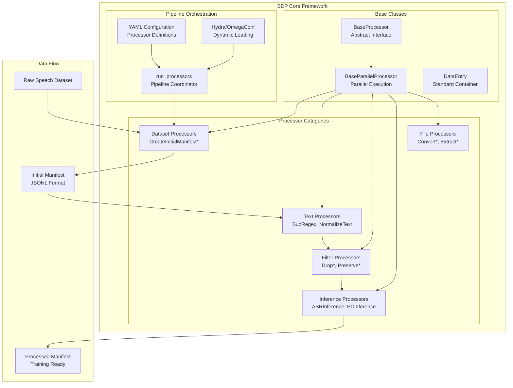

Sources: [sdp/processors/__init__.py:1-177](), [README.md:1-94](), [docs/src/sdp/api.rst:1-517]()

## Processor Framework

The processor framework provides a standardized interface for all dataset transformations through two main base classes:

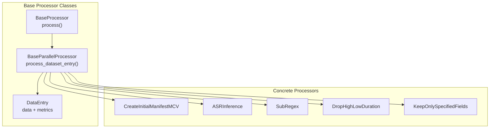

The `BaseParallelProcessor` class handles the core processing logic including parallel execution, input/output manifest management, and runtime testing through the `test()` method. Individual processors implement `process_dataset_entry()` to define their specific transformation logic.

Sources: [sdp/processors/base_processor.py](), [docs/src/sdp/api.rst:463-517]()

## Supported Datasets and Processors

SDP provides specialized processors for major speech datasets:

| Dataset Category | Processors | Description |
|------------------|------------|-------------|
| **Multilingual** | `CreateInitialManifestMCV`, `CreateInitialManifestMLS`, `CreateInitialManifestVoxpopuli` | Mozilla Common Voice, Multilingual LibriSpeech, VoxPopuli |
| **English** | `CreateInitialManifestLibrispeech`, `CreateInitialManifestSLR83`, `CreateInitialManifestCORAAL` | LibriSpeech, SLR83 British Isles, CORAAL African American English |
| **TTS Datasets** | `CreateInitialManifestYTC`, `DownloadHiFiTTS2` | YouTube Commons, HiFiTTS-2 |
| **Specialized** | `CreateInitialManifestFleurs`, `CreateInitialManifestEarnings21` | FLEURS cross-lingual, Earnings call datasets |

Sources: [sdp/processors/__init__.py:17-83](), [docs/src/sdp/api.rst:17-156]()

## Processing Pipeline Flow

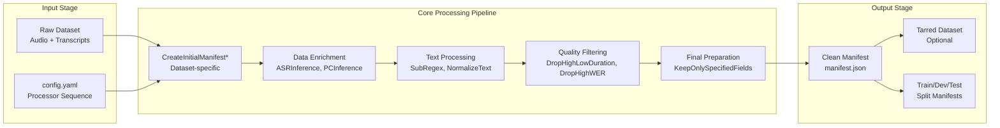

Each processing stage reads from an input manifest file and writes to an output manifest file, with the `run_processors` orchestrator chaining these files automatically based on the YAML configuration sequence.

Sources: [README.md:43-85](), [sdp/processors/modify_manifest/data_to_data.py:1-1497]()

## Configuration System

SDP uses YAML configuration files with Hydra/OmegaConf for dynamic processor instantiation:

```yaml
processors:
  - _target_: sdp.processors.CreateInitialManifestMCV
    output_manifest_file: "${data_split}_initial_manifest.json"
    language_id: es
  - _target_: sdp.processors.ASRInference
    pretrained_model: "stt_es_quartznet15x5"
  - _target_: sdp.processors.SubRegex
    regex_params_list:
      - {"pattern": "¡", "repl": "."}
    test_cases:
      - {input: {text: "hey!"}, output: {text: "hey."}}
```

The `_target_` field specifies the processor class, while remaining fields provide processor-specific parameters. Runtime tests can be embedded directly in the configuration through `test_cases` to validate processor behavior before execution.

Sources: [README.md:43-72](), [docs/src/sdp/api.rst:509-517]()

## Data Entry Structure

The `DataEntry` class provides a standardized container for manifest entries:

```python
# Example DataEntry structure
{
    "audio_filepath": "/path/to/audio.wav",
    "text": "transcript text",
    "duration": 3.45,
    "pred_text": "ASR prediction",  # Added by ASRInference
    "wer": 0.05                   # Added by GetWER
}
```

Processors can add, modify, or remove fields from `DataEntry` objects, with the framework automatically handling serialization to JSONL format for manifest files.

Sources: [sdp/processors/base_processor.py](), [sdp/processors/modify_manifest/data_to_data.py:829-854]()

---

# Page: Core Architecture

# Core Architecture

<details>
<summary>Relevant source files</summary>

The following files were used as context for generating this wiki page:

- [docs/src/sdp/api.rst](docs/src/sdp/api.rst)
- [sdp/processors/__init__.py](sdp/processors/__init__.py)
- [sdp/processors/base_processor.py](sdp/processors/base_processor.py)
- [sdp/processors/modify_manifest/common.py](sdp/processors/modify_manifest/common.py)
- [sdp/processors/modify_manifest/data_to_data.py](sdp/processors/modify_manifest/data_to_data.py)
- [sdp/run_processors.py](sdp/run_processors.py)

</details>


The Core Architecture encompasses the fundamental framework that underlies the NeMo Speech Data Processor (SDP) system. This document covers the base processor classes, pipeline orchestration mechanisms, and data flow patterns that enable scalable speech dataset processing. For specific processor implementations, see [Processor Categories](#2.3). For configuration details, see [Configuration System](#3).

## Overview

The SDP core architecture is built around three primary components:

1. **Base Processor Framework** - Abstract classes defining processor interfaces and parallel execution capabilities
2. **Pipeline Orchestration** - Runtime coordination and execution of processor sequences  
3. **Data Flow System** - Standardized data entry handling and manifest file chaining

## Base Processor Framework

### Class Hierarchy

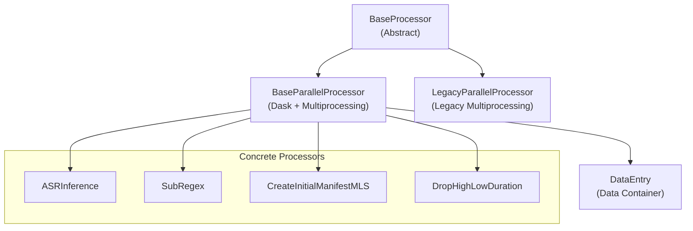

Sources: [sdp/processors/base_processor.py:39-498]()

### BaseProcessor Interface

The `BaseProcessor` class defines the fundamental interface that all SDP processors must implement:

| Method | Purpose | Implementation |
|--------|---------|----------------|
| `process()` | Main data processing logic | Abstract - must be overridden |
| `test()` | Runtime validation of processor behavior | Optional - default implementation available |
| `__init__()` | Constructor with manifest file paths | Validates input/output file constraints |

Key constraints enforced by `BaseProcessor`:
- `input_manifest_file` and `output_manifest_file` cannot be identical
- Processors can create initial manifests (no input required) or transform existing ones

Sources: [sdp/processors/base_processor.py:39-85]()

### BaseParallelProcessor Implementation

The `BaseParallelProcessor` extends `BaseProcessor` with parallel execution capabilities:

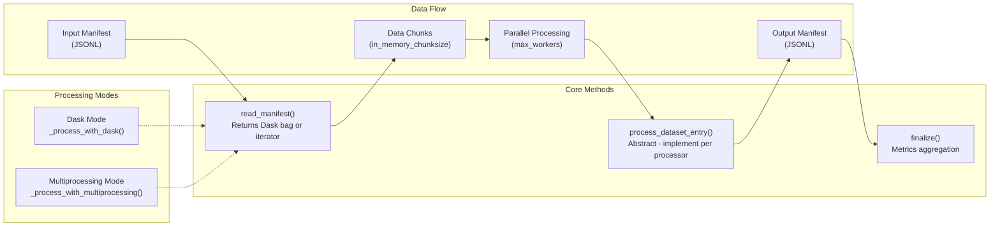

Key parameters controlling parallel execution:
- `max_workers`: Number of parallel workers (default: CPU count)
- `chunksize`: Chunk size for parallel routines (default: 100)
- `in_memory_chunksize`: Maximum entries loaded simultaneously (default: 100,000)
- `use_dask`: Enable Dask vs multiprocessing (default: True)

Sources: [sdp/processors/base_processor.py:86-294]()

### DataEntry Container

The `DataEntry` class serves as a standardized wrapper for processed data:

```python
@dataclass
class DataEntry:
    data: Optional[Dict]  # can be None to drop the entry
    metrics: Any = None
```

This design enables:
- **Data filtering**: Setting `data=None` drops entries from output
- **Metrics collection**: Arbitrary metrics attached to each entry
- **One-to-many mapping**: Single input can produce multiple outputs

Sources: [sdp/processors/base_processor.py:31-37]()

## Pipeline Orchestration

### Execution Flow

The `run_processors()` function coordinates the entire pipeline execution:

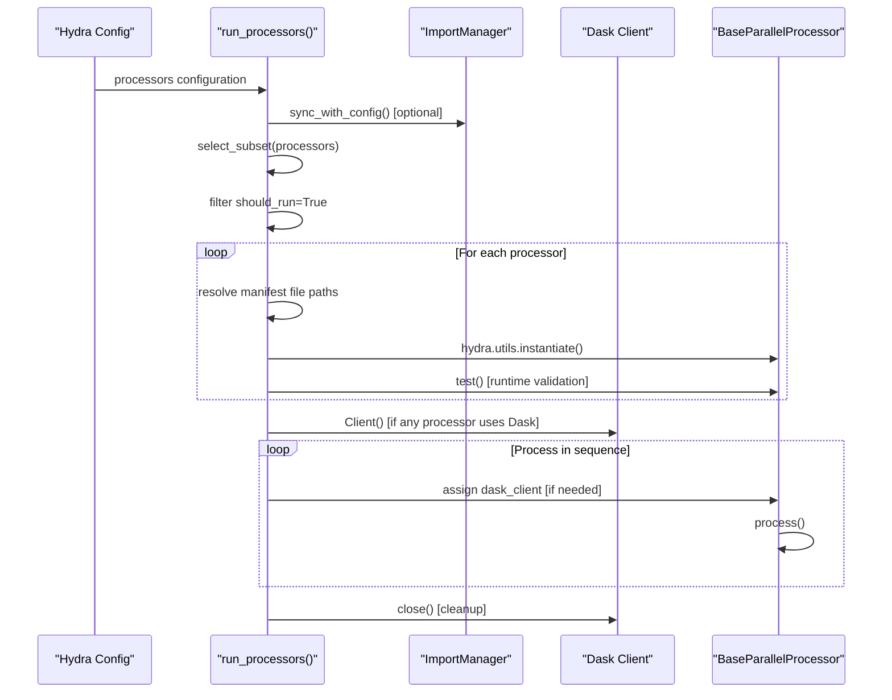

Sources: [sdp/run_processors.py:116-251]()

### Manifest File Chaining

The orchestrator automatically chains processors by linking output manifests to input manifests:

1. **Temporary Files**: Missing `output_manifest_file` gets temporary path in `tmp_dir`
2. **Automatic Linking**: Current processor's output becomes next processor's input
3. **Subset Execution**: When starting mid-pipeline, infers input from previous processor's output

This enables flexible pipeline execution without explicit manifest path management.

Sources: [sdp/run_processors.py:176-208]()

### Configuration Resolvers

SDP extends OmegaConf with custom resolvers for dynamic configuration:

```python
OmegaConf.register_new_resolver("subfield", lambda node, field: node[field])
OmegaConf.register_new_resolver("not", lambda x: not x)
OmegaConf.register_new_resolver("equal", lambda field, value: field == value)
```

These enable conditional logic and field references within YAML configurations.

Sources: [sdp/run_processors.py:30-33]()

## Data Flow Architecture

### Manifest Processing Pattern

All processors follow a consistent data flow pattern:

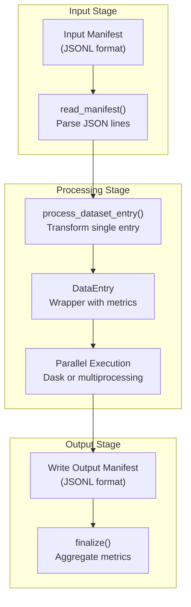

### Entry Transformation Types

Processors can implement different transformation patterns:

| Pattern | Input → Output | Example Use Case |
|---------|----------------|------------------|
| **One-to-One** | 1 entry → 1 entry | Text normalization, field addition |
| **One-to-Many** | 1 entry → N entries | Audio segmentation, sentence splitting |
| **One-to-Zero** | 1 entry → 0 entries (filtered) | Quality filtering, duplicate removal |

Sources: [sdp/processors/base_processor.py:224-267](), [sdp/processors/modify_manifest/data_to_data.py:164-204]()

## Runtime Testing Framework

### Test Case Validation

The processor framework includes built-in runtime testing through the `test()` method:

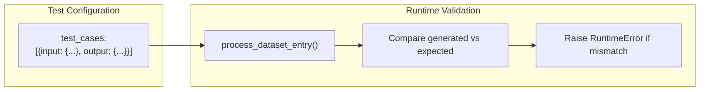

Test cases are defined directly in processor configurations, enabling:
- **Regression testing**: Ensure processor behavior remains consistent
- **Documentation**: Test cases serve as usage examples
- **Early failure**: Runtime tests execute before data processing begins

Sources: [sdp/processors/base_processor.py:280-293](), [docs/src/sdp/api.rst:489-517]()

This architecture provides a robust foundation for scalable, testable, and maintainable speech data processing pipelines while maintaining flexibility for diverse dataset requirements and processing workflows.

---

# Page: Base Processor Classes

# Base Processor Classes

<details>
<summary>Relevant source files</summary>

The following files were used as context for generating this wiki page:

- [sdp/processors/base_processor.py](sdp/processors/base_processor.py)
- [sdp/processors/modify_manifest/common.py](sdp/processors/modify_manifest/common.py)
- [sdp/run_processors.py](sdp/run_processors.py)

</details>


This page covers the fundamental base classes that form the foundation of the NeMo Speech Data Processor (SDP) framework. These classes define the core interfaces and processing patterns used by all data processors in the system.

For information about specific processor implementations and categories, see [Processor Categories](#2.3). For details on how processors are orchestrated and executed in pipelines, see [Pipeline Orchestration](#2.2).

## Overview

The SDP framework is built around a hierarchy of base processor classes that provide standardized interfaces for data processing operations. All processors inherit from these base classes, ensuring consistent behavior across the entire system. The architecture supports both sequential and parallel processing modes, with automatic manifest file chaining and standardized error handling.

### Base Class Hierarchy

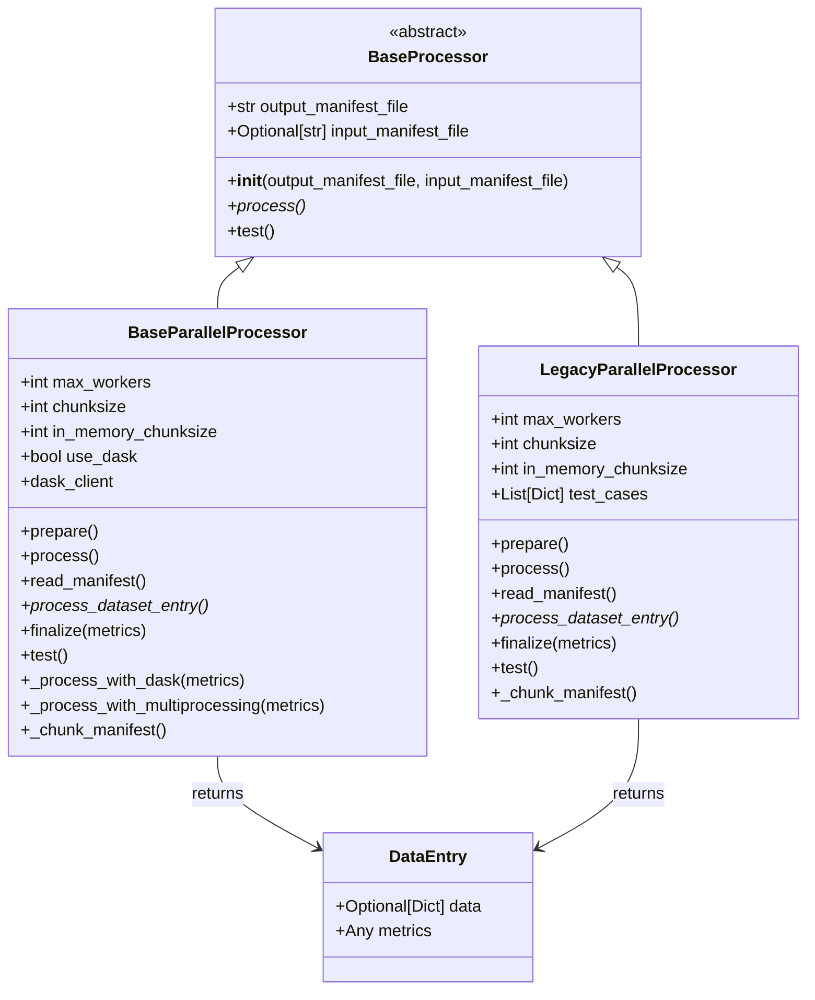

**Sources:** [sdp/processors/base_processor.py:31-498]()

## DataEntry Class

The `DataEntry` class serves as a standardized container for processed data and associated metrics throughout the SDP pipeline.

```python
@dataclass
class DataEntry:
    data: Optional[Dict]  # can be None to drop the entry
    metrics: Any = None
```

### Key Characteristics

| Property | Description |
|----------|-------------|
| `data` | Contains the actual processed manifest entry as a dictionary, or `None` to drop the entry |
| `metrics` | Stores any additional metrics or metadata for statistics reporting |
| **Purpose** | Provides a uniform return type for all processor operations |

The `data` field being `Optional[Dict]` allows processors to filter out entries by returning `DataEntry(data=None)`, which the framework automatically handles by excluding these entries from the output manifest.

**Sources:** [sdp/processors/base_processor.py:31-37]()

## BaseProcessor Abstract Class

`BaseProcessor` defines the fundamental interface that all SDP processors must implement. It establishes the basic contract for data processing operations and runtime testing.

### Core Interface

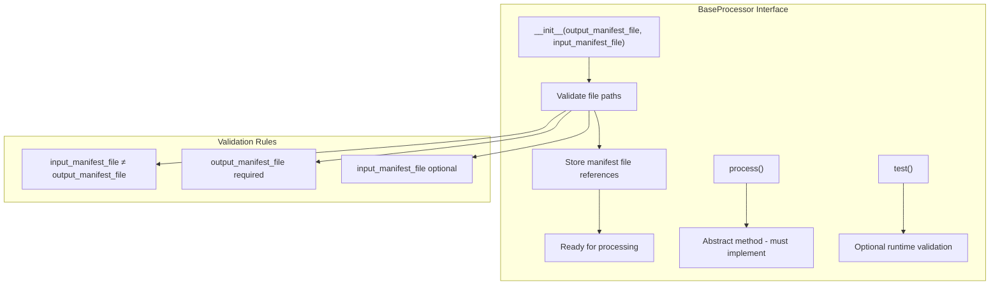

### Constructor Parameters

| Parameter | Type | Required | Description |
|-----------|------|----------|-------------|
| `output_manifest_file` | `str` | Yes | Path where processed manifest will be written |
| `input_manifest_file` | `Optional[str]` | No | Path to input manifest (optional for initial manifest creators) |

### Abstract Methods

- **`process()`**: Must be implemented by all concrete processors to perform the actual data processing
- **`test()`**: Optional method for runtime validation and self-consistency checks

**Sources:** [sdp/processors/base_processor.py:39-85]()

## BaseParallelProcessor Class

`BaseParallelProcessor` extends `BaseProcessor` to provide sophisticated parallel processing capabilities using either Dask distributed computing or multiprocessing backends.

### Parallel Processing Architecture

```mermaid
graph TB
    subgraph "BaseParallelProcessor Execution Flow"
        A["process()"] --> B["prepare()"]
        B --> C{"use_dask?"}
        
        C -->|True| D["_process_with_dask()"]
        C -->|False| E["_process_with_multiprocessing()"]
        
        D --> F["Create Dask bag from manifest"]
        F --> G["bag.map(process_dataset_entry)"]
        G --> H["Compute results"]
        
        E --> I["_chunk_manifest()"]
        I --> J["Parallel() with joblib"]
        J --> K["Process chunks"]
        
        H --> L["Write output manifest"]
        K --> L
        L --> M["finalize(metrics)"]
    end
    
    subgraph "Data Flow"
        N["read_manifest()"] --> O{"Dask mode?"}
        O -->|True| P["db.read_text() -> Dask bag"]
        O -->|False| Q["Line-by-line generator"]
        
        P --> R["process_dataset_entry()"]
        Q --> R
        R --> S["List[DataEntry]"]
    end
```

### Configuration Parameters

| Parameter | Type | Default | Description |
|-----------|------|---------|-------------|
| `max_workers` | `int` | `-1` (auto-detect) | Maximum number of parallel workers |
| `chunksize` | `int` | `100` | Chunk size for parallel processing |
| `in_memory_chunksize` | `int` | `100000` | Maximum entries to load at once |
| `use_dask` | `bool` | `True` | Enable Dask vs multiprocessing |
| `dask_client` | Optional | `None` | Existing Dask client instance |
| `test_cases` | `Optional[List[Dict]]` | `None` | Runtime test cases |

### Processing Modes

#### Dask Mode (`use_dask=True`)
- Uses `dask.bag` for distributed processing
- Automatically chunks data into 256KB blocks
- Provides dashboard for monitoring
- Better for large-scale distributed processing

#### Multiprocessing Mode (`use_dask=False`)
- Uses `joblib.Parallel` with multiprocessing backend
- Processes data in configurable chunks
- More suitable for single-machine processing
- Lower overhead for smaller datasets

### Abstract Methods

Concrete implementations must provide:

```python
@abstractmethod
def process_dataset_entry(self, data_entry) -> List[DataEntry]:
    """Process a single data entry and return list of results."""
    pass
```

### Lifecycle Methods

| Method | Purpose | When Called |
|--------|---------|-------------|
| `prepare()` | Setup before processing starts | Before manifest processing |
| `read_manifest()` | Read and yield manifest entries | During processing |
| `process_dataset_entry()` | Process individual entries | For each manifest entry |
| `finalize()` | Cleanup and metrics reporting | After processing completes |

**Sources:** [sdp/processors/base_processor.py:86-293]()

## LegacyParallelProcessor Class

`LegacyParallelProcessor` provides backward compatibility with the original multiprocessing-based implementation, using `tqdm.contrib.concurrent.process_map` for parallel execution.

### Key Differences from BaseParallelProcessor

| Aspect | BaseParallelProcessor | LegacyParallelProcessor |
|--------|----------------------|------------------------|
| **Backend** | Dask or joblib | process_map only |
| **Memory Management** | Streaming with chunks | Load chunks into memory |
| **Progress Tracking** | Dask dashboard or basic logging | tqdm progress bars |
| **Scalability** | Distributed computing capable | Single machine only |

### Processing Flow

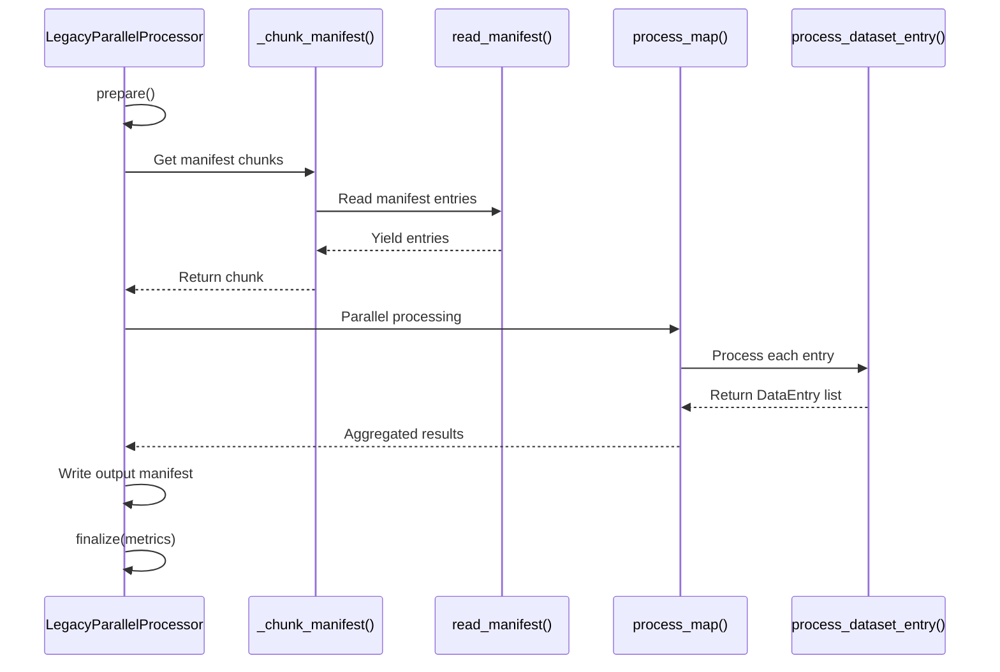

**Sources:** [sdp/processors/base_processor.py:296-498]()

## Implementation Patterns

### Concrete Processor Examples

The base classes are implemented by hundreds of concrete processors. Here are common patterns:

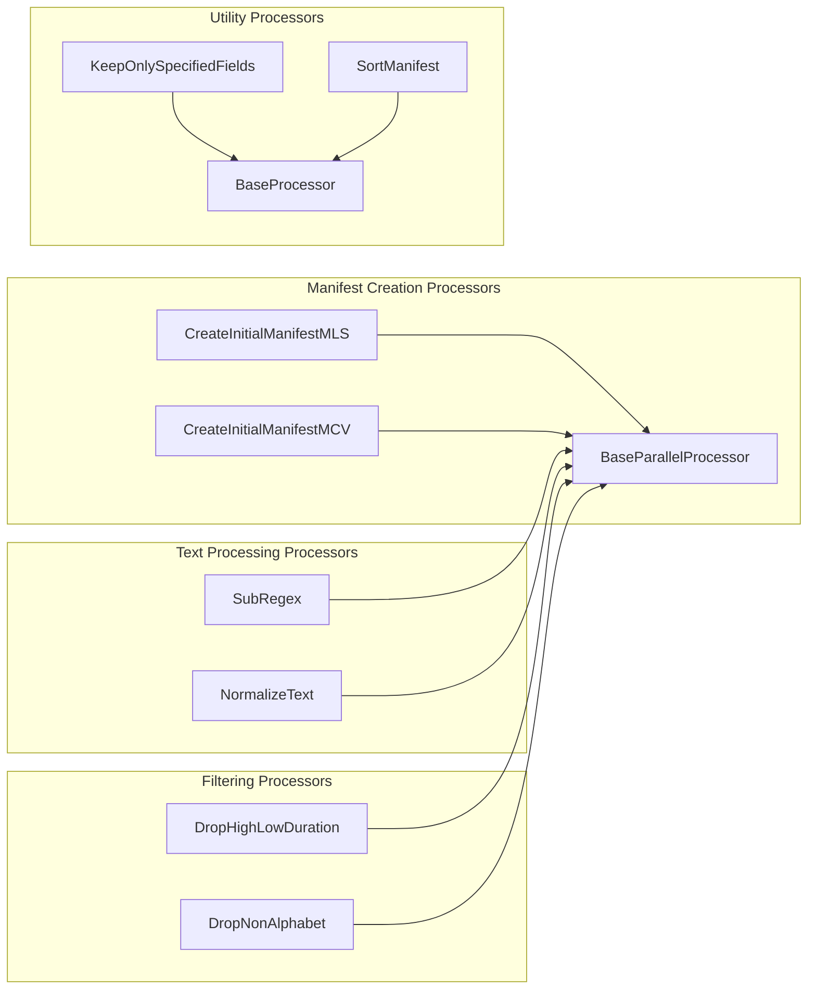

### Runtime Testing Pattern

All processors support runtime testing through the `test()` method:

```python
def test(self):
    for test_case in self.test_cases:
        input_data = test_case["input"].copy()
        generated_outputs = self.process_dataset_entry(input_data)
        expected_outputs = [test_case["output"]] if not isinstance(test_case["output"], list) else test_case["output"]
        # Validation logic...
```

**Sources:** [sdp/processors/base_processor.py:280-293](), [sdp/processors/modify_manifest/common.py:25-30]()

## Integration with Pipeline Orchestration

The base processor classes integrate seamlessly with the pipeline orchestration system through standardized manifest file handling:

### Manifest File Chaining

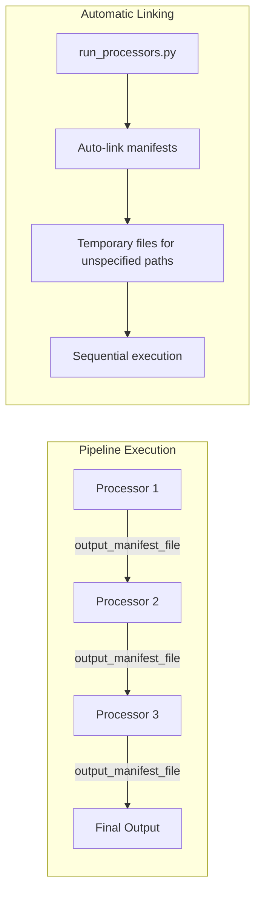

### Dask Client Management

The orchestration system manages Dask clients globally:

- Detects which processors require Dask
- Creates shared client for all Dask-enabled processors
- Handles graceful shutdown after processing completes

**Sources:** [sdp/run_processors.py:224-250]()

---

# Page: Pipeline Orchestration

# Pipeline Orchestration

<details>
<summary>Relevant source files</summary>

The following files were used as context for generating this wiki page:

- [README.md](README.md)
- [sdp/processors/base_processor.py](sdp/processors/base_processor.py)
- [sdp/processors/modify_manifest/common.py](sdp/processors/modify_manifest/common.py)
- [sdp/run_processors.py](sdp/run_processors.py)

</details>


This document explains how the SDP system coordinates the execution of processor sequences, including configuration loading, manifest file chaining, processor instantiation, and parallel processing management. It covers the central orchestration logic that transforms YAML configurations into executable processing pipelines.

For information about individual processor implementations, see [Processor Categories](#2.3). For details about the configuration system structure, see [Configuration System](#3).

## Overview

Pipeline orchestration in SDP is handled by the `run_processors` function in [sdp/run_processors.py](), which serves as the central coordinator for all data processing operations. This function transforms declarative YAML configurations into executable processor sequences, manages manifest file chaining between processors, and coordinates parallel execution using either Dask or multiprocessing.

The orchestration system handles several critical responsibilities:
- Loading and validating processor configurations
- Managing manifest file dependencies between processors
- Coordinating parallel processing backends
- Running runtime tests before processing
- Managing temporary files for intermediate results

Sources: [sdp/run_processors.py:116-252]()

## Configuration Loading and Processor Selection

### Hydra Configuration Management

The orchestration system uses Hydra for configuration management, with custom OmegaConf resolvers to enable dynamic configuration features:

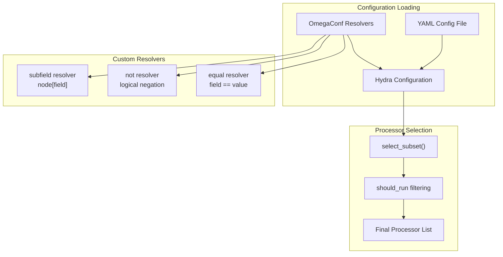

The system registers custom resolvers to simplify configuration files:

| Resolver | Function | Usage Example |
|----------|----------|---------------|
| `subfield` | Extract nested field | `${subfield:node,field}` |
| `not` | Logical negation | `${not:${some_condition}}` |
| `equal` | Equality comparison | `${equal:${field},value}` |

Sources: [sdp/run_processors.py:30-33](), [sdp/run_processors.py:116-118]()

### Processor Selection Logic

The `select_subset` function enables flexible processor selection using Python slice notation:

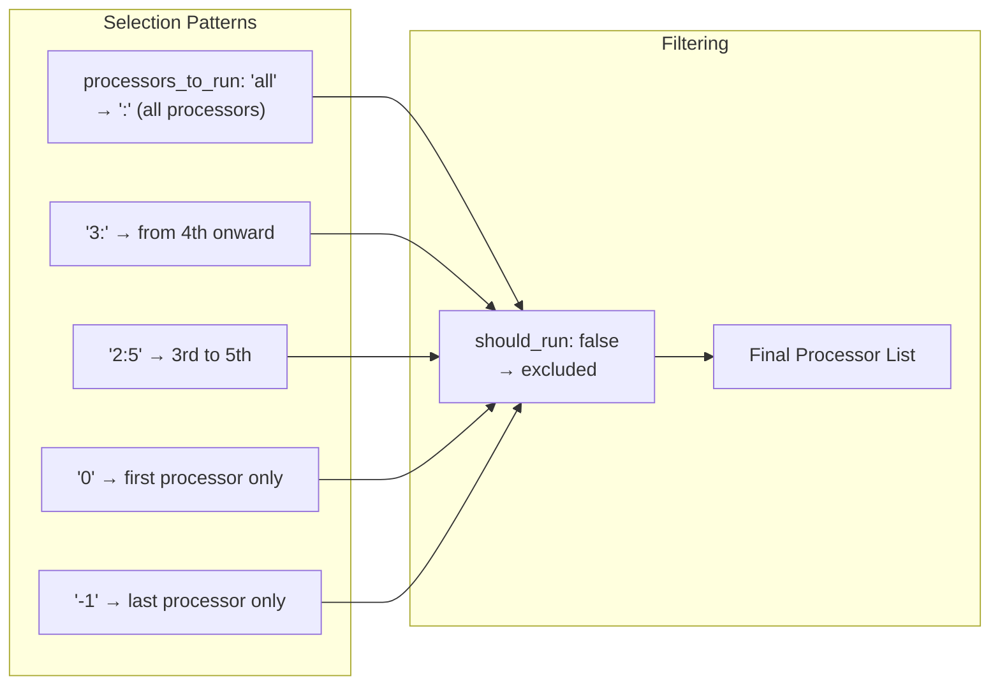

Sources: [sdp/run_processors.py:74-113](), [sdp/run_processors.py:155-166]()

## Manifest File Chaining

### Automatic Manifest Linking

The orchestration system automatically chains processors by linking output manifests to input manifests:

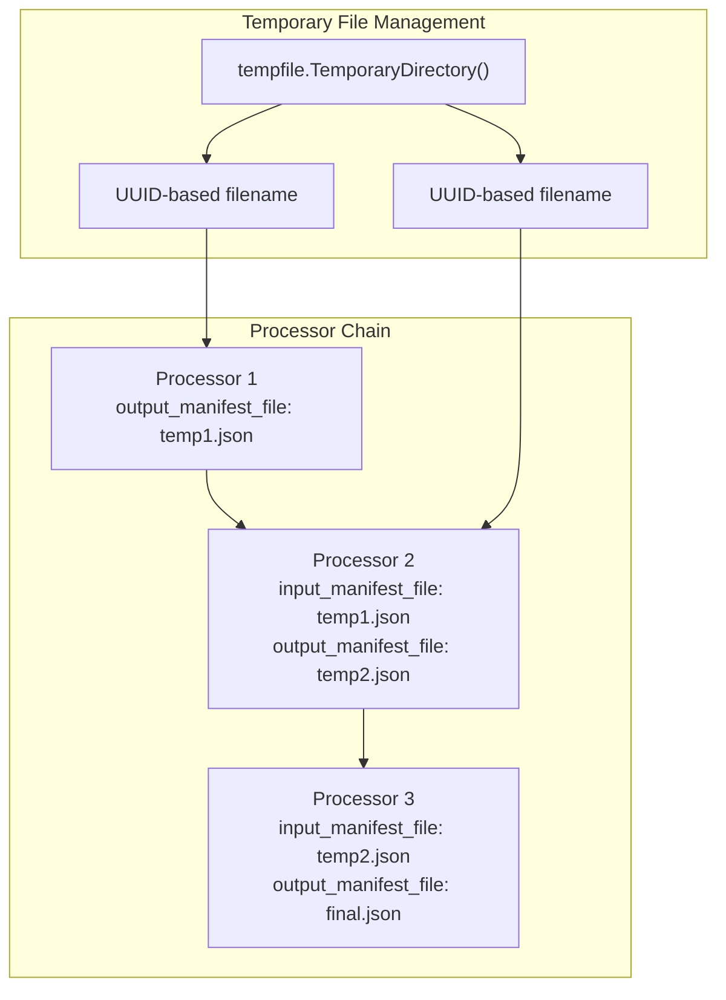

The chaining logic handles several scenarios:

1. **Automatic Output File Generation**: If `output_manifest_file` is not specified, creates a temporary UUID-based filename
2. **Automatic Input File Linking**: Links the current processor's output to the next processor's input if not specified
3. **Partial Pipeline Execution**: When starting from a non-first processor, infers input from the previous processor's output

Sources: [sdp/run_processors.py:176-207]()

### Temporary File Management

The system uses Python's `tempfile.TemporaryDirectory()` to manage intermediate manifest files:

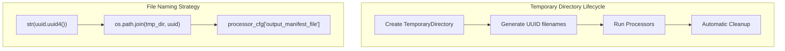

Sources: [sdp/run_processors.py:177](), [sdp/run_processors.py:198-201]()

## Parallel Processing Coordination

### Dask vs Multiprocessing Backend Selection

The orchestration system manages two parallel processing backends with flexible configuration:

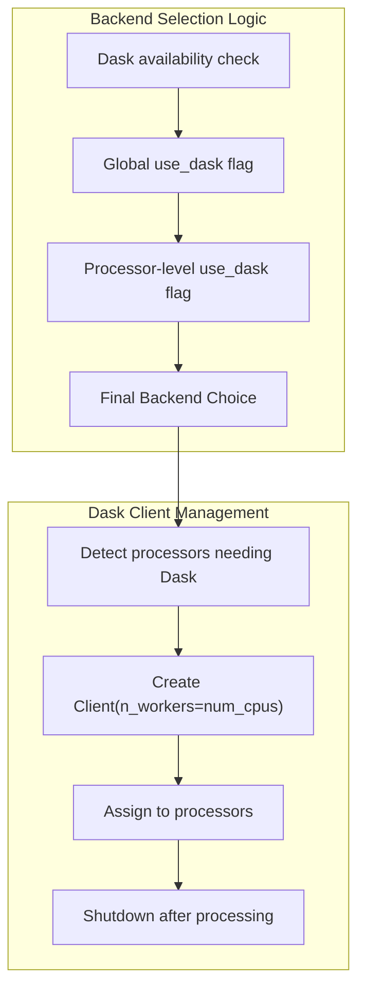

The backend selection follows this priority:
1. Processor-specific `use_dask` flag (highest priority)
2. Global `use_dask` configuration
3. Dask availability check (fallback to multiprocessing if unavailable)

Sources: [sdp/run_processors.py:144-153](), [sdp/run_processors.py:209-218](), [sdp/run_processors.py:224-236]()

### Processing Backend Architecture

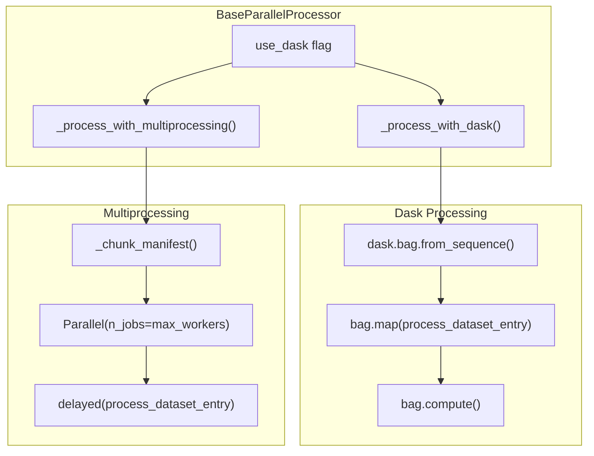

Sources: [sdp/processors/base_processor.py:140-156](), [sdp/processors/base_processor.py:158-191](), [sdp/processors/base_processor.py:192-209]()

## Processor Instantiation and Execution

### Runtime Testing and Validation

Before processing, the orchestration system runs runtime tests on each processor:

```mermaid
graph LR
    subgraph "Processor Lifecycle"
        INSTANTIATE["hydra.utils.instantiate()"]
        ASSIGN_BACKEND["Assign use_dask flag"]
        TEST["processor.test()"]
        PROCESS["processor.process()"]
    end
    
    subgraph "Test Execution"
        TEST_CASES["test_cases configuration"]
        PROCESS_ENTRY["process_dataset_entry()"]
        COMPARE["Compare with expected output"]
        PASS_FAIL["Pass/Fail determination"]
    end
    
    INSTANTIATE --> ASSIGN_BACKEND
    ASSIGN_BACKEND --> TEST
    TEST --> PROCESS
    
    TEST --> TEST_CASES
    TEST_CASES --> PROCESS_ENTRY
    PROCESS_ENTRY --> COMPARE
    COMPARE --> PASS_FAIL
```

Sources: [sdp/run_processors.py:217-222](), [sdp/processors/base_processor.py:280-292]()

### Execution Flow Control

```mermaid
graph TD
    subgraph "Sequential Execution"
        START["Start Processing"]
        DASK_CLIENT["Create Dask Client if needed"]
        LOOP["For each processor"]
        ASSIGN_CLIENT["Assign dask_client if use_dask"]
        EXECUTE["processor.process()"]
        CLEANUP["Shutdown Dask client"]
    end
    
    subgraph "Error Handling"
        TRY["try block"]
        FINALLY["finally block"]
        TIMEOUT["60s shutdown timeout"]
    end
    
    START --> DASK_CLIENT
    DASK_CLIENT --> LOOP
    LOOP --> ASSIGN_CLIENT
    ASSIGN_CLIENT --> EXECUTE
    EXECUTE --> LOOP
    LOOP --> CLEANUP
    
    EXECUTE --> TRY
    CLEANUP --> FINALLY
    FINALLY --> TIMEOUT
```

The execution flow ensures proper resource management:
1. Single Dask client shared across all processors needing it
2. Client assignment per processor based on `use_dask` flag
3. Graceful shutdown with timeout handling
4. Exception safety through try/finally blocks

Sources: [sdp/run_processors.py:237-252]()

## Import Management Integration

### Dynamic Import Resolution

The orchestration system includes optional import management for resolving processor dependencies:

```mermaid
graph TB
    subgraph "Import Management"
        CONFIG_FLAG["use_import_manager flag"]
        YAML_PATH["config_path specification"]
        MANAGER["ImportManager.sync_with_config()"]
        ERROR_HANDLING["Comprehensive error handling"]
    end
    
    subgraph "Error Types Handled"
        FILE_NOT_FOUND["FileNotFoundError"]
        YAML_ERROR["YAMLError"]
        IMPORT_ERROR["ImportError"]
        VALUE_ERROR["ValueError"]
        GENERAL["General Exception"]
    end
    
    CONFIG_FLAG --> YAML_PATH
    YAML_PATH --> MANAGER
    MANAGER --> ERROR_HANDLING
    
    ERROR_HANDLING --> FILE_NOT_FOUND
    ERROR_HANDLING --> YAML_ERROR
    ERROR_HANDLING --> IMPORT_ERROR
    ERROR_HANDLING --> VALUE_ERROR
    ERROR_HANDLING --> GENERAL
```

Sources: [sdp/run_processors.py:119-142]()

## Configuration Integration Points

The orchestration system integrates with several configuration mechanisms:

| Integration Point | Purpose | Implementation |
|------------------|---------|----------------|
| Hydra instantiation | Create processor objects | `hydra.utils.instantiate(processor_cfg)` |
| OmegaConf resolvers | Dynamic configuration | Custom resolver registration |
| open_dict context | Runtime config modification | Temporary config unlocking |
| Processor selection | Subset execution | Slice notation parsing |
| Backend assignment | Processing mode control | Flag propagation |

The orchestration ensures that all configuration elements work together seamlessly, from high-level pipeline definitions down to individual processor parameters.

Sources: [sdp/run_processors.py:30-33](), [sdp/run_processors.py:163-164](), [sdp/run_processors.py:200-207](), [sdp/run_processors.py:217-218]()

---

# Page: Processor Categories

# Processor Categories

<details>
<summary>Relevant source files</summary>

The following files were used as context for generating this wiki page:

- [docs/src/sdp/api.rst](docs/src/sdp/api.rst)
- [sdp/processors/__init__.py](sdp/processors/__init__.py)
- [sdp/processors/modify_manifest/create_manifest.py](sdp/processors/modify_manifest/create_manifest.py)
- [sdp/processors/modify_manifest/data_to_data.py](sdp/processors/modify_manifest/data_to_data.py)
- [sdp/processors/modify_manifest/data_to_dropbool.py](sdp/processors/modify_manifest/data_to_dropbool.py)

</details>


This document provides a comprehensive overview of the different categories of processors available in the NeMo Speech Data Processor system. Processors are organized into functional categories based on their primary purpose, ranging from dataset ingestion to data filtering and transformation. Understanding these categories helps users select the appropriate processors for their speech data processing pipelines.

For information about implementing custom processors, see [Base Processor Classes](#2.1). For details on how processors are orchestrated in pipelines, see [Pipeline Orchestration](#2.2).

## Overview of Processor Categories

The SDP system contains over 200 processors organized into seven main functional categories. Each category serves a specific role in the speech data processing pipeline, from initial data ingestion to final quality filtering.

### Processor Category Architecture

```mermaid
graph TB
    subgraph "Dataset Creation"
        DS_MCV["CreateInitialManifestMCV"]
        DS_MLS["CreateInitialManifestMLS"] 
        DS_VP["CreateInitialManifestVoxpopuli"]
        DS_LIB["CreateInitialManifestLibrispeech"]
        DS_HF["CreateInitialManifestHuggingFace"]
    end
    
    subgraph "Data Enrichment"
        ASR["ASRInference"]
        PC["PCInference"]
        WHISPER["FasterWhisperInference"]
        VLLM["vLLMInference"]
        LID["AudioLid"]
    end
    
    subgraph "Text Processing"
        REGEX["SubRegex"]
        NORM["NormalizeText"]
        LOWER["SubMakeLowercase"]
        SPLIT["SplitLineBySentence"]
        LAMBDA["LambdaExpression"]
    end
    
    subgraph "Data Filtering"
        DUR["DropHighLowDuration"]
        CHAR["DropHighLowCharrate"]
        WER["DropHighWER"]
        ALPHA["DropNonAlphabet"]
        REGEX_DROP["DropIfRegexMatch"]
    end
    
    subgraph "File Management"
        FFMPEG["FfmpegConvert"]
        SOX["SoxConvert"]
        TAR["ExtractTar"]
        TARRED["ConvertToTarredAudioDataset"]
    end
    
    subgraph "Manifest Operations"
        COMBINE["CombineSources"]
        FIELDS["KeepOnlySpecifiedFields"]
        RENAME["RenameFields"]
        SORT["SortManifest"]
        SPLIT_DUR["SplitOnFixedDuration"]
    end
    
    subgraph "Specialized"
        TOLOKA["CreateTolokaPool"]
        TTS["PrepareTTSSegmentsProcessor"]
        LHOTSE["LhotseImport"]
    end
    
    DS_MCV --> ASR
    DS_MLS --> PC
    ASR --> REGEX
    PC --> NORM
    REGEX --> DUR
    NORM --> CHAR
    DUR --> COMBINE
    CHAR --> FIELDS
```

Sources: [sdp/processors/__init__.py:15-177](), [docs/src/sdp/api.rst:17-462]()

## Dataset-Specific Processors

Dataset-specific processors create initial manifests from raw speech datasets. Each processor handles the unique file structure and metadata format of a particular dataset.

### Major Dataset Processors

| Dataset | Processor Class | Purpose |
|---------|----------------|---------|
| Mozilla Common Voice | `CreateInitialManifestMCV` | Process MCV archives with validated/invalidated splits |
| Multilingual LibriSpeech | `CreateInitialManifestMLS` | Handle MLS language-specific directories |
| VoxPopuli | `CreateInitialManifestVoxpopuli` | Process European Parliament recordings |
| LibriSpeech | `CreateInitialManifestLibrispeech` | Standard English ASR corpus |
| CORAAL | `CreateInitialManifestCORAAL` | African American English dialect corpus |
| FLEURS | `CreateInitialManifestFleurs` | Cross-lingual speech corpus |
| SLR83 | `CreateInitialManifestSLR83` | British Isles accent corpus |

```mermaid
graph LR
    subgraph "Raw Datasets"
        MCV_RAW["MCV Archive<br/>validated.tsv"]
        MLS_RAW["MLS Directory<br/>train/dev/test"]
        VP_RAW["VoxPopuli<br/>Language Splits"]
        HF_RAW["HuggingFace<br/>Dataset API"]
    end
    
    subgraph "Dataset Processors"
        MCV_PROC["CreateInitialManifestMCV"]
        MLS_PROC["CreateInitialManifestMLS"]
        VP_PROC["CreateInitialManifestVoxpopuli"]
        HF_PROC["CreateInitialManifestHuggingFace"]
    end
    
    subgraph "Initial Manifests"
        MANIFEST["Standardized JSONL<br/>audio_filepath, text, duration"]
    end
    
    MCV_RAW --> MCV_PROC
    MLS_RAW --> MLS_PROC
    VP_RAW --> VP_PROC
    HF_RAW --> HF_PROC
    
    MCV_PROC --> MANIFEST
    MLS_PROC --> MANIFEST
    VP_PROC --> MANIFEST
    HF_PROC --> MANIFEST
```

Sources: [sdp/processors/__init__.py:17-83](), [docs/src/sdp/api.rst:17-156]()

## Data Enrichment Processors

Data enrichment processors add new fields to manifest entries by running inference with pre-trained models. These processors typically add predictions, quality scores, or metadata that can be used for downstream filtering or processing.

### Inference Categories

**ASR Inference**
- `ASRInference`: NeMo ASR model predictions
- `FasterWhisperInference`: OpenAI Whisper variants
- `ASRTransformers`: HuggingFace Transformers ASR models

**NLP Processing**
- `PCInference`: Punctuation and capitalization restoration
- `vLLMInference`: Large language model inference
- `FastTextLangIdClassifier`: Language identification

**Quality Estimation**
- `CometoidWMTQualityEstimation`: Translation quality scores
- `AudioLid`: Audio-based language identification

```mermaid
graph TD
    INPUT["Input Manifest<br/>{audio_filepath, text}"]
    
    subgraph "ASR Models"
        NEMO_ASR["ASRInference<br/>NeMo Models"]
        WHISPER["FasterWhisperInference<br/>OpenAI Models"]
        HF_ASR["ASRTransformers<br/>HuggingFace Models"]
    end
    
    subgraph "NLP Models"
        PC["PCInference<br/>Punctuation/Caps"]
        VLLM["vLLMInference<br/>Large Language Models"]
        FASTTEXT["FastTextLangIdClassifier<br/>Language ID"]
    end
    
    subgraph "Quality Models"
        QE["CometoidWMTQualityEstimation<br/>Quality Scores"]
        ALID["AudioLid<br/>Audio Language ID"]
    end
    
    OUTPUT["Enriched Manifest<br/>{audio_filepath, text, pred_text, lang_pred, quality_score}"]
    
    INPUT --> NEMO_ASR
    INPUT --> WHISPER
    INPUT --> HF_ASR
    INPUT --> PC
    INPUT --> VLLM
    INPUT --> FASTTEXT
    INPUT --> QE
    INPUT --> ALID
    
    NEMO_ASR --> OUTPUT
    WHISPER --> OUTPUT
    HF_ASR --> OUTPUT
    PC --> OUTPUT
    VLLM --> OUTPUT
    FASTTEXT --> OUTPUT
    QE --> OUTPUT
    ALID --> OUTPUT
```

Sources: [sdp/processors/__init__.py:145-156](), [docs/src/sdp/api.rst:171-216]()

## Text Processing Processors

Text processing processors modify the content of text fields in manifest entries. These processors are essential for standardizing text format, applying normalization rules, and preparing text for model training.

### Core Text Transformations

**Pattern-Based Processing**
- `SubRegex`: Apply regex substitutions with configurable patterns
- `SubMakeLowercase`: Convert text to lowercase
- `SplitLineBySentence`: Split text into sentence-level entries

**Normalization**
- `NormalizeText`: Apply text normalization (TN) rules
- `InverseNormalizeText`: Apply inverse text normalization (ITN)
- `MakeLettersUppercaseAfterPeriod`: Sentence capitalization

**Advanced Processing**
- `LambdaExpression`: Dynamic field computation with custom expressions
- `CountNumWords`: Word count calculation with alphabet filtering
- `ExtractFromBrackets`: Extract text within bracket patterns

```mermaid
graph TB
    subgraph "Input Processing"
        RAW_TEXT["Raw Text Field<br/>'Hello WORLD! 123 dollars'"]
    end
    
    subgraph "Text Processors"
        REGEX["SubRegex<br/>Pattern Substitution"]
        NORM["NormalizeText<br/>TN Rules"]
        LOWER["SubMakeLowercase<br/>Case Conversion"]
        LAMBDA["LambdaExpression<br/>Custom Logic"]
    end
    
    subgraph "Output Results"
        CLEAN_TEXT["Processed Text<br/>'hello world one hundred twenty three dollars'"]
        WORD_COUNT["Word Count<br/>num_words: 7"]
        FILTERED["Filtered Entries<br/>Based on Conditions"]
    end
    
    RAW_TEXT --> REGEX
    REGEX --> NORM
    NORM --> LOWER
    LOWER --> LAMBDA
    
    REGEX --> CLEAN_TEXT
    NORM --> CLEAN_TEXT
    LOWER --> CLEAN_TEXT
    LAMBDA --> WORD_COUNT
    LAMBDA --> FILTERED
```

Sources: [sdp/processors/modify_manifest/data_to_data.py:429-541](), [sdp/processors/modify_manifest/data_to_data.py:1163-1257]()

## Data Filtering Processors

Data filtering processors remove manifest entries that don't meet specified quality criteria. These processors are crucial for maintaining dataset quality and removing problematic samples.

### Filtering Categories

**Duration-Based Filtering**
- `DropHighLowDuration`: Remove entries outside duration thresholds
- `DropHighLowCharrate`: Filter by character rate (chars/second)
- `DropHighLowWordrate`: Filter by word rate (words/second)

**Quality-Based Filtering**
- `DropHighWER`: Remove entries with high Word Error Rate
- `DropHighCER`: Remove entries with high Character Error Rate
- `DropLowWordMatchRate`: Filter by word match rate

**Content-Based Filtering**
- `DropIfRegexMatch`: Remove entries matching regex patterns
- `DropNonAlphabet`: Filter entries with non-alphabet characters
- `DropASRError`: Remove entries with ASR inconsistencies

```mermaid
graph LR
    subgraph "Input Manifest"
        ENTRY1["Entry 1<br/>duration: 0.5s<br/>WER: 0.8"]
        ENTRY2["Entry 2<br/>duration: 15s<br/>WER: 0.1"]
        ENTRY3["Entry 3<br/>duration: 5s<br/>WER: 0.3"]
    end
    
    subgraph "Filter Processors"
        DUR_FILTER["DropHighLowDuration<br/>1s < duration < 10s"]
        WER_FILTER["DropHighWER<br/>WER < 0.5"]
        CHAR_FILTER["DropNonAlphabet<br/>alphabet='a-z '"]
    end
    
    subgraph "Output Manifest"
        ENTRY3_OUT["Entry 3<br/>duration: 5s<br/>WER: 0.3<br/>PASSED"]
    end
    
    ENTRY1 --> DUR_FILTER
    ENTRY2 --> DUR_FILTER
    ENTRY3 --> DUR_FILTER
    
    DUR_FILTER --> WER_FILTER
    WER_FILTER --> CHAR_FILTER
    CHAR_FILTER --> ENTRY3_OUT
    
    style ENTRY1 fill:#ffebee
    style ENTRY2 fill:#ffebee
    style ENTRY3_OUT fill:#e8f5e8
```

Sources: [sdp/processors/modify_manifest/data_to_dropbool.py:87-909](), [docs/src/sdp/api.rst:267-387]()

## File Management Processors

File management processors handle audio file operations, format conversions, and dataset packaging. These processors manage the physical files referenced in manifests.

### Audio Processing Operations

**Format Conversion**
- `FfmpegConvert`: Audio format conversion using FFmpeg
- `SoxConvert`: Audio processing using SoX toolkit

**Archive Operations**
- `ExtractTar`: Extract tar archives
- `ConvertToTarredAudioDataset`: Create NeMo tarred datasets

**File Operations**
- `RemoveFiles`: Delete files based on manifest entries
- `CopyManifestData`: Copy files to consolidated locations

```mermaid
graph TB
    subgraph "Input Files"
        AUDIO_RAW["Raw Audio Files<br/>.mp3, .flac, .wav"]
        ARCHIVES["Compressed Archives<br/>.tar.gz, .zip"]
    end
    
    subgraph "File Processors"
        FFMPEG["FfmpegConvert<br/>Format Conversion"]
        SOX["SoxConvert<br/>Audio Processing"]
        EXTRACT["ExtractTar<br/>Archive Extraction"]
        TARRED["ConvertToTarredAudioDataset<br/>NeMo Format"]
    end
    
    subgraph "Output Files"
        AUDIO_STD["Standardized Audio<br/>.wav, 16kHz"]
        TARRED_DS["Tarred Dataset<br/>NeMo Training Format"]
    end
    
    AUDIO_RAW --> FFMPEG
    AUDIO_RAW --> SOX
    ARCHIVES --> EXTRACT
    
    FFMPEG --> AUDIO_STD
    SOX --> AUDIO_STD
    EXTRACT --> AUDIO_STD
    AUDIO_STD --> TARRED
    TARRED --> TARRED_DS
```

Sources: [sdp/processors/__init__.py:157-169](), [docs/src/sdp/api.rst:308-325]()

## Manifest Manipulation Processors

Manifest manipulation processors restructure, combine, or transform manifest files without necessarily processing the underlying audio or text content.

### Structural Operations

**Field Operations**
- `KeepOnlySpecifiedFields`: Retain only specified fields
- `DropSpecifiedFields`: Remove specified fields
- `RenameFields`: Change field names
- `DuplicateFields`: Copy field values to new fields
- `AddConstantFields`: Add fields with constant values

**Manifest Combination**
- `CombineSources`: Merge multiple manifests
- `CreateCombinedManifests`: Combine manifest files
- `ApplyInnerJoin`: Join manifests on common fields

**Entry Manipulation**
- `SortManifest`: Sort entries by field values
- `SplitOnFixedDuration`: Split long audio into segments
- `ListToEntries`: Expand list fields into separate entries

```mermaid
graph LR
    subgraph "Input Manifests"
        MANIFEST_A["Manifest A<br/>{audio_filepath, text, speaker}"]
        MANIFEST_B["Manifest B<br/>{audio_filepath, duration, lang}"]
    end
    
    subgraph "Manipulation Processors"
        COMBINE["CombineSources<br/>Merge Manifests"]
        FIELDS["KeepOnlySpecifiedFields<br/>Select Fields"]
        RENAME["RenameFields<br/>Standardize Names"]
        SORT["SortManifest<br/>Order Entries"]
    end
    
    subgraph "Output Manifest"
        FINAL["Combined Manifest<br/>{audio_filepath, text, duration}<br/>Sorted by duration"]
    end
    
    MANIFEST_A --> COMBINE
    MANIFEST_B --> COMBINE
    COMBINE --> FIELDS
    FIELDS --> RENAME
    RENAME --> SORT
    SORT --> FINAL
```

Sources: [sdp/processors/__init__.py:84-97](), [sdp/processors/modify_manifest/create_manifest.py:23-89]()

## Specialized Processors

Specialized processors serve specific use cases or integrate with external systems and services.

### Integration Categories

**Crowdsourcing (Toloka)**
- `CreateTolokaProject`: Set up crowdsourcing projects
- `CreateTolokaPool`: Create worker pools
- `CreateTolokaTaskSet`: Generate annotation tasks
- `GetTolokaResults`: Retrieve crowdsourced annotations

**Text-to-Speech (TTS)**
- `PrepareTTSSegmentsProcessor`: Prepare TTS training segments
- `SplitLongAudio`: Split audio for TTS processing
- `MergeAlignmentDiarization`: Merge alignment and diarization

**External Libraries**
- `LhotseImport`: Import from Lhotse speech library
- `NemoRunIPLProcessor`: Integration with NeMo IPL

```mermaid
graph TB
    subgraph "External Systems"
        TOLOKA_API["Toloka Platform<br/>Crowdsourcing API"]
        LHOTSE_LIB["Lhotse Library<br/>Speech Data Toolkit"]
        NEMO_IPL["NeMo IPL<br/>Intelligent Processing"]
    end
    
    subgraph "Specialized Processors"
        TOLOKA_PROC["Toloka Processors<br/>Project/Pool/Task Management"]
        TTS_PROC["TTS Processors<br/>Segment Preparation"]
        LHOTSE_PROC["LhotseImport<br/>80+ Dataset Recipes"]
        IPL_PROC["NemoRunIPLProcessor<br/>IPL Integration"]
    end
    
    subgraph "SDP Manifests"
        CROWD_MANIFEST["Crowdsourced Annotations<br/>Quality Scores"]
        TTS_MANIFEST["TTS Training Data<br/>Segmented Audio"]
        LHOTSE_MANIFEST["Standardized Datasets<br/>Multiple Sources"]
    end
    
    TOLOKA_API --> TOLOKA_PROC
    LHOTSE_LIB --> LHOTSE_PROC
    NEMO_IPL --> IPL_PROC
    
    TOLOKA_PROC --> CROWD_MANIFEST
    TTS_PROC --> TTS_MANIFEST
    LHOTSE_PROC --> LHOTSE_MANIFEST
```

Sources: [sdp/processors/__init__.py:170-177](), [docs/src/sdp/api.rst:158-169](), [docs/src/sdp/api.rst:370-459]()

---

# Page: Configuration System

# Configuration System

<details>
<summary>Relevant source files</summary>

The following files were used as context for generating this wiki page:

- [dataset_configs/spanish/mls/config.yaml](dataset_configs/spanish/mls/config.yaml)
- [dataset_configs/spanish_pc/mls/config.yaml](dataset_configs/spanish_pc/mls/config.yaml)
- [dataset_configs/spanish_pc/voxpopuli/config.yaml](dataset_configs/spanish_pc/voxpopuli/config.yaml)
- [docs/src/sdp/config_structure.rst](docs/src/sdp/config_structure.rst)
- [docs/src/sdp/existing_configs.rst](docs/src/sdp/existing_configs.rst)

</details>


The Configuration System in NeMo Speech Data Processor (SDP) provides a YAML-based framework for defining, managing, and executing data processing pipelines. This system uses Hydra/OmegaConf for dynamic configuration loading and includes custom resolvers for conditional logic and parameter substitution.

For information about the actual processor classes that these configurations instantiate, see [Core Architecture](#2). For details on specific dataset processing workflows, see [Dataset Processing](#4).

## Configuration File Structure

SDP configuration files are YAML documents that define processing pipelines through a list of processor specifications. Each configuration must contain a `processors` key with a list of processor definitions.

**Basic Configuration Structure**
```mermaid
graph TB
    subgraph "YAML Configuration File"
        CONFIG["config.yaml"]
        META["Metadata Fields<br/>documentation<br/>processors_to_run<br/>data_split<br/>workspace_dir"]
        PARAMS["Parameter Definitions<br/>language_id<br/>final_manifest<br/>thresholds"]
        PROCS["processors:<br/>List of Processor Specs"]
    end
    
    subgraph "Processor Specification"
        TARGET["_target_:<br/>sdp.processors.ClassName"]
        ARGS["Processor Arguments<br/>input_manifest_file<br/>output_manifest_file<br/>custom_params"]
        SPECIAL["Special Fields<br/>should_run<br/>test_cases"]
    end
    
    CONFIG --> META
    CONFIG --> PARAMS
    CONFIG --> PROCS
    PROCS --> TARGET
    PROCS --> ARGS
    PROCS --> SPECIAL
```

Sources: [docs/src/sdp/config_structure.rst:1-19](), [dataset_configs/spanish_pc/mls/config.yaml:1-30]()

## Processor Definition Format

Each processor in the configuration is defined using Hydra's instantiation format with the `_target_` key specifying the processor class path.

| Field | Type | Purpose | Required |
|-------|------|---------|----------|
| `_target_` | string | Full path to processor class | Yes |
| `input_manifest_file` | string | Path to input manifest | No* |
| `output_manifest_file` | string | Path to output manifest | No* |
| `should_run` | bool | Whether to execute processor | No |
| `test_cases` | list | Runtime validation tests | No |

*Automatically managed by SDP if not specified

**Processor Configuration Flow**
```mermaid
graph LR
    subgraph "Configuration Loading"
        YAML["config.yaml"]
        HYDRA["hydra.utils.instantiate()"]
        PROC_CLASS["Processor Class Instance"]
    end
    
    subgraph "Execution Chain"
        MANIFEST_IN["input_manifest_file"]
        PROCESSOR["Processor.process()"]
        MANIFEST_OUT["output_manifest_file"]
    end
    
    YAML --> HYDRA
    HYDRA --> PROC_CLASS
    PROC_CLASS --> PROCESSOR
    MANIFEST_IN --> PROCESSOR
    PROCESSOR --> MANIFEST_OUT
```

Sources: [docs/src/sdp/config_structure.rst:4-8](), [dataset_configs/spanish_pc/mls/config.yaml:24-30]()

## Dynamic Configuration Features

SDP provides custom OmegaConf resolvers for dynamic configuration management, enabling conditional logic and parameter substitution within YAML files.

### Custom Resolvers

**subfield Resolver**
```yaml
# Usage: ${subfield:<dictionary>,<field_to_select>}
high_duration_thresholds:
  train: 20
  dev: 25
  test: 30

processors:
  - _target_: sdp.processors.DropHighLowDuration
    high_duration_threshold: ${subfield:${high_duration_thresholds},${data_split}}
```

**not Resolver**
```yaml
# Usage: ${not:<parameter_to_negate>}
restore_pc: True

processors:
  - _target_: sdp.processors.SubMakeLowercase
    should_run: ${not:${restore_pc}}
```

**equal Resolver**
```yaml
# Usage: ${equal:<argument_to_compare>,<value_for_comparison>}
processors:
  - _target_: sdp.processors.SomeProcessor
    should_run: ${equal:${data_split},train}
```

**Resolver Registration and Usage**
```mermaid
graph TB
    subgraph "OmegaConf Resolver System"
        REG["sdp/run_processors.py<br/>register_resolvers()"]
        SUBFIELD["subfield_resolver"]
        NOT["not_resolver"]
        EQUAL["equal_resolver"]
    end
    
    subgraph "Configuration Resolution"
        YAML_RAW["Raw YAML Config"]
        OMEGACONF["OmegaConf.load()"]
        RESOLVED["Resolved Configuration"]
    end
    
    subgraph "Processor Instantiation"
        HYDRA_INST["hydra.utils.instantiate()"]
        PROC_INST["Processor Instance"]
    end
    
    REG --> SUBFIELD
    REG --> NOT
    REG --> EQUAL
    
    YAML_RAW --> OMEGACONF
    OMEGACONF --> RESOLVED
    RESOLVED --> HYDRA_INST
    HYDRA_INST --> PROC_INST
    
    SUBFIELD -.-> OMEGACONF
    NOT -.-> OMEGACONF
    EQUAL -.-> OMEGACONF
```

Sources: [docs/src/sdp/config_structure.rst:79-141](), [dataset_configs/spanish_pc/voxpopuli/config.yaml:19-23](), [dataset_configs/spanish_pc/voxpopuli/config.yaml:141]()

## Special Configuration Fields

### Processor Execution Control

**processors_to_run**
Controls which processors execute from the configuration list:
```yaml
processors_to_run: all        # Run all processors
processors_to_run: ":3"       # Run first 3 processors
processors_to_run: "2:5"      # Run processors 2-4
processors_to_run: ":-1"      # Run all but last
processors_to_run: "0"        # Run only first processor
```

**should_run**
Individual processor execution control:
```yaml
processors:
  - _target_: sdp.processors.SomeProcessor
    should_run: ${equal:${data_split},train}  # Only run for train split
```

### Runtime Testing

**test_cases**
Inline validation for processor behavior:
```yaml
processors:
  - _target_: sdp.processors.SubRegex
    regex_params_list:
      - {"pattern": "!", "repl": "."}
    test_cases:
      - {input: {text: "hey!"}, output: {text: "hey."}}
      - {input: {text: "abc"}, output: {text: "abc"}}
```

Sources: [docs/src/sdp/config_structure.rst:10-14](), [docs/src/sdp/config_structure.rst:46-77](), [dataset_configs/spanish_pc/mls/config.yaml:7-14]()

## Manifest File Management

SDP automatically manages manifest file chains between processors when `input_manifest_file` and `output_manifest_file` are not explicitly specified.

**Automatic Manifest Chaining**
```mermaid
graph LR
    subgraph "Processor Chain"
        P1["Processor 1<br/>CreateInitialManifest"]
        P2["Processor 2<br/>ASRInference"]
        P3["Processor 3<br/>SubRegex"]
        P4["Processor 4<br/>KeepOnlySpecifiedFields"]
    end
    
    subgraph "Manifest Files"
        M1["temp_manifest_1.json"]
        M2["temp_manifest_2.json"]
        M3["temp_manifest_3.json"]
        FINAL["final_manifest.json"]
    end
    
    P1 --> M1
    M1 --> P2
    P2 --> M2
    M2 --> P3
    P3 --> M3
    M3 --> P4
    P4 --> FINAL
```

**Explicit Manifest File Specification**
```yaml
processors:
  - _target_: sdp.processors.CreateInitialManifestMLS
    output_manifest_file: "${workspace_dir}/initial_manifest.json"
    
  - _target_: sdp.processors.ASRInference
    output_manifest_file: "${workspace_dir}/transcribed_manifest.json"
    
  - _target_: sdp.processors.KeepOnlySpecifiedFields
    output_manifest_file: "${final_manifest}"
```

Sources: [docs/src/sdp/config_structure.rst:29-42](), [dataset_configs/spanish_pc/mls/config.yaml:22](), [dataset_configs/spanish_pc/mls/config.yaml:396]()

## Configuration Examples

### Basic Dataset Processing Configuration

```yaml
# MLS Spanish Processing Configuration
processors_to_run: all
data_split: ???
workspace_dir: ???
language_long: "spanish"
final_manifest: ${workspace_dir}/mls_spanish_processed/${data_split}_final.json

processors:
  - _target_: sdp.processors.CreateInitialManifestMLS
    raw_data_dir: ${workspace_dir}
    output_manifest_file: "${workspace_dir}/initial_manifest.json"
    language: ${language_long}
    data_split: "${data_split}"

  - _target_: sdp.processors.ASRInference
    pretrained_model: "stt_es_quartznet15x5"

  - _target_: sdp.processors.KeepOnlySpecifiedFields
    output_manifest_file: "${final_manifest}"
    fields_to_keep:
      - "audio_filepath"
      - "text" 
      - "duration"
```

### Advanced Configuration with Conditions

```yaml
# VoxPopuli Configuration with Data Split Conditions
data_split: ???
workspace_dir: ???

high_duration_thresholds:
  train: 20
  dev: 30
  test: 30

processors:
  - _target_: sdp.processors.CreateInitialManifestVoxpopuli
    output_manifest_file: "${workspace_dir}/manifests/${data_split}_initial.json"
    
  - _target_: sdp.processors.DropHighLowDuration
    high_duration_threshold: ${subfield:${high_duration_thresholds},${data_split}}
    low_duration_threshold: 1
    test_cases:
      - {input: {duration: 0.1}, output: null}
      - {input: {duration: 5}, output: {duration: 5}}
```

Sources: [dataset_configs/spanish_pc/mls/config.yaml:1-30](), [dataset_configs/spanish_pc/voxpopuli/config.yaml:19-23](), [dataset_configs/spanish_pc/voxpopuli/config.yaml:137-146]()

## Dataset Configuration Organization

Configuration files are organized hierarchically by language and dataset in the `dataset_configs/` directory structure.

**Configuration Directory Structure**
```mermaid
graph TB
    subgraph "dataset_configs/"
        ROOT["dataset_configs/"]
        
        subgraph "Language Directories" 
            SPANISH["spanish_pc/"]
            ITALIAN["italian/"]
            ENGLISH["english/"]
            MULTILINGUAL["multilingual/"]
        end
        
        subgraph "Dataset Subdirectories"
            MLS["mls/"]
            MCV["mcv/"]
            VOXPOP["voxpopuli/"]
            LIBRI["librispeech/"]
        end
        
        subgraph "Configuration Files"
            CONFIG["config.yaml"]
            CONFIG_NOPC["config_nopc.yaml"]
            VARIANTS["Processor Variants"]
        end
    end
    
    ROOT --> SPANISH
    ROOT --> ITALIAN
    ROOT --> ENGLISH
    ROOT --> MULTILINGUAL
    
    SPANISH --> MLS
    SPANISH --> VOXPOP
    ITALIAN --> MLS
    ITALIAN --> MCV
    ENGLISH --> LIBRI
    
    MLS --> CONFIG
    MLS --> CONFIG_NOPC
    CONFIG --> VARIANTS
```

**Supported Configuration Categories**

| Language Family | Datasets | Configuration Variants |
|----------------|----------|----------------------|
| Spanish | MLS, MCV, VoxPopuli, Fisher | `_pc` (with punctuation/caps), `_nopc` (without) |
| Italian | MLS, MCV, VoxPopuli | Standard and no-punctuation variants |
| English | LibriSpeech, SLR83, CORAAL, HiFiTTS-2 | Processing complexity variants |
| Multilingual | FLEURS, Granary | Language-specific parameter sets |

Sources: [docs/src/sdp/existing_configs.rst:14-465]()

## Automatic Documentation Generation

SDP automatically generates documentation from configuration files using the `docs/gen_docs.py` script, which creates reStructuredText documentation for each configuration.

**Documentation Generation Process**
```mermaid
graph LR
    subgraph "Source Files"
        CONFIGS["dataset_configs/**/*.yaml"]
        GEN_SCRIPT["docs/gen_docs.py"]
    end
    
    subgraph "Generated Documentation"
        CONFIG_DOCS["docs/src/config-docs/"]
        RST_FILES["*.rst files"]
        SPHINX_INDEX["existing_configs.rst"]
    end
    
    subgraph "Final Documentation"
        SPHINX_BUILD["Sphinx Build Process"]
        HTML_DOCS["HTML Documentation"]
    end
    
    CONFIGS --> GEN_SCRIPT
    GEN_SCRIPT --> CONFIG_DOCS
    CONFIG_DOCS --> RST_FILES
    RST_FILES --> SPHINX_INDEX
    SPHINX_INDEX --> SPHINX_BUILD
    SPHINX_BUILD --> HTML_DOCS
```

Sources: [docs/src/sdp/existing_configs.rst:1-3](), [docs/src/sdp/existing_configs.rst:47-56]()

---

# Page: YAML Configuration Structure

# YAML Configuration Structure

<details>
<summary>Relevant source files</summary>

The following files were used as context for generating this wiki page:

- [dataset_configs/spanish/mls/config.yaml](dataset_configs/spanish/mls/config.yaml)
- [dataset_configs/spanish_pc/fisher/config.yaml](dataset_configs/spanish_pc/fisher/config.yaml)
- [dataset_configs/spanish_pc/mcv12/config.yaml](dataset_configs/spanish_pc/mcv12/config.yaml)
- [dataset_configs/spanish_pc/mls/config.yaml](dataset_configs/spanish_pc/mls/config.yaml)
- [dataset_configs/spanish_pc/voxpopuli/config.yaml](dataset_configs/spanish_pc/voxpopuli/config.yaml)
- [docs/src/sdp/config_structure.rst](docs/src/sdp/config_structure.rst)
- [tests/README.md](tests/README.md)

</details>


This page covers the detailed structure and format of YAML configuration files used to define speech data processing pipelines in the NeMo Speech Data Processor (SDP). For information about available datasets and their specific configurations, see [Available Datasets and Configurations](#3.2).

## Overview

YAML configuration files in SDP define complete data processing pipelines by specifying a sequence of processors and their parameters. These configurations use Hydra/OmegaConf for dynamic loading and provide features like variable interpolation, custom resolvers, and runtime testing capabilities.

## Basic Configuration Structure

Every SDP configuration file follows a standard hierarchical structure with required and optional top-level fields:

```mermaid
graph TD
    CONFIG["YAML Configuration"]
    
    subgraph "Required Fields"
        PROCESSORS["processors: []"]
        TARGET["_target_: processor.class"]
        PARAMS["processor_parameters"]
    end
    
    subgraph "Optional Top-Level Fields"
        DOCS["documentation: string"]
        TO_RUN["processors_to_run: all|slice"]
        VARS["variable_name: value"]
        SHOULD["should_run: boolean"]
    end
    
    subgraph "Special Processor Fields"
        INPUT_MANIFEST["input_manifest_file: path"]
        OUTPUT_MANIFEST["output_manifest_file: path"]
        TEST_CASES["test_cases: []"]
    end
    
    CONFIG --> PROCESSORS
    CONFIG --> DOCS
    CONFIG --> TO_RUN
    CONFIG --> VARS
    
    PROCESSORS --> TARGET
    PROCESSORS --> PARAMS
    PROCESSORS --> INPUT_MANIFEST
    PROCESSORS --> OUTPUT_MANIFEST
    PROCESSORS --> TEST_CASES
    PROCESSORS --> SHOULD
```

Sources: [docs/src/sdp/config_structure.rst:1-195](), [dataset_configs/spanish_pc/mls/config.yaml:1-401]()

## Top-Level Configuration Fields

### Required Fields

| Field | Type | Description |
|-------|------|-------------|
| `processors` | List | Ordered list of processor definitions that define the processing pipeline |

### Common Optional Fields

| Field | Type | Description | Example |
|-------|------|-------------|---------|
| `documentation` | String | Multi-line description of the configuration purpose | [dataset_configs/spanish_pc/mls/config.yaml:1-6]() |
| `processors_to_run` | String/Slice | Controls which processors execute (`"all"`, `":3"`, `"2:5"`, etc.) | [dataset_configs/spanish_pc/mls/config.yaml:14]() |
| `data_split` | String | Placeholder for train/dev/test split specification | [dataset_configs/spanish_pc/mls/config.yaml:15]() |
| `workspace_dir` | String | Placeholder for workspace directory path | [dataset_configs/spanish_pc/mls/config.yaml:16]() |
| `final_manifest` | String | Path to the final output manifest file | [dataset_configs/spanish_pc/mls/config.yaml:22]() |

### Configuration Variables

Configuration files can define custom variables that are referenced throughout the file using OmegaConf interpolation syntax:

```yaml
language_long: "spanish"
language_short: "es"
pc_model_path: ???

processors:
  - _target_: sdp.processors.CreateInitialManifestMLS
    language: ${language_long}
```

Sources: [dataset_configs/spanish_pc/mls/config.yaml:17-28](), [dataset_configs/spanish_pc/mcv12/config.yaml:10-20]()

## Processor Definitions

Each processor in the `processors` list follows a standard structure with required and optional fields:

```mermaid
graph TD
    PROCESSOR["Processor Definition"]
    
    subgraph "Required"
        TARGET["_target_: sdp.processors.ProcessorClass"]
    end
    
    subgraph "Optional Standard Fields"
        INPUT["input_manifest_file: path"]
        OUTPUT["output_manifest_file: path"]
        SHOULD_RUN["should_run: boolean"]
        TESTS["test_cases: []"]
    end
    
    subgraph "Processor-Specific Parameters"
        PARAM1["parameter1: value"]
        PARAM2["parameter2: value"]
        PARAMN["..."]
    end
    
    PROCESSOR --> TARGET
    PROCESSOR --> INPUT
    PROCESSOR --> OUTPUT
    PROCESSOR --> SHOULD_RUN
    PROCESSOR --> TESTS
    PROCESSOR --> PARAM1
    PROCESSOR --> PARAM2
    PROCESSOR --> PARAMN
```

### Core Processor Fields

| Field | Required | Description |
|-------|----------|-------------|
| `_target_` | Yes | Full Python path to the processor class (e.g., `sdp.processors.SubRegex`) |
| `input_manifest_file` | No | Path to input manifest (auto-generated if omitted) |
| `output_manifest_file` | No | Path to output manifest (auto-generated if omitted) |
| `should_run` | No | Boolean controlling whether processor executes |
| `test_cases` | No | List of test case dictionaries for runtime validation |

Sources: [docs/src/sdp/config_structure.rst:29-48](), [dataset_configs/spanish_pc/mls/config.yaml:25-31]()

### Example Processor Definition

```yaml
- _target_: sdp.processors.SubRegex
  text_key: "text_pc_pred"
  regex_params_list:
    - {"pattern": ' (\w+)¿ ', "repl": ' ¿\1 '}
  test_cases:
    - {input: {text_pc_pred: "cómo¿ estás? def."}, output: {text_pc_pred: "¿cómo estás? def."}}
```

Sources: [dataset_configs/spanish_pc/mls/config.yaml:51-57]()

## Variable Interpolation and Custom Resolvers

SDP extends OmegaConf with custom resolvers for advanced configuration patterns:

```mermaid
graph LR
    subgraph "Variable Types"
        SIMPLE["${variable_name}"]
        NESTED["${workspace_dir}/path"]
        RESOLVER["${resolver:args}"]
    end
    
    subgraph "Custom Resolvers"
        SUBFIELD["${subfield:dict,key}"]
        NOT["${not:boolean_var}"]
        EQUAL["${equal:var,value}"]
    end
    
    subgraph "Resolution Process"
        PARSE["Parse YAML"]
        RESOLVE["Resolve Variables"]
        INSTANTIATE["Instantiate Objects"]
    end
    
    SIMPLE --> RESOLVE
    NESTED --> RESOLVE
    RESOLVER --> RESOLVE
    SUBFIELD --> RESOLVE
    NOT --> RESOLVE
    EQUAL --> RESOLVE
    
    PARSE --> RESOLVE
    RESOLVE --> INSTANTIATE
```

### Subfield Resolver

Enables conditional parameter selection based on configuration variables:

```yaml
high_duration_thresholds:
  train: 20
  dev: 25
  test: 30

processors:
  - _target_: sdp.processors.DropHighLowDuration
    high_duration_threshold: ${subfield:${high_duration_thresholds},${data_split}}
```

Sources: [docs/src/sdp/config_structure.rst:87-108](), [dataset_configs/spanish_pc/voxpopuli/config.yaml:19-23](), [dataset_configs/spanish_pc/voxpopuli/config.yaml:141]()

### Boolean Resolvers

The `not` resolver inverts boolean values, while `equal` compares values:

```yaml
restore_pc: True

processors:
  - _target_: sdp.processors.NormalizeFromNonPCTextVoxpopuli
    should_run: ${restore_pc}
  - _target_: sdp.processors.SubMakeLowercase
    should_run: ${not:${restore_pc}}
```

Sources: [docs/src/sdp/config_structure.rst:110-142]()

## Special Processor Fields

### Test Cases

Runtime validation through `test_cases` ensures processors behave as expected:

```yaml
- _target_: sdp.processors.DropIfRegexMatch
  regex_patterns:
    - "(\\D ){5,20}"
  test_cases:
    - {input: {text: "some s p a c e d out letters"}, output: null}
    - {input: {text: "normal words only"}, output: {text: "normal words only"}}
```

Test cases specify input data and expected output data. If output is `null`, the processor should drop the input.

Sources: [docs/src/sdp/config_structure.rst:50-77](), [dataset_configs/spanish_pc/mls/config.yaml:262-267]()

### Manifest File Chaining

SDP automatically chains processors by linking output manifests to input manifests:

```mermaid
graph LR
    PROC1["Processor 1"]
    TEMP1["temp_001.json"]
    PROC2["Processor 2"]
    TEMP2["temp_002.json"]
    PROC3["Processor 3"]
    FINAL["final_manifest.json"]
    
    PROC1 --> TEMP1
    TEMP1 --> PROC2
    PROC2 --> TEMP2
    TEMP2 --> PROC3
    PROC3 --> FINAL
    
    PROC1 -.->|"auto-generated if not specified"| TEMP1
    PROC2 -.->|"auto-generated if not specified"| TEMP2
    PROC3 -->|"must specify for final output"| FINAL
```

Sources: [docs/src/sdp/config_structure.rst:29-42]()

### Conditional Execution

Use `should_run` field to conditionally execute processors:

```yaml
- _target_: sdp.processors.RestorePCForMLS
  should_run: ${equal:${data_split},train}
  # processor parameters...
```

Sources: [docs/src/sdp/config_structure.rst:46-48]()

## Configuration Patterns and Best Practices

### Dataset-Specific Variables

Define reusable variables at the top level for maintainability:

```yaml
language_long: "spanish"
language_short: "es"
language_id: "es"
workspace_dir: ???
data_split: ???

processors:
  - _target_: sdp.processors.CreateInitialManifestMLS
    language: ${language_long}
    data_split: ${data_split}
```

Sources: [dataset_configs/spanish_pc/mls/config.yaml:17-30](), [dataset_configs/spanish_pc/mcv12/config.yaml:8-20]()

### Custom Processor Integration

Reference custom processors using full module paths:

```yaml
- _target_: dataset_configs.spanish_pc.fisher.unique_processors.create_initial_manifest_fisher_spanish.CreateInitialManifestFisherSpanish
  output_manifest_file: "${processed_manifest_dir}/all_initial_manifest.json"
  raw_data_dir: ${workspace_dir}
```

Sources: [dataset_configs/spanish_pc/fisher/config.yaml:21-24](), [docs/src/sdp/config_structure.rst:183-189]()

### Complex Processing Pipelines

Large configurations can include dozens of processors with sophisticated parameter handling:

```yaml
processors:
  # Initial manifest creation
  - _target_: sdp.processors.CreateInitialManifestMLS
    # ... parameters
  
  # Text processing and normalization
  - _target_: sdp.processors.RestorePCForMLS
    # ... parameters
    
  # Inference and quality filtering
  - _target_: sdp.processors.ASRInference
    # ... parameters
    
  # Multiple regex cleaning stages
  - _target_: sdp.processors.SubRegex
    regex_params_list:
      - {"pattern": "pattern1", "repl": "replacement1"}
      - {"pattern": "pattern2", "repl": "replacement2"}
    # ... more patterns
```

Sources: [dataset_configs/spanish_pc/mls/config.yaml:24-401]()

---

# Page: Available Datasets and Configurations

# Available Datasets and Configurations

<details>
<summary>Relevant source files</summary>

The following files were used as context for generating this wiki page:

- [docs/src/sdp/existing_configs.rst](docs/src/sdp/existing_configs.rst)

</details>


This page provides a comprehensive catalog of all supported datasets in the NeMo Speech Data Processor (SDP), along with their configuration files and processing requirements. Each dataset entry includes links to both the configuration files and auto-generated documentation that details the specific processors and parameters used.

For information about the overall configuration system structure and YAML format, see [YAML Configuration Structure](#3.1). For details about how these configurations are executed in processing pipelines, see [Pipeline Orchestration](#2.2).

## Dataset Configuration Architecture

The following diagram shows how dataset configurations are organized within the SDP system:

**Dataset Configuration Structure and Code Mapping**

```mermaid
graph TB
    subgraph "Configuration Repository"
        DC["dataset_configs/"]
        LANG["Language Directories<br/>(english/, spanish/, etc.)"]
        DS["Dataset Subdirectories<br/>(mls/, mcv/, librispeech/, etc.)"]
        CONFIGS["Config Files<br/>(config.yaml, config_nopc.yaml)"]
    end
    
    subgraph "Processor Classes"
        CREATE_MCV["CreateInitialManifestMCV"]
        CREATE_MLS["CreateInitialManifestMLS"] 
        CREATE_VP["CreateInitialManifestVoxpopuli"]
        CREATE_FISHER["CreateInitialManifestFisherSpanish"]
        CREATE_SLR83["CreateInitialManifestSLR83"]
        CREATE_CORAAL["CreateInitialManifestCORAAlv1_0_0"]
        CREATE_LIBRI["CreateInitialManifestLibrispeech"]
    end
    
    subgraph "Documentation Generation"
        GEN_DOCS["docs/gen_docs.py"]
        CONFIG_DOCS["docs/src/config-docs/"]
        EXISTING["docs/src/sdp/existing_configs.rst"]
    end
    
    DC --> LANG
    LANG --> DS
    DS --> CONFIGS
    
    CONFIGS --> CREATE_MCV
    CONFIGS --> CREATE_MLS
    CONFIGS --> CREATE_VP
    CONFIGS --> CREATE_FISHER
    CONFIGS --> CREATE_SLR83
    CONFIGS --> CREATE_CORAAL
    CONFIGS --> CREATE_LIBRI
    
    CONFIGS --> GEN_DOCS
    GEN_DOCS --> CONFIG_DOCS
    CONFIG_DOCS --> EXISTING
```

Sources: [docs/src/sdp/existing_configs.rst:1-465]()

## ASR Dataset Categories

### Multilingual Datasets

**Mozilla Common Voice (MCV)**
- **Processor Class**: `CreateInitialManifestMCV`
- **Manual Steps Required**: Download data archive manually due to license agreement
- **Supported Languages**: Italian, Spanish, Portuguese, Kazakh, Georgian, Uzbek, Arabic
- **Config Pattern**: `dataset_configs/{language}/mcv/config.yaml`

**Multilingual LibriSpeech (MLS)**
- **Processor Class**: `CreateInitialManifestMLS`
- **Supported Languages**: Italian, Spanish, Portuguese
- **Config Variants**: 
  - Standard: `config.yaml` (with punctuation/capitalization)
  - No PC: `config_nopc.yaml` (without punctuation/capitalization)

**VoxPopuli**
- **Processor Class**: `CreateInitialManifestVoxpopuli` 
- **Supported Languages**: Italian, Spanish
- **Focus**: European Parliament speeches

**FLEURS (Few-shot Learning Evaluation)**
- **Dataset Source**: HuggingFace `google/fleurs`
- **Supported Languages**: Armenian, Uzbek, Arabic
- **Purpose**: Cross-lingual evaluation

### English-Specific Datasets

**LibriSpeech**
- **Processor Class**: `CreateInitialManifestLibrispeech`
- **Config Variants**:
  - `config.yaml`: Process single subset
  - `mini.yaml`: Mini LibriSpeech variant
  - `all.yaml`: All subsets in one pipeline

**UK and Ireland English Dialect (SLR83)**
- **Processor Class**: `CreateInitialManifestSLR83`
- **Focus**: Regional accent variations

**CORAAL (Corpus of Regional African American Language)**
- **Processor Class**: `CreateInitialManifestCORAAlv1_0_0`
- **Focus**: African American English varieties

**Earnings21/22**
- **Focus**: Financial earnings call transcriptions
- **Domain**: Business/financial speech

### Language-Specific Datasets

The following diagram shows the relationship between languages and their available datasets:

**Language-Dataset Mapping**

```mermaid
graph TB
    subgraph "Romance Languages"
        SPANISH["Spanish"]
        PORTUGUESE["Portuguese"] 
        ITALIAN["Italian"]
    end
    
    subgraph "Turkic Languages"
        KAZAKH["Kazakh"]
        UZBEK["Uzbek"]
    end
    
    subgraph "Other Languages"
        ARABIC["Arabic"]
        ARMENIAN["Armenian"]
        GEORGIAN["Georgian"]
        ENGLISH["English"]
    end
    
    subgraph "Dataset Sources"
        MCV_DS["Mozilla Common Voice"]
        MLS_DS["Multilingual LibriSpeech"]
        VP_DS["VoxPopuli"]
        FISHER_DS["Fisher Spanish"]
        FLEURS_DS["FLEURS"]
        SPECIALTY["Language-Specific Sources"]
    end
    
    SPANISH --> MCV_DS
    SPANISH --> MLS_DS
    SPANISH --> VP_DS
    SPANISH --> FISHER_DS
    
    PORTUGUESE --> MCV_DS
    PORTUGUESE --> MLS_DS
    PORTUGUESE --> "CORAA (Brazilian)"
    PORTUGUESE --> "MTEDx"
    
    ITALIAN --> MCV_DS
    ITALIAN --> MLS_DS
    ITALIAN --> VP_DS
    
    KAZAKH --> MCV_DS
    KAZAKH --> "SLR140"
    KAZAKH --> "SLR102" 
    KAZAKH --> "KSC2"
    
    UZBEK --> MCV_DS
    UZBEK --> FLEURS_DS
    UZBEK --> "UzbekVoice"
    
    ARABIC --> MCV_DS
    ARABIC --> FLEURS_DS
    ARABIC --> "MASC"
    ARABIC --> "MediaSpeech"
    ARABIC --> "EveryAyah"
    
    ARMENIAN --> FLEURS_DS
    ARMENIAN --> "Text MCV"
    ARMENIAN --> "Audio Books"
    ARMENIAN --> "Toloka Pipeline"
    
    ENGLISH --> "LibriSpeech"
    ENGLISH --> "SLR83"
    ENGLISH --> "CORAAL"
    ENGLISH --> "Earnings21/22"
    ENGLISH --> "HiFiTTS-2"
```

Sources: [docs/src/sdp/existing_configs.rst:14-465]()

## TTS (Text-to-Speech) Datasets

**YouTube Commons (YTC)**
- **Config Path**: `dataset_configs/tts/ytc/config.yaml`
- **Source**: HuggingFace `PleIAs/YouTube-Commons`
- **Purpose**: Large-scale TTS training data

**HiFiTTS-2**
- **Config Variants**:
  - `config_22khz.yaml`: 22kHz sampling rate
  - `config_44khz.yaml`: 44kHz sampling rate  
  - `config_bandwidth.yaml`: Bandwidth estimation variant
- **Source**: HuggingFace `nvidia/hifitts-2`
- **Quality**: High-fidelity TTS dataset

Sources: [docs/src/sdp/existing_configs.rst:376-409]()

## Configuration Variants and Processing Options

### Punctuation and Capitalization Variants

Many datasets support dual processing modes:

| Variant | Suffix | Description | Use Case |
|---------|--------|-------------|----------|
| Standard | None | Includes punctuation and capitalization | Production ASR systems |
| No PC | `_nopc` | Removes punctuation and capitalization | Research, comparison studies |

**Example Configurations:**
- `dataset_configs/italian/mls/config.yaml` (with PC)
- `dataset_configs/italian/mls/config_nopc.yaml` (without PC)
- `dataset_configs/spanish_pc/mls/config.yaml` vs `dataset_configs/spanish/mls/config.yaml`

### Manual Download Requirements

Some datasets require manual steps due to licensing or access restrictions:

**Manual Download Required:**
- Mozilla Common Voice (license agreement)
- Fisher Spanish (LDC dataset)
- Kazakh Speech Corpus 2 (KSC2) (approval process)
- UzbekVoice (Google Drive download)
- Granary (manual download)

**Automatic Download:**
- LibriSpeech variants
- VoxPopuli
- SLR datasets (OpenSLR)
- HuggingFace hosted datasets

Sources: [docs/src/sdp/existing_configs.rst:19-21](), [docs/src/sdp/existing_configs.rst:115-116](), [docs/src/sdp/existing_configs.rst:289-290]()

## Integration with Processing Pipeline

The following diagram shows how dataset configurations integrate with the broader SDP processing pipeline:

**Dataset Config to Pipeline Integration**

```mermaid
graph LR
    subgraph "Config Selection"
        USER_INPUT["User Specifies Config"]
        CONFIG_FILE["dataset_configs/{lang}/{dataset}/config.yaml"]
        HYDRA_LOAD["Hydra Configuration Loading"]
    end
    
    subgraph "Pipeline Execution"
        RUN_PROC["run_processors.py"]
        PROC_SEQ["Processor Sequence"]
        MANIFEST_CHAIN["Manifest File Chain"]
    end
    
    subgraph "Dataset-Specific Processing"
        INIT_MANIFEST["CreateInitialManifest*"]
        ASR_INFERENCE["ASRInference"]
        PC_INFERENCE["PCInference"] 
        TEXT_PROC["Text Processing"]
        FILTERING["Quality Filtering"]
    end
    
    USER_INPUT --> CONFIG_FILE
    CONFIG_FILE --> HYDRA_LOAD
    HYDRA_LOAD --> RUN_PROC
    RUN_PROC --> PROC_SEQ
    PROC_SEQ --> MANIFEST_CHAIN
    
    PROC_SEQ --> INIT_MANIFEST
    INIT_MANIFEST --> ASR_INFERENCE
    ASR_INFERENCE --> PC_INFERENCE
    PC_INFERENCE --> TEXT_PROC
    TEXT_PROC --> FILTERING
```

Sources: [docs/src/sdp/existing_configs.rst:1-465]()

## Specialized and Research Datasets

### Crowdsourcing Pipelines

**Armenian Toloka**
- **Pipeline Stages**:
  - `pipeline_start.yaml`: Initialize crowdsourcing tasks
  - `pipeline_validate_answers.yaml`: Validate crowd responses  
  - `pipeline_get_final_res.yaml`: Extract final results
- **Purpose**: Crowdsourced speech data collection and validation

### Domain-Specific Datasets

**Earnings21/22**
- **Domain**: Financial earnings calls
- **Characteristics**: Business terminology, multi-speaker

**MediaSpeech (Arabic)**
- **Domain**: Media/broadcast speech
- **Language**: Arabic

**EveryAyah (Arabic)**
- **Domain**: Religious text (Quranic recitation)
- **Source**: Tarteel AI via HuggingFace

### Research and Evaluation

**IPL (Instruction Processing Language)**
- **Config Variants**:
  - `config.yaml`: Standard processing
  - `nemo_run_config.yaml`: NeMo framework integration
- **Purpose**: Instruction-following evaluation

**Granary**
- **Scope**: Multilingual dataset
- **Config Path**: `dataset_configs/multilingual/granary/config.yaml`

Sources: [docs/src/sdp/existing_configs.rst:356-374](), [docs/src/sdp/existing_configs.rst:423-465]()

## Documentation and Discovery

All dataset configurations include automatically generated documentation accessible through:

1. **Direct Config Links**: GitHub links to raw YAML files
2. **Generated Documentation**: Sphinx-generated docs with parameter details
3. **Central Index**: [docs/src/sdp/existing_configs.rst:1-465]() serves as the master catalog

The documentation generation process uses [docs/gen_docs.py]() to automatically create RST files from YAML configurations, ensuring documentation stays synchronized with actual config files.

Sources: [docs/src/sdp/existing_configs.rst:1-3]()

---

# Page: Dataset Processing

# Dataset Processing

<details>
<summary>Relevant source files</summary>

The following files were used as context for generating this wiki page:

- [dataset_configs/spanish_pc/fisher/unique_processors/create_initial_manifest_fisher_spanish.py](dataset_configs/spanish_pc/fisher/unique_processors/create_initial_manifest_fisher_spanish.py)
- [sdp/processors/datasets/mcv/create_initial_manifest.py](sdp/processors/datasets/mcv/create_initial_manifest.py)
- [sdp/processors/datasets/mls/create_initial_manifest.py](sdp/processors/datasets/mls/create_initial_manifest.py)
- [sdp/processors/datasets/mls/restore_pc.py](sdp/processors/datasets/mls/restore_pc.py)
- [sdp/processors/datasets/voxpopuli/create_initial_manifest.py](sdp/processors/datasets/voxpopuli/create_initial_manifest.py)
- [sdp/utils/get_diff.py](sdp/utils/get_diff.py)
- [tests/prepare_test_data/prepare_mcv_data.py](tests/prepare_test_data/prepare_mcv_data.py)

</details>


This document explains how the NeMo Speech Data Processor (SDP) ingests, processes, and standardizes various speech datasets using dataset-specific processors. This covers the transformation of raw dataset formats into standardized manifest files that can be used for speech model training.

For information about the overall system architecture and pipeline orchestration, see [Core Architecture](#2). For details about specific datasets, see [Multilingual LibriSpeech (MLS)](#4.1), [Mozilla Common Voice and Other Public Datasets](#4.2), and [TTS and Specialized Datasets](#4.3).

## Dataset Processing Overview

The SDP system transforms heterogeneous speech datasets into a standardized format through a multi-stage pipeline. Each dataset has unique characteristics requiring specialized initial processing, but all datasets converge to a common manifest format.

```mermaid
graph TD
    subgraph "Raw Dataset Formats"
        MLS_RAW["MLS Raw Data<br/>FLAC/OPUS + transcripts.txt"]
        MCV_RAW["MCV Raw Data<br/>MP3 + TSV files"]
        VP_RAW["VoxPopuli Raw<br/>OGG + metadata"]
        FISHER_RAW["Fisher Spanish<br/>SPH + TDF transcripts"]
    end
    
    subgraph "Dataset-Specific Processors"
        MLS_PROC["CreateInitialManifestMLS"]
        MCV_PROC["CreateInitialManifestMCV"]
        VP_PROC["CreateInitialManifestVoxpopuli"]
        FISHER_PROC["CreateInitialManifestFisherSpanish"]
    end
    
    subgraph "Standardized Outputs"
        STD_MANIFEST["Standardized Manifest<br/>JSONL Format"]
    end
    
    subgraph "Additional Processing"
        PC_RESTORE["RestorePCForMLS<br/>Punctuation/Caps"]
        TEXT_NORM["Text Normalization"]
        FILTERING["Quality Filtering"]
    end
    
    MLS_RAW --> MLS_PROC
    MCV_RAW --> MCV_PROC
    VP_RAW --> VP_PROC
    FISHER_RAW --> FISHER_PROC
    
    MLS_PROC --> STD_MANIFEST
    MCV_PROC --> STD_MANIFEST
    VP_PROC --> STD_MANIFEST
    FISHER_PROC --> STD_MANIFEST
    
    STD_MANIFEST --> PC_RESTORE
    STD_MANIFEST --> TEXT_NORM
    STD_MANIFEST --> FILTERING
```

**Dataset Processing Flow**

Sources: [sdp/processors/datasets/mls/create_initial_manifest.py:30-70](), [sdp/processors/datasets/mcv/create_initial_manifest.py:32-62](), [sdp/processors/datasets/voxpopuli/create_initial_manifest.py:28-68](), [dataset_configs/spanish_pc/fisher/unique_processors/create_initial_manifest_fisher_spanish.py:59-69]()

## Initial Manifest Creation

All dataset processors inherit from `BaseParallelProcessor` and follow a common pattern for creating initial manifests. The standardized output format includes these core fields:

| Field | Description | Required |
|-------|-------------|----------|
| `audio_filepath` | Path to the audio file | Yes |
| `duration` | Duration in seconds | Yes |
| `text` | Transcription text | Yes |

Additional fields may be included based on dataset-specific metadata.

```mermaid
graph LR
    subgraph "Processor Interface"
        BP["BaseParallelProcessor"]
        PREPARE["prepare()"]
        READ_MANIFEST["read_manifest()"]
        PROCESS_ENTRY["process_dataset_entry()"]
    end
    
    subgraph "Processing Steps"
        DOWNLOAD["Download/Extract<br/>Raw Data"]
        PARSE["Parse Dataset<br/>Metadata"]
        CONVERT["Convert Audio<br/>Format"]
        CREATE_ENTRY["Create DataEntry<br/>Objects"]
    end
    
    BP --> PREPARE
    BP --> READ_MANIFEST
    BP --> PROCESS_ENTRY
    
    PREPARE --> DOWNLOAD
    READ_MANIFEST --> PARSE
    PROCESS_ENTRY --> CONVERT
    PROCESS_ENTRY --> CREATE_ENTRY
```

**Common Processor Interface Pattern**

Sources: [sdp/processors/base_processor.py](), [sdp/processors/datasets/mls/create_initial_manifest.py:112-181](), [sdp/processors/datasets/mcv/create_initial_manifest.py:86-142]()

## Dataset-Specific Processing Requirements

### Audio Format Handling

Different datasets require specialized audio processing:

| Dataset | Input Format | Conversion Tool | Output Format |
|---------|--------------|-----------------|---------------|
| MLS | FLAC/OPUS | `sox.Transformer` | WAV |
| MCV | MP3 | `sox.Transformer` | WAV |
| VoxPopuli | OGG | `sox.Transformer` | WAV |
| Fisher Spanish | SPH | `sph2pipe` | WAV |

### Transcript Format Processing

Each dataset has unique transcript formats requiring specialized parsing:

```mermaid
graph TD
    subgraph "MLS Processing"
        MLS_TRANS["transcripts.txt<br/>utt_id TAB text"]
        MLS_PARSE["Parse tab-delimited<br/>Create audio paths"]
    end
    
    subgraph "MCV Processing"
        MCV_TRANS["train/dev/test.tsv<br/>CSV with headers"]
        MCV_PARSE["csv.DictReader<br/>Extract path + sentence"]
    end
    
    subgraph "VoxPopuli Processing"
        VP_TRANS["asr_train.tsv<br/>Rich metadata format"]
        VP_PARSE["Parse 8-column format<br/>Include speaker info"]
    end
    
    subgraph "Fisher Spanish Processing"
        FISHER_TRANS["*.tdf files<br/>Timing + metadata"]
        FISHER_PARSE["Parse timing info<br/>Segment audio"]
    end
    
    MLS_TRANS --> MLS_PARSE
    MCV_TRANS --> MCV_PARSE
    VP_TRANS --> VP_PARSE
    FISHER_TRANS --> FISHER_PARSE
```

**Dataset Transcript Processing Patterns**

Sources: [sdp/processors/datasets/mls/create_initial_manifest.py:131-180](), [sdp/processors/datasets/mcv/create_initial_manifest.py:112-142](), [sdp/processors/datasets/voxpopuli/create_initial_manifest.py:117-155](), [dataset_configs/spanish_pc/fisher/unique_processors/create_initial_manifest_fisher_spanish.py:109-204]()

### Download and Extraction Strategies

Datasets use different acquisition methods:

- **MLS**: Automatic download from Facebook URLs using `download_file()` and `extract_archive()`
- **MCV**: Manual download required from Mozilla website, then extraction
- **VoxPopuli**: Git clone repository, install dependencies, run dataset scripts
- **Fisher Spanish**: Manual download of LDC archives, extraction with specialized processing

## Audio Processing and Resampling

Most dataset processors support audio resampling using the `sox.Transformer` class:

```python
# Common resampling pattern
tfm = Transformer()
tfm.rate(samplerate=self.target_samplerate)  # Usually 16000 Hz
tfm.channels(n_channels=self.target_nchannels)  # Usually 1 (mono)
tfm.build(input_filepath=src_path, output_filepath=tgt_path)
```

### Special Audio Processing Cases

**Fisher Spanish Audio Segmentation**:
- Uses timing information from TDF files to segment long recordings
- Applies channel separation for speaker isolation using `transformer.remix()`
- Validates segment duration and excludes segments shorter than 0.2 seconds

Sources: [dataset_configs/spanish_pc/fisher/unique_processors/create_initial_manifest_fisher_spanish.py:169-188]()

**MLS OPUS Support**:
- Supports both FLAC and OPUS formats via `use_opus_archive` parameter
- OPUS files cannot be resampled (format limitation)
- Automatically selects appropriate URL and file extensions

Sources: [sdp/processors/datasets/mls/create_initial_manifest.py:90-105](), [sdp/processors/datasets/mls/create_initial_manifest.py:154-172]()

## Punctuation and Capitalization Restoration

For datasets like MLS that lack punctuation and capitalization, the `RestorePCForMLS` processor can restore this information using original Librivox texts:

```mermaid
graph TD
    subgraph "MLS P&C Restoration Process"
        ORIG_MLS["Original MLS Manifest<br/>Lowercase, no punctuation"]
        LIBRIVOX["Librivox Text Archive<br/>lv_text.tar.gz"]
        SUBMANIFESTS["Split by Speaker+Book<br/>book_id_speaker_id.json"]
        TEXT_NORM["Text Normalization<br/>NeMo Normalizer"]
        MATCHING["Text Matching Algorithm<br/>Pattern matching + validation"]
        RESTORED["Restored Manifest<br/>With P&C or n/a"]
    end
    
    ORIG_MLS --> SUBMANIFESTS
    LIBRIVOX --> TEXT_NORM
    SUBMANIFESTS --> MATCHING
    TEXT_NORM --> MATCHING
    MATCHING --> RESTORED
```

**MLS Punctuation/Capitalization Restoration Pipeline**

The restoration process uses sophisticated text matching algorithms and can optionally apply NeMo text normalization for better alignment.

Sources: [sdp/processors/datasets/mls/restore_pc.py:402-607](), [sdp/processors/datasets/mls/restore_pc.py:193-279]()

## Quality Validation and Metadata

Dataset processors perform various validation steps:

- **Duration validation**: Check audio file duration using `librosa.get_duration()` or `sox.file_info.duration()`
- **Text validation**: Ensure non-empty transcriptions
- **File existence**: Verify audio files exist before creating manifest entries
- **Format validation**: Validate expected transcript format (tab-delimited, CSV, etc.)

### Rich Metadata Support

Some processors capture extensive metadata:

**VoxPopuli Metadata**:
- Speaker ID, gender, age
- Transcript quality indicators (`is_gold_transcript`)
- Accent information
- Raw vs. normalized text versions

**Fisher Spanish Metadata**:
- Channel, speaker type, dialect
- Conversation section, turn, segment information
- Timing information (start/end times)

Sources: [sdp/processors/datasets/voxpopuli/create_initial_manifest.py:145-155](), [dataset_configs/spanish_pc/fisher/unique_processors/create_initial_manifest_fisher_spanish.py:174-203]()

---

# Page: Multilingual LibriSpeech (MLS)

# Multilingual LibriSpeech (MLS)

<details>
<summary>Relevant source files</summary>

The following files were used as context for generating this wiki page:

- [dataset_configs/english/slr83/config.yaml](dataset_configs/english/slr83/config.yaml)
- [dataset_configs/italian/mcv/config.yaml](dataset_configs/italian/mcv/config.yaml)
- [dataset_configs/italian/mls/config.yaml](dataset_configs/italian/mls/config.yaml)
- [dataset_configs/italian/mls/config_nopc.yaml](dataset_configs/italian/mls/config_nopc.yaml)
- [dataset_configs/italian/voxpopuli/config.yaml](dataset_configs/italian/voxpopuli/config.yaml)
- [sdp/processors/datasets/mcv/create_initial_manifest.py](sdp/processors/datasets/mcv/create_initial_manifest.py)
- [sdp/processors/datasets/mls/create_initial_manifest.py](sdp/processors/datasets/mls/create_initial_manifest.py)
- [sdp/processors/datasets/mls/restore_pc.py](sdp/processors/datasets/mls/restore_pc.py)
- [sdp/processors/datasets/voxpopuli/create_initial_manifest.py](sdp/processors/datasets/voxpopuli/create_initial_manifest.py)
- [sdp/utils/get_diff.py](sdp/utils/get_diff.py)

</details>


This page covers the processing pipeline for the Multilingual LibriSpeech (MLS) dataset, including data download, audio conversion, manifest creation, and optional punctuation and capitalization restoration. The MLS system supports 8 languages and provides two main processing variants: with and without punctuation and capitalization (P&C).

For information about other speech datasets, see [Mozilla Common Voice and Other Public Datasets](#4.2).

## Overview

The MLS processing system handles the complete pipeline from raw dataset download to training-ready manifests. The key distinguishing feature of MLS processing is the optional punctuation and capitalization restoration, which uses alignment with original LibriVox source texts to recover formatting that was removed in the original dataset preparation.

## Core Processing Components

### MLS Processing Architecture

```mermaid
graph TB
    subgraph "MLS Processing Pipeline"
        Download["CreateInitialManifestMLS<br/>Download & Extract"]
        Convert["Audio Conversion<br/>FLAC/OPUS → WAV"]
        InitManifest["Initial Manifest Creation<br/>audio_filepath, duration, text"]
        
        subgraph "P&C Restoration (Optional)"
            RestorePC["RestorePCForMLS<br/>Match with LibriVox texts"]
            PCInference["PCInference<br/>Synthetic P&C generation"]
            Combine["CombineSources<br/>Merge text variants"]
        end
        
        subgraph "Text Processing"
            Regex["SubRegex<br/>Character normalization"]
            Filter["DropNonAlphabet<br/>Alphabet filtering"]
            Lower["SubMakeLowercase<br/>(no P&C variant)"]
        end
        
        subgraph "Quality Control"
            ASRCheck["ASRInference<br/>Quality validation"]
            ErrorDrop["DropASRError<br/>Filter bad transcripts"]
        end
        
        Final["KeepOnlySpecifiedFields<br/>Final manifest"]
    end
    
    Download --> Convert
    Convert --> InitManifest
    InitManifest --> RestorePC
    RestorePC --> PCInference
    PCInference --> Combine
    Combine --> Regex
    InitManifest --> Lower
    Lower --> Regex
    Regex --> Filter
    Filter --> ASRCheck
    ASRCheck --> ErrorDrop
    ErrorDrop --> Final
```

Sources: [sdp/processors/datasets/mls/create_initial_manifest.py:1-181](), [dataset_configs/italian/mls/config.yaml:69-250](), [dataset_configs/italian/mls/config_nopc.yaml:55-165]()

### Data Flow and File Organization

```mermaid
graph LR
    subgraph "Input Sources"
        FLAC["MLS FLAC Archive<br/>mls_{language}.tar.gz"]
        OPUS["MLS OPUS Archive<br/>mls_{language}_opus.tar.gz"]
        LibriVox["LibriVox Texts<br/>lv_text.tar.gz"]
    end
    
    subgraph "Processing Stages"
        Raw["raw_data/<br/>Downloaded archives"]
        Extract["mls_{language}/<br/>Extracted audio & transcripts"]
        Audio["audio/<br/>Resampled WAV files"]
        Manifest["manifest files<br/>JSONL format"]
    end
    
    subgraph "P&C Restoration Files"
        SubMan["submanifests/<br/>Per-book-speaker splits"]
        Restored["restored_submanifests/<br/>P&C restored versions"]
    end
    
    FLAC --> Raw
    OPUS --> Raw
    LibriVox --> Raw
    Raw --> Extract
    Extract --> Audio
    Extract --> Manifest
    Manifest --> SubMan
    SubMan --> Restored
    Restored --> Manifest
```

Sources: [sdp/processors/datasets/mls/create_initial_manifest.py:126-130](), [sdp/processors/datasets/mls/restore_pc.py:476-534]()

## Configuration Variants

The MLS system provides two main configuration variants that handle different use cases:

### With Punctuation & Capitalization (P&C)

| Configuration | Purpose | P&C Restoration Method |
|---------------|---------|----------------------|
| `config.yaml` | Training with punctuation and capitalization | LibriVox text matching + synthetic generation |
| P&C Mode Options | `full_drop` (default) | Drop utterances if P&C cannot be restored |
| | `synthetic` | Generate P&C using pretrained models |
| | `ignore` | Use original text without P&C matching |

### Without Punctuation & Capitalization

| Configuration | Purpose | Text Processing |
|---------------|---------|----------------|
| `config_nopc.yaml` | Training without punctuation | Lowercase + punctuation removal |
| Filtering | Alphabet-based | Keep only supported character sets |
| Quality Control | ASR validation | Remove transcription errors |

Sources: [dataset_configs/italian/mls/config.yaml:10-24](), [dataset_configs/italian/mls/config_nopc.yaml:1-38]()

## Primary Processors

### CreateInitialManifestMLS

The `CreateInitialManifestMLS` processor handles the foundational data preparation:

**Key Parameters:**
- `language`: Target language (e.g., "english", "italian", "spanish")
- `data_split`: One of "train", "dev", "test"
- `use_opus_archive`: Choose between FLAC (higher quality) or OPUS (smaller size)
- `resampled_audio_dir`: Output directory for converted WAV files
- `target_samplerate`: Default 16000 Hz
- `target_nchannels`: Default 1 (mono)

**Processing Steps:**
1. Download archive from `https://dl.fbaipublicfiles.com/mls/mls_{language}.tar.gz`
2. Extract to specified directory structure
3. Convert FLAC/OPUS files to WAV using sox
4. Calculate audio durations using librosa
5. Generate manifest with `audio_filepath`, `duration`, `text` fields

**Output Format:**
```json
{
    "audio_filepath": "/path/to/audio.wav",
    "duration": 4.32,
    "text": "transcript text without punctuation"
}
```

Sources: [sdp/processors/datasets/mls/create_initial_manifest.py:30-181]()

### RestorePCForMLS

The `RestorePCForMLS` processor implements sophisticated text alignment to restore punctuation and capitalization:

**Core Algorithm:**
1. **Submanifest Creation**: Split data by book and speaker combinations
2. **Text Preprocessing**: Normalize LibriVox source texts using pattern matching
3. **Alignment Process**: Use regex-based fuzzy matching to align MLS transcripts with source texts
4. **Validation**: Verify matches by comparing character-level content without punctuation
5. **Recovery Statistics**: Track success rates per book-speaker combination

**Text Normalization Pipeline:**
- Abbreviation expansion (e.g., "Cap'n" → "Captain")
- Character replacement (quotes, dashes, Unicode normalization)
- Sentence segmentation using regex patterns
- Optional NeMo text normalization for supported languages

**Validation Logic:**
```python
def is_valid(line, recovered_line):
    line_no_punc = remove_punctuation(line, remove_spaces=True, do_lower=True)
    recovered_line_no_punc = remove_punctuation(recovered_line, remove_spaces=True, do_lower=True)
    return line_no_punc == recovered_line_no_punc
```

Sources: [sdp/processors/datasets/mls/restore_pc.py:402-607](), [sdp/processors/datasets/mls/restore_pc.py:358-366]()

## Processing Modes and Strategies

### P&C Restoration Modes

```mermaid
graph TD
    Input["MLS Transcript<br/>(no punctuation)"]
    
    subgraph "Restoration Attempts"
        LibriVox["LibriVox Text Matching<br/>Original source alignment"]
        Synthetic["PCInference<br/>NeMo model prediction"]
    end
    
    subgraph "Mode-Specific Handling"
        FullDrop["full_drop<br/>Drop if no match"]
        SyntheticMode["synthetic<br/>Use model prediction"]
        Ignore["ignore<br/>Keep original"]
    end
    
    subgraph "Output Fields"
        TextPC["text_pc<br/>(from LibriVox)"]
        TextPred["text_pc_pred<br/>(from model)"]
        TextOrig["text<br/>(original)"]
        Origin["text_origin<br/>(source tracking)"]
    end
    
    Input --> LibriVox
    Input --> Synthetic
    
    LibriVox --> TextPC
    Synthetic --> TextPred
    Input --> TextOrig
    
    TextPC --> FullDrop
    TextPred --> SyntheticMode
    TextOrig --> Ignore
    
    FullDrop --> Origin
    SyntheticMode --> Origin
    Ignore --> Origin
```

Sources: [dataset_configs/italian/mls/config.yaml:104-121](), [dataset_configs/italian/mls/config.yaml:58-61]()

### Text Processing Pipeline

The text processing follows language-specific patterns but maintains consistent structure:

**Character Normalization:**
- Unicode character replacement (dashes, quotes, special symbols)
- Language-specific character handling (e.g., Italian î→i, ó→o)
- Google Books artifact removal

**Alphabet Filtering:**
- Define allowed character sets per language
- Drop utterances with unsupported characters
- Preserve language-specific diacritics

**Quality Filtering (Training Only):**
- ASR inference using pretrained models
- Drop utterances with high error rates
- Remove spaced-out letter patterns
- Filter specific transcription errors

Sources: [dataset_configs/italian/mls/config.yaml:123-152](), [dataset_configs/italian/mls/config_nopc.yaml:66-115]()

## Integration with Processing Framework

### Processor Chain Configuration

The MLS processors integrate with the broader SDP framework through YAML configuration:

```yaml
processors:
  - _target_: sdp.processors.CreateInitialManifestMLS
    language: ${language}
    data_split: "${data_split}"
    raw_data_dir: ${workspace_dir}/raw_data
    resampled_audio_dir: "${workspace_dir}/${data_split}/audio/"

  - _target_: sdp.processors.RestorePCForMLS
    language_long: ${language}
    language_short: ${language_id}
    lv_text_dir: "${workspace_dir}/librivox_text"
    restored_text_field: "text_pc"
```

**Configuration Parameters:**
- Dynamic field resolution using OmegaConf resolvers
- Conditional processor execution based on `pc_mode`
- Language-specific customization through parameter override

Sources: [dataset_configs/italian/mls/config.yaml:69-85](), [dataset_configs/italian/mls/config_nopc.yaml:55-61]()

### Error Handling and Validation

The MLS system includes comprehensive error handling:

**Audio Processing Validation:**
- OPUS resampling restriction (not supported)
- Audio duration calculation verification
- File existence checks before processing

**Text Restoration Validation:**
- Character-level content matching
- Success rate tracking and reporting
- Fallback strategies for failed matches

**Configuration Validation:**
- Parameter compatibility checks
- Required argument validation
- Language support verification

Sources: [sdp/processors/datasets/mls/create_initial_manifest.py:92-105](), [sdp/processors/datasets/mls/restore_pc.py:573-593]()

---

# Page: Mozilla Common Voice and Other Public Datasets

# Mozilla Common Voice and Other Public Datasets

<details>
<summary>Relevant source files</summary>

The following files were used as context for generating this wiki page:

- [dataset_configs/english/coraal/config.yaml](dataset_configs/english/coraal/config.yaml)
- [dataset_configs/spanish_pc/fisher/unique_processors/create_initial_manifest_fisher_spanish.py](dataset_configs/spanish_pc/fisher/unique_processors/create_initial_manifest_fisher_spanish.py)
- [pytest.ini](pytest.ini)
- [sdp/processors/datasets/coraal/__init__.py](sdp/processors/datasets/coraal/__init__.py)
- [sdp/processors/datasets/coraal/create_initial_manifest.py](sdp/processors/datasets/coraal/create_initial_manifest.py)
- [sdp/processors/datasets/coraal/data_splits.py](sdp/processors/datasets/coraal/data_splits.py)
- [tests/prepare_test_data/prepare_mcv_data.py](tests/prepare_test_data/prepare_mcv_data.py)

</details>


This page covers the processing of Mozilla Common Voice (MCV) and other publicly available speech datasets using the NeMo Speech Data Processor (SDP). These datasets require specialized processors to handle their unique formats, metadata structures, and audio characteristics.

For information about multilingual datasets like MLS, see [Multilingual LibriSpeech (MLS)](#4.1). For TTS-specific datasets, see [TTS and Specialized Datasets](#4.3).

## Overview of Supported Public Datasets

The SDP framework supports numerous public speech datasets, each with dedicated processors that handle format-specific requirements. These processors follow a common pattern of downloading, extracting, converting, and segmenting the raw data into standardized manifest format.

### Supported Public Datasets

| Dataset | Processor Class | Primary Use Case | Audio Format | Transcript Format |
|---------|----------------|------------------|--------------|-------------------|
| Mozilla Common Voice | `CreateInitialManifestMCV` | ASR/TTS | MP3 | TSV |
| CORAAL | `CreateInitialManifestCORAAL` | Dialect/ASR | WAV | TXT with timestamps |
| Fisher Spanish | `CreateInitialManifestFisherSpanish` | Conversational ASR | SPH (dual-channel) | TDF |
| VoxPopuli | `CreateInitialManifestVoxpopuli` | Multilingual ASR | WAV | Custom format |
| SLR83 | `CreateInitialManifestSLR83` | Accent variation | WAV | Text files |

Sources: [tests/prepare_test_data/prepare_mcv_data.py:24-58](), [sdp/processors/datasets/coraal/create_initial_manifest.py:47-84](), [dataset_configs/spanish_pc/fisher/unique_processors/create_initial_manifest_fisher_spanish.py:59-70]()

## Dataset Processing Architecture

The following diagram shows the common architecture for public dataset processors and their data flow:

```mermaid
graph TB
    subgraph "Raw Dataset Sources"
        MCV_SRC["Mozilla Common Voice<br/>TSV + MP3 files"]
        CORAAL_SRC["CORAAL Dataset<br/>TAR archives + URLs"]
        FISHER_SRC["Fisher Spanish<br/>SPH files + TDF transcripts"]
        OTHER_SRC["Other Public Datasets<br/>Various formats"]
    end
    
    subgraph "Initial Manifest Creation"
        MCV_PROC["CreateInitialManifestMCV"]
        CORAAL_PROC["CreateInitialManifestCORAAL"]
        FISHER_PROC["CreateInitialManifestFisherSpanish"]
        VOXPOP_PROC["CreateInitialManifestVoxpopuli"]
        SLR_PROC["CreateInitialManifestSLR83"]
    end
    
    subgraph "Common Processing Steps"
        DOWNLOAD["Download & Extract<br/>get_coraal_url_list()"]
        CONVERT["Audio Conversion<br/>sph2pipe, sox"]
        SEGMENT["Audio Segmentation<br/>Transformer.trim()"]
        METADATA["Metadata Extraction<br/>Speaker info, timestamps"]
    end
    
    subgraph "Standardized Output"
        MANIFEST["Initial Manifest<br/>JSONL format"]
        AUDIO_DIR["Processed Audio<br/>WAV files"]
    end
    
    MCV_SRC --> MCV_PROC
    CORAAL_SRC --> CORAAL_PROC
    FISHER_SRC --> FISHER_PROC
    OTHER_SRC --> VOXPOP_PROC
    OTHER_SRC --> SLR_PROC
    
    MCV_PROC --> DOWNLOAD
    CORAAL_PROC --> DOWNLOAD
    FISHER_PROC --> DOWNLOAD
    
    DOWNLOAD --> CONVERT
    CONVERT --> SEGMENT
    SEGMENT --> METADATA
    
    METADATA --> MANIFEST
    METADATA --> AUDIO_DIR
```

Sources: [sdp/processors/datasets/coraal/create_initial_manifest.py:104-122](), [dataset_configs/spanish_pc/fisher/unique_processors/create_initial_manifest_fisher_spanish.py:79-107]()

## Mozilla Common Voice Processing

Mozilla Common Voice datasets come in a standardized format with train/dev/test splits in TSV files and corresponding MP3 audio clips. The test data preparation shows the typical structure.

### MCV Data Structure

```mermaid
graph LR
    subgraph "MCV Archive Structure"
        ARCHIVE["cv-corpus-*.tar.gz"]
        EXTRACTED["Extracted Directory"]
        CLIPS["clips/<br/>MP3 audio files"]
        TRAIN_TSV["train.tsv"]
        DEV_TSV["dev.tsv"]
        TEST_TSV["test.tsv"]
    end
    
    ARCHIVE --> EXTRACTED
    EXTRACTED --> CLIPS
    EXTRACTED --> TRAIN_TSV
    EXTRACTED --> DEV_TSV
    EXTRACTED --> TEST_TSV
    
    subgraph "TSV File Contents"
        CLIENT_ID["client_id"]
        PATH["path (filename)"]
        SENTENCE["sentence"]
        UP_VOTES["up_votes"]
        DOWN_VOTES["down_votes"]
        AGE["age"]
        GENDER["gender"]
        ACCENT["accent"]
    end
    
    TRAIN_TSV --> CLIENT_ID
    TRAIN_TSV --> PATH
    TRAIN_TSV --> SENTENCE
```

The test preparation script demonstrates the typical processing pattern by reading TSV files line by line and copying corresponding audio files.

Sources: [tests/prepare_test_data/prepare_mcv_data.py:39-52]()

## CORAAL Dataset Processing

The Corpus of Regional African American Language (CORAAL) requires specialized handling due to its complex structure with multiple archives, timestamp-based transcripts, and speaker metadata.

### CORAAL Processing Pipeline

```mermaid
graph TB
    subgraph "Data Acquisition"
        URL_LIST["get_coraal_url_list()<br/>Download official file list"]
        DOWNLOAD_FILES["download_file()<br/>Audio + transcript archives"]
        EXTRACT["extract_archive()<br/>TAR.GZ extraction"]
    end
    
    subgraph "Audio Processing"
        AUDIO_DIR["Raw Audio Directory<br/>WAV files"]
        SOX_TRIM["sox.Transformer.trim()<br/>Timestamp-based segmentation"]
        RESAMPLE["Rate conversion<br/>16kHz mono"]
    end
    
    subgraph "Transcript Processing"
        TRANSCRIPT_DIR["Transcript Directory<br/>TXT files with timestamps"]
        GROUP_UTTERANCES["group_duration_threshold<br/>Merge consecutive segments"]
        DROP_PAUSES["drop_pauses<br/>Remove silence markers"]
        METADATA_MERGE["Merge speaker metadata<br/>Age, gender, education"]
    end
    
    subgraph "Output Generation"
        INITIAL_MANIFEST["Initial Manifest<br/>Audio + metadata fields"]
        TRAIN_SPLIT["TrainDevTestSplitCORAAL<br/>Speaker-based splits"]
    end
    
    URL_LIST --> DOWNLOAD_FILES
    DOWNLOAD_FILES --> EXTRACT
    EXTRACT --> AUDIO_DIR
    EXTRACT --> TRANSCRIPT_DIR
    
    AUDIO_DIR --> SOX_TRIM
    SOX_TRIM --> RESAMPLE
    
    TRANSCRIPT_DIR --> GROUP_UTTERANCES
    GROUP_UTTERANCES --> DROP_PAUSES
    DROP_PAUSES --> METADATA_MERGE
    
    RESAMPLE --> INITIAL_MANIFEST
    METADATA_MERGE --> INITIAL_MANIFEST
    INITIAL_MANIFEST --> TRAIN_SPLIT
```

The CORAAL processor implements sophisticated utterance grouping logic that merges consecutive segments from the same speaker until a duration threshold is reached:

```python
# Speaker grouping logic from CreateInitialManifestCORAAL
speaker_bins = (~df['Spkr'].eq(df['Spkr'].shift())).cumsum()
df['ThresholdMult'] = df.groupby(speaker_bins)['Duration'].transform(
    lambda x: pd.Series.cumsum(x) // self.group_duration_threshold
)
```

Sources: [sdp/processors/datasets/coraal/create_initial_manifest.py:47-84](), [sdp/processors/datasets/coraal/create_initial_manifest.py:133-156](), [dataset_configs/english/coraal/config.yaml:63-76]()

## Fisher Spanish Dataset Processing

Fisher Spanish presents unique challenges with dual-channel SPH audio files that require specialized conversion tools and channel-specific processing.

### Fisher Spanish Audio Pipeline

```mermaid
graph TB
    subgraph "Raw Data Archives"
        AUDIO_TGZ["fisher_spa_LDC2010S01.tgz<br/>SPH audio files"]
        TRANSCRIPT_TGZ["LDC2010T04.tgz<br/>TDF transcript files"]
    end
    
    subgraph "Audio Conversion"
        SPH_FILES["SPH Files<br/>Dual-channel format"]
        SPH2PIPE["sph2pipe tool<br/>SPH to WAV conversion"]
        WAV_ORIG["Original WAV<br/>Full duration"]
    end
    
    subgraph "Segmentation Process"
        TDF_PARSE["TDF Parser<br/>Extract timestamps & channels"]
        CHANNEL_SPLIT["Channel Separation<br/>transformer.remix()"]
        TRIM_SEGMENT["sox.Transformer.trim()<br/>Start/end timestamps"]
        FINAL_WAV["Segmented WAV<br/>16kHz mono"]
    end
    
    subgraph "Quality Control"
        DURATION_CHECK["Duration validation<br/>Skip if < 0.2s"]
        TRANSCRIPT_CHECK["Empty transcript check"]
        SOXI_DURATION["soxi -D duration check"]
    end
    
    AUDIO_TGZ --> SPH_FILES
    TRANSCRIPT_TGZ --> TDF_PARSE
    SPH_FILES --> SPH2PIPE
    SPH2PIPE --> WAV_ORIG
    
    TDF_PARSE --> CHANNEL_SPLIT
    WAV_ORIG --> CHANNEL_SPLIT
    CHANNEL_SPLIT --> TRIM_SEGMENT
    TRIM_SEGMENT --> FINAL_WAV
    
    FINAL_WAV --> DURATION_CHECK
    DURATION_CHECK --> TRANSCRIPT_CHECK
    TRANSCRIPT_CHECK --> SOXI_DURATION
```

The Fisher Spanish processor uses `sox.Transformer` for sophisticated audio processing including channel remixing:

```python
# Channel separation logic
transformer.remix({1: [int(channel) + 1]}, num_output_channels=1)
```

Sources: [dataset_configs/spanish_pc/fisher/unique_processors/create_initial_manifest_fisher_spanish.py:93-107](), [dataset_configs/spanish_pc/fisher/unique_processors/create_initial_manifest_fisher_spanish.py:169-177]()

## Configuration Patterns for Public Datasets

Public dataset configurations follow consistent patterns for processing pipelines, with common stages for filtering, text normalization, and quality control.

### Common Configuration Structure

```mermaid
graph LR
    subgraph "Configuration Components"
        INITIAL["CreateInitialManifest*<br/>Dataset-specific processor"]
        DURATION["DropHighLowDuration<br/>Length filtering"]
        REGEX["SubRegex<br/>Text cleaning"]
        LOWERCASE["SubMakeLowercase<br/>Case normalization"]
        ALPHABET["DropNonAlphabet<br/>Character filtering"]
        RELATIVE["ChangeToRelativePath<br/>Path adjustment"]
    end
    
    subgraph "Dataset-Specific Steps"
        CORAAL_DROP["DropOnAttribute<br/>Remove interviewers"]
        CORAAL_SPLIT["TrainDevTestSplitCORAAL<br/>Speaker-based splits"]
    end
    
    INITIAL --> DURATION
    DURATION --> REGEX
    REGEX --> LOWERCASE
    LOWERCASE --> ALPHABET
    ALPHABET --> RELATIVE
    
    RELATIVE --> CORAAL_DROP
    CORAAL_DROP --> CORAAL_SPLIT
```

The CORAAL configuration demonstrates sophisticated regex patterns for cleaning African American English transcripts:

| Pattern | Replacement | Purpose |
|---------|-------------|---------|
| `\bbusses\b` | `"buses"` | Common spelling correction |
| `\baks\b` | `"ask"` | Dialect-specific correction |
| `(?i)unintelligible/` | `""` | Remove unintelligible markers |
| `/RD(.*?)/` | `""` | Remove redacted content |
| `<[^>]+>` | `""` | Remove non-linguistic markers |

Sources: [dataset_configs/english/coraal/config.yaml:88-110](), [dataset_configs/english/coraal/config.yaml:141-154](), [sdp/processors/datasets/coraal/data_splits.py:19-31]()

## Custom Data Splits and Metadata

Public datasets often require custom splitting strategies that preserve important characteristics like speaker identity or dialectal variation.

### CORAAL Speaker-Based Splitting

The CORAAL dataset uses a predefined speaker-based split to ensure that the same speakers don't appear across different data splits. This is implemented in `TrainDevTestSplitCORAAL` with hardcoded speaker lists:

```mermaid
graph TB
    subgraph "Speaker Distribution"
        TRAIN_SPEAKERS["Train Speakers<br/>28 speakers<br/>ATL_se0_ag1_m, DCA_se1_ag1_f, etc."]
        DEV_SPEAKERS["Dev Speakers<br/>7 speakers<br/>ATL_se0_ag1_f, DCA_se1_ag1_m, etc."]
        TEST_SPEAKERS["Test Speakers<br/>34 speakers<br/>ATL_se0_ag2_f, DCA_se2_ag3_m, etc."]
    end
    
    subgraph "Split Logic"
        ORIGINAL_FILE["original_file field<br/>Contains speaker ID"]
        SPEAKER_CHECK["Speaker ID extraction<br/>data_entry['original_file'][:-5]"]
        SPLIT_MAP["self.split_map[data_split]<br/>Predefined speaker sets"]
    end
    
    ORIGINAL_FILE --> SPEAKER_CHECK
    SPEAKER_CHECK --> SPLIT_MAP
    SPLIT_MAP --> TRAIN_SPEAKERS
    SPLIT_MAP --> DEV_SPEAKERS
    SPLIT_MAP --> TEST_SPEAKERS
```

Sources: [sdp/processors/datasets/coraal/data_splits.py:43-125](), [sdp/processors/datasets/coraal/data_splits.py:127-130]()

---

# Page: TTS and Specialized Datasets

# TTS and Specialized Datasets

<details>
<summary>Relevant source files</summary>

The following files were used as context for generating this wiki page:

- [dataset_configs/english/hifitts2/config_22khz.yaml](dataset_configs/english/hifitts2/config_22khz.yaml)
- [dataset_configs/english/hifitts2/config_44khz.yaml](dataset_configs/english/hifitts2/config_44khz.yaml)
- [dataset_configs/english/hifitts2/config_bandwidth.yaml](dataset_configs/english/hifitts2/config_bandwidth.yaml)
- [docs/src/conf.py](docs/src/conf.py)
- [requirements/tts.txt](requirements/tts.txt)
- [sdp/processors/datasets/hifitts2/__init__.py](sdp/processors/datasets/hifitts2/__init__.py)
- [sdp/processors/datasets/hifitts2/download_dataset.py](sdp/processors/datasets/hifitts2/download_dataset.py)
- [sdp/processors/datasets/hifitts2/remove_failed_chapters.py](sdp/processors/datasets/hifitts2/remove_failed_chapters.py)
- [tests/prepare_test_data/prepare_hifitts2_data.py](tests/prepare_test_data/prepare_hifitts2_data.py)
- [tests/test_tts_sdp_end_to_end.py](tests/test_tts_sdp_end_to_end.py)

</details>


This document covers the processing of Text-to-Speech (TTS) datasets and other specialized speech datasets that require unique handling beyond standard ASR datasets. The focus is on high-quality TTS data preparation, including audiobook segmentation, specialized audio requirements, and dataset-specific processors.

For general dataset processing patterns, see [Dataset Processing](#4). For ASR-focused datasets like LibriSpeech and Common Voice, see [Mozilla Common Voice and Other Public Datasets](#4.2).

## Overview and Scope

TTS datasets typically require different processing considerations compared to ASR datasets:
- Higher audio quality requirements (22kHz, 44kHz sample rates)
- Longer-form audio that needs segmentation
- Specialized metadata handling for prosodic features
- Quality estimation and bandwidth analysis
- Integration with external content sources (LibriVox, YouTube)

The SDP system provides specialized processors for TTS dataset preparation, with primary support for HiFiTTS-2 and emerging support for YouTube Commons datasets.

Sources: [dataset_configs/english/hifitts2/config_22khz.yaml:1-64](), [dataset_configs/english/hifitts2/config_44khz.yaml:1-64](), [tests/test_tts_sdp_end_to_end.py:1-83]()

## HiFiTTS-2 Dataset Processing

HiFiTTS-2 is a high-quality TTS dataset sourced from LibriVox audiobooks. The processing pipeline involves downloading audiobook chapters and segmenting them into individual utterances based on precomputed timing information.

### Core HiFiTTS-2 Processors

```mermaid
graph TB
    subgraph "HiFiTTS-2 Processing Pipeline"
        CHAPTERS["chapters_22khz.json<br/>Chapter Metadata"]
        MANIFEST["manifest_22khz.json<br/>Utterance Metadata"]
        
        DOWNLOAD["DownloadHiFiTTS2<br/>sdp.processors.DownloadHiFiTTS2"]
        REMOVE["RemovedFailedChapters<br/>sdp.processors.RemovedFailedChapters"]
        
        LIBRIVOX["LibriVox<br/>External Audio Source"]
        CHAPTERS_DIR["chapters/<br/>Downloaded Chapter Files"]
        AUDIO_DIR["audio_22khz/<br/>Segmented Utterances"]
        
        ERROR_FILE["errors_22khz.json<br/>Failed Downloads"]
        FINAL_MANIFEST["manifest_filtered_22khz.json<br/>Clean Dataset"]
    end
    
    CHAPTERS --> DOWNLOAD
    LIBRIVOX --> DOWNLOAD
    DOWNLOAD --> CHAPTERS_DIR
    DOWNLOAD --> AUDIO_DIR
    DOWNLOAD --> ERROR_FILE
    
    MANIFEST --> REMOVE
    ERROR_FILE --> REMOVE
    REMOVE --> FINAL_MANIFEST
```

Sources: [sdp/processors/datasets/hifitts2/download_dataset.py:28-169](), [sdp/processors/datasets/hifitts2/remove_failed_chapters.py:24-66]()

### DownloadHiFiTTS2 Processor

The `DownloadHiFiTTS2` class handles the core download and segmentation logic:

| Parameter | Purpose | Default |
|-----------|---------|---------|
| `audio_dir` | Root directory for utterance files | Required |
| `chapter_dir` | Root directory for chapter files | Required |
| `sample_rate` | Target sample rate for utterances | 22050 |
| `delete_chapter_files` | Remove chapters after segmentation | true |
| `exit_on_error` | Terminate on download failures | false |
| `num_retries` | Retry attempts for failed downloads | 5 |

The processor implements robust error handling with exponential backoff and tracks failed downloads for later retry attempts.

Sources: [sdp/processors/datasets/hifitts2/download_dataset.py:64-80](), [sdp/processors/datasets/hifitts2/download_dataset.py:100-169]()

### Sample Rate Configurations

HiFiTTS-2 supports multiple sample rate configurations for different use cases:

```mermaid
graph LR
    subgraph "HiFiTTS-2 Variants"
        CONFIG_22["config_22khz.yaml<br/>sample_rate: 22050"]
        CONFIG_44["config_44khz.yaml<br/>sample_rate: 44100"]
        CONFIG_BW["config_bandwidth.yaml<br/>EstimateBandwidth"]
    end
    
    subgraph "Output Directories"
        AUDIO_22["audio_22khz/<br/>22kHz Utterances"]
        AUDIO_44["audio_44khz/<br/>44kHz Utterances"]
        BW_MANIFEST["manifest_bandwidth.json<br/>Bandwidth Estimates"]
    end
    
    CONFIG_22 --> AUDIO_22
    CONFIG_44 --> AUDIO_44
    CONFIG_BW --> BW_MANIFEST
```

Sources: [dataset_configs/english/hifitts2/config_22khz.yaml:33-34](), [dataset_configs/english/hifitts2/config_44khz.yaml:34-35](), [dataset_configs/english/hifitts2/config_bandwidth.yaml:37-44]()

### Error Handling and Recovery

The HiFiTTS-2 pipeline includes sophisticated error handling:

1. **Download Retries**: Network failures trigger automatic retries with backoff
2. **Duration Validation**: Downloaded chapters are validated against expected durations
3. **Error Tracking**: Failed downloads are logged to `errors_22khz.json` for analysis
4. **Manifest Cleanup**: `RemovedFailedChapters` removes utterances from failed chapters

Sources: [sdp/processors/datasets/hifitts2/download_dataset.py:106-133](), [sdp/processors/datasets/hifitts2/download_dataset.py:138-154](), [sdp/processors/datasets/hifitts2/remove_failed_chapters.py:52-66]()

## YouTube Commons and TTS Testing

The system includes support for YouTube Commons (YTC) TTS data processing, primarily used in the testing framework.

### YTC Processing Pipeline

```mermaid
graph TB
    subgraph "YTC Test Pipeline"
        S3_DATA["sdp-test-data S3 Bucket<br/>ytc.en.tar.gz"]
        AUDIO_FILES["audios/*<br/>Audio Files"]
        INPUT_MANIFEST["input_manifest.jsonl<br/>Audio Item Metadata"]
        
        YTC_CONFIG["config.yaml<br/>tts/ytc/config.yaml"]
        ASR_PROC["ASRInference<br/>nvidia/stt_en_fastconformer_ctc_large"]
        
        OUTPUT_MANIFEST["output_manifest.jsonl<br/>Processed Data"]
        REFERENCE["test_data_reference.json<br/>Expected Output"]
    end
    
    S3_DATA --> AUDIO_FILES
    AUDIO_FILES --> INPUT_MANIFEST
    INPUT_MANIFEST --> YTC_CONFIG
    YTC_CONFIG --> ASR_PROC
    ASR_PROC --> OUTPUT_MANIFEST
    OUTPUT_MANIFEST --> REFERENCE
```

Sources: [tests/test_tts_sdp_end_to_end.py:13-46](), [tests/test_tts_sdp_end_to_end.py:48-83]()

### TTS-Specific Requirements

TTS processing requires additional dependencies beyond standard SDP requirements:

| Package | Purpose |
|---------|---------|
| `transformers` | Transformer model support |
| `accelerate` | Model acceleration |
| `torchaudio` | Audio processing |
| `pyannote-audio` | Speaker diarization |
| `ffmpeg-python` | Audio conversion |
| `whisperx==3.3.1` | Whisper ASR integration |

Sources: [requirements/tts.txt:1-7]()

## Bandwidth Estimation

The system includes specialized bandwidth estimation capabilities for audio quality assessment:

### EstimateBandwidth Processor

The bandwidth estimation processor analyzes audio files to determine their frequency bandwidth, which is crucial for TTS quality assessment:

```mermaid
graph LR
    subgraph "Bandwidth Estimation"
        INPUT_AUDIO["Audio Files<br/>Any Format"]
        ESTIMATE_PROC["EstimateBandwidth<br/>sdp.processors.EstimateBandwidth"]
        BW_MANIFEST["manifest_bandwidth.json<br/>bandwidth: int"]
    end
    
    INPUT_AUDIO --> ESTIMATE_PROC
    ESTIMATE_PROC --> BW_MANIFEST
```

The processor can be applied to any audio dataset but was specifically designed for HiFiTTS-2 quality analysis using the first 30 seconds of each audiobook chapter.

Sources: [dataset_configs/english/hifitts2/config_bandwidth.yaml:1-44]()

## Testing and Validation

TTS dataset processing includes comprehensive testing infrastructure:

### End-to-End Testing

The `test_tts_sdp_end_to_end.py` test validates the complete TTS processing pipeline:

1. Downloads test data from S3 (`sdp-test-data` bucket)
2. Extracts audio files and creates input manifests
3. Runs the YTC configuration with CPU-based ASR inference
4. Validates output against reference data

### Test Data Preparation

The `prepare_hifitts2_data.py` script creates smaller test datasets from full HiFiTTS-2 downloads:
- Copies subset of manifest entries
- Copies corresponding audio files
- Maintains directory structure for testing

Sources: [tests/test_tts_sdp_end_to_end.py:48-83](), [tests/prepare_test_data/prepare_hifitts2_data.py:23-72]()

## Implementation Details

### Directory Structure

TTS datasets follow a specific directory organization:

```
workspace_dir/
├── manifest_22khz.json          # Utterance metadata
├── chapters_22khz.json          # Chapter metadata  
├── errors_22khz.json           # Failed downloads
├── audio_22khz/                # Segmented utterances
│   └── speaker_id/
│       └── book_id/
│           └── utterance.wav
├── chapters/                   # Downloaded chapters
│   └── speaker_id/
│       └── book_id/
│           └── chapter.wav
└── manifest_filtered_22khz.json # Final clean dataset
```

### Parallel Processing

TTS processors inherit from `BaseParallelProcessor` and support configurable parallelism:
- `use_dask`: Enable Dask-based distributed processing
- `max_workers`: Number of parallel workers
- `chunksize`: Batch size for parallel operations

Sources: [dataset_configs/english/hifitts2/config_22khz.yaml:36-38](), [sdp/processors/datasets/hifitts2/download_dataset.py:28]()

---

# Page: Data Processing and Transformation

# Data Processing and Transformation

<details>
<summary>Relevant source files</summary>

The following files were used as context for generating this wiki page:

- [.gitignore](.gitignore)
- [sdp/processors/datasets/voxpopuli/normalize_from_non_pc_text.py](sdp/processors/datasets/voxpopuli/normalize_from_non_pc_text.py)
- [sdp/processors/modify_manifest/create_manifest.py](sdp/processors/modify_manifest/create_manifest.py)
- [sdp/processors/modify_manifest/data_to_dropbool.py](sdp/processors/modify_manifest/data_to_dropbool.py)
- [sdp/utils/apply_operators.py](sdp/utils/apply_operators.py)
- [tests/test_data_to_data.py](tests/test_data_to_data.py)
- [tests/test_data_to_dropbool.py](tests/test_data_to_dropbool.py)

</details>


This page covers the core data processing and transformation capabilities within the NeMo Speech Data Processor (SDP). It focuses on the manipulation of manifest data through filtering, text processing, normalization, and quality control operations that transform raw datasets into training-ready speech data.

For information about dataset-specific processing workflows, see [Dataset Processing](#4). For details about ASR inference and quality estimation models used within pipelines, see [Inference and Quality Estimation](#5.3).

## Overview

The SDP system provides a comprehensive suite of processors for transforming speech dataset manifests. These processors operate on JSONL manifest files where each line represents a single data entry with fields like `audio_filepath`, `text`, `duration`, and various metadata. The transformation pipeline consists of three main categories:

### Data Processing Categories

```mermaid
graph TB
    subgraph "Data Processing and Transformation"
        subgraph "Filtering[Filtering & Quality Control]"
            DURATION["DropHighLowDuration<br/>DropHighLowCharrate<br/>DropHighLowWordrate"]
            QUALITY["DropHighCER<br/>DropHighWER<br/>DropLowWordMatchRate"]
            REGEX["DropIfRegexMatch<br/>DropIfNoneOfRegexMatch<br/>DropNonAlphabet"]
            ASR_ERROR["DropASRErrorBeginningEnd<br/>DropASRError<br/>DropIfSubstringInInsertion"]
            DEDUP["DropDuplicates<br/>DropRepeatedFields<br/>DropOnAttribute"]
            PRESERVE["PreserveByValue"]
        end
        
        subgraph "TEXT_PROC[Text Processing & Normalization]"
            BASIC["SubMakeLowercase<br/>SubRegex<br/>NormalizeText"]
            ASR_FIX["SubIfASRSubstitution<br/>InsIfASRInsertion"]
            ADVANCED["LambdaExpression<br/>ListToEntries"]
            CLEAN["CleanQwenGeneration<br/>DetectWhisperHallucinationFeatures"]
        end
        
        subgraph "MANIFEST[Manifest Creation & Manipulation]"
            CREATE["CreateInitialManifestByExt<br/>CreateCombinedManifests"]
            FIELDS["KeepOnlySpecifiedFields<br/>AddConstantFields"]
        end
    end
    
    subgraph "Base[Base Framework]"
        BPP["BaseParallelProcessor"]
        DE["DataEntry"]
        EXPR["evaluate_expression"]
    end
    
    BPP --> DURATION
    BPP --> QUALITY
    BPP --> REGEX
    BPP --> ASR_ERROR
    BPP --> DEDUP
    BPP --> PRESERVE
    BPP --> BASIC
    BPP --> ASR_FIX
    BPP --> ADVANCED
    BPP --> CLEAN
    BPP --> CREATE
    BPP --> FIELDS
    
    DE --> DURATION
    DE --> QUALITY
    DE --> TEXT_PROC
    
    EXPR --> ADVANCED
```

**Sources:** [sdp/processors/modify_manifest/data_to_dropbool.py:39-909](), [tests/test_data_to_data.py:20-28](), [sdp/processors/modify_manifest/create_manifest.py:23-89](), [sdp/utils/apply_operators.py:71-171]()

## Data Transformation Pipeline Flow

The typical data processing flow moves from raw manifest creation through quality filtering to final text normalization:

```mermaid
graph LR
    subgraph "Input Stage"
        RAW["Raw Dataset Files<br/>.wav, .mp3, .txt"]
        META["Metadata Files<br/>.tsv, .csv, .json"]
    end
    
    subgraph "Manifest Creation"
        CREATE_EXT["CreateInitialManifestByExt"]
        CREATE_COMB["CreateCombinedManifests"]
        INIT_MANIFEST["Initial Manifest<br/>manifest.jsonl"]
    end
    
    subgraph "Quality Filtering"
        DURATION_FILTER["DropHighLowDuration"]
        CHARRATE_FILTER["DropHighLowCharrate"]
        ALPHABET_FILTER["DropNonAlphabet"]
        DEDUP_FILTER["DropDuplicates"]
        FILTERED_MANIFEST["Filtered Manifest<br/>filtered.jsonl"]
    end
    
    subgraph "Text Processing"
        REGEX_SUB["SubRegex"]
        LOWERCASE["SubMakeLowercase"]
        LAMBDA_EXPR["LambdaExpression"]
        FINAL_MANIFEST["Final Manifest<br/>processed.jsonl"]
    end
    
    subgraph "Quality Estimation"
        ASR_METRICS["DropHighCER<br/>DropHighWER"]
        WMR_FILTER["DropLowWordMatchRate"]
        QE_MANIFEST["Quality Filtered<br/>qe_filtered.jsonl"]
    end
    
    RAW --> CREATE_EXT
    META --> CREATE_COMB
    CREATE_EXT --> INIT_MANIFEST
    CREATE_COMB --> INIT_MANIFEST
    
    INIT_MANIFEST --> DURATION_FILTER
    DURATION_FILTER --> CHARRATE_FILTER
    CHARRATE_FILTER --> ALPHABET_FILTER
    ALPHABET_FILTER --> DEDUP_FILTER
    DEDUP_FILTER --> FILTERED_MANIFEST
    
    FILTERED_MANIFEST --> REGEX_SUB
    REGEX_SUB --> LOWERCASE
    LOWERCASE --> LAMBDA_EXPR
    LAMBDA_EXPR --> FINAL_MANIFEST
    
    FINAL_MANIFEST --> ASR_METRICS
    ASR_METRICS --> WMR_FILTER
    WMR_FILTER --> QE_MANIFEST
```

**Sources:** [sdp/processors/modify_manifest/create_manifest.py:23-89](), [sdp/processors/modify_manifest/data_to_dropbool.py:214-271](), [sdp/processors/modify_manifest/data_to_dropbool.py:87-149](), [sdp/processors/modify_manifest/data_to_dropbool.py:875-909]()

## Filtering and Quality Control Processors

The SDP system provides extensive filtering capabilities for removing low-quality data entries from manifests. All filtering processors inherit from `BaseParallelProcessor` and return `DataEntry(data=None)` to drop entries or `DataEntry(data=data_entry)` to keep them.

### Duration and Rate-Based Filtering

| Processor | Purpose | Key Parameters | Metrics Tracked |
|-----------|---------|----------------|-----------------|
| `DropHighLowDuration` | Filters by audio duration | `high_duration_threshold`, `low_duration_threshold` | Duration thresholds |
| `DropHighLowCharrate` | Filters by character rate | `high_charrate_threshold`, `low_charrate_threshold` | Characters per second |
| `DropHighLowWordrate` | Filters by word rate | `high_wordrate_threshold`, `low_wordrate_threshold` | Words per second |

```mermaid
graph TD
    subgraph "Rate-Based Filtering Logic"
        ENTRY["DataEntry<br/>{text, duration}"]
        CALC_RATE["Calculate Rate<br/>get_charrate()<br/>get_wordrate()"]
        CHECK_HIGH["Rate > high_threshold?"]
        CHECK_LOW["Rate < low_threshold?"]
        DROP_HIGH["Drop: metrics=(0,1)"]
        DROP_LOW["Drop: metrics=(1,0)"]
        KEEP["Keep: metrics=(0,0)"]
    end
    
    ENTRY --> CALC_RATE
    CALC_RATE --> CHECK_HIGH
    CHECK_HIGH -->|Yes| DROP_HIGH
    CHECK_HIGH -->|No| CHECK_LOW
    CHECK_LOW -->|Yes| DROP_LOW
    CHECK_LOW -->|No| KEEP
```

**Sources:** [sdp/processors/modify_manifest/data_to_dropbool.py:87-149](), [sdp/processors/modify_manifest/data_to_dropbool.py:152-211](), [sdp/processors/modify_manifest/data_to_dropbool.py:214-271]()

### ASR Error-Based Filtering

The system includes specialized processors for filtering based on ASR prediction quality:

- **`DropHighCER`**: Removes entries with character error rate above threshold
- **`DropHighWER`**: Removes entries with word error rate above threshold  
- **`DropLowWordMatchRate`**: Removes entries with word match rate below threshold
- **`DropASRErrorBeginningEnd`**: Removes entries with long ASR errors at utterance boundaries
- **`DropIfSubstringInInsertion`**: Removes entries containing specific substring insertions

```mermaid
graph LR
    subgraph "ASR Error Filtering"
        TEXT_PRED["text vs pred_text"]
        CER_CALC["get_cer()"]
        WER_CALC["get_wer()"]
        WMR_CALC["get_wmr()"]
        DIFF_CALC["get_diff_with_subs_grouped()"]
        
        CER_CHECK["CER > threshold?"]
        WER_CHECK["WER > threshold?"]
        WMR_CHECK["WMR < threshold?"]
        BOUNDARY_CHECK["Long boundary errors?"]
        
        DROP_DECISION["Drop or Keep"]
    end
    
    TEXT_PRED --> CER_CALC
    TEXT_PRED --> WER_CALC
    TEXT_PRED --> WMR_CALC
    TEXT_PRED --> DIFF_CALC
    
    CER_CALC --> CER_CHECK
    WER_CALC --> WER_CHECK
    WMR_CALC --> WMR_CHECK
    DIFF_CALC --> BOUNDARY_CHECK
    
    CER_CHECK --> DROP_DECISION
    WER_CHECK --> DROP_DECISION
    WMR_CHECK --> DROP_DECISION
    BOUNDARY_CHECK --> DROP_DECISION
```

**Sources:** [sdp/processors/modify_manifest/data_to_dropbool.py:501-550](), [sdp/processors/modify_manifest/data_to_dropbool.py:553-602](), [sdp/processors/modify_manifest/data_to_dropbool.py:605-655](), [sdp/processors/modify_manifest/data_to_dropbool.py:375-457]()

### Text Content Filtering

- **`DropNonAlphabet`**: Removes entries containing characters not in specified alphabet
- **`DropIfRegexMatch`**: Removes entries matching regex patterns
- **`DropIfNoneOfRegexMatch`**: Removes entries not matching any regex pattern
- **`DropRepeatedFields`**: Removes entries with text fields duplicated across manifests
- **`DropDuplicates`**: Removes duplicate entries within a single manifest

**Sources:** [sdp/processors/modify_manifest/data_to_dropbool.py:325-372](), [sdp/processors/modify_manifest/data_to_dropbool.py:658-707](), [sdp/processors/modify_manifest/data_to_dropbool.py:273-322](), [sdp/processors/modify_manifest/data_to_dropbool.py:806-873](), [sdp/processors/modify_manifest/data_to_dropbool.py:875-909]()

## Text Processing and Normalization

Text processing processors modify the content of manifest fields, typically the `text` field containing transcriptions.

### Basic Text Transformations

The most commonly used text processors include:

| Processor | Function | Example |
|-----------|----------|---------|
| `SubMakeLowercase` | Converts text to lowercase | `"Hello World"` → `"hello world"` |
| `SubRegex` | Applies regex substitutions | `"<cough> hello"` → `"hello"` |
| `NormalizeText` | Language-specific normalization | Punctuation, spacing cleanup |

### Advanced Text Processing

**`LambdaExpression`** enables dynamic field computation using safe expression evaluation:

```mermaid
graph TB
    subgraph "LambdaExpression Processing"
        INPUT["DataEntry<br/>{duration: 3.5}"]
        EXPR["expression:<br/>'entry.duration * 2'"]
        PARSE["ast.parse()"]
        EVAL["evaluate_expression()"]
        RESULT["new_field: 7.0"]
        FILTER_CHECK["filter=True?"]
        DROP_CHECK["result is False?"]
        OUTPUT["Modified DataEntry"]
        DROPPED["DataEntry(data=None)"]
    end
    
    INPUT --> EXPR
    EXPR --> PARSE
    PARSE --> EVAL
    EVAL --> RESULT
    RESULT --> FILTER_CHECK
    FILTER_CHECK -->|Yes| DROP_CHECK
    FILTER_CHECK -->|No| OUTPUT
    DROP_CHECK -->|Yes| DROPPED
    DROP_CHECK -->|No| OUTPUT
```

**Sources:** [tests/test_data_to_data.py:122-204](), [sdp/utils/apply_operators.py:71-171]()

### ASR-Based Text Corrections

- **`InsIfASRInsertion`**: Inserts text from ASR predictions where appropriate
- **`SubIfASRSubstitution`**: Substitutes text based on ASR prediction differences

These processors use `get_diff()` and `get_diff_with_subs_grouped()` to analyze differences between reference text and ASR predictions, then selectively apply corrections.

**Sources:** [tests/test_data_to_data.py:35-50](), [tests/test_data_to_data.py:52-72]()

## Expression Evaluation System

The `LambdaExpression` processor uses a safe expression evaluator that restricts execution to a subset of Python operations:

### Supported Operations

| Category | Operations | Examples |
|----------|------------|----------|
| Arithmetic | `+`, `-`, `*`, `/`, `//`, `%`, `**` | `entry.a + entry.b` |
| Comparison | `==`, `!=`, `<`, `<=`, `>`, `>=` | `entry.duration > 10` |
| Logical | `and`, `or`, `not` | `entry.a > 0 and entry.b < 5` |
| Functions | `max`, `min`, `len`, `sum`, `abs` | `max(entry.a, entry.b)` |
| Conditionals | Ternary expressions | `'long' if entry.duration > 10 else 'short'` |

### Security Model

The expression evaluator in `apply_operators.py` uses AST parsing to restrict execution:

```python
OPERATORS = {
    ast.Add: operator.add,
    ast.Sub: operator.sub,
    # ... other safe operators
}

SAFE_FUNCTIONS = {
    'max': max,
    'min': min,
    'len': len,
    # ... other safe functions  
}
```

**Sources:** [sdp/utils/apply_operators.py:32-68](), [sdp/utils/apply_operators.py:71-171]()

## Manifest Creation and Manipulation

### Initial Manifest Creation

- **`CreateInitialManifestByExt`**: Creates manifests by recursively finding files with specified extensions
- **`CreateCombinedManifests`**: Combines multiple existing manifest files into a single manifest

### Data Structure Manipulation

- **`ListToEntries`**: Converts list fields (like segments) into separate manifest entries
- **`KeepOnlySpecifiedFields`**: Removes unwanted fields from manifest entries
- **`AddConstantFields`**: Adds constant values to all entries

**Sources:** [sdp/processors/modify_manifest/create_manifest.py:23-56](), [sdp/processors/modify_manifest/create_manifest.py:58-89](), [tests/test_data_to_data.py:104-119]()

## Specialized Processors

### Whisper Hallucination Detection

`DetectWhisperHallucinationFeatures` identifies common hallucination patterns:

- Repeated n-grams: `"yes yes yes yes yes"`
- Unusually long words: `"reallyreallyreallylong"`
- Known hallucinated phrases from training data

### LLM Generation Cleaning  

`CleanQwenGeneration` cleans outputs from language model inference:

- Removes prompt remnants and special tokens
- Replaces all-uppercase generations
- Falls back to reference text for high CER outputs

**Sources:** [tests/test_data_to_data.py:259-288](), [tests/test_data_to_data.py:207-256]()

---

# Page: Manifest Creation and Filtering

# Manifest Creation and Filtering

<details>
<summary>Relevant source files</summary>

The following files were used as context for generating this wiki page:

- [sdp/processors/modify_manifest/create_manifest.py](sdp/processors/modify_manifest/create_manifest.py)
- [sdp/processors/modify_manifest/data_to_dropbool.py](sdp/processors/modify_manifest/data_to_dropbool.py)

</details>


This document covers the creation of initial dataset manifests and the application of various quality filtering criteria within the NeMo Speech Data Processor (SDP) system. Manifest creation involves generating structured JSONL files that catalog audio files and their metadata, while filtering applies data quality controls to remove problematic entries.

For information about text processing and normalization operations applied after filtering, see [Text Processing and Normalization](#5.2). For details about inference-based quality estimation, see [Inference and Quality Estimation](#5.3).

## Manifest Creation

The SDP system provides processors for creating initial manifests from raw audio datasets. These processors scan directories for audio files and generate the foundational manifest structure that subsequent processors can modify.

### File-Based Manifest Creation

The `CreateInitialManifestByExt` processor creates manifests by recursively scanning directories for files with specified extensions:

```mermaid
graph TD
    RawDir["raw_data_dir<br/>(Directory)"] --> Scanner["CreateInitialManifestByExt<br/>read_manifest()"]
    Scanner --> FileList["List of file paths<br/>with specified extension"]
    FileList --> Processor["process_dataset_entry()"]
    Processor --> Manifest["Initial Manifest<br/>(JSONL format)"]
    
    Scanner --> GlobPattern["*.{extension}<br/>(recursive glob)"]
    GlobPattern --> FileList
    
    Processor --> DataEntry["DataEntry<br/>{output_file_key: filepath}"]
    DataEntry --> Manifest
```

The processor accepts parameters for the root directory (`raw_data_dir`), output field name (`output_file_key`), and file extension (`extension`). It generates manifest entries with the specified key containing the full file path [sdp/processors/modify_manifest/create_manifest.py:47-55]().

### Combined Manifest Creation

The `CreateCombinedManifests` processor merges multiple existing manifest files into a single combined manifest:

```mermaid
graph TD
    ManifestList["manifest_list<br/>(List of file paths)"] --> Reader["CreateCombinedManifests<br/>read_manifest()"]
    Reader --> JsonParser["JSON.loads()<br/>per line"]
    JsonParser --> Combiner["process_dataset_entry()"]
    Combiner --> CombinedManifest["Combined Manifest<br/>(JSONL format)"]
    
    File1["manifest1.jsonl"] --> Reader
    File2["manifest2.jsonl"] --> Reader
    File3["manifest3.jsonl"] --> Reader
```

This processor reads JSON lines from multiple input files and yields the parsed data, enabling the consolidation of separately processed manifest files [sdp/processors/modify_manifest/create_manifest.py:81-88]().

**Sources:** [sdp/processors/modify_manifest/create_manifest.py:23-89]()

## Data Quality Filtering

The SDP system includes a comprehensive set of filtering processors that apply quality controls to remove problematic entries from manifests. These filters operate on various aspects of the data including audio characteristics, text content, and ASR prediction quality.

### Audio-Based Filtering Processors

Audio-based filters evaluate temporal characteristics of speech recordings:

| Processor Class | Purpose | Key Parameters |
|-----------------|---------|----------------|
| `DropHighLowDuration` | Filters by audio duration | `high_duration_threshold`, `low_duration_threshold` |
| `DropHighLowCharrate` | Filters by character rate (chars/second) | `high_charrate_threshold`, `low_charrate_threshold` |
| `DropHighLowWordrate` | Filters by word rate (words/second) | `high_wordrate_threshold`, `low_wordrate_threshold` |

The duration filter removes utterances that are too short or too long based on the `duration` field [sdp/processors/modify_manifest/data_to_dropbool.py:245-252](). Character rate and word rate filters identify potential transcription mismatches by detecting unrealistic speaking rates [sdp/processors/modify_manifest/data_to_dropbool.py:121-129](), [sdp/processors/modify_manifest/data_to_dropbool.py:186-193]().

### Text Content Filtering

Text-based filters validate the content and format of transcriptions:

```mermaid
graph LR
    TextInput["data_entry[text_key]"] --> AlphabetCheck["DropNonAlphabet<br/>character validation"]
    TextInput --> RegexCheck["DropIfRegexMatch<br/>pattern matching"]
    TextInput --> RegexKeep["DropIfNoneOfRegexMatch<br/>pattern requirement"]
    
    AlphabetCheck --> AlphabetResult["Keep if all chars<br/>in alphabet"]
    RegexCheck --> RegexResult["Drop if pattern<br/>matches"]
    RegexKeep --> RegexKeepResult["Drop if no patterns<br/>match"]
    
    AlphabetResult --> FilteredManifest["Filtered Manifest"]
    RegexResult --> FilteredManifest
    RegexKeepResult --> FilteredManifest
```

The `DropNonAlphabet` processor ensures all characters in transcriptions belong to a specified alphabet [sdp/processors/modify_manifest/data_to_dropbool.py:353-362](). Regex-based filters provide flexible pattern matching for both inclusion and exclusion criteria [sdp/processors/modify_manifest/data_to_dropbool.py:688-697](), [sdp/processors/modify_manifest/data_to_dropbool.py:303-313]().

### ASR Quality Filtering

ASR-based filters evaluate prediction quality when both ground truth and predicted transcriptions are available:

```mermaid
graph TD
    GroundTruth["data_entry[text_key]"] --> Metrics["Metric Computation"]
    Prediction["data_entry[pred_text_key]"] --> Metrics
    
    Metrics --> WER["get_wer()<br/>Word Error Rate"]
    Metrics --> CER["get_cer()<br/>Character Error Rate"] 
    Metrics --> WMR["get_wmr()<br/>Word Match Rate"]
    Metrics --> Diff["get_diff()<br/>Edit Distance"]
    
    WER --> WERFilter["DropHighWER<br/>threshold check"]
    CER --> CERFilter["DropHighCER<br/>threshold check"]
    WMR --> WMRFilter["DropLowWordMatchRate<br/>threshold check"]
    Diff --> ASRFilter["DropASRError<br/>consecutive errors"]
    
    WERFilter --> FilterResult["Keep/Drop Decision"]
    CERFilter --> FilterResult
    WMRFilter --> FilterResult
    ASRFilter --> FilterResult
```

These processors compute error metrics between ground truth and predicted text, dropping utterances that exceed quality thresholds [sdp/processors/modify_manifest/data_to_dropbool.py:534-539](), [sdp/processors/modify_manifest/data_to_dropbool.py:586-591](), [sdp/processors/modify_manifest/data_to_dropbool.py:638-643]().

### Specialized Filtering Operations

Additional processors handle specific filtering scenarios:

- `PreserveByValue`: Keeps entries based on field value comparisons using configurable operators [sdp/processors/modify_manifest/data_to_dropbool.py:78-84]()
- `DropOnAttribute`: Filters based on boolean field values [sdp/processors/modify_manifest/data_to_dropbool.py:732-735]()
- `DropDuplicates`: Removes duplicate entries based on specified keys [sdp/processors/modify_manifest/data_to_dropbool.py:893-908]()
- `DropRepeatedFields`: Removes entries that appear in other manifest files [sdp/processors/modify_manifest/data_to_dropbool.py:859-865]()

**Sources:** [sdp/processors/modify_manifest/data_to_dropbool.py:39-909]()

## Filtering Pipeline Architecture

The filtering system follows a consistent processing pattern where each filter extends `BaseParallelProcessor` and implements standardized methods:

```mermaid
graph TD
    BaseProcessor["BaseParallelProcessor<br/>(Abstract Base)"] --> FilterImpl["Filter Implementation"]
    
    FilterImpl --> ProcessEntry["process_dataset_entry()<br/>Entry-level processing"]
    FilterImpl --> Finalize["finalize()<br/>Aggregated reporting"]
    
    ProcessEntry --> KeepEntry["Return DataEntry(data=entry)<br/>Keep entry"]
    ProcessEntry --> DropEntry["Return DataEntry(data=None)<br/>Drop entry"]
    ProcessEntry --> Metrics["metrics parameter<br/>for counting"]
    
    Metrics --> Finalize
    Finalize --> Logger["logger.info()<br/>Summary statistics"]
    
    InputManifest["Input Manifest<br/>(JSONL)"] --> ProcessEntry
    KeepEntry --> OutputManifest["Output Manifest<br/>(JSONL)"]
```

Each filtering processor follows this pattern:
1. **Initialization**: Configure thresholds and parameters [sdp/processors/modify_manifest/data_to_dropbool.py:51-76]()
2. **Entry Processing**: Evaluate each manifest entry and return `DataEntry` with data or `None` [sdp/processors/modify_manifest/data_to_dropbool.py:121-129]()
3. **Metrics Collection**: Track statistics about dropped entries [sdp/processors/modify_manifest/data_to_dropbool.py:125]()
4. **Finalization**: Report summary statistics via logging [sdp/processors/modify_manifest/data_to_dropbool.py:131-149]()

The system provides detailed logging for each filter, reporting the number of entries dropped and the reasons for dropping them. This enables data quality monitoring and threshold tuning.

**Sources:** [sdp/processors/modify_manifest/data_to_dropbool.py:23-27](), [sdp/processors/modify_manifest/data_to_dropbool.py:131-149]()

---

# Page: Text Processing and Normalization

# Text Processing and Normalization

<details>
<summary>Relevant source files</summary>

The following files were used as context for generating this wiki page:

- [.gitignore](.gitignore)
- [dataset_configs/spanish/mls/unique_processors/clean_roman_numerals.py](dataset_configs/spanish/mls/unique_processors/clean_roman_numerals.py)
- [sdp/processors/datasets/voxpopuli/normalize_from_non_pc_text.py](sdp/processors/datasets/voxpopuli/normalize_from_non_pc_text.py)
- [sdp/processors/modify_manifest/make_letters_uppercase_after_period.py](sdp/processors/modify_manifest/make_letters_uppercase_after_period.py)
- [sdp/utils/apply_operators.py](sdp/utils/apply_operators.py)
- [tests/test_data_to_data.py](tests/test_data_to_data.py)
- [tests/test_data_to_dropbool.py](tests/test_data_to_dropbool.py)

</details>


This document covers text processing and normalization capabilities within the NeMo Speech Data Processor (SDP) framework. Text processing and normalization are essential steps in preparing speech datasets, involving operations like regex substitutions, case handling, punctuation restoration, and language-specific text cleaning. These processors transform raw transcripts into standardized formats suitable for training speech models.

For information about manifest filtering and data quality control, see [Manifest Creation and Filtering](#5.1). For details about ASR inference and model-based text processing, see [Inference and Quality Estimation](#5.3).

## Core Text Processing Architecture

The text processing system in SDP is built around specialized processors that inherit from `BaseParallelProcessor`. These processors can be chained together to create comprehensive text normalization pipelines.

```mermaid
graph TB
    subgraph "Text Processing Pipeline"
        INPUT["Raw Manifest Entry<br/>{text: 'Hello WORLD!'}"]
        
        subgraph "Core Processors"
            REGEX["SubRegex<br/>Pattern replacement"]
            LOWER["SubMakeLowercase<br/>Case normalization"] 
            LAMBDA["LambdaExpression<br/>Custom transformations"]
            PUNCT["MakeLettersUppercaseAfterPeriod<br/>Punctuation handling"]
        end
        
        subgraph "Language-Specific"
            ROMAN["CleanRomanNumerals<br/>Spanish numerals"]
            VOXPOP["NormalizeFromNonPCTextVoxpopuli<br/>PC restoration"]
        end
        
        subgraph "Quality Processing"  
            QWEN["CleanQwenGeneration<br/>LLM output cleaning"]
            WHISPER["DetectWhisperHallucinationFeatures<br/>Hallucination detection"]
            CHARHIST["CharacterHistogramLangValidator<br/>Language validation"]
        end
        
        OUTPUT["Processed Entry<br/>{text: 'hello world!'}"]
    end
    
    INPUT --> REGEX
    REGEX --> LOWER
    LOWER --> LAMBDA
    LAMBDA --> PUNCT
    
    INPUT --> ROMAN
    INPUT --> VOXPOP
    
    INPUT --> QWEN
    INPUT --> WHISPER
    INPUT --> CHARHIST
    
    PUNCT --> OUTPUT
    ROMAN --> OUTPUT
    VOXPOP --> OUTPUT
    QWEN --> OUTPUT
    WHISPER --> OUTPUT
    CHARHIST --> OUTPUT
```

Sources: [tests/test_data_to_data.py:15-360](), [sdp/processors/base_processor.py]()

## Regular Expression Operations

The `SubRegex` processor provides powerful pattern-based text transformation capabilities using Python's `re` module. It applies a sequence of regex patterns and replacements to text fields.

```mermaid
graph LR
    subgraph "SubRegex Processing"
        INPUT["Input Text<br/>'hello <cough> world'"]
        PATTERN["Pattern: '\\s<.*>\\s'<br/>Replacement: ' '"]
        OUTPUT["Output Text<br/>'hello world'"]
    end
    
    INPUT --> PATTERN
    PATTERN --> OUTPUT
```

**Key Parameters:**
- `regex_params_list`: List of dictionaries containing `pattern` and `repl` keys
- `text_key`: Field name to process (defaults to "text")

**Example Configuration:**
```yaml
- _target_: sdp.processors.modify_manifest.data_to_data.SubRegex
  regex_params_list:
    - pattern: "\\s<.*>\\s"
      repl: " "
    - pattern: "\\[.*\\]"
      repl: ""
```

Sources: [tests/test_data_to_data.py:92-100](), [sdp/processors/modify_manifest/data_to_data.py]()

## Case and Punctuation Handling

### Case Normalization

The `SubMakeLowercase` processor converts text to lowercase while preserving Unicode characters across different languages.

**Capabilities:**
- Handles multilingual text including Cyrillic, Latin, and other scripts
- Preserves numbers and special characters
- Configurable target field via `text_key` parameter

**Example Usage:**
```yaml
- _target_: sdp.processors.modify_manifest.data_to_data.SubMakeLowercase
  text_key: "text"
```

Sources: [tests/test_data_to_data.py:74-89]()

### Punctuation Restoration

The `MakeLettersUppercaseAfterPeriod` processor capitalizes letters following punctuation marks, useful for restoring proper sentence capitalization.

```mermaid
graph LR
    subgraph "Capitalization After Punctuation"
        BEFORE["'hello. world! how are you?'"]
        PROCESSOR["MakeLettersUppercaseAfterPeriod<br/>punctuation='.!?'"]
        AFTER["'hello. World! How are you?'"]
    end
    
    BEFORE --> PROCESSOR
    PROCESSOR --> AFTER
```

**Configuration Options:**
- `punctuation`: String of punctuation characters to consider (default: ".!?")
- `text_key`: Target text field (default: "text")

Sources: [sdp/processors/modify_manifest/make_letters_uppercase_after_period.py:24-81]()

## Language-Specific Processing

### Spanish Roman Numeral Cleaning

The `CleanRomanNumerals` processor handles Spanish-specific text normalization for Roman numerals in royal titles and ordinal numbers.

```mermaid
graph TB
    subgraph "Roman Numeral Processing"
        CSV["1-100_roman_numeral_table.csv<br/>Roman → Written form mapping"]
        
        subgraph "Trigger Categories"
            KING["King triggers<br/>'felipe', 'carlos'"]
            QUEEN["Queen triggers<br/>'isabel', 'maria'"] 
            ORDM["Ordinal masculine<br/>'siglo', 'capitulo'"]
            ORDF["Ordinal feminine<br/>'parte', 'seccion'"]
            CARD["Cardinal numbers<br/>'año', 'pagina'"]
        end
        
        EXAMPLE["'Felipe IV' → 'Felipe Cuarto'<br/>'siglo xxi' → 'siglo veintiuno'"]
    end
    
    CSV --> KING
    CSV --> QUEEN  
    CSV --> ORDM
    CSV --> ORDF
    CSV --> CARD
    
    KING --> EXAMPLE
    QUEEN --> EXAMPLE
    ORDM --> EXAMPLE
    ORDF --> EXAMPLE
    CARD --> EXAMPLE
```

**Processing Logic:**
- Reads mapping from CSV file containing Roman numerals and their written equivalents
- Applies context-specific transformations based on trigger words
- Preserves capitalization patterns from original text
- Tracks substitution metrics for quality monitoring

Sources: [dataset_configs/spanish/mls/unique_processors/clean_roman_numerals.py:27-127]()

### VoxPopuli Punctuation Restoration

The `NormalizeFromNonPCTextVoxpopuli` processor restores punctuation and capitalization by mapping between normalized and non-normalized text versions.

**Algorithm:**
1. Tokenizes both original and normalized text
2. Aligns words using heuristic matching
3. Handles special cases like numbers and punctuation
4. Produces merged text with restored formatting

**Key Features:**
- Handles multilingual European text
- Manages number formatting inconsistencies  
- Preserves punctuation from original text
- Returns "n/a" for failed mappings

Sources: [sdp/processors/datasets/voxpopuli/normalize_from_non_pc_text.py:118-171]()

## Expression Evaluation and Lambda Operations

### LambdaExpression Processor

The `LambdaExpression` processor enables dynamic field computation and filtering using safe Python expression evaluation.

```mermaid
graph TB
    subgraph "Lambda Expression Processing"
        ENTRY["DataEntry<br/>{duration: 3.5, text: 'hello'}"]
        
        subgraph "Expression Types"
            ARITH["Arithmetic<br/>'entry.duration * 2'"]
            LOGICAL["Logical<br/>'entry.duration > 10'"]
            BUILTIN["Built-ins<br/>'len(entry.text)'"]
            TERNARY["Conditional<br/>'long' if entry.duration > 10 else 'short'"]
        end
        
        FILTER["Filter Mode<br/>Drop if expression is False"]
        NEWFIELD["Add computed field<br/>{duration: 3.5, duration_x2: 7.0}"]
    end
    
    ENTRY --> ARITH
    ENTRY --> LOGICAL  
    ENTRY --> BUILTIN
    ENTRY --> TERNARY
    
    LOGICAL --> FILTER
    ARITH --> NEWFIELD
    BUILTIN --> NEWFIELD
    TERNARY --> NEWFIELD
```

**Expression Safety:**
- Uses restricted AST evaluation via `apply_operators.py`
- Supports safe built-in functions: `max`, `min`, `len`, `sum`, `abs`, `sorted`
- Prevents arbitrary code execution
- Configurable variable prefix handling

**Configuration Example:**
```yaml
- _target_: sdp.processors.modify_manifest.data_to_data.LambdaExpression
  new_field: "duration_category"
  expression: "'long' if entry.duration > 10 else 'short'"
  filter: false
```

Sources: [tests/test_data_to_data.py:121-205](), [sdp/utils/apply_operators.py:70-171]()

### Safe Expression Evaluation

The `apply_operators.py` module provides secure expression evaluation with restricted AST operations:

| Operation Type | Supported Operations |
|----------------|---------------------|
| Arithmetic | `+`, `-`, `*`, `/`, `//`, `%`, `**` |
| Comparison | `==`, `!=`, `<`, `<=`, `>`, `>=`, `is`, `is not` |
| Logical | `and`, `or`, `not` |
| Data Access | Indexing, slicing, attribute access |
| Built-ins | `max`, `min`, `len`, `sum`, `abs`, `sorted` |

Sources: [sdp/utils/apply_operators.py:32-68]()

## Quality Assessment and Validation

### LLM Output Cleaning

The `CleanQwenGeneration` processor cleans and validates text generated by language models, particularly addressing common generation artifacts.

**Cleaning Operations:**
- Removes model-specific tokens like `<|endoftext|>`
- Strips prompt remnants and formatting artifacts
- Handles excessive uppercase text
- Validates output quality using Character Error Rate (CER)
- Replaces poor generations with reference text

**Quality Thresholds:**
- `cer_threshold`: Maximum acceptable CER between generation and reference
- `upper_case_threshold`: Maximum acceptable ratio of uppercase characters

Sources: [tests/test_data_to_data.py:207-257]()

### Whisper Hallucination Detection

The `DetectWhisperHallucinationFeatures` processor identifies potential hallucinations in Whisper ASR output by detecting:

**Hallucination Patterns:**
- `hall_repeated_ngrams`: Repetitive word sequences  
- `hall_long_word`: Unusually long words without spaces
- `hall_frequent_single_word`: Known hallucinated phrases from common phrases file

**Detection Logic:**
```mermaid
graph LR
    subgraph "Hallucination Detection"
        INPUT["Whisper Text Output"]
        REPEAT["Check Repeated N-grams"]
        LONGWORD["Check Word Length"]
        PHRASES["Check Against Known Phrases"]
        FLAGS["Set Boolean Flags<br/>hall_repeated_ngrams<br/>hall_long_word<br/>hall_frequent_single_word"]
    end
    
    INPUT --> REPEAT
    INPUT --> LONGWORD  
    INPUT --> PHRASES
    REPEAT --> FLAGS
    LONGWORD --> FLAGS
    PHRASES --> FLAGS
```

Sources: [tests/test_data_to_data.py:259-288]()

### Character Distribution Validation

The `CharacterHistogramLangValidator` processor validates text language consistency by comparing character distributions against language-specific histograms.

**Validation Process:**
1. Loads pre-computed character frequency histograms for target language
2. Calculates ratio of expected characters in input text
3. Outputs score indicating language match confidence
4. Supports caching of histogram data for efficiency

**Usage Example:**
```yaml
- _target_: sdp.processors.modify_manifest.data_to_data.CharacterHistogramLangValidator
  lang: "en"
  cache_dir: "/path/to/histograms"
  text_field: "text"
  output_score_field: "lang_score"
```

Sources: [tests/test_data_to_data.py:289-353]()

## Processing Pipeline Integration

Text processing and normalization processors integrate seamlessly into SDP processing pipelines through YAML configuration. Multiple processors can be chained to create comprehensive text cleaning workflows.

**Typical Pipeline Sequence:**
1. **Initial Cleaning**: Remove artifacts and standardize format
2. **Language Processing**: Apply language-specific rules
3. **Case Normalization**: Standardize capitalization
4. **Quality Validation**: Assess and filter poor quality text
5. **Final Formatting**: Apply final formatting rules

**Configuration Pattern:**
```yaml
processors:
  - _target_: sdp.processors.modify_manifest.data_to_data.SubRegex
    regex_params_list: [...]
  
  - _target_: sdp.processors.modify_manifest.data_to_data.SubMakeLowercase
    
  - _target_: sdp.processors.modify_manifest.data_to_data.LambdaExpression
    new_field: "text_length"
    expression: "len(entry.text)"
```

Sources: [tests/test_data_to_data.py:354-360](), [dataset_configs/]()

---

# Page: Inference and Quality Estimation

# Inference and Quality Estimation

<details>
<summary>Relevant source files</summary>

The following files were used as context for generating this wiki page:

- [requirements/docs.txt](requirements/docs.txt)
- [sdp/processors/datasets/slr83/__init__.py](sdp/processors/datasets/slr83/__init__.py)
- [sdp/processors/datasets/slr83/create_initial_manifest.py](sdp/processors/datasets/slr83/create_initial_manifest.py)
- [sdp/processors/inference/quality_estimation/pymarian.py](sdp/processors/inference/quality_estimation/pymarian.py)
- [tests/test_cometoid_qe.py](tests/test_cometoid_qe.py)

</details>


This document covers the inference and quality estimation capabilities within the NeMo Speech Data Processor (SDP). These processors leverage pre-trained models to enrich datasets with computed scores, predictions, and quality assessments during data processing pipelines.

The inference processors integrate seamlessly with SDP's manifest-based processing architecture, allowing users to apply various neural models for automatic speech recognition (ASR), quality estimation, and text processing tasks. For information about text processing and normalization without inference models, see [Text Processing and Normalization](#5.2).

## Architecture Overview

Inference processors in SDP extend the base processor framework to incorporate pre-trained models into data processing pipelines. These processors typically load models, process data in batches for efficiency, and append computed results to manifest entries.

### Inference Processor Integration

```mermaid
graph TB
    subgraph "SDP Pipeline Integration"
        INPUT[Input Manifest<br/>JSONL Format]
        CONFIG[YAML Configuration<br/>Processor Parameters]
        ORCH[run_processors<br/>Pipeline Orchestrator]
    end
    
    subgraph "Inference Processors"
        QE[CometoidWMTQualityEstimation<br/>sdp.processors.inference.quality_estimation]
        ASR[ASRInference<br/>NeMo Models]
        PC[PCInference<br/>Punctuation/Caps]
        WHISPER[FasterWhisperInference<br/>OpenAI Whisper]
        VLLM[vLLMInference<br/>Large Language Models]
    end
    
    subgraph "External Models"
        MARIAN[MarianNMT Models<br/>HuggingFace Hub]
        NEMO[NeMo ASR Models<br/>Pre-trained Checkpoints]
        HF[HuggingFace Models<br/>Transformer Architecture]
    end
    
    subgraph "Output Processing"
        ENRICHED[Enriched Manifest<br/>Added Score Fields]
        STATS[Statistics & Metrics<br/>Score Distributions]
        FILTER[Downstream Filtering<br/>Quality-based Selection]
    end
    
    INPUT --> ORCH
    CONFIG --> ORCH
    ORCH --> QE
    ORCH --> ASR
    ORCH --> PC
    ORCH --> WHISPER
    ORCH --> VLLM
    
    QE --> MARIAN
    ASR --> NEMO
    PC --> NEMO
    WHISPER --> HF
    VLLM --> HF
    
    QE --> ENRICHED
    ASR --> ENRICHED
    PC --> ENRICHED
    WHISPER --> ENRICHED
    VLLM --> ENRICHED
    
    ENRICHED --> STATS
    ENRICHED --> FILTER
```

Sources: [sdp/processors/inference/quality_estimation/pymarian.py:1-232]()

## Quality Estimation with CometoidWMTQualityEstimation

The `CometoidWMTQualityEstimation` processor implements translation quality estimation using COMET-like models based on MarianNMT. This processor evaluates source-target text pairs (bitext) and provides quality scores that can be used for filtering or analysis.

### CometoidWMTQualityEstimation Workflow

```mermaid
graph TD
    subgraph "Initialization"
        INIT[CometoidWMTQualityEstimation<br/>Processor Instantiation]
        CONFIG_PARAMS[Configuration Parameters<br/>source_text_field, target_text_field<br/>model_name_or_path, device_type]
    end
    
    subgraph "Model Loading"
        ALIAS_CHECK[Check Model Alias<br/>MODEL_NAME_TO_HF_PATH]
        HF_DOWNLOAD[HuggingFace Download<br/>hf_hub_download]
        VOCAB_LOAD[Vocabulary Loading<br/>SentencePiece Model]
        MARIAN_INIT[pymarian.Evaluator<br/>Marian Arguments Assembly]
    end
    
    subgraph "Data Processing"
        CHUNK[Chunk Manifest<br/>chunksize batches]
        BITEXT[Format Bitext Pairs<br/>src_text TAB tgt_text]
        EVALUATE[model.evaluate()<br/>Batch Score Computation]
        APPEND[Append Scores<br/>output_field in manifest]
    end
    
    subgraph "Statistics Generation"
        HISTOGRAM[Score Histogram<br/>termplotlib visualization]
        METRICS[Statistical Metrics<br/>min, max, mean, median]
        OUTPUT[Enhanced Manifest<br/>Quality Scores Added]
    end
    
    INIT --> CONFIG_PARAMS
    CONFIG_PARAMS --> ALIAS_CHECK
    ALIAS_CHECK --> HF_DOWNLOAD
    HF_DOWNLOAD --> VOCAB_LOAD
    VOCAB_LOAD --> MARIAN_INIT
    
    MARIAN_INIT --> CHUNK
    CHUNK --> BITEXT
    BITEXT --> EVALUATE
    EVALUATE --> APPEND
    
    APPEND --> HISTOGRAM
    HISTOGRAM --> METRICS
    METRICS --> OUTPUT
```

Sources: [sdp/processors/inference/quality_estimation/pymarian.py:98-151](), [sdp/processors/inference/quality_estimation/pymarian.py:175-203]()

### Key Components and Configuration

| Component | Purpose | Configuration Options |
|-----------|---------|----------------------|
| **Model Loading** | Downloads and initializes MarianNMT models | `model_name_or_path`, `vocab_path`, `save_model_to` |
| **Text Processing** | Formats source-target pairs for evaluation | `source_text_field`, `target_text_field` |
| **Batch Processing** | Configures processing efficiency | `mini_batch`, `maxi_batch`, `chunksize` |
| **Device Management** | Controls CPU/GPU usage | `device_type`, `num_devices` |
| **Score Output** | Defines output field for quality scores | `output_field` |

The processor supports predefined model aliases that map to HuggingFace repository paths:

```python
MODEL_NAME_TO_HF_PATH = {
    "cometoid-wmt23": "marian-nmt/cometoid22-wmt23",
    "cometoid-wmt23-mqm": "marian-nmt/cometoid22-wmt23",
}
```

Sources: [sdp/processors/inference/quality_estimation/pymarian.py:59-62](), [sdp/processors/inference/quality_estimation/pymarian.py:68-94]()

### Device Configuration and Performance

The processor automatically configures device usage based on availability:

**CPU Configuration:**
- Uses `MARIAN_CPU_ARGS = "-w 2000 --cpu-threads {num_threads}"`
- Automatically detects available CPU cores
- Supports parallel processing across multiple threads

**GPU Configuration:**
- Uses `MARIAN_GPU_ARGS = "-w 8000 -d {device_indicies}"`
- Automatically detects available CUDA devices
- Supports multi-GPU processing

Sources: [sdp/processors/inference/quality_estimation/pymarian.py:65-66](), [sdp/processors/inference/quality_estimation/pymarian.py:127-146]()

## Processing Pipeline Integration

### Manifest Data Flow

```mermaid
graph LR
    subgraph "Input Manifest"
        INPUT_DATA["{<br/>  audio_filepath: path,<br/>  source_text: original,<br/>  target_text: translation<br/>}"]
    end
    
    subgraph "CometoidWMTQualityEstimation"
        LOAD_MODEL[load_model<br/>Download & Initialize]
        CHUNK_DATA[_chunk_manifest<br/>Process in Batches]
        FORMAT_BITEXT["Format Bitext<br/>src TAB tgt"]
        COMPUTE_SCORES[model.evaluate<br/>Quality Scores]
    end
    
    subgraph "Output Manifest"
        OUTPUT_DATA["{<br/>  audio_filepath: path,<br/>  source_text: original,<br/>  target_text: translation,<br/>  cometoid_score: 0.875<br/>}"]
    end
    
    subgraph "Statistics Output"
        HIST[Terminal Histogram<br/>Score Distribution]
        STATS[Min/Max/Mean/Median<br/>Quality Metrics]
    end
    
    INPUT_DATA --> LOAD_MODEL
    LOAD_MODEL --> CHUNK_DATA
    CHUNK_DATA --> FORMAT_BITEXT
    FORMAT_BITEXT --> COMPUTE_SCORES
    COMPUTE_SCORES --> OUTPUT_DATA
    
    OUTPUT_DATA --> HIST
    OUTPUT_DATA --> STATS
```

Sources: [sdp/processors/inference/quality_estimation/pymarian.py:152-174](), [sdp/processors/inference/quality_estimation/pymarian.py:186-201]()

### Statistics and Visualization

The processor provides comprehensive statistics about computed quality scores:

- **Histogram Visualization**: Uses `termplotlib` to display score distributions in the terminal
- **Statistical Metrics**: Computes min, max, mean, and median scores
- **Binned Analysis**: Creates histogram bins from 0.0 to 1.0 in 0.1 increments

The `finalize` method generates these statistics automatically after processing all data entries.

Sources: [sdp/processors/inference/quality_estimation/pymarian.py:205-232]()

## Error Handling and Dependencies

The processor includes robust error handling for common issues:

| Error Type | Handling Approach |
|------------|------------------|
| **Missing Dependencies** | Checks for `pymarian` installation and provides installation instructions |
| **Invalid Model Paths** | Validates model file existence and provides clear error messages |
| **Missing Vocabulary** | Automatically downloads vocabulary files from HuggingFace when using model aliases |
| **Device Configuration** | Gracefully falls back to available resources when requested devices are unavailable |

The processor requires the `pymarian` library, which must be installed separately:

```bash
pip install pymarian
```

Sources: [sdp/processors/inference/quality_estimation/pymarian.py:99-102](), [sdp/processors/inference/quality_estimation/pymarian.py:116-123]()

## Testing and Validation

The quality estimation processor includes comprehensive test coverage:

### Test Structure

```mermaid
graph TB
    subgraph "Test Categories"
        MOCK[Mock-based Tests<br/>test_cometoid_qe.py]
        UNIT[Unit Tests<br/>Individual Components]
        INTEGRATION[Integration Tests<br/>End-to-End Workflows]
    end
    
    subgraph "Mock Test Components"
        MOCK_PROCESSOR[mock_processor<br/>Test Fixture]
        MOCK_MODEL[Mock Model Loading<br/>HuggingFace Downloads]
        MOCK_EVAL[Mock Evaluation<br/>pymarian.Evaluator]
    end
    
    subgraph "Validation Checks"
        SCORE_FORMAT[Score Format Validation<br/>0.0 <= score <= 1.0]
        ENTRY_COUNT[Entry Count Tracking<br/>number_of_entries]
        PARAM_TEST[Parameterized Tests<br/>Multiple Language Pairs]
    end
    
    MOCK --> MOCK_PROCESSOR
    MOCK --> MOCK_MODEL
    MOCK --> MOCK_EVAL
    
    UNIT --> SCORE_FORMAT
    UNIT --> ENTRY_COUNT
    INTEGRATION --> PARAM_TEST
```

Sources: [tests/test_cometoid_qe.py:1-87]()

The test suite validates:
- Model loading with mocked HuggingFace downloads
- Score computation with expected ranges (0.0 to 1.0)
- Proper manifest entry processing and counting
- Multiple language pair scenarios through parameterized tests

Sources: [tests/test_cometoid_qe.py:35-43](), [tests/test_cometoid_qe.py:46-67](), [tests/test_cometoid_qe.py:70-87]()

---

# Page: Utility Functions and Common Operations

# Utility Functions and Common Operations

<details>
<summary>Relevant source files</summary>

The following files were used as context for generating this wiki page:

- [dataset_configs/armenian/audio_books/config.yaml](dataset_configs/armenian/audio_books/config.yaml)
- [requirements/huggingface.txt](requirements/huggingface.txt)
- [requirements/tests.txt](requirements/tests.txt)
- [sdp/processors/datasets/lhotse.py](sdp/processors/datasets/lhotse.py)
- [sdp/utils/common.py](sdp/utils/common.py)
- [tests/test_lhotse.py](tests/test_lhotse.py)

</details>


This document covers the shared utility functions, file operations, and external tool integrations that support the NeMo Speech Data Processor framework. These utilities provide common functionality for manifest handling, file downloads, archive extraction, audio processing, and integration with external libraries and tools.

For information about processor-specific operations and transformations, see [Data Processing and Transformation](#5). For deployment and infrastructure utilities, see [Deployment and Infrastructure](#8).

## Core Utility Functions

The SDP framework provides a comprehensive set of utility functions through the `sdp.utils.common` module that handle fundamental operations required across all processor types.

### Manifest Operations

The framework provides standardized functions for reading and writing JSONL manifest files, which are the primary data format used throughout the processing pipeline.

| Function | Purpose | Input | Output |
|----------|---------|-------|--------|
| `load_manifest()` | Read JSONL manifest into memory | File path, optional encoding | List of dictionaries |
| `save_manifest()` | Write manifest data to JSONL file | List of dictionaries, file path | JSONL file |

The `load_manifest()` function at [sdp/utils/common.py:29-36]() reads NeMo manifest files as lists of dictionaries, with each line representing a single data entry. The `save_manifest()` function at [sdp/utils/common.py:38-42]() performs the inverse operation, writing manifest data back to JSONL format.

### File and Download Operations

The framework includes robust file handling capabilities for downloading external datasets and managing local file operations.

```mermaid
graph TD
    subgraph "File Operations"
        DOWNLOAD["download_file()"]
        CHECK["File existence check"]
        WGET["wget download"]
        PATH["Path resolution"]
    end
    
    subgraph "Archive Operations"
        EXTRACT["extract_archive()"]
        TAR_CHECK["tarfile.is_tarfile()"]
        ZIP_CHECK["zipfile.is_zipfile()"]
        STRIP["extract_tar_with_strip_components()"]
    end
    
    DOWNLOAD --> CHECK
    CHECK --> WGET
    DOWNLOAD --> PATH
    
    EXTRACT --> TAR_CHECK
    EXTRACT --> ZIP_CHECK
    EXTRACT --> STRIP
    
    WGET --> EXTRACT
```

The `download_file()` function at [sdp/utils/common.py:44-68]() handles dataset downloads with intelligent caching, automatically skipping downloads if the target file already exists. The function uses `wget` for reliable downloading and maintains proper working directory handling.

### Archive Extraction

The framework supports multiple archive formats through unified extraction interfaces:

- **Standard extraction**: `extract_archive()` at [sdp/utils/common.py:71-98]() handles both tar and zip files
- **Strip components**: `extract_tar_with_strip_components()` at [sdp/utils/common.py:109-117]() provides tar extraction with path component stripping

The extraction functions include intelligent duplicate detection and support for force extraction when needed.

**Sources**: [sdp/utils/common.py:1-117]()

## Audio Processing Utilities

### FFmpeg Integration

The framework integrates with FFmpeg for audio format conversion and processing through the `ffmpeg_convert()` function.

```mermaid
graph LR
    subgraph "FFmpeg Conversion Pipeline"
        INPUT["Input Audio File"]
        FFMPEG["ffmpeg_convert()"]
        PARAMS["Conversion Parameters"]
        OUTPUT["Output WAV File"]
    end
    
    subgraph "Parameters"
        AR["Sample Rate (-ar)"]
        AC["Channels (-ac)"]
        CODEC["PCM 16-bit (-c:a pcm_s16le)"]
    end
    
    INPUT --> FFMPEG
    PARAMS --> FFMPEG
    AR --> PARAMS
    AC --> PARAMS
    CODEC --> PARAMS
    FFMPEG --> OUTPUT
```

The `ffmpeg_convert()` function at [sdp/utils/common.py:101-106]() provides a standardized interface for audio conversion with configurable sample rate and channel parameters. The function uses subprocess execution with suppressed output for batch processing efficiency.

**Sources**: [sdp/utils/common.py:101-106](), [dataset_configs/armenian/audio_books/config.yaml:53-60]()

## External Library Integration

### Lhotse Integration

The framework provides seamless integration with the Lhotse speech processing library through the `LhotseImport` processor.

```mermaid
graph TD
    subgraph "Lhotse Integration"
        CUTSET["Lhotse CutSet"]
        IMPORT["LhotseImport processor"]
        VALIDATE["check_entry()"]
        CONVERT["Convert to NeMo format"]
        MANIFEST["NeMo Manifest"]
    end
    
    subgraph "Validation Checks"
        MONO["MonoCut only"]
        SINGLE_CH["Single channel"]
        SINGLE_SRC["Single AudioSource"]
        FILE_TYPE["File-based source"]
        SINGLE_SUP["Single supervision"]
    end
    
    CUTSET --> IMPORT
    IMPORT --> VALIDATE
    VALIDATE --> MONO
    VALIDATE --> SINGLE_CH
    VALIDATE --> SINGLE_SRC
    VALIDATE --> FILE_TYPE
    VALIDATE --> SINGLE_SUP
    VALIDATE --> CONVERT
    CONVERT --> MANIFEST
```

The `LhotseImport` processor at [sdp/processors/datasets/lhotse.py:19-84]() enables importing datasets from Lhotse CutSet format into NeMo manifest format. The processor includes comprehensive validation through `check_entry()` to ensure compatibility with SDP requirements.

### External Tool Requirements

The framework integrates with various external tools and libraries as needed:

| Tool/Library | Purpose | Requirements File |
|--------------|---------|-------------------|
| Lhotse | Speech data processing | [requirements/tests.txt:6]() |
| PyTorch | Neural network operations | [requirements/tests.txt:7-8]() |
| HuggingFace | Model access and inference | [requirements/huggingface.txt:1-4]() |
| FFmpeg | Audio conversion | System dependency |

**Sources**: [sdp/processors/datasets/lhotse.py:1-84](), [tests/test_lhotse.py:1-63](), [requirements/tests.txt:1-8](), [requirements/huggingface.txt:1-4]()

## Common Operation Patterns

### File Path Management

The utility functions follow consistent patterns for file path handling:

- **Absolute path conversion**: Functions like `download_file()` convert relative paths to absolute paths to prevent directory-related bugs
- **Working directory preservation**: Download operations preserve the original working directory after temporary changes
- **Path validation**: Archive extraction includes path existence checks before processing

### Error Handling and Logging

The framework implements standardized error handling and logging patterns:

- **Structured logging**: All utility functions use the SDP logging framework for consistent output
- **Graceful degradation**: File operations include existence checks to avoid unnecessary work
- **Validation assertions**: External integrations include comprehensive validation with descriptive error messages

### Caching and Optimization

Common operations implement intelligent caching strategies:

- **Download caching**: Files are not re-downloaded if they already exist locally
- **Extraction caching**: Archives are not re-extracted if the target directory already exists
- **Subprocess optimization**: Audio conversion operations suppress unnecessary output for batch processing

**Sources**: [sdp/utils/common.py:44-68](), [sdp/utils/common.py:71-98](), [sdp/logging.py]()

---

# Page: Testing and Quality Assurance

# Testing and Quality Assurance

<details>
<summary>Relevant source files</summary>

The following files were used as context for generating this wiki page:

- [.github/workflows/tests.yml](.github/workflows/tests.yml)
- [.gitignore](.gitignore)
- [requirements/main.txt](requirements/main.txt)
- [sdp/processors/datasets/voxpopuli/normalize_from_non_pc_text.py](sdp/processors/datasets/voxpopuli/normalize_from_non_pc_text.py)
- [sdp/utils/apply_operators.py](sdp/utils/apply_operators.py)
- [tests/test_cfg_end_to_end_tests.py](tests/test_cfg_end_to_end_tests.py)
- [tests/test_data_to_data.py](tests/test_data_to_data.py)
- [tests/test_data_to_dropbool.py](tests/test_data_to_dropbool.py)

</details>


The NeMo Speech Data Processor (SDP) employs a comprehensive testing and quality assurance framework to ensure reliable dataset processing across diverse speech datasets and configurations. This system validates processor functionality, configuration correctness, and output quality through multiple testing layers including end-to-end validation, unit testing, and continuous integration.

For information about processor development and implementation, see [Core Architecture](#2). For dataset-specific processing details, see [Dataset Processing](#4).

## Testing Architecture Overview

The SDP testing framework consists of three primary components: an end-to-end testing system that validates complete processing pipelines, unit tests for individual processor validation, and a CI/CD pipeline for automated quality assurance.

```mermaid
graph TB
    subgraph "Testing Framework"
        E2E["End-to-End Tests<br/>test_cfg_end_to_end_tests.py"]
        UNIT["Unit Tests<br/>test_data_to_data.py<br/>test_data_to_dropbool.py"]
        CI["CI/CD Pipeline<br/>.github/workflows/tests.yml"]
    end
    
    subgraph "Test Data Infrastructure"
        S3["S3 Test Data<br/>sdp-test-data bucket"]
        MINI["Mini Datasets<br/>Language/Dataset specific"]
        REF["Reference Manifests<br/>Expected outputs"]
    end
    
    subgraph "Quality Validation"
        RUNTIME["Runtime Tests<br/>processor.test()"]
        CONFIG["Config Validation<br/>Hydra instantiation"]
        MANIFEST["Manifest Comparison<br/>Field-by-field validation"]
    end
    
    subgraph "Test Execution"
        PYTEST["PyTest Framework<br/>Parameterized testing"]
        FIXTURES["Test Fixtures<br/>Data setup/teardown"]
        COVERAGE["Code Coverage<br/>pytest-cov reporting"]
    end
    
    E2E --> S3
    E2E --> MINI
    E2E --> REF
    CI --> E2E
    CI --> UNIT
    E2E --> RUNTIME
    E2E --> CONFIG
    E2E --> MANIFEST
    UNIT --> PYTEST
    E2E --> FIXTURES
    CI --> COVERAGE
    
    style E2E fill:#e8f5e8
    style CI fill:#fff3e0
    style S3 fill:#e1f5fe
```

**Sources:** [tests/test_cfg_end_to_end_tests.py:1-502](), [.github/workflows/tests.yml:1-114](), [tests/test_data_to_data.py:1-360]()

## End-to-End Testing System

The end-to-end testing framework validates complete dataset processing pipelines using the `TestCase` dataclass and dataset-specific validation functions.

### Test Case Definition

```mermaid
graph LR
    subgraph "TestCase Structure"
        TC["TestCase<br/>@dataclass"]
        CONFIG["config_path<br/>YAML configuration"]
        DATA_CHECK["data_check_fn<br/>Validation function"]
        REF_MANIFEST["reference_manifest_filename<br/>Expected output"]
        IGNORE["fields_to_ignore<br/>Non-deterministic fields"]
        PROC_RUN["processors_to_run<br/>Subset specification"]
    end
    
    subgraph "Data Check Functions"
        MLS["data_check_fn_mls<br/>Multilingual LibriSpeech"]
        MCV["data_check_fn_mcv<br/>Mozilla Common Voice"]
        VP["data_check_fn_voxpopuli<br/>VoxPopuli extraction"]
        GENERIC["data_check_fn_generic<br/>Generic file validation"]
    end
    
    TC --> CONFIG
    TC --> DATA_CHECK
    TC --> REF_MANIFEST
    TC --> IGNORE
    TC --> PROC_RUN
    
    DATA_CHECK --> MLS
    DATA_CHECK --> MCV
    DATA_CHECK --> VP
    DATA_CHECK --> GENERIC
    
    style TC fill:#e8f5e8
    style DATA_CHECK fill:#fff3e0
```

**Sources:** [tests/test_cfg_end_to_end_tests.py:35-44](), [tests/test_cfg_end_to_end_tests.py:52-91]()

### Test Data Management

The system manages test data through S3 storage and automatic downloading, with support for both local and cloud-based test execution.

| Component | Function | File Location |
|-----------|----------|---------------|
| `check_e2e_test_data()` | Validates environment variables for test data access | [tests/test_cfg_end_to_end_tests.py:341-347]() |
| `get_e2e_test_data_path()` | Downloads test data from S3 if not available locally | [tests/test_cfg_end_to_end_tests.py:349-378]() |
| `setup_data` fixture | Configures test environment and data paths | [tests/test_cfg_end_to_end_tests.py:380-398]() |

### Supported Dataset Test Cases

The framework includes test cases for over 30 dataset configurations across multiple languages:

```mermaid
graph TB
    subgraph "Multilingual Datasets"
        MLS_ES["Spanish MLS<br/>mls/config.yaml"]
        MLS_IT["Italian MLS<br/>mls/config.yaml"]
        MLS_PT["Portuguese MLS<br/>mls/config.yaml"]
        VP_IT["Italian VoxPopuli<br/>voxpopuli/config.yaml"]
    end
    
    subgraph "Mozilla Common Voice"
        MCV_ES["Spanish MCV12<br/>mcv12/config.yaml"]
        MCV_PT["Portuguese MCV<br/>mcv/config.yaml"]
        MCV_KK["Kazakh MCV<br/>mcv/config.yaml"]
        MCV_AR["Arabic MCV<br/>mcv/config.yaml"]
    end
    
    subgraph "Specialized Datasets"
        CORAAL["English CORAAL<br/>coraal/config.yaml"]
        SLR83["English SLR83<br/>slr83/config.yaml"]
        HIFITTS["HiFiTTS-2<br/>config_22khz.yaml"]
        TOLOKA["Armenian Toloka<br/>pipeline_start.yaml"]
    end
    
    subgraph "Test Validation"
        DATA_AVAIL["test_data_availability<br/>Validates test data exists"]
        CONFIG_TEST["test_configs<br/>Runs processing pipeline"]
        MANIFEST_CMP["Manifest Comparison<br/>Field-by-field validation"]
    end
    
    MLS_ES --> DATA_AVAIL
    MCV_ES --> DATA_AVAIL
    CORAAL --> DATA_AVAIL
    DATA_AVAIL --> CONFIG_TEST
    CONFIG_TEST --> MANIFEST_CMP
    
    style DATA_AVAIL fill:#e8f5e8
    style CONFIG_TEST fill:#fff3e0
```

**Sources:** [tests/test_cfg_end_to_end_tests.py:179-331](), [tests/test_cfg_end_to_end_tests.py:400-411](), [tests/test_cfg_end_to_end_tests.py:412-499]()

## Unit Testing Framework

Unit tests validate individual processor functionality using pytest parameterization and systematic test case generation.

### Data Transformation Testing

The `test_data_to_data.py` module tests processors that modify manifest entries without filtering:

| Processor Class | Test Parameters | Validation Focus |
|----------------|-----------------|------------------|
| `InsIfASRInsertion` | `insert_words` list | ASR-based text insertion |
| `SubIfASRSubstitution` | `sub_words` dictionary | ASR-guided substitution |
| `SubMakeLowercase` | `text_key` field | Case normalization |
| `SubRegex` | `regex_params_list` | Pattern replacement |
| `ListToEntries` | `field_with_list`, `output_field` | List expansion |
| `LambdaExpression` | `expression`, `filter` | Dynamic expression evaluation |

**Sources:** [tests/test_data_to_data.py:35-205](), [tests/test_data_to_data.py:354-359]()

### Filtering Processor Testing

The `test_data_to_dropbool.py` module validates processors that filter manifest entries:

```mermaid
graph LR
    subgraph "Quality Filters"
        DURATION["DropHighLowDuration<br/>Duration thresholds"]
        CHARRATE["DropHighLowCharrate<br/>Character rate validation"]
        WORDRATE["DropHighLowWordrate<br/>Word rate validation"]
        ALPHABET["DropNonAlphabet<br/>Character set validation"]
    end
    
    subgraph "ASR Quality Filters"
        CER["DropHighCER<br/>Character error rate"]
        WER["DropHighWER<br/>Word error rate"]
        ASR_ERROR["DropASRErrorBeginningEnd<br/>Alignment validation"]
        WMR["DropLowWordMatchRate<br/>Word matching rate"]
    end
    
    subgraph "Pattern Filters"
        REGEX_MATCH["DropIfRegexMatch<br/>Pattern-based exclusion"]
        REGEX_NONE["DropIfNoneOfRegexMatch<br/>Required pattern validation"]
        SUBSTRING["DropIfSubstringInInsertion<br/>Insertion analysis"]
    end
    
    subgraph "Test Validation"
        PARAM_TEST["Parameterized Testing<br/>pytest.mark.parametrize"]
        BOOL_RESULT["Boolean Result Validation<br/>Drop vs Keep decision"]
    end
    
    DURATION --> PARAM_TEST
    CER --> PARAM_TEST
    REGEX_MATCH --> PARAM_TEST
    PARAM_TEST --> BOOL_RESULT
    
    style PARAM_TEST fill:#e8f5e8
    style BOOL_RESULT fill:#fff3e0
```

**Sources:** [tests/test_data_to_dropbool.py:31-256](), [tests/test_data_to_dropbool.py:258-269]()

### Advanced Quality Testing

The framework includes specialized testing for advanced features like hallucination detection and language validation:

| Test Function | Purpose | Key Components |
|---------------|---------|----------------|
| `test_detect_whisper_hallucinations` | Validates Whisper hallucination detection | `DetectWhisperHallucinationFeatures` processor |
| `test_character_hist_validator` | Tests character histogram language validation | S3-based histogram data, language scoring |
| `en_hist_dir` fixture | Manages histogram test data | S3 download, session-scoped caching |

**Sources:** [tests/test_data_to_data.py:272-288](), [tests/test_data_to_data.py:327-352](), [tests/test_data_to_data.py:289-325]()

## Continuous Integration Pipeline

The CI/CD system runs automated tests across multiple environments and dependency configurations through GitHub Actions.

### CI Workflow Structure

```mermaid
graph TB
    subgraph "GitHub Actions Workflow"
        TRIGGER["Pull Request Trigger<br/>main branch"]
        MANUAL["Manual Workflow Dispatch<br/>workflow_dispatch"]
    end
    
    subgraph "Test Jobs"
        DOC_BUILD["doc-building<br/>Documentation validation"]
        NO_NEMO["no-nemo-tests<br/>Core functionality without NeMo"]
        MAIN_TESTS["main-tests<br/>Full test suite with dependencies"]
    end
    
    subgraph "Documentation Testing"
        SPHINX["Sphinx Build<br/>make html"]
        LINKCHECK["Link Validation<br/>-b linkcheck"]
        WARNINGS["Warning Detection<br/>-W --keep-going"]
    end
    
    subgraph "Core Testing"
        RUNTIME_CFG["Runtime Config Tests<br/>test_cfg_runtime_tests.py"]
        BASIC_IMPORT["SDP Import Validation<br/>No NeMo dependencies"]
    end
    
    subgraph "Full Testing"
        ALL_TESTS["Complete Test Suite<br/>pytest tests/"]
        COVERAGE["Code Coverage<br/>--cov=sdp"]
        S3_DATA["S3 Test Data<br/>AWS credentials"]
        DURATION["Test Duration Report<br/>--durations=30"]
    end
    
    TRIGGER --> DOC_BUILD
    TRIGGER --> NO_NEMO
    TRIGGER --> MAIN_TESTS
    MANUAL --> DOC_BUILD
    MANUAL --> NO_NEMO
    MANUAL --> MAIN_TESTS
    
    DOC_BUILD --> SPHINX
    DOC_BUILD --> LINKCHECK
    DOC_BUILD --> WARNINGS
    
    NO_NEMO --> RUNTIME_CFG
    NO_NEMO --> BASIC_IMPORT
    
    MAIN_TESTS --> ALL_TESTS
    MAIN_TESTS --> COVERAGE
    MAIN_TESTS --> S3_DATA
    MAIN_TESTS --> DURATION
    
    style MAIN_TESTS fill:#e8f5e8
    style ALL_TESTS fill:#fff3e0
```

**Sources:** [.github/workflows/tests.yml:1-114]()

### Dependency Management

The CI system manages complex dependency installations across different testing scenarios:

| Test Job | Dependencies | Purpose |
|----------|-------------|---------|
| `doc-building` | `requirements/docs.txt`, `nemo_text_processing` | Documentation generation validation |
| `no-nemo-tests` | `requirements/main.txt`, `requirements/tests.txt` | Core SDP functionality without heavy ML dependencies |
| `main-tests` | Full NeMo toolkit, audio libraries, cloud dependencies | Complete functionality validation |

### Environment Configuration

The main test job configures extensive system dependencies and environment variables:

```bash
# Audio processing libraries
sudo apt-get install -y libsndfile1 ffmpeg sox libsox-fmt-mp3

# NeMo toolkit installation
pip install nemo-toolkit[asr,nlp]==2.2.1

# Cloud and specialized dependencies
pip install pymarian  # For quality estimation
pip install certifi   # For CORAAL dataset processing
```

**Sources:** [.github/workflows/tests.yml:67-81](), [.github/workflows/tests.yml:84-102]()

## Quality Validation Mechanisms

The testing framework implements multiple validation layers to ensure processing quality and consistency.

### Manifest Comparison System

The end-to-end tests perform detailed manifest validation through field-by-field comparison:

```mermaid
graph LR
    subgraph "Manifest Validation Process"
        REF_LOAD["Reference Manifest<br/>Load expected output"]
        GEN_LOAD["Generated Manifest<br/>Load actual output"]
        FIELD_IGNORE["Field Filtering<br/>Remove non-deterministic fields"]
        LINE_SORT["Line Sorting<br/>Consistent comparison order"]
        JSON_PARSE["JSON Parsing<br/>Structured comparison"]
        FIELD_CMP["Field Comparison<br/>Assert equality"]
    end
    
    subgraph "Ignored Fields"
        AUDIO_PATH["audio_filepath<br/>Path-dependent"]
        DURATION["duration<br/>Non-deterministic processors"]
        TEXT["text<br/>Model-dependent generation"]
        CUSTOM["Custom Fields<br/>Per-test configuration"]
    end
    
    REF_LOAD --> FIELD_IGNORE
    GEN_LOAD --> FIELD_IGNORE
    FIELD_IGNORE --> LINE_SORT
    LINE_SORT --> JSON_PARSE
    JSON_PARSE --> FIELD_CMP
    
    FIELD_IGNORE --> AUDIO_PATH
    FIELD_IGNORE --> DURATION
    FIELD_IGNORE --> TEXT
    FIELD_IGNORE --> CUSTOM
    
    style FIELD_CMP fill:#e8f5e8
    style FIELD_IGNORE fill:#fff3e0
```

**Sources:** [tests/test_cfg_end_to_end_tests.py:481-495]()

### Runtime Testing Integration

Processors can implement optional `test()` methods for runtime validation during processing:

| Validation Type | Implementation | Purpose |
|-----------------|----------------|---------|
| Runtime Tests | `processor.test()` method | Real-time validation during processing |
| Config Validation | Hydra instantiation | Configuration correctness verification |
| Data Availability | `data_check_fn` functions | Input data validation |
| Output Consistency | Reference manifest comparison | Output quality assurance |

### Test Data Cleanup

The framework includes automated cleanup mechanisms to manage test artifacts:

```bash
# Environment variable controls
CLEAN_UP_TMP_PATH=1    # Remove temporary processing files
CLEAN_UP_DATA_DIR=0    # Preserve downloaded test data
USE_THREADING_BACKEND=1 # Enable parallel processing in tests
```

**Sources:** [tests/test_cfg_end_to_end_tests.py:397-398](), [tests/test_cfg_end_to_end_tests.py:497-498](), [.github/workflows/tests.yml:86-90]()

---

# Page: End-to-End Testing

# End-to-End Testing

<details>
<summary>Relevant source files</summary>

The following files were used as context for generating this wiki page:

- [.github/workflows/tests.yml](.github/workflows/tests.yml)
- [requirements/main.txt](requirements/main.txt)
- [tests/test_cfg_end_to_end_tests.py](tests/test_cfg_end_to_end_tests.py)

</details>


## Purpose and Scope

The end-to-end testing framework validates complete dataset processing pipelines by running actual processor configurations against mini datasets and comparing outputs with reference manifests. This system ensures that dataset configurations work correctly and produce consistent results across different environments.

For information about unit testing individual processors, see [Unit Testing and Validation](#7.2). For details about the processor architecture being tested, see [Core Architecture](#2).

## Testing Framework Overview

The end-to-end testing system validates dataset processing pipelines by executing complete configurations against curated test datasets. The framework automatically downloads test data from AWS S3, runs processor sequences, and compares generated manifests against reference outputs.

```mermaid
graph TB
    subgraph "Test Orchestration"
        pytest["pytest Framework"]
        setup["setup_data Fixture"]
        testcase["TestCase Dataclass"]
    end
    
    subgraph "Test Data Management"
        s3bucket["S3 Bucket: sdp-test-data"]
        localdata["Local TEST_DATA_ROOT"]
        minidata["Mini Datasets"]
        refman["Reference Manifests"]
    end
    
    subgraph "Configuration Validation"
        datacheck["data_check_fn_* Functions"]
        configload["OmegaConf Configuration Loading"]
        procrun["run_processors Execution"]
    end
    
    subgraph "Output Validation"
        mancomp["Manifest Comparison"]
        fieldign["fields_to_ignore Filtering"]
        assert["Assertion Validation"]
    end
    
    pytest --> setup
    setup --> testcase
    testcase --> datacheck
    datacheck --> minidata
    datacheck --> refman
    
    setup --> s3bucket
    setup --> localdata
    
    configload --> procrun
    procrun --> mancomp
    mancomp --> fieldign
    fieldign --> assert
    
    style pytest fill:#e1f5fe
    style procrun fill:#fff3e0
    style mancomp fill:#e8f5e8
```

**Sources:** [tests/test_cfg_end_to_end_tests.py:35-44](), [tests/test_cfg_end_to_end_tests.py:380-396]()

## Test Case Structure

### TestCase Dataclass

The `TestCase` dataclass defines the structure for individual end-to-end tests, specifying configuration paths, data validation functions, and comparison parameters.

| Field | Type | Purpose |
|-------|------|---------|
| `config_path` | `str` | Path to YAML configuration file |
| `data_check_fn` | `Callable` | Function to validate test data availability |
| `reference_manifest_filename` | `str` | Expected output manifest file (default: "test_data_reference.json") |
| `fields_to_ignore` | `List[str]` | Manifest fields to ignore during comparison |
| `processors_to_run` | `str` | Processor range specification (e.g., "2:14") |

**Sources:** [tests/test_cfg_end_to_end_tests.py:35-44]()

### Dataset-Specific Data Check Functions

The framework includes specialized data validation functions for different dataset types:

```mermaid
graph LR
    subgraph "Data Check Functions"
        generic["data_check_fn_generic"]
        mls["data_check_fn_mls"] 
        mcv["data_check_fn_mcv"]
        voxpopuli["data_check_fn_voxpopuli"]
        coraal["data_check_fn_coraal"]
        librispeech["data_check_fn_librispeech"]
        fleurs["data_check_fn_fleurs"]
        slr140["data_check_fn_slr140"]
        uzbekvoice["data_check_fn_uzbekvoice"]
        unlabeled["data_check_fn_unlabeled"]
        toloka["data_check_fn_armenian_toloka_*"]
        granary["data_check_fn_granary"]
    end
    
    subgraph "Expected File Patterns"
        mlsfiles["mls_{language}.tar.gz"]
        mcvfiles["{archive_file_stem}.tar.gz"]
        voxfiles["transcribed_data.tar.gz"]
        slrfiles["slr140_kk.tar.gz"]
        uzbekfiles["clips.zip, uzbekvoice-dataset.zip"]
    end
    
    mls --> mlsfiles
    mcv --> mcvfiles
    voxpopuli --> voxfiles
    slr140 --> slrfiles
    uzbekvoice --> uzbekfiles
    
    style generic fill:#e1f5fe
    style granary fill:#fff3e0
```

**Sources:** [tests/test_cfg_end_to_end_tests.py:45-178]()

## Test Data Management

### Environment-Based Data Sources

The testing framework supports two modes for accessing test data:

| Mode | Environment Variables | Description |
|------|----------------------|-------------|
| Local | `TEST_DATA_ROOT` | Points to local directory with test data |
| AWS S3 | `AWS_SECRET_KEY`, `AWS_ACCESS_KEY` | Downloads from `sdp-test-data` bucket |

**Sources:** [tests/test_cfg_end_to_end_tests.py:341-347]()

### S3 Test Data Download

The `get_e2e_test_data_path` function implements automatic test data retrieval:

```python
# Key components from get_e2e_test_data_path function
s3_resource = boto3.resource("s3", 
    aws_access_key_id=os.getenv("AWS_ACCESS_KEY"),
    aws_secret_access_key=os.getenv("AWS_SECRET_KEY"))
bucket = s3_resource.Bucket("sdp-test-data")
```

**Sources:** [tests/test_cfg_end_to_end_tests.py:349-378]()

### Test Dataset Configurations

The framework validates configurations for multiple language-dataset combinations:

```mermaid
graph TB
    subgraph "Multilingual Datasets"
        spanish_mls["spanish/mls/config.yaml"]
        spanish_mcv["spanish_pc/mcv12/config.yaml"]
        italian_vox["italian/voxpopuli/config.yaml"]
        portuguese_mls["portuguese/mls/config.yaml"]
        armenian_fleurs["armenian/fleurs/config.yaml"]
    end
    
    subgraph "Specialized Datasets"
        english_libri["english/librispeech/config.yaml"]
        english_coraal["english/coraal/config.yaml"] 
        english_hifitts["english/hifitts2/config_*.yaml"]
        kazakh_slr["kazakh/slr140/config.yaml"]
        arabic_masc["arabic/masc/config.yaml"]
    end
    
    subgraph "Processing Pipelines"
        toloka_start["armenian/toloka/pipeline_start.yaml"]
        toloka_final["armenian/toloka/pipeline_get_final_res.yaml"]
        granary_multi["multilingual/granary/config.yaml"]
    end
    
    style toloka_start fill:#e1f5fe
    style granary_multi fill:#fff3e0
    style english_hifitts fill:#e8f5e8
```

**Sources:** [tests/test_cfg_end_to_end_tests.py:179-331]()

## CI/CD Integration

### GitHub Actions Workflow Structure

The testing framework integrates with GitHub Actions through multiple job types defined in the CI workflow:

```mermaid
graph TB
    subgraph "GitHub Actions Jobs"
        docbuild["doc-building Job"]
        nonemo["no-nemo-tests Job"]
        maintests["main-tests Job"]
    end
    
    subgraph "Test Execution"
        pytest_runtime["pytest test_cfg_runtime_tests.py"]
        pytest_full["pytest tests/ (full suite)"]
        e2e_tests["test_cfg_end_to_end_tests.py"]
    end
    
    subgraph "Dependencies & Environment"
        python310["Python 3.10"]
        main_req["requirements/main.txt"]
        test_req["requirements/tests.txt"]
        nemo_toolkit["nemo-toolkit[asr,nlp]==2.2.1"]
        system_libs["libsndfile1, ffmpeg, sox"]
    end
    
    docbuild --> python310
    nonemo --> pytest_runtime
    maintests --> pytest_full
    pytest_full --> e2e_tests
    
    maintests --> main_req
    maintests --> test_req
    maintests --> nemo_toolkit
    maintests --> system_libs
    
    style maintests fill:#e1f5fe
    style e2e_tests fill:#fff3e0
```

**Sources:** [.github/workflows/tests.yml:14-33](), [.github/workflows/tests.yml:57-102]()

### Environment Variables and Secrets

The CI system uses specific environment variables for test execution:

| Variable | Purpose | Usage |
|----------|---------|-------|
| `AWS_SECRET_KEY` | S3 authentication | Download test data |
| `AWS_ACCESS_KEY` | S3 authentication | Download test data |
| `CLEAN_UP_TMP_PATH` | Cleanup control | Remove temporary files |
| `USE_THREADING_BACKEND` | Execution mode | Enable parallel processing |

**Sources:** [.github/workflows/tests.yml:84-89]()

## Test Execution Flow

### Test Discovery and Parameterization

The framework uses pytest parameterization to generate individual tests for each dataset configuration:

```python
@pytest.fixture(scope="module", params=get_test_cases(), ids=get_test_names())
def setup_data(request):
    # Extract test case parameters
    config_path, data_check_fn, reference_manifest_filename, fields_to_ignore, processors_to_run = (
        request.param.config_path,
        request.param.data_check_fn, 
        request.param.reference_manifest_filename,  
        request.param.fields_to_ignore,
        request.param.processors_to_run
    )
```

**Sources:** [tests/test_cfg_end_to_end_tests.py:380-390]()

### Configuration Modification and Execution

The `test_configs` function modifies configurations for test execution:

```mermaid
graph LR
    subgraph "Configuration Setup"
        load_cfg["OmegaConf.load(config_path)"]
        set_workspace["cfg.workspace_dir = tmp_path"]
        set_data_dir["cfg.processors[0].raw_data_dir"]
        set_processors["cfg.processors_to_run"]
    end
    
    subgraph "Special Cases"
        toloka_paths["Toloka pipeline paths"]
        hifitts_manifests["HiFiTTS manifest files"]
        granary_cache["Granary cache directories"]
        processor_disable["GPU processor disabling"]
    end
    
    subgraph "Execution & Validation"
        run_proc["run_processors(cfg)"]
        load_manifests["Load reference & generated"]
        compare_fields["Field-by-field comparison"]
        assert_equal["Assert equality"]
    end
    
    load_cfg --> set_workspace
    set_workspace --> set_data_dir
    set_data_dir --> set_processors
    
    set_processors --> toloka_paths
    set_processors --> hifitts_manifests
    set_processors --> granary_cache
    
    toloka_paths --> run_proc
    hifitts_manifests --> run_proc
    granary_cache --> run_proc
    
    run_proc --> load_manifests
    load_manifests --> compare_fields
    compare_fields --> assert_equal
    
    style run_proc fill:#e1f5fe
    style compare_fields fill:#fff3e0
```

**Sources:** [tests/test_cfg_end_to_end_tests.py:413-477](), [tests/test_cfg_end_to_end_tests.py:483-495]()

### Manifest Comparison Logic

The framework implements sophisticated manifest comparison that accounts for non-deterministic fields:

```python
# Key comparison logic
fields_to_ignore += ['audio_filepath']
for reference_line, generated_line in zip(reference_lines, generated_lines):
    reference_data = json.loads(reference_line)
    generated_data = json.loads(generated_line)
    for field in fields_to_ignore:
        reference_data.pop(field, None)
        generated_data.pop(field, None)
    assert reference_data == generated_data
```

**Sources:** [tests/test_cfg_end_to_end_tests.py:481-495]()

---

# Page: Unit Testing and Validation

# Unit Testing and Validation

<details>
<summary>Relevant source files</summary>

The following files were used as context for generating this wiki page:

- [.gitignore](.gitignore)
- [sdp/processors/datasets/voxpopuli/normalize_from_non_pc_text.py](sdp/processors/datasets/voxpopuli/normalize_from_non_pc_text.py)
- [sdp/utils/apply_operators.py](sdp/utils/apply_operators.py)
- [tests/test_data_to_data.py](tests/test_data_to_data.py)
- [tests/test_data_to_dropbool.py](tests/test_data_to_dropbool.py)

</details>


This document covers the unit testing framework and validation patterns used for individual processors in the NeMo Speech Data Processor (SDP). It focuses on testing individual processor components in isolation, validating their data transformation logic, and ensuring correct handling of edge cases. For comprehensive system-level testing using complete dataset configurations, see [End-to-End Testing](#7.1).

## Unit Testing Framework Overview

The SDP unit testing framework is built on pytest and follows a parametrized testing approach to validate processor behavior across multiple scenarios. The framework tests individual processors by providing controlled input data entries and validating the expected output transformations.

```mermaid
graph TD
    subgraph "Unit Testing Architecture"
        PYTEST["pytest Framework"]
        PARAM["@pytest.mark.parametrize"]
        TEST_CASES["test_params_list"]
        
        subgraph "Test Execution Flow"
            INPUT["Input DataEntry"]
            PROCESSOR["Processor Instance"]
            OUTPUT["Output Validation"]
        end
        
        subgraph "Test Categories"
            DATA_TO_DATA["Data Transformation Tests<br/>test_data_to_data.py"]
            DATA_TO_DROP["Filtering Tests<br/>test_data_to_dropbool.py"]
            SPECIAL["Special Processor Tests"]
        end
    end
    
    PYTEST --> PARAM
    PARAM --> TEST_CASES
    TEST_CASES --> INPUT
    INPUT --> PROCESSOR
    PROCESSOR --> OUTPUT
    
    TEST_CASES --> DATA_TO_DATA
    TEST_CASES --> DATA_TO_DROP
    TEST_CASES --> SPECIAL
```

**Test Structure Pattern:**
```
(ProcessorClass, initialization_kwargs, input_data_entry, expected_output)
```

Sources: [tests/test_data_to_data.py:1-360](), [tests/test_data_to_dropbool.py:1-270]()

## Processor Test Categories

The unit testing framework organizes tests into distinct categories based on processor behavior and output patterns.

### Data Transformation Tests

Tests processors that modify input data entries and return transformed versions. These processors inherit from `BaseProcessor` or `BaseParallelProcessor` and implement data-to-data transformations.

```mermaid
graph LR
    subgraph "Data Transformation Test Pattern"
        INPUT_ENTRY["Input DataEntry<br/>{text: 'Hello World'}"]
        PROCESSOR_INSTANCE["SubMakeLowercase<br/>processor.process_dataset_entry()"]
        EXPECTED_OUTPUT["Expected Output<br/>[{text: 'hello world'}]"]
    end
    
    INPUT_ENTRY --> PROCESSOR_INSTANCE
    PROCESSOR_INSTANCE --> EXPECTED_OUTPUT
```

**Key Processor Types Tested:**

| Processor Class | Test Focus | Example Test Case |
|-----------------|------------|-------------------|
| `SubRegex` | Pattern replacement | `{"pattern": r"\s<.*>\s", "repl": " "}` |
| `SubMakeLowercase` | Case conversion | `{"text": "Hello Привет 123"}` → `{"text": "hello привет 123"}` |
| `LambdaExpression` | Dynamic expressions | `{"expression": "entry.duration * 2"}` |
| `ListToEntries` | List expansion | Segments list → individual entries |
| `InsIfASRInsertion` | ASR-based insertion | Insert missing words based on pred_text |
| `CleanQwenGeneration` | LLM output cleaning | Clean generation artifacts |

Sources: [tests/test_data_to_data.py:35-257]()

### Filtering and Validation Tests

Tests processors that implement boolean filtering logic, where entries are either kept or dropped based on validation criteria.

```mermaid
graph TD
    subgraph "Filtering Test Pattern"
        INPUT_DATA["Input DataEntry<br/>{duration: 4.0}"]
        FILTER_PROCESSOR["DropHighLowDuration<br/>high_threshold: 3.9"]
        
        DECISION{"Should Drop?"}
        KEEP_ENTRY["Return: input_data"]
        DROP_ENTRY["Return: None"]
    end
    
    INPUT_DATA --> FILTER_PROCESSOR
    FILTER_PROCESSOR --> DECISION
    DECISION -->|"duration > threshold"| DROP_ENTRY
    DECISION -->|"duration <= threshold"| KEEP_ENTRY
```

**Filtering Processor Test Matrix:**

| Processor | Validation Logic | Test Parameters |
|-----------|------------------|-----------------|
| `DropHighLowDuration` | Duration thresholds | `high_duration_threshold`, `low_duration_threshold` |
| `DropHighCER` | Character Error Rate | `cer_threshold` with text/pred_text comparison |
| `DropHighWER` | Word Error Rate | `wer_threshold` with word-level comparison |
| `DropNonAlphabet` | Character validation | `alphabet` parameter for allowed characters |
| `DropIfRegexMatch` | Pattern matching | `regex_patterns` for text filtering |
| `DropASRErrorBeginningEnd` | ASR alignment errors | Character-level error thresholds |

Sources: [tests/test_data_to_dropbool.py:33-255]()

## Test Data Management and External Resources

The unit testing framework integrates with external test data sources and handles resource management for processors requiring additional files or models.

```mermaid
graph TB
    subgraph "Test Data Sources"
        S3_BUCKET["S3 Test Data<br/>sdp-test-data bucket"]
        LOCAL_CACHE["Local Test Cache<br/>tmp_path_factory"]
        TEST_FILES["Test Resource Files<br/>common_phrases.txt<br/>histograms/en"]
    end
    
    subgraph "Resource Management"
        PYTEST_FIXTURES["pytest Fixtures<br/>@pytest.fixture(scope='session')"]
        AWS_CREDENTIALS["AWS Credentials<br/>AWS_ACCESS_KEY<br/>AWS_SECRET_KEY"]
        DOWNLOAD_LOGIC["boto3 Download<br/>s3.download_file()"]
    end
    
    subgraph "Test Execution"
        CHAR_HIST_TEST["CharacterHistogramLangValidator<br/>Language validation test"]
        WHISPER_HALL_TEST["DetectWhisperHallucinationFeatures<br/>Hallucination detection test"]
    end
    
    S3_BUCKET --> DOWNLOAD_LOGIC
    AWS_CREDENTIALS --> DOWNLOAD_LOGIC
    DOWNLOAD_LOGIC --> LOCAL_CACHE
    LOCAL_CACHE --> PYTEST_FIXTURES
    PYTEST_FIXTURES --> CHAR_HIST_TEST
    TEST_FILES --> WHISPER_HALL_TEST
```

**External Resource Test Examples:**

1. **Character Histogram Validation**: Tests language detection using character frequency histograms downloaded from S3
2. **Whisper Hallucination Detection**: Tests hallucination pattern detection using local phrase files

Sources: [tests/test_data_to_data.py:289-352]()

## Validation Patterns and Test Assertions

The unit testing framework employs specific validation patterns to ensure processor correctness across different data transformation scenarios.

### Standard Validation Pattern

```python
def test_data_to_data(test_class, class_kwargs, test_input, expected_output):
    processor = test_class(**class_kwargs, output_manifest_file=None)
    result = [entry.data for entry in processor.process_dataset_entry(test_input)]
    assert result == expected_output
```

### Filtering Validation Pattern

```python
def test_data_to_dropbool(test_class, class_kwargs, test_input, should_drop):
    processor = test_class(**class_kwargs, output_manifest_file=None)
    output = processor.process_dataset_entry(test_input)
    
    if should_drop:
        assert output is None or len(output) == 0
    else:
        assert output[0].data == test_input
```

### Specialized Validation Patterns

**Approximate Numeric Validation:**
- Used for floating-point comparisons in processors like `CharacterHistogramLangValidator`
- Employs `pytest.approx()` for numerical tolerance

**Complex Output Validation:**
- Multi-field validation for processors with complex transformations
- Field-by-field assertion for processors that add computed fields

```mermaid
graph TD
    subgraph "Validation Workflow"
        PROCESSOR_CALL["processor.process_dataset_entry()"]
        OUTPUT_CHECK{"Output Type Check"}
        
        NONE_OUTPUT["output is None<br/>(Entry Dropped)"]
        LIST_OUTPUT["output is List[DataEntry]<br/>(Entry Processed)"]
        
        EXTRACT_DATA["[entry.data for entry in output]"]
        ASSERT_EQUAL["assert result == expected"]
        
        FIELD_VALIDATION["Field-by-field validation"]
        APPROX_VALIDATION["pytest.approx() for floats"]
    end
    
    PROCESSOR_CALL --> OUTPUT_CHECK
    OUTPUT_CHECK --> NONE_OUTPUT
    OUTPUT_CHECK --> LIST_OUTPUT
    LIST_OUTPUT --> EXTRACT_DATA
    EXTRACT_DATA --> ASSERT_EQUAL
    ASSERT_EQUAL --> FIELD_VALIDATION
    FIELD_VALIDATION --> APPROX_VALIDATION
```

Sources: [tests/test_data_to_data.py:354-359](), [tests/test_data_to_dropbool.py:258-269]()

## Advanced Processor Testing

### Expression Evaluation Testing

The `LambdaExpression` processor tests demonstrate validation of dynamic expression evaluation with safety constraints.

**Test Categories:**
- **Arithmetic Operations**: `entry.duration * 2`, `entry.a + entry.b`
- **Conditional Logic**: `'long' if entry.duration > 10 else 'short'`
- **Filtering Applications**: `entry.duration > 10` with `filter=True`
- **Built-in Functions**: `len(entry.text)`, `max(entry.a, entry.b * 2)`
- **Boolean Logic**: `entry.a > 0 and entry.b < 5`

### Inference Processor Testing

Tests for processors that integrate with external models or services include additional validation for:

- **Model Output Cleaning**: `CleanQwenGeneration` with CER thresholds and case validation
- **Hallucination Detection**: `DetectWhisperHallucinationFeatures` with pattern matching
- **Quality Metrics**: Character/Word Error Rate calculations

### Multi-Language Processing

Tests ensure processors handle international text correctly:

- **Unicode Support**: Cyrillic text in `SubMakeLowercase` tests
- **Language Detection**: Character histogram validation across languages
- **Special Characters**: Punctuation and symbol handling

Sources: [tests/test_data_to_data.py:121-257](), [sdp/utils/apply_operators.py:71-171]()

---

# Page: Deployment and Infrastructure

# Deployment and Infrastructure

<details>
<summary>Relevant source files</summary>

The following files were used as context for generating this wiki page:

- [.github/workflows/docker_pull.yml](.github/workflows/docker_pull.yml)
- [.github/workflows/docker_tts_sdp_test.yml](.github/workflows/docker_tts_sdp_test.yml)
- [dataset_configs/arabic/readme.md](dataset_configs/arabic/readme.md)
- [dataset_configs/tts/ytc/config.yaml](dataset_configs/tts/ytc/config.yaml)
- [docker/Dockerfile](docker/Dockerfile)
- [docker/Dockerfile.tts_sdp](docker/Dockerfile.tts_sdp)
- [sdp/processors/toloka/accept_if.py](sdp/processors/toloka/accept_if.py)
- [sdp/processors/toloka/create_pool.py](sdp/processors/toloka/create_pool.py)
- [sdp/processors/toloka/create_project.py](sdp/processors/toloka/create_project.py)
- [sdp/processors/toloka/create_task_set.py](sdp/processors/toloka/create_task_set.py)
- [sdp/processors/toloka/download_responses.py](sdp/processors/toloka/download_responses.py)
- [sdp/processors/toloka/reject_if.py](sdp/processors/toloka/reject_if.py)

</details>


This document covers the deployment options, containerization, cloud service integrations, and infrastructure requirements for the NeMo Speech Data Processor (SDP) system. It focuses on production deployment patterns, Docker containerization strategies, and integration with external cloud services for large-scale speech data processing workflows.

For information about testing infrastructure and quality assurance, see [Testing and Quality Assurance](#7). For configuration management and pipeline orchestration, see [Configuration System](#3).

## Overview

The SDP system supports multiple deployment patterns ranging from local development environments to large-scale cloud deployments. The infrastructure is designed around containerized deployments with support for both general speech processing and specialized Text-to-Speech (TTS) workflows.

**Deployment Infrastructure Architecture**

```mermaid
graph TB
    subgraph "Local Development"
        DEV["Local Python Environment"]
        DOCKER_LOCAL["Local Docker Containers"]
    end
    
    subgraph "Container Infrastructure"
        MAIN_DOCKER["Main SDP Container<br/>docker/Dockerfile"]
        TTS_DOCKER["TTS Specialized Container<br/>docker/Dockerfile.tts_sdp"]
    end
    
    subgraph "CI/CD Pipeline"
        GHA_MAIN[".github/workflows/docker_pull.yml"]
        GHA_TTS[".github/workflows/docker_tts_sdp_test.yml"]
        TEST_RUNNER["Docker Test Runner"]
    end
    
    subgraph "Cloud Services"
        S3["AWS S3 Storage"]
        TOLOKA["Toloka Crowdsourcing Platform"]
        HF["HuggingFace Hub"]
    end
    
    subgraph "External Tools"
        FFMPEG["ffmpeg"]
        SOX["sox"]
        NEMO["NeMo Toolkit"]
        EXTERNAL["sph2pipe, DALI, etc."]
    end
    
    DEV --> DOCKER_LOCAL
    DOCKER_LOCAL --> MAIN_DOCKER
    DOCKER_LOCAL --> TTS_DOCKER
    
    MAIN_DOCKER --> GHA_MAIN
    TTS_DOCKER --> GHA_TTS
    GHA_MAIN --> TEST_RUNNER
    GHA_TTS --> TEST_RUNNER
    
    MAIN_DOCKER --> S3
    MAIN_DOCKER --> TOLOKA
    TTS_DOCKER --> HF
    
    MAIN_DOCKER --> FFMPEG
    MAIN_DOCKER --> SOX
    MAIN_DOCKER --> NEMO
    MAIN_DOCKER --> EXTERNAL
```

Sources: [docker/Dockerfile:1-41](), [docker/Dockerfile.tts_sdp:1-46](), [.github/workflows/docker_pull.yml:1-44](), [.github/workflows/docker_tts_sdp_test.yml:1-54]()

## Docker and Containerization

The SDP system provides two primary Docker containers optimized for different use cases. Both containers are based on NVIDIA CUDA images to support GPU-accelerated processing.

### Main SDP Container

The main container ([docker/Dockerfile:1-41]()) provides a general-purpose environment for speech data processing with comprehensive tool support.

**Main Container Architecture**

```mermaid
graph TB
    subgraph "Base Image"
        CUDA["nvidia/cuda:12.1.1-cudnn8-devel-ubuntu22.04"]
    end
    
    subgraph "System Dependencies"
        PYTHON["python3, python3-pip"]
        BUILD["build-essential, cmake"]
        AUDIO["ffmpeg, sox, libsox-fmt-mp3"]
        UTILS["curl, git, wget, unzip"]
    end
    
    subgraph "Python Environment"
        PIP_UPGRADE["pip upgrade"]
        TYPING_EXT["typing-extensions"]
        NUMPY["numpy (pre-installed)"]
        REQUIREMENTS["requirements/*.txt"]
    end
    
    subgraph "SDP Installation"
        SRC_COPY["Copy source to /src/NeMo-speech-data-processor"]
        WORKDIR["Set working directory"]
        ENTRYPOINT["bash entrypoint"]
    end
    
    CUDA --> PYTHON
    CUDA --> BUILD
    CUDA --> AUDIO
    CUDA --> UTILS
    
    PYTHON --> PIP_UPGRADE
    PIP_UPGRADE --> TYPING_EXT
    TYPING_EXT --> NUMPY
    NUMPY --> REQUIREMENTS
    
    REQUIREMENTS --> SRC_COPY
    SRC_COPY --> WORKDIR
    WORKDIR --> ENTRYPOINT
```

Key container features:
- **Base Image**: NVIDIA CUDA 12.1.1 with cuDNN 8 support
- **Audio Processing**: ffmpeg, sox with MP3 format support
- **Build Tools**: Complete C++ build environment for compiled dependencies
- **Python Environment**: Python 3 with pip and essential packages
- **Working Directory**: `/src/NeMo-speech-data-processor`

Sources: [docker/Dockerfile:1-41]()

### TTS Specialized Container

The TTS container ([docker/Dockerfile.tts_sdp:1-46]()) extends PyTorch's official image with specialized dependencies for Text-to-Speech workflows.

**TTS Container Architecture**

```mermaid
graph TB
    subgraph "Base Image"
        PYTORCH["pytorch/pytorch:2.4.1-cuda12.1-cudnn9-devel"]
    end
    
    subgraph "System Dependencies"
        BUILD_TOOLS["build-essential, cmake, g++"]
        AUDIO_TOOLS["ffmpeg, sox, libsox-fmt-mp3"]
        SYSTEM_UTILS["bzip2, curl, wget, vim"]
    end
    
    subgraph "CUDA Configuration"
        CUDNN_HEADERS["Link cuDNN headers to /usr/include/"]
        CUDNN_LIBS["Link cuDNN libraries to /usr/local/cuda/lib64/"]
        LD_PATH["Set LD_LIBRARY_PATH"]
    end
    
    subgraph "Specialized Dependencies"
        MAIN_REQS["requirements/main.txt"]
        TTS_REQS["requirements/tts.txt"]
        FLASH_ATTN["flash-attn"]
        YOUTOKENOME["YouTokenToMe"]
        MEGATRON["megatron-core, transformer_engine"]
        NEMO_FULL["nemo_toolkit[all]==2.1.0"]
    end
    
    PYTORCH --> BUILD_TOOLS
    PYTORCH --> AUDIO_TOOLS
    PYTORCH --> SYSTEM_UTILS
    
    BUILD_TOOLS --> CUDNN_HEADERS
    CUDNN_HEADERS --> CUDNN_LIBS
    CUDNN_LIBS --> LD_PATH
    
    LD_PATH --> MAIN_REQS
    MAIN_REQS --> TTS_REQS
    TTS_REQS --> FLASH_ATTN
    FLASH_ATTN --> YOUTOKENOME
    YOUTOKENOME --> MEGATRON
    MEGATRON --> NEMO_FULL
```

Key TTS container features:
- **Base Image**: PyTorch 2.4.1 with CUDA 12.1 and cuDNN 9
- **Enhanced CUDA Support**: Manual cuDNN library linking for runtime compatibility
- **TTS Dependencies**: Flash attention, Megatron-Core, Transformer Engine
- **NeMo Integration**: Full NeMo toolkit with all optional dependencies
- **Specialized Tools**: YouTokenToMe for tokenization

Sources: [docker/Dockerfile.tts_sdp:1-46]()

### Container Build and Testing

Both containers are automatically built and tested through GitHub Actions workflows:

| Container | Workflow | Test Command |
|-----------|----------|--------------|
| Main SDP | `docker_pull.yml` | `python -m pytest tests/test_utils.py -v` |
| TTS SDP | `docker_tts_sdp_test.yml` | `python -m pytest tests/test_tts_sdp_end_to_end.py -v` |

The workflows include:
- **Automated Building**: Docker Buildx for cross-platform builds
- **Test Execution**: Pytest-based validation in containerized environment
- **Artifact Collection**: Test results and coverage reports
- **Resource Management**: Automatic Docker cleanup

Sources: [.github/workflows/docker_pull.yml:1-44](), [.github/workflows/docker_tts_sdp_test.yml:1-54]()

## Cloud Services Integration

The SDP system integrates with several cloud services for scalable data processing and crowdsourcing workflows.

### Toloka Crowdsourcing Platform

The Toloka integration provides a complete workflow for crowdsourced speech data collection and quality control through specialized processors in the `sdp.processors.toloka` module.

**Toloka Integration Workflow**

```mermaid
graph LR
    subgraph "Project Setup"
        CREATE_PROJECT["CreateTolokaProject"]
        CREATE_POOL["CreateTolokaPool"]
        CREATE_TASKS["CreateTolokaTaskSet"]
    end
    
    subgraph "Quality Control"
        DOWNLOAD["GetTolokaResults"]
        ACCEPT["AcceptIfWERLess"]
        REJECT["RejectIfBanned"]
    end
    
    subgraph "Toloka Platform"
        PROJECT["Toloka Project"]
        POOL["Task Pool"]
        WORKERS["Crowd Workers"]
        ASSIGNMENTS["Task Assignments"]
    end
    
    subgraph "Configuration"
        ENV_VARS["TOLOKA_API_KEY<br/>TOLOKA_PLATFORM"]
        POOL_CONFIG["Pool Configuration JSON"]
        DATA_CONFIG["API Configuration JSON"]
    end
    
    CREATE_PROJECT --> PROJECT
    PROJECT --> CREATE_POOL
    CREATE_POOL --> POOL
    POOL --> CREATE_TASKS
    CREATE_TASKS --> ASSIGNMENTS
    ASSIGNMENTS --> WORKERS
    
    WORKERS --> DOWNLOAD
    DOWNLOAD --> ACCEPT
    DOWNLOAD --> REJECT
    
    ENV_VARS --> CREATE_PROJECT
    ENV_VARS --> CREATE_POOL
    POOL_CONFIG --> CREATE_TASKS
    DATA_CONFIG --> DOWNLOAD
```

#### Toloka Processor Classes

| Processor | Purpose | Key Methods |
|-----------|---------|-------------|
| `CreateTolokaProject` | Initialize crowdsourcing project | `process()` |
| `CreateTolokaPool` | Create task pool with filters | `process_dataset_entry()`, `setup_quality_control()` |
| `CreateTolokaTaskSet` | Upload tasks to pool | `read_manifest()`, `process()` |
| `GetTolokaResults` | Download completed assignments | `read_manifest()`, `process_dataset_entry()` |
| `AcceptIfWERLess` | Accept tasks based on WER threshold | `process()` |
| `RejectIfBanned` | Reject tasks from banned workers | `process()` |

Sources: [sdp/processors/toloka/create_project.py:31-132](), [sdp/processors/toloka/create_pool.py:32-156](), [sdp/processors/toloka/create_task_set.py:34-167](), [sdp/processors/toloka/download_responses.py:31-250](), [sdp/processors/toloka/accept_if.py:35-160](), [sdp/processors/toloka/reject_if.py:34-164]()

#### Environment Configuration

Toloka processors require environment variables for authentication:

```bash
export TOLOKA_API_KEY="your_api_key"
export TOLOKA_PLATFORM="PRODUCTION"  # or "SANDBOX"
```

Configuration files specify pool settings and API parameters in JSON format. All Toloka processors include graceful degradation when the `toloka` package is not available, logging warnings about limited functionality.

Sources: [sdp/processors/toloka/create_project.py:55-73](), [sdp/processors/toloka/create_pool.py:59-70]()

### AWS S3 Integration

S3 integration is primarily used for test data storage and CI/CD workflows, with the `sdp-test-data` bucket containing reference datasets for end-to-end testing.

### HuggingFace Hub Integration

HuggingFace integration supports model downloads and pyannote access for TTS workflows, requiring HF tokens for authenticated access to private models.

Sources: [.github/workflows/docker_tts_sdp_test.yml:28-31](), [dataset_configs/tts/ytc/config.yaml:40]()

## CI/CD and Testing Infrastructure

The system uses GitHub Actions for continuous integration with Docker-based testing environments.

**CI/CD Pipeline Architecture**

```mermaid
graph TB
    subgraph "Trigger Events"
        PR["Pull Request to main"]
        MANUAL["Manual Workflow Dispatch"]
    end
    
    subgraph "Build Stage"
        CHECKOUT["Checkout Repository"]
        BUILDX["Setup Docker Buildx"]
        BUILD_MAIN["Build Main Container"]
        BUILD_TTS["Build TTS Container"]
    end
    
    subgraph "Test Stage"
        TEST_UTILS["Run Utils Tests"]
        TEST_TTS["Run TTS End-to-End Tests"]
        COLLECT["Collect Artifacts"]
    end
    
    subgraph "Environment Setup"
        SECRETS["AWS Keys, HF Token"]
        VOLUMES["Mount Workspace"]
        SHM["Shared Memory (4GB)"]
    end
    
    subgraph "Cleanup"
        PRUNE["Docker System Prune"]
    end
    
    PR --> CHECKOUT
    MANUAL --> CHECKOUT
    
    CHECKOUT --> BUILDX
    BUILDX --> BUILD_MAIN
    BUILDX --> BUILD_TTS
    
    BUILD_MAIN --> TEST_UTILS
    BUILD_TTS --> TEST_TTS
    
    SECRETS --> TEST_TTS
    VOLUMES --> TEST_UTILS
    VOLUMES --> TEST_TTS
    SHM --> TEST_TTS
    
    TEST_UTILS --> COLLECT
    TEST_TTS --> COLLECT
    
    COLLECT --> PRUNE
```

### Test Environment Configuration

The CI pipeline configures specialized test environments:

- **Resource Allocation**: 4GB shared memory for TTS tests ([.github/workflows/docker_tts_sdp_test.yml:36]())
- **Secrets Management**: AWS credentials and HuggingFace tokens
- **Volume Mounting**: Workspace directory mounted for test data access
- **Cleanup Variables**: `CLEAN_UP_TMP_PATH=1` for temporary file management

### Test Execution Patterns

| Workflow | Container | Test Suite | Environment |
|----------|-----------|------------|-------------|
| `docker_pull.yml` | Main SDP | `test_utils.py` | Standard Ubuntu |
| `docker_tts_sdp_test.yml` | TTS SDP | `test_tts_sdp_end_to_end.py` | Enhanced with secrets |

Both workflows include artifact collection for test results and coverage reports, with automatic Docker cleanup to prevent resource exhaustion.

Sources: [.github/workflows/docker_pull.yml:1-44](), [.github/workflows/docker_tts_sdp_test.yml:1-54]()

## Environment Configuration and Secrets Management

The SDP system uses environment variables for external service authentication and configuration management.

### Required Environment Variables

| Service | Variables | Purpose |
|---------|-----------|---------|
| Toloka | `TOLOKA_API_KEY`, `TOLOKA_PLATFORM` | Crowdsourcing API access |
| AWS | `AWS_ACCESS_KEY`, `AWS_SECRET_KEY` | S3 storage access |
| HuggingFace | `HF_SECRET_KEY` | Model and dataset access |
| System | `CLEAN_UP_TMP_PATH` | Temporary file management |

### Security Considerations

- **API Keys**: Stored as GitHub repository secrets for CI/CD
- **Environment Isolation**: Separate sandbox/production environments for Toloka
- **Graceful Degradation**: Processors continue with limited functionality when credentials are unavailable
- **Error Handling**: Clear error messages for missing required environment variables

All cloud service integrations include comprehensive error handling and logging for authentication failures and service availability issues.

Sources: [sdp/processors/toloka/create_project.py:55-61](), [.github/workflows/docker_tts_sdp_test.yml:27-31]()

---

# Page: Docker and Containerization

# Docker and Containerization

<details>
<summary>Relevant source files</summary>

The following files were used as context for generating this wiki page:

- [.github/workflows/docker_pull.yml](.github/workflows/docker_pull.yml)
- [.github/workflows/docker_tts_sdp_test.yml](.github/workflows/docker_tts_sdp_test.yml)
- [dataset_configs/arabic/readme.md](dataset_configs/arabic/readme.md)
- [dataset_configs/tts/ytc/config.yaml](dataset_configs/tts/ytc/config.yaml)
- [docker/Dockerfile](docker/Dockerfile)
- [docker/Dockerfile.tts_sdp](docker/Dockerfile.tts_sdp)

</details>


This document covers the Docker containerization strategy for the NeMo Speech Data Processor (SDP), including container configurations, build processes, and CI/CD integration. The SDP system provides two specialized Docker containers: a general-purpose container for standard speech processing and a TTS-specific container for text-to-speech workloads.

For information about cloud services integration and distributed processing, see [Cloud Services Integration](#8.2). For details about the testing framework that validates these containers, see [Testing and Quality Assurance](#7).

## Container Architecture Overview

The SDP system uses a dual-container strategy to optimize for different processing workloads while maintaining reproducible environments across development and production.

```mermaid
graph TB
    subgraph "SDP Container Architecture"
        subgraph "Base Images"
            CUDA["nvidia/cuda:12.1.1-cudnn8-devel-ubuntu22.04"]
            PYTORCH["pytorch/pytorch:2.4.1-cuda12.1-cudnn9-devel"]
        end
        
        subgraph "SDP Containers"
            GENERAL["General SDP Container<br/>docker/Dockerfile"]
            TTS["TTS SDP Container<br/>docker/Dockerfile.tts_sdp"]
        end
        
        subgraph "Dependencies"
            BASIC["Basic Dependencies<br/>ffmpeg, sox, python3"]
            REQS["requirements/*.txt<br/>Core SDP Dependencies"]
            TTS_DEPS["TTS Dependencies<br/>flash-attn, nemo_toolkit<br/>megatron-core"]
        end
        
        subgraph "CI/CD Testing"
            DOCKER_TEST["docker_pull.yml<br/>General Container Tests"]
            TTS_TEST["docker_tts_sdp_test.yml<br/>TTS Container Tests"]
        end
    end
    
    CUDA --> GENERAL
    PYTORCH --> TTS
    
    GENERAL --> BASIC
    GENERAL --> REQS
    
    TTS --> BASIC
    TTS --> REQS
    TTS --> TTS_DEPS
    
    GENERAL --> DOCKER_TEST
    TTS --> TTS_TEST
```

Sources: [docker/Dockerfile:1-41](), [docker/Dockerfile.tts_sdp:1-46](), [.github/workflows/docker_pull.yml:1-44](), [.github/workflows/docker_tts_sdp_test.yml:1-54]()

## General SDP Container

The general SDP container provides a standardized environment for most speech processing tasks, including dataset preparation, ASR inference, and manifest manipulation.

### Container Specifications

| Component | Configuration |
|-----------|---------------|
| Base Image | `nvidia/cuda:12.1.1-cudnn8-devel-ubuntu22.04` |
| Python Version | Python 3 (via `python-is-python3`) |
| Audio Tools | `ffmpeg`, `sox`, `libsox-fmt-mp3` |
| Build Tools | `build-essential`, `curl`, `git`, `wget` |
| Working Directory | `/src/NeMo-speech-data-processor` |

### Build Process

```mermaid
graph LR
    subgraph "General Container Build Flow"
        BASE["nvidia/cuda:12.1.1-cudnn8-devel-ubuntu22.04"]
        DEPS["Install System Dependencies<br/>apt-get update && install"]
        PIP["Upgrade pip<br/>Install typing-extensions"]
        COPY["Copy Source Code<br/>COPY . /src/NeMo-speech-data-processor"]
        NUMPY["Install numpy<br/>Pre-requirement for python-sox"]
        INSTALL["Install All Requirements<br/>find requirements/ -name '*.txt'"]
        READY["Container Ready<br/>CMD bash"]
    end
    
    BASE --> DEPS
    DEPS --> PIP
    PIP --> COPY
    COPY --> NUMPY
    NUMPY --> INSTALL
    INSTALL --> READY
```

Sources: [docker/Dockerfile:1-20](), [docker/Dockerfile:32-40]()

The container installation process handles several important considerations:

- **Dependency Order**: `numpy` is installed before other requirements because `python-sox` requires it during installation [docker/Dockerfile:33-34]()
- **Source Management**: The `.git` directory is removed to reduce container size [docker/Dockerfile:29]()
- **Requirements Discovery**: All requirement files are dynamically discovered and installed [docker/Dockerfile:35]()

## TTS-Specific Container

The TTS container extends the basic SDP functionality with specialized dependencies for text-to-speech processing, including advanced transformer models and audio quality metrics.

### Enhanced Specifications

| Component | Configuration |
|-----------|---------------|
| Base Image | `pytorch/pytorch:2.4.1-cuda12.1-cudnn9-devel` |
| Specialized Libraries | `flash-attn`, `YouTokenToMe`, `megatron-core` |
| NeMo Version | `nemo_toolkit[all]==2.1.0` |
| CUDA Libraries | Custom cuDNN linking for runtime |

### TTS Container Build Process

```mermaid
graph TB
    subgraph "TTS Container Build Flow"
        PYTORCH_BASE["pytorch/pytorch:2.4.1-cuda12.1-cudnn9-devel"]
        SYSTEM_DEPS["Install System Dependencies<br/>cmake, g++, vim, bzip2"]
        CUDA_SETUP["Setup CUDA Environment<br/>Link cuDNN libraries"]
        SDP_COPY["Copy SDP Source<br/>Remove .git directory"]
        MAIN_REQS["Install main.txt<br/>Core SDP requirements"]
        TTS_REQS["Install tts.txt<br/>TTS-specific requirements"]
        FLASH_ATTN["Install flash-attn<br/>--no-build-isolation"]
        YOUTOKENTOME["Install YouTokenToMe<br/>from GitHub master"]
        MEGATRON["Install megatron-core<br/>transformer_engine==2.4.0"]
        NEMO["Install nemo_toolkit[all]==2.1.0<br/>Complete NeMo suite"]
    end
    
    PYTORCH_BASE --> SYSTEM_DEPS
    SYSTEM_DEPS --> CUDA_SETUP
    CUDA_SETUP --> SDP_COPY
    SDP_COPY --> MAIN_REQS
    MAIN_REQS --> TTS_REQS
    TTS_REQS --> FLASH_ATTN
    FLASH_ATTN --> YOUTOKENTOME
    YOUTOKENTOME --> MEGATRON
    MEGATRON --> NEMO
```

Sources: [docker/Dockerfile.tts_sdp:1-46]()

### CUDA Library Configuration

The TTS container includes specialized CUDA setup for optimal performance:

```bash
# Link cuDNN headers and libraries for runtime access
ln -s /opt/conda/lib/python3.11/site-packages/nvidia/cudnn/include/cudnn*.h /usr/include/
ln -s /opt/conda/lib/python3.11/site-packages/nvidia/cudnn/lib/libcudnn*.so* /usr/local/cuda/lib64/
```

Sources: [docker/Dockerfile.tts_sdp:26-28]()

## CI/CD Integration and Testing

Both containers are automatically tested through GitHub Actions workflows that validate functionality and ensure reproducible builds.

### Testing Pipeline Architecture

```mermaid
graph TB
    subgraph "CI/CD Testing Pipeline"
        subgraph "Triggers"
            PR["Pull Request to main"]
            MANUAL["workflow_dispatch"]
        end
        
        subgraph "General Container Testing"
            BUILD_GENERAL["Build General Container<br/>docker build -f docker/Dockerfile"]
            TEST_UTILS["Run Utils Tests<br/>pytest tests/test_utils.py"]
            CLEANUP_GENERAL["Docker Cleanup<br/>docker system prune -af"]
        end
        
        subgraph "TTS Container Testing"
            BUILD_TTS["Build TTS Container<br/>docker build -f docker/Dockerfile.tts_sdp"]
            ENV_SETUP["Setup Environment<br/>AWS_SECRET_KEY, HF_SECRET_KEY"]
            TEST_TTS["Run TTS E2E Tests<br/>pytest tests/test_tts_sdp_end_to_end.py"]
            CLEANUP_TTS["Docker Cleanup<br/>docker system prune -af"]
        end
        
        subgraph "Artifacts"
            RESULTS["Upload Test Results<br/>pytest.xml, coverage.xml"]
        end
    end
    
    PR --> BUILD_GENERAL
    PR --> BUILD_TTS
    MANUAL --> BUILD_GENERAL
    MANUAL --> BUILD_TTS
    
    BUILD_GENERAL --> TEST_UTILS
    TEST_UTILS --> CLEANUP_GENERAL
    CLEANUP_GENERAL --> RESULTS
    
    BUILD_TTS --> ENV_SETUP
    ENV_SETUP --> TEST_TTS
    TEST_TTS --> CLEANUP_TTS
    CLEANUP_TTS --> RESULTS
```

Sources: [.github/workflows/docker_pull.yml:3-6](), [.github/workflows/docker_tts_sdp_test.yml:3-6]()

### Testing Configuration Details

**General Container Testing**:
- Builds using commit SHA as tag [.github/workflows/docker_pull.yml:24]()
- Runs basic utility tests to validate core functionality [.github/workflows/docker_pull.yml:32]()
- Uses workspace volume mounting for test access [.github/workflows/docker_pull.yml:29]()

**TTS Container Testing**:
- Requires environment variables for external service access [.github/workflows/docker_tts_sdp_test.yml:28-31]()
- Uses shared memory configuration (`--shm-size=4g`) for memory-intensive operations [.github/workflows/docker_tts_sdp_test.yml:36]()
- Runs comprehensive end-to-end TTS processing tests [.github/workflows/docker_tts_sdp_test.yml:42]()

## Usage Patterns and Deployment

### Container Selection Guidelines

| Use Case | Recommended Container | Key Dependencies |
|----------|----------------------|------------------|
| Standard Dataset Processing | General SDP | `ffmpeg`, `sox`, core requirements |
| ASR Inference and Filtering | General SDP | Basic NeMo models, manifest processing |
| TTS Dataset Preparation | TTS SDP | `flash-attn`, `nemo_toolkit[all]` |
| Advanced NLP Processing | TTS SDP | `megatron-core`, transformer models |
| Quality Estimation | TTS SDP | TorchSQUIM, advanced metrics |

### Common Deployment Commands

**General Container**:
```bash
docker build -t sdp:latest -f docker/Dockerfile .
docker run --rm -v /data:/data sdp:latest python sdp/run_processors.py <config>
```

**TTS Container**:
```bash
docker build -t sdp-tts:latest -f docker/Dockerfile.tts_sdp .
docker run --rm --gpus all --shm-size=4g -v /data:/data sdp-tts:latest python sdp/run_processors.py <tts_config>
```

The containerization strategy ensures reproducible environments across different deployment contexts while optimizing for specific processing workloads through targeted dependency management.

Sources: [docker/Dockerfile:40](), [docker/Dockerfile.tts_sdp:46](), [dataset_configs/tts/ytc/config.yaml:1-103]()

---

# Page: Cloud Services Integration

# Cloud Services Integration

<details>
<summary>Relevant source files</summary>

The following files were used as context for generating this wiki page:

- [sdp/processors/toloka/accept_if.py](sdp/processors/toloka/accept_if.py)
- [sdp/processors/toloka/create_pool.py](sdp/processors/toloka/create_pool.py)
- [sdp/processors/toloka/create_project.py](sdp/processors/toloka/create_project.py)
- [sdp/processors/toloka/create_task_set.py](sdp/processors/toloka/create_task_set.py)
- [sdp/processors/toloka/download_responses.py](sdp/processors/toloka/download_responses.py)
- [sdp/processors/toloka/reject_if.py](sdp/processors/toloka/reject_if.py)

</details>


This document covers the integration of external cloud services within the NeMo Speech Data Processor (SDP) system. The primary focus is on crowdsourcing platforms for data collection and validation, along with cloud storage for distributed processing and testing infrastructure.

For information about Docker containerization and deployment, see [Docker and Containerization](#8.1). For testing infrastructure that uses cloud resources, see [Testing and Quality Assurance](#7).

## Overview of Cloud Service Support

The SDP system integrates with several categories of cloud services to support large-scale speech data processing:

| Service Category | Implementation | Primary Use Case |
|------------------|----------------|------------------|
| Crowdsourcing | Toloka API | Data collection, quality validation |
| Cloud Storage | S3 Compatible | Test data, distributed processing |
| Authentication | Environment Variables | Secure API access |

## Toloka Crowdsourcing Platform Integration

### Architecture Overview

The Toloka integration provides a complete workflow for crowdsourced speech data collection and validation through specialized processors.

```mermaid
graph TB
    subgraph "Toloka Workflow"
        CP["CreateTolokaProject<br/>sdp/processors/toloka/create_project.py"]
        CPL["CreateTolokaPool<br/>sdp/processors/toloka/create_pool.py"]
        CTS["CreateTolokaTaskSet<br/>sdp/processors/toloka/create_task_set.py"]
        GTR["GetTolokaResults<br/>sdp/processors/toloka/download_responses.py"]
        AIW["AcceptIfWERLess<br/>sdp/processors/toloka/accept_if.py"]
        RIB["RejectIfBanned<br/>sdp/processors/toloka/reject_if.py"]
    end
    
    subgraph "Configuration Files"
        ENV["Environment Variables<br/>TOLOKA_API_KEY<br/>TOLOKA_PLATFORM"]
        DATA["input_data_file<br/>API configurations"]
        POOL["input_pool_file<br/>Pool configurations"]
    end
    
    subgraph "Toloka API"
        TCLIENT["toloka.client.TolokaClient"]
        PROJ["Project Creation"]
        POOLAPI["Pool Management"]
        TASKS["Task Management"]
        ASSIGN["Assignment Processing"]
    end
    
    CP --> PROJ
    CPL --> POOLAPI
    CTS --> TASKS
    GTR --> ASSIGN
    AIW --> ASSIGN
    RIB --> ASSIGN
    
    ENV --> TCLIENT
    DATA --> TCLIENT
    POOL --> TCLIENT
    
    TCLIENT --> PROJ
    TCLIENT --> POOLAPI
    TCLIENT --> TASKS
    TCLIENT --> ASSIGN
```

Sources: [sdp/processors/toloka/create_project.py:1-132](), [sdp/processors/toloka/create_pool.py:1-156](), [sdp/processors/toloka/create_task_set.py:1-167](), [sdp/processors/toloka/download_responses.py:1-250]()

### Project and Pool Management

#### CreateTolokaProject Processor

The `CreateTolokaProject` class establishes new crowdsourcing projects on the Toloka platform with audio recording capabilities.

```mermaid
graph TB
    subgraph "CreateTolokaProject Flow"
        INIT["__init__<br/>project_name, project_description<br/>project_instructions"]
        PROC["process()<br/>Create project interface"]
        SPEC["TaskSpec Creation<br/>input_spec: StringSpec<br/>output_spec: FileSpec"]
        VIEW["TemplateBuilderViewSpec<br/>TextViewV1 + AudioFieldV1"]
        API["toloka_client.create_project()"]
        OUT["output_manifest_file<br/>project_id + platform"]
    end
    
    ENV_VARS["Environment Variables<br/>TOLOKA_API_KEY<br/>TOLOKA_PLATFORM"]
    
    INIT --> PROC
    PROC --> SPEC
    PROC --> VIEW
    SPEC --> API
    VIEW --> API
    ENV_VARS --> API
    API --> OUT
```

Sources: [sdp/processors/toloka/create_project.py:31-132]()

Key configuration parameters:
- `project_name`: Public project name visible to workers
- `project_description`: Project description for workers  
- `project_instructions`: Detailed task instructions
- Output: Manifest with `project_id` for subsequent processors

#### CreateTolokaPool Processor

The `CreateTolokaPool` class creates task pools within existing projects with quality control mechanisms.

```mermaid
graph TB
    subgraph "Pool Configuration"
        FILTER["Filter Configuration<br/>Languages.in_(lang)<br/>ClientType == TOLOKA_APP"]
        QC["Quality Control<br/>SkippedInRowAssignments<br/>AssignmentSubmitTime"]
        REWARD["Pool Settings<br/>reward_per_assignment: 0.01<br/>assignment_max_duration_seconds"]
    end
    
    subgraph "CreateTolokaPool Process"
        ENTRY["process_dataset_entry()<br/>project_id from data_entry"]
        POOL["toloka.client.Pool<br/>Configuration"]
        MIXER["set_mixer_config<br/>real_tasks_count: 5"]
        CREATE["toloka_client.create_pool()"]
        RETURN["DataEntry<br/>pool_id"]
    end
    
    ENTRY --> POOL
    FILTER --> POOL
    QC --> POOL
    REWARD --> POOL
    POOL --> MIXER
    MIXER --> CREATE
    CREATE --> RETURN
```

Sources: [sdp/processors/toloka/create_pool.py:32-156]()

### Task Management and Data Collection

#### CreateTolokaTaskSet Processor

The `CreateTolokaTaskSet` class populates pools with tasks based on manifest data.

Key functionality:
- Reads manifest entries up to specified `limit` percentage [sdp/processors/toloka/create_task_set.py:111-129]()
- Creates `toloka.client.Task` objects with text input values [sdp/processors/toloka/create_task_set.py:151-154]()
- Uploads tasks using `toloka_client.create_tasks()` [sdp/processors/toloka/create_task_set.py:157-161]()

#### GetTolokaResults Processor

The `GetTolokaResults` class retrieves completed assignments and downloads audio attachments.

```mermaid
graph TB
    subgraph "Result Processing Flow"
        ASSIGN["get_assignments(pool_id)"]
        FILTER["Status Filtering<br/>ACCEPTED, REJECTED, SUBMITTED"]
        EXTRACT["Extract Task Info<br/>task_id, text, attachment_id<br/>user_id, assignment_id"]
        DOWNLOAD["download_attachment()<br/>Save to output_dir"]
        MANIFEST["Update Manifest<br/>audio_filepath field"]
    end
    
    subgraph "Status Types"
        ACC["Status.ACCEPTED<br/>Has solutions"]
        REJ["Status.REJECTED<br/>Has solutions"]  
        SUB["Status.SUBMITTED<br/>Has solutions"]
        OTHER["Other Statuses<br/>No attachment_id"]
    end
    
    ASSIGN --> FILTER
    FILTER --> ACC
    FILTER --> REJ
    FILTER --> SUB
    FILTER --> OTHER
    ACC --> EXTRACT
    REJ --> EXTRACT
    SUB --> EXTRACT
    OTHER --> EXTRACT
    EXTRACT --> DOWNLOAD
    DOWNLOAD --> MANIFEST
```

Sources: [sdp/processors/toloka/download_responses.py:148-249]()

### Quality Control and Assignment Management

#### AcceptIfWERLess Processor

The `AcceptIfWERLess` class implements automated quality control based on Word Error Rate thresholds.

Processing logic:
- Evaluates WER against configurable threshold [sdp/processors/toloka/accept_if.py:148-150]()
- Accepts assignments with >= 3 tasks below threshold [sdp/processors/toloka/accept_if.py:154-156]()
- Uses `toloka_client.accept_assignment()` with public comments

#### RejectIfBanned Processor

The `RejectIfBanned` class automatically rejects assignments from banned users.

Key features:
- Retrieves banned user list via `get_user_restrictions(scope='ALL_PROJECTS')` [sdp/processors/toloka/reject_if.py:148-150]()
- Filters submitted assignments from banned users [sdp/processors/toloka/reject_if.py:155-158]()
- Bulk rejection with standardized comments [sdp/processors/toloka/reject_if.py:161-162]()

Sources: [sdp/processors/toloka/accept_if.py:35-160](), [sdp/processors/toloka/reject_if.py:34-164]()

## Authentication and Configuration Management

### Environment Variable Configuration

All Toloka processors require standardized environment variables for secure API access:

| Variable | Purpose | Required |
|----------|---------|----------|
| `TOLOKA_API_KEY` | API authentication token | Yes |
| `TOLOKA_PLATFORM` | Target environment (PRODUCTION/SANDBOX) | Yes |

Configuration loading pattern across processors:
```python
self.API_KEY = os.getenv('TOLOKA_API_KEY')
self.platform = os.getenv('TOLOKA_PLATFORM')
```

### File-Based Configuration

Input configuration files provide additional parameters:

- **input_data_file**: Contains API configurations and backup credentials
- **input_pool_file**: Pool-specific settings including `pool_id`
- **config_file**: Optional centralized configuration (JSON format)

Sources: [sdp/processors/toloka/create_task_set.py:65-74](), [sdp/processors/toloka/download_responses.py:90-95]()

## Cloud Storage Integration

### S3 Test Data Infrastructure

The testing framework utilizes S3-compatible storage for distributed test data access:

```mermaid
graph LR
    subgraph "Test Infrastructure"
        E2E["End-to-End Tests<br/>test_cfg_end_to_end_tests.py"]
        MINI["Mini Datasets<br/>prepare_test_data/"]
        REF["Reference Manifests"]
    end
    
    subgraph "S3 Storage"
        BUCKET["sdp-test-data bucket"]
        DATASETS["Test Dataset Files"]
        CONFIGS["Configuration Files"]
    end
    
    subgraph "CI/CD Pipeline"
        GHA["GitHub Actions"]
        DOCKER["Docker Testing"]
        MULTI["Multiple Environments"]
    end
    
    E2E --> BUCKET
    MINI --> BUCKET
    REF --> BUCKET
    
    BUCKET --> DATASETS
    BUCKET --> CONFIGS
    
    GHA --> E2E
    DOCKER --> E2E
    MULTI --> E2E
```

Sources: Referenced from system overview diagrams and testing infrastructure

## Error Handling and Availability

### Toloka Availability Checking

All Toloka processors implement graceful degradation when the Toloka client is unavailable:

```python
try:
    import toloka.client
    TOLOKA_AVAILABLE = True
except ImportError:
    TOLOKA_AVAILABLE = False
    toloka = None
```

Processors log warnings and continue with limited functionality when `TOLOKA_AVAILABLE != True`.

### Exception Handling Patterns

Common error handling across cloud service processors:
- File not found exceptions for configuration files
- JSON decode errors for malformed configuration
- API connection failures with descriptive error messages
- Environment variable validation with clear error messages

Sources: [sdp/processors/toloka/create_task_set.py:23-30](), [sdp/processors/toloka/download_responses.py:21-27](), [sdp/processors/toloka/create_pool.py:22-29]()

---

# Page: Advanced Features

# Advanced Features

<details>
<summary>Relevant source files</summary>

The following files were used as context for generating this wiki page:

- [sdp/processors/inference/asr/nemo/utils/frame_vad_infer_postprocess.yaml](sdp/processors/inference/asr/nemo/utils/frame_vad_infer_postprocess.yaml)
- [sdp/processors/inference/asr/nemo/utils/speech_to_text_with_vad.py](sdp/processors/inference/asr/nemo/utils/speech_to_text_with_vad.py)
- [sdp/processors/inference/asr/nemo/utils/transcribe_speech.py](sdp/processors/inference/asr/nemo/utils/transcribe_speech.py)
- [sdp/processors/manage_files/convert_to_tarred_audio_dataset.py](sdp/processors/manage_files/convert_to_tarred_audio_dataset.py)
- [sdp/processors/manage_files/utils/convert_to_tarred_audio_dataset.py](sdp/processors/manage_files/utils/convert_to_tarred_audio_dataset.py)
- [sdp/processors/manage_files/utils/create_dali_tarred_dataset_index.py](sdp/processors/manage_files/utils/create_dali_tarred_dataset_index.py)

</details>


## Purpose and Scope

This page covers advanced features of the NeMo Speech Data Processor (SDP) that extend beyond basic dataset processing workflows. These features include sophisticated audio-text processing pipelines, optimized dataset packaging for large-scale training, and integration with external high-performance tools.

For basic processor usage and pipeline configuration, see [Core Architecture](#2). For standard dataset processing workflows, see [Data Processing and Transformation](#5).

## Advanced ASR and VAD Integration

The SDP system provides sophisticated inference pipelines that combine Automatic Speech Recognition (ASR) with Voice Activity Detection (VAD) for robust audio processing workflows.

### Combined ASR+VAD Pipeline Architecture

```mermaid
graph TB
    subgraph "Input Processing"
        MANIFEST["Input Manifest<br/>audio_filepath, duration, text"]
        AUDIO_DIR["Audio Directory<br/>*.wav files"]
    end
    
    subgraph "Feature Extraction"
        FEAT_EXTRACT["extract_audio_features()<br/>Preprocessor"]
        FEAT_STORE["Feature Storage<br/>*.pt files"]
    end
    
    subgraph "VAD Processing"
        VAD_MODEL["VAD Model<br/>vad_multilingual_frame_marblenet"]
        FRAME_PRED["generate_vad_frame_pred()<br/>Frame-level predictions"]
        OVERLAP_SMOOTH["generate_overlap_vad_seq()<br/>Overlap smoothing"]
        SEGMENT_TABLE["generate_vad_segment_table()<br/>RTTM generation"]
    end
    
    subgraph "ASR Processing"
        ASR_MODEL["ASR Model<br/>stt_en_conformer_ctc_large"]
        DECODE["Decoding Strategy<br/>CTC/RNNT/MultiTask"]
        ASR_INFER["run_asr_inference()<br/>Transcription"]
    end
    
    subgraph "Output"
        PRED_MANIFEST["Prediction Manifest<br/>pred_text, feature_file, rttm_file"]
        METRICS["Performance Metrics<br/>WER, CER, RTFx"]
    end
    
    MANIFEST --> FEAT_EXTRACT
    AUDIO_DIR --> FEAT_EXTRACT
    FEAT_EXTRACT --> FEAT_STORE
    FEAT_STORE --> VAD_MODEL
    VAD_MODEL --> FRAME_PRED
    FRAME_PRED --> OVERLAP_SMOOTH
    OVERLAP_SMOOTH --> SEGMENT_TABLE
    SEGMENT_TABLE --> ASR_MODEL
    FEAT_STORE --> ASR_MODEL
    ASR_MODEL --> DECODE
    DECODE --> ASR_INFER
    ASR_INFER --> PRED_MANIFEST
    ASR_INFER --> METRICS
```

**VAD+ASR Pipeline Integration**

Sources: [sdp/processors/inference/asr/nemo/utils/speech_to_text_with_vad.py:1-648]()

The system supports three operational modes through the `speech_to_text_with_vad.py` script:

| Mode | VAD Model | ASR Model | Use Case |
|------|-----------|-----------|----------|
| ASR Only | `None` | Specified | Pure transcription without VAD filtering |
| VAD Only | Specified | `None` | Speech activity detection and segmentation |
| Combined | Specified | Specified | VAD-filtered transcription with RTTM masking |

### Frame-Level VAD Processing

The system implements sophisticated frame-level VAD with configurable post-processing parameters:

```mermaid
graph LR
    subgraph "VAD Configuration"
        VAD_YAML["frame_vad_infer_postprocess.yaml<br/>onset: 0.3, offset: 0.3<br/>pad_onset: 0.2, pad_offset: 0.2"]
    end
    
    subgraph "Frame Processing"
        AUDIO_IN["Audio Input<br/>16kHz sampling"]
        FRAME_VAD["Frame VAD Model<br/>shift_length_in_sec: 0.02"]
        FRAME_PRED["Frame Predictions<br/>*.frame files"]
    end
    
    subgraph "Post-Processing"
        SMOOTHING["Overlap Smoothing<br/>median/mean filtering"]
        THRESHOLD["Threshold Application<br/>onset/offset thresholds"]
        PADDING["Segment Padding<br/>pad_onset/pad_offset"]
        MIN_DURATION["Duration Filtering<br/>min_duration_on/off"]
    end
    
    subgraph "Output"
        RTTM["RTTM Files<br/>Speaker segments"]
        SEGMENTS["Speech Segments<br/>start/end times"]
    end
    
    VAD_YAML --> FRAME_VAD
    AUDIO_IN --> FRAME_VAD
    FRAME_VAD --> FRAME_PRED
    FRAME_PRED --> SMOOTHING
    SMOOTHING --> THRESHOLD
    THRESHOLD --> PADDING
    PADDING --> MIN_DURATION
    MIN_DURATION --> RTTM
    MIN_DURATION --> SEGMENTS
```

**VAD Post-Processing Parameters**

Sources: [sdp/processors/inference/asr/nemo/utils/frame_vad_infer_postprocess.yaml:22-29]()

### Advanced Transcription Features

The `transcribe_speech.py` script provides comprehensive transcription capabilities with extensive configuration options:

```mermaid
graph TB
    subgraph "Model Support"
        CTC["EncDecCTCModel<br/>CTC Decoding"]
        RNNT["EncDecRNNTModel<br/>RNNT Decoding"]
        HYBRID["EncDecHybridRNNTCTCModel<br/>Dual Decoding"]
        AED["AED Models<br/>MultiTask Decoding"]
    end
    
    subgraph "Advanced Features"
        TIMESTAMPS["Timestamp Extraction<br/>word/char/segment level"]
        LANG_ID["Language Detection<br/>compute_langs=True"]
        NBEST["N-Best Hypotheses<br/>extract_nbest=True"]
        PROMPTS["Multi-Task Prompts<br/>Canary-1B support"]
    end
    
    subgraph "Performance Measurement"
        RTFX["Real-Time Factor<br/>calculate_rtfx=True"]
        WARMUP["Warmup Steps<br/>warmup_steps"]
        BATCH_TIME["Batch Timing<br/>SimpleTimer"]
    end
    
    subgraph "Output Options"
        WER_CALC["WER/CER Calculation<br/>calculate_wer=True"]
        MANIFEST_OUT["Manifest Output<br/>JSON lines format"]
        HYPO_OUT["Hypotheses Output<br/>return_hypotheses=True"]
    end
    
    CTC --> TIMESTAMPS
    RNNT --> TIMESTAMPS
    HYBRID --> TIMESTAMPS
    AED --> PROMPTS
    
    TIMESTAMPS --> RTFX
    LANG_ID --> RTFX
    NBEST --> RTFX
    PROMPTS --> RTFX
    
    RTFX --> WER_CALC
    BATCH_TIME --> WER_CALC
    WER_CALC --> MANIFEST_OUT
    WER_CALC --> HYPO_OUT
```

**Advanced Transcription Configuration**

Sources: [sdp/processors/inference/asr/nemo/utils/transcribe_speech.py:118-215]()

Key advanced features include:

- **Multi-Model Support**: CTC, RNNT, Hybrid RNNT/CTC, and AED models through the `TranscriptionConfig` dataclass
- **Timestamp Extraction**: Configurable timestamp types (`all`, `char`, `word`, `segment`) via `ctc_timestamp_type` and `rnnt_timestamp_type`
- **Language Detection**: Multi-lingual model support with `compute_langs` parameter
- **Performance Profiling**: Real-time factor (RTFx) calculation with warmup and timing measurements

## Tarred Audio Dataset Conversion

The SDP system provides sophisticated dataset packaging capabilities for large-scale training through the tarred audio dataset conversion pipeline.

### Tarred Dataset Architecture

```mermaid
graph TB
    subgraph "Input Processing"
        MANIFEST["Input Manifest<br/>audio_filepath, duration, text"]
        CONFIG["ASRTarredDatasetConfig<br/>num_shards, shuffle, bucketing"]
    end
    
    subgraph "Processing Pipeline"
        FILTER["Duration Filtering<br/>min_duration, max_duration"]
        SHUFFLE["Optional Shuffling<br/>shuffle_seed"]
        BUCKET["Optional Bucketing<br/>buckets_num, duration bins"]
        SHARD["Shard Distribution<br/>entries per shard calculation"]
    end
    
    subgraph "Parallel Tar Creation"
        WORKER1["Worker 1<br/>_create_shard()"]
        WORKER2["Worker 2<br/>_create_shard()"]
        WORKERN["Worker N<br/>_create_shard()"]
        TAR_WRITE["Audio File Writing<br/>_write_to_tar()"]
    end
    
    subgraph "Output Generation"
        TAR_FILES["Tar Archives<br/>audio_0.tar, audio_1.tar, ..."]
        MAIN_MANIFEST["Main Manifest<br/>tarred_audio_manifest.json"]
        SHARD_MANIFESTS["Shard Manifests<br/>manifest_0.json, manifest_1.json"]
        METADATA["Metadata<br/>metadata.yaml"]
        DALI_INDEX["DALI Index<br/>*.index files"]
    end
    
    MANIFEST --> FILTER
    CONFIG --> FILTER
    FILTER --> SHUFFLE
    SHUFFLE --> BUCKET
    BUCKET --> SHARD
    
    SHARD --> WORKER1
    SHARD --> WORKER2
    SHARD --> WORKERN
    
    WORKER1 --> TAR_WRITE
    WORKER2 --> TAR_WRITE
    WORKERN --> TAR_WRITE
    
    TAR_WRITE --> TAR_FILES
    TAR_WRITE --> MAIN_MANIFEST
    TAR_WRITE --> SHARD_MANIFESTS
    TAR_WRITE --> METADATA
    TAR_FILES --> DALI_INDEX
```

**Tarred Dataset Creation Pipeline**

Sources: [sdp/processors/manage_files/utils/convert_to_tarred_audio_dataset.py:159-890](), [sdp/processors/manage_files/convert_to_tarred_audio_dataset.py:73-162]()

### Advanced Dataset Features

The `ASRTarredDatasetBuilder` class provides sophisticated dataset management capabilities:

| Feature | Description | Configuration |
|---------|-------------|---------------|
| **Duration Bucketing** | Split datasets by duration ranges | `buckets_num`, `bucket_duration_bins` |
| **Dynamic Bucketing** | Automatic bucket estimation | `dynamic_buckets_num=30` |
| **Audio Transcoding** | On-the-fly codec conversion | `force_codec='flac'` |
| **Offset Slicing** | Extract audio segments | `slice_with_offset=True` |
| **File Grouping** | Keep file segments together | `keep_files_together=True` |
| **Parallel Processing** | Multi-worker tar creation | `workers=-1` |

### DALI Integration

The system provides GPU-accelerated data loading through NVIDIA DALI integration:

```mermaid
graph LR
    subgraph "Tar Dataset"
        TAR_FILES["Tar Archives<br/>audio_*.tar"]
        MANIFEST["Tarred Manifest<br/>tarred_audio_manifest.json"]
    end
    
    subgraph "DALI Index Creation"
        INDEX_CREATOR["IndexCreator<br/>wds2idx library"]
        PARALLEL_BUILD["Parallel Index Building<br/>build_index()"]
        INDEX_FILES["Index Files<br/>*.index in dali_index/"]
    end
    
    subgraph "Training Integration"
        WEBDATASET["WebDataset<br/>Efficient streaming"]
        GPU_LOADING["GPU Data Loading<br/>DALI pipeline"]
        BATCH_PREP["Batch Preparation<br/>Minimized CPU overhead"]
    end
    
    TAR_FILES --> INDEX_CREATOR
    MANIFEST --> INDEX_CREATOR
    INDEX_CREATOR --> PARALLEL_BUILD
    PARALLEL_BUILD --> INDEX_FILES
    
    INDEX_FILES --> WEBDATASET
    TAR_FILES --> WEBDATASET
    WEBDATASET --> GPU_LOADING
    GPU_LOADING --> BATCH_PREP
```

**DALI Index Generation**

Sources: [sdp/processors/manage_files/utils/create_dali_tarred_dataset_index.py:68-91]()

The DALI integration requires the `wds2idx` library and creates index files that enable:

- **Random Access**: Direct access to samples within tar archives
- **GPU Acceleration**: Elimination of CPU bottlenecks during data loading
- **Memory Efficiency**: Streaming data access without full dataset loading

### Metadata and Versioning

The system maintains comprehensive metadata through the `ASRTarredDatasetMetadata` class:

```mermaid
graph TB
    subgraph "Metadata Structure"
        BASE_META["ASRTarredDatasetMetadata<br/>version, created_datetime"]
        DATASET_CONFIG["ASRTarredDatasetConfig<br/>processing parameters"]
        HISTORY["History<br/>previous versions"]
    end
    
    subgraph "Versioning Workflow"
        INITIAL["Initial Dataset<br/>metadata.yaml"]
        CONCAT1["Concatenated v1<br/>metadata_version_1.yaml"]
        CONCAT2["Concatenated v2<br/>metadata_version_2.yaml"]
    end
    
    subgraph "Configuration Tracking"
        NUM_SHARDS["num_shards<br/>shard count"]
        SAMPLES_PER_SHARD["num_samples_per_shard<br/>distribution"]
        BUCKETING_PARAMS["Bucketing Parameters<br/>duration bins, bucket count"]
    end
    
    BASE_META --> DATASET_CONFIG
    BASE_META --> HISTORY
    
    INITIAL --> CONCAT1
    CONCAT1 --> CONCAT2
    
    DATASET_CONFIG --> NUM_SHARDS
    DATASET_CONFIG --> SAMPLES_PER_SHARD
    DATASET_CONFIG --> BUCKETING_PARAMS
```

**Dataset Metadata Management**

Sources: [sdp/processors/manage_files/utils/convert_to_tarred_audio_dataset.py:132-157](), [sdp/processors/manage_files/utils/convert_to_tarred_audio_dataset.py:377-570]()

## Performance Optimization Features

### Audio Processing Optimization

The tarred dataset system includes several performance optimizations:

- **Codec Selection**: Automatic format detection with optional transcoding via `force_codec`
- **Parallel Tar Creation**: Multi-worker processing using joblib's `Parallel` backend
- **Memory Management**: Streaming audio processing to minimize memory footprint
- **Shard Sorting**: Duration-based sorting within shards to reduce training padding

### Inference Performance Measurement

The ASR/VAD pipeline provides comprehensive performance profiling:

```mermaid
graph LR
    subgraph "Performance Metrics"
        RTFX["Real-Time Factor<br/>audio_duration / processing_time"]
        WARMUP["Warmup Measurement<br/>GPU initialization overhead"]
        BATCH_TIMING["Batch Processing Time<br/>per-iteration measurement"]
        MEMORY_PROF["Memory Profiling<br/>CUDA memory tracking"]
    end
    
    subgraph "Profiling Tools"
        PYTORCH_PROF["PyTorch Profiler<br/>CPU/GPU activity tracking"]
        SIMPLE_TIMER["SimpleTimer<br/>high-precision timing"]
        TORCH_PROF["torch.profiler<br/>detailed performance analysis"]
    end
    
    RTFX --> PYTORCH_PROF
    WARMUP --> SIMPLE_TIMER
    BATCH_TIMING --> SIMPLE_TIMER
    MEMORY_PROF --> TORCH_PROF
```

**Performance Profiling Integration**

Sources: [sdp/processors/inference/asr/nemo/utils/speech_to_text_with_vad.py:149-188](), [sdp/processors/inference/asr/nemo/utils/transcribe_speech.py:386-501]()

The performance measurement features enable:

- **RTFx Calculation**: Real-time factor measurement for production deployment planning
- **Memory Profiling**: CUDA memory usage tracking for optimization
- **Detailed Timing**: Per-component timing analysis for bottleneck identification