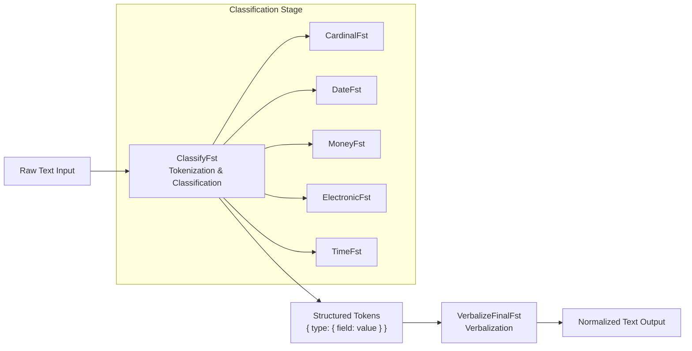
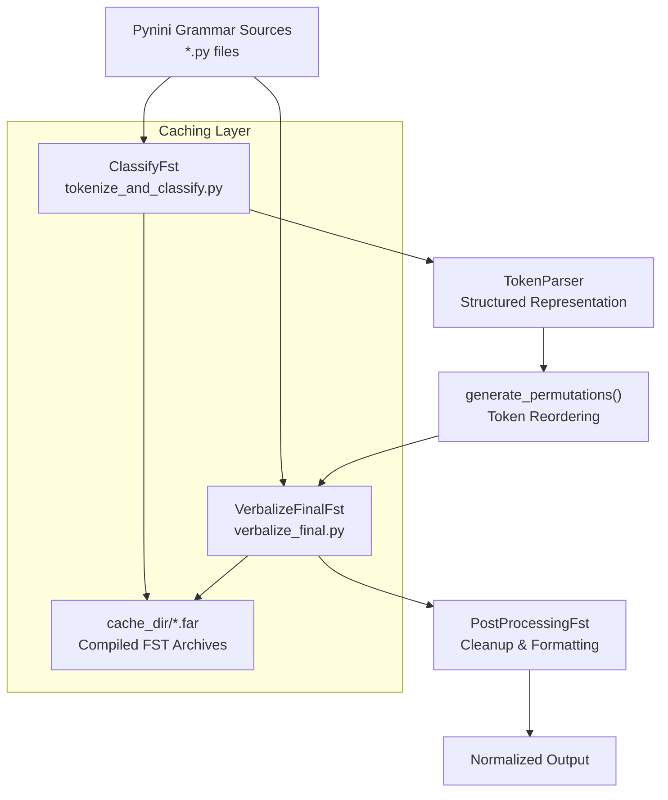
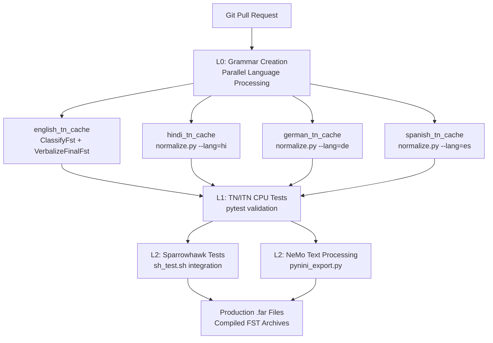

<!-- source: DeepWiki mcp.deepwiki.com · repo NVIDIA/NeMo-text-processing · page 1 Overview · fetched 2026-10-26 -->

# Overview

<details>
<summary>Relevant source files</summary>

The following files were used as context for generating this wiki page:

- [CHANGELOG.md](CHANGELOG.md)
- [Jenkinsfile](Jenkinsfile)
- [MANIFEST.in](MANIFEST.in)
- [nemo_text_processing/inverse_text_normalization/inverse_normalize.py](nemo_text_processing/inverse_text_normalization/inverse_normalize.py)
- [nemo_text_processing/package_info.py](nemo_text_processing/package_info.py)
- [nemo_text_processing/text_normalization/en/data/electronic/domain.tsv](nemo_text_processing/text_normalization/en/data/electronic/domain.tsv)
- [nemo_text_processing/text_normalization/en/taggers/electronic.py](nemo_text_processing/text_normalization/en/taggers/electronic.py)
- [nemo_text_processing/text_normalization/en/taggers/tokenize_and_classify.py](nemo_text_processing/text_normalization/en/taggers/tokenize_and_classify.py)
- [nemo_text_processing/text_normalization/normalize.py](nemo_text_processing/text_normalization/normalize.py)
- [nemo_text_processing/text_normalization/normalize_with_audio.py](nemo_text_processing/text_normalization/normalize_with_audio.py)
- [nemo_text_processing/text_normalization/run_evaluate.py](nemo_text_processing/text_normalization/run_evaluate.py)
- [tests/nemo_text_processing/en/data_text_normalization/test_cases_electronic.txt](tests/nemo_text_processing/en/data_text_normalization/test_cases_electronic.txt)
- [tests/nemo_text_processing/en/data_text_normalization/test_cases_punctuation.txt](tests/nemo_text_processing/en/data_text_normalization/test_cases_punctuation.txt)
- [tests/nemo_text_processing/en/data_text_normalization/test_cases_punctuation_match_input.txt](tests/nemo_text_processing/en/data_text_normalization/test_cases_punctuation_match_input.txt)
- [tests/nemo_text_processing/en/data_text_normalization/test_cases_range.txt](tests/nemo_text_processing/en/data_text_normalization/test_cases_range.txt)
- [tests/nemo_text_processing/en/test_normalization_with_audio.py](tests/nemo_text_processing/en/test_normalization_with_audio.py)

</details>


## Purpose and Scope

NeMo Text Processing is a multilingual text normalization and inverse text normalization system designed for Automatic Speech Recognition (ASR) and Text-to-Speech (TTS) applications. The system converts between written text and spoken forms using Finite State Transducers (FSTs) implemented with the Pynini library.

The repository provides production-ready grammars for 15+ languages, supporting both deterministic and non-deterministic normalization modes. For deployment information, see [Deployment and Production](#6). For language-specific implementations, see [Language Support](#4).

**Sources:** [nemo_text_processing/package_info.py:33](), [nemo_text_processing/text_normalization/normalize.py:85-102]()

## Core Text Processing Pipeline

The system implements a two-stage pipeline for text processing:



**Sources:** [nemo_text_processing/text_normalization/normalize.py:321-384](), [nemo_text_processing/text_normalization/en/taggers/tokenize_and_classify.py:51-242]()

## System Architecture

### Core Components

The system consists of three main processing classes:

| Component | Class | Purpose | File Location |
|-----------|-------|---------|---------------|
| **Text Normalization** | `Normalizer` | Converts written → spoken form | [normalize.py:85]() |
| **Audio-Enhanced TN** | `NormalizerWithAudio` | ASR-guided normalization | [normalize_with_audio.py:58]() |
| **Inverse Normalization** | `InverseNormalizer` | Converts spoken → written form | [inverse_normalize.py:26]() |

**Sources:** [nemo_text_processing/text_normalization/normalize.py:85](), [nemo_text_processing/text_normalization/normalize_with_audio.py:58](), [nemo_text_processing/inverse_text_normalization/inverse_normalize.py:26]()

### FST Grammar Processing Flow



**Sources:** [nemo_text_processing/text_normalization/normalize.py:181-194](), [nemo_text_processing/text_normalization/normalize.py:592-620](), [nemo_text_processing/text_normalization/normalize.py:120-126]()

## Language Support Matrix

The system supports comprehensive text normalization across multiple languages:

| Language | TN Support | ITN Support | Special Features |
|----------|------------|-------------|------------------|
| English (`en`) | ✓ | ✓ | Audio-enhanced, Electronic text |
| Hindi (`hi`) | ✓ | ✓ | Complex number systems |
| German (`de`) | ✓ | ✓ | Electronic text processing |
| Spanish (`es`) | ✓ | ✓ | Code-switched ES/EN support |
| French (`fr`) | ✓ | ✓ | Date handling |
| Italian (`it`) | ✓ | ◐ | Sparrowhawk integration |
| Japanese (`ja`) | ◐ | ✓ | ITN-focused implementation |
| Chinese (`zh`) | ✓ | ✓ | Sentence-level processing |

**Sources:** [nemo_text_processing/text_normalization/normalize.py:120-178](), [nemo_text_processing/inverse_text_normalization/inverse_normalize.py:55-134]()

## Development and CI/CD Pipeline

### Jenkins Build Stages

The system uses a comprehensive Jenkins pipeline with three validation levels:



**Sources:** [Jenkinsfile:64-321](), [Jenkinsfile:325-410](), [Jenkinsfile:412-497]()

### Cache Management

The system implements sophisticated caching for compiled FST grammars:

- **Cache Directory Structure**: `{cache_dir}/{lang}_tn_{deterministic}_deterministic_{input_case}_{whitelist}_tokenize.far`
- **Environment Variables**: `EN_TN_CACHE`, `HI_TN_CACHE`, `DE_TN_CACHE` for CI/CD
- **Cache Validation**: Automatic `.far` file generation and restoration

**Sources:** [nemo_text_processing/text_normalization/en/taggers/tokenize_and_classify.py:76-86](), [Jenkinsfile:14-31]()

## Key Processing Examples

### Electronic Text Processing

The `ElectronicFst` handles email addresses, URLs, and technical text:

```
Input:  "cdf1@abc.edu"
Output: "cdf one at abc dot edu"

Input:  "https://www.nvidia.com/dgx-basepod"
Output: "HTTPS colon slash slash WWW dot NVIDIA dot com slash DGX dash BASEPOD"
```

**Sources:** [nemo_text_processing/text_normalization/en/taggers/electronic.py:33-178](), [tests/nemo_text_processing/en/data_text_normalization/test_cases_electronic.txt:1-44]()

### Audio-Enhanced Normalization

The `NormalizerWithAudio` class provides ASR-guided normalization by selecting the best normalization option based on Character Error Rate (CER):

```python
normalizer = NormalizerWithAudio(input_case='cased', lang='en')
result = normalizer.normalize(
    text="The meeting is at 2:30",
    pred_text="the meeting is at two thirty",
    n_tagged=30
)
```

**Sources:** [nemo_text_processing/text_normalization/normalize_with_audio.py:118-192](), [nemo_text_processing/text_normalization/normalize_with_audio.py:373-401]()

---

