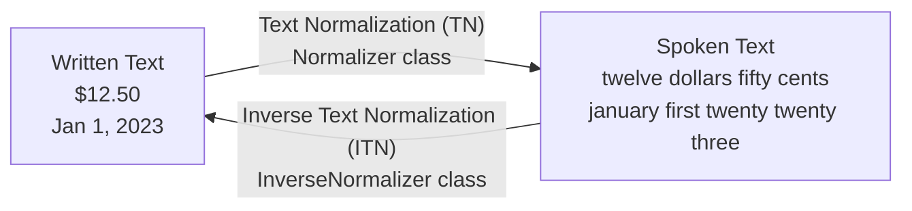
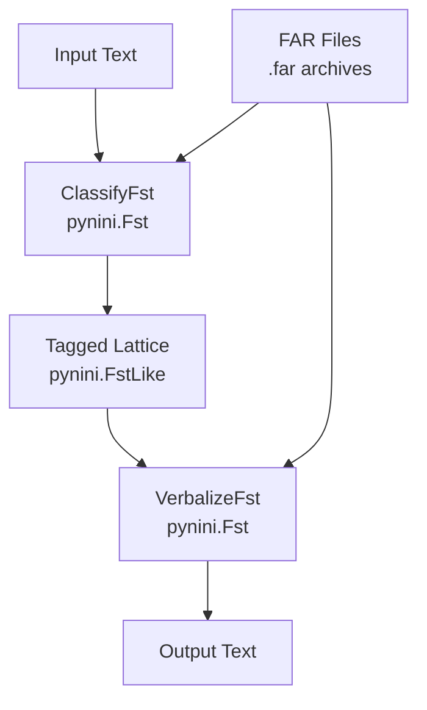
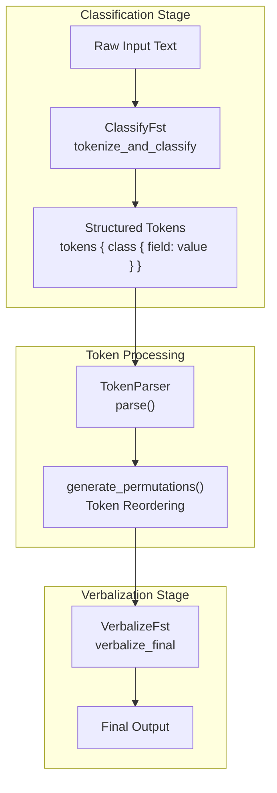
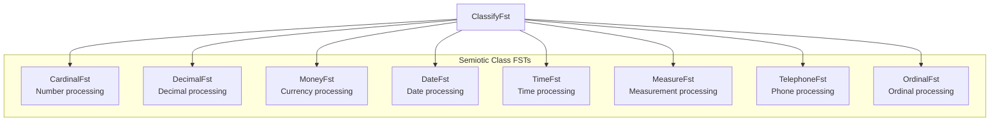
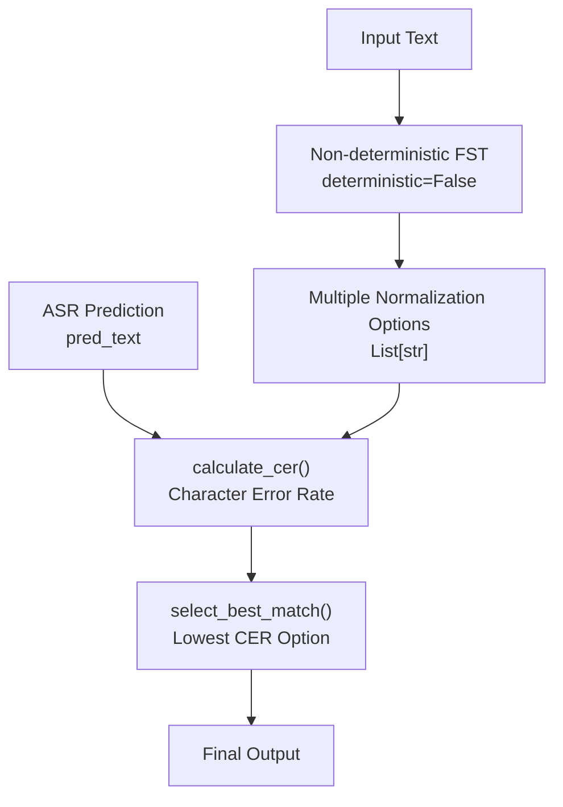
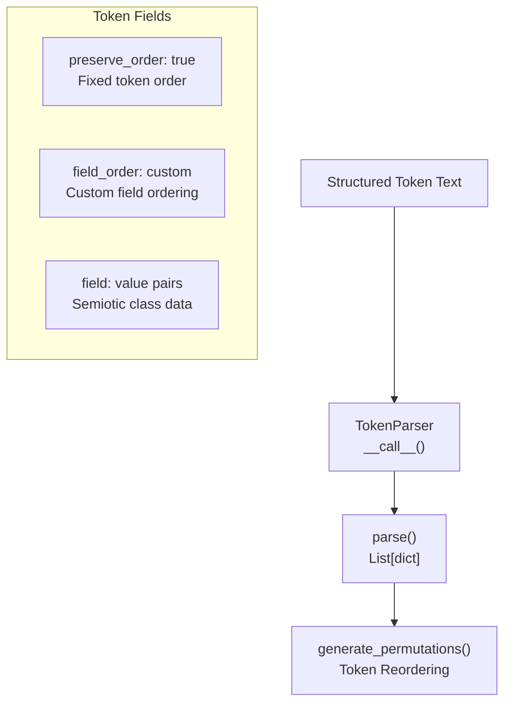
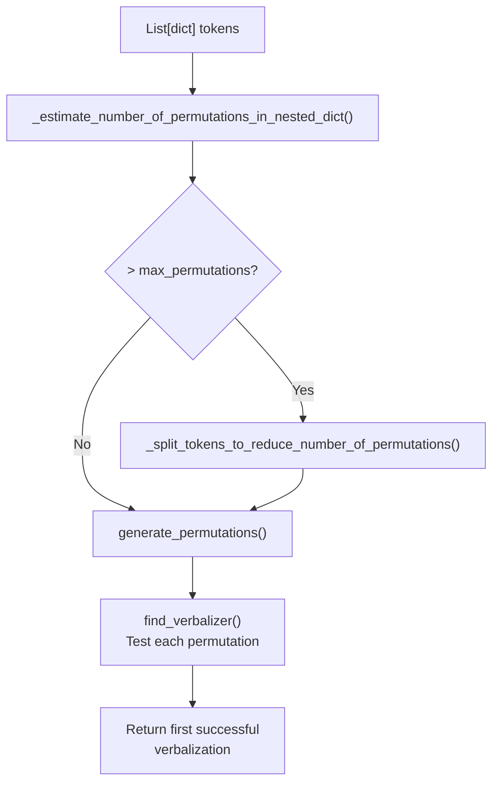

<!-- source: DeepWiki mcp.deepwiki.com · repo NVIDIA/NeMo-text-processing · page 1.1 Core Concepts · fetched 2026-10-26 -->

# Core Concepts

<details>
<summary>Relevant source files</summary>

The following files were used as context for generating this wiki page:

- [nemo_text_processing/inverse_text_normalization/hi/taggers/date.py](nemo_text_processing/inverse_text_normalization/hi/taggers/date.py)
- [nemo_text_processing/inverse_text_normalization/hi/taggers/tokenize_and_classify.py](nemo_text_processing/inverse_text_normalization/hi/taggers/tokenize_and_classify.py)
- [nemo_text_processing/inverse_text_normalization/hi/verbalizers/date.py](nemo_text_processing/inverse_text_normalization/hi/verbalizers/date.py)
- [nemo_text_processing/inverse_text_normalization/hi/verbalizers/verbalize.py](nemo_text_processing/inverse_text_normalization/hi/verbalizers/verbalize.py)
- [nemo_text_processing/inverse_text_normalization/inverse_normalize.py](nemo_text_processing/inverse_text_normalization/inverse_normalize.py)
- [nemo_text_processing/text_normalization/normalize.py](nemo_text_processing/text_normalization/normalize.py)
- [nemo_text_processing/text_normalization/normalize_with_audio.py](nemo_text_processing/text_normalization/normalize_with_audio.py)
- [nemo_text_processing/text_normalization/run_evaluate.py](nemo_text_processing/text_normalization/run_evaluate.py)
- [tests/nemo_text_processing/en/test_normalization_with_audio.py](tests/nemo_text_processing/en/test_normalization_with_audio.py)
- [tests/nemo_text_processing/hi/data_inverse_text_normalization/test_cases_date.txt](tests/nemo_text_processing/hi/data_inverse_text_normalization/test_cases_date.txt)
- [tests/nemo_text_processing/hi/test_sparrowhawk_inverse_text_normalization.sh](tests/nemo_text_processing/hi/test_sparrowhawk_inverse_text_normalization.sh)

</details>


This page covers the fundamental concepts and architecture of NeMo Text Processing, including text normalization, inverse text normalization, finite state transducers, and the core processing pipeline.

For information about language-specific implementations, see the Language Support section [4](#4). For deployment and runtime details, see Deployment and Production [6](#6).

## Text Normalization vs Inverse Text Normalization

NeMo Text Processing implements two complementary transformation processes:

**Text Normalization (TN)** converts written text to spoken form, useful for Text-to-Speech (TTS) preprocessing:
- `$12.50` → `twelve dollars fifty cents`
- `Jan 1, 2023` → `january first twenty twenty three`

**Inverse Text Normalization (ITN)** converts spoken text to written form, useful for Automatic Speech Recognition (ASR) post-processing:
- `twelve dollars fifty cents` → `$12.50`
- `january first twenty twenty three` → `Jan 1, 2023`



Sources: [nemo_text_processing/text_normalization/normalize.py:85-102](), [nemo_text_processing/inverse_text_normalization/inverse_normalize.py:26-41]()

## Finite State Transducers (FSTs)

The system is built on **Finite State Transducers (FSTs)** using the Pynini library. FSTs provide a mathematical framework for string-to-string transformations with the following properties:

- **Composable**: FSTs can be chained together using the `@` operator
- **Deterministic/Non-deterministic**: Can produce single or multiple outputs
- **Weighted**: Support probability weights for ranking alternatives
- **Cached**: Compiled to `.far` files for efficient runtime loading



Sources: [nemo_text_processing/text_normalization/normalize.py:631-632](), [nemo_text_processing/text_normalization/normalize.py:657-658](), [nemo_text_processing/inverse_text_normalization/hi/taggers/tokenize_and_classify.py:67-69]()

## Two-Stage Processing Pipeline

Both TN and ITN use a two-stage pipeline:

1. **Classification Stage**: Identifies and tags semiotic classes in structured format
2. **Verbalization Stage**: Converts tagged tokens to final output form



**Example Token Structure**:
```
tokens { money { integer_part: "12" fractional_part: "50" currency: "dollars" } }
```

Sources: [nemo_text_processing/text_normalization/normalize.py:181-191](), [nemo_text_processing/text_normalization/normalize.py:354-375](), [nemo_text_processing/text_normalization/token_parser.py:43]()

## Semiotic Classes

The system recognizes and processes multiple **semiotic classes** - categories of entities that require normalization:

| Class | TN Example | ITN Example |
|-------|------------|-------------|
| `cardinal` | `123` → `one hundred twenty three` | `one hundred twenty three` → `123` |
| `decimal` | `12.5` → `twelve point five` | `twelve point five` → `12.5` |
| `money` | `$12.50` → `twelve dollars fifty cents` | `twelve dollars fifty cents` → `$12.50` |
| `date` | `Jan 1, 2023` → `january first twenty twenty three` | `january first twenty twenty three` → `Jan 1, 2023` |
| `time` | `3:30 PM` → `three thirty p m` | `three thirty p m` → `3:30 PM` |
| `measure` | `5 kg` → `five kilograms` | `five kilograms` → `5 kg` |
| `telephone` | `555-1234` → `five five five one two three four` | `five five five one two three four` → `555-1234` |
| `ordinal` | `1st` → `first` | `first` → `1st` |



Sources: [nemo_text_processing/inverse_text_normalization/hi/taggers/tokenize_and_classify.py:96-108](), [nemo_text_processing/inverse_text_normalization/hi/verbalizers/verbalize.py:53-65]()

## Audio-Enhanced Processing

The `NormalizerWithAudio` class extends basic normalization by using ASR predictions to select the best normalization option from multiple candidates:



**Character Error Rate (CER) Selection**:
- Calculates edit distance between each normalization option and ASR prediction
- Selects option with lowest CER
- Falls back to deterministic normalization if CER exceeds threshold

Sources: [nemo_text_processing/text_normalization/normalize_with_audio.py:58-97](), [nemo_text_processing/text_normalization/normalize_with_audio.py:373-401](), [nemo_text_processing/text_normalization/normalize_with_audio.py:404-423]()

## Token Structure and Parsing

The system uses a structured token format for intermediate representation:

**Token Format**:
```
tokens { <semiotic_class> { <field1>: "<value1>" <field2>: "<value2>" preserve_order: true } }
```

**Example Tokens**:
```
tokens { date { month: "january" day: "first" year: "twenty twenty three" preserve_order: true } }
tokens { money { integer_part: "twelve" fractional_part: "fifty" currency: "dollars" } }
```

The `TokenParser` class handles parsing of structured tokens:



Sources: [nemo_text_processing/text_normalization/token_parser.py:43](), [nemo_text_processing/text_normalization/normalize.py:354-355](), [nemo_text_processing/text_normalization/normalize.py:592-620]()

## Permutation Management

The system generates multiple token orderings to handle ambiguous cases, with built-in limits to prevent combinatorial explosion:

**Permutation Control**:
- `max_number_of_permutations_per_split`: Maximum permutations per token sequence (default: 729)
- `_split_tokens_to_reduce_number_of_permutations()`: Splits long sequences to stay under limit
- `PRESERVE_ORDER_KEY`: Prevents permutation for specific tokens

**Permutation Process**:
1. Estimate permutation count using `_estimate_number_of_permutations_in_nested_dict()`
2. Split token sequences if count exceeds limit
3. Generate all valid permutations using `_permute()`
4. Test each permutation against verbalizer until success



Sources: [nemo_text_processing/text_normalization/normalize.py:258-319](), [nemo_text_processing/text_normalization/normalize.py:563-591](), [nemo_text_processing/text_normalization/normalize.py:592-620]()

---

