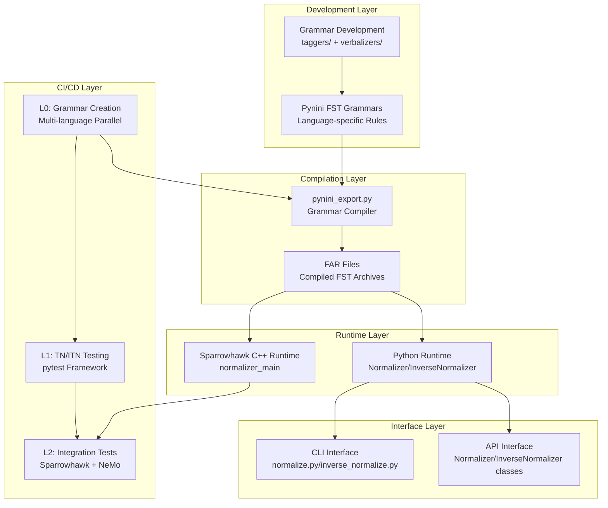
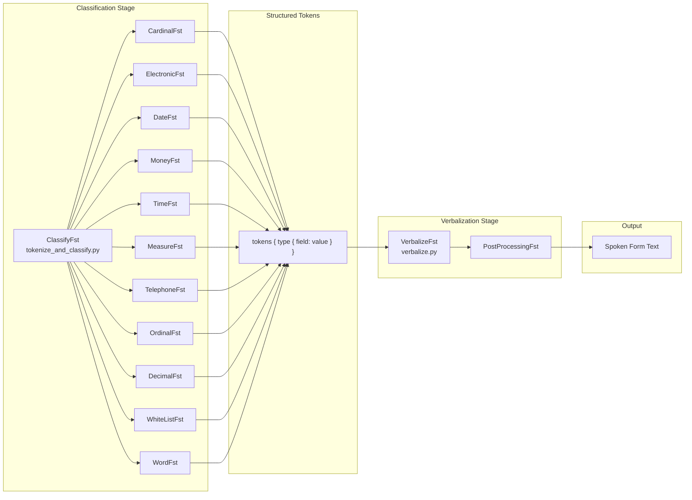
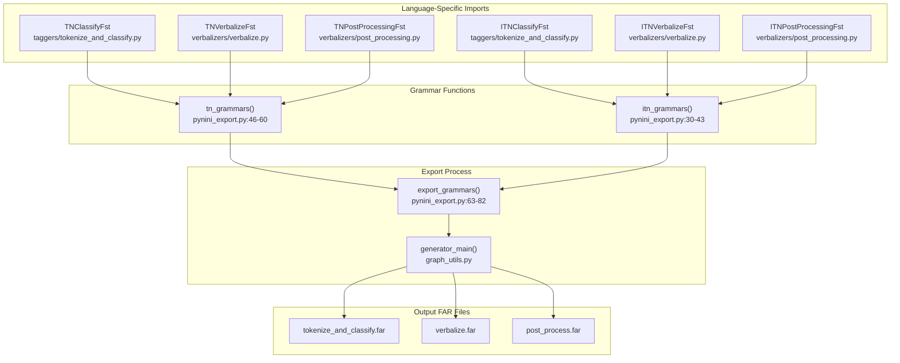
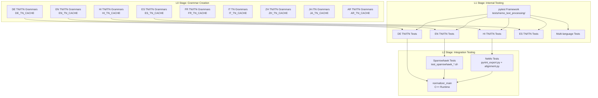
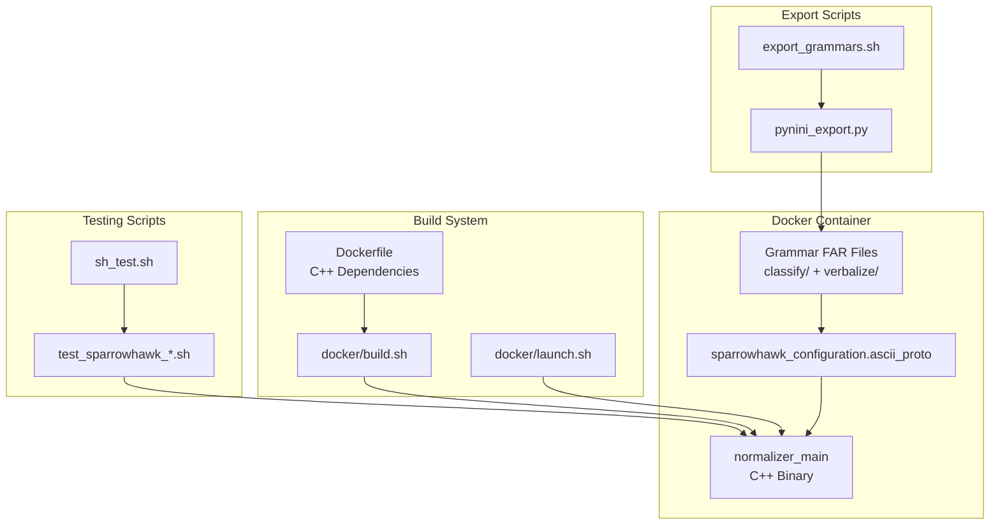
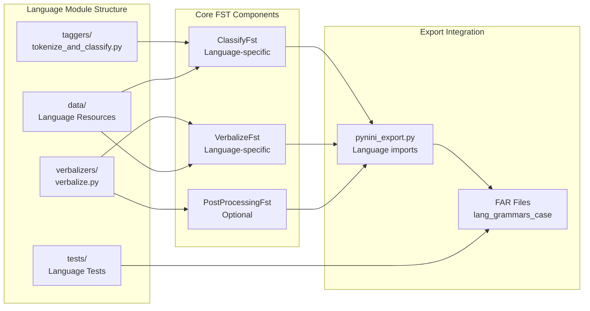

<!-- source: DeepWiki mcp.deepwiki.com · repo NVIDIA/NeMo-text-processing · page 1.2 System Architecture · fetched 2026-10-26 -->

# System Architecture

Relevant source files

The following files were used as context for generating this wiki page:

- [Jenkinsfile](Jenkinsfile)
- [nemo_text_processing/inverse_text_normalization/ja/verbalizers/word.py](nemo_text_processing/inverse_text_normalization/ja/verbalizers/word.py)
- [nemo_text_processing/text_normalization/en/data/electronic/domain.tsv](nemo_text_processing/text_normalization/en/data/electronic/domain.tsv)
- [nemo_text_processing/text_normalization/en/taggers/electronic.py](nemo_text_processing/text_normalization/en/taggers/electronic.py)
- [nemo_text_processing/text_normalization/en/taggers/tokenize_and_classify.py](nemo_text_processing/text_normalization/en/taggers/tokenize_and_classify.py)
- [nemo_text_processing/text_normalization/zh/taggers/money.py](nemo_text_processing/text_normalization/zh/taggers/money.py)
- [tests/nemo_text_processing/en/data_text_normalization/test_cases_electronic.txt](tests/nemo_text_processing/en/data_text_normalization/test_cases_electronic.txt)
- [tests/nemo_text_processing/en/data_text_normalization/test_cases_punctuation.txt](tests/nemo_text_processing/en/data_text_normalization/test_cases_punctuation.txt)
- [tests/nemo_text_processing/en/data_text_normalization/test_cases_punctuation_match_input.txt](tests/nemo_text_processing/en/data_text_normalization/test_cases_punctuation_match_input.txt)
- [tests/nemo_text_processing/en/data_text_normalization/test_cases_range.txt](tests/nemo_text_processing/en/data_text_normalization/test_cases_range.txt)
- [tests/nemo_text_processing/en/test_sparrowhawk_inverse_text_normalization.sh](tests/nemo_text_processing/en/test_sparrowhawk_inverse_text_normalization.sh)
- [tests/nemo_text_processing/en/test_sparrowhawk_inverse_text_normalization_cased.sh](tests/nemo_text_processing/en/test_sparrowhawk_inverse_text_normalization_cased.sh)
- [tests/nemo_text_processing/en/test_sparrowhawk_normalization.sh](tests/nemo_text_processing/en/test_sparrowhawk_normalization.sh)
- [tests/nemo_text_processing/hi/test_whitelist.py](tests/nemo_text_processing/hi/test_whitelist.py)
- [tests/nemo_text_processing/hi/test_word.py](tests/nemo_text_processing/hi/test_word.py)
- [tests/nemo_text_processing/mr/test_cardinal.py](tests/nemo_text_processing/mr/test_cardinal.py)
- [tests/nemo_text_processing/mr/test_date.py](tests/nemo_text_processing/mr/test_date.py)
- [tests/nemo_text_processing/zh/data_text_normalization/test_cases_word.txt](tests/nemo_text_processing/zh/data_text_normalization/test_cases_word.txt)
- [tests/nemo_text_processing/zh/test_sparrowhawk_normalization.sh](tests/nemo_text_processing/zh/test_sparrowhawk_normalization.sh)
- [tools/text_processing_deployment/Dockerfile](tools/text_processing_deployment/Dockerfile)
- [tools/text_processing_deployment/docker/launch.sh](tools/text_processing_deployment/docker/launch.sh)
- [tools/text_processing_deployment/export_grammars.sh](tools/text_processing_deployment/export_grammars.sh)
- [tools/text_processing_deployment/pynini_export.py](tools/text_processing_deployment/pynini_export.py)
- [tools/text_processing_deployment/sh_test.sh](tools/text_processing_deployment/sh_test.sh)

## Purpose and Scope

This document provides a comprehensive overview of the NeMo Text Processing system architecture, covering the core components responsible for text normalization (TN) and inverse text normalization (ITN) across multiple languages. The architecture encompasses grammar development, compilation pipelines, continuous integration, and production deployment systems.

For implementation details of specific text processing components, see [Core Text Processing Systems](#3). For language-specific implementations, see [Language Support](#4). For deployment procedures, see [Deployment and Production](#6).

## High-Level System Architecture

The NeMo Text Processing system consists of five major architectural layers that work together to transform text between written and spoken forms:

**Sources:** [Jenkinsfile:1-507](), [tools/text_processing_deployment/pynini_export.py:1-324](), [nemo_text_processing/text_normalization/en/taggers/tokenize_and_classify.py:1-242]()

## Grammar Development and Compilation Pipeline

The core of the system is built around Finite State Transducers (FSTs) that handle the two-stage text processing pipeline:

### Two-Stage Processing Architecture

**Sources:** [nemo_text_processing/text_normalization/en/taggers/tokenize_and_classify.py:189-222](), [nemo_text_processing/text_normalization/en/taggers/electronic.py:33-178]()

### Grammar Compilation Process

The `pynini_export.py` script serves as the central compilation engine that transforms Pynini FST grammars into production-ready FAR files:

**Sources:** [tools/text_processing_deployment/pynini_export.py:46-82](), [tools/text_processing_deployment/pynini_export.py:144-324]()

## CI/CD and Testing Architecture

The Jenkins-based CI/CD pipeline implements a three-tier testing strategy:

### Jenkins Pipeline Structure

**Sources:** [Jenkinsfile:64-117](), [Jenkinsfile:325-410](), [Jenkinsfile:412-497]()

### Testing Framework Components

| Component | Purpose | Key Files |
|-----------|---------|-----------|
| **pytest Tests** | Internal grammar validation | `tests/nemo_text_processing/*/test_*.py` |
| **Sparrowhawk Tests** | C++ runtime integration | `tests/*/test_sparrowhawk_*.sh` |
| **Shell Tests** | Production environment validation | `tools/text_processing_deployment/sh_test.sh` |
| **Test Data** | Input/expected output pairs | `tests/*/data_*/test_cases_*.txt` |

**Sources:** [tests/nemo_text_processing/en/test_sparrowhawk_normalization.sh:1-122](), [tests/nemo_text_processing/en/test_sparrowhawk_inverse_text_normalization.sh:1-85]()

## Production Deployment Architecture

The production deployment system utilizes Docker containers with the Sparrowhawk C++ runtime for high-performance text processing:

### Sparrowhawk Runtime Environment

**Sources:** [tools/text_processing_deployment/Dockerfile:1-41](), [tools/text_processing_deployment/export_grammars.sh:1-109](), [tools/text_processing_deployment/docker/launch.sh:1-61]()

## Multi-Language Support Structure

The system supports multiple languages through a modular architecture where each language implements the same FST interface:

### Language Implementation Matrix

| Language | TN Support | ITN Support | Special Components |
|----------|------------|-------------|-------------------|
| **English** | ✓ | ✓ | `NormalizerWithAudio`, `PostProcessingFst` |
| **Hindi** | ✓ | ✓ | `PostProcessingFst` |
| **German** | ✓ | ✓ | Electronic text focus |
| **Spanish** | ✓ | ✓ | Ordinal processing |
| **French** | ✓ | ✓ | Date handling |
| **Italian** | ✓ | Partial | Sparrowhawk integration |
| **Chinese** | ✓ | ✓ | `PostProcessingFst` |
| **Japanese** | ✓ | ✓ | `PostProcessingFst` |
| **Arabic** | ✓ | ✓ | RTL text support |

### Language-Specific Architecture Pattern

**Sources:** [tools/text_processing_deployment/pynini_export.py:140-324](), [tests/nemo_text_processing/hi/test_word.py:1-43](), [tests/nemo_text_processing/zh/data_text_normalization/test_cases_word.txt:1-26]()

---

