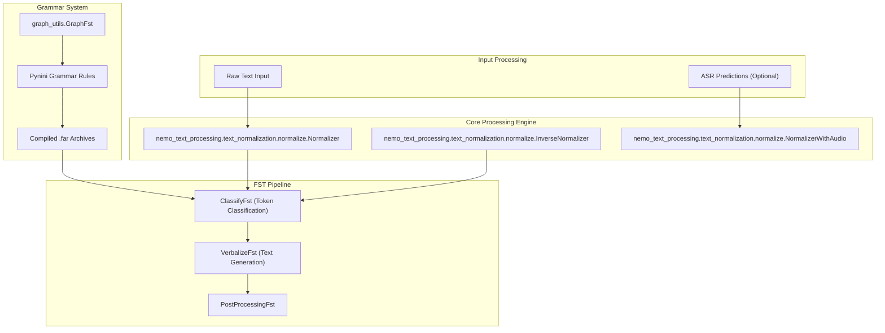
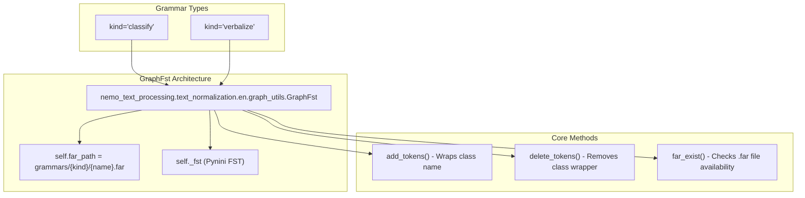
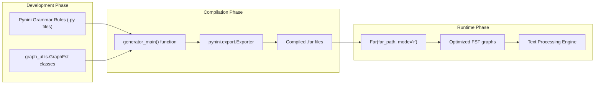

<!-- source: DeepWiki mcp.deepwiki.com · repo NVIDIA/NeMo-text-processing · page 2 Getting Started · fetched 2026-10-26 -->

# Getting Started

<details>
<summary>Relevant source files</summary>

The following files were used as context for generating this wiki page:

- [CHANGELOG.md](CHANGELOG.md)
- [MANIFEST.in](MANIFEST.in)
- [README.md](README.md)
- [nemo_text_processing/package_info.py](nemo_text_processing/package_info.py)
- [nemo_text_processing/text_normalization/en/graph_utils.py](nemo_text_processing/text_normalization/en/graph_utils.py)
- [requirements/requirements.txt](requirements/requirements.txt)
- [requirements/requirements_test.txt](requirements/requirements_test.txt)
- [setup.py](setup.py)

</details>


This document provides installation instructions, dependency information, and basic setup guidance for the NeMo Text Processing system. It covers the essential steps to get the system running and introduces the core components for text normalization and inverse text normalization. For detailed usage examples and API documentation, see [Quick Start Guide](#2.1). For information about specific language implementations, see [Language Support](#4).

## Installation

NeMo Text Processing can be installed through multiple methods depending on your use case and development needs.

### Prerequisites

The system requires Python 3.8+ and has specific platform requirements due to the Pynini dependency. Linux x86_64 is the primary supported platform, while macOS and Windows require additional configuration.

### Installation Methods

#### Pip Installation (Recommended for Users)

For the latest stable release:

```bash
pip install nemo_text_processing
```

#### Conda Environment Setup

Create a dedicated environment for optimal dependency management:

```bash
conda create --name nemo_tn python==3.10
conda activate nemo_tn
pip install nemo_text_processing
```

#### Development Installation

For contributors and developers:

```bash
git clone https://github.com/NVIDIA/NeMo-text-processing
cd NeMo-text-processing
./reinstall.sh
```

#### Platform-Specific Notes

For macOS and Windows users, install Pynini separately via conda-forge due to compilation requirements:

```bash
conda install -c conda-forge pynini=2.1.6.post1
```

*Sources: [README.md:28-81](), [setup.py:78-84]()*

## Dependencies

The system relies on several key dependencies for text processing and finite state transducer operations:

| Dependency | Version | Purpose |
|------------|---------|---------|
| pynini | 2.1.6.post1 | Finite State Transducer operations |
| inflect | - | Number and word inflection |
| pandas | - | Data manipulation |
| regex | - | Advanced pattern matching |
| transformers | - | Language model integration |
| sacremoses | >=0.0.43 | Text tokenization |
| editdistance | - | String similarity calculations |

### Core FST Dependencies

The system's finite state transducer functionality depends on:
- **OpenFst**: Backend for FST operations
- **Pynini**: Python binding for weighted finite-state transducers
- **FAR files**: Compiled grammar archives

*Sources: [requirements/requirements.txt:1-14](), [requirements/requirements_test.txt:1-14]()*

## System Overview

NeMo Text Processing implements a two-stage pipeline architecture for bidirectional text transformation:



*Sources: [nemo_text_processing/text_normalization/en/graph_utils.py:271-338](), [README.md:7-12]()*

## Core Components

### Base Classes and Utilities

The system is built around several foundational classes:

#### GraphFst Base Class

The `GraphFst` class serves as the foundation for all grammar finite state transducers:



#### Essential FST Constants

The system defines critical FST building blocks in `graph_utils.py`:

| Constant | Purpose | Definition |
|----------|---------|------------|
| `NEMO_DIGIT` | Digit recognition | `byte.DIGIT` |
| `NEMO_ALPHA` | Alphabetic characters | Union of upper/lowercase |
| `NEMO_WHITE_SPACE` | Whitespace handling | Space, tab, newline, non-breaking space |
| `NEMO_SIGMA` | Universal character set | `pynini.closure(NEMO_CHAR)` |

*Sources: [nemo_text_processing/text_normalization/en/graph_utils.py:271-338](), [nemo_text_processing/text_normalization/en/graph_utils.py:30-47]()*

### Grammar Compilation Pipeline

The system uses a compilation process to convert Pynini grammars into optimized FAR archives:



*Sources: [nemo_text_processing/text_normalization/en/graph_utils.py:174-187](), [nemo_text_processing/text_normalization/en/graph_utils.py:288-291]()*

## Package Information

The system maintains version and metadata information through a centralized configuration:

| Property | Value | Purpose |
|----------|-------|---------|
| `__version__` | 1.1.0 | Current release version |
| `__package_name__` | nemo_text_processing | PyPI package identifier |
| `__description__` | NeMo text processing for ASR and TTS | Package description |
| `__repository_url__` | https://github.com/nvidia/nemo-text-processing | Source repository |

*Sources: [nemo_text_processing/package_info.py:16-35](), [setup.py:30-44]()*

## Basic Usage Patterns

### Normalizer Class Integration

The core processing classes follow a consistent interface pattern:

```python
# Referenced from expected usage patterns
from nemo_text_processing.text_normalization.normalize import Normalizer

# Initialize with language support
normalizer = Normalizer(input_case='cased', lang='en')

# Process text through FST pipeline
normalized_text = normalizer.normalize(text_input)
```

### FST Graph Operations

The system provides utilities for common FST operations:

| Function | Purpose | Usage Pattern |
|----------|---------|---------------|
| `get_plurals()` | Singular to plural conversion | `SINGULAR_TO_PLURAL @ fst` |
| `get_singulars()` | Plural to singular conversion | `PLURAL_TO_SINGULAR @ fst` |
| `convert_space()` | Space normalization | Handle non-breaking spaces |
| `capitalized_input_graph()` | Case handling | Support capitalized inputs |

*Sources: [nemo_text_processing/text_normalization/en/graph_utils.py:189-211](), [nemo_text_processing/text_normalization/en/graph_utils.py:149-172]()*

## Next Steps

After completing the installation:

1. **Quick Start**: Follow the [Quick Start Guide](#2.1) for basic usage examples
2. **Language Selection**: Review [Language Support](#4) for your target language
3. **Development**: See [Development and Testing](#5) for contribution guidelines
4. **Production**: Consult [Deployment and Production](#6) for runtime optimization

For immediate testing, verify your installation by importing the core modules:

```python
from nemo_text_processing.text_normalization.normalize import Normalizer
from nemo_text_processing.text_normalization.normalize import InverseNormalizer
```

*Sources: [README.md:14-26](), [CHANGELOG.md:8-29]()*

---

