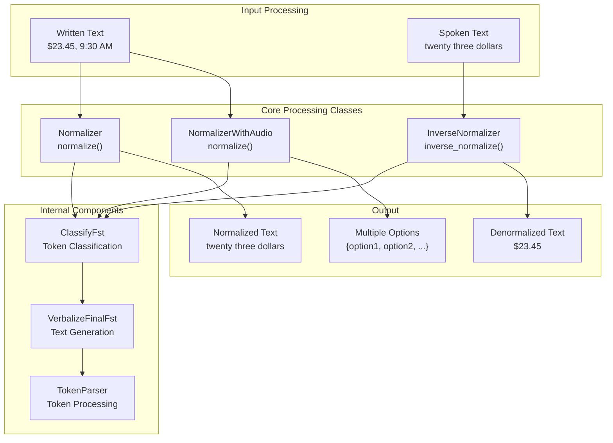
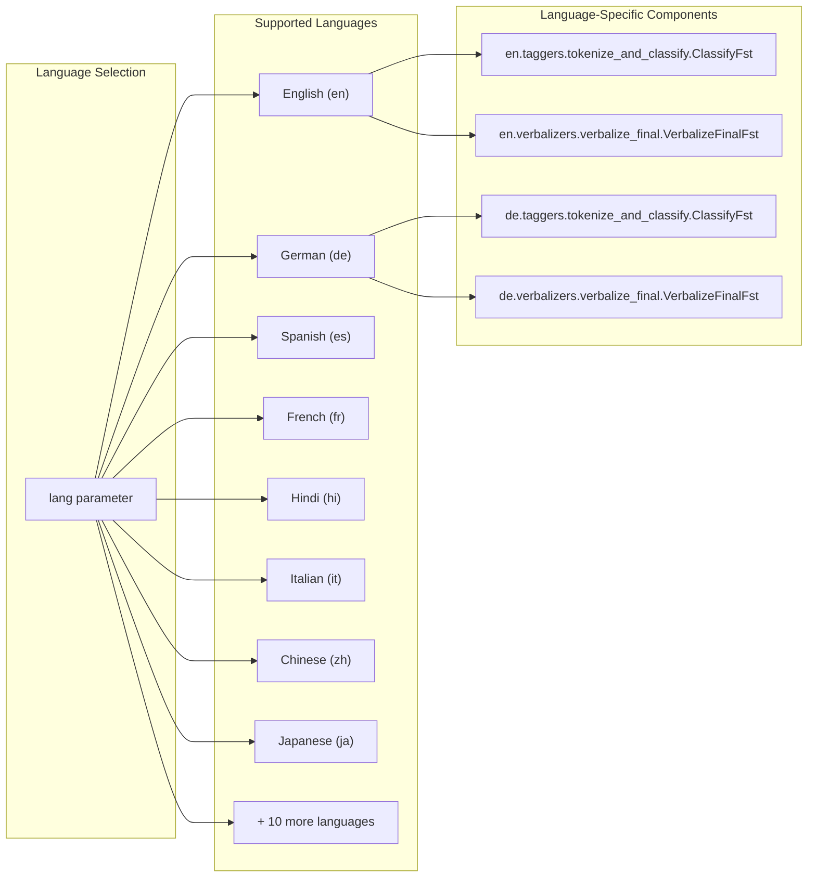

<!-- source: DeepWiki mcp.deepwiki.com · repo NVIDIA/NeMo-text-processing · page 2.1 Quick Start Guide · fetched 2026-10-26 -->

# Quick Start Guide

<details>
<summary>Relevant source files</summary>

The following files were used as context for generating this wiki page:

- [nemo_text_processing/inverse_text_normalization/inverse_normalize.py](nemo_text_processing/inverse_text_normalization/inverse_normalize.py)
- [nemo_text_processing/text_normalization/en/taggers/range.py](nemo_text_processing/text_normalization/en/taggers/range.py)
- [nemo_text_processing/text_normalization/en/verbalizers/measure.py](nemo_text_processing/text_normalization/en/verbalizers/measure.py)
- [nemo_text_processing/text_normalization/normalize.py](nemo_text_processing/text_normalization/normalize.py)
- [nemo_text_processing/text_normalization/normalize_with_audio.py](nemo_text_processing/text_normalization/normalize_with_audio.py)
- [nemo_text_processing/text_normalization/run_evaluate.py](nemo_text_processing/text_normalization/run_evaluate.py)
- [tests/nemo_text_processing/en/data_text_normalization/test_cases_normalize_with_audio.txt](tests/nemo_text_processing/en/data_text_normalization/test_cases_normalize_with_audio.txt)
- [tests/nemo_text_processing/en/test_normalization_with_audio.py](tests/nemo_text_processing/en/test_normalization_with_audio.py)
- [tests/nemo_text_processing/en/test_serial.py](tests/nemo_text_processing/en/test_serial.py)
- [tests/nemo_text_processing/en/test_word.py](tests/nemo_text_processing/en/test_word.py)

</details>


This guide provides simple examples of using the core text processing components for basic text normalization and inverse normalization tasks. For detailed information about the underlying FST grammars and language-specific implementations, see [Grammar Development](#5.2). For production deployment scenarios, see [Deployment and Production](#6).

## Overview

The NeMo Text Processing system provides three main classes for text processing:

- **`Normalizer`** - Converts written text to spoken form (Text Normalization)
- **`NormalizerWithAudio`** - Audio-guided normalization with multiple options 
- **`InverseNormalizer`** - Converts spoken text to written form (Inverse Text Normalization)

## Basic Text Normalization

### Simple Usage

```python
from nemo_text_processing.text_normalization.normalize import Normalizer

# Initialize normalizer
normalizer = Normalizer(input_case='cased', lang='en')

# Normalize single text
text = "I have $23.45 and will arrive at 9:30 AM"
result = normalizer.normalize(text)
# Output: "I have twenty three dollars and forty five cents and will arrive at nine thirty AM"
```

*Sources: [nemo_text_processing/text_normalization/normalize.py:70-82]()*

### Batch Processing

```python
# Normalize multiple texts
texts = ["$1.50", "2:15 PM", "Dec 25, 2023"]
results = normalizer.normalize_list(texts)
# Output: ["one dollar and fifty cents", "two fifteen PM", "december twenty five twenty twenty three"]
```

*Sources: [nemo_text_processing/text_normalization/normalize.py:197-256]()*

### Processing JSON Manifests

```python
# Process JSON manifest file
normalizer.normalize_manifest(
    manifest="input.json",
    n_jobs=-1,
    batch_size=300,
    output_filename="output.json",
    text_field="text",
    punct_pre_process=False,
    punct_post_process=True
)
```

*Sources: [nemo_text_processing/text_normalization/normalize.py:419-527]()*

## Audio-Enhanced Normalization

### Basic Audio-Guided Normalization

```python
from nemo_text_processing.text_normalization.normalize_with_audio import NormalizerWithAudio

# Initialize audio-enhanced normalizer
normalizer = NormalizerWithAudio(input_case='cased', lang='en')

# Normalize with audio prediction guidance
text = "I bought 5 books for $25"
pred_text = "i bought five books for twenty five dollars"  # ASR prediction

result = normalizer.normalize(
    text=text,
    pred_text=pred_text,
    n_tagged=30,
    punct_post_process=True
)
# Returns best matching normalization based on ASR prediction
```

*Sources: [nemo_text_processing/text_normalization/normalize_with_audio.py:118-192]()*

### Multiple Normalization Options

```python
# Get multiple normalization options (without audio)
options = normalizer.normalize(
    text="$1.50", 
    n_tagged=30,
    punct_post_process=True
)
# Returns set of possible normalizations: 
# {"one dollar and fifty cents", "one dollar fifty cents", ...}
```

*Sources: [nemo_text_processing/text_normalization/normalize_with_audio.py:194-266]()*

## Inverse Text Normalization

### Basic Inverse Normalization

```python
from nemo_text_processing.inverse_text_normalization.inverse_normalize import InverseNormalizer

# Initialize inverse normalizer
inverse_normalizer = InverseNormalizer(input_case='lower_cased', lang='en')

# Convert spoken to written form
spoken_text = "twenty three dollars and forty five cents"
written_text = inverse_normalizer.inverse_normalize(spoken_text, verbose=False)
# Output: "$23.45"
```

*Sources: [nemo_text_processing/inverse_text_normalization/inverse_normalize.py:155-166]()*

### Batch Inverse Normalization

```python
# Process multiple spoken texts
spoken_texts = [
    "twenty three dollars", 
    "nine thirty AM", 
    "december twenty fifth"
]
written_texts = inverse_normalizer.inverse_normalize_list(spoken_texts)
# Output: ["$23", "9:30 AM", "december 25th"]
```

*Sources: [nemo_text_processing/inverse_text_normalization/inverse_normalize.py:143-153]()*

## System Architecture Overview



*Sources: [nemo_text_processing/text_normalization/normalize.py:85-196](), [nemo_text_processing/text_normalization/normalize_with_audio.py:58-117](), [nemo_text_processing/inverse_text_normalization/inverse_normalize.py:26-142]()*

## Configuration Parameters

### Common Parameters

| Parameter | Description | Default | Options |
|-----------|-------------|---------|---------|
| `input_case` | Input text capitalization | `'cased'` | `'cased'`, `'lower_cased'` |
| `lang` | Target language | `'en'` | `'en'`, `'de'`, `'es'`, `'fr'`, `'hi'`, etc. |
| `cache_dir` | Grammar cache directory | `None` | Path to cache directory |
| `overwrite_cache` | Rebuild grammar cache | `False` | `True`, `False` |
| `whitelist` | Custom replacements file | `None` | Path to whitelist file |
| `deterministic` | Single vs multiple outputs | `True` | `True`, `False` |

*Sources: [nemo_text_processing/text_normalization/normalize.py:104-115]()*

### Audio-Specific Parameters

| Parameter | Description | Default | Purpose |
|-----------|-------------|---------|---------|
| `n_tagged` | Number of normalization options | `30` | Controls output diversity |
| `pred_text` | ASR prediction | `None` | Guides best option selection |
| `cer_threshold` | Character error rate limit | `-1` | Fallback to deterministic |

*Sources: [nemo_text_processing/text_normalization/normalize_with_audio.py:118-144]()*

## Multi-Language Support



*Sources: [nemo_text_processing/text_normalization/normalize.py:120-178](), [nemo_text_processing/inverse_text_normalization/inverse_normalize.py:55-134]()*

## Performance Considerations

### Caching

```python
# Enable caching for better performance
normalizer = Normalizer(
    input_case='cased',
    lang='en',
    cache_dir='/path/to/cache',
    overwrite_cache=False  # Reuse existing cache
)
```

### Parallel Processing

```python
# Use parallel processing for large batches
normalizer.normalize_list(
    texts=large_text_list,
    n_jobs=-1,        # Use all CPU cores
    batch_size=300    # Process in batches
)
```

*Sources: [nemo_text_processing/text_normalization/normalize.py:197-256]()*

## Common Use Cases

### TTS Preprocessing

```python
# Text-to-Speech preprocessing
normalizer = Normalizer(input_case='cased', lang='en', post_process=True)
tts_text = normalizer.normalize("Call me at 555-1234 by 3:30 PM")
```

### ASR Postprocessing

```python
# Automatic Speech Recognition postprocessing
inverse_normalizer = InverseNormalizer(input_case='lower_cased', lang='en')
written_form = inverse_normalizer.inverse_normalize("twenty three dollars")
```

### Data Processing Pipeline

```python
# Process training data manifest
normalizer.normalize_manifest(
    manifest="training_data.json",
    text_field="raw_text",
    output_field="normalized_text",
    n_jobs=-1
)
```

*Sources: [nemo_text_processing/text_normalization/normalize.py:419-527](), [tests/nemo_text_processing/en/test_word.py:26-69](), [tests/nemo_text_processing/en/test_normalization_with_audio.py:23-37]()*

---

