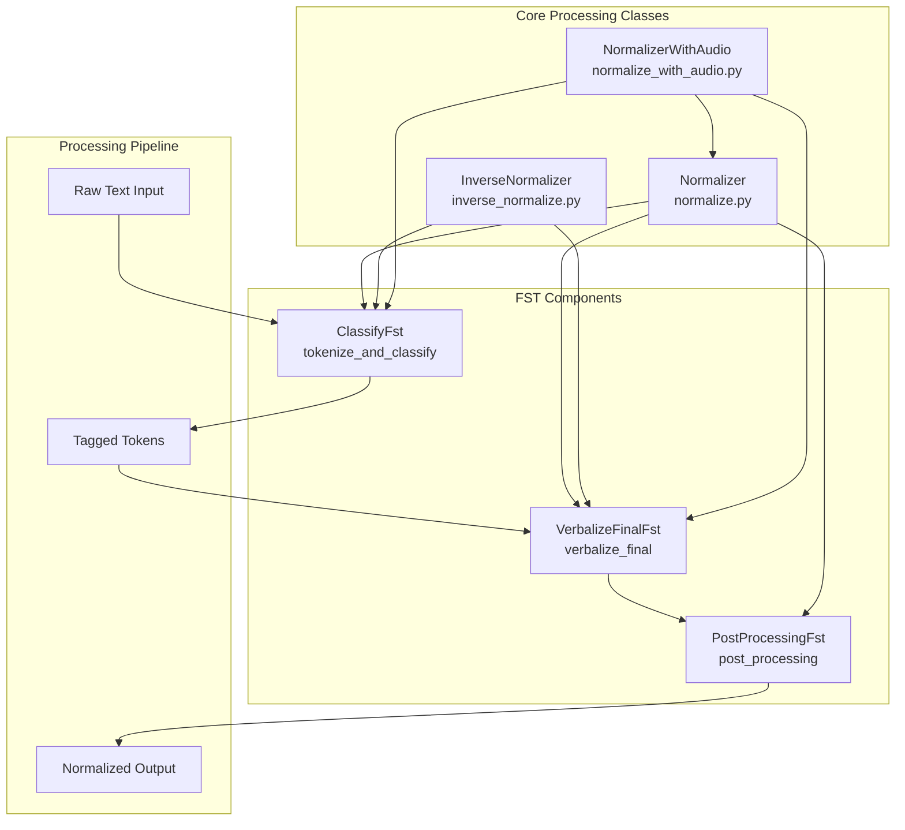
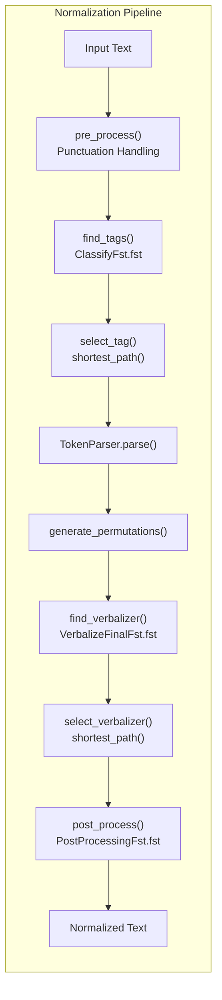
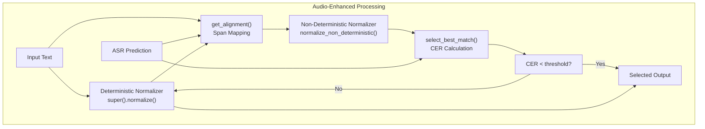

<!-- source: DeepWiki mcp.deepwiki.com · repo NVIDIA/NeMo-text-processing · page 3 Core Text Processing Systems · fetched 2026-10-26 -->

# Core Text Processing Systems

<details>
<summary>Relevant source files</summary>

The following files were used as context for generating this wiki page:

- [nemo_text_processing/inverse_text_normalization/inverse_normalize.py](nemo_text_processing/inverse_text_normalization/inverse_normalize.py)
- [nemo_text_processing/text_normalization/normalize.py](nemo_text_processing/text_normalization/normalize.py)
- [nemo_text_processing/text_normalization/normalize_with_audio.py](nemo_text_processing/text_normalization/normalize_with_audio.py)
- [nemo_text_processing/text_normalization/run_evaluate.py](nemo_text_processing/text_normalization/run_evaluate.py)
- [tests/nemo_text_processing/en/test_normalization_with_audio.py](tests/nemo_text_processing/en/test_normalization_with_audio.py)

</details>


This page provides detailed documentation of the main text processing components and their interfaces within the NeMo Text Processing system. These core systems handle the fundamental operations of text normalization (TN) and inverse text normalization (ITN), with specialized support for audio-enhanced processing.

For information about grammar development and FST compilation, see [Grammar Development](#5.2). For language-specific implementations, see [Language Support](#4).

## System Architecture Overview

The core text processing systems are built around three main classes that handle different aspects of text transformation:



**Sources:** [nemo_text_processing/text_normalization/normalize.py:85-194](), [nemo_text_processing/inverse_text_normalization/inverse_normalize.py:26-142](), [nemo_text_processing/text_normalization/normalize_with_audio.py:58-117]()

## Text Normalization System

The `Normalizer` class converts text from written to spoken form, making it suitable for TTS preprocessing. It supports multiple languages and provides both deterministic and non-deterministic normalization modes.

### Class Interface

| Method | Purpose | Parameters |
|--------|---------|------------|
| `normalize(text, verbose, punct_pre_process, punct_post_process)` | Main normalization function | Text string, processing flags |
| `normalize_list(texts, verbose, punct_pre_process, punct_post_process, batch_size, n_jobs)` | Batch normalization | List of strings, parallel processing options |
| `normalize_manifest(manifest, n_jobs, punct_pre_process, punct_post_process, batch_size, output_filename)` | Process JSON manifest files | File paths, processing options |

### Initialization Parameters

```python
Normalizer(
    input_case: str,           # 'cased' or 'lower_cased'
    lang: str = 'en',          # Language code
    deterministic: bool = True, # Processing mode
    cache_dir: str = None,     # Grammar cache location
    overwrite_cache: bool = False,
    whitelist: str = None,     # Whitelist file path
    post_process: bool = True  # Enable post-processing
)
```

### Processing Pipeline



**Sources:** [nemo_text_processing/text_normalization/normalize.py:321-384](), [nemo_text_processing/text_normalization/normalize.py:622-674]()

## Inverse Text Normalization System

The `InverseNormalizer` class converts text from spoken to written form, useful for ASR postprocessing. It inherits from `Normalizer` but uses inverse grammar rules.

### Class Interface

| Method | Purpose | Input Format |
|--------|---------|-------------|
| `inverse_normalize(text, verbose)` | Main ITN function | Spoken form text |
| `inverse_normalize_list(texts, verbose)` | Batch ITN processing | List of spoken form texts |

### Supported Languages

The system supports ITN for multiple languages with language-specific grammar imports:

```python
# Language-specific imports in InverseNormalizer.__init__()
if lang == 'en':
    from nemo_text_processing.inverse_text_normalization.en.taggers.tokenize_and_classify import ClassifyFst
    from nemo_text_processing.inverse_text_normalization.en.verbalizers.verbalize_final import VerbalizeFinalFst
elif lang == 'es':
    from nemo_text_processing.inverse_text_normalization.es.taggers.tokenize_and_classify import ClassifyFst
    # ... additional language support
```

**Sources:** [nemo_text_processing/inverse_text_normalization/inverse_normalize.py:43-142](), [nemo_text_processing/inverse_text_normalization/inverse_normalize.py:155-166]()

## Audio-Enhanced Normalization System

The `NormalizerWithAudio` class extends the basic `Normalizer` to provide multiple normalization options and select the best one based on ASR predictions using Character Error Rate (CER) minimization.

### Key Features

- **Dual Mode Operation**: Maintains both deterministic and non-deterministic normalizers
- **CER-Based Selection**: Uses `editdistance` to calculate CER between normalization options and ASR predictions
- **Alignment System**: Employs `get_alignment()` function to map semiotic spans to prediction spans

### Processing Flow



### CER Calculation

The `calculate_cer()` function computes Character Error Rate between normalization options and ASR predictions:

```python
def calculate_cer(normalized_texts: List[str], pred_text: str, remove_punct=False) -> List[Tuple[str, float]]:
    normalized_options = []
    for i, text in enumerate(normalized_texts):
        text_clean = text.replace('-', ' ').lower()
        if remove_punct:
            for punct in "!?:;,.-()*+-/<=>@^_":
                text_clean = text_clean.replace(punct, " ").replace("  ", " ")
        
        cer = editdistance.eval(pred_text, text_clean) * 100.0 / len(pred_text)
        normalized_options.append((text, cer, i))
    return normalized_options
```

**Sources:** [nemo_text_processing/text_normalization/normalize_with_audio.py:118-192](), [nemo_text_processing/text_normalization/normalize_with_audio.py:373-402](), [nemo_text_processing/text_normalization/normalize_with_audio.py:404-423]()

## FST Component Architecture

The core processing relies on Finite State Transducer (FST) components built with the Pynini library:

### Component Roles

| Component | Purpose | Input | Output |
|-----------|---------|-------|--------|
| `ClassifyFst` | Token classification and tagging | Raw text | Tagged tokens |
| `VerbalizeFinalFst` | Token verbalization | Tagged tokens | Spoken/written form |
| `PostProcessingFst` | Cleanup and formatting | Verbalized text | Final output |

### Language-Specific Loading

The system dynamically imports language-specific FST components:

```python
# Example from Normalizer.__init__()
if lang == "en":
    from nemo_text_processing.text_normalization.en.verbalizers.post_processing import PostProcessingFst
    from nemo_text_processing.text_normalization.en.verbalizers.verbalize_final import VerbalizeFinalFst
    
    if deterministic:
        from nemo_text_processing.text_normalization.en.taggers.tokenize_and_classify import ClassifyFst
    else:
        from nemo_text_processing.text_normalization.en.taggers.tokenize_and_classify_with_audio import ClassifyFst
```

### FST Operations

The core FST operations use Pynini's rewrite functions:

- `text @ self.tagger.fst` - Apply classification FST
- `pynini.shortestpath(lattice, nshortest=1, unique=True)` - Extract best path
- `tagged_text @ self.verbalizer.fst` - Apply verbalization FST
- `top_rewrite(normalized_text, self.post_processor.fst)` - Apply post-processing

**Sources:** [nemo_text_processing/text_normalization/normalize.py:120-178](), [nemo_text_processing/text_normalization/normalize.py:631-632](), [nemo_text_processing/text_normalization/normalize.py:657-658](), [nemo_text_processing/text_normalization/normalize.py:690-691]()

## Performance and Optimization

### Permutation Management

The system includes permutation control to handle complex token sequences:

- `max_number_of_permutations_per_split` parameter limits computational complexity
- `_split_tokens_to_reduce_number_of_permutations()` method breaks large token sequences
- `_estimate_number_of_permutations_in_nested_dict()` calculates permutation complexity

### Parallel Processing

Batch processing methods support parallel execution:

- `n_jobs` parameter controls parallel worker count
- `batch_size` parameter optimizes memory usage
- `Parallel(n_jobs=n_jobs)` from joblib handles parallel execution

### Caching System

Grammar compilation results are cached for performance:

- `cache_dir` parameter specifies cache location
- `overwrite_cache` parameter forces cache regeneration
- `.far` files store compiled FST grammars

**Sources:** [nemo_text_processing/text_normalization/normalize.py:258-319](), [nemo_text_processing/text_normalization/normalize.py:247-256](), [nemo_text_processing/text_normalization/normalize.py:104-115]()

---

