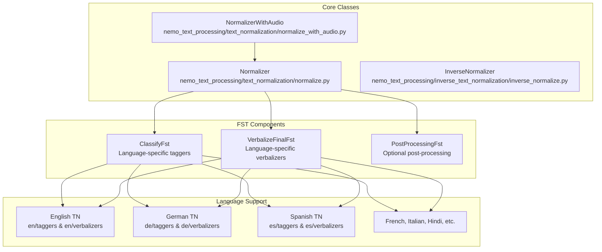
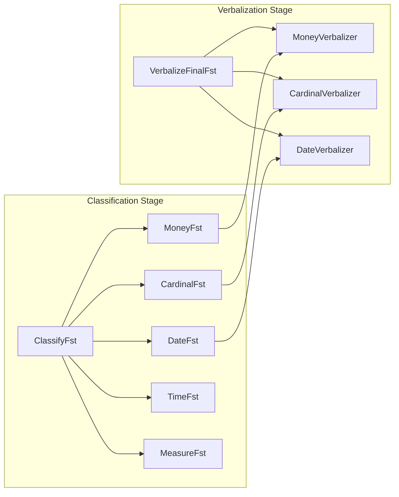
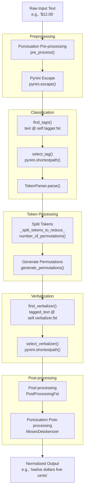
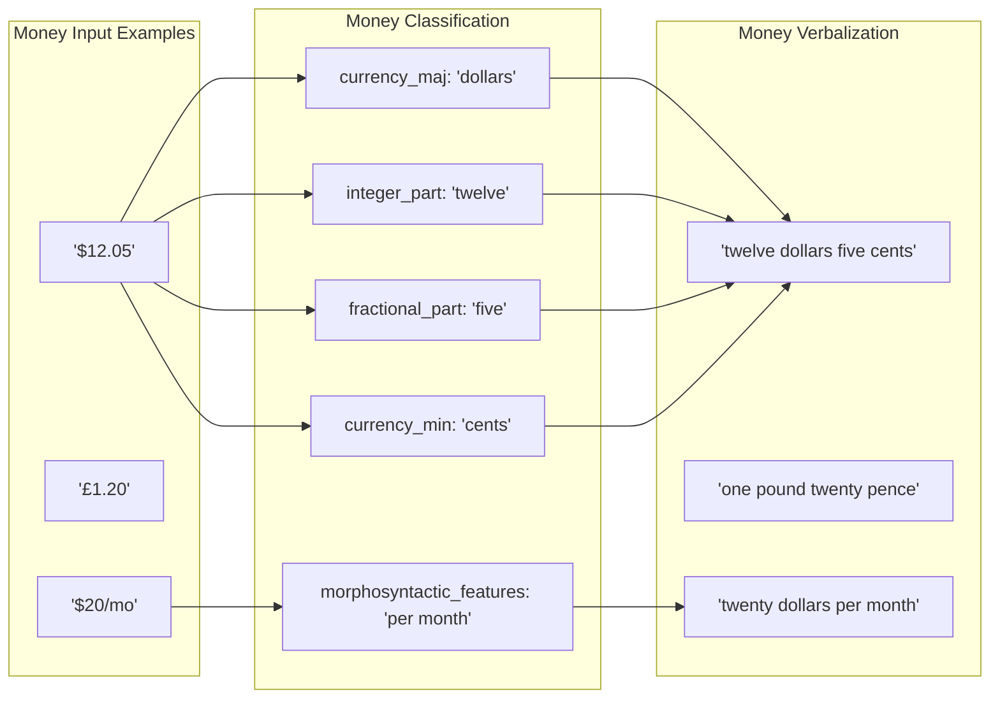

<!-- source: DeepWiki mcp.deepwiki.com · repo NVIDIA/NeMo-text-processing · page 3.1 Text Normalization · fetched 2026-10-26 -->

# Text Normalization

<details>
<summary>Relevant source files</summary>

The following files were used as context for generating this wiki page:

- [nemo_text_processing/inverse_text_normalization/inverse_normalize.py](nemo_text_processing/inverse_text_normalization/inverse_normalize.py)
- [nemo_text_processing/text_normalization/en/data/measure/unit.tsv](nemo_text_processing/text_normalization/en/data/measure/unit.tsv)
- [nemo_text_processing/text_normalization/en/data/money/per_unit.tsv](nemo_text_processing/text_normalization/en/data/money/per_unit.tsv)
- [nemo_text_processing/text_normalization/en/taggers/money.py](nemo_text_processing/text_normalization/en/taggers/money.py)
- [nemo_text_processing/text_normalization/en/verbalizers/money.py](nemo_text_processing/text_normalization/en/verbalizers/money.py)
- [nemo_text_processing/text_normalization/normalize.py](nemo_text_processing/text_normalization/normalize.py)
- [nemo_text_processing/text_normalization/normalize_with_audio.py](nemo_text_processing/text_normalization/normalize_with_audio.py)
- [nemo_text_processing/text_normalization/run_evaluate.py](nemo_text_processing/text_normalization/run_evaluate.py)
- [tests/nemo_text_processing/en/data_text_normalization/test_cases_address.txt](tests/nemo_text_processing/en/data_text_normalization/test_cases_address.txt)
- [tests/nemo_text_processing/en/data_text_normalization/test_cases_money.txt](tests/nemo_text_processing/en/data_text_normalization/test_cases_money.txt)
- [tests/nemo_text_processing/en/test_normalization_with_audio.py](tests/nemo_text_processing/en/test_normalization_with_audio.py)

</details>


This document covers the Text Normalization (TN) system, which converts written text into spoken form. This is the forward direction of text processing, transforming input like "12 kg" into "twelve kilograms" for Text-to-Speech (TTS) applications. For the reverse process (spoken to written form), see [Inverse Text Normalization](#3.2). For audio-enhanced normalization capabilities, see [Audio-Enhanced Normalization](#3.3).

## System Overview

The Text Normalization system is built around Finite State Transducers (FSTs) using the Pynini library. It operates through a two-stage pipeline: classification followed by verbalization. The system supports multiple languages and offers both deterministic and non-deterministic processing modes.



**Sources:** [nemo_text_processing/text_normalization/normalize.py:85-196](), [nemo_text_processing/text_normalization/normalize_with_audio.py:58-117](), [nemo_text_processing/inverse_text_normalization/inverse_normalize.py:26-141]()

## Core Components

### Normalizer Class

The `Normalizer` class is the primary interface for text normalization. It initializes language-specific FST components and provides methods for processing individual strings, lists of strings, and manifest files.

| Parameter | Type | Description |
|-----------|------|-------------|
| `input_case` | `str` | Input capitalization (`"lower_cased"` or `"cased"`) |
| `lang` | `str` | Language code (default: `"en"`) |
| `deterministic` | `bool` | Single output vs multiple options |
| `cache_dir` | `str` | Directory for compiled FST files |
| `whitelist` | `str` | Path to whitelist replacements |
| `post_process` | `bool` | Enable WFST-based post-processing |

**Sources:** [nemo_text_processing/text_normalization/normalize.py:104-196]()

### FST Pipeline Components

The system uses a modular FST architecture with distinct classification and verbalization stages:



**Sources:** [nemo_text_processing/text_normalization/normalize.py:120-179](), [nemo_text_processing/text_normalization/en/taggers/money.py:35-54](), [nemo_text_processing/text_normalization/en/verbalizers/money.py:30-42]()

## Processing Pipeline

The normalization process follows a structured pipeline that transforms input text through multiple stages:



**Sources:** [nemo_text_processing/text_normalization/normalize.py:321-384](), [nemo_text_processing/text_normalization/normalize.py:622-674](), [nemo_text_processing/text_normalization/normalize.py:647-692]()

### Key Processing Methods

| Method | Purpose | Location |
|--------|---------|----------|
| `normalize()` | Main normalization function | [normalize.py:321-384]() |
| `find_tags()` | Apply classification FST | [normalize.py:622-632]() |
| `find_verbalizer()` | Apply verbalization FST | [normalize.py:647-658]() |
| `generate_permutations()` | Create token reorderings | [normalize.py:592-620]() |
| `post_process()` | Apply post-processing FST | [normalize.py:676-692]() |

**Sources:** [nemo_text_processing/text_normalization/normalize.py:321-692]()

## Language Support

The system supports multiple languages with language-specific FST implementations:

| Language | Code | TN Support | Features |
|----------|------|------------|----------|
| English | `en` | ✓ | Full TN/ITN, Audio-enhanced, Post-processing |
| German | `de` | ✓ | Electronic text processing |
| Spanish | `es` | ✓ | Ordinal handling |
| French | `fr` | ✓ | Date processing |
| Italian | `it` | ✓ | Sparrowhawk integration |
| Hindi | `hi` | ✓ | Complex number systems |
| Russian | `ru` | ✓ | Non-deterministic only |
| Chinese | `zh` | ✓ | Sentence-level processing |
| Japanese | `ja` | ✓ | Character-based processing |
| Arabic | `ar` | ✓ | RTL text support |

**Sources:** [nemo_text_processing/text_normalization/normalize.py:120-179]()

## Semiotic Classes

The system handles various semiotic classes with specialized FST components:

### Money Processing

The money class handles currency amounts with support for major/minor units and per-unit expressions:



**Sources:** [nemo_text_processing/text_normalization/en/taggers/money.py:35-199](), [nemo_text_processing/text_normalization/en/verbalizers/money.py:30-85](), [tests/nemo_text_processing/en/data_text_normalization/test_cases_money.txt:1-71]()

### Currency and Per-Unit Support

The system includes comprehensive currency and per-unit processing:

- **Currency files**: Major/minor currency definitions
- **Per-unit file**: Common unit expressions like `/mo`, `/hr`, `/kg`
- **Morphosyntactic features**: Integration with grammatical features

**Sources:** [nemo_text_processing/text_normalization/en/data/money/per_unit.tsv:1-70]()

## Usage Examples

### Basic Usage

```python
from nemo_text_processing.text_normalization.normalize import Normalizer

# Initialize normalizer
normalizer = Normalizer(input_case='cased', lang='en')

# Normalize single text
result = normalizer.normalize("$12.05")
# Output: "twelve dollars five cents"

# Normalize list of texts
texts = ["$12.05", "3.14 kg", "Jan 1, 2023"]
results = normalizer.normalize_list(texts)
```

**Sources:** [nemo_text_processing/text_normalization/normalize.py:70-81]()

### Command Line Usage

```bash
# Normalize single text
python normalize.py --text="$12.05" --language=en

# Normalize file
python normalize.py --input_file=input.txt --output_file=output.txt --language=en

# Normalize JSON manifest
python normalize.py --input_file=manifest.json --output_file=normalized.json --n_jobs=-1
```

**Sources:** [nemo_text_processing/text_normalization/normalize.py:52-82](), [nemo_text_processing/text_normalization/normalize.py:695-774]()

### Advanced Configuration

| Parameter | Purpose | Default |
|-----------|---------|---------|
| `cache_dir` | FST cache directory | `None` |
| `overwrite_cache` | Regenerate FST files | `False` |
| `whitelist` | Custom replacements | `None` |
| `max_number_of_permutations_per_split` | Permutation limit | `729` |
| `punct_pre_process` | Punctuation preprocessing | `False` |
| `punct_post_process` | Punctuation postprocessing | `False` |

**Sources:** [nemo_text_processing/text_normalization/normalize.py:104-115]()

## Performance Considerations

The system includes several optimization strategies:

### Token Splitting

Large token sequences are split to manage permutation complexity:

```python
def _split_tokens_to_reduce_number_of_permutations(self, tokens):
    """Split tokens to keep permutations under max_number_of_permutations_per_split"""
```

This prevents exponential growth in processing time for complex inputs.

**Sources:** [nemo_text_processing/text_normalization/normalize.py:268-319]()

### Caching

FST compilation results are cached to improve startup time:

- `.far` files store compiled FSTs
- `cache_dir` parameter controls cache location
- `overwrite_cache` forces regeneration

**Sources:** [nemo_text_processing/text_normalization/normalize.py:94-95]()

### Parallel Processing

The system supports parallel processing for batch operations:

```python
normalizer.normalize_list(texts, n_jobs=-1, batch_size=300)
```

**Sources:** [nemo_text_processing/text_normalization/normalize.py:197-256]()

---

