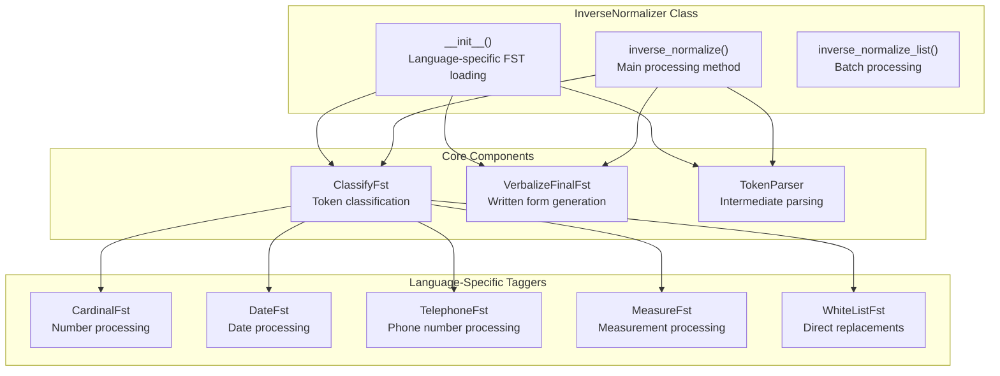

<!-- source: DeepWiki mcp.deepwiki.com · repo NVIDIA/NeMo-text-processing · page 3.2 Inverse Text Normalization · fetched 2026-10-26 -->

# Inverse Text Normalization

<details>
<summary>Relevant source files</summary>

The following files were used as context for generating this wiki page:

- [nemo_text_processing/inverse_text_normalization/en/data/measurements.tsv](nemo_text_processing/inverse_text_normalization/en/data/measurements.tsv)
- [nemo_text_processing/inverse_text_normalization/en/data/whitelist.tsv](nemo_text_processing/inverse_text_normalization/en/data/whitelist.tsv)
- [nemo_text_processing/inverse_text_normalization/en/taggers/cardinal.py](nemo_text_processing/inverse_text_normalization/en/taggers/cardinal.py)
- [nemo_text_processing/inverse_text_normalization/en/taggers/date.py](nemo_text_processing/inverse_text_normalization/en/taggers/date.py)
- [nemo_text_processing/inverse_text_normalization/en/taggers/measure.py](nemo_text_processing/inverse_text_normalization/en/taggers/measure.py)
- [nemo_text_processing/inverse_text_normalization/en/taggers/telephone.py](nemo_text_processing/inverse_text_normalization/en/taggers/telephone.py)
- [nemo_text_processing/inverse_text_normalization/en/taggers/whitelist.py](nemo_text_processing/inverse_text_normalization/en/taggers/whitelist.py)
- [nemo_text_processing/inverse_text_normalization/inverse_normalize.py](nemo_text_processing/inverse_text_normalization/inverse_normalize.py)
- [nemo_text_processing/text_normalization/normalize.py](nemo_text_processing/text_normalization/normalize.py)
- [nemo_text_processing/text_normalization/normalize_with_audio.py](nemo_text_processing/text_normalization/normalize_with_audio.py)
- [nemo_text_processing/text_normalization/run_evaluate.py](nemo_text_processing/text_normalization/run_evaluate.py)
- [tests/nemo_text_processing/en/data_inverse_text_normalization/test_cases_date.txt](tests/nemo_text_processing/en/data_inverse_text_normalization/test_cases_date.txt)
- [tests/nemo_text_processing/en/data_inverse_text_normalization/test_cases_telephone.txt](tests/nemo_text_processing/en/data_inverse_text_normalization/test_cases_telephone.txt)
- [tests/nemo_text_processing/en/test_normalization_with_audio.py](tests/nemo_text_processing/en/test_normalization_with_audio.py)

</details>


## Purpose and Scope

This document covers the Inverse Text Normalization (ITN) system, which converts text from spoken form to written form. ITN is the reverse process of Text Normalization and is primarily used for ASR (Automatic Speech Recognition) postprocessing. For information about the forward Text Normalization process, see [Text Normalization](#3.1). For audio-enhanced normalization capabilities, see [Audio-Enhanced Normalization](#3.3).

The ITN system transforms spoken representations like "twelve kilograms" into written forms like "12 kg", and handles complex patterns such as telephone numbers, dates, and monetary amounts.

## System Overview

The ITN system follows a two-stage pipeline similar to Text Normalization but operates in reverse:

```mermaid
graph LR
    SpokenText["Spoken Text Input<br/>twelve kilograms"]
    ClassifyStage["Classification Stage<br/>ClassifyFst"]
    TokenizedForm["Tokenized Form<br/>measure { cardinal { integer: \"12\" } units: \"kg\" }"]
    VerbalizeStage["Verbalization Stage<br/>VerbalizeFinalFst"]
    WrittenText["Written Text Output<br/>12 kg"]
    
    SpokenText --> ClassifyStage
    ClassifyStage --> TokenizedForm
    TokenizedForm --> VerbalizeStage
    VerbalizeStage --> WrittenText
```

**Sources:** [nemo_text_processing/inverse_text_normalization/inverse_normalize.py:1-234]()

## InverseNormalizer Class Architecture

The `InverseNormalizer` class extends the base `Normalizer` class and provides the core ITN functionality:



**Sources:** [nemo_text_processing/inverse_text_normalization/inverse_normalize.py:26-141]()

## Processing Pipeline

### Input Requirements

The ITN system expects input text with specific characteristics:
- No punctuation except apostrophe (') and dash (-)
- Lower case format (unless `input_case='cased'`)
- Spoken form representations

### Pipeline Stages

```mermaid
graph TD
    Input["Input Text<br/>july twenty fifth two thousand twelve"]
    
    subgraph "Stage 1: Classification"
        TokenizeClassify["tokenize_and_classify<br/>ClassifyFst.fst"]
        TaggedOutput["Tagged Output<br/>date { month: \"july\" day: \"25\" year: \"2012\" preserve_order: true }"]
    end
    
    subgraph "Stage 2: Parsing"
        TokenParsing["Token Parsing<br/>TokenParser.parse()"]
        ParsedTokens["Parsed Tokens<br/>List[dict]"]
    end
    
    subgraph "Stage 3: Verbalization"
        VerbalizeFinal["verbalize_final<br/>VerbalizeFinalFst.fst"]
        FinalOutput["Final Output<br/>july 25 2012"]
    end
    
    Input --> TokenizeClassify
    TokenizeClassify --> TaggedOutput
    TaggedOutput --> TokenParsing
    TokenParsing --> ParsedTokens
    ParsedTokens --> VerbalizeFinal
    VerbalizeFinal --> FinalOutput
```

**Sources:** [nemo_text_processing/inverse_text_normalization/inverse_normalize.py:155-166](), [nemo_text_processing/text_normalization/normalize.py:321-384]()

## Language Support

The ITN system supports multiple languages through language-specific FST implementations:

| Language | Code | ClassifyFst Path | VerbalizeFinalFst Path |
|----------|------|------------------|------------------------|
| English | `en` | `inverse_text_normalization.en.taggers.tokenize_and_classify` | `inverse_text_normalization.en.verbalizers.verbalize_final` |
| Spanish | `es` | `inverse_text_normalization.es.taggers.tokenize_and_classify` | `inverse_text_normalization.es.verbalizers.verbalize_final` |
| German | `de` | `inverse_text_normalization.de.taggers.tokenize_and_classify` | `inverse_text_normalization.de.verbalizers.verbalize_final` |
| French | `fr` | `inverse_text_normalization.fr.taggers.tokenize_and_classify` | `inverse_text_normalization.fr.verbalizers.verbalize_final` |
| Hindi | `hi` | `inverse_text_normalization.hi.taggers.tokenize_and_classify` | `inverse_text_normalization.hi.verbalizers.verbalize_final` |
| Japanese | `ja` | `inverse_text_normalization.ja.taggers.tokenize_and_classify` | `inverse_text_normalization.ja.verbalizers.verbalize_final` |

**Sources:** [nemo_text_processing/inverse_text_normalization/inverse_normalize.py:55-133]()

## Semiotic Class Processing

### Cardinal Numbers

The `CardinalFst` class handles spoken number conversion:

```mermaid
graph LR
    SpokenNumbers["Spoken Numbers<br/>twenty three<br/>one hundred fifty"]
    CardinalFst["CardinalFst<br/>Number classification"]
    CardinalOutput["Cardinal Output<br/>cardinal { integer: \"23\" }<br/>cardinal { integer: \"150\" }"]
    
    SpokenNumbers --> CardinalFst
    CardinalFst --> CardinalOutput
```

Key features:
- Handles numbers from zero to sextillions
- Supports negative numbers with `MINUS` prefix
- Excludes numbers below 13 by default
- Supports both international and Indian number systems

**Sources:** [nemo_text_processing/inverse_text_normalization/en/taggers/cardinal.py:34-256]()

### Date Processing

The `DateFst` class converts spoken dates to structured representations:

```mermaid
graph LR
    SpokenDate["Spoken Date<br/>january fifth twenty twelve"]
    DateFst["DateFst<br/>Date classification"]
    DateOutput["Date Output<br/>date { month: \"january\" day: \"5\" year: \"2012\" preserve_order: true }"]
    
    SpokenDate --> DateFst
    DateFst --> DateOutput
```

Supported formats:
- Month-day-year: "january fifth twenty twelve"
- Day-month-year: "the fifth of january twenty twelve"
- Year-only: "twenty twenty"
- Financial periods: "second quarter of twenty twenty two"

**Sources:** [nemo_text_processing/inverse_text_normalization/en/taggers/date.py:138-208]()

### Telephone Numbers

The `TelephoneFst` class handles various number formats:

```mermaid
graph LR
    SpokenPhone["Spoken Phone<br/>one two three one two three five six seven eight"]
    TelephoneFst["TelephoneFst<br/>Phone number classification"]
    PhoneOutput["Phone Output<br/>{ number_part: \"123-123-5678\" }"]
    
    SpokenPhone --> TelephoneFst
    TelephoneFst --> PhoneOutput
```

Supported formats:
- Phone numbers: "one two three one two three five six seven eight" → "123-123-5678"
- IP addresses: "one two three dot one two three dot o dot four o" → "123.123.0.40"
- Credit card numbers: Multi-digit sequences with spaces
- Serial numbers: Alphanumeric sequences

**Sources:** [nemo_text_processing/inverse_text_normalization/en/taggers/telephone.py:62-206]()

### Measurements

The `MeasureFst` class processes measurement expressions:

```mermaid
graph LR
    SpokenMeasure["Spoken Measure<br/>twelve kilograms"]
    MeasureFst["MeasureFst<br/>Measurement classification"]
    MeasureOutput["Measure Output<br/>measure { cardinal { integer: \"12\" } units: \"kg\" }"]
    
    SpokenMeasure --> MeasureFst
    MeasureFst --> MeasureOutput
```

Features:
- Handles both cardinal and decimal quantities
- Supports unit conversions through `measurements.tsv`
- Processes compound units with "per" constructions
- Handles negative measurements

**Sources:** [nemo_text_processing/inverse_text_normalization/en/taggers/measure.py:34-116]()

## Usage Examples

### Basic Usage

```python
from nemo_text_processing.inverse_text_normalization.inverse_normalize import InverseNormalizer

# Initialize for English
inverse_normalizer = InverseNormalizer(
    input_case='lower_cased',
    lang='en',
    cache_dir='./cache'
)

# Single text processing
result = inverse_normalizer.inverse_normalize(
    "twelve kilograms", 
    verbose=False
)
# Output: "12 kg"

# Batch processing
results = inverse_normalizer.inverse_normalize_list([
    "twenty three",
    "july twenty fifth two thousand twelve"
])
# Output: ["23", "july 25 2012"]
```

### Configuration Options

| Parameter | Description | Default |
|-----------|-------------|---------|
| `input_case` | Input capitalization: "lower_cased" or "cased" | "lower_cased" |
| `lang` | Language code | "en" |
| `whitelist` | Path to whitelist file | None |
| `cache_dir` | Grammar cache directory | None |
| `overwrite_cache` | Regenerate grammar files | False |
| `max_number_of_permutations_per_split` | Permutation limit | 729 |

**Sources:** [nemo_text_processing/inverse_text_normalization/inverse_normalize.py:43-51]()

## Command-Line Interface

The ITN system provides a command-line interface for processing text files:

```bash
# Process single text
python inverse_normalize.py --text "twelve kilograms" --language en

# Process file
python inverse_normalize.py --input_file input.txt --output_file output.txt --language en

# With custom whitelist
python inverse_normalize.py --input_file input.txt --whitelist custom_whitelist.tsv
```

**Sources:** [nemo_text_processing/inverse_text_normalization/inverse_normalize.py:169-234]()

## Whitelist System

The whitelist system provides direct spoken-to-written mappings through TSV files:

```mermaid
graph LR
    WhitelistTSV["whitelist.tsv<br/>mrs. → misses<br/>dr. → doctor"]
    WhiteListFst["WhiteListFst<br/>Direct mapping"]
    WhitelistOutput["Whitelist Output<br/>tokens { name: \"mrs.\" }"]
    
    WhitelistTSV --> WhiteListFst
    WhiteListFst --> WhitelistOutput
```

The whitelist has the highest priority among classifier grammars and supports:
- Abbreviations: "dr." ↔ "doctor"
- Technical terms: "CPU" ↔ "c p u"
- Brand names: "GeForce" ↔ "geforce"

**Sources:** [nemo_text_processing/inverse_text_normalization/en/taggers/whitelist.py:33-57](), [nemo_text_processing/inverse_text_normalization/en/data/whitelist.tsv:1-417]()

---

