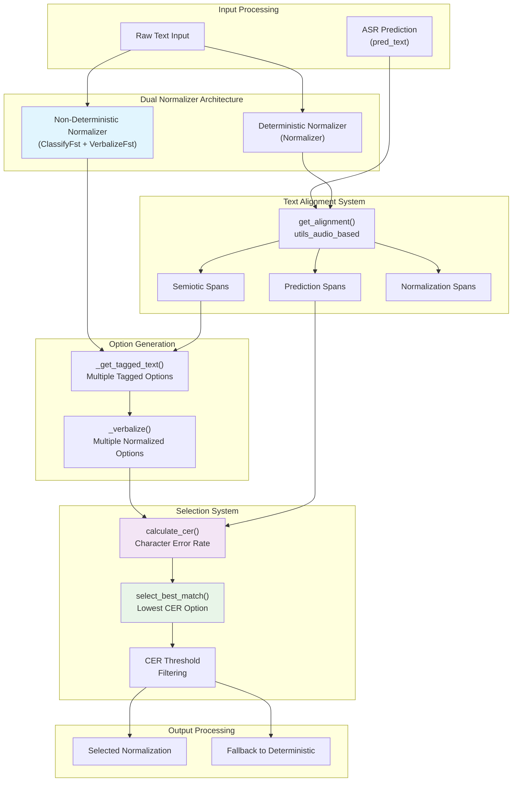
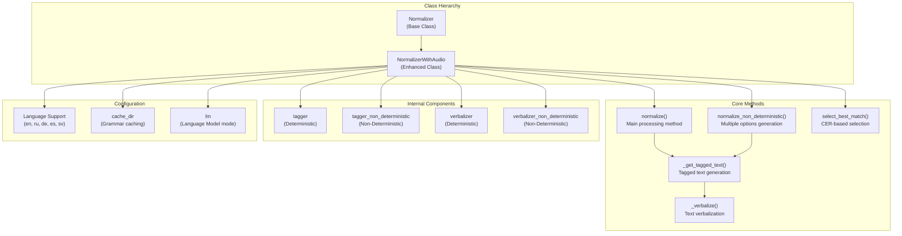
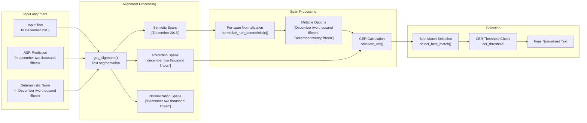
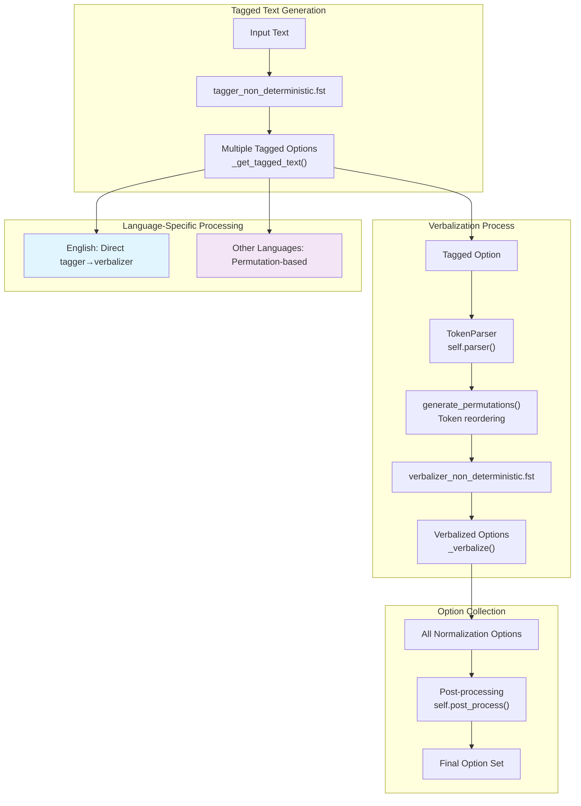
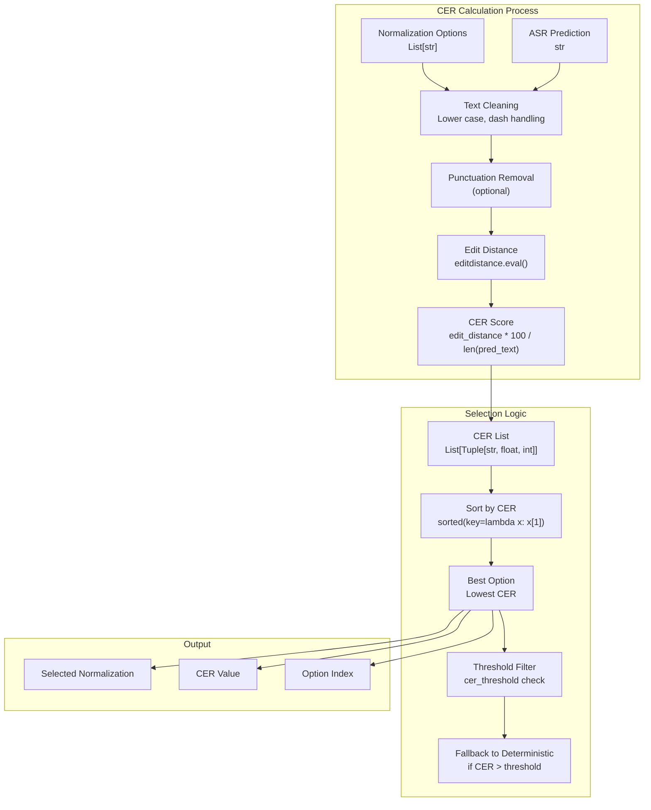
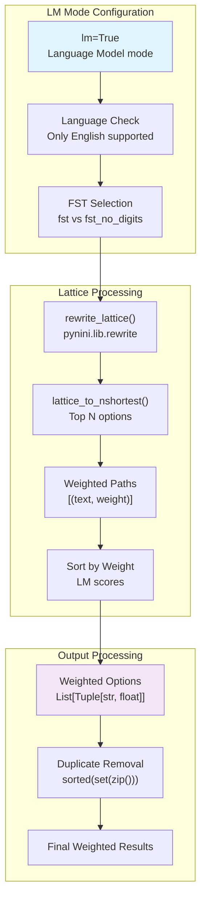
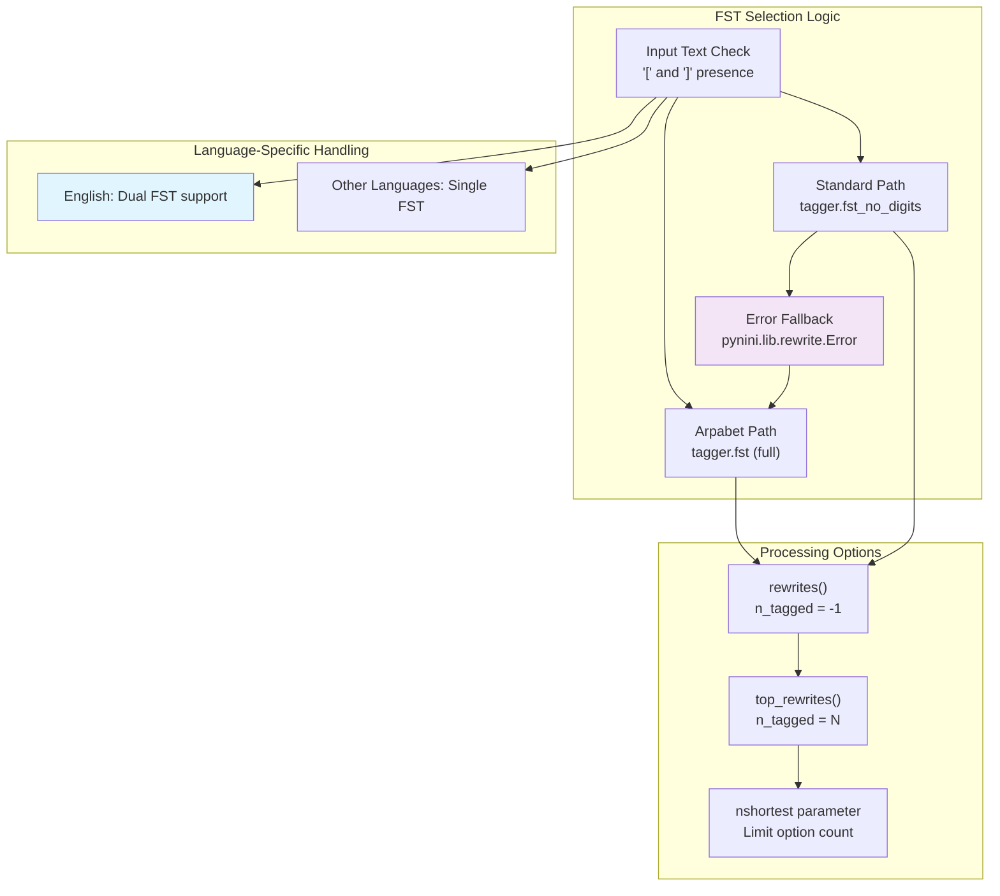

<!-- source: DeepWiki mcp.deepwiki.com · repo NVIDIA/NeMo-text-processing · page 3.3 Audio-Enhanced Normalization · fetched 2026-10-26 -->

# Audio-Enhanced Normalization

<details>
<summary>Relevant source files</summary>

The following files were used as context for generating this wiki page:

- [nemo_text_processing/inverse_text_normalization/inverse_normalize.py](nemo_text_processing/inverse_text_normalization/inverse_normalize.py)
- [nemo_text_processing/text_normalization/normalize.py](nemo_text_processing/text_normalization/normalize.py)
- [nemo_text_processing/text_normalization/normalize_with_audio.py](nemo_text_processing/text_normalization/normalize_with_audio.py)
- [nemo_text_processing/text_normalization/run_evaluate.py](nemo_text_processing/text_normalization/run_evaluate.py)
- [tests/nemo_text_processing/en/test_normalization_with_audio.py](tests/nemo_text_processing/en/test_normalization_with_audio.py)

</details>


This document covers the Audio-Enhanced Normalization system, which provides ASR-guided text normalization capabilities for improved accuracy in speech-to-text processing workflows. The system generates multiple normalization options and selects the best match based on acoustic predictions from ASR models.

For standard deterministic text normalization, see [Text Normalization](#3.1). For inverse text normalization capabilities, see [Inverse Text Normalization](#3.2).

## Purpose and Scope

The Audio-Enhanced Normalization system extends the standard text normalization pipeline by incorporating Automatic Speech Recognition (ASR) predictions to guide the selection of normalization options. This approach addresses the inherent ambiguity in text normalization where multiple valid spoken forms exist for the same written text.

The system is particularly valuable for:
- TTS preprocessing where acoustic context improves normalization accuracy
- ASR post-processing workflows
- Multi-modal text processing pipelines
- Scenarios requiring high normalization quality over speed

## System Architecture

The audio-enhanced normalization system builds upon the standard normalization pipeline by adding ASR-guided selection capabilities:



**Sources:** [nemo_text_processing/text_normalization/normalize_with_audio.py:1-554]()

## Core Components

### NormalizerWithAudio Class

The `NormalizerWithAudio` class serves as the main entry point for audio-enhanced normalization, extending the base `Normalizer` class with ASR-guided selection capabilities:



**Sources:** [nemo_text_processing/text_normalization/normalize_with_audio.py:58-117]()

### Initialization and Configuration

The system initializes with dual normalizer architectures:

| Parameter | Purpose | Default | Notes |
|-----------|---------|---------|-------|
| `input_case` | Input text capitalization | Required | "lower_cased" or "cased" |
| `lang` | Target language | "en" | Affects FST grammar selection |
| `cache_dir` | Grammar file caching | None | Improves initialization speed |
| `overwrite_cache` | Force cache regeneration | False | Used for development |
| `lm` | Language model mode | False | Enhanced scoring (English only) |
| `max_number_of_permutations_per_split` | Permutation limit | 729 | Controls computational complexity |

**Sources:** [nemo_text_processing/text_normalization/normalize_with_audio.py:75-117]()

## Normalization Pipeline

### Text Alignment Process

The system performs sophisticated text alignment to map input text segments to their corresponding ASR predictions and normalizations:



**Sources:** [nemo_text_processing/text_normalization/normalize_with_audio.py:157-192]()

### Option Generation Process

The system generates multiple normalization options through non-deterministic FST processing:



**Sources:** [nemo_text_processing/text_normalization/normalize_with_audio.py:309-372]()

## CER-Based Selection

### Character Error Rate Calculation

The system uses Character Error Rate (CER) as the primary metric for selecting the best normalization option:



**Sources:** [nemo_text_processing/text_normalization/normalize_with_audio.py:373-423]()

### Selection Algorithm

The selection process implements a sophisticated fallback mechanism:

| Step | Process | Fallback Condition |
|------|---------|-------------------|
| 1 | Generate deterministic normalization | Always available (except Russian) |
| 2 | Generate non-deterministic options | Multiple FST paths |
| 3 | Calculate CER for each option | Compare against ASR prediction |
| 4 | Select lowest CER option | Sort by CER score |
| 5 | Apply threshold filtering | If CER > `cer_threshold` |
| 6 | Fallback to deterministic | When quality insufficient |

**Sources:** [nemo_text_processing/text_normalization/normalize_with_audio.py:172-189]()

## Language Model Integration

### LM Mode Processing

The system supports enhanced processing with language model integration for English:



**Sources:** [nemo_text_processing/text_normalization/normalize_with_audio.py:215-260]()

## Advanced Features

### Batch Processing Support

The system inherits batch processing capabilities from the base `Normalizer` class with audio-specific extensions:

| Method | Purpose | Audio-Specific Parameters |
|--------|---------|---------------------------|
| `normalize_line()` | Single manifest line processing | `asr_pred_field`, `cer_threshold` |
| `normalize_manifest()` | Batch manifest processing | Inherited from base class |
| `normalize_list()` | List processing | Inherited from base class |

**Sources:** [nemo_text_processing/text_normalization/normalize_with_audio.py:268-307]()

### FST Selection Logic

The system implements intelligent FST selection based on input characteristics:



**Sources:** [nemo_text_processing/text_normalization/normalize_with_audio.py:316-345]()

## Usage Patterns

### Basic Audio-Enhanced Normalization

```python
# Initialize with audio support
normalizer = NormalizerWithAudio(
    input_case='cased',
    lang='en',
    cache_dir='/path/to/cache'
)

# Normalize with ASR guidance
result = normalizer.normalize(
    text="The price is $12.50",
    pred_text="the price is twelve dollars fifty cents",
    n_tagged=30,
    cer_threshold=50.0
)
```

**Sources:** [nemo_text_processing/text_normalization/normalize_with_audio.py:503-547]()

### Manifest Processing

The system supports batch processing of JSON manifests with ASR predictions:

```python
# Process manifest with audio guidance
normalizer.normalize_manifest(
    manifest='/path/to/manifest.json',
    n_jobs=-1,
    batch_size=200,
    text_field='text',
    asr_pred_field='pred_text',
    cer_threshold=100.0
)
```

**Sources:** [nemo_text_processing/text_normalization/normalize_with_audio.py:535-547]()

## Performance Considerations

### Computational Complexity

The audio-enhanced normalization system has higher computational requirements than deterministic normalization:

| Component | Complexity Factor | Mitigation Strategy |
|-----------|-------------------|-------------------|
| Non-deterministic FST | Multiple path exploration | `n_tagged` parameter limiting |
| CER calculation | O(n*m) edit distance | Parallel processing support |
| Option generation | Exponential with ambiguity | `max_number_of_permutations_per_split` |
| Text alignment | Linear with input length | Span-based processing |

### Caching and Optimization

The system supports several optimization mechanisms:

- **Grammar Caching**: FST compilation results cached in `cache_dir`
- **Batch Processing**: Parallel execution with `n_jobs` parameter
- **Option Limiting**: `n_tagged` parameter controls exploration depth
- **Threshold Filtering**: `cer_threshold` enables early termination

**Sources:** [nemo_text_processing/text_normalization/normalize_with_audio.py:75-117](), [tests/nemo_text_processing/en/test_normalization_with_audio.py:23-36]()

---

