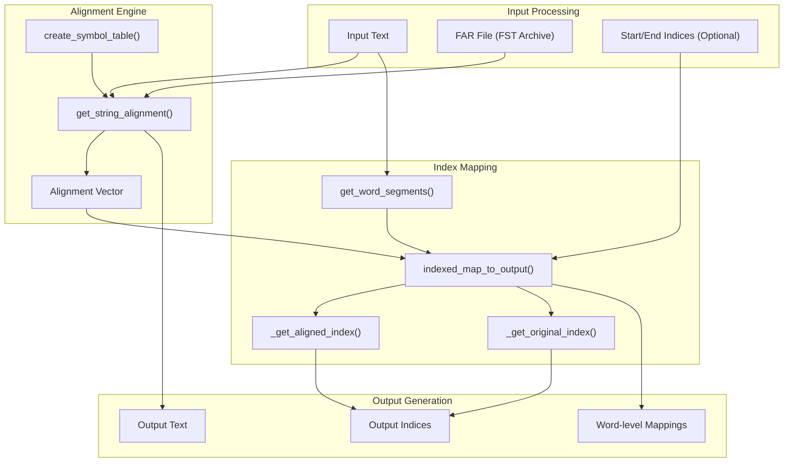
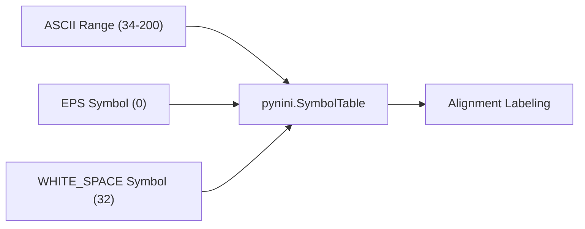
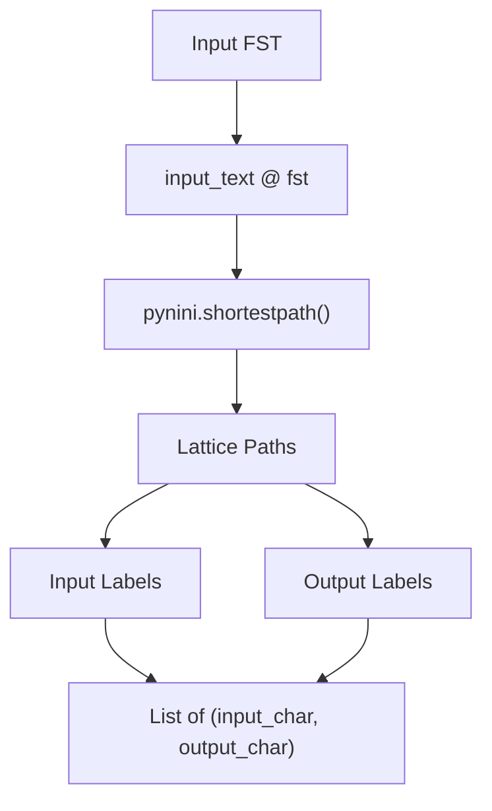
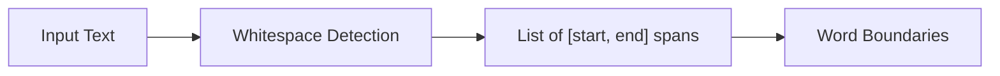
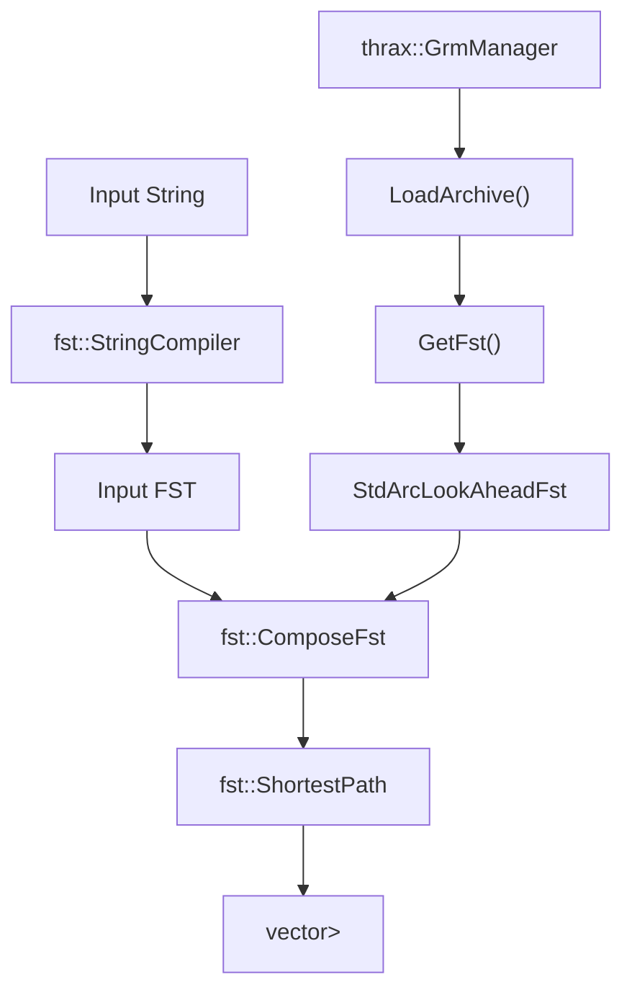
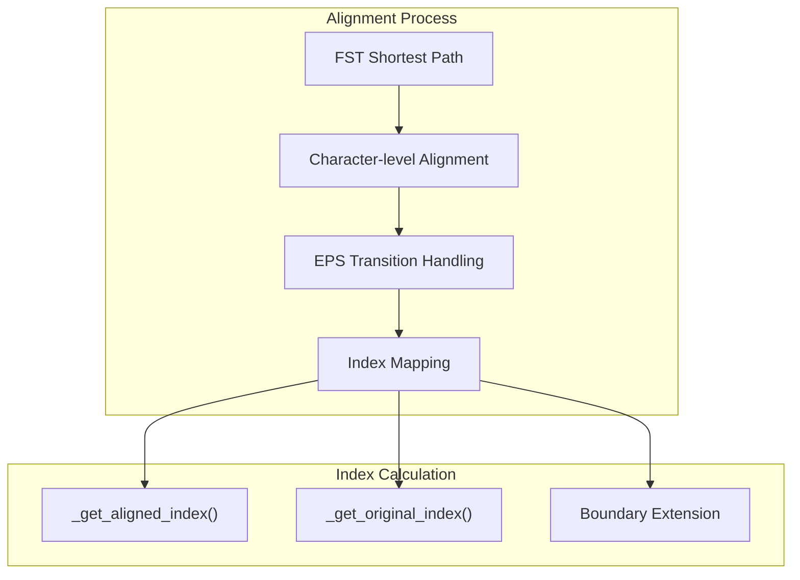
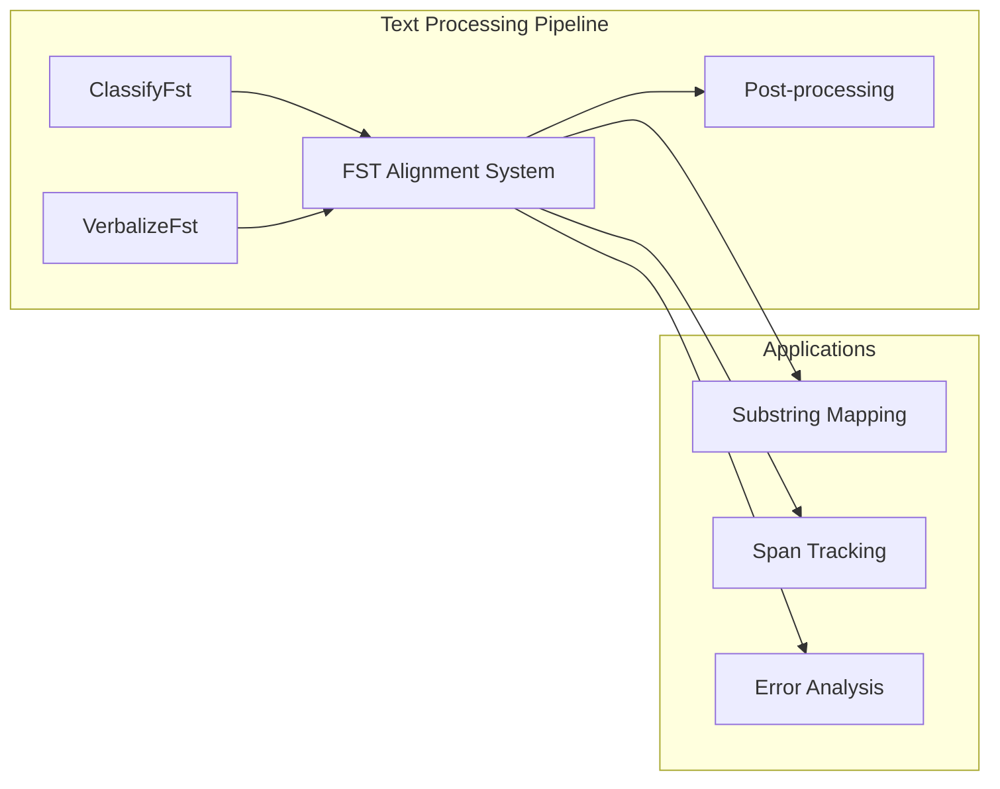

<!-- source: DeepWiki mcp.deepwiki.com · repo NVIDIA/NeMo-text-processing · page 3.4 FST Alignment System · fetched 2026-10-26 -->

# FST Alignment System

<details>
<summary>Relevant source files</summary>

The following files were used as context for generating this wiki page:

- [.github/ISSUE_TEMPLATE/bug_report.md](.github/ISSUE_TEMPLATE/bug_report.md)
- [.github/ISSUE_TEMPLATE/feature_request.md](.github/ISSUE_TEMPLATE/feature_request.md)
- [.github/PULL_REQUEST_TEMPLATE.md](.github/PULL_REQUEST_TEMPLATE.md)
- [.github/workflows/close-inactive-issue-pr.yml](.github/workflows/close-inactive-issue-pr.yml)
- [.github/workflows/codeql.yml](.github/workflows/codeql.yml)
- [.pre-commit-config.yaml](.pre-commit-config.yaml)
- [nemo_text_processing/fst_alignment/alignment.cpp](nemo_text_processing/fst_alignment/alignment.cpp)
- [nemo_text_processing/fst_alignment/alignment.py](nemo_text_processing/fst_alignment/alignment.py)
- [nemo_text_processing/hybrid/model_utils.py](nemo_text_processing/hybrid/model_utils.py)
- [nemo_text_processing/text_normalization/en/taggers/punctuation.py](nemo_text_processing/text_normalization/en/taggers/punctuation.py)
- [nemo_text_processing/text_normalization/en/verbalizers/post_processing.py](nemo_text_processing/text_normalization/en/verbalizers/post_processing.py)
- [tests/nemo_text_processing/en/data_inverse_text_normalization/test_cases_ordinal.txt](tests/nemo_text_processing/en/data_inverse_text_normalization/test_cases_ordinal.txt)

</details>


## Purpose and Scope

The FST Alignment System provides precise input-to-output text mapping capabilities for Finite State Transducers (FSTs) used in text normalization and inverse text normalization. This system enables tracking how input text segments are transformed to output text segments, maintaining character-level and word-level alignment information essential for applications requiring substring mapping and span tracking.

For broader text processing capabilities, see [Text Normalization](#3.1) and [Inverse Text Normalization](#3.2). For FST grammar compilation, see [Grammar Compilation](#6.1).

## System Overview

The FST Alignment System operates as a post-processing layer that analyzes FST transduction paths to establish precise mappings between input and output text segments. It supports both Python and C++ implementations for different deployment scenarios.

### Core Architecture



**Sources:** [nemo_text_processing/fst_alignment/alignment.py:1-268]()

## Core Components

### Python Implementation

The primary implementation provides comprehensive alignment functionality through several key components:

#### Symbol Table Management

The `create_symbol_table()` function establishes the character mapping framework:



#### Alignment Generation

The `get_string_alignment()` function creates character-level alignments:



#### Word Segmentation

The `get_word_segments()` function identifies word boundaries:



**Sources:** [nemo_text_processing/fst_alignment/alignment.py:106-125](), [nemo_text_processing/fst_alignment/alignment.py:128-137](), [nemo_text_processing/fst_alignment/alignment.py:140-159]()

### C++ Implementation

The C++ implementation provides equivalent functionality with performance optimizations:

#### Core Processing Pipeline



**Sources:** [nemo_text_processing/fst_alignment/alignment.cpp:132-194]()

## API and Usage

### Python API

The system provides both command-line and programmatic interfaces:

#### Command Line Interface

| Parameter | Description | Example |
|-----------|-------------|---------|
| `--fst` | Path to FAR file containing FST | `path/to/grammar.far` |
| `--rule` | Rule name in FAR file | `TOKENIZE_AND_CLASSIFY` |
| `--text` | Input text string | `"2615 Forest Av, 1 Aug 2016"` |
| `--start` | Start index of substring (optional) | `22` |
| `--end` | End index of substring (optional) | `26` |
| `--grammar` | Grammar type: `tn` or `itn` | `TN` |

#### Usage Examples

**Full text alignment:**
```bash
python alignment.py --fst=grammar.far --text="2615 Forest Av, 1 Aug 2016" --rule=TOKENIZE_AND_CLASSIFY
```

**Substring mapping:**
```bash
python alignment.py --fst=grammar.far --text="2615 Forest Av, 1 Aug 2016" --rule=TOKENIZE_AND_CLASSIFY --start=22 --end=26
```

#### Key Functions

| Function | Purpose | Input | Output |
|----------|---------|--------|--------|
| `get_string_alignment()` | Create FST alignment | FST, input text, symbol table | Alignment list, output string |
| `indexed_map_to_output()` | Map input indices to output | Alignment, start, end, mode | Output start/end indices |
| `get_word_segments()` | Extract word boundaries | Text string | List of [start, end] spans |

**Sources:** [nemo_text_processing/fst_alignment/alignment.py:74-95](), [nemo_text_processing/fst_alignment/alignment.py:24-71]()

### C++ API

The C++ implementation provides a compiled executable interface:

```bash
./alignment <fst_file> <rule_name> <input_text> <start_index> <end_index>
```

**Sources:** [nemo_text_processing/fst_alignment/alignment.cpp:27-50]()

## Implementation Details

### Alignment Algorithm

The system uses a heuristic algorithm based on monotonous alignment:



### Constants and Configuration

| Constant | Value | Purpose |
|----------|-------|---------|
| `EPS` | `"<eps>"` | Epsilon symbol for empty transitions |
| `WHITE_SPACE` | `"\u23b5"` | Whitespace representation |
| `TN_MODE` | `"tn"` | Text normalization mode |
| `ITN_MODE` | `"itn"` | Inverse text normalization mode |

### Special Character Handling

The system handles special characters through predefined sets:

```python
tn_item_special_chars = ["$", "\\", ":", "+", "-", "="]
tn_itn_symbols = list(string.ascii_letters + string.digits) + tn_item_special_chars
```

**Sources:** [nemo_text_processing/fst_alignment/alignment.py:98-104](), [nemo_text_processing/fst_alignment/alignment.py:162-242]()

## Limitations and Considerations

### Algorithm Limitations

The alignment system has known limitations in specific scenarios:

1. **Non-monotonic Alignments**: The heuristic algorithm can fail when FST reorders word pieces
2. **Complex Reordering**: Examples like `"$1"` → `"one dollar"` where `"$"` maps to `"one"` can produce incorrect alignments

### Example Failure Case

```
Input: "$1"
Expected: $ → dollar, 1 → one
Actual: $ → one, 1 → dollar
```

### Performance Considerations

- **Memory Usage**: Alignment vectors can become large for long input texts
- **Processing Time**: Shortest path computation scales with FST complexity
- **Character Encoding**: Limited to ASCII character range (34-200)

**Sources:** [nemo_text_processing/fst_alignment/alignment.py:62-71](), [nemo_text_processing/fst_alignment/alignment.cpp:42-49]()

## Integration with Text Processing Pipeline

The FST Alignment System integrates with the broader text processing framework:



This system enables precise tracking of text transformations across the entire normalization pipeline, supporting applications that require detailed provenance of text changes.

**Sources:** [nemo_text_processing/fst_alignment/alignment.py:1-268](), [nemo_text_processing/fst_alignment/alignment.cpp:1-194]()

---

