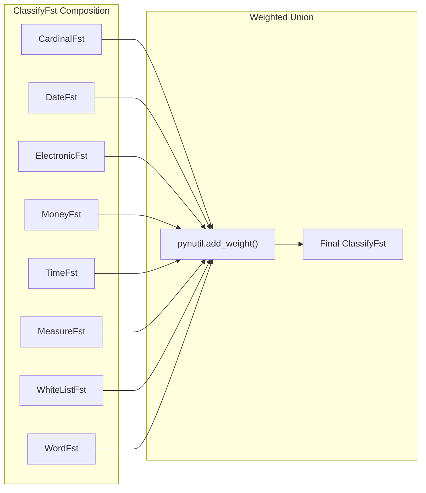
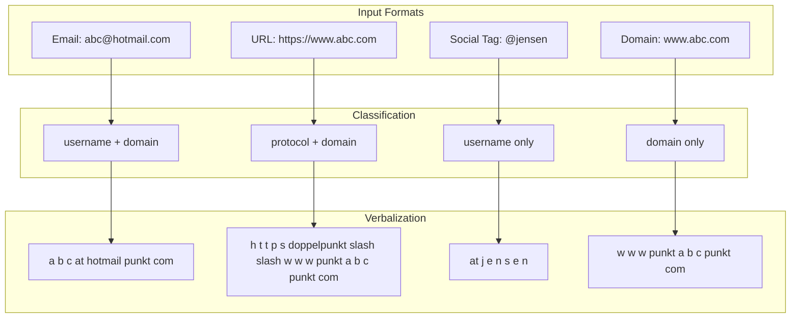
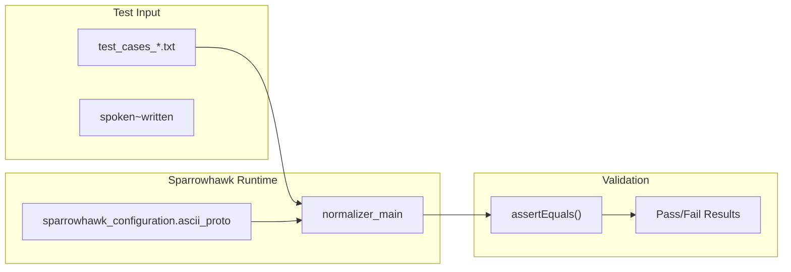
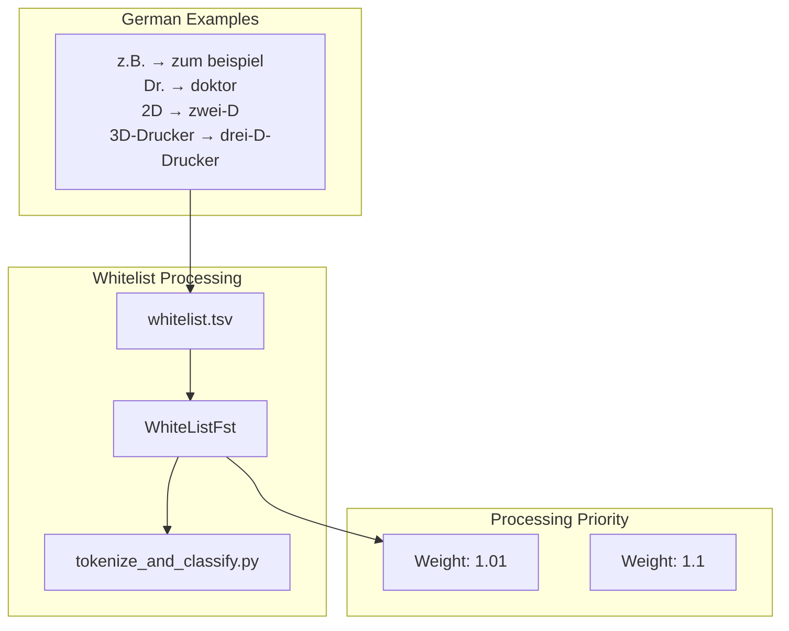

<!-- source: DeepWiki mcp.deepwiki.com · repo NVIDIA/NeMo-text-processing · page 4 Language Support · fetched 2026-10-26 -->

# Language Support

Relevant source files

The following files were used as context for generating this wiki page:

- [nemo_text_processing/inverse_text_normalization/hi/taggers/date.py](nemo_text_processing/inverse_text_normalization/hi/taggers/date.py)
- [nemo_text_processing/inverse_text_normalization/hi/taggers/tokenize_and_classify.py](nemo_text_processing/inverse_text_normalization/hi/taggers/tokenize_and_classify.py)
- [nemo_text_processing/inverse_text_normalization/hi/verbalizers/date.py](nemo_text_processing/inverse_text_normalization/hi/verbalizers/date.py)
- [nemo_text_processing/inverse_text_normalization/hi/verbalizers/verbalize.py](nemo_text_processing/inverse_text_normalization/hi/verbalizers/verbalize.py)
- [nemo_text_processing/text_normalization/de/data/electronic/domain.tsv](nemo_text_processing/text_normalization/de/data/electronic/domain.tsv)
- [nemo_text_processing/text_normalization/de/data/electronic/server_name.tsv](nemo_text_processing/text_normalization/de/data/electronic/server_name.tsv)
- [nemo_text_processing/text_normalization/de/data/whitelist.tsv](nemo_text_processing/text_normalization/de/data/whitelist.tsv)
- [nemo_text_processing/text_normalization/de/taggers/electronic.py](nemo_text_processing/text_normalization/de/taggers/electronic.py)
- [nemo_text_processing/text_normalization/de/taggers/time.py](nemo_text_processing/text_normalization/de/taggers/time.py)
- [nemo_text_processing/text_normalization/de/taggers/tokenize_and_classify.py](nemo_text_processing/text_normalization/de/taggers/tokenize_and_classify.py)
- [nemo_text_processing/text_normalization/de/verbalizers/electronic.py](nemo_text_processing/text_normalization/de/verbalizers/electronic.py)
- [tests/nemo_text_processing/de/data_text_normalization/test_cases_date.txt](tests/nemo_text_processing/de/data_text_normalization/test_cases_date.txt)
- [tests/nemo_text_processing/de/data_text_normalization/test_cases_decimal.txt](tests/nemo_text_processing/de/data_text_normalization/test_cases_decimal.txt)
- [tests/nemo_text_processing/de/data_text_normalization/test_cases_electronic.txt](tests/nemo_text_processing/de/data_text_normalization/test_cases_electronic.txt)
- [tests/nemo_text_processing/de/data_text_normalization/test_cases_time.txt](tests/nemo_text_processing/de/data_text_normalization/test_cases_time.txt)
- [tests/nemo_text_processing/de/test_sparrowhawk_inverse_text_normalization.sh](tests/nemo_text_processing/de/test_sparrowhawk_inverse_text_normalization.sh)
- [tests/nemo_text_processing/de/test_sparrowhawk_normalization.sh](tests/nemo_text_processing/de/test_sparrowhawk_normalization.sh)
- [tests/nemo_text_processing/hi/data_inverse_text_normalization/test_cases_date.txt](tests/nemo_text_processing/hi/data_inverse_text_normalization/test_cases_date.txt)
- [tests/nemo_text_processing/hi/test_sparrowhawk_inverse_text_normalization.sh](tests/nemo_text_processing/hi/test_sparrowhawk_inverse_text_normalization.sh)

This document describes the multilingual text normalization and inverse text normalization capabilities of the NeMo Text Processing system. It covers the architecture for language-specific implementations, supported languages, and the framework for extending to new languages.

For information about the core text processing pipeline, see [Core Text Processing Systems](#3). For details on grammar development workflows, see [Grammar Development](#5.2).

## Multilingual Architecture

The system implements a modular architecture where each language has its own directory structure containing classification grammars, verbalization rules, and language-specific data files. All languages follow a consistent two-stage pipeline: classification followed by verbalization.

### Language Directory Structure

```mermaid
graph TD
    subgraph "Language Root Directory"
        TaggersDir["taggers/"]
        VerbalizersDir["verbalizers/"]
        DataDir["data/"]
        TestsDir["tests/"]
        UtilsFile["utils.py"]
    end
    
    subgraph "Classification Stage"
        TokenizeClassify["tokenize_and_classify.py"]
        CardinalTagger["cardinal.py"]
        DateTagger["date.py"]
        ElectronicTagger["electronic.py"]
        MoneyTagger["money.py"]
        OtherTaggers["time.py, measure.py, etc."]
    end
    
    subgraph "Verbalization Stage"
        VerbalizeFst["verbalize.py"]
        CardinalVerb["cardinal.py"]
        DateVerb["date.py"]
        ElectronicVerb["electronic.py"]
        MoneyVerb["money.py"]
        OtherVerbs["time.py, measure.py, etc."]
    end
    
    subgraph "Language Data"
        NumbersData["numbers/"]
        ElectronicData["electronic/"]
        DateData["date/"]
        WhitelistData["whitelist.tsv"]
    end
    
    TaggersDir --> TokenizeClassify
    TaggersDir --> CardinalTagger
    TaggersDir --> DateTagger
    TaggersDir --> ElectronicTagger
    TaggersDir --> MoneyTagger
    TaggersDir --> OtherTaggers
    
    VerbalizersDir --> VerbalizeFst
    VerbalizersDir --> CardinalVerb
    VerbalizersDir --> DateVerb
    VerbalizersDir --> ElectronicVerb
    VerbalizersDir --> MoneyVerb
    VerbalizersDir --> OtherVerbs
    
    DataDir --> NumbersData
    DataDir --> ElectronicData
    DataDir --> DateData
    DataDir --> WhitelistData
```

Sources: [nemo_text_processing/text_normalization/de/taggers/tokenize_and_classify.py:1-152](), [nemo_text_processing/inverse_text_normalization/hi/taggers/tokenize_and_classify.py:1-124](), [nemo_text_processing/inverse_text_normalization/hi/verbalizers/verbalize.py:1-67]()

### Core Language Components

Each language implementation contains two primary FST classes that orchestrate the text processing pipeline:

| Component | Purpose | Key Methods |
|-----------|---------|-------------|
| `ClassifyFst` | Token classification and tagging | `__init__()`, `.fst` property |
| `VerbalizeFst` | Token verbalization to output text | `__init__()`, `.fst` property |

The `ClassifyFst` class in each language combines domain-specific taggers with weighted priorities:

Sources: [nemo_text_processing/text_normalization/de/taggers/tokenize_and_classify.py:121-136](), [nemo_text_processing/inverse_text_normalization/hi/taggers/tokenize_and_classify.py:96-108]()

## German Language Support

German implementation provides comprehensive text normalization with specialized support for electronic text processing, including emails, URLs, and social media tags.

### German Electronic Text Processing

The German `ElectronicFst` class handles multiple electronic text formats:

Sources: [nemo_text_processing/text_normalization/de/taggers/electronic.py:1-84](), [nemo_text_processing/text_normalization/de/verbalizers/electronic.py:1-83](), [tests/nemo_text_processing/de/data_text_normalization/test_cases_electronic.txt:1-19]()

### German Domain and Symbol Mapping

The system uses extensive TSV files for domain and symbol normalization:

| Data File | Purpose | Example Mappings |
|-----------|---------|------------------|
| `domain.tsv` | Domain extensions | `.com → punkt com`, `.de → punkt de` |
| `symbols.tsv` | Special characters | `@ → at`, `: → doppelpunkt` |
| `server_name.tsv` | Common server names | `gmail → g mail`, `amazon → amazon` |

Sources: [nemo_text_processing/text_normalization/de/data/electronic/domain.tsv:1-844](), [nemo_text_processing/text_normalization/de/data/electronic/server_name.tsv:1-17]()

## Hindi Language Support

Hindi implementation provides full bidirectional text normalization with support for Devanagari script and complex number systems.

### Hindi Classification Pipeline

The Hindi `ClassifyFst` implements a comprehensive classification system with weighted priorities:

```mermaid
graph TD
    subgraph "Hindi Taggers"
        CardinalTagger["CardinalFst - Numbers"]
        OrdinalTagger["OrdinalFst - Ordinals"]  
        DecimalTagger["DecimalFst - Decimals"]
        FractionTagger["FractionFst - Fractions"]
        DateTagger["DateFst - Dates"]
        TimeTagger["TimeFst - Time"]
        MeasureTagger["MeasureFst - Measurements"]
        MoneyTagger["MoneyFst - Currency"]
        TelephoneTagger["TelephoneFst - Phone Numbers"]
        WhitelistTagger["WhiteListFst - Whitelist"]
        WordTagger["WordFst - Words"]
    end
    
    subgraph "Weight Assignments"
        StandardWeight["Weight: 1.1"]
        WhitelistWeight["Weight: 1.01"]
        WordWeight["Weight: 100"]
    end
    
    CardinalTagger --> StandardWeight
    OrdinalTagger --> StandardWeight
    DecimalTagger --> StandardWeight
    FractionTagger --> StandardWeight
    DateTagger --> StandardWeight
    TimeTagger --> StandardWeight
    MeasureTagger --> StandardWeight
    MoneyTagger --> StandardWeight
    TelephoneTagger --> StandardWeight
    WhitelistTagger --> WhitelistWeight
    WordTagger --> WordWeight
```

Sources: [nemo_text_processing/inverse_text_normalization/hi/taggers/tokenize_and_classify.py:96-108]()

### Hindi Date Processing

The Hindi date system supports multiple formats including Devanagari numerals and complex temporal expressions:

| Input Format | Output Format | Example |
|-------------|---------------|---------|
| Day Month Year | `day month, year` | `पच्चीस मार्च दो हज़ार दस → २५ मार्च, २०१०` |
| Month Day | `month day` | `मार्च की दो → मार्च २` |
| Year Range | `year-year` | `उन्नीस सौ नब्बे से उन्नीस सौ इक्यानबे → १९९०-१९९१` |
| Era Notation | `year era` | `चौंतीस सौ ईसा पूर्व → ३४०० ई.पू.` |

Sources: [nemo_text_processing/inverse_text_normalization/hi/taggers/date.py:1-98](), [nemo_text_processing/inverse_text_normalization/hi/verbalizers/date.py:1-132](), [tests/nemo_text_processing/hi/data_inverse_text_normalization/test_cases_date.txt:1-36]()

## Testing and Validation Framework

The system implements comprehensive testing through Sparrowhawk integration and language-specific test suites.

### Sparrowhawk Test Integration

Each language implements shell-based tests that validate both TN and ITN through the Sparrowhawk runtime:

Sources: [tests/nemo_text_processing/hi/test_sparrowhawk_inverse_text_normalization.sh:1-84](), [tests/nemo_text_processing/de/test_sparrowhawk_inverse_text_normalization.sh:1-89](), [tests/nemo_text_processing/de/test_sparrowhawk_normalization.sh:1-87]()

### Language-Specific Test Categories

Each language implements standardized test categories covering all supported domains:

| Test Category | German | Hindi | Test File Pattern |
|---------------|---------|-------|-------------------|
| Cardinal Numbers | ✓ | ✓ | `test_cases_cardinal.txt` |
| Ordinal Numbers | ✓ | ✓ | `test_cases_ordinal.txt` |
| Decimals | ✓ | ✓ | `test_cases_decimal.txt` |
| Fractions | ✓ | ✓ | `test_cases_fraction.txt` |
| Dates | ✓ | ✓ | `test_cases_date.txt` |
| Time | ✓ | ✓ | `test_cases_time.txt` |
| Money | ✓ | ✓ | `test_cases_money.txt` |
| Measurements | ✓ | ✓ | `test_cases_measure.txt` |
| Telephone | ✓ | ✓ | `test_cases_telephone.txt` |
| Electronic | ✓ | ✗ | `test_cases_electronic.txt` |
| Whitelist | ✓ | ✓ | `test_cases_whitelist.txt` |

Sources: [tests/nemo_text_processing/de/test_sparrowhawk_normalization.sh:25-83](), [tests/nemo_text_processing/hi/test_sparrowhawk_inverse_text_normalization.sh:23-79]()

## Data Files and Localization

The system uses TSV files for language-specific data that can be easily modified for localization.

### Whitelist System

Each language maintains a whitelist file for common abbreviations and special cases:

Sources: [nemo_text_processing/text_normalization/de/data/whitelist.tsv:1-21](), [nemo_text_processing/text_normalization/de/taggers/tokenize_and_classify.py:117-122]()

### Number and Time Formatting

Language-specific number and time formatting follows localized conventions:

| Language | Time Format | Date Format | Number Format |
|----------|-------------|-------------|---------------|
| German | `08:00 Uhr` | `24. juli 2013` | `18 milliarden` |
| Hindi | Standard | `२५ मार्च, २०१०` | Devanagari numerals |

Sources: [tests/nemo_text_processing/de/data_text_normalization/test_cases_time.txt:1-28](), [tests/nemo_text_processing/de/data_text_normalization/test_cases_date.txt:1-15](), [tests/nemo_text_processing/de/data_text_normalization/test_cases_decimal.txt:1-10]()

---

