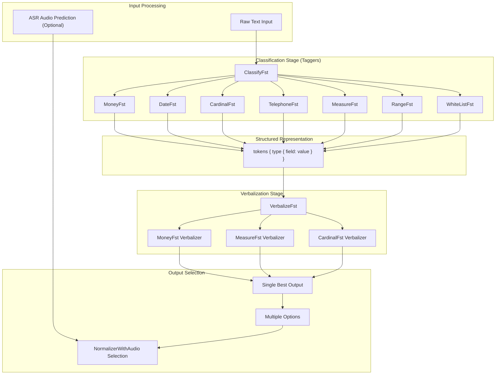
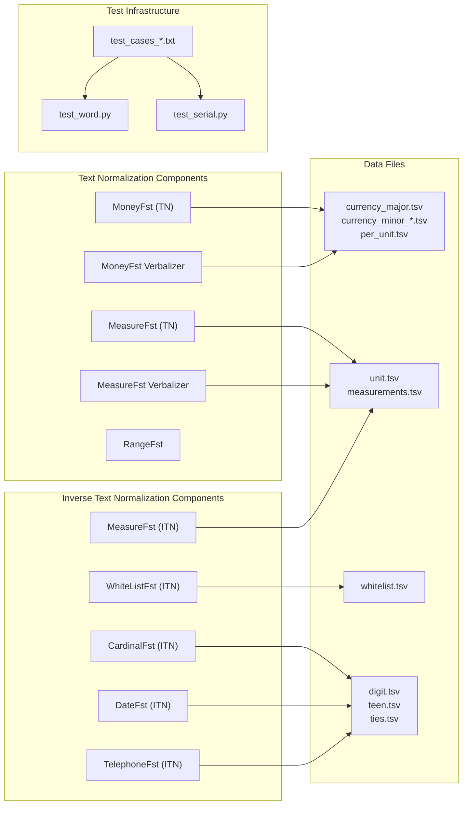

<!-- source: DeepWiki mcp.deepwiki.com · repo NVIDIA/NeMo-text-processing · page 4.1 English · fetched 2026-10-26 -->

# English

<details>
<summary>Relevant source files</summary>

The following files were used as context for generating this wiki page:

- [nemo_text_processing/inverse_text_normalization/en/data/measurements.tsv](nemo_text_processing/inverse_text_normalization/en/data/measurements.tsv)
- [nemo_text_processing/inverse_text_normalization/en/data/whitelist.tsv](nemo_text_processing/inverse_text_normalization/en/data/whitelist.tsv)
- [nemo_text_processing/inverse_text_normalization/en/taggers/cardinal.py](nemo_text_processing/inverse_text_normalization/en/taggers/cardinal.py)
- [nemo_text_processing/inverse_text_normalization/en/taggers/date.py](nemo_text_processing/inverse_text_normalization/en/taggers/date.py)
- [nemo_text_processing/inverse_text_normalization/en/taggers/measure.py](nemo_text_processing/inverse_text_normalization/en/taggers/measure.py)
- [nemo_text_processing/inverse_text_normalization/en/taggers/telephone.py](nemo_text_processing/inverse_text_normalization/en/taggers/telephone.py)
- [nemo_text_processing/inverse_text_normalization/en/taggers/whitelist.py](nemo_text_processing/inverse_text_normalization/en/taggers/whitelist.py)
- [nemo_text_processing/text_normalization/en/data/measure/unit.tsv](nemo_text_processing/text_normalization/en/data/measure/unit.tsv)
- [nemo_text_processing/text_normalization/en/data/money/per_unit.tsv](nemo_text_processing/text_normalization/en/data/money/per_unit.tsv)
- [nemo_text_processing/text_normalization/en/taggers/money.py](nemo_text_processing/text_normalization/en/taggers/money.py)
- [nemo_text_processing/text_normalization/en/taggers/range.py](nemo_text_processing/text_normalization/en/taggers/range.py)
- [nemo_text_processing/text_normalization/en/verbalizers/measure.py](nemo_text_processing/text_normalization/en/verbalizers/measure.py)
- [nemo_text_processing/text_normalization/en/verbalizers/money.py](nemo_text_processing/text_normalization/en/verbalizers/money.py)
- [tests/nemo_text_processing/en/data_inverse_text_normalization/test_cases_date.txt](tests/nemo_text_processing/en/data_inverse_text_normalization/test_cases_date.txt)
- [tests/nemo_text_processing/en/data_inverse_text_normalization/test_cases_telephone.txt](tests/nemo_text_processing/en/data_inverse_text_normalization/test_cases_telephone.txt)
- [tests/nemo_text_processing/en/data_text_normalization/test_cases_address.txt](tests/nemo_text_processing/en/data_text_normalization/test_cases_address.txt)
- [tests/nemo_text_processing/en/data_text_normalization/test_cases_money.txt](tests/nemo_text_processing/en/data_text_normalization/test_cases_money.txt)
- [tests/nemo_text_processing/en/data_text_normalization/test_cases_normalize_with_audio.txt](tests/nemo_text_processing/en/data_text_normalization/test_cases_normalize_with_audio.txt)
- [tests/nemo_text_processing/en/test_serial.py](tests/nemo_text_processing/en/test_serial.py)
- [tests/nemo_text_processing/en/test_word.py](tests/nemo_text_processing/en/test_word.py)

</details>


This document covers the comprehensive English text normalization and inverse text normalization capabilities in the NeMo text processing system. English is the most fully-featured language implementation, providing both text normalization (TN) and inverse text normalization (ITN) with specialized processing for money, dates, addresses, telephone numbers, measurements, and other domain-specific text types.

For information about the core text processing interfaces that English implements, see [Core Text Processing Systems](#3). For details about grammar compilation and deployment, see [Grammar Compilation](#6.1).

## Architecture Overview

The English text processing system implements a comprehensive two-stage pipeline with specialized finite state transducers (FSTs) for different text domains.

### English Text Processing Pipeline



Sources: [nemo_text_processing/text_normalization/en/taggers/money.py:35-199](), [nemo_text_processing/text_normalization/en/verbalizers/money.py:30-85](), [nemo_text_processing/inverse_text_normalization/en/taggers/date.py:138-208](), [nemo_text_processing/inverse_text_normalization/en/taggers/cardinal.py:34-246]()

### English Component Architecture



Sources: [nemo_text_processing/text_normalization/en/data/money/per_unit.tsv:1-70](), [nemo_text_processing/text_normalization/en/data/measure/unit.tsv:1-135](), [nemo_text_processing/inverse_text_normalization/en/data/whitelist.tsv:1-417](), [tests/nemo_text_processing/en/test_word.py:26-69]()

## Core Components

### Money Processing

The English money processing system handles currency amounts with sophisticated support for major and minor currencies, fractional amounts, and per-unit expressions.

#### MoneyFst Tagger

The `MoneyFst` class in text normalization converts currency symbols and amounts into structured representations:

```
$12.05 -> money { integer_part: "twelve" currency_maj: "dollars" fractional_part: "five" currency_min: "cents" preserve_order: true }
$1 -> money { currency_maj: "dollar" integer_part: "one" }
$1.2 million -> money { currency_maj: "dollars" integer_part: "one" fractional_part: "two" quantity: "million" }
```

The system supports:
- **Currency symbols**: `$`, `£`, `¥`, `₩`, `yuan`
- **Fractional amounts**: Automatic handling of cents/pence with proper singular/plural forms
- **Per-unit expressions**: `$20/mo`, `£10/wk`, `$350/yr`
- **Quantity abbreviations**: `million`, `billion`, `trillion`

#### MoneyFst Verbalizer

The money verbalizer converts structured money tokens back to spoken form:

```
money { integer_part: "twelve" fractional_part: "o five" currency: "dollars" } -> twelve o five dollars
```

#### Per-Unit Support

The system includes comprehensive per-unit mappings for various contexts:

| Unit | Spoken Form |
|------|-------------|
| `/mo` | per month |
| `/hr` | per hour |
| `/gal` | per gallon |
| `/lb` | per pound |
| `/ft²` | per square foot |

Sources: [nemo_text_processing/text_normalization/en/taggers/money.py:35-199](), [nemo_text_processing/text_normalization/en/verbalizers/money.py:30-85](), [nemo_text_processing/text_normalization/en/data/money/per_unit.tsv:1-70](), [tests/nemo_text_processing/en/data_text_normalization/test_cases_money.txt:1-71]()

### Date Processing

The `DateFst` class handles date normalization with support for multiple date formats and historical dates.

#### Date Formats Supported

- **Month-Day-Year**: `january fifth twenty twelve` → `date { month: "january" day: "5" year: "2012" }`
- **Day-Month-Year**: `the fifth of january twenty twelve` → `date { day: "5" month: "january" year: "2012" }`
- **Year only**: `twenty twenty` → `date { year: "2020" }`
- **Financial periods**: `second quarter of twenty twenty two` → `date { text: "Q2" year: "2022" }`

#### Year Processing

The system handles various year formats:
- **Two-digit years**: `twenty twelve` → `2012`
- **Four-digit years**: `two thousand twelve` → `2012`
- **Historical dates**: `sixteen sixty five` → `1665`
- **AD/BC notation**: `seven fifty b c` → `750BC`

#### Range Support

Date ranges and decades are supported:
- **Decades**: `nineteen eighties` → `1980s`
- **Centuries**: `two thousands` → `2000s`
- **Millennia**: `two thousands` → `2000s`

Sources: [nemo_text_processing/inverse_text_normalization/en/taggers/date.py:138-208](), [tests/nemo_text_processing/en/data_inverse_text_normalization/test_cases_date.txt:1-37]()

### Cardinal Number Processing

The `CardinalFst` class provides comprehensive number processing for both international and Indian numbering systems.

#### International Format

Supports standard Western numbering:
- **Basic numbers**: `twenty three` → `23`
- **Hundreds**: `one hundred twenty three` → `123`
- **Thousands**: `one thousand two hundred thirty four` → `1234`
- **Large numbers**: `million`, `billion`, `trillion`, `quadrillion`, `quintillion`, `sextillion`

#### Indian Numbering System

Comprehensive support for Indian number words:
- **Lakh**: `one lakh` → `100000`
- **Crore**: `one crore` → `10000000`
- **Arab**: `one arab` → `1000000000`
- **Kharab**: `one kharab` → `100000000000`
- **Nil**: `one nil` → `10000000000000`
- **Padma**: `one padma` → `1000000000000000`
- **Shankh**: `one shankh` → `100000000000000000`

#### Exception Handling

Numbers below 13 are not converted to maintain natural speech patterns in most contexts.

Sources: [nemo_text_processing/inverse_text_normalization/en/taggers/cardinal.py:34-255]()

### Telephone and Serial Processing

The `TelephoneFst` class handles various types of structured number sequences.

#### Telephone Numbers

- **Standard format**: `one two three one two three five six seven eight` → `123-123-5678`
- **Country codes**: `plus nine one one two three...` → `+91 123-123-5678`
- **Area codes**: `four one two three...` → `4 123-123-5678`

#### Credit Card Numbers

- **Standard format**: `four three two double seven...` → `432 7732 143214 3005`
- **Various lengths**: Supports different card number formats

#### IP Addresses

- **Dot notation**: `one two three dot one two three dot o dot four o` → `123.123.0.40`
- **Double digits**: `double five` → `55`

#### Serial Numbers

The system includes advanced serial number processing that handles alphanumeric sequences:
- **Mixed format**: `five w k r a three one` → `5wkra31`
- **Technical codes**: `x eighty six` → `x86`
- **Model numbers**: `r t x forty fifty t i` → `RTX 4050ti`

Sources: [nemo_text_processing/inverse_text_normalization/en/taggers/telephone.py:62-206](), [tests/nemo_text_processing/en/data_inverse_text_normalization/test_cases_telephone.txt:1-23]()

### Measurement Processing

The English measurement system handles units, dimensions, and scientific notation.

#### Unit Categories

| Category | Examples |
|----------|----------|
| **Length** | `meter`, `kilometer`, `foot`, `inch` |
| **Weight** | `kilogram`, `pound`, `ounce`, `gram` |
| **Temperature** | `degree Celsius`, `degree Fahrenheit`, `kelvin` |
| **Time** | `second`, `minute`, `hour`, `day` |
| **Technology** | `gigahertz`, `megabit per second`, `terabyte` |

#### Measurement Formats

- **With decimals**: `twelve point five kilograms` → `measure { decimal { integer_part: "twelve" fractional_part: "five" } units: "kg" }`
- **With cardinals**: `twelve kilograms` → `measure { cardinal { integer: "12" } units: "kg" }`
- **Singular/plural**: Automatic handling based on quantity

#### Advanced Features

- **Per-unit expressions**: `per meter`, `per second`, `per kilogram`
- **Scientific notation**: Support for exponential formats
- **Abbreviated units**: `km`, `kg`, `MHz`, `GB`

Sources: [nemo_text_processing/inverse_text_normalization/en/taggers/measure.py:34-116](), [nemo_text_processing/text_normalization/en/verbalizers/measure.py:27-122](), [nemo_text_processing/text_normalization/en/data/measure/unit.tsv:1-135](), [nemo_text_processing/inverse_text_normalization/en/data/measurements.tsv:1-146]()

### Range Processing

The `RangeFst` class handles various types of ranges and mathematical expressions.

#### Range Types

- **Time ranges**: `2:30 - 4:45` → `two thirty to four forty five`
- **Date ranges**: `1970-2010` → `nineteen seventy to twenty ten`
- **Numeric ranges**: `10-20` → `ten to twenty`
- **Approximate values**: `~25` → `approximately twenty five`

#### Mathematical Operations

- **Addition**: `5 + 3` → `five plus three`
- **Multiplication**: `5 x 3` → `five times three`
- **Division**: `10/5` → `ten divided by five`
- **Percentages**: `10% to 20%` → `ten to twenty percent`

#### Special Patterns

- **Mid-year**: `mid-1990s` → `mid nineteen nineties`
- **Number sequences**: `No. 12` → `Number twelve`
- **Dimensions**: `25 x 7 m` → `twenty five by seven meters`

Sources: [nemo_text_processing/text_normalization/en/taggers/range.py:22-128]()

### Whitelist Processing

The `WhiteListFst` class handles predefined mappings for common abbreviations and special cases.

#### Categories

- **Technology**: `API` → `a p i`, `GPU` → `g p u`, `CPU` → `c p u`
- **Companies**: `AMD` → `a m d`, `NVIDIA` → `nvidia`
- **Standards**: `USB` → `u s b`, `HDMI` → `h d m i`
- **Titles**: `dr.` → `doctor`, `mr.` → `mister`, `mrs.` → `misses`

#### Special Cases

- **Gaming**: `RTX` → `r t x`, `GTX` → `g t x`
- **Programming**: `C++` → `c plus plus`, `C#` → `c sharp`
- **Protocols**: `HTTP` → `h t t p`, `TCP/IP` → `t c p i p`

The whitelist has the highest priority among all classifier grammars and is loaded from configurable data files.

Sources: [nemo_text_processing/inverse_text_normalization/en/taggers/whitelist.py:33-57](), [nemo_text_processing/inverse_text_normalization/en/data/whitelist.tsv:1-417]()

## Address Processing

The English system includes specialized address normalization capabilities.

### Address Components

- **Street numbers**: `2788 San Tomas Expy` → `twenty seven eighty eight San Tomas Expressway`
- **Directions**: `708 N 1st St` → `seven zero eight North first Street`
- **Street types**: `St` → `Street`, `Ave` → `Avenue`, `Ct` → `Court`
- **State abbreviations**: `CA` → `California`, `NY` → `New York`

### Context Sensitivity

The system maintains context awareness to avoid over-normalization:
- **Proper handling**: `Nancy lived at 1428 Elm St. It was a strange place.` → `Nancy lived at fourteen twenty eight Elm Street. It was a strange place.`
- **Boundary detection**: Prevents incorrect normalization across sentence boundaries

Sources: [tests/nemo_text_processing/en/data_text_normalization/test_cases_address.txt:1-11]()

## Audio-Enhanced Normalization

The English system supports `NormalizerWithAudio` for improved accuracy when ASR predictions are available.

### Multi-Option Generation

The system generates multiple normalization options:

```
123 →
- one two three
- one twenty three  
- one hundred twenty three
- one hundred and twenty three
```

### Audio-Guided Selection

When audio predictions are available, the system selects the most appropriate normalization:

```
$1.01 →
- one dollar and one cent
- one us dollar one cent
- one dollar one cent
```

### Complex Scenarios

The system handles ambiguous cases effectively:

```
1/24 →
- january twenty four
- the twenty fourth of january
- january twenty fourth
```

Sources: [tests/nemo_text_processing/en/data_text_normalization/test_cases_normalize_with_audio.txt:1-183]()

## Testing Framework

The English system includes comprehensive testing infrastructure.

### Test Categories

| Test Type | Purpose | Example Files |
|-----------|---------|---------------|
| **Unit Tests** | Component validation | `test_word.py`, `test_serial.py` |
| **Integration Tests** | End-to-end validation | `test_cases_money.txt` |
| **Audio Tests** | Multi-option validation | `test_cases_normalize_with_audio.txt` |

### Test Case Format

Test cases use the format `input~expected_output`:

```
$2.50~two dollars fifty cents
july twenty fifth twenty twelve~july 25 2012
one two three one two three five six seven eight~123-123-5678
```

### Parameterized Testing

The system uses parameterized tests for efficient validation:

```python
@parameterized.expand(parse_test_case_file('en/data_text_normalization/test_cases_money.txt'))
def test_norm(self, test_input, expected):
    pred = self.normalizer_en.normalize(test_input, verbose=False)
    assert pred == expected
```

Sources: [tests/nemo_text_processing/en/test_word.py:26-69](), [tests/nemo_text_processing/en/test_serial.py:24-45]()

---

