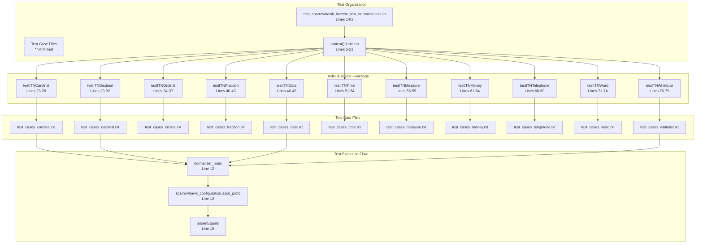

<!-- source: DeepWiki mcp.deepwiki.com · repo NVIDIA/NeMo-text-processing · page 4.2 Hindi · fetched 2026-10-26 -->

# Hindi

<details>
<summary>Relevant source files</summary>

The following files were used as context for generating this wiki page:

- [nemo_text_processing/inverse_text_normalization/hi/data/date/century.tsv](nemo_text_processing/inverse_text_normalization/hi/data/date/century.tsv)
- [nemo_text_processing/inverse_text_normalization/hi/data/telephone/__init__.py](nemo_text_processing/inverse_text_normalization/hi/data/telephone/__init__.py)
- [nemo_text_processing/inverse_text_normalization/hi/data/telephone/eng_to_hindi_digit.tsv](nemo_text_processing/inverse_text_normalization/hi/data/telephone/eng_to_hindi_digit.tsv)
- [nemo_text_processing/inverse_text_normalization/hi/data/telephone/teens_and_ties_eng_to_hin.tsv](nemo_text_processing/inverse_text_normalization/hi/data/telephone/teens_and_ties_eng_to_hin.tsv)
- [nemo_text_processing/inverse_text_normalization/hi/data/whitelist/whitelist.tsv](nemo_text_processing/inverse_text_normalization/hi/data/whitelist/whitelist.tsv)
- [nemo_text_processing/inverse_text_normalization/hi/taggers/date.py](nemo_text_processing/inverse_text_normalization/hi/taggers/date.py)
- [nemo_text_processing/inverse_text_normalization/hi/taggers/telephone.py](nemo_text_processing/inverse_text_normalization/hi/taggers/telephone.py)
- [nemo_text_processing/inverse_text_normalization/hi/taggers/tokenize_and_classify.py](nemo_text_processing/inverse_text_normalization/hi/taggers/tokenize_and_classify.py)
- [nemo_text_processing/inverse_text_normalization/hi/taggers/whitelist.py](nemo_text_processing/inverse_text_normalization/hi/taggers/whitelist.py)
- [nemo_text_processing/inverse_text_normalization/hi/verbalizers/date.py](nemo_text_processing/inverse_text_normalization/hi/verbalizers/date.py)
- [nemo_text_processing/inverse_text_normalization/hi/verbalizers/telephone.py](nemo_text_processing/inverse_text_normalization/hi/verbalizers/telephone.py)
- [nemo_text_processing/inverse_text_normalization/hi/verbalizers/verbalize.py](nemo_text_processing/inverse_text_normalization/hi/verbalizers/verbalize.py)
- [nemo_text_processing/text_normalization/hi/data/measure/unit.tsv](nemo_text_processing/text_normalization/hi/data/measure/unit.tsv)
- [nemo_text_processing/text_normalization/hi/data/money/currency.tsv](nemo_text_processing/text_normalization/hi/data/money/currency.tsv)
- [nemo_text_processing/text_normalization/hi/data/numbers/teens_and_ties.tsv](nemo_text_processing/text_normalization/hi/data/numbers/teens_and_ties.tsv)
- [nemo_text_processing/text_normalization/hi/data/time/hours.tsv](nemo_text_processing/text_normalization/hi/data/time/hours.tsv)
- [nemo_text_processing/text_normalization/hi/taggers/cardinal.py](nemo_text_processing/text_normalization/hi/taggers/cardinal.py)
- [nemo_text_processing/text_normalization/hi/taggers/date.py](nemo_text_processing/text_normalization/hi/taggers/date.py)
- [nemo_text_processing/text_normalization/hi/taggers/measure.py](nemo_text_processing/text_normalization/hi/taggers/measure.py)
- [nemo_text_processing/text_normalization/hi/taggers/money.py](nemo_text_processing/text_normalization/hi/taggers/money.py)
- [nemo_text_processing/text_normalization/hi/taggers/tokenize_and_classify.py](nemo_text_processing/text_normalization/hi/taggers/tokenize_and_classify.py)
- [nemo_text_processing/text_normalization/hi/verbalizers/date.py](nemo_text_processing/text_normalization/hi/verbalizers/date.py)
- [tests/nemo_text_processing/hi/data_inverse_text_normalization/test_cases_date.txt](tests/nemo_text_processing/hi/data_inverse_text_normalization/test_cases_date.txt)
- [tests/nemo_text_processing/hi/data_inverse_text_normalization/test_cases_whitelist.txt](tests/nemo_text_processing/hi/data_inverse_text_normalization/test_cases_whitelist.txt)
- [tests/nemo_text_processing/hi/data_inverse_text_normalization/test_cases_word.txt](tests/nemo_text_processing/hi/data_inverse_text_normalization/test_cases_word.txt)
- [tests/nemo_text_processing/hi/test_sparrowhawk_inverse_text_normalization.sh](tests/nemo_text_processing/hi/test_sparrowhawk_inverse_text_normalization.sh)

</details>


This document covers the Hindi language support in the NeMo Text Processing system, including both Text Normalization (TN) and Inverse Text Normalization (ITN) capabilities. The Hindi implementation provides comprehensive support for converting written Hindi text to spoken form and vice versa, with specialized handling for numbers, dates, money, measurements, and other structured data types.

For information about other language implementations, see the Language Support overview at [4](#4). For details about the core text processing architecture that underlies all languages, see [3](#3).

## System Architecture

The Hindi text processing system follows the standard two-stage pipeline architecture used throughout NeMo Text Processing, with language-specific implementations for classification and verbalization.

### Hindi Processing Pipeline

```mermaid
graph TB
    subgraph "Input Processing"
        RawHindi["Raw Hindi Text<br/>पाँच जनवरी दो हज़ार बारह"]
        SpokenHindi["Spoken Hindi Text<br/>५ जनवरी, २०१२"]
    end
    
    subgraph "Classification Stage (ITN)"
        ClassifyFst["ClassifyFst<br/>tokenize_and_classify.py"]
        CardinalFst["CardinalFst<br/>cardinal.py"]
        DateFst["DateFst<br/>date.py"]
        MoneyFst["MoneyFst<br/>money.py"]
        TelephoneFst["TelephoneFst<br/>telephone.py"]
        MeasureFst["MeasureFst<br/>measure.py"]
        DecimalFst["DecimalFst<br/>decimal.py"]
        FractionFst["FractionFst<br/>fraction.py"]
        TimeFst["TimeFst<br/>time.py"]
        OrdinalFst["OrdinalFst<br/>ordinal.py"]
        WhiteListFst["WhiteListFst<br/>whitelist.py"]
        WordFst["WordFst<br/>word.py"]
        PunctuationFst["PunctuationFst<br/>punctuation.py"]
    end
    
    subgraph "Structured Representation"
        TokenizedForm["tokens { date { month: \"जनवरी\" day: \"५\" year: \"२०१२\" } }"]
    end
    
    subgraph "Verbalization Stage (ITN)"
        VerbalizeFst["VerbalizeFst<br/>verbalize.py"]
        CardinalVerb["CardinalFst<br/>verbalizers/cardinal.py"]
        DateVerb["DateFst<br/>verbalizers/date.py"]
        MoneyVerb["MoneyFst<br/>verbalizers/money.py"]
        TelephoneVerb["TelephoneFst<br/>verbalizers/telephone.py"]
        MeasureVerb["MeasureFst<br/>verbalizers/measure.py"]
        DecimalVerb["DecimalFst<br/>verbalizers/decimal.py"]
        FractionVerb["FractionFst<br/>verbalizers/fraction.py"]
        TimeVerb["TimeFst<br/>verbalizers/time.py"]
        OrdinalVerb["OrdinalFst<br/>verbalizers/ordinal.py"]
        WhiteListVerb["WhiteListFst<br/>verbalizers/whitelist.py"]
        WordVerb["WordFst<br/>verbalizers/word.py"]
    end
    
    subgraph "Output"
        NormalizedText["Normalized Text<br/>५ जनवरी, २०१२"]
    end
    
    RawHindi --> ClassifyFst
    ClassifyFst --> CardinalFst
    ClassifyFst --> DateFst
    ClassifyFst --> MoneyFst
    ClassifyFst --> TelephoneFst
    ClassifyFst --> MeasureFst
    ClassifyFst --> DecimalFst
    ClassifyFst --> FractionFst
    ClassifyFst --> TimeFst
    ClassifyFst --> OrdinalFst
    ClassifyFst --> WhiteListFst
    ClassifyFst --> WordFst
    ClassifyFst --> PunctuationFst
    
    CardinalFst --> TokenizedForm
    DateFst --> TokenizedForm
    MoneyFst --> TokenizedForm
    TelephoneFst --> TokenizedForm
    MeasureFst --> TokenizedForm
    DecimalFst --> TokenizedForm
    FractionFst --> TokenizedForm
    TimeFst --> TokenizedForm
    OrdinalFst --> TokenizedForm
    WhiteListFst --> TokenizedForm
    WordFst --> TokenizedForm
    PunctuationFst --> TokenizedForm
    
    TokenizedForm --> VerbalizeFst
    VerbalizeFst --> CardinalVerb
    VerbalizeFst --> DateVerb
    VerbalizeFst --> MoneyVerb
    VerbalizeFst --> TelephoneVerb
    VerbalizeFst --> MeasureVerb
    VerbalizeFst --> DecimalVerb
    VerbalizeFst --> FractionVerb
    VerbalizeFst --> TimeVerb
    VerbalizeFst --> OrdinalVerb
    VerbalizeFst --> WhiteListVerb
    VerbalizeFst --> WordVerb
    
    CardinalVerb --> NormalizedText
    DateVerb --> NormalizedText
    MoneyVerb --> NormalizedText
    TelephoneVerb --> NormalizedText
    MeasureVerb --> NormalizedText
    DecimalVerb --> NormalizedText
    FractionVerb --> NormalizedText
    TimeVerb --> NormalizedText
    OrdinalVerb --> NormalizedText
    WhiteListVerb --> NormalizedText
    WordVerb --> NormalizedText
    
    SpokenHindi --> VerbalizeFst
```

**Sources:** [nemo_text_processing/inverse_text_normalization/hi/taggers/tokenize_and_classify.py:42-124](), [nemo_text_processing/inverse_text_normalization/hi/verbalizers/verbalize.py:30-66]()

## Classification Pipeline (ITN)

The classification pipeline converts spoken Hindi text into structured token representations. The main entry point is the `ClassifyFst` class which orchestrates all component classifiers.

### Main Classification Controller

```mermaid
graph TB
    subgraph "ClassifyFst - tokenize_and_classify.py"
        ClassifyInit["__init__()<br/>Lines 55-61"]
        WeightedClassifiers["Weighted Classifier Union<br/>Lines 96-108"]
        TokenWrapper["Token Wrapper<br/>Lines 110-116"]
        CachingLogic["FAR File Caching<br/>Lines 64-70, 121-123"]
    end
    
    subgraph "Component Classifiers"
        CardinalComponent["CardinalFst()<br/>Lines 73-74"]
        OrdinalComponent["OrdinalFst(cardinal)<br/>Lines 76-77"]
        DecimalComponent["DecimalFst(cardinal)<br/>Lines 78-79"]
        FractionComponent["FractionFst(cardinal)<br/>Lines 80-81"]
        DateComponent["DateFst(cardinal)<br/>Lines 82-83"]
        TimeComponent["TimeFst()<br/>Lines 84-85"]
        MeasureComponent["MeasureFst(cardinal, decimal)<br/>Lines 86-87"]
        MoneyComponent["MoneyFst(cardinal, decimal)<br/>Lines 88-89"]
        TelephoneComponent["TelephoneFst(cardinal)<br/>Lines 90-91"]
        PunctuationComponent["PunctuationFst().fst<br/>Lines 92"]
        WhitelistComponent["WhiteListFst().fst<br/>Lines 93"]
        WordComponent["WordFst().fst<br/>Lines 94"]
    end
    
    subgraph "Weighted Priority System"
        CardinalWeight["cardinal_graph weight: 1.1<br/>Line 97"]
        OrdinalWeight["ordinal_graph weight: 1.1<br/>Line 98"]
        DecimalWeight["decimal_graph weight: 1.1<br/>Line 99"]
        FractionWeight["fraction_graph weight: 1.1<br/>Line 100"]
        DateWeight["date_graph weight: 1.1<br/>Line 101"]
        TimeWeight["time_graph weight: 1.1<br/>Line 102"]
        MeasureWeight["measure_graph weight: 1.1<br/>Line 103"]
        MoneyWeight["money_graph weight: 1.1<br/>Line 104"]
        TelephoneWeight["telephone_graph weight: 1.1<br/>Line 105"]
        WordWeight["word_graph weight: 100<br/>Line 106"]
        WhitelistWeight["whitelist_graph weight: 1.01<br/>Line 107"]
    end
    
    ClassifyInit --> CardinalComponent
    ClassifyInit --> OrdinalComponent
    ClassifyInit --> DecimalComponent
    ClassifyInit --> FractionComponent
    ClassifyInit --> DateComponent
    ClassifyInit --> TimeComponent
    ClassifyInit --> MeasureComponent
    ClassifyInit --> MoneyComponent
    ClassifyInit --> TelephoneComponent
    ClassifyInit --> PunctuationComponent
    ClassifyInit --> WhitelistComponent
    ClassifyInit --> WordComponent
    
    CardinalComponent --> CardinalWeight
    OrdinalComponent --> OrdinalWeight
    DecimalComponent --> DecimalWeight
    FractionComponent --> FractionWeight
    DateComponent --> DateWeight
    TimeComponent --> TimeWeight
    MeasureComponent --> MeasureWeight
    MoneyComponent --> MoneyWeight
    TelephoneComponent --> TelephoneWeight
    WordComponent --> WordWeight
    WhitelistComponent --> WhitelistWeight
    
    CardinalWeight --> WeightedClassifiers
    OrdinalWeight --> WeightedClassifiers
    DecimalWeight --> WeightedClassifiers
    FractionWeight --> WeightedClassifiers
    DateWeight --> WeightedClassifiers
    TimeWeight --> WeightedClassifiers
    MeasureWeight --> WeightedClassifiers
    MoneyWeight --> WeightedClassifiers
    TelephoneWeight --> WeightedClassifiers
    WordWeight --> WeightedClassifiers
    WhitelistWeight --> WeightedClassifiers
    
    WeightedClassifiers --> TokenWrapper
    TokenWrapper --> CachingLogic
```



**Sources:** [nemo_text_processing/inverse_text_normalization/hi/taggers/tokenize_and_classify.py:55-124]()

## Verbalization Pipeline (ITN)

The verbalization pipeline converts structured tokens back into Hindi text. The `VerbalizeFst` class coordinates all component verbalizers.

### Main Verbalization Controller

```mermaid
graph TB
    subgraph "VerbalizeFst - verbalize.py"
        VerbInit["__init__()<br/>Lines 37-38"]
        GraphUnion["Graph Union<br/>Lines 53-65"]
        FstAssignment["self.fst = graph<br/>Line 66"]
    end
    
    subgraph "Component Verbalizers"
        CardinalVerb["CardinalFst()<br/>Lines 39-40"]
        OrdinalVerb["OrdinalFst().fst<br/>Line 41"]
        DecimalVerb["DecimalFst()<br/>Lines 42-43"]
        FractionVerb["FractionFst().fst<br/>Line 44"]
        DateVerb["DateFst().fst<br/>Line 45"]
        TimeVerb["TimeFst().fst<br/>Line 46"]
        MeasureVerb["MeasureFst(cardinal, decimal).fst<br/>Line 47"]
        MoneyVerb["MoneyFst(cardinal, decimal).fst<br/>Line 48"]
        TelephoneVerb["TelephoneFst(cardinal).fst<br/>Line 49"]
        WordVerb["WordFst().fst<br/>Line 50"]
        WhitelistVerb["WhiteListFst().fst<br/>Line 51"]
    end
    
    subgraph "Union Structure"
        CardinalGraphUnion["cardinal_graph<br/>Line 54"]
        WhitelistGraphUnion["whitelist_graph<br/>Line 55"]
        WordGraphUnion["word_graph<br/>Line 56"]
        OrdinalGraphUnion["ordinal_graph<br/>Line 57"]
        DecimalGraphUnion["decimal_graph<br/>Line 58"]
        FractionGraphUnion["fraction_graph<br/>Line 59"]
        DateGraphUnion["date_graph<br/>Line 60"]
        TimeGraphUnion["time_graph<br/>Line 61"]
        MeasureGraphUnion["measure_graph<br/>Line 62"]
        MoneyGraphUnion["money_graph<br/>Line 63"]
        TelephoneGraphUnion["telephone_graph<br/>Line 64"]
    end
    
    VerbInit --> CardinalVerb
    VerbInit --> OrdinalVerb
    VerbInit --> DecimalVerb
    VerbInit --> FractionVerb
    VerbInit --> DateVerb
    VerbInit --> TimeVerb
    VerbInit --> MeasureVerb
    VerbInit --> MoneyVerb
    VerbInit --> TelephoneVerb
    VerbInit --> WordVerb
    VerbInit --> WhitelistVerb
    
    CardinalVerb --> CardinalGraphUnion
    WhitelistVerb --> WhitelistGraphUnion
    WordVerb --> WordGraphUnion
    OrdinalVerb --> OrdinalGraphUnion
    DecimalVerb --> DecimalGraphUnion
    FractionVerb --> FractionGraphUnion
    DateVerb --> DateGraphUnion
    TimeVerb --> TimeGraphUnion
    MeasureVerb --> MeasureGraphUnion
    MoneyVerb --> MoneyGraphUnion
    TelephoneVerb --> TelephoneGraphUnion
    
    CardinalGraphUnion --> GraphUnion
    WhitelistGraphUnion --> GraphUnion
    WordGraphUnion --> GraphUnion
    OrdinalGraphUnion --> GraphUnion
    DecimalGraphUnion --> GraphUnion
    FractionGraphUnion --> GraphUnion
    DateGraphUnion --> GraphUnion
    TimeGraphUnion --> GraphUnion
    MeasureGraphUnion --> GraphUnion
    MoneyGraphUnion --> GraphUnion
    TelephoneGraphUnion --> GraphUnion
    
    GraphUnion --> FstAssignment
```



**Sources:** [nemo_text_processing/inverse_text_normalization/hi/verbalizers/verbalize.py:37-66]()

## Supported Data Types

The Hindi system supports comprehensive text normalization across multiple data types, each with specialized handling for Hindi linguistic patterns and numerical systems.

### Data Type Coverage

| Data Type | Tagger | Verbalizer | Example Input | Example Output |
|-----------|---------|------------|---------------|----------------|
| Cardinal | `CardinalFst` | `CardinalFst` | `बारह` | `१२` |
| Ordinal | `OrdinalFst` | `OrdinalFst` | `पहला` | `१st` |
| Decimal | `DecimalFst` | `DecimalFst` | `बारह दशमलव पांच` | `१२.५` |
| Fraction | `FractionFst` | `FractionFst` | `एक चौथाई` | `१/४` |
| Date | `DateFst` | `DateFst` | `पांच जनवरी` | `५ जनवरी` |
| Time | `TimeFst` | `TimeFst` | `डेढ़ बजे` | `१:३०` |
| Money | `MoneyFst` | `MoneyFst` | `पचास रुपए` | `₹५०` |
| Measure | `MeasureFst` | `MeasureFst` | `दस किलोग्राम` | `१० kg` |
| Telephone | `TelephoneFst` | `TelephoneFst` | `प्लस इक्यानवे` | `+९१` |
| Whitelist | `WhiteListFst` | `WhiteListFst` | `डॉक्टर` | `डॉ.` |
| Word | `WordFst` | `WordFst` | `संगीत` | `संगीत` |

### Date Processing Capabilities

The Hindi date system handles complex date patterns including:

```mermaid
graph TB
    subgraph "Date Input Patterns"
        DMY["Day Month Year<br/>पांच जनवरी दो हज़ार बारह"]
        MDY["Month Day Year<br/>जनवरी पांच दो हज़ार बारह"]
        MY["Month Year<br/>जनवरी दो हज़ार बारह"]
        YearOnly["Year Only<br/>दो हज़ार बारह"]
        YearRange["Year Range<br/>दो हज़ार पाँच से दो हज़ार उन्नीस"]
        Century["Century<br/>चौंतीस सौ ईसा पूर्व"]
        EraMarkers["Era Markers<br/>उन्नीस सौ बीस ईस्वी"]
    end
    
    subgraph "DateFst Processing"
        DateTagger["DateFst Tagger<br/>date.py Lines 38-97"]
        MonthGraph["month_graph<br/>Line 45"]
        DateDaysGraph["graph_date_days<br/>Line 46"]
        YearGraph["graph_year<br/>Lines 41-43"]
        CenturyGraph["graph_century<br/>Line 47"]
        YearRangeGraph["year_range<br/>Lines 52-61"]
    end
    
    subgraph "Output Token Structure"
        DateToken["date { month: \"जनवरी\" day: \"५\" year: \"२०१२\" preserve_order: true }"]
        YearToken["date { year: \"२०१२\" }"]
        RangeToken["date { year: \"२००५-२०१९\" }"]
        CenturyToken["date { year: \"३४००\" text: \"ई.पू.\" }"]
    end
    
    DMY --> DateTagger
    MDY --> DateTagger
    MY --> DateTagger
    YearOnly --> DateTagger
    YearRange --> DateTagger
    Century --> DateTagger
    EraMarkers --> DateTagger
    
    DateTagger --> MonthGraph
    DateTagger --> DateDaysGraph
    DateTagger --> YearGraph
    DateTagger --> CenturyGraph
    DateTagger --> YearRangeGraph
    
    MonthGraph --> DateToken
    DateDaysGraph --> DateToken
    YearGraph --> YearToken
    CenturyGraph --> CenturyToken
    YearRangeGraph --> RangeToken
```

**Sources:** [nemo_text_processing/inverse_text_normalization/hi/taggers/date.py:38-97](), [tests/nemo_text_processing/hi/data_inverse_text_normalization/test_cases_date.txt:1-36]()

### Telephone Processing

The Hindi telephone system handles both Hindi and English digit sequences for phone numbers:

```mermaid
graph TB
    subgraph "Telephone Input Types"
        MobileHindi["Mobile Numbers (Hindi)<br/>प्लस इक्यानवे नौ आठ सात छह पांच"]
        MobileEnglish["Mobile Numbers (English)<br/>plus ninety one nine eight seven six"]
        LandlineHindi["Landline with Extension<br/>शून्य ग्यारह एक दो तीन चार पांच छह सात"]
        PincodeHindi["Pincode<br/>एक दो तीन चार पांच छह"]
        CreditCardHindi["Credit Card Digits<br/>एक दो तीन चार"]
    end
    
    subgraph "TelephoneFst Processing"
        TelephoneTagger["TelephoneFst<br/>telephone.py Lines 31-158"]
        HindiDigitGraph["hindi_digit_graph<br/>Lines 34-35"]
        EnglishDigitGraph["english_digit_graph<br/>Line 37"]
        CountryCodeGraph["country_code_graph<br/>Lines 39-48, 69-74"]
        CityCodeGraph["city_code_hindi/english<br/>Lines 77-88"]
        NumberPartGraph["number_part processing<br/>Lines 50-62"]
    end
    
    subgraph "Output Token Structure"
        MobileToken["telephone { country_code: \"९१\" number_part: \"९८७६५४३२१\" }"]
        LandlineToken["telephone { extension: \"१११\" number_part: \"१२३४५६७\" }"]
        PincodeToken["telephone { number_part: \"१२३४५६\" }"]
        CreditToken["telephone { number_part: \"१२३४\" }"]
    end
    
    MobileHindi --> TelephoneTagger
    MobileEnglish --> TelephoneTagger
    LandlineHindi --> TelephoneTagger
    PincodeHindi --> TelephoneTagger
    CreditCardHindi --> TelephoneTagger
    
    TelephoneTagger --> HindiDigitGraph
    TelephoneTagger --> EnglishDigitGraph
    TelephoneTagger --> CountryCodeGraph
    TelephoneTagger --> CityCodeGraph
    TelephoneTagger --> NumberPartGraph
    
    HindiDigitGraph --> MobileToken
    EnglishDigitGraph --> MobileToken
    CountryCodeGraph --> MobileToken
    CityCodeGraph --> LandlineToken
    NumberPartGraph --> PincodeToken
    NumberPartGraph --> CreditToken
```

**Sources:** [nemo_text_processing/inverse_text_normalization/hi/taggers/telephone.py:31-158](), [nemo_text_processing/inverse_text_normalization/hi/data/telephone/eng_to_hindi_digit.tsv:1-11](), [nemo_text_processing/inverse_text_normalization/hi/data/telephone/teens_and_ties_eng_to_hin.tsv:1-91]()

### Whitelist Processing

The whitelist system handles common abbreviations and special cases:

```mermaid
graph TB
    subgraph "Whitelist Data Sources"
        WhitelistFile["whitelist.tsv<br/>Lines 1-13"]
        FractionMappings["Fraction Mappings<br/>१/४ → पाव, १/२ → आधा"]
        TimeMappings["Time Mappings<br/>१:३० → डेढ़ बजे, २:३० → ढाई बजे"]
        TitleMappings["Title Mappings<br/>डॉ. → डॉक्टर, स्मि. → श्रीमती"]
        DecimalMappings["Decimal Mappings<br/>१.५ → डेढ़, २.५ → ढाई"]
    end
    
    subgraph "WhiteListFst Processing"
        WhitelistTagger["WhiteListFst<br/>whitelist.py Lines 33-57"]
        StringMapCased["string_map_cased<br/>Line 55"]
        ConvertSpace["convert_space<br/>Line 56"]
        InputCaseHandling["input_case handling<br/>Line 46"]
    end
    
    subgraph "Output Token Structure"
        WhitelistToken["tokens { name: \"डॉ.\" }"]
        FractionToken["tokens { name: \"१/४\" }"]
        TimeToken["tokens { name: \"१:३०\" }"]
        DecimalToken["tokens { name: \"१.५\" }"]
    end
    
    WhitelistFile --> FractionMappings
    WhitelistFile --> TimeMappings
    WhitelistFile --> TitleMappings
    WhitelistFile --> DecimalMappings
    
    FractionMappings --> WhitelistTagger
    TimeMappings --> WhitelistTagger
    TitleMappings --> WhitelistTagger
    DecimalMappings --> WhitelistTagger
    
    WhitelistTagger --> StringMapCased
    StringMapCased --> ConvertSpace
    ConvertSpace --> InputCaseHandling
    
    InputCaseHandling --> WhitelistToken
    InputCaseHandling --> FractionToken
    InputCaseHandling --> TimeToken
    InputCaseHandling --> DecimalToken
```

**Sources:** [nemo_text_processing/inverse_text_normalization/hi/taggers/whitelist.py:33-57](), [nemo_text_processing/inverse_text_normalization/hi/data/whitelist/whitelist.tsv:1-13](), [tests/nemo_text_processing/hi/data_inverse_text_normalization/test_cases_whitelist.txt:1-12]()

## Testing Framework

The Hindi implementation includes comprehensive testing through both shell-based Sparrowhawk tests and test case files.

### Test Structure



**Sources:** [tests/nemo_text_processing/hi/test_sparrowhawk_inverse_text_normalization.sh:1-83]()

### Test Case Format

Test cases follow a simple format with input and expected output separated by `~`:

| Test Type | Example Test Case | Description |
|-----------|-------------------|-------------|
| Date | `छः मई~६ मई` | Basic day-month format |
| Date | `पच्चीस मार्च दो हज़ार दस~२५ मार्च, २०१०` | Full date with year |
| Whitelist | `डॉक्टर~डॉ.` | Title abbreviation |
| Whitelist | `डेढ़ बजे~१:३०` | Time expression |
| Word | `नींद~नींद` | Pass-through word |
| Word | `कच्चा-पक्का~कच्चा-पक्का` | Hyphenated compound |

**Sources:** [tests/nemo_text_processing/hi/data_inverse_text_normalization/test_cases_date.txt:1-36](), [tests/nemo_text_processing/hi/data_inverse_text_normalization/test_cases_whitelist.txt:1-12](), [tests/nemo_text_processing/hi/data_inverse_text_normalization/test_cases_word.txt:1-15]()

## Data Files and Configuration

The Hindi system relies on extensive data files for linguistic mappings and configuration:

### Data File Organization

```mermaid
graph TB
    subgraph "Core Number System"
        DigitTSV["data/numbers/digit.tsv<br/>Basic digit mappings"]
        ZeroTSV["data/numbers/zero.tsv<br/>Zero variants"]
        TeensTiesTSV["data/numbers/teens_and_ties.tsv<br/>10-99 mappings"]
    end
    
    subgraph "Date System"
        MonthsTSV["data/date/months.tsv<br/>Month names"]
        DateDaysTSV["data/date/date_days.tsv<br/>Day numbers"]
        CenturyTSV["data/date/century.tsv<br/>Era markers"]
        SuffixesTSV["data/date/suffixes.tsv<br/>Year suffixes"]
        PrefixesTSV["data/date/prefixes.tsv<br/>Year prefixes"]
    end
    
    subgraph "Measurement System"
        UnitTSV["data/measure/unit.tsv<br/>Unit mappings"]
        QuarterlyUnitsTSV["data/measure/quarterly_units.tsv<br/>Fractional units"]
    end
    
    subgraph "Currency System"
        CurrencyTSV["data/money/currency.tsv<br/>Currency symbols"]
    end
    
    subgraph "Time System"
        HoursTSV["data/time/hours.tsv<br/>Hour mappings"]
    end
    
    subgraph "Telephone System"
        EngToHindiDigitTSV["data/telephone/eng_to_hindi_digit.tsv<br/>English digit mappings"]
        TeensEngToHinTSV["data/telephone/teens_and_ties_eng_to_hin.tsv<br/>English teens/ties"]
    end
    
    subgraph "Whitelist System"
        WhitelistTSV["data/whitelist/whitelist.tsv<br/>Abbreviation mappings"]
    end
    
    subgraph "FST Components Using Data"
        CardinalFst["CardinalFst uses digit, zero, teens_and_ties"]
        DateFst["DateFst uses months, date_days, century"]
        MeasureFst["MeasureFst uses unit, quarterly_units"]
        MoneyFst["MoneyFst uses currency"]
        TimeFst["TimeFst uses hours"]
        TelephoneFst["TelephoneFst uses eng_to_hindi_digit, teens_eng_to_hin"]
        WhiteListFst["WhiteListFst uses whitelist"]
    end
    
    DigitTSV --> CardinalFst
    ZeroTSV --> CardinalFst
    TeensTiesTSV --> CardinalFst
    
    MonthsTSV --> DateFst
    DateDaysTSV --> DateFst
    CenturyTSV --> DateFst
    SuffixesTSV --> DateFst
    PrefixesTSV --> DateFst
    
    UnitTSV --> MeasureFst
    QuarterlyUnitsTSV --> MeasureFst
    
    CurrencyTSV --> MoneyFst
    
    HoursTSV --> TimeFst
    
    EngToHindiDigitTSV --> TelephoneFst
    TeensEngToHinTSV --> TelephoneFst
    
    WhitelistTSV --> WhiteListFst
```



**Sources:** [nemo_text_processing/inverse_text_normalization/hi/data/whitelist/whitelist.tsv:1-13](), [nemo_text_processing/inverse_text_normalization/hi/data/telephone/eng_to_hindi_digit.tsv:1-11](), [nemo_text_processing/inverse_text_normalization/hi/data/telephone/teens_and_ties_eng_to_hin.tsv:1-91](), [nemo_text_processing/inverse_text_normalization/hi/data/date/century.tsv:1-4](), [nemo_text_processing/text_normalization/hi/data/time/hours.tsv:1-26](), [nemo_text_processing/text_normalization/hi/data/measure/unit.tsv:1-157](), [nemo_text_processing/text_normalization/hi/data/money/currency.tsv:1-9](), [nemo_text_processing/text_normalization/hi/data/numbers/teens_and_ties.tsv:1-91]()

---

