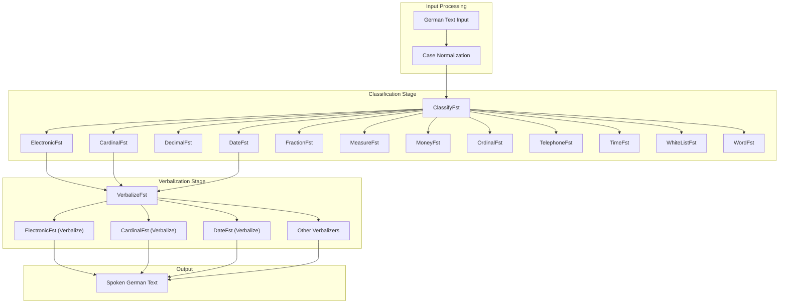
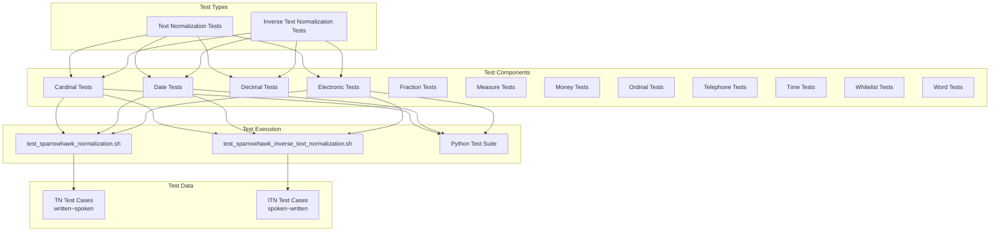

<!-- source: DeepWiki mcp.deepwiki.com · repo NVIDIA/NeMo-text-processing · page 4.3 German · fetched 2026-10-26 -->

# German

<details>
<summary>Relevant source files</summary>

The following files were used as context for generating this wiki page:

- [nemo_text_processing/text_normalization/de/data/electronic/domain.tsv](nemo_text_processing/text_normalization/de/data/electronic/domain.tsv)
- [nemo_text_processing/text_normalization/de/data/electronic/server_name.tsv](nemo_text_processing/text_normalization/de/data/electronic/server_name.tsv)
- [nemo_text_processing/text_normalization/de/data/whitelist.tsv](nemo_text_processing/text_normalization/de/data/whitelist.tsv)
- [nemo_text_processing/text_normalization/de/taggers/electronic.py](nemo_text_processing/text_normalization/de/taggers/electronic.py)
- [nemo_text_processing/text_normalization/de/taggers/time.py](nemo_text_processing/text_normalization/de/taggers/time.py)
- [nemo_text_processing/text_normalization/de/taggers/tokenize_and_classify.py](nemo_text_processing/text_normalization/de/taggers/tokenize_and_classify.py)
- [nemo_text_processing/text_normalization/de/verbalizers/electronic.py](nemo_text_processing/text_normalization/de/verbalizers/electronic.py)
- [tests/nemo_text_processing/de/data_text_normalization/test_cases_date.txt](tests/nemo_text_processing/de/data_text_normalization/test_cases_date.txt)
- [tests/nemo_text_processing/de/data_text_normalization/test_cases_decimal.txt](tests/nemo_text_processing/de/data_text_normalization/test_cases_decimal.txt)
- [tests/nemo_text_processing/de/data_text_normalization/test_cases_electronic.txt](tests/nemo_text_processing/de/data_text_normalization/test_cases_electronic.txt)
- [tests/nemo_text_processing/de/data_text_normalization/test_cases_time.txt](tests/nemo_text_processing/de/data_text_normalization/test_cases_time.txt)
- [tests/nemo_text_processing/de/test_sparrowhawk_inverse_text_normalization.sh](tests/nemo_text_processing/de/test_sparrowhawk_inverse_text_normalization.sh)
- [tests/nemo_text_processing/de/test_sparrowhawk_normalization.sh](tests/nemo_text_processing/de/test_sparrowhawk_normalization.sh)

</details>


This document covers the German text normalization capabilities in the NeMo Text Processing system, including electronic text processing (emails, URLs, social media), numerical text normalization, and other German-specific text processing components. For general text normalization concepts, see [Core Concepts](#1.1). For overall system architecture, see [System Architecture](#1.2).

## System Architecture

The German text normalization system follows the standard two-stage classification and verbalization pipeline, with specialized components for German language processing.

### German TN Pipeline Architecture



Sources: [nemo_text_processing/text_normalization/de/taggers/tokenize_and_classify.py:44-152]()

### Classification Priority System

The German classification system uses weighted priorities to determine the most appropriate classification for ambiguous inputs:

| Component | Weight | Priority |
|-----------|--------|----------|
| `WhiteListFst` | 1.01 | Highest |
| `TimeFst` | 1.1 | High |
| `MeasureFst` | 1.1 | High |
| `CardinalFst` | 1.1 | High |
| `FractionFst` | 1.1 | High |
| `DateFst` | 1.1 | High |
| `OrdinalFst` | 1.1 | High |
| `DecimalFst` | 1.1 | High |
| `MoneyFst` | 1.1 | High |
| `TelephoneFst` | 1.1 | High |
| `ElectronicFst` | 1.11 | Medium |
| `WordFst` | 100 | Lowest |

Sources: [nemo_text_processing/text_normalization/de/taggers/tokenize_and_classify.py:121-135]()

## Electronic Text Processing

The electronic text processing system handles emails, URLs, and social media tags, converting them to spoken German forms.

### Electronic Text Processing Pipeline

```mermaid
graph TB
    subgraph "Input Types"
        Email["Email Addresses<br/>abc@hotmail.com"]
        URL["URLs<br/>https://www.abc.com"]
        SocialTag["Social Media Tags<br/>@jensen"]
        Domain["Domain Names<br/>www.abc.com"]
    end
    
    subgraph "ElectronicFst Tagger"
        EmailTagger["Email Pattern<br/>username + @ + domain"]
        URLTagger["URL Pattern<br/>protocol + domain"]
        TagTagger["Tag Pattern<br/>@ + username"]
        DomainTagger["Domain Pattern<br/>name + TLD"]
    end
    
    subgraph "Structured Output"
        EmailStruct["username: \"abc\"<br/>domain: \"hotmail.com\""]
        URLStruct["protocol: \"https://\"<br/>domain: \"www.abc.com\""]
        TagStruct["username: \"jensen\""]
        DomainStruct["domain: \"abc.com\""]
    end
    
    subgraph "ElectronicFst Verbalizer"
        CharSpacing["Character Spacing<br/>a b c"]
        SymbolMapping["Symbol Mapping<br/>@ → at<br/>. → punkt"]
        DomainMapping["Domain Mapping<br/>.com → punkt com"]
        ProtocolMapping["Protocol Mapping<br/>https:// → h t t p s doppelpunkt slash slash"]
    end
    
    subgraph "Spoken Output"
        SpokenEmail["a b c at hotmail punkt com"]
        SpokenURL["h t t p s doppelpunkt slash slash w w w punkt a b c punkt com"]
        SpokenTag["at j e n s e n"]
        SpokenDomain["w w w punkt a b c punkt com"]
    end
    
    Email --> EmailTagger
    URL --> URLTagger
    SocialTag --> TagTagger
    Domain --> DomainTagger
    
    EmailTagger --> EmailStruct
    URLTagger --> URLStruct
    TagTagger --> TagStruct
    DomainTagger --> DomainStruct
    
    EmailStruct --> CharSpacing
    URLStruct --> CharSpacing
    TagStruct --> CharSpacing
    DomainStruct --> CharSpacing
    
    CharSpacing --> SymbolMapping
    SymbolMapping --> DomainMapping
    DomainMapping --> ProtocolMapping
    
    ProtocolMapping --> SpokenEmail
    ProtocolMapping --> SpokenURL
    ProtocolMapping --> SpokenTag
    ProtocolMapping --> SpokenDomain
```

Sources: [nemo_text_processing/text_normalization/de/taggers/electronic.py:23-84](), [nemo_text_processing/text_normalization/de/verbalizers/electronic.py:30-83]()

### Electronic Text Classification

The `ElectronicFst` tagger identifies and classifies different types of electronic text:

**Email Addresses**: Patterns like `username@domain.com` are classified with separate username and domain components.

**URLs**: Supports protocols (`http://`, `https://`) and www prefixes, with domain extraction.

**Social Media Tags**: Handles `@username` patterns for social media mentions.

**Domain Names**: Recognizes standalone domain names with optional trailing periods.

Sources: [nemo_text_processing/text_normalization/de/taggers/electronic.py:59-80]()

### Electronic Text Verbalization

The `ElectronicFst` verbalizer converts classified electronic text to spoken German:

**Character Spacing**: Individual characters are separated by spaces (`abc` → `a b c`).

**Symbol Mapping**: Special characters are converted to German words:
- `@` → `at`
- `.` → `punkt`
- `:` → `doppelpunkt`
- `/` → `slash`
- `?` → `fragezeichen`
- `=` → `gleichheitszeichen`
- `-` → `bindestrich`

**Domain Mapping**: Common domains are mapped to spoken forms (`.com` → `punkt com`).

**Server Name Mapping**: Common server names like `gmail` are converted to spaced forms (`g mail`).

Sources: [nemo_text_processing/text_normalization/de/verbalizers/electronic.py:49-75]()

### Domain and Server Data

The system uses extensive mapping files for domain and server name normalization:

**Domain Mappings**: Over 800 top-level domains are mapped to spoken forms in [nemo_text_processing/text_normalization/de/data/electronic/domain.tsv:1-844]().

**Server Names**: Common email providers and services are mapped in [nemo_text_processing/text_normalization/de/data/electronic/server_name.tsv:1-17]().

Examples from domain mappings:
- `.com` → `punkt com`
- `.de` → `punkt de`
- `.org` → `punkt org`
- `.edu` → `punkt edu`

Examples from server mappings:
- `gmail` → `g mail`
- `outlook` → `outlook`
- `amazon` → `amazon`

Sources: [nemo_text_processing/text_normalization/de/data/electronic/domain.tsv:1-844](), [nemo_text_processing/text_normalization/de/data/electronic/server_name.tsv:1-17]()

## Whitelist Processing

The German system includes a whitelist for common abbreviations and special cases:

### Whitelist Mappings

| Input | Output |
|-------|--------|
| `z.B.` | `zum beispiel` |
| `d.h.` | `dass heißt` |
| `Dr.` | `doktor` |
| `Nr.` | `nummer` |
| `2D` | `zwei-D` |
| `3D` | `drei-D` |
| `2D-Mammogram` | `zwei-D-Mammogram` |
| `3D-Drucker` | `drei-D-Drucker` |

Sources: [nemo_text_processing/text_normalization/de/data/whitelist.tsv:1-21]()

## Other German Text Processing Components

### Numerical Processing

The German system includes specialized components for various numerical types:

**Cardinal Numbers**: Handles German number words and digit sequences.

**Decimal Numbers**: Processes decimal notation with German comma usage (`komma` for decimal point).

**Ordinal Numbers**: Converts ordinal numbers to spoken German forms.

**Fractions**: Handles fractional expressions in German.

**Money**: Processes currency amounts in German format.

**Measures**: Handles units of measurement with German conventions.

Sources: [nemo_text_processing/text_normalization/de/taggers/tokenize_and_classify.py:84-116]()

### Temporal Processing

**Time**: Converts time expressions to spoken German (`08:00 Uhr` → `acht uhr`).

**Date**: Handles German date formats and month names.

Sources: [nemo_text_processing/text_normalization/de/taggers/time.py:23-99]()

### Communication Processing

**Telephone**: Normalizes German telephone number formats.

Sources: [nemo_text_processing/text_normalization/de/taggers/tokenize_and_classify.py:107-108]()

## Testing Framework

The German text normalization system uses comprehensive testing through both Python and Sparrowhawk integration.

### Test Structure



Sources: [tests/nemo_text_processing/de/test_sparrowhawk_normalization.sh:1-87](), [tests/nemo_text_processing/de/test_sparrowhawk_inverse_text_normalization.sh:1-89]()

### Electronic Test Cases

The electronic text processing system includes comprehensive test cases covering various scenarios:

**Email Normalization**:
- `cdf@abc.edu` → `c d f at a b c punkt edu`
- `abc@gmail.abc` → `a b c at g mail punkt a b c`
- `asdf123@abc.com` → `a s d f eins zwei drei at a b c punkt com`

**URL Normalization**:
- `https://www.abc.com` → `h t t p s doppelpunkt slash slash w w w punkt a b c punkt com`
- `www.abc.com` → `w w w punkt a b c punkt com`

**Social Media Tags**:
- `@jensen` → `at j e n s e n`
- `@jensen.me` → `at j e n s e n punkt m e`
- `@wezyr1986` → `at w e z y r eins neun acht sechs`

**Complex URLs**:
- `https://www.abc.com/ab?=3-/abs/1` → `h t t p s doppelpunkt slash slash w w w punkt a b c punkt com slash a b fragezeichen gleichheitszeichen drei bindestrich slash a b s slash eins`

Sources: [tests/nemo_text_processing/de/data_text_normalization/test_cases_electronic.txt:1-19]()

---

