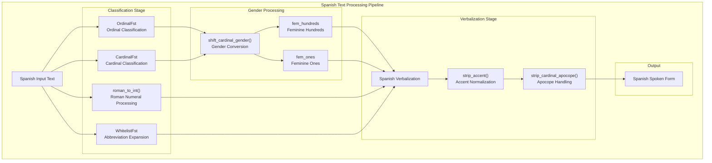
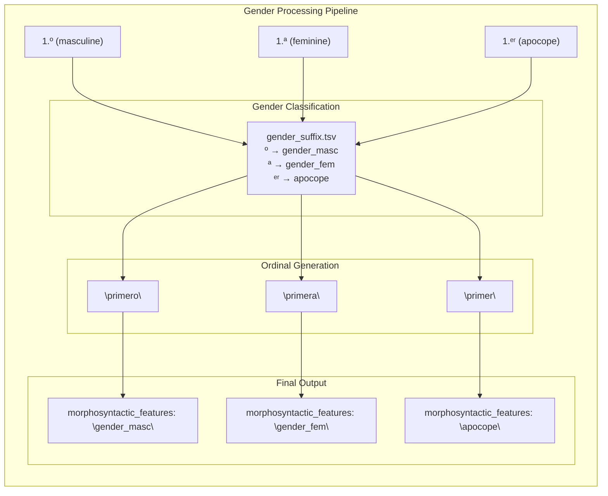
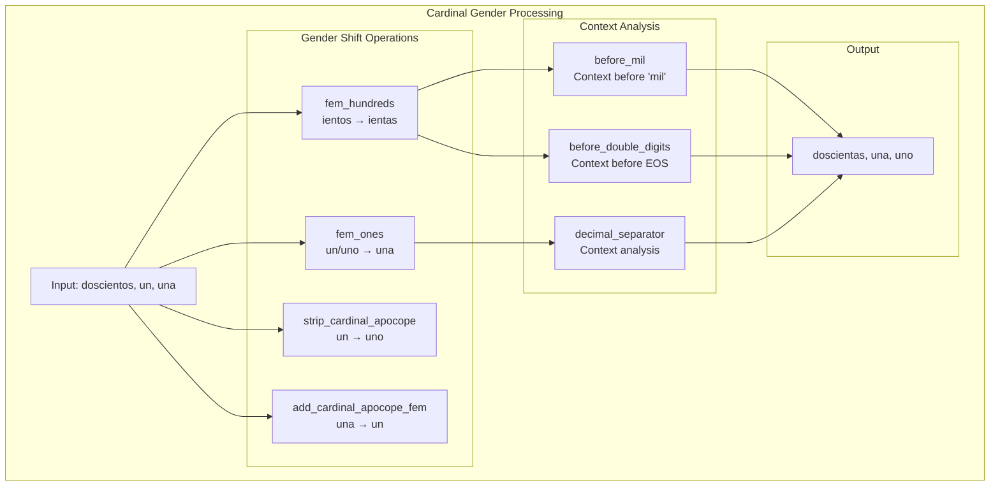
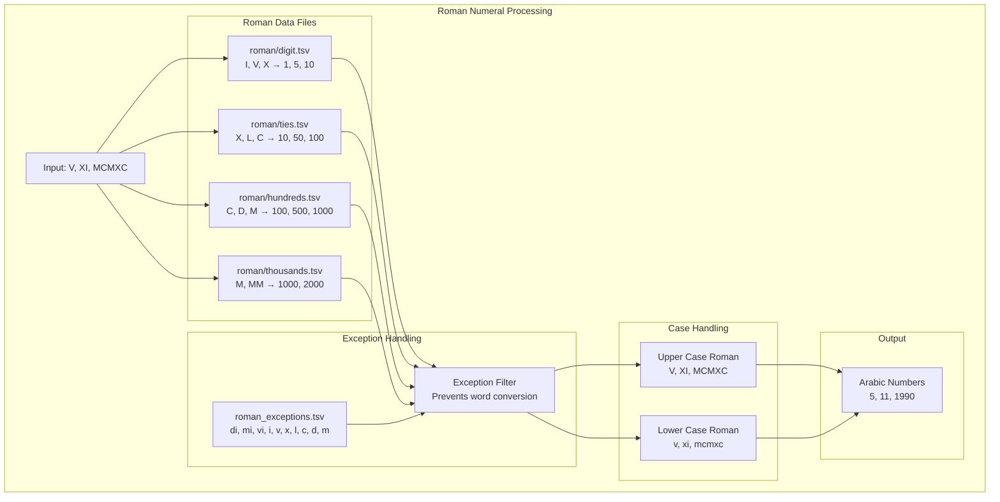
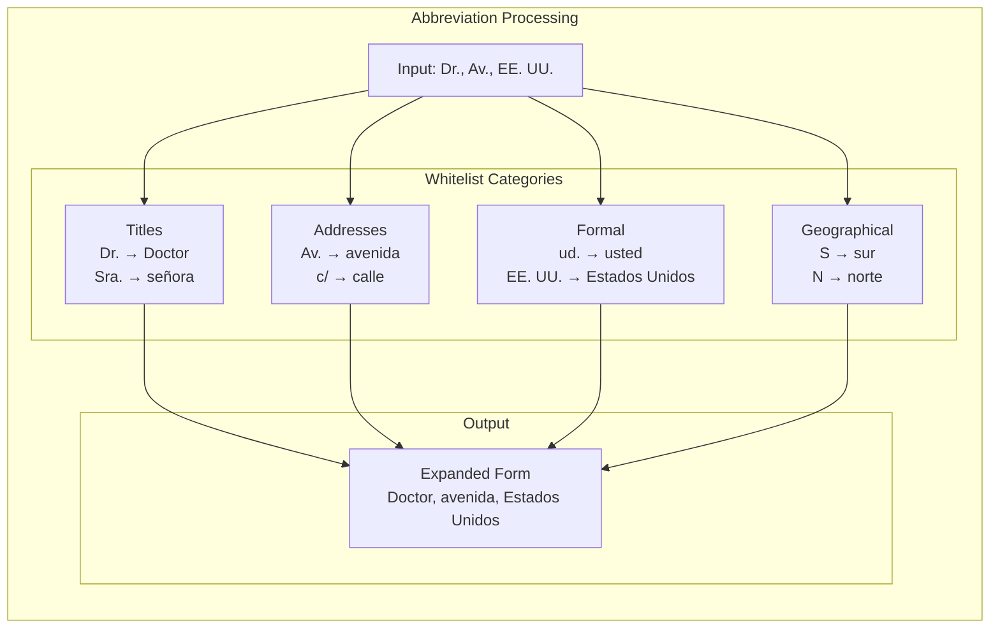
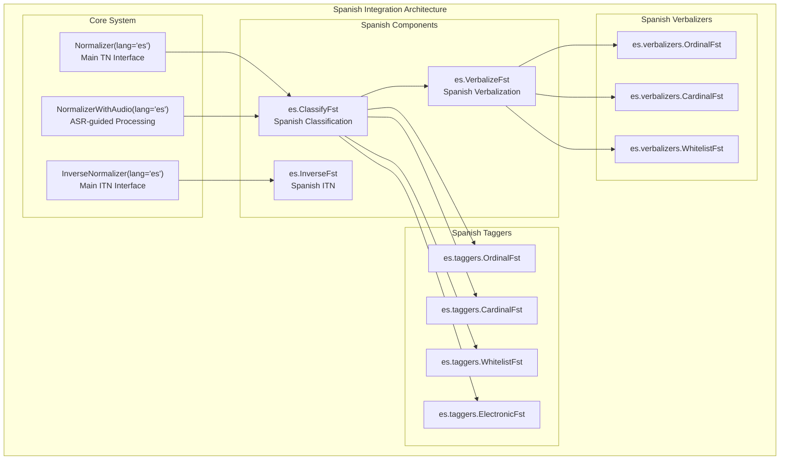

<!-- source: DeepWiki mcp.deepwiki.com · repo NVIDIA/NeMo-text-processing · page 4.4 Spanish · fetched 2026-10-26 -->

# Spanish

<details>
<summary>Relevant source files</summary>

The following files were used as context for generating this wiki page:

- [nemo_text_processing/inverse_text_normalization/run_evaluate.py](nemo_text_processing/inverse_text_normalization/run_evaluate.py)
- [nemo_text_processing/text_normalization/data_loader_utils.py](nemo_text_processing/text_normalization/data_loader_utils.py)
- [nemo_text_processing/text_normalization/es/data/ordinals/roman_exceptions.tsv](nemo_text_processing/text_normalization/es/data/ordinals/roman_exceptions.tsv)
- [nemo_text_processing/text_normalization/es/data/whitelist.tsv](nemo_text_processing/text_normalization/es/data/whitelist.tsv)
- [nemo_text_processing/text_normalization/es/graph_utils.py](nemo_text_processing/text_normalization/es/graph_utils.py)
- [nemo_text_processing/text_normalization/es/taggers/ordinal.py](nemo_text_processing/text_normalization/es/taggers/ordinal.py)
- [tests/nemo_text_processing/es/data_text_normalization/test_cases_ordinal.txt](tests/nemo_text_processing/es/data_text_normalization/test_cases_ordinal.txt)

</details>


This document covers the Spanish text processing capabilities within the NeMo Text Processing system. It provides comprehensive documentation of Spanish-specific text normalization (TN) and inverse text normalization (ITN) features, including ordinal number handling, Roman numeral processing, gender-aware number processing, and evaluation frameworks.

For general text normalization concepts, see [Core Concepts](#1.1). For English text processing, see [English](#4.1). For development and testing procedures, see [Development and Testing](#5).

## Overview

The Spanish text processing system provides language-specific implementations for converting written Spanish text to spoken form and vice versa. The system handles complex linguistic features unique to Spanish, including:

- Gender-aware number processing with masculine/feminine forms
- Comprehensive ordinal number processing up to millions
- Roman numeral conversion with ambiguity resolution
- Accent handling and normalization
- Localization support for different Spanish-speaking regions
- Extensive abbreviation expansion



**Sources:** [nemo_text_processing/text_normalization/es/graph_utils.py:1-219](), [nemo_text_processing/text_normalization/es/taggers/ordinal.py:1-173]()

## Ordinal Number Processing

The Spanish ordinal processing system handles complex ordinal number transformations including gender agreement, morphological features, and Roman numeral conversion. The `OrdinalFst` class provides comprehensive ordinal classification up to the millionth order.

### Core Ordinal Features

| Feature | Description | Example |
|---------|-------------|---------|
| **Gender Agreement** | Masculine/feminine forms | `21.º` → `vigésimo primero` (masc)<br/>`21.ª` → `vigésimo primera` (fem) |
| **Morphological Features** | Tracks gender and apocope | `morphosyntactic_features: "gender_masc"` |
| **Roman Numerals** | Converts Roman to ordinals | `V` → `quinto` |
| **Compound Numbers** | Handles complex ordinals | `1248.º` → `milésimo ducentésimo cuadragésimo octavo` |

```mermaid
graph TB
    subgraph "Ordinal Processing Components"
        Input["Input: 21.º, 1.ª, V, 1248.º"]
        
        subgraph "OrdinalFst Processing"
            DigitOrd["digit.tsv<br/>Basic Ordinals"]
            TeensOrd["teens.tsv<br/>Teen Ordinals"]
            TiesOrd["ties.tsv<br/>Tens Ordinals"]
            HundredsOrd["hundreds.tsv<br/>Hundreds Ordinals"]
            GenderSuffix["gender_suffix.tsv<br/>Gender Markers"]
        end
        
        subgraph "Roman Processing"
            RomanExceptions["roman_exceptions.tsv<br/>Ambiguous Words"]
            RomanToInt["roman_to_int()<br/>Roman Converter"]
        end
        
        subgraph "Output Generation"
            IntegerField["integer: \"vigésimo primero\""]
            MorphField["morphosyntactic_features: \"gender_masc\""]
            FinalOutput["ordinal { integer: \"vigésimo primero\" morphosyntactic_features: \"gender_masc\" }"]
        end
    end
    
    Input --> DigitOrd
    Input --> TeensOrd
    Input --> TiesOrd
    Input --> HundredsOrd
    Input --> RomanToInt
    
    DigitOrd --> IntegerField
    TeensOrd --> IntegerField
    TiesOrd --> IntegerField
    HundredsOrd --> IntegerField
    RomanToInt --> IntegerField
    
    GenderSuffix --> MorphField
    RomanExceptions --> RomanToInt
    
    IntegerField --> FinalOutput
    MorphField --> FinalOutput
```

**Sources:** [nemo_text_processing/text_normalization/es/taggers/ordinal.py:49-173](), [tests/nemo_text_processing/es/data_text_normalization/test_cases_ordinal.txt:1-120]()

### Gender and Morphological Processing

The ordinal system includes sophisticated gender handling and morphological feature tracking:



**Sources:** [nemo_text_processing/text_normalization/es/taggers/ordinal.py:130-172](), [nemo_text_processing/text_normalization/es/data/ordinals/roman_exceptions.tsv:1-10]()

## Cardinal Number Processing

The Spanish cardinal processing system handles gender agreement, apocope, and localization features. The system includes specialized functions for managing Spanish number morphology.

### Gender Conversion Functions

| Function | Purpose | Example |
|----------|---------|---------|
| `shift_cardinal_gender()` | Converts cardinals to feminine | `doscientos` → `doscientas` |
| `shift_number_gender()` | Gender shift across all numbers | `doscientos millones` → `doscientas millones` |
| `strip_cardinal_apocope()` | Removes apocope from cardinals | `un` → `uno` |
| `add_cardinal_apocope_fem()` | Adds feminine apocope | `una` → `un` |



**Sources:** [nemo_text_processing/text_normalization/es/graph_utils.py:57-151]()

### Localization Support

The system includes localization features for different Spanish-speaking regions:

```python
# From graph_utils.py
if LOCALIZATION == "am":  # Central and Northern America formatting
    cardinal_separator = pynini.string_map([",", NEMO_SPACE])
    decimal_separator = pynini.accep(".")
else:  # European/South American formatting
    cardinal_separator = pynini.string_map([".", NEMO_SPACE])
    decimal_separator = pynini.accep(",")
```

**Sources:** [nemo_text_processing/text_normalization/es/graph_utils.py:30-35]()

## Roman Numeral Processing

The Spanish system includes comprehensive Roman numeral processing with ambiguity resolution to prevent conversion of Spanish words that coincidentally match Roman patterns.

### Roman Numeral Components



**Sources:** [nemo_text_processing/text_normalization/es/graph_utils.py:153-218](), [nemo_text_processing/text_normalization/es/data/ordinals/roman_exceptions.tsv:1-10]()

## Abbreviation Processing

The Spanish system includes a comprehensive whitelist for common abbreviations and their expansions.

### Abbreviation Categories

| Category | Examples | Expansions |
|----------|----------|------------|
| **Titles** | `Dr.`, `Dra.`, `Sr.`, `Sra.` | `Doctor`, `Doctora`, `señor`, `señora` |
| **Addresses** | `Av.`, `c/`, `pza.`, `carr.ª` | `avenida`, `calle`, `plaza`, `carrera` |
| **Formal** | `ud.`, `Ud.`, `EE. UU.` | `usted`, `Estados Unidos` |
| **Geographical** | `S`, `N`, `arr.º` | `sur`, `norte`, `arrollo` |



**Sources:** [nemo_text_processing/text_normalization/es/data/whitelist.tsv:1-63]()

## Evaluation Framework

The Spanish text processing system includes comprehensive evaluation capabilities supporting both sentence-level and token-level assessment.

### Evaluation Components

```mermaid
graph TB
    subgraph "Spanish Evaluation System"
        EvalInput["Input: Test Data"]
        
        subgraph "run_evaluate.py"
            LangSupport["Language Support<br/>--lang=es"]
            CategoryFilter["Category Filter<br/>--cat=ORDINAL, CARDINAL, etc."]
            CaseHandling["Case Handling<br/>--input_case, --output_case"]
            DataFilter["Data Filter<br/>--filter for ITN cleanup"]
        end
        
        subgraph "InverseNormalizer"
            ESInverseNorm["InverseNormalizer(lang='es')<br/>Spanish ITN Processing"]
            BatchProcess["inverse_normalize_list()<br/>Batch Processing"]
        end
        
        subgraph "Evaluation Metrics"
            SentenceEval["Sentence Level<br/>Full sentence accuracy"]
            TokenEval["Token Level<br/>Per-token accuracy"]
            TypeAccuracy["Type Accuracy<br/>Per semiotic class"]
        end
        
        subgraph "Output"
            AccuracyReport["Accuracy Report<br/>Class | Num Tokens | Accuracy"]
            ResultLog["result.log<br/>Detailed Results"]
        end
    end
    
    EvalInput --> LangSupport
    LangSupport --> CategoryFilter
    CategoryFilter --> CaseHandling
    CaseHandling --> DataFilter
    
    DataFilter --> ESInverseNorm
    ESInverseNorm --> BatchProcess
    
    BatchProcess --> SentenceEval
    BatchProcess --> TokenEval
    BatchProcess --> TypeAccuracy
    
    SentenceEval --> AccuracyReport
    TokenEval --> AccuracyReport
    TypeAccuracy --> AccuracyReport
    
    AccuracyReport --> ResultLog
```



**Sources:** [nemo_text_processing/inverse_text_normalization/run_evaluate.py:1-128](), [nemo_text_processing/text_normalization/data_loader_utils.py:1-360]()

### Test Data Format

The Spanish evaluation system uses standardized test data formats:

```
# Test case format from test_cases_ordinal.txt
1.ᵉʳ~primer
21.º~vigesimoprimero
1248.º~milésimo ducentésimo cuadragésimo octavo
V~quinto
maría vii~maría séptima~maría séptimo
```

**Sources:** [tests/nemo_text_processing/es/data_text_normalization/test_cases_ordinal.txt:1-120]()

## Integration with Core System

The Spanish text processing system integrates seamlessly with the core NeMo Text Processing architecture:



**Sources:** [nemo_text_processing/text_normalization/es/graph_utils.py:1-219](), [nemo_text_processing/text_normalization/es/taggers/ordinal.py:1-173]()

---

