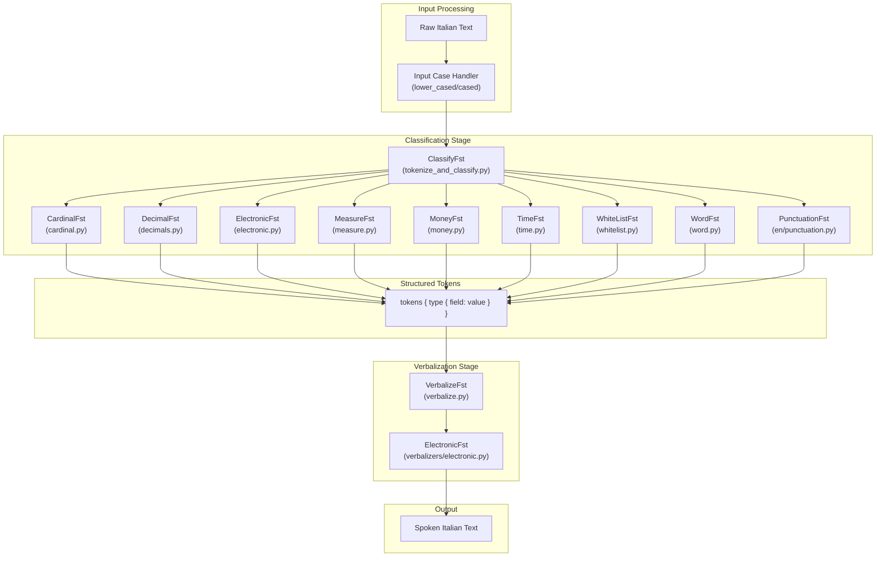
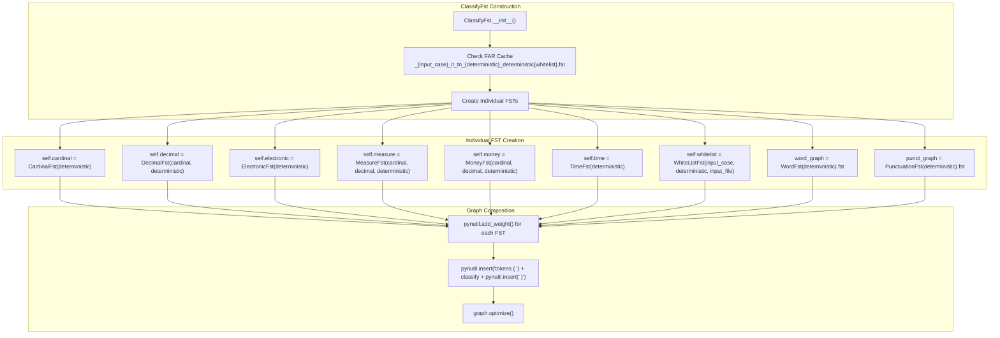
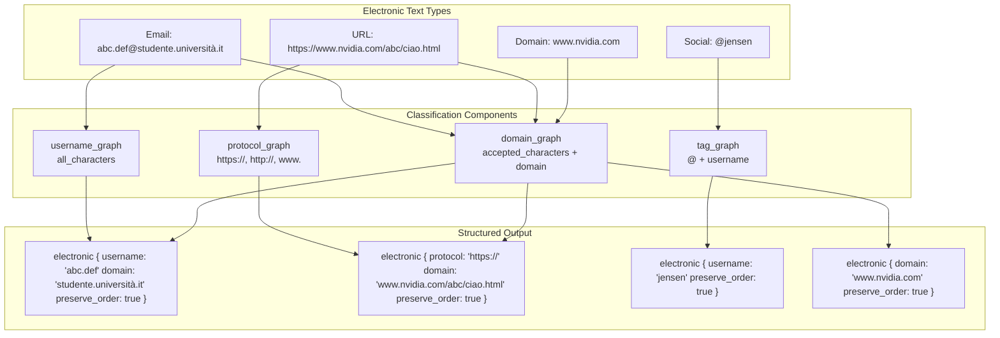
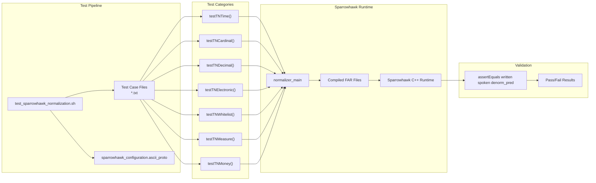

<!-- source: DeepWiki mcp.deepwiki.com · repo NVIDIA/NeMo-text-processing · page 4.5 Italian · fetched 2026-10-26 -->

# Italian

Relevant source files

The following files were used as context for generating this wiki page:

- [nemo_text_processing/text_normalization/it/data/electronic/domain.tsv](nemo_text_processing/text_normalization/it/data/electronic/domain.tsv)
- [nemo_text_processing/text_normalization/it/data/measure/measurements.tsv](nemo_text_processing/text_normalization/it/data/measure/measurements.tsv)
- [nemo_text_processing/text_normalization/it/taggers/electronic.py](nemo_text_processing/text_normalization/it/taggers/electronic.py)
- [nemo_text_processing/text_normalization/it/taggers/tokenize_and_classify.py](nemo_text_processing/text_normalization/it/taggers/tokenize_and_classify.py)
- [nemo_text_processing/text_normalization/it/verbalizers/electronic.py](nemo_text_processing/text_normalization/it/verbalizers/electronic.py)
- [tests/nemo_text_processing/it/data_text_normalization/test_cases_electronic.txt](tests/nemo_text_processing/it/data_text_normalization/test_cases_electronic.txt)
- [tests/nemo_text_processing/it/data_text_normalization/test_cases_measure.txt](tests/nemo_text_processing/it/data_text_normalization/test_cases_measure.txt)
- [tests/nemo_text_processing/it/data_text_normalization/test_cases_whitelist.txt](tests/nemo_text_processing/it/data_text_normalization/test_cases_whitelist.txt)
- [tests/nemo_text_processing/it/test_sparrowhawk_normalization.sh](tests/nemo_text_processing/it/test_sparrowhawk_normalization.sh)

The Italian text processing system provides comprehensive text normalization (TN) capabilities for Italian language content, with primary focus on converting written text to its spoken form. This system implements finite state transducers (FSTs) for handling various text types including numbers, electronic addresses, measurements, monetary values, and time expressions.

For inverse text normalization capabilities, see [Japanese](#4.7). For other European language implementations, see [German](#4.3), [Spanish](#4.4), and [French](#4.6).

## Overview and Scope

The Italian text processing system is integrated with the Sparrowhawk runtime environment and supports the following core functionalities:

- **Text Normalization**: Converting written Italian text to spoken form
- **Electronic Text Processing**: Handling emails, URLs, and social media tags
- **Numerical Processing**: Cardinals, decimals, measurements, and monetary values
- **Time Expressions**: Time format normalization
- **Whitelist Support**: Custom abbreviation and acronym expansion
- **Production Deployment**: Sparrowhawk integration for runtime processing

## System Architecture

The Italian text processing system follows the standard two-stage pipeline architecture with classification and verbalization components:

**Sources:** [nemo_text_processing/text_normalization/it/taggers/tokenize_and_classify.py:41-139](), [nemo_text_processing/text_normalization/it/taggers/electronic.py:40-108](), [nemo_text_processing/text_normalization/it/verbalizers/electronic.py:40-89]()

## Supported Text Types

The Italian system processes the following text categories with specific weight assignments in the classification pipeline:

| Text Type | Weight | Description | Example Input | Example Output |
|-----------|--------|-------------|---------------|----------------|
| Whitelist | 0.0 | Abbreviations and acronyms | `avv.` | `avvocato` |
| Cardinal | 1.1 | Integer numbers | `123` | `cento ventitre` |
| Decimal | 1.1 | Decimal numbers | `4,3` | `quattro virgola tre` |
| Electronic | 1.1 | Emails, URLs, social media | `abc@test.it` | `a b c chiocciola test punto IT` |
| Measure | 1.1 | Units of measurement | `5 km/s` | `cinque chilometri per secondo` |
| Money | 1.1 | Monetary values | `€15,50` | `quindici euro e cinquanta centesimi` |
| Time | 1.1 | Time expressions | `15:30` | `quindici e trenta` |
| Punctuation | 1.1 | Punctuation marks | `.` | `punto` |
| Word | 100 | Default word processing | `ciao` | `ciao` |

**Sources:** [nemo_text_processing/text_normalization/it/taggers/tokenize_and_classify.py:111-120](), [tests/nemo_text_processing/it/data_text_normalization/test_cases_whitelist.txt:1-4](), [tests/nemo_text_processing/it/data_text_normalization/test_cases_measure.txt:1-7]()

## Classification Pipeline

The `ClassifyFst` class orchestrates the token classification process through a unified interface:

**Sources:** [nemo_text_processing/text_normalization/it/taggers/tokenize_and_classify.py:55-139](), [nemo_text_processing/text_normalization/it/taggers/tokenize_and_classify.py:78-107]()

## Electronic Text Processing

The Italian system provides comprehensive electronic text processing capabilities for emails, URLs, and social media content:

### Classification Process

The `ElectronicFst` tagger handles four main electronic text types:

**Sources:** [nemo_text_processing/text_normalization/it/taggers/electronic.py:40-108](), [nemo_text_processing/text_normalization/it/taggers/electronic.py:70-102]()

### Verbalization Process

The electronic verbalizer converts structured tokens to spoken Italian:

| Input Token | Verbalization Rule | Output |
|-------------|-------------------|--------|
| `abc.def@test.it` | Character spacing + domain mapping | `a b c punto d e f chiocciola test punto IT` |
| `https://www.nvidia.com` | Protocol expansion + domain spelling | `h t t p s due punti slash slash w w w punto nvidia punto com` |
| `@jensen` | Social media prefix | `chiocciola j e n s e n` |
| `file.py` | File extension mapping | `f i l e punto python` |

**Sources:** [nemo_text_processing/text_normalization/it/verbalizers/electronic.py:40-89](), [nemo_text_processing/text_normalization/it/data/electronic/domain.tsv:1-14](), [tests/nemo_text_processing/it/data_text_normalization/test_cases_electronic.txt:1-14]()

## Measurement and Unit Processing

The Italian system handles comprehensive measurement units through the `MeasureFst` tagger:

### Supported Measurement Categories

| Category | Units | Example | Verbalization |
|----------|-------|---------|---------------|
| Length | `m`, `km`, `cm`, `mm` | `1 m` | `un metro` |
| Weight | `g`, `kg`, `mg` | `2 kg` | `due chilogrammi` |
| Time | `s`, `min`, `h` | `155 d` | `cento cinquantacinque giorni` |
| Volume | `l`, `ml`, `dl` | `4,3 l` | `quattro virgola tre litri` |
| Electrical | `A`, `V`, `W` | `15 A` | `quindici ampere` |
| Percentage | `%` | `18%` | `diciotto percento` |

**Sources:** [nemo_text_processing/text_normalization/it/data/measure/measurements.tsv:1-64](), [tests/nemo_text_processing/it/data_text_normalization/test_cases_measure.txt:1-7]()

## Sparrowhawk Integration

The Italian system is validated through Sparrowhawk integration testing using the `normalizer_main` executable:

**Sources:** [tests/nemo_text_processing/it/test_sparrowhawk_normalization.sh:1-66](), [tests/nemo_text_processing/it/test_sparrowhawk_normalization.sh:30-63]()

## Whitelist Processing

The Italian system supports custom abbreviation expansion through whitelist functionality:

### Whitelist Examples

| Abbreviation | Expansion | Context |
|-------------|-----------|---------|
| `avv.` | `avvocato` | Professional title |
| `dip. di Fisica` | `dipartimento di Fisica` | Academic department |
| `sig.na Sonia` | `signorina Sonia` | Personal title |
| `p.za Grande` | `piazza Grande` | Location abbreviation |

The whitelist system uses the `WhiteListFst` class with configurable input files and case handling, receiving the highest priority (weight 0.0) in the classification pipeline.

**Sources:** [tests/nemo_text_processing/it/data_text_normalization/test_cases_whitelist.txt:1-4](), [nemo_text_processing/text_normalization/it/taggers/tokenize_and_classify.py:86-87](), [nemo_text_processing/text_normalization/it/taggers/tokenize_and_classify.py:112]()

## Caching and Performance

The Italian system implements FST caching for improved performance:

- **Cache Directory**: Configurable cache directory for storing compiled FAR files
- **Cache Naming**: `_{input_case}_it_tn_{deterministic}_deterministic{whitelist_file}.far`
- **Cache Validation**: Automatic cache restoration when available
- **Overwrite Control**: `overwrite_cache` parameter for forcing regeneration

**Sources:** [nemo_text_processing/text_normalization/it/taggers/tokenize_and_classify.py:64-74](), [nemo_text_processing/text_normalization/it/taggers/tokenize_and_classify.py:137-138]()

---

