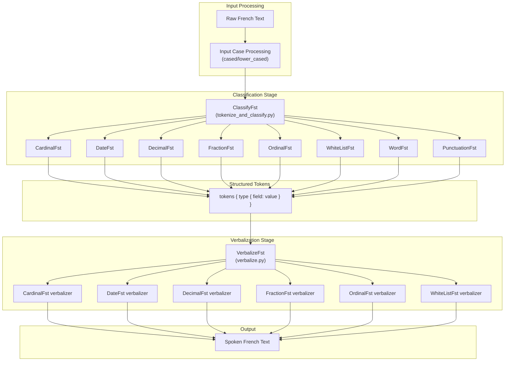
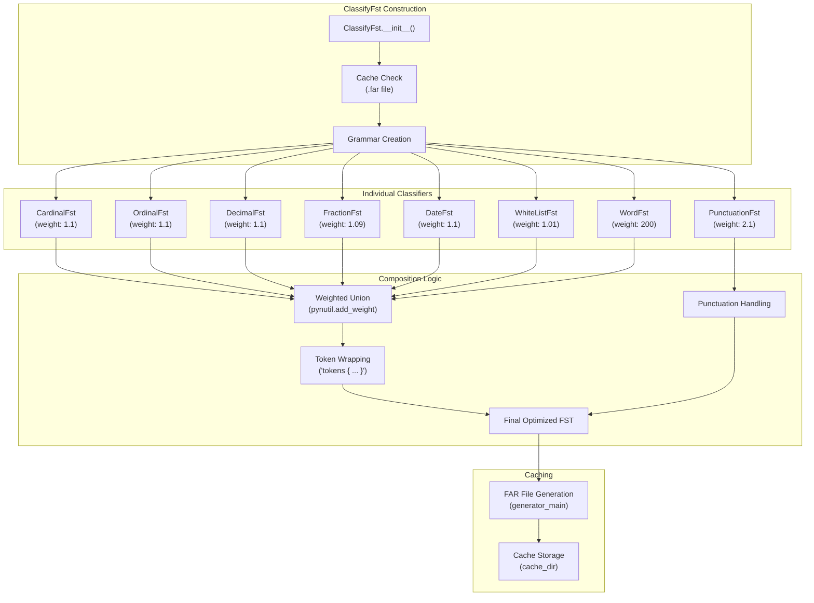
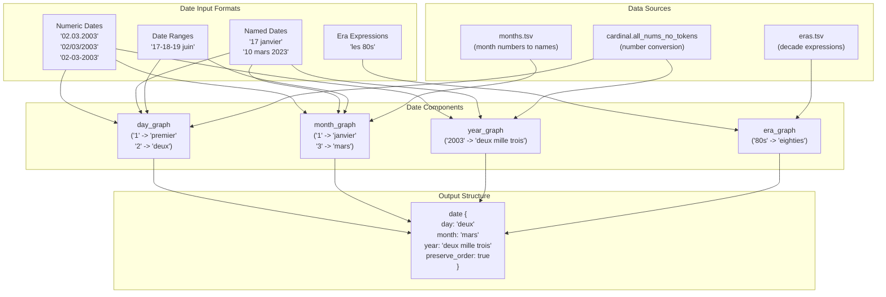
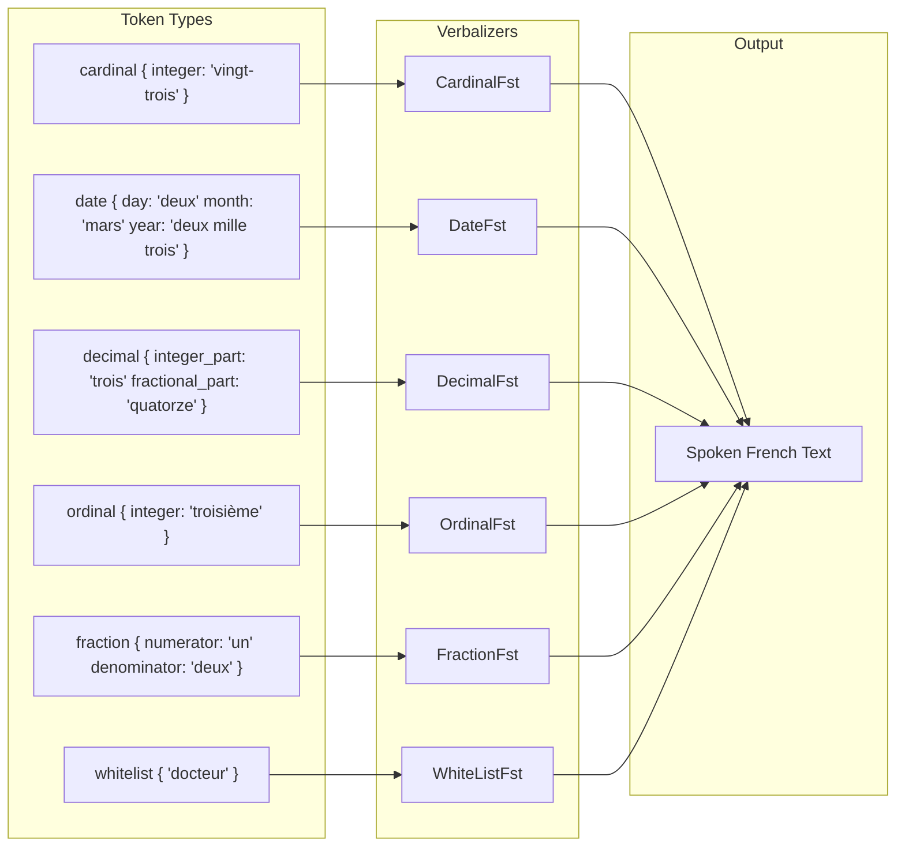

<!-- source: DeepWiki mcp.deepwiki.com · repo NVIDIA/NeMo-text-processing · page 4.6 French · fetched 2026-10-26 -->

# French

<details>
<summary>Relevant source files</summary>

The following files were used as context for generating this wiki page:

- [nemo_text_processing/text_normalization/fr/data/dates/__init__.py](nemo_text_processing/text_normalization/fr/data/dates/__init__.py)
- [nemo_text_processing/text_normalization/fr/data/dates/eras.tsv](nemo_text_processing/text_normalization/fr/data/dates/eras.tsv)
- [nemo_text_processing/text_normalization/fr/data/dates/months.tsv](nemo_text_processing/text_normalization/fr/data/dates/months.tsv)
- [nemo_text_processing/text_normalization/fr/data/measures/__init__.py](nemo_text_processing/text_normalization/fr/data/measures/__init__.py)
- [nemo_text_processing/text_normalization/fr/data/measures/measurements.tsv](nemo_text_processing/text_normalization/fr/data/measures/measurements.tsv)
- [nemo_text_processing/text_normalization/fr/data/whitelist.tsv](nemo_text_processing/text_normalization/fr/data/whitelist.tsv)
- [nemo_text_processing/text_normalization/fr/taggers/date.py](nemo_text_processing/text_normalization/fr/taggers/date.py)
- [nemo_text_processing/text_normalization/fr/taggers/tokenize_and_classify.py](nemo_text_processing/text_normalization/fr/taggers/tokenize_and_classify.py)
- [nemo_text_processing/text_normalization/fr/verbalizers/date.py](nemo_text_processing/text_normalization/fr/verbalizers/date.py)
- [nemo_text_processing/text_normalization/fr/verbalizers/verbalize.py](nemo_text_processing/text_normalization/fr/verbalizers/verbalize.py)
- [tests/nemo_text_processing/fr/data_text_normalization/test_cases_date.txt](tests/nemo_text_processing/fr/data_text_normalization/test_cases_date.txt)
- [tests/nemo_text_processing/fr/data_text_normalization/test_cases_whitelist.txt](tests/nemo_text_processing/fr/data_text_normalization/test_cases_whitelist.txt)
- [tests/nemo_text_processing/fr/data_text_normalization/test_cases_word.txt](tests/nemo_text_processing/fr/data_text_normalization/test_cases_word.txt)
- [tests/nemo_text_processing/fr/test_date.py](tests/nemo_text_processing/fr/test_date.py)
- [tests/nemo_text_processing/fr/test_sparrowhawk_normalization.sh](tests/nemo_text_processing/fr/test_sparrowhawk_normalization.sh)
- [tests/nemo_text_processing/fr/test_whitelist.py](tests/nemo_text_processing/fr/test_whitelist.py)
- [tests/nemo_text_processing/fr/test_word.py](tests/nemo_text_processing/fr/test_word.py)

</details>


This document covers the French text processing capabilities in the NeMo text processing system. The French implementation provides text normalization (TN) functionality that converts written text to spoken form, with support for cardinal numbers, ordinals, decimals, fractions, dates, and whitelist-based replacements. The system includes both Pynini-based FST grammars and Sparrowhawk integration for production deployment.

For information about the overall text processing architecture, see [Core Text Processing Systems](#3). For details about grammar compilation and deployment, see [Grammar Compilation](#6.1) and [Sparrowhawk Runtime](#6.2).

## Architecture Overview

The French text processing system follows the standard two-stage pipeline used throughout the NeMo text processing framework: classification followed by verbalization. The system is built using finite state transducers (FSTs) implemented with Pynini.

### French Text Processing Pipeline



Sources: [nemo_text_processing/text_normalization/fr/taggers/tokenize_and_classify.py:38-127](), [nemo_text_processing/text_normalization/fr/verbalizers/verbalize.py:23-49]()

## Classification System

The `ClassifyFst` class serves as the main entry point for French text normalization, orchestrating multiple specialized classification FSTs. The system supports both deterministic and non-deterministic modes, with caching capabilities for improved performance.

### ClassifyFst Implementation



Sources: [nemo_text_processing/text_normalization/fr/taggers/tokenize_and_classify.py:52-127]()

The classification weights determine processing priority:
- `WhiteListFst`: 1.01 (highest priority for exact matches)
- `FractionFst`: 1.09 (high priority for fractions)
- `CardinalFst`, `OrdinalFst`, `DecimalFst`, `DateFst`: 1.1 (standard priority)
- `PunctuationFst`: 2.1 (lower priority)
- `WordFst`: 200 (lowest priority, fallback for unmatched text)

## Whitelist System

The French whitelist system provides exact string replacements for common abbreviations and special terms. The system uses a tab-separated value file for mapping written forms to spoken forms.

### Whitelist Data Structure

| Written Form | Spoken Form |
|--------------|-------------|
| `Mᵐᵉ` | `madame` |
| `Mᵐᵉˢ` | `mesdames` |
| `Mˡˡᵉ` | `mademoiselle` |
| `Mˡˡᵉˢ` | `mademoiselles` |
| `Dʳ` | `docteur` |
| `Dʳˢ` | `docteurs` |
| `Dʳᵉ` | `docteure` |
| `Dʳᵉˢ` | `docteures` |
| `apr. J.-C.` | `après jésus-christ` |
| `av. J.-C.` | `avant Jésus-Christ` |
| `le hon.` | `l'honorable` |
| `le très hon.` | `le très hononrable` |
| `%` | `pour cent` |

Sources: [nemo_text_processing/text_normalization/fr/data/whitelist.tsv:1-13]()

The whitelist system supports both cased and lower-cased input modes and can be extended with custom whitelist files during initialization.

## Date Processing

The French date processing system handles various date formats including numeric dates, written months, and era expressions. The system supports both complete dates and partial date expressions.

### Date Classification Components



Sources: [nemo_text_processing/text_normalization/fr/taggers/date.py:1-98](), [nemo_text_processing/text_normalization/fr/data/dates/months.tsv:1-12](), [nemo_text_processing/text_normalization/fr/data/dates/eras.tsv:1-8]()

### Date Processing Examples

The system handles various date formats:

- **Numeric dates**: `02.03.2003` → `deux mars deux mille trois`
- **Named dates**: `17 janvier` → `dix-sept janvier`
- **Date ranges**: `17-18-19 juin` → `dix-sept dix-huit dix-neuf juin`
- **Era expressions**: `les 80s` → `les eighties`

Sources: [tests/nemo_text_processing/fr/data_text_normalization/test_cases_date.txt:1-13]()

## Verbalization System

The `VerbalizeFst` class composes individual verbalizer grammars to convert structured tokens back to spoken text. The system supports the same token types as the classification stage.

### Verbalization Flow

The verbalization process takes structured tokens and converts them to natural speech:



Sources: [nemo_text_processing/text_normalization/fr/verbalizers/verbalize.py:33-49]()

## Testing Framework

The French text processing system includes comprehensive testing infrastructure with both Python-based unit tests and shell-based Sparrowhawk integration tests.

### Test Structure

| Test Category | Python Tests | Sparrowhawk Tests | Test Data Format |
|---------------|-------------|-------------------|------------------|
| Cardinal Numbers | `test_cardinal.py` | `testTNCardinal()` | `test_cases_cardinal.txt` |
| Dates | `test_date.py` | `testTNDate()` | `test_cases_date.txt` |
| Decimals | `test_decimal.py` | `testTNDecimal()` | `test_cases_decimal.txt` |
| Fractions | `test_fraction.py` | `testTNFraction()` | `test_cases_fraction.txt` |
| Ordinals | `test_ordinal.py` | `testTNOrdinal()` | `test_cases_ordinal.txt` |
| Whitelist | `test_whitelist.py` | `testTNWhitelist()` | `test_cases_whitelist.txt` |
| Words | `test_word.py` | `testTNWord()` | `test_cases_word.txt` |

### Test Data Format

Test cases use the format: `input~expected_output`

Examples from whitelist tests:
- `Dʳ~docteur`
- `Mᵐᵉ~madame`
- `18%~dix-huit pour cent`

Sources: [tests/nemo_text_processing/fr/test_sparrowhawk_normalization.sh:1-61](), [tests/nemo_text_processing/fr/data_text_normalization/test_cases_whitelist.txt:1-7](), [tests/nemo_text_processing/fr/test_whitelist.py:1-43]()

### Sparrowhawk Integration

The shell-based testing framework validates compatibility with the Sparrowhawk C++ runtime:

```bash
# Test execution pattern
written="input_text"
denorm_pred=$(echo $written | normalizer_main --config=sparrowhawk_configuration.ascii_proto 2>&1 | tail -n 1)
assertEquals "$written" "$spoken" "$denorm_pred"
```

Sources: [tests/nemo_text_processing/fr/test_sparrowhawk_normalization.sh:14-21]()

## Supported Features

The French text processing system supports the following normalization categories:

- **Cardinal Numbers**: Basic number conversion to French words
- **Ordinal Numbers**: Ordinal number processing with proper French forms
- **Decimal Numbers**: Decimal point handling with French conventions
- **Fractions**: Fraction processing with numerator/denominator verbalization
- **Dates**: Comprehensive date format support with French month names
- **Whitelist**: Abbreviation and special term replacement
- **Words**: Fallback processing for unmatched text
- **Punctuation**: Punctuation mark handling

The system includes both deterministic and non-deterministic processing modes, with caching support for improved performance in production environments.

Sources: [nemo_text_processing/text_normalization/fr/taggers/tokenize_and_classify.py:98-106](), [nemo_text_processing/text_normalization/fr/verbalizers/verbalize.py:47-48]()

---

