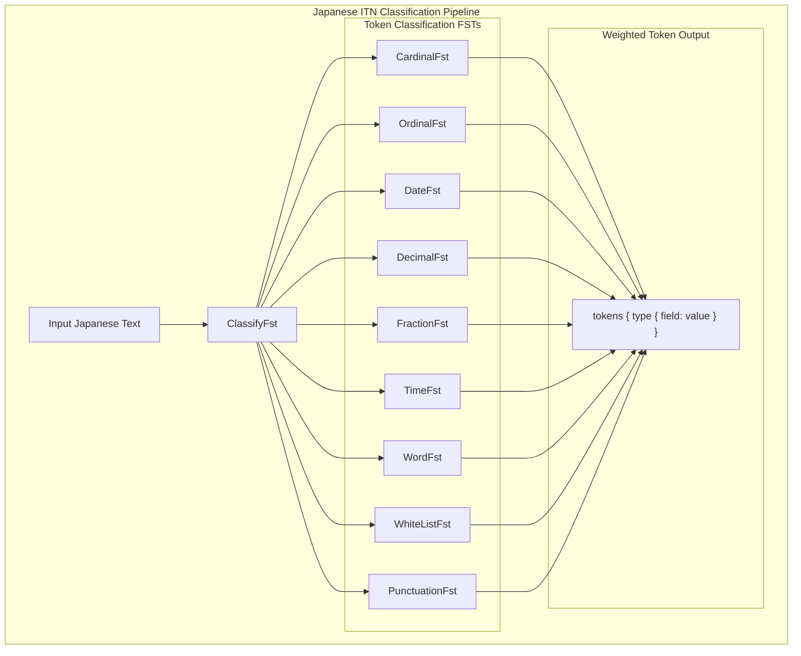
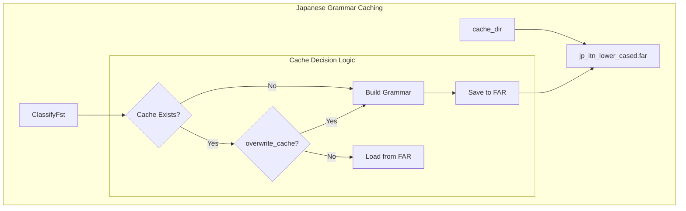

<!-- source: DeepWiki mcp.deepwiki.com · repo NVIDIA/NeMo-text-processing · page 4.7 Japanese · fetched 2026-10-26 -->

# Japanese

<details>
<summary>Relevant source files</summary>

The following files were used as context for generating this wiki page:

- [nemo_text_processing/inverse_text_normalization/ja/graph_utils.py](nemo_text_processing/inverse_text_normalization/ja/graph_utils.py)
- [nemo_text_processing/inverse_text_normalization/ja/taggers/fraction.py](nemo_text_processing/inverse_text_normalization/ja/taggers/fraction.py)
- [nemo_text_processing/inverse_text_normalization/ja/taggers/tokenize_and_classify.py](nemo_text_processing/inverse_text_normalization/ja/taggers/tokenize_and_classify.py)
- [nemo_text_processing/inverse_text_normalization/ja/taggers/word.py](nemo_text_processing/inverse_text_normalization/ja/taggers/word.py)
- [nemo_text_processing/inverse_text_normalization/ja/utils.py](nemo_text_processing/inverse_text_normalization/ja/utils.py)
- [nemo_text_processing/inverse_text_normalization/ja/verbalizers/fraction.py](nemo_text_processing/inverse_text_normalization/ja/verbalizers/fraction.py)
- [nemo_text_processing/inverse_text_normalization/ja/verbalizers/post_processing.py](nemo_text_processing/inverse_text_normalization/ja/verbalizers/post_processing.py)

</details>


This document covers the Japanese language support in the NeMo text processing system. The Japanese implementation provides inverse text normalization (ITN) capabilities, converting spoken Japanese text into written form. Unlike some other languages in the system, Japanese currently supports only ITN and not text normalization (TN).

For information about other language implementations, see the language-specific sections under [Language Support](#4). For details about the core ITN system architecture that Japanese implements, see [Inverse Text Normalization](#3.2).

## System Architecture

The Japanese ITN system follows the standard two-stage pipeline used throughout the NeMo text processing system: classification followed by verbalization. The system is implemented entirely using Pynini finite state transducers (FSTs) and supports caching of compiled grammar files for improved performance.

### Classification Pipeline

The Japanese classification system processes input text through multiple specialized FSTs that identify and classify different types of tokens. The main entry point is the `ClassifyFst` class, which orchestrates the entire classification process.



Sources: [nemo_text_processing/inverse_text_normalization/ja/taggers/tokenize_and_classify.py:39-111]()

### Weight Configuration

The Japanese classification system assigns different weights to each token type to control priority during ambiguous cases. The weights are configured in the `ClassifyFst` constructor:

| Token Type | Weight | Priority |
|------------|---------|----------|
| WhiteListFst | 1.01 | Highest |
| CardinalFst | 1.0 | High |
| FractionFst | 1.0 | High |
| TimeFst | 1.0 | High |
| OrdinalFst | 1.1 | Medium |
| DateFst | 1.1 | Medium |
| DecimalFst | 1.1 | Medium |
| PunctuationFst | 1.1 | Medium |
| WordFst | 100 | Lowest (fallback) |

Sources: [nemo_text_processing/inverse_text_normalization/ja/taggers/tokenize_and_classify.py:92-102]()

## Token Classification Components

### Cardinal Numbers
The `CardinalFst` class handles Japanese cardinal number recognition and conversion to numeric form. It serves as a foundation for other numeric processing components.

### Fraction Processing
The Japanese fraction system demonstrates sophisticated handling of Japanese mathematical expressions. The `FractionFst` tagger converts Japanese fraction expressions into structured tokens, while the corresponding verbalizer converts these tokens back to standard mathematical notation.

#### Fraction Classification Examples

```mermaid
graph LR
    subgraph "Japanese Fraction Classification"
        JA1["四分の三"] --> TOK1["fraction { denominator: \"4\" numerator: \"3\" }"]
        JA2["一と四分の三"] --> TOK2["fraction { integer: \"1\" denominator: \"4\" numerator: \"3\" }"]
        JA3["ルート三分の一"] --> TOK3["fraction { denominator: \"√3\" numerator: \"1\" }"]
        JA4["一点六五分の五十"] --> TOK4["fraction { denominator: \"1.65\" numerator: \"50\" }"]
        JA5["二ルート六分の三"] --> TOK5["fraction { denominator: \"2√6\" numerator: \"3\" }"]
    end
```

Sources: [nemo_text_processing/inverse_text_normalization/ja/taggers/fraction.py:25-33]()

#### Fraction Verbalization Examples

```mermaid
graph LR
    subgraph "Japanese Fraction Verbalization"
        TOK1["fraction { denominator: \"4\" numerator: \"3\" }"] --> OUT1["3/4"]
        TOK2["fraction { integer: \"1\" denominator: \"4\" numerator: \"3\" }"] --> OUT2["1 3/4"]
        TOK3["fraction { denominator: \"√3\" numerator: \"1\" }"] --> OUT3["1/√3"]
        TOK4["fraction { denominator: \"1.65\" numerator: \"50\" }"] --> OUT4["50/1.65"]
        TOK5["fraction { denominator: \"2√6\" numerator: \"3\" }"] --> OUT5["3/2√6"]
    end
```

Sources: [nemo_text_processing/inverse_text_normalization/ja/verbalizers/fraction.py:29-37]()

### Word Processing
The `WordFst` class handles the default case for tokens that don't match any specialized patterns. It creates a simple name-value pair structure for plain text tokens.

```mermaid
graph LR
    subgraph "Japanese Word Classification"
        Input["sleep"] --> WordFst["WordFst"] 
        WordFst --> Output["tokens { name: \"sleep\" }"]
    end
```

Sources: [nemo_text_processing/inverse_text_normalization/ja/taggers/word.py:20-29]()

## Verbalization Pipeline

The verbalization stage converts the structured tokens produced by classification back into normalized text. Each token type has a corresponding verbalizer that handles the conversion from the structured representation to the final output format.

### Post-Processing
The Japanese system includes a `PostProcessingFst` that handles final cleanup operations, particularly around punctuation and spacing. The post-processor applies several transformations:

1. **Narrow Space Handling**: Converts regular spaces to narrow non-breaking spaces between digits in fraction contexts
2. **Space Normalization**: Removes and reapplies spaces around punctuation marks
3. **Quote Processing**: Handles various quote character variants

Sources: [nemo_text_processing/inverse_text_normalization/ja/verbalizers/post_processing.py:32-133]()

## Grammar Compilation and Caching

The Japanese ITN system supports grammar compilation and caching through the FAR (Finite State Archive) format. The `ClassifyFst` class can automatically save and load compiled grammars to improve startup performance.

### Cache Management



Sources: [nemo_text_processing/inverse_text_normalization/ja/taggers/tokenize_and_classify.py:61-111]()

## Core Infrastructure

### GraphFst Base Class
All Japanese FST components inherit from the `GraphFst` base class, which provides common functionality for token wrapping, FST management, and FAR file handling.

The base class provides two key methods:
- `add_tokens()`: Wraps FST output with token structure
- `delete_tokens()`: Removes token structure wrapper during verbalization

### Utility Functions
The Japanese implementation includes utility functions for path resolution and common operations:

- `get_abs_path()`: Resolves relative paths to absolute paths for resource files

Sources: [nemo_text_processing/inverse_text_normalization/ja/utils.py:18-35](), [nemo_text_processing/inverse_text_normalization/ja/graph_utils.py:226-293]()

## Integration Points

The Japanese ITN system integrates with the broader NeMo text processing infrastructure through standardized interfaces. The main integration points include:

1. **InverseNormalizer**: The Japanese `ClassifyFst` plugs into the main inverse normalization pipeline
2. **Grammar Export**: Japanese grammars can be exported using the `generator_main` function for production deployment
3. **Testing Framework**: Japanese implementations follow the standard testing patterns used across all languages

Sources: [nemo_text_processing/inverse_text_normalization/ja/graph_utils.py:135-148]()

---

