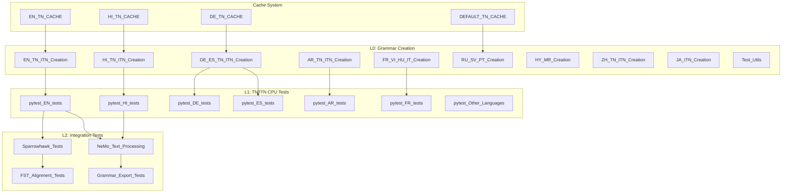
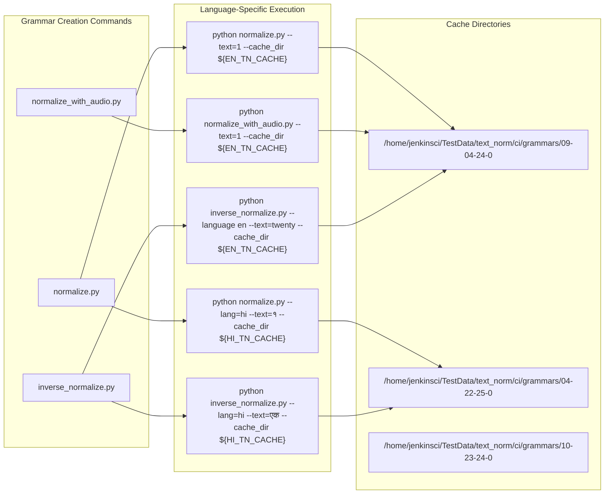
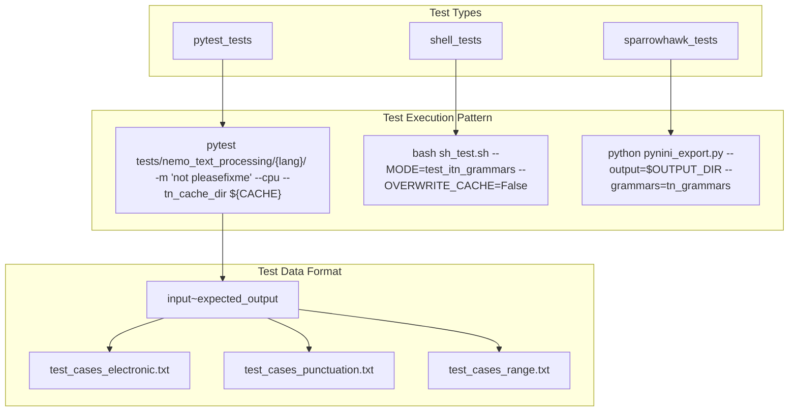
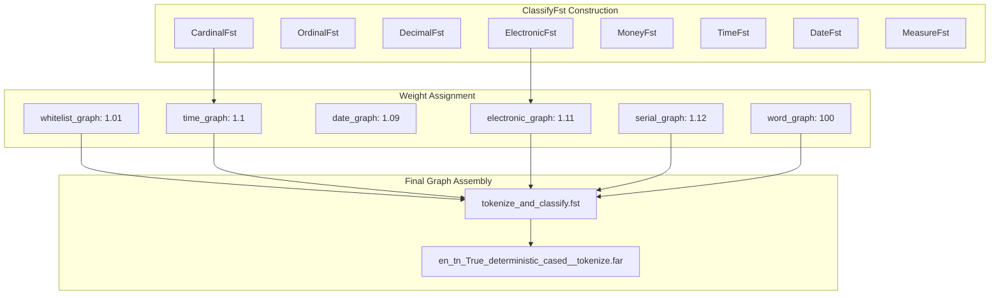
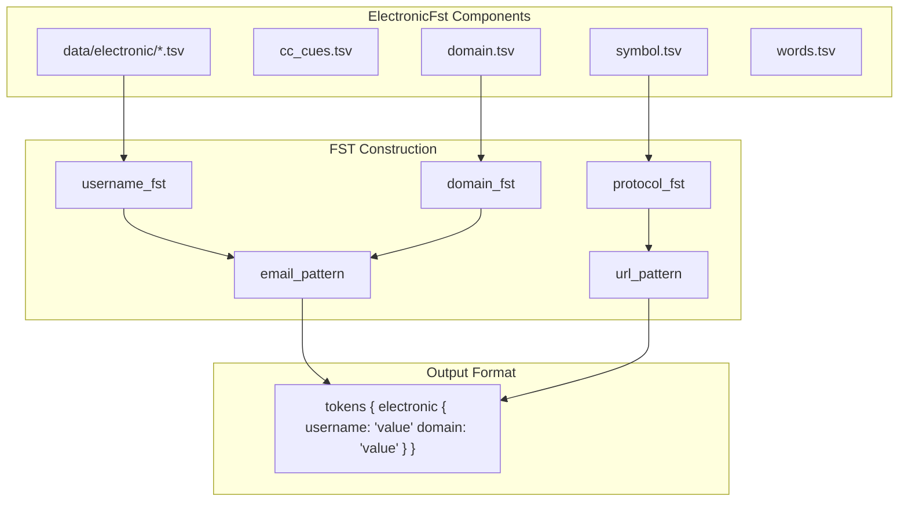
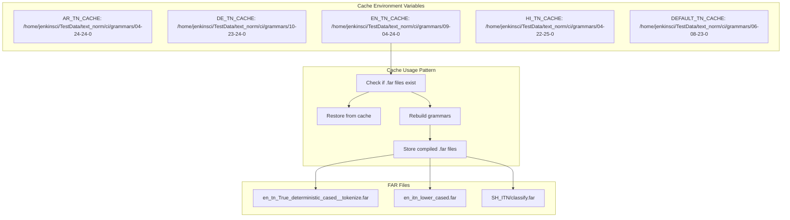
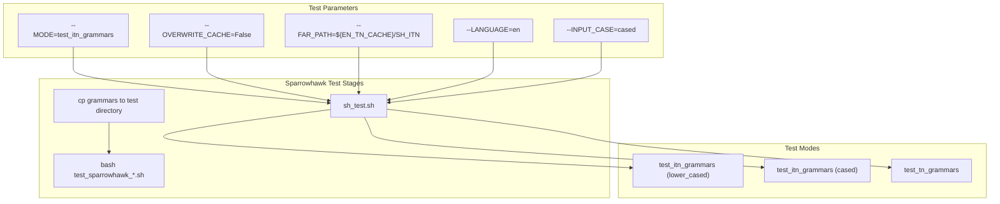
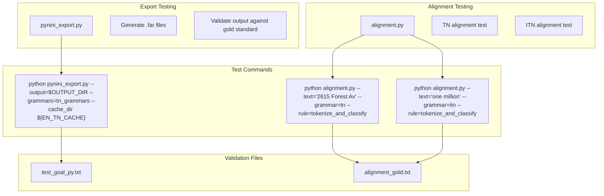

<!-- source: DeepWiki mcp.deepwiki.com · repo NVIDIA/NeMo-text-processing · page 5 Development and Testing · fetched 2026-10-26 -->

# Development and Testing

Relevant source files

The following files were used as context for generating this wiki page:

- [Jenkinsfile](Jenkinsfile)
- [nemo_text_processing/text_normalization/en/data/electronic/domain.tsv](nemo_text_processing/text_normalization/en/data/electronic/domain.tsv)
- [nemo_text_processing/text_normalization/en/taggers/electronic.py](nemo_text_processing/text_normalization/en/taggers/electronic.py)
- [nemo_text_processing/text_normalization/en/taggers/tokenize_and_classify.py](nemo_text_processing/text_normalization/en/taggers/tokenize_and_classify.py)
- [tests/nemo_text_processing/en/data_text_normalization/test_cases_electronic.txt](tests/nemo_text_processing/en/data_text_normalization/test_cases_electronic.txt)
- [tests/nemo_text_processing/en/data_text_normalization/test_cases_punctuation.txt](tests/nemo_text_processing/en/data_text_normalization/test_cases_punctuation.txt)
- [tests/nemo_text_processing/en/data_text_normalization/test_cases_punctuation_match_input.txt](tests/nemo_text_processing/en/data_text_normalization/test_cases_punctuation_match_input.txt)
- [tests/nemo_text_processing/en/data_text_normalization/test_cases_range.txt](tests/nemo_text_processing/en/data_text_normalization/test_cases_range.txt)

This document covers the development workflow, continuous integration/continuous deployment (CI/CD) pipeline, and testing framework for the NeMo Text Processing system. It focuses on the technical aspects of grammar development, automated testing, and deployment validation processes.

For information about grammar compilation and production deployment, see [Grammar Compilation](#6.1) and [Sparrowhawk Runtime](#6.2). For details on the core text processing algorithms, see [Core Text Processing Systems](#3).

## CI/CD Pipeline Architecture

The development and testing infrastructure is built around a comprehensive Jenkins-based CI/CD pipeline that orchestrates grammar building, testing, and validation across multiple languages and deployment targets.

### Pipeline Stages Overview

The pipeline consists of three main stages that execute sequentially, with parallel execution within each stage to optimize build times.

**Sources:** [Jenkinsfile:33-498]()

### Grammar Creation Commands

The L0 stage executes grammar creation commands for each supported language, using cached grammar files when available:

**Sources:** [Jenkinsfile:64-320]()

## Testing Framework

The testing framework combines pytest-based unit tests with shell-based integration tests, covering both Python API functionality and Sparrowhawk compatibility.

### Test Execution Strategy

**Sources:** [Jenkinsfile:325-497](), [tests/nemo_text_processing/en/data_text_normalization/test_cases_electronic.txt:1-44]()

### Test Data Structure

Test cases follow a standardized format with input and expected output separated by `~`:

| Component | Example Input | Expected Output |
|-----------|---------------|-----------------|
| Electronic | `cdf@abc.edu` | `cdf at abc dot edu` |
| Punctuation | `$150-$200` | `one hundred and fifty dollars to two hundred dollars` |
| Range | `1980-1986` | `nineteen eighty to nineteen eighty six` |

**Sources:** [tests/nemo_text_processing/en/data_text_normalization/test_cases_electronic.txt:7](), [tests/nemo_text_processing/en/data_text_normalization/test_cases_range.txt:19]()

## Grammar Development Workflow

The grammar development process involves creating FST-based classifiers and verbalizers that are integrated into the main tokenization pipeline.

### FST Component Integration

**Sources:** [nemo_text_processing/text_normalization/en/taggers/tokenize_and_classify.py:189-241]()

### Electronic FST Development Example

The `ElectronicFst` class demonstrates the grammar development pattern:

**Sources:** [nemo_text_processing/text_normalization/en/taggers/electronic.py:44-178](), [nemo_text_processing/text_normalization/en/data/electronic/domain.tsv:1-13]()

## Cache Management System

The CI/CD pipeline uses a sophisticated cache management system to optimize build times by reusing compiled grammar files across builds.

### Cache Directory Structure

**Sources:** [Jenkinsfile:14-31]()

## Sparrowhawk Integration Testing

The L2 stage includes comprehensive Sparrowhawk integration testing to validate grammar compatibility with the C++ runtime environment.

### Sparrowhawk Test Flow

**Sources:** [Jenkinsfile:421-442]()

## Deployment Validation

The L2 stage includes comprehensive deployment validation through grammar export testing and alignment verification.

### Export and Alignment Testing

**Sources:** [Jenkinsfile:454-494]()

---

