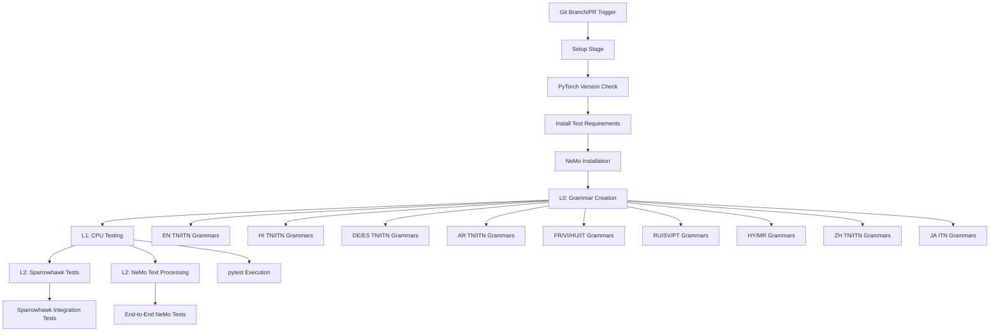
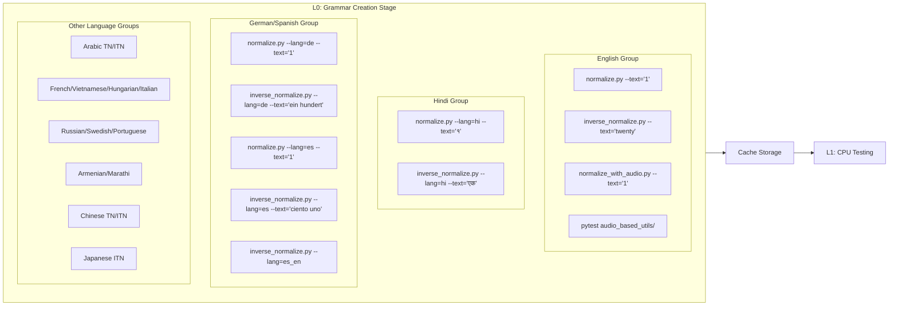
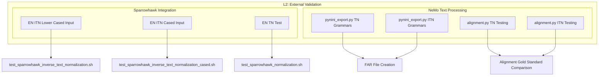
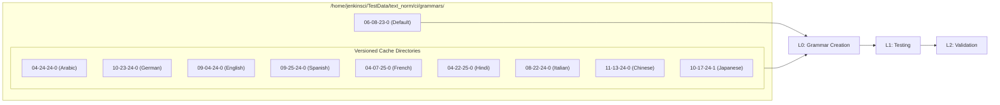

<!-- source: DeepWiki mcp.deepwiki.com · repo NVIDIA/NeMo-text-processing · page 5.1 CI/CD Pipeline · fetched 2026-10-26 -->

# CI/CD Pipeline

Relevant source files

The following files were used as context for generating this wiki page:

- [Jenkinsfile](Jenkinsfile)
- [nemo_text_processing/text_normalization/en/data/electronic/domain.tsv](nemo_text_processing/text_normalization/en/data/electronic/domain.tsv)
- [nemo_text_processing/text_normalization/en/taggers/electronic.py](nemo_text_processing/text_normalization/en/taggers/electronic.py)
- [nemo_text_processing/text_normalization/en/taggers/tokenize_and_classify.py](nemo_text_processing/text_normalization/en/taggers/tokenize_and_classify.py)
- [tests/nemo_text_processing/en/data_text_normalization/test_cases_electronic.txt](tests/nemo_text_processing/en/data_text_normalization/test_cases_electronic.txt)
- [tests/nemo_text_processing/en/data_text_normalization/test_cases_punctuation.txt](tests/nemo_text_processing/en/data_text_normalization/test_cases_punctuation.txt)
- [tests/nemo_text_processing/en/data_text_normalization/test_cases_punctuation_match_input.txt](tests/nemo_text_processing/en/data_text_normalization/test_cases_punctuation_match_input.txt)
- [tests/nemo_text_processing/en/data_text_normalization/test_cases_range.txt](tests/nemo_text_processing/en/data_text_normalization/test_cases_range.txt)

This document describes the Jenkins-based continuous integration and continuous deployment (CI/CD) pipeline for the NeMo Text Processing system. The pipeline orchestrates grammar compilation, testing, and validation across multiple languages through a three-stage process.

For information about grammar development workflows, see [Grammar Development](#5.2). For testing methodologies and procedures, see [Testing Framework](#5.3). For production deployment processes, see [Sparrowhawk Runtime](#6.2).

## Pipeline Overview

The CI/CD pipeline is implemented using Jenkins and configured through the [Jenkinsfile](Jenkinsfile:1-507). The pipeline operates in a Docker environment using the `tnitn_ci:py310` image and implements a multi-stage validation process with parallel execution for efficiency.

## Pipeline Architecture

Sources: [Jenkinsfile:1-507]()

## Stage Structure

### L0: Grammar Creation Stage

The L0 stage handles grammar compilation and caching for all supported languages. This stage runs in parallel across multiple language groups to optimize build time.

Sources: [Jenkinsfile:64-320]()

### L1: CPU Testing Stage

The L1 stage executes comprehensive CPU-based tests using the `pytest` framework. Tests restore grammars from cache and validate TN/ITN functionality across all languages.

| Language | Test Command | Cache Directory |
|----------|-------------|----------------|
| English | `pytest tests/nemo_text_processing/en/` | `${EN_TN_CACHE}` |
| German | `pytest tests/nemo_text_processing/de/` | `${DE_TN_CACHE}` |
| Spanish | `pytest tests/nemo_text_processing/es/` | `${ES_TN_CACHE}` |
| Hindi | `pytest tests/nemo_text_processing/hi/` | `${HI_TN_CACHE}` |
| Arabic | `pytest tests/nemo_text_processing/ar/` | `${AR_TN_CACHE}` |
| French | `pytest tests/nemo_text_processing/fr/` | `${FR_TN_CACHE}` |
| Chinese | `pytest tests/nemo_text_processing/zh/` | `${ZH_TN_CACHE}` |
| Japanese | `pytest tests/nemo_text_processing/ja/` | `${JA_TN_CACHE}` |

Sources: [Jenkinsfile:325-409]()

### L2: External Validation Stage

The L2 stage performs integration testing with external tools and end-to-end validation.

Sources: [Jenkinsfile:412-497]()

## Cache Management System

The pipeline utilizes a sophisticated caching system to optimize build times and ensure consistent grammar artifacts across stages.

### Cache Directory Structure

Sources: [Jenkinsfile:14-32]()

### Cache Environment Variables

The pipeline defines cache directories through environment variables:

- `EN_TN_CACHE`: `/home/jenkinsci/TestData/text_norm/ci/grammars/09-04-24-0`
- `HI_TN_CACHE`: `/home/jenkinsci/TestData/text_norm/ci/grammars/04-22-25-0`
- `DE_TN_CACHE`: `/home/jenkinsci/TestData/text_norm/ci/grammars/10-23-24-0`
- `ES_TN_CACHE`: `/home/jenkinsci/TestData/text_norm/ci/grammars/09-25-24-0`
- `FR_TN_CACHE`: `/home/jenkinsci/TestData/text_norm/ci/grammars/04-07-25-0`
- `ZH_TN_CACHE`: `/home/jenkinsci/TestData/text_norm/ci/grammars/11-13-24-0`
- `JA_TN_CACHE`: `/home/jenkinsci/TestData/text_norm/ci/grammars/10-17-24-1`

Sources: [Jenkinsfile:14-32]()

## Language Support Matrix

The pipeline supports different combinations of Text Normalization (TN) and Inverse Text Normalization (ITN) across languages:

| Language | TN Support | ITN Support | Audio Support | Cache Version |
|----------|------------|-------------|---------------|---------------|
| English | ✅ | ✅ | ✅ | 09-04-24-0 |
| Hindi | ✅ | ✅ | ❌ | 04-22-25-0 |
| German | ✅ | ✅ | ❌ | 10-23-24-0 |
| Spanish | ✅ | ✅ | ❌ | 09-25-24-0 |
| Arabic | ✅ | ✅ | ❌ | 04-24-24-0 |
| French | ✅ | ✅ | ❌ | 04-07-25-0 |
| Chinese | ✅ | ✅ | ❌ | 11-13-24-0 |
| Japanese | ❌ | ✅ | ❌ | 10-17-24-1 |
| Italian | ✅ | ❌ | ❌ | 08-22-24-0 |
| Hungarian | ✅ | ❌ | ❌ | 07-16-24-0 |
| Russian | ✅ | ✅ | ✅ | 06-08-23-0 |
| Vietnamese | ❌ | ✅ | ❌ | 06-08-23-0 |
| Portuguese | ❌ | ✅ | ❌ | 06-08-23-0 |
| Swedish | ✅ | ❌ | ❌ | 06-08-23-0 |
| Armenian | ✅ | ✅ | ❌ | 03-12-24-0 |
| Marathi | ❌ | ✅ | ❌ | 03-12-24-1 |

Sources: [Jenkinsfile:14-32](), [Jenkinsfile:64-320]()

## Testing Framework Integration

The pipeline integrates with multiple testing frameworks and validation tools:

### pytest Integration

The L1 stage uses `pytest` with specific markers and configurations:
- `pytest tests/nemo_text_processing/{lang}/ -m "not pleasefixme" --cpu --tn_cache_dir {cache}`
- Tests exclude items marked with `pleasefixme`
- CPU-only execution with `--cpu` flag
- Cache directory specification with `--tn_cache_dir`

### Sparrowhawk Integration

The L2 stage includes Sparrowhawk integration testing through shell scripts:
- `test_sparrowhawk_inverse_text_normalization.sh`
- `test_sparrowhawk_inverse_text_normalization_cased.sh`
- `test_sparrowhawk_normalization.sh`

### Alignment Testing

The pipeline includes FST alignment validation:
- `alignment.py --grammar=tn --rule=tokenize_and_classify`
- `alignment.py --grammar=itn --rule=tokenize_and_classify`
- Gold standard comparison with `cmp --silent`

Sources: [Jenkinsfile:325-497]()

## Deployment Integration

The pipeline integrates with deployment processes through:

### Grammar Export

The `pynini_export.py` tool creates FAR files for production deployment:
- `pynini_export.py --output=$OUTPUT_DIR --grammars=tn_grammars --cache_dir $CACHE`
- `pynini_export.py --output=$OUTPUT_DIR --grammars=itn_grammars --cache_dir $CACHE`

### Docker Environment

The pipeline runs in a controlled Docker environment:
- Image: `tnitn_ci:py310`
- Volume mounts: `/home/jenkinsci:/home/jenkinsci`
- Cache volume: `$HOME/.cache:/root/.cache`
- Shared memory: `--shm-size=4g`

### Cleanup and Security

Post-build cleanup ensures proper permissions:
- `chmod -R 777 .` for permission normalization
- `cleanWs()` for workspace cleanup

Sources: [Jenkinsfile:1-10](), [Jenkinsfile:454-497](), [Jenkinsfile:501-507]()

---

