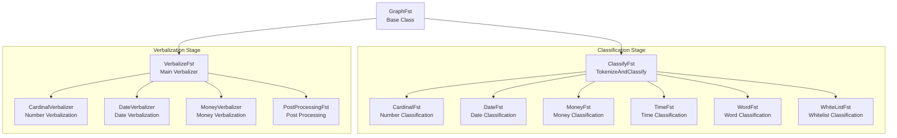
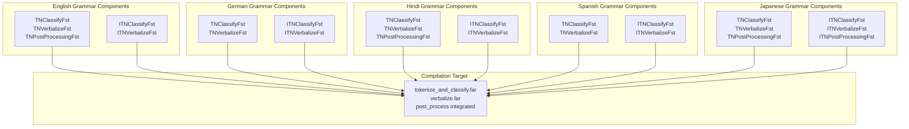
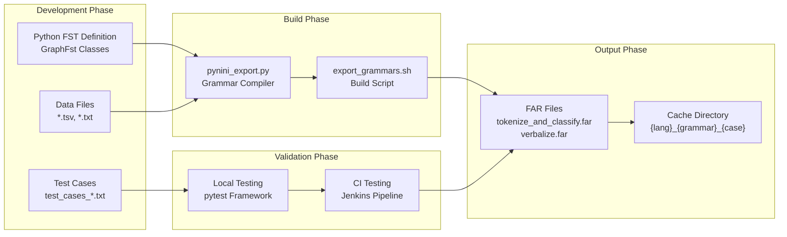
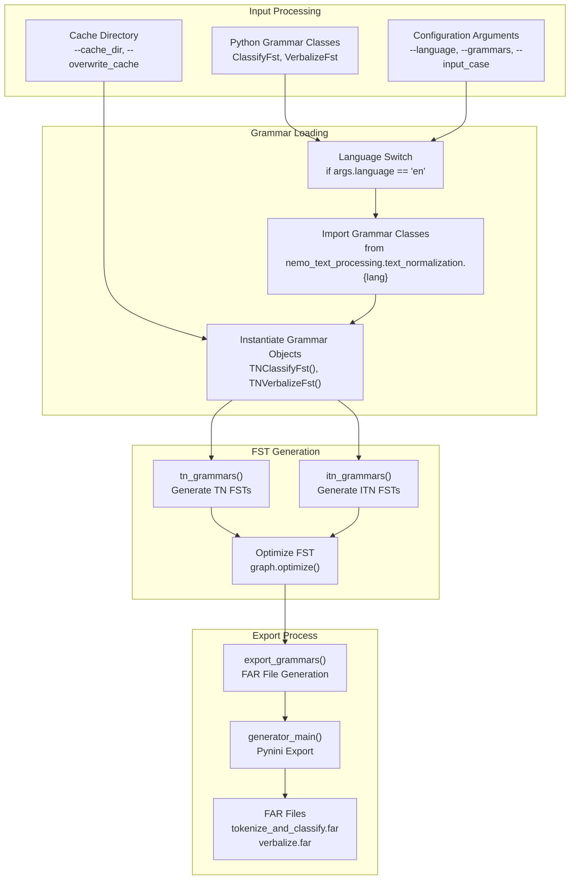

<!-- source: DeepWiki mcp.deepwiki.com · repo NVIDIA/NeMo-text-processing · page 5.2 Grammar Development · fetched 2026-10-26 -->

# Grammar Development

<details>
<summary>Relevant source files</summary>

The following files were used as context for generating this wiki page:

- [README.md](README.md)
- [nemo_text_processing/inverse_text_normalization/ja/verbalizers/word.py](nemo_text_processing/inverse_text_normalization/ja/verbalizers/word.py)
- [nemo_text_processing/text_normalization/en/graph_utils.py](nemo_text_processing/text_normalization/en/graph_utils.py)
- [requirements/requirements.txt](requirements/requirements.txt)
- [requirements/requirements_test.txt](requirements/requirements_test.txt)
- [setup.py](setup.py)
- [tests/nemo_text_processing/hi/test_whitelist.py](tests/nemo_text_processing/hi/test_whitelist.py)
- [tests/nemo_text_processing/hi/test_word.py](tests/nemo_text_processing/hi/test_word.py)
- [tools/text_processing_deployment/export_grammars.sh](tools/text_processing_deployment/export_grammars.sh)
- [tools/text_processing_deployment/pynini_export.py](tools/text_processing_deployment/pynini_export.py)

</details>


This document provides a comprehensive guide for developing and modifying Finite State Transducer (FST) grammars within the NeMo Text Processing system. It covers the grammar architecture, development workflow, data file formats, testing procedures, and compilation processes. For information about the CI/CD pipeline that builds and tests grammars, see [CI/CD Pipeline](#5.1). For details about the runtime deployment of compiled grammars, see [Grammar Compilation](#6.1).

## Grammar Architecture Overview

The NeMo Text Processing system uses a two-stage FST architecture where grammars are organized into classification and verbalization components. Each language implements both Text Normalization (TN) and Inverse Text Normalization (ITN) grammars following this pattern.

### Grammar Class Hierarchy



Sources: [nemo_text_processing/text_normalization/en/graph_utils.py:271-338]()

### Grammar Components by Language



Sources: [tools/text_processing_deployment/pynini_export.py:144-324]()

## Development Workflow

### Grammar Development Process

The grammar development process follows a standardized workflow from Python FST definitions to compiled FAR files used in production.



Sources: [tools/text_processing_deployment/pynini_export.py:1-324](), [tools/text_processing_deployment/export_grammars.sh:1-109]()

### Base Grammar Class Structure

All grammar components inherit from the `GraphFst` base class which provides standardized functionality for FST management and token wrapping.

| Method | Purpose | Usage |
|--------|---------|-------|
| `__init__()` | Initialize grammar with name, kind, and deterministic flag | Base constructor for all grammars |
| `add_tokens()` | Wrap FST output with grammar class tokens | Used in classification stage |
| `delete_tokens()` | Remove grammar class tokens from FST input | Used in verbalization stage |
| `fst` property | Access to the underlying FST | Main interface for grammar usage |
| `far_exist()` | Check if precompiled FAR file exists | Used for caching optimization |

Sources: [nemo_text_processing/text_normalization/en/graph_utils.py:271-338]()

## Data File Formats

### TSV Data Files

Grammar data files use tab-separated values (TSV) format with specific column structures depending on the grammar type.

#### Whitelist Files
```
written_form	spoken_form	[weight]
BMW	b m w
CEO	c e o
etc.	etcetera	0.1
```

#### Suppletive Forms
```
singular	plural
child	children
person	people
mouse	mice
```

#### Number Mappings
```
digit	word_form
0	zero
1	one
2	two
```

Sources: [nemo_text_processing/text_normalization/en/graph_utils.py:103-268]()

### Test Case Files

Test cases follow a standardized format with input and expected output separated by a tab character.

```
input_text	expected_output
$2.50	two dollars fifty cents
Jan 1, 2023	january first twenty twenty three
123-456-7890	one two three four five six seven eight nine zero
```

Sources: [tests/nemo_text_processing/hi/test_word.py:30-42](), [tests/nemo_text_processing/hi/test_whitelist.py:30-42]()

## Grammar Compilation Process

### Compilation Pipeline

The compilation process transforms Python FST definitions into optimized FAR files for production use.



Sources: [tools/text_processing_deployment/pynini_export.py:30-82](), [tools/text_processing_deployment/pynini_export.py:137-324]()

### Compilation Configuration

| Parameter | Purpose | Values | Default |
|-----------|---------|---------|---------|
| `--language` | Target language | `en`, `de`, `es`, `hi`, `ja`, etc. | `en` |
| `--grammars` | Grammar type | `tn_grammars`, `itn_grammars` | Required |
| `--input_case` | Input capitalization | `cased`, `lower_cased` | `cased` |
| `--cache_dir` | Cache directory path | File path or `None` | `None` |
| `--overwrite_cache` | Force grammar rebuild | Boolean flag | `False` |
| `--whitelist` | Custom whitelist file | File path or `None` | `None` |

Sources: [tools/text_processing_deployment/pynini_export.py:84-134]()

## Testing and Validation

### Test File Structure

Test cases are organized by language and grammar component, following a standardized directory structure.

```
tests/nemo_text_processing/
├── {lang}/
│   ├── test_word.py
│   ├── test_whitelist.py
│   ├── test_cardinal.py
│   └── data_text_normalization/
│       ├── test_cases_word.txt
│       ├── test_cases_whitelist.txt
│       └── test_cases_cardinal.txt
```

### Test Implementation Pattern

```python
class TestWord:
    normalizer = Normalizer(
        input_case='cased', 
        lang='hi', 
        cache_dir=CACHE_DIR, 
        overwrite_cache=False
    )
    
    @parameterized.expand(parse_test_case_file('hi/data_text_normalization/test_cases_word.txt'))
    def test_norm(self, test_input, expected):
        pred = self.normalizer.normalize(test_input, verbose=False)
        assert pred == expected
```

Sources: [tests/nemo_text_processing/hi/test_word.py:24-35]()

### Validation Modes

The export script supports multiple validation modes for testing grammar functionality.

| Mode | Purpose | Command |
|------|---------|---------|
| `export` | Generate FAR files only | `bash export_grammars.sh --MODE=export` |
| `test` | Run validation tests | `bash export_grammars.sh --MODE=test` |
| `interactive` | Interactive testing prompt | `bash export_grammars.sh --MODE=interactive` |
| `ci` | CI/CD pipeline mode | `bash export_grammars.sh --MODE=ci` |

Sources: [tools/text_processing_deployment/export_grammars.sh:36-109]()

## Grammar Utilities and Helpers

### Core Utilities

The `graph_utils.py` module provides essential utilities for FST construction and manipulation.

| Utility | Purpose | Usage |
|---------|---------|-------|
| `NEMO_CHAR` | Valid UTF-8 character set | FST character validation |
| `NEMO_DIGIT` | Digit character set | Number processing |
| `NEMO_ALPHA` | Alphabetic character set | Text processing |
| `NEMO_SPACE` | Space character handling | Whitespace management |
| `delete_space` | Space deletion utility | Token boundary handling |
| `insert_space` | Space insertion utility | Output formatting |

Sources: [nemo_text_processing/text_normalization/en/graph_utils.py:30-84]()

### String Mapping Functions

```python
def string_map_cased(input_file: str, input_case: str = INPUT_LOWER_CASED):
    """Creates case-sensitive string mappings from TSV files"""
    
def capitalized_input_graph(graph: "pynini.FstLike", 
                           original_graph_weight: float = None,
                           capitalized_graph_weight: float = None):
    """Allows graph input to be capitalized for ITN"""
```

Sources: [nemo_text_processing/text_normalization/en/graph_utils.py:227-268](), [nemo_text_processing/text_normalization/en/graph_utils.py:149-172]()

## Dependencies and Requirements

### Core Dependencies

The grammar development system relies on several key dependencies for FST operations.

| Package | Version | Purpose |
|---------|---------|---------|
| `pynini` | 2.1.6.post1 | FST library and operations |
| `setuptools` | >=65.5.1 | Package management |
| `pytest` | Latest | Testing framework |
| `parameterized` | Latest | Test parameterization |

Sources: [requirements/requirements.txt:1-14](), [requirements/requirements_test.txt:1-14]()

### Development Environment Setup

```bash
# Create conda environment
conda create --name nemo_tn python==3.10
conda activate nemo_tn

# Install dependencies
pip install -r requirements/requirements.txt
pip install -r requirements/requirements_test.txt

# Install from source
git clone https://github.com/NVIDIA/NeMo-text-processing
cd NeMo-text-processing
./reinstall.sh
```

Sources: [README.md:31-81]()

---

