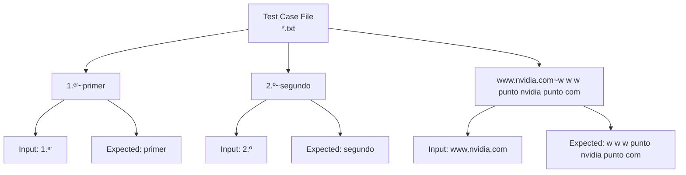
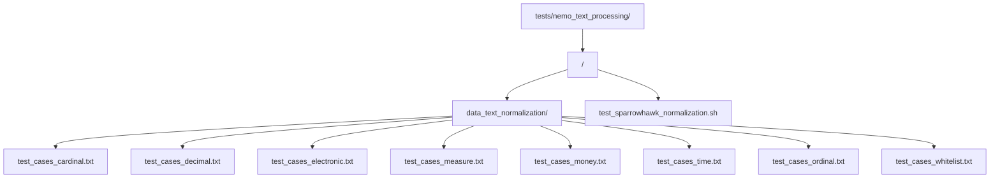
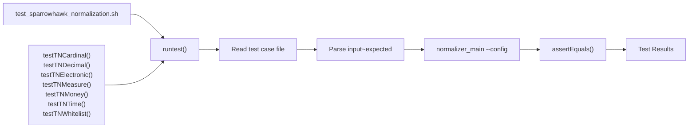
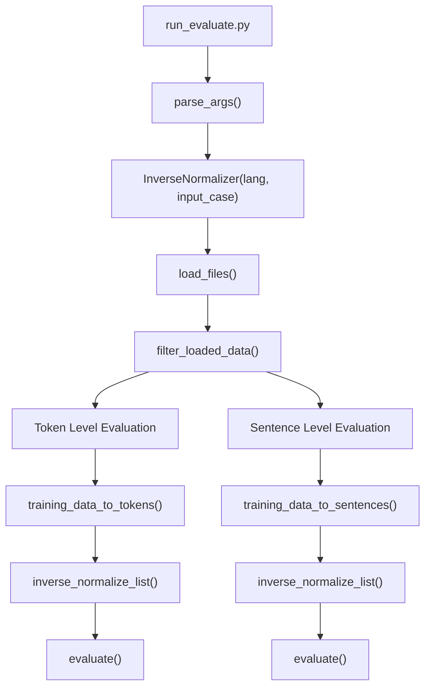
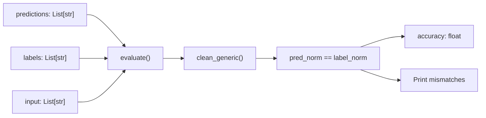
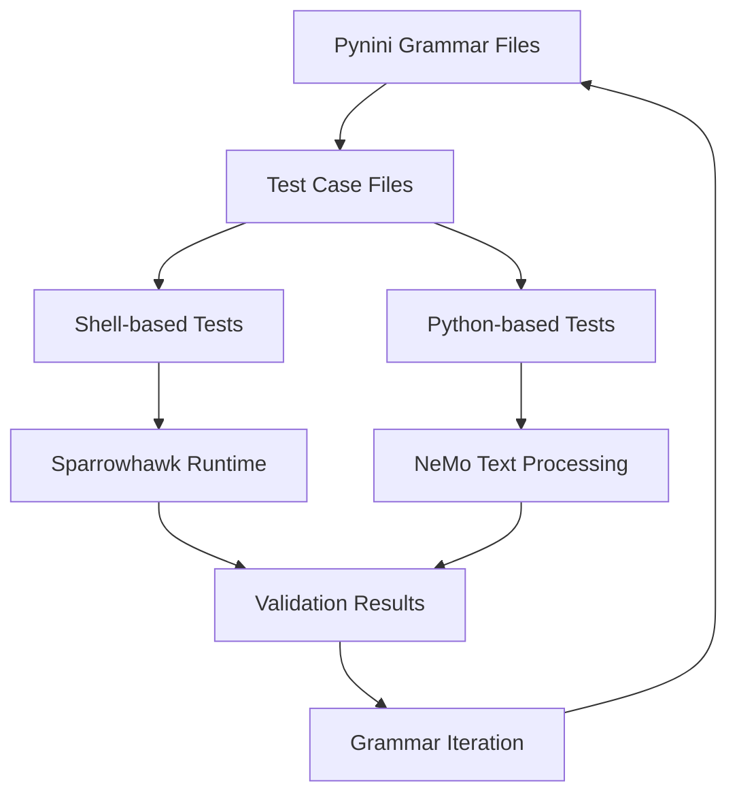

<!-- source: DeepWiki mcp.deepwiki.com · repo NVIDIA/NeMo-text-processing · page 5.3 Testing Framework · fetched 2026-10-26 -->

# Testing Framework

<details>
<summary>Relevant source files</summary>

The following files were used as context for generating this wiki page:

- [nemo_text_processing/inverse_text_normalization/run_evaluate.py](nemo_text_processing/inverse_text_normalization/run_evaluate.py)
- [nemo_text_processing/text_normalization/data_loader_utils.py](nemo_text_processing/text_normalization/data_loader_utils.py)
- [nemo_text_processing/text_normalization/es/data/ordinals/roman_exceptions.tsv](nemo_text_processing/text_normalization/es/data/ordinals/roman_exceptions.tsv)
- [nemo_text_processing/text_normalization/es/data/whitelist.tsv](nemo_text_processing/text_normalization/es/data/whitelist.tsv)
- [nemo_text_processing/text_normalization/es/graph_utils.py](nemo_text_processing/text_normalization/es/graph_utils.py)
- [nemo_text_processing/text_normalization/es/taggers/ordinal.py](nemo_text_processing/text_normalization/es/taggers/ordinal.py)
- [nemo_text_processing/text_normalization/it/data/electronic/domain.tsv](nemo_text_processing/text_normalization/it/data/electronic/domain.tsv)
- [nemo_text_processing/text_normalization/it/data/measure/measurements.tsv](nemo_text_processing/text_normalization/it/data/measure/measurements.tsv)
- [nemo_text_processing/text_normalization/it/taggers/electronic.py](nemo_text_processing/text_normalization/it/taggers/electronic.py)
- [nemo_text_processing/text_normalization/it/taggers/tokenize_and_classify.py](nemo_text_processing/text_normalization/it/taggers/tokenize_and_classify.py)
- [nemo_text_processing/text_normalization/it/verbalizers/electronic.py](nemo_text_processing/text_normalization/it/verbalizers/electronic.py)
- [tests/nemo_text_processing/es/data_text_normalization/test_cases_ordinal.txt](tests/nemo_text_processing/es/data_text_normalization/test_cases_ordinal.txt)
- [tests/nemo_text_processing/it/data_text_normalization/test_cases_electronic.txt](tests/nemo_text_processing/it/data_text_normalization/test_cases_electronic.txt)
- [tests/nemo_text_processing/it/data_text_normalization/test_cases_measure.txt](tests/nemo_text_processing/it/data_text_normalization/test_cases_measure.txt)
- [tests/nemo_text_processing/it/data_text_normalization/test_cases_whitelist.txt](tests/nemo_text_processing/it/data_text_normalization/test_cases_whitelist.txt)
- [tests/nemo_text_processing/it/test_sparrowhawk_normalization.sh](tests/nemo_text_processing/it/test_sparrowhawk_normalization.sh)

</details>


The testing framework provides comprehensive validation mechanisms for text normalization and inverse text normalization across multiple languages. This system includes test case formats, evaluation scripts, shell-based Sparrowhawk integration tests, and Python-based evaluation utilities that support both token-level and sentence-level accuracy measurements.

For information about the CI/CD pipeline that orchestrates these tests, see [CI/CD Pipeline](#5.1). For details about grammar development workflows, see [Grammar Development](#5.2).

## Test Case Format and Structure

The testing framework uses a standardized test case format across all languages and semiotic classes. Test cases are stored in language-specific directories under `tests/nemo_text_processing/` and follow a consistent `input~expected_output` format.

### Test Case File Format



Test cases are organized by semiotic class and language, with each file containing input-output pairs separated by the `~` delimiter. The format supports multiple expected outputs for non-deterministic cases by using additional `~` separators.

Sources: [tests/nemo_text_processing/es/data_text_normalization/test_cases_ordinal.txt:1-120](), [tests/nemo_text_processing/it/data_text_normalization/test_cases_electronic.txt:1-14]()

### Test Data Organization



Each language directory contains test cases organized by semiotic class, with standardized naming conventions for test files and corresponding shell test scripts.

Sources: [tests/nemo_text_processing/it/test_sparrowhawk_normalization.sh:30-63]()

## Shell-Based Sparrowhawk Testing

The shell-based testing system provides integration tests for Sparrowhawk normalization using the `normalizer_main` executable. These tests validate the complete normalization pipeline including grammar compilation and runtime execution.

### Sparrowhawk Test Runner



The shell testing framework implements a `runtest()` function that processes test case files, executes normalization through `normalizer_main`, and compares results using the `assertEquals()` function from the shUnit2 testing framework.

Sources: [tests/nemo_text_processing/it/test_sparrowhawk_normalization.sh:6-28](), [tests/nemo_text_processing/it/test_sparrowhawk_normalization.sh:30-66]()

### Test Execution Flow

The shell tests follow a standardized execution pattern:

1. **Test File Processing**: Read test cases from category-specific files
2. **Input Parsing**: Split each line on `~` delimiter to extract input and expected output
3. **Normalization**: Execute `normalizer_main` with Sparrowhawk configuration
4. **Output Processing**: Clean whitespace and handle non-breaking spaces
5. **Validation**: Compare actual output with expected output using `assertEquals()`

The test runner handles multiple test categories automatically, with each category having its own dedicated test function (`testTNCardinal()`, `testTNDecimal()`, etc.).

Sources: [tests/nemo_text_processing/it/test_sparrowhawk_normalization.sh:12-27]()

## Python-Based Evaluation System

The Python evaluation system provides comprehensive accuracy measurement capabilities for both text normalization and inverse text normalization across multiple languages and semiotic classes.

### Evaluation Script Architecture



The evaluation system supports both token-level and sentence-level accuracy measurements, with filtering capabilities for specific semiotic classes and data cleaning for inverse normalization purposes.

Sources: [nemo_text_processing/inverse_text_normalization/run_evaluate.py:32-53](), [nemo_text_processing/inverse_text_normalization/run_evaluate.py:76-106]()

### Data Loading and Processing

The evaluation framework uses standardized data loading utilities that handle the Kaggle text normalization format:

| Component | Purpose | Format |
|-----------|---------|---------|
| `load_files()` | Load test data from file paths | List of file paths → List of instances |
| `training_data_to_tokens()` | Convert instances to token-level data | Instances → Dict[token_type, (unnormalized, normalized)] |
| `training_data_to_sentences()` | Convert instances to sentence-level data | Instances → (unnormalized_sentences, normalized_sentences, categories) |
| `evaluate()` | Calculate accuracy metrics | (predictions, labels) → accuracy_score |

The system supports the Kaggle format with tab-separated values: `<semiotic_class>\t<unnormalized_text>\t<normalized_text>`.

Sources: [nemo_text_processing/text_normalization/data_loader_utils.py:51-89](), [nemo_text_processing/text_normalization/data_loader_utils.py:149-199]()

## Test Data Validation and Utilities

The framework provides comprehensive utilities for test data validation, accuracy measurement, and post-processing of normalized outputs.

### Evaluation Metrics and Accuracy Calculation



The evaluation system implements character-level accuracy measurement with text normalization through the `clean_generic()` function, which strips whitespace and converts text to lowercase for consistent comparison.

Sources: [nemo_text_processing/text_normalization/data_loader_utils.py:122-146]()

### Known Semiotic Classes

The testing framework supports validation across standardized semiotic classes:

```python
known_types = [
    "PLAIN", "DATE", "CARDINAL", "LETTERS", "VERBATIM", 
    "MEASURE", "DECIMAL", "ORDINAL", "DIGIT", "MONEY", 
    "TELEPHONE", "ELECTRONIC", "FRACTION", "TIME", "ADDRESS"
]
```

Each semiotic class has corresponding test case files and evaluation metrics, with token-level and sentence-level accuracy reporting.

Sources: [nemo_text_processing/text_normalization/data_loader_utils.py:32-48]()

## Integration with Grammar Development

The testing framework integrates closely with the grammar development workflow, providing validation for FST grammars and normalization rules.

### Grammar Validation Flow



The testing framework supports iterative grammar development by providing immediate feedback on normalization accuracy across different semiotic classes and languages.

Sources: [nemo_text_processing/text_normalization/it/taggers/tokenize_and_classify.py:41-139]()

### Test Case Generation and Maintenance

Test cases are maintained in language-specific directories with standardized formats that support:

- **Multiple output options**: Non-deterministic cases with multiple valid normalizations
- **Whitelist validation**: Domain-specific abbreviations and proper nouns
- **Cross-language consistency**: Standardized test formats across all supported languages
- **Semiotic class coverage**: Comprehensive test coverage for all supported text types

The framework enables efficient test case maintenance and validation across the entire multilingual normalization system.

Sources: [nemo_text_processing/text_normalization/es/data/whitelist.tsv:1-63](), [tests/nemo_text_processing/it/data_text_normalization/test_cases_whitelist.txt:1-4]()

---

