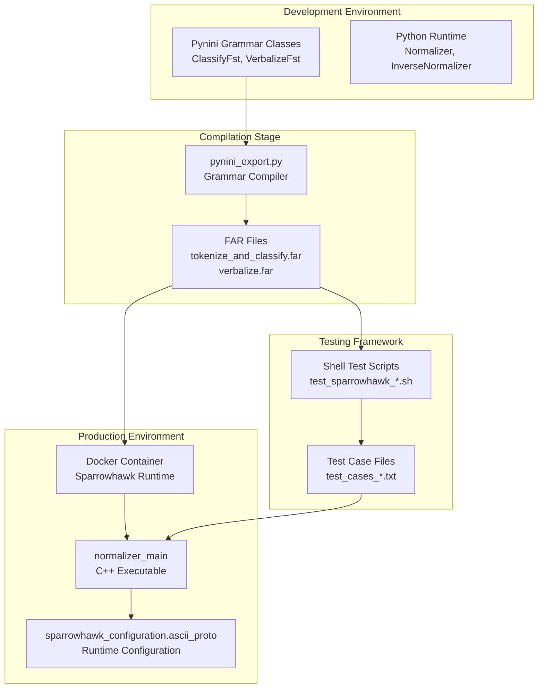
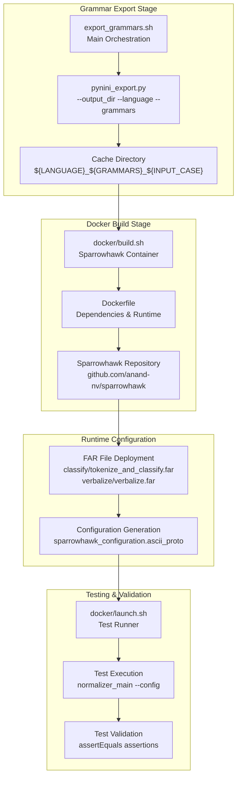
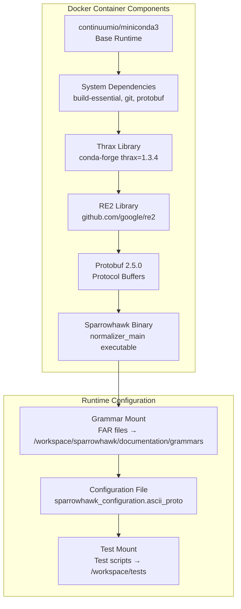
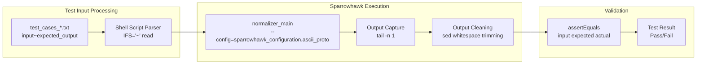

<!-- source: DeepWiki mcp.deepwiki.com · repo NVIDIA/NeMo-text-processing · page 6 Deployment and Production · fetched 2026-10-26 -->

# Deployment and Production

<details>
<summary>Relevant source files</summary>

The following files were used as context for generating this wiki page:

- [nemo_text_processing/inverse_text_normalization/ja/verbalizers/word.py](nemo_text_processing/inverse_text_normalization/ja/verbalizers/word.py)
- [nemo_text_processing/text_normalization/zh/taggers/money.py](nemo_text_processing/text_normalization/zh/taggers/money.py)
- [tests/nemo_text_processing/en/test_sparrowhawk_inverse_text_normalization.sh](tests/nemo_text_processing/en/test_sparrowhawk_inverse_text_normalization.sh)
- [tests/nemo_text_processing/en/test_sparrowhawk_inverse_text_normalization_cased.sh](tests/nemo_text_processing/en/test_sparrowhawk_inverse_text_normalization_cased.sh)
- [tests/nemo_text_processing/en/test_sparrowhawk_normalization.sh](tests/nemo_text_processing/en/test_sparrowhawk_normalization.sh)
- [tests/nemo_text_processing/hi/test_whitelist.py](tests/nemo_text_processing/hi/test_whitelist.py)
- [tests/nemo_text_processing/hi/test_word.py](tests/nemo_text_processing/hi/test_word.py)
- [tests/nemo_text_processing/mr/test_cardinal.py](tests/nemo_text_processing/mr/test_cardinal.py)
- [tests/nemo_text_processing/mr/test_date.py](tests/nemo_text_processing/mr/test_date.py)
- [tests/nemo_text_processing/zh/data_text_normalization/test_cases_word.txt](tests/nemo_text_processing/zh/data_text_normalization/test_cases_word.txt)
- [tests/nemo_text_processing/zh/test_sparrowhawk_normalization.sh](tests/nemo_text_processing/zh/test_sparrowhawk_normalization.sh)
- [tools/text_processing_deployment/Dockerfile](tools/text_processing_deployment/Dockerfile)
- [tools/text_processing_deployment/docker/launch.sh](tools/text_processing_deployment/docker/launch.sh)
- [tools/text_processing_deployment/export_grammars.sh](tools/text_processing_deployment/export_grammars.sh)
- [tools/text_processing_deployment/pynini_export.py](tools/text_processing_deployment/pynini_export.py)
- [tools/text_processing_deployment/sh_test.sh](tools/text_processing_deployment/sh_test.sh)

</details>


This document covers the deployment and production aspects of the NeMo Text Processing system. It describes how Pynini-based finite state grammars are compiled, packaged, and deployed for production use through the Sparrowhawk C++ runtime environment.

For information about grammar development and testing during development, see [Development and Testing](#5). For details about the specific compilation process, see [Grammar Compilation](#6.1). For information about the Sparrowhawk runtime configuration, see [Sparrowhawk Runtime](#6.2).

## Overview

The NeMo Text Processing system provides a two-stage deployment pipeline that transforms Python-based Pynini grammars into production-ready finite state transducers (FSTs) that can be executed efficiently in C++ runtime environments. This deployment process is essential for production use cases where performance and resource efficiency are critical.

The deployment pipeline consists of grammar compilation, Docker containerization, and integration testing phases. The system supports both Text Normalization (TN) and Inverse Text Normalization (ITN) grammars across multiple languages.

## Deployment Architecture

The deployment architecture transforms development grammars into production-ready components through a multi-stage process:



Sources: [tools/text_processing_deployment/pynini_export.py:1-325](), [tools/text_processing_deployment/export_grammars.sh:1-109](), [tools/text_processing_deployment/Dockerfile:1-41]()

## Deployment Pipeline Process

The deployment process follows a structured pipeline managed by the `export_grammars.sh` script:



Sources: [tools/text_processing_deployment/export_grammars.sh:33-109](), [tools/text_processing_deployment/docker/launch.sh:1-61]()

## Key Deployment Components

### Grammar Compilation Process

The `pynini_export.py` script serves as the primary compilation tool, transforming Pynini grammar classes into FAR (Finite State Archive) files:

| Component | Function | Output |
|-----------|----------|--------|
| `itn_grammars()` | Compiles ITN ClassifyFst and VerbalizeFst | classify/tokenize_and_classify.far, verbalize/verbalize.far |
| `tn_grammars()` | Compiles TN ClassifyFst and VerbalizeFst | classify/tokenize_and_classify.far, verbalize/verbalize.far |
| `export_grammars()` | Orchestrates FAR file generation | Directory structure with FAR files |

The compilation process supports multiple languages and handles both cased and lower-cased input configurations.

Sources: [tools/text_processing_deployment/pynini_export.py:30-82]()

### Docker Runtime Environment

The production runtime uses a specialized Docker container built with the Sparrowhawk C++ framework:



Sources: [tools/text_processing_deployment/Dockerfile:19-40]()

## Production Runtime Execution

The production system executes through the `normalizer_main` executable, which processes text using the compiled FAR files:

### Command Line Interface

The basic production usage pattern follows this structure:

```bash
echo "input text" | normalizer_main --config=sparrowhawk_configuration.ascii_proto
```

### Test Execution Framework

The testing framework validates deployed grammars through shell scripts that interface with the `normalizer_main` executable:



Sources: [tests/nemo_text_processing/en/test_sparrowhawk_normalization.sh:11-25](), [tests/nemo_text_processing/en/test_sparrowhawk_inverse_text_normalization.sh:12-22]()

## Language Support and Configuration

The deployment system supports multiple languages with configurable input case handling:

| Language | TN Support | ITN Support | Special Features |
|----------|------------|-------------|------------------|
| English (`en`) | ✓ | ✓ | PostProcessingFst support |
| German (`de`) | ✓ | ✓ | Electronic text processing |
| Spanish (`es`) | ✓ | ✓ | Ordinal handling |
| French (`fr`) | ✓ | ✓ | Date processing |
| Hindi (`hi`) | ✓ | ✓ | PostProcessingFst support |
| Chinese (`zh`) | ✓ | ✓ | PostProcessingFst support |
| Italian (`it`) | ✓ | - | TN only |
| Japanese (`ja`) | ✓ | ✓ | PostProcessingFst support |

The system handles both `lower_cased` and `cased` input configurations through the `--input_case` parameter.

Sources: [tools/text_processing_deployment/pynini_export.py:90-111](), [tools/text_processing_deployment/pynini_export.py:140-314]()

## Cache Management and Performance

The deployment system implements caching mechanisms to optimize build times and resource usage:

- **Cache Directory Structure**: `${LANGUAGE}_${GRAMMARS}_${INPUT_CASE}/`
- **FAR File Caching**: Compiled grammars stored as `.far` files
- **Overwrite Control**: `--overwrite_cache` flag controls cache regeneration
- **Validation**: Automatic cache validation checks for missing FAR files

The cache system significantly reduces deployment time by reusing previously compiled grammars when source code hasn't changed.

Sources: [tools/text_processing_deployment/export_grammars.sh:54-87]()

---

