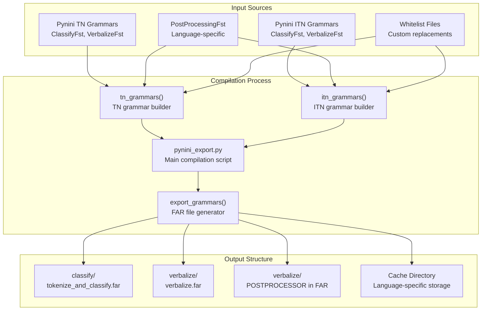
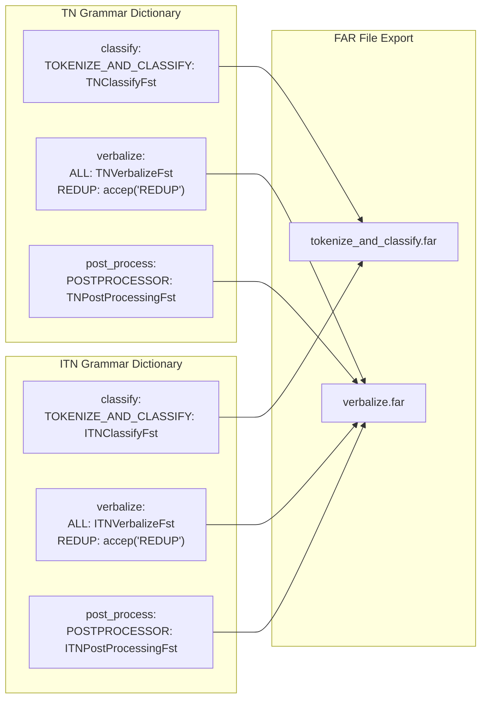
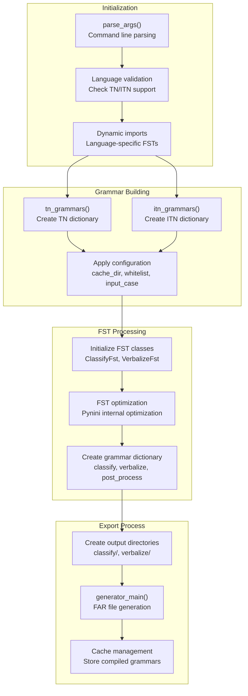
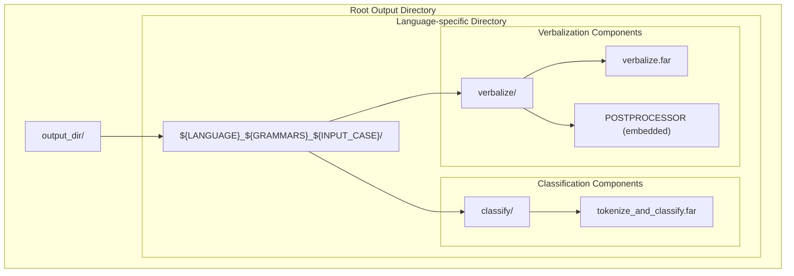
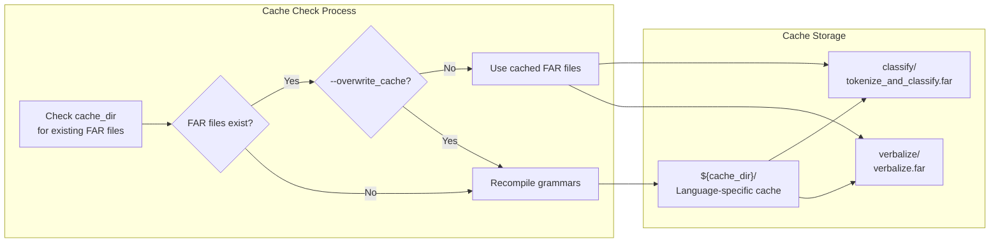
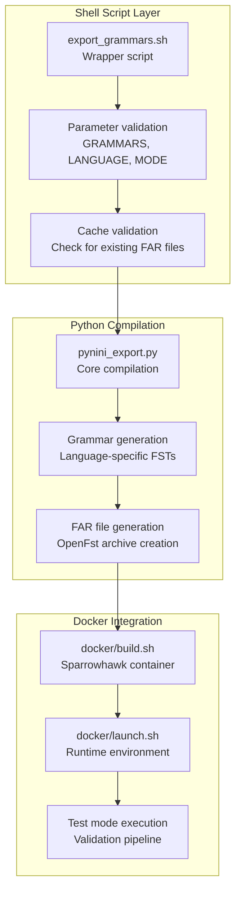

<!-- source: DeepWiki mcp.deepwiki.com · repo NVIDIA/NeMo-text-processing · page 6.1 Grammar Compilation · fetched 2026-10-26 -->

# Grammar Compilation

<details>
<summary>Relevant source files</summary>

The following files were used as context for generating this wiki page:

- [nemo_text_processing/inverse_text_normalization/ja/verbalizers/word.py](nemo_text_processing/inverse_text_normalization/ja/verbalizers/word.py)
- [tests/nemo_text_processing/hi/test_whitelist.py](tests/nemo_text_processing/hi/test_whitelist.py)
- [tests/nemo_text_processing/hi/test_word.py](tests/nemo_text_processing/hi/test_word.py)
- [tools/text_processing_deployment/export_grammars.sh](tools/text_processing_deployment/export_grammars.sh)
- [tools/text_processing_deployment/pynini_export.py](tools/text_processing_deployment/pynini_export.py)

</details>


This document covers the grammar compilation process that transforms Pynini-based finite state transducers (FSTs) into OpenFst FAR (Finite-state ARchive) files for production deployment. The compilation process is essential for preparing text normalization and inverse text normalization grammars for use in the Sparrowhawk runtime environment.

For information about the Sparrowhawk runtime environment that consumes these compiled grammars, see [Sparrowhawk Runtime](#6.2). For details about grammar development and testing, see [Grammar Development](#5.2).

## Purpose and Scope

Grammar compilation converts language-specific Pynini FST grammars into optimized FAR files that can be efficiently loaded by production systems. This process bridges the gap between development-time Python-based grammars and runtime C++ components, enabling high-performance text processing in production environments.

## Compilation Architecture

The grammar compilation system centers around the `pynini_export.py` script, which orchestrates the transformation of Pynini FSTs into FAR files through a structured pipeline.



Sources: [tools/text_processing_deployment/pynini_export.py:1-325]()

## Grammar Dictionary Structure

The compilation process organizes grammars into standardized dictionary structures that separate classification, verbalization, and post-processing components.



Sources: [tools/text_processing_deployment/pynini_export.py:30-61]()

## Language Support Matrix

The compilation system supports multiple languages with varying levels of TN and ITN capability. The language-specific imports are dynamically loaded based on the target language.

| Language | TN Support | ITN Support | Post-processing | Special Features |
|----------|------------|-------------|-----------------|------------------|
| English (en) | ✓ | ✓ | TN, ITN | Full feature set |
| German (de) | ✓ | ✓ | - | Electronic text processing |
| Spanish (es) | ✓ | ✓ | - | Ordinal support |
| French (fr) | ✓ | ✓ | - | Date handling |
| Hindi (hi) | ✓ | ✓ | TN | Complex numbers |
| Chinese (zh) | ✓ | ✓ | TN | Sentence-level processing |
| Japanese (ja) | ✓ | ✓ | TN, ITN | Comprehensive post-processing |
| Portuguese (pt) | - | ✓ | - | ITN only |
| Russian (ru) | - | ✓ | - | ITN only |
| Italian (it) | ✓ | - | - | TN only |
| Arabic (ar) | ✓ | ✓ | - | Basic support |

Sources: [tools/text_processing_deployment/pynini_export.py:140-314]()

## Compilation Process Flow

The compilation process follows a systematic approach to transform Pynini grammars into production-ready FAR files.



Sources: [tools/text_processing_deployment/pynini_export.py:84-134](), [tools/text_processing_deployment/pynini_export.py:315-324]()

## Output Directory Structure

The compilation process generates a structured directory hierarchy that organizes FAR files by language, grammar type, and input case configuration.



Sources: [tools/text_processing_deployment/pynini_export.py:63-82](), [tools/text_processing_deployment/pynini_export.py:315]()

## Caching Mechanism

The compilation system implements a sophisticated caching mechanism to avoid expensive recompilation of unchanged grammars.



Sources: [tools/text_processing_deployment/export_grammars.sh:74-87]()

## Command Line Interface

The `pynini_export.py` script provides a comprehensive command-line interface for grammar compilation with extensive configuration options.

### Core Parameters

| Parameter | Description | Options | Default |
|-----------|-------------|---------|---------|
| `--output_dir` | Output directory for FAR files | Directory path | Required |
| `--language` | Target language | en, de, es, fr, hi, zh, ja, etc. | en |
| `--grammars` | Grammar type to export | tn_grammars, itn_grammars | Required |
| `--input_case` | Input text capitalization | lower_cased, cased | cased |
| `--cache_dir` | Cache directory for FAR files | Directory path | None |
| `--overwrite_cache` | Force recompilation | Boolean flag | False |
| `--whitelist` | Custom whitelist file path | File path | None |

### Usage Examples

```bash
# Export English TN grammars with caching
python3 pynini_export.py --output_dir=/tmp/grammars --language=en --grammars=tn_grammars --cache_dir=/tmp/cache

# Export Hindi ITN grammars with custom whitelist
python3 pynini_export.py --output_dir=/tmp/grammars --language=hi --grammars=itn_grammars --whitelist=/path/to/whitelist.txt

# Force recompilation of Spanish grammars
python3 pynini_export.py --output_dir=/tmp/grammars --language=es --grammars=tn_grammars --overwrite_cache
```

Sources: [tools/text_processing_deployment/pynini_export.py:84-134]()

## Integration with Build Pipeline

The grammar compilation integrates with the broader CI/CD pipeline through the `export_grammars.sh` wrapper script, which provides additional orchestration and Docker integration.



Sources: [tools/text_processing_deployment/export_grammars.sh:1-109]()

## Error Handling and Validation

The compilation system implements comprehensive error handling and validation to ensure robust grammar deployment.

### Language-Grammar Compatibility

The system validates that the requested grammar type is supported for the target language:

```python
# ITN-only language validation
if args.language in ['pt', 'ru', 'vi', 'es_en', 'mr'] and args.grammars == 'tn_grammars':
    raise ValueError('Only ITN grammars could be deployed in Sparrowhawk for the selected languages.')
```

### FST Initialization Validation

Each language requires specific FST classes to be available:

- `ClassifyFst` for tokenization and classification
- `VerbalizeFst` for verbalization
- `PostProcessingFst` for post-processing (optional)

### Cache Validation

The system validates cache directory accessibility and FAR file integrity before attempting to use cached grammars.

Sources: [tools/text_processing_deployment/pynini_export.py:140-142](), [tools/text_processing_deployment/export_grammars.sh:83-87]()

---

