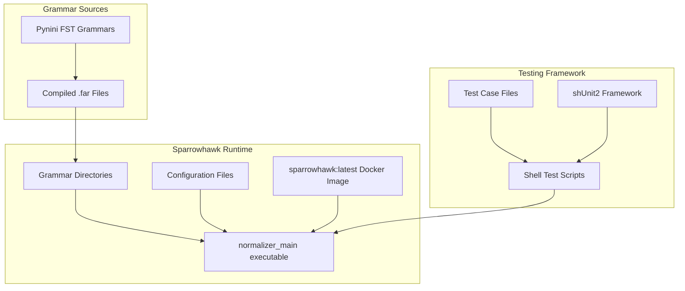
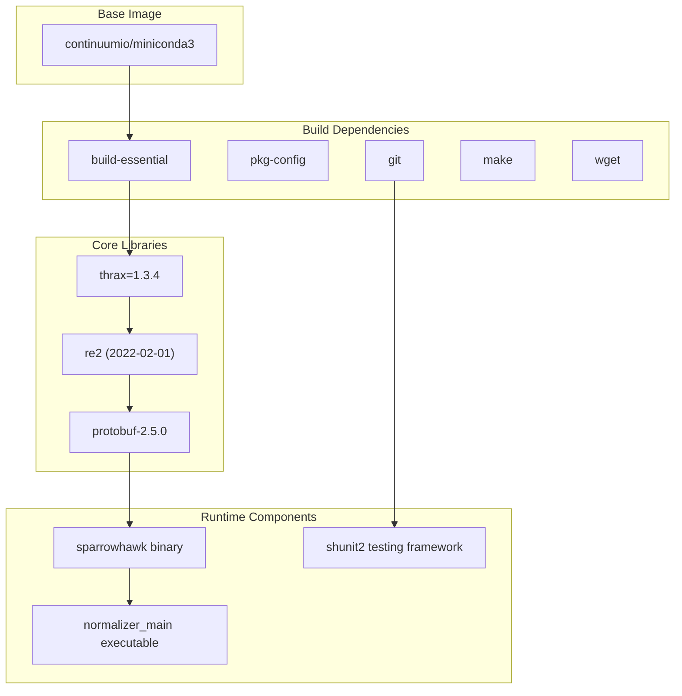
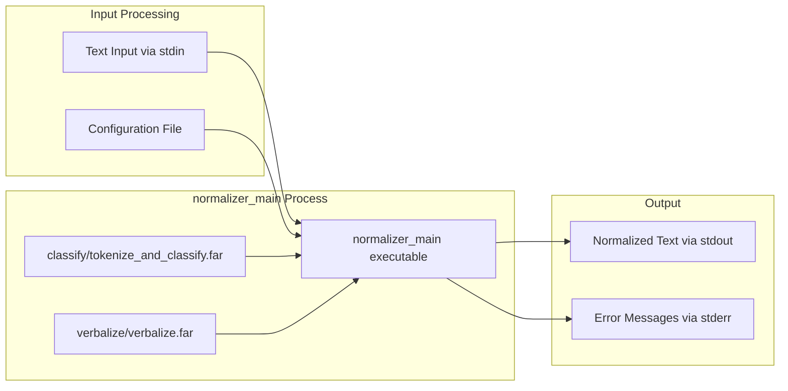
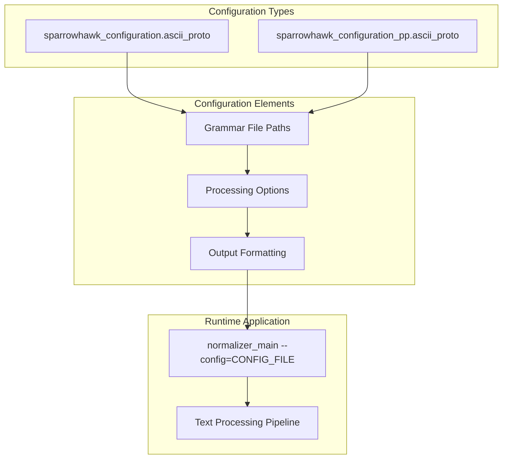
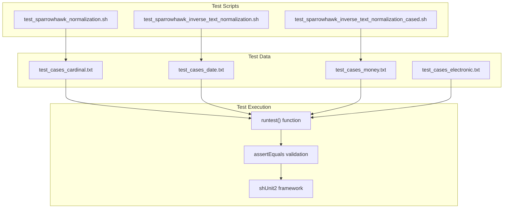
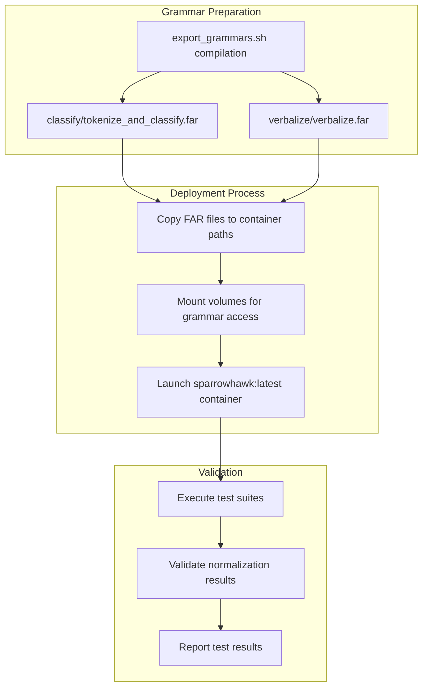
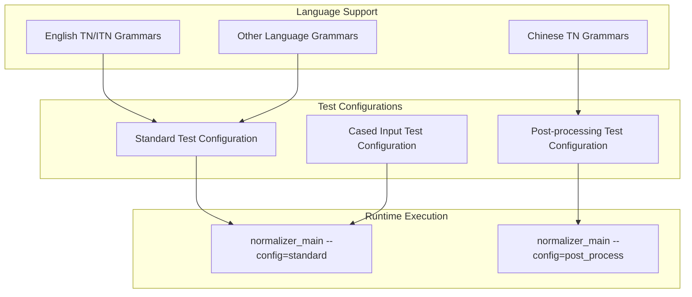

<!-- source: DeepWiki mcp.deepwiki.com · repo NVIDIA/NeMo-text-processing · page 6.2 Sparrowhawk Runtime · fetched 2026-10-26 -->

# Sparrowhawk Runtime

<details>
<summary>Relevant source files</summary>

The following files were used as context for generating this wiki page:

- [nemo_text_processing/text_normalization/zh/taggers/money.py](nemo_text_processing/text_normalization/zh/taggers/money.py)
- [tests/nemo_text_processing/en/test_sparrowhawk_inverse_text_normalization.sh](tests/nemo_text_processing/en/test_sparrowhawk_inverse_text_normalization.sh)
- [tests/nemo_text_processing/en/test_sparrowhawk_inverse_text_normalization_cased.sh](tests/nemo_text_processing/en/test_sparrowhawk_inverse_text_normalization_cased.sh)
- [tests/nemo_text_processing/en/test_sparrowhawk_normalization.sh](tests/nemo_text_processing/en/test_sparrowhawk_normalization.sh)
- [tests/nemo_text_processing/mr/test_cardinal.py](tests/nemo_text_processing/mr/test_cardinal.py)
- [tests/nemo_text_processing/mr/test_date.py](tests/nemo_text_processing/mr/test_date.py)
- [tests/nemo_text_processing/zh/data_text_normalization/test_cases_word.txt](tests/nemo_text_processing/zh/data_text_normalization/test_cases_word.txt)
- [tests/nemo_text_processing/zh/test_sparrowhawk_normalization.sh](tests/nemo_text_processing/zh/test_sparrowhawk_normalization.sh)
- [tools/text_processing_deployment/Dockerfile](tools/text_processing_deployment/Dockerfile)
- [tools/text_processing_deployment/docker/launch.sh](tools/text_processing_deployment/docker/launch.sh)
- [tools/text_processing_deployment/sh_test.sh](tools/text_processing_deployment/sh_test.sh)

</details>


This document covers the Sparrowhawk C++ runtime environment used for production text normalization and inverse text normalization. It includes Docker deployment, runtime components, configuration, and integration with the compiled FST grammars. For information about compiling grammars into the format used by Sparrowhawk, see [Grammar Compilation](#6.1).

## Overview

Sparrowhawk is a C++ runtime system that provides high-performance text normalization and inverse text normalization capabilities. It serves as the production deployment target for the FST grammars compiled in the grammar compilation pipeline. The runtime is containerized using Docker and integrates with the broader NeMo text processing ecosystem through testing frameworks and CI/CD pipelines.



Sources: [tools/text_processing_deployment/Dockerfile:1-41](), [tests/nemo_text_processing/en/test_sparrowhawk_normalization.sh:1-122]()

## Docker Environment

The Sparrowhawk runtime is deployed using a Docker container that provides all necessary dependencies and build tools. The container is based on `continuumio/miniconda3` and includes the complete build chain for the Sparrowhawk C++ application.

### Docker Build Components

The Docker image includes several key components:

| Component | Version | Purpose |
|-----------|---------|---------|
| `thrax` | 1.3.4 | FST grammar compilation toolkit |
| `re2` | 2022-02-01 | Regular expression library |
| `protobuf` | 2.5.0 | Protocol buffer serialization |
| `sparrowhawk` | nemo_tests branch | C++ text normalization engine |
| `shunit2` | latest | Shell unit testing framework |



Sources: [tools/text_processing_deployment/Dockerfile:18-41]()

### Environment Configuration

The Docker container configures specific environment variables and library paths to ensure proper compilation and runtime operation:

- `CPPFLAGS="-I/opt/conda/include"` - Include path for conda headers
- `LDFLAGS="-L/opt/conda/lib"` - Library path for conda libraries
- Custom `ld.so.conf.d` configuration for conda library resolution

Sources: [tools/text_processing_deployment/Dockerfile:35-38]()

## Runtime Components

### normalizer_main Executable

The core runtime component is the `normalizer_main` executable, which processes text input through the compiled FST grammars. It accepts text via stdin and outputs normalized results via stdout.



Sources: [tests/nemo_text_processing/en/test_sparrowhawk_normalization.sh:14-17](), [tests/nemo_text_processing/en/test_sparrowhawk_inverse_text_normalization.sh:14]()

### Grammar Directory Structure

The runtime expects grammars to be organized in a specific directory structure:

```
/workspace/sparrowhawk/documentation/grammars/
├── en_toy/
│   ├── classify/
│   │   └── tokenize_and_classify.far
│   └── verbalize/
│       └── verbalize.far
└── sparrowhawk_configuration.ascii_proto
```

Sources: [tools/text_processing_deployment/sh_test.sh:65-66](), [tools/text_processing_deployment/docker/launch.sh:32-33]()

## Configuration System

### Configuration Files

Sparrowhawk uses protocol buffer-based configuration files to define runtime behavior:

- `sparrowhawk_configuration.ascii_proto` - Standard configuration
- `sparrowhawk_configuration_pp.ascii_proto` - Configuration with post-processing

The configuration files specify paths to grammar files, processing options, and output formatting preferences.



Sources: [tests/nemo_text_processing/en/test_sparrowhawk_normalization.sh:15-17](), [tests/nemo_text_processing/zh/test_sparrowhawk_normalization.sh:15]()

## Testing Integration

### Shell-based Testing Framework

The Sparrowhawk runtime integrates with a comprehensive shell-based testing framework using `shunit2`. Tests are organized by language and processing type (TN/ITN).



Sources: [tests/nemo_text_processing/en/test_sparrowhawk_normalization.sh:5-26](), [tests/nemo_text_processing/en/test_sparrowhawk_inverse_text_normalization.sh:6-23]()

### Test Case Format

Test cases follow a standardized format with tilde-separated input and expected output:

```
written_text~spoken_text
```

The test framework parses these files and validates that the `normalizer_main` executable produces the expected output.

Sources: [tests/nemo_text_processing/en/test_sparrowhawk_normalization.sh:11-25]()

## Deployment Pipeline

### Grammar Deployment Process

The deployment process involves several coordinated steps to prepare grammars for the Sparrowhawk runtime:

1. **Grammar Compilation**: Pynini grammars are compiled to FAR format
2. **File Organization**: FAR files are copied to the expected directory structure
3. **Container Launch**: Docker container is launched with appropriate volume mounts
4. **Testing Execution**: Comprehensive test suites validate functionality



Sources: [tools/text_processing_deployment/sh_test.sh:56-66](), [tools/text_processing_deployment/docker/launch.sh:31-60]()

### Container Launch Configuration

The `launch.sh` script provides a standardized way to launch Sparrowhawk containers with proper configuration:

| Parameter | Default | Purpose |
|-----------|---------|---------|
| `MODE` | "interactive" | Execution mode (interactive, test_tn_grammars, test_itn_grammars) |
| `LANGUAGE` | "en" | Target language for processing |
| `INPUT_CASE` | "lower_cased" | Input text casing (lower_cased, cased) |
| `GRAMMARS` | "tn_grammars" | Grammar type (tn_grammars, itn_grammars) |

The script automatically configures volume mounts and working directories based on these parameters.

Sources: [tools/text_processing_deployment/docker/launch.sh:19-50]()

## Multi-Language Support

The Sparrowhawk runtime supports multiple languages through language-specific grammar configurations and test suites. Each language maintains its own set of compiled grammars and test cases.

### Language-Specific Testing

Different languages may have different test script configurations:

- **English**: Full TN and ITN support with comprehensive test suites
- **Chinese**: Specialized handling with post-processing configuration
- **Other Languages**: Varying levels of support based on grammar availability



Sources: [tests/nemo_text_processing/zh/test_sparrowhawk_normalization.sh:15](), [tests/nemo_text_processing/en/test_sparrowhawk_inverse_text_normalization_cased.sh:1-85]()