# Page: Overview

# Overview

<details>
<summary>Relevant source files</summary>

The following files were used as context for generating this wiki page:

- [CHANGELOG.md](CHANGELOG.md)
- [Jenkinsfile](Jenkinsfile)
- [MANIFEST.in](MANIFEST.in)
- [nemo_text_processing/inverse_text_normalization/inverse_normalize.py](nemo_text_processing/inverse_text_normalization/inverse_normalize.py)
- [nemo_text_processing/package_info.py](nemo_text_processing/package_info.py)
- [nemo_text_processing/text_normalization/en/data/electronic/domain.tsv](nemo_text_processing/text_normalization/en/data/electronic/domain.tsv)
- [nemo_text_processing/text_normalization/en/taggers/electronic.py](nemo_text_processing/text_normalization/en/taggers/electronic.py)
- [nemo_text_processing/text_normalization/en/taggers/tokenize_and_classify.py](nemo_text_processing/text_normalization/en/taggers/tokenize_and_classify.py)
- [nemo_text_processing/text_normalization/normalize.py](nemo_text_processing/text_normalization/normalize.py)
- [nemo_text_processing/text_normalization/normalize_with_audio.py](nemo_text_processing/text_normalization/normalize_with_audio.py)
- [nemo_text_processing/text_normalization/run_evaluate.py](nemo_text_processing/text_normalization/run_evaluate.py)
- [tests/nemo_text_processing/en/data_text_normalization/test_cases_electronic.txt](tests/nemo_text_processing/en/data_text_normalization/test_cases_electronic.txt)
- [tests/nemo_text_processing/en/data_text_normalization/test_cases_punctuation.txt](tests/nemo_text_processing/en/data_text_normalization/test_cases_punctuation.txt)
- [tests/nemo_text_processing/en/data_text_normalization/test_cases_punctuation_match_input.txt](tests/nemo_text_processing/en/data_text_normalization/test_cases_punctuation_match_input.txt)
- [tests/nemo_text_processing/en/data_text_normalization/test_cases_range.txt](tests/nemo_text_processing/en/data_text_normalization/test_cases_range.txt)
- [tests/nemo_text_processing/en/test_normalization_with_audio.py](tests/nemo_text_processing/en/test_normalization_with_audio.py)

</details>


## Purpose and Scope

NeMo Text Processing is a multilingual text normalization and inverse text normalization system designed for Automatic Speech Recognition (ASR) and Text-to-Speech (TTS) applications. The system converts between written text and spoken forms using Finite State Transducers (FSTs) implemented with the Pynini library.

The repository provides production-ready grammars for 15+ languages, supporting both deterministic and non-deterministic normalization modes. For deployment information, see [Deployment and Production](#6). For language-specific implementations, see [Language Support](#4).

**Sources:** [nemo_text_processing/package_info.py:33](), [nemo_text_processing/text_normalization/normalize.py:85-102]()

## Core Text Processing Pipeline

The system implements a two-stage pipeline for text processing:

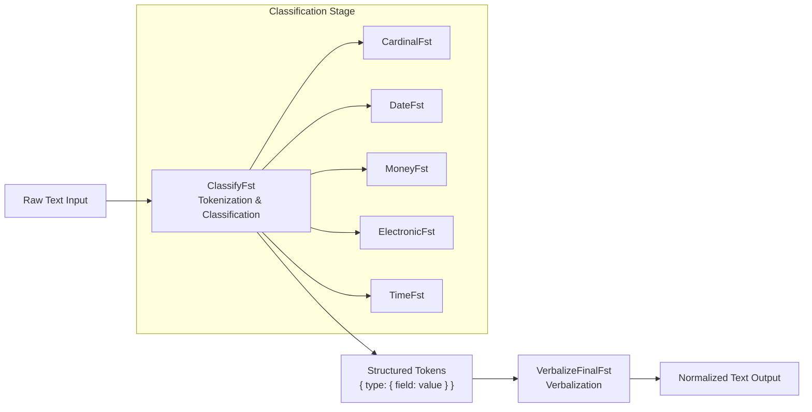

**Sources:** [nemo_text_processing/text_normalization/normalize.py:321-384](), [nemo_text_processing/text_normalization/en/taggers/tokenize_and_classify.py:51-242]()

## System Architecture

### Core Components

The system consists of three main processing classes:

| Component | Class | Purpose | File Location |
|-----------|-------|---------|---------------|
| **Text Normalization** | `Normalizer` | Converts written → spoken form | [normalize.py:85]() |
| **Audio-Enhanced TN** | `NormalizerWithAudio` | ASR-guided normalization | [normalize_with_audio.py:58]() |
| **Inverse Normalization** | `InverseNormalizer` | Converts spoken → written form | [inverse_normalize.py:26]() |

**Sources:** [nemo_text_processing/text_normalization/normalize.py:85](), [nemo_text_processing/text_normalization/normalize_with_audio.py:58](), [nemo_text_processing/inverse_text_normalization/inverse_normalize.py:26]()

### FST Grammar Processing Flow

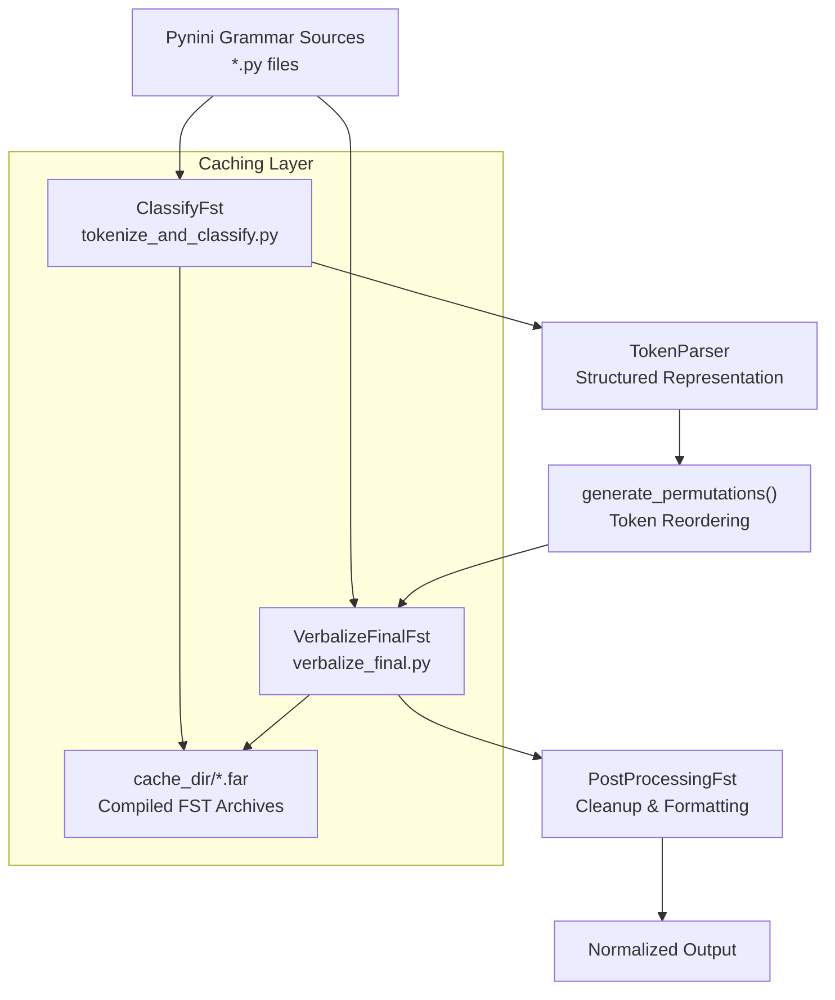

**Sources:** [nemo_text_processing/text_normalization/normalize.py:181-194](), [nemo_text_processing/text_normalization/normalize.py:592-620](), [nemo_text_processing/text_normalization/normalize.py:120-126]()

## Language Support Matrix

The system supports comprehensive text normalization across multiple languages:

| Language | TN Support | ITN Support | Special Features |
|----------|------------|-------------|------------------|
| English (`en`) | ✓ | ✓ | Audio-enhanced, Electronic text |
| Hindi (`hi`) | ✓ | ✓ | Complex number systems |
| German (`de`) | ✓ | ✓ | Electronic text processing |
| Spanish (`es`) | ✓ | ✓ | Code-switched ES/EN support |
| French (`fr`) | ✓ | ✓ | Date handling |
| Italian (`it`) | ✓ | ◐ | Sparrowhawk integration |
| Japanese (`ja`) | ◐ | ✓ | ITN-focused implementation |
| Chinese (`zh`) | ✓ | ✓ | Sentence-level processing |

**Sources:** [nemo_text_processing/text_normalization/normalize.py:120-178](), [nemo_text_processing/inverse_text_normalization/inverse_normalize.py:55-134]()

## Development and CI/CD Pipeline

### Jenkins Build Stages

The system uses a comprehensive Jenkins pipeline with three validation levels:

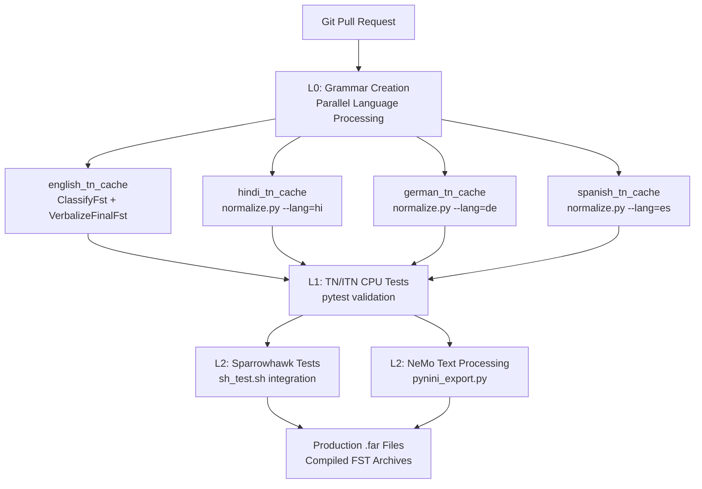

**Sources:** [Jenkinsfile:64-321](), [Jenkinsfile:325-410](), [Jenkinsfile:412-497]()

### Cache Management

The system implements sophisticated caching for compiled FST grammars:

- **Cache Directory Structure**: `{cache_dir}/{lang}_tn_{deterministic}_deterministic_{input_case}_{whitelist}_tokenize.far`
- **Environment Variables**: `EN_TN_CACHE`, `HI_TN_CACHE`, `DE_TN_CACHE` for CI/CD
- **Cache Validation**: Automatic `.far` file generation and restoration

**Sources:** [nemo_text_processing/text_normalization/en/taggers/tokenize_and_classify.py:76-86](), [Jenkinsfile:14-31]()

## Key Processing Examples

### Electronic Text Processing

The `ElectronicFst` handles email addresses, URLs, and technical text:

```
Input:  "cdf1@abc.edu"
Output: "cdf one at abc dot edu"

Input:  "https://www.nvidia.com/dgx-basepod"
Output: "HTTPS colon slash slash WWW dot NVIDIA dot com slash DGX dash BASEPOD"
```

**Sources:** [nemo_text_processing/text_normalization/en/taggers/electronic.py:33-178](), [tests/nemo_text_processing/en/data_text_normalization/test_cases_electronic.txt:1-44]()

### Audio-Enhanced Normalization

The `NormalizerWithAudio` class provides ASR-guided normalization by selecting the best normalization option based on Character Error Rate (CER):

```python
normalizer = NormalizerWithAudio(input_case='cased', lang='en')
result = normalizer.normalize(
    text="The meeting is at 2:30",
    pred_text="the meeting is at two thirty",
    n_tagged=30
)
```

**Sources:** [nemo_text_processing/text_normalization/normalize_with_audio.py:118-192](), [nemo_text_processing/text_normalization/normalize_with_audio.py:373-401]()

---

# Page: Core Concepts

# Core Concepts

<details>
<summary>Relevant source files</summary>

The following files were used as context for generating this wiki page:

- [nemo_text_processing/inverse_text_normalization/hi/taggers/date.py](nemo_text_processing/inverse_text_normalization/hi/taggers/date.py)
- [nemo_text_processing/inverse_text_normalization/hi/taggers/tokenize_and_classify.py](nemo_text_processing/inverse_text_normalization/hi/taggers/tokenize_and_classify.py)
- [nemo_text_processing/inverse_text_normalization/hi/verbalizers/date.py](nemo_text_processing/inverse_text_normalization/hi/verbalizers/date.py)
- [nemo_text_processing/inverse_text_normalization/hi/verbalizers/verbalize.py](nemo_text_processing/inverse_text_normalization/hi/verbalizers/verbalize.py)
- [nemo_text_processing/inverse_text_normalization/inverse_normalize.py](nemo_text_processing/inverse_text_normalization/inverse_normalize.py)
- [nemo_text_processing/text_normalization/normalize.py](nemo_text_processing/text_normalization/normalize.py)
- [nemo_text_processing/text_normalization/normalize_with_audio.py](nemo_text_processing/text_normalization/normalize_with_audio.py)
- [nemo_text_processing/text_normalization/run_evaluate.py](nemo_text_processing/text_normalization/run_evaluate.py)
- [tests/nemo_text_processing/en/test_normalization_with_audio.py](tests/nemo_text_processing/en/test_normalization_with_audio.py)
- [tests/nemo_text_processing/hi/data_inverse_text_normalization/test_cases_date.txt](tests/nemo_text_processing/hi/data_inverse_text_normalization/test_cases_date.txt)
- [tests/nemo_text_processing/hi/test_sparrowhawk_inverse_text_normalization.sh](tests/nemo_text_processing/hi/test_sparrowhawk_inverse_text_normalization.sh)

</details>


This page covers the fundamental concepts and architecture of NeMo Text Processing, including text normalization, inverse text normalization, finite state transducers, and the core processing pipeline.

For information about language-specific implementations, see the Language Support section [4](#4). For deployment and runtime details, see Deployment and Production [6](#6).

## Text Normalization vs Inverse Text Normalization

NeMo Text Processing implements two complementary transformation processes:

**Text Normalization (TN)** converts written text to spoken form, useful for Text-to-Speech (TTS) preprocessing:
- `$12.50` → `twelve dollars fifty cents`
- `Jan 1, 2023` → `january first twenty twenty three`

**Inverse Text Normalization (ITN)** converts spoken text to written form, useful for Automatic Speech Recognition (ASR) post-processing:
- `twelve dollars fifty cents` → `$12.50`
- `january first twenty twenty three` → `Jan 1, 2023`

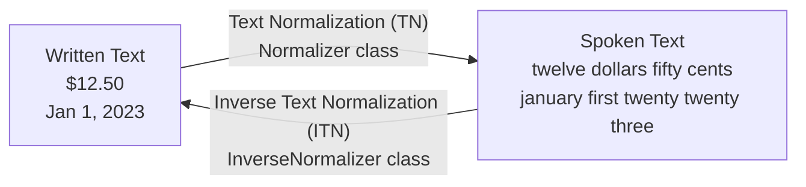

Sources: [nemo_text_processing/text_normalization/normalize.py:85-102](), [nemo_text_processing/inverse_text_normalization/inverse_normalize.py:26-41]()

## Finite State Transducers (FSTs)

The system is built on **Finite State Transducers (FSTs)** using the Pynini library. FSTs provide a mathematical framework for string-to-string transformations with the following properties:

- **Composable**: FSTs can be chained together using the `@` operator
- **Deterministic/Non-deterministic**: Can produce single or multiple outputs
- **Weighted**: Support probability weights for ranking alternatives
- **Cached**: Compiled to `.far` files for efficient runtime loading

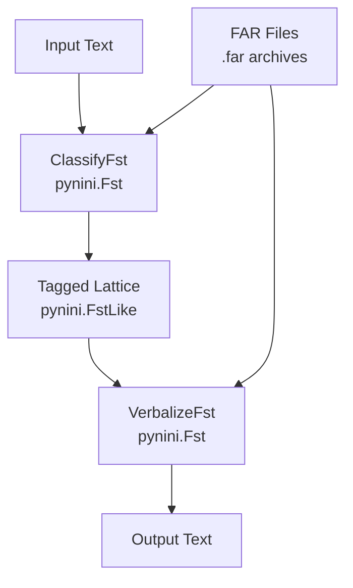

Sources: [nemo_text_processing/text_normalization/normalize.py:631-632](), [nemo_text_processing/text_normalization/normalize.py:657-658](), [nemo_text_processing/inverse_text_normalization/hi/taggers/tokenize_and_classify.py:67-69]()

## Two-Stage Processing Pipeline

Both TN and ITN use a two-stage pipeline:

1. **Classification Stage**: Identifies and tags semiotic classes in structured format
2. **Verbalization Stage**: Converts tagged tokens to final output form

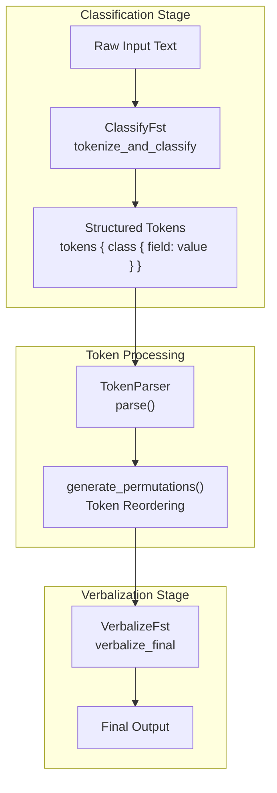

**Example Token Structure**:
```
tokens { money { integer_part: "12" fractional_part: "50" currency: "dollars" } }
```

Sources: [nemo_text_processing/text_normalization/normalize.py:181-191](), [nemo_text_processing/text_normalization/normalize.py:354-375](), [nemo_text_processing/text_normalization/token_parser.py:43]()

## Semiotic Classes

The system recognizes and processes multiple **semiotic classes** - categories of entities that require normalization:

| Class | TN Example | ITN Example |
|-------|------------|-------------|
| `cardinal` | `123` → `one hundred twenty three` | `one hundred twenty three` → `123` |
| `decimal` | `12.5` → `twelve point five` | `twelve point five` → `12.5` |
| `money` | `$12.50` → `twelve dollars fifty cents` | `twelve dollars fifty cents` → `$12.50` |
| `date` | `Jan 1, 2023` → `january first twenty twenty three` | `january first twenty twenty three` → `Jan 1, 2023` |
| `time` | `3:30 PM` → `three thirty p m` | `three thirty p m` → `3:30 PM` |
| `measure` | `5 kg` → `five kilograms` | `five kilograms` → `5 kg` |
| `telephone` | `555-1234` → `five five five one two three four` | `five five five one two three four` → `555-1234` |
| `ordinal` | `1st` → `first` | `first` → `1st` |

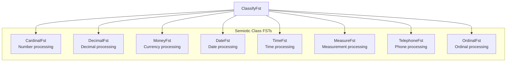

Sources: [nemo_text_processing/inverse_text_normalization/hi/taggers/tokenize_and_classify.py:96-108](), [nemo_text_processing/inverse_text_normalization/hi/verbalizers/verbalize.py:53-65]()

## Audio-Enhanced Processing

The `NormalizerWithAudio` class extends basic normalization by using ASR predictions to select the best normalization option from multiple candidates:

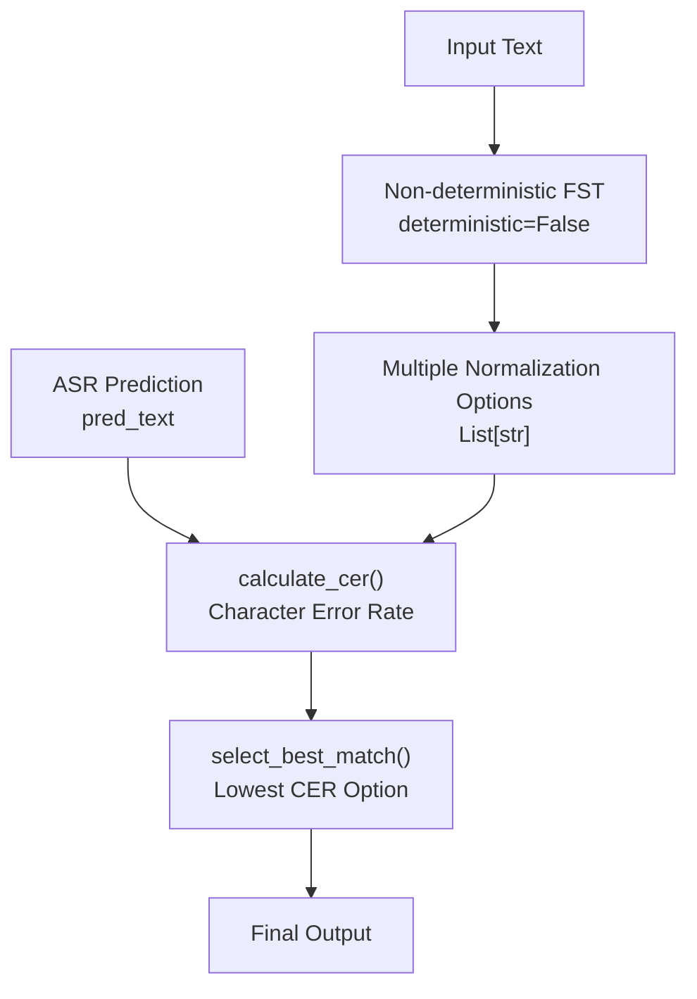

**Character Error Rate (CER) Selection**:
- Calculates edit distance between each normalization option and ASR prediction
- Selects option with lowest CER
- Falls back to deterministic normalization if CER exceeds threshold

Sources: [nemo_text_processing/text_normalization/normalize_with_audio.py:58-97](), [nemo_text_processing/text_normalization/normalize_with_audio.py:373-401](), [nemo_text_processing/text_normalization/normalize_with_audio.py:404-423]()

## Token Structure and Parsing

The system uses a structured token format for intermediate representation:

**Token Format**:
```
tokens { <semiotic_class> { <field1>: "<value1>" <field2>: "<value2>" preserve_order: true } }
```

**Example Tokens**:
```
tokens { date { month: "january" day: "first" year: "twenty twenty three" preserve_order: true } }
tokens { money { integer_part: "twelve" fractional_part: "fifty" currency: "dollars" } }
```

The `TokenParser` class handles parsing of structured tokens:

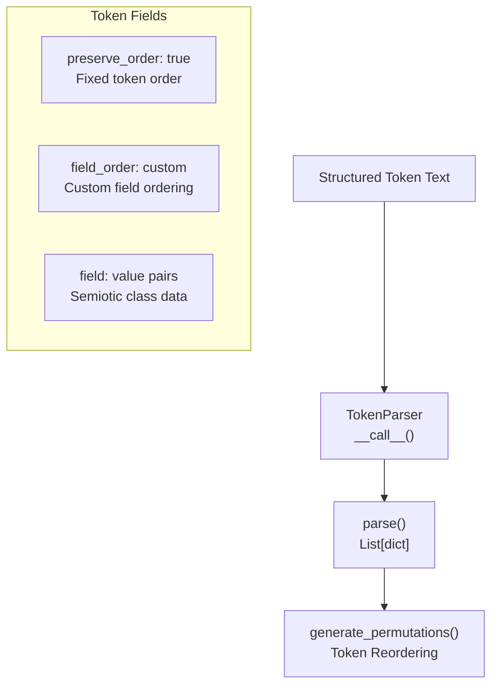

Sources: [nemo_text_processing/text_normalization/token_parser.py:43](), [nemo_text_processing/text_normalization/normalize.py:354-355](), [nemo_text_processing/text_normalization/normalize.py:592-620]()

## Permutation Management

The system generates multiple token orderings to handle ambiguous cases, with built-in limits to prevent combinatorial explosion:

**Permutation Control**:
- `max_number_of_permutations_per_split`: Maximum permutations per token sequence (default: 729)
- `_split_tokens_to_reduce_number_of_permutations()`: Splits long sequences to stay under limit
- `PRESERVE_ORDER_KEY`: Prevents permutation for specific tokens

**Permutation Process**:
1. Estimate permutation count using `_estimate_number_of_permutations_in_nested_dict()`
2. Split token sequences if count exceeds limit
3. Generate all valid permutations using `_permute()`
4. Test each permutation against verbalizer until success

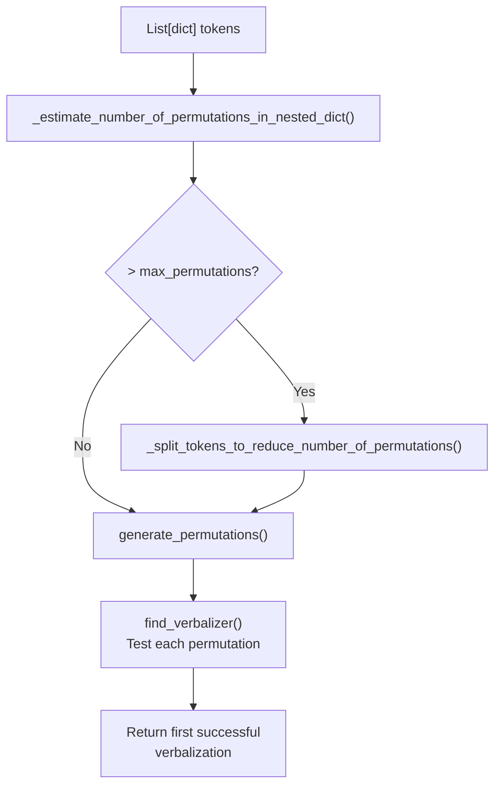

Sources: [nemo_text_processing/text_normalization/normalize.py:258-319](), [nemo_text_processing/text_normalization/normalize.py:563-591](), [nemo_text_processing/text_normalization/normalize.py:592-620]()

---

# Page: System Architecture

# System Architecture

<details>
<summary>Relevant source files</summary>

The following files were used as context for generating this wiki page:

- [Jenkinsfile](Jenkinsfile)
- [nemo_text_processing/inverse_text_normalization/ja/verbalizers/word.py](nemo_text_processing/inverse_text_normalization/ja/verbalizers/word.py)
- [nemo_text_processing/text_normalization/en/data/electronic/domain.tsv](nemo_text_processing/text_normalization/en/data/electronic/domain.tsv)
- [nemo_text_processing/text_normalization/en/taggers/electronic.py](nemo_text_processing/text_normalization/en/taggers/electronic.py)
- [nemo_text_processing/text_normalization/en/taggers/tokenize_and_classify.py](nemo_text_processing/text_normalization/en/taggers/tokenize_and_classify.py)
- [nemo_text_processing/text_normalization/zh/taggers/money.py](nemo_text_processing/text_normalization/zh/taggers/money.py)
- [tests/nemo_text_processing/en/data_text_normalization/test_cases_electronic.txt](tests/nemo_text_processing/en/data_text_normalization/test_cases_electronic.txt)
- [tests/nemo_text_processing/en/data_text_normalization/test_cases_punctuation.txt](tests/nemo_text_processing/en/data_text_normalization/test_cases_punctuation.txt)
- [tests/nemo_text_processing/en/data_text_normalization/test_cases_punctuation_match_input.txt](tests/nemo_text_processing/en/data_text_normalization/test_cases_punctuation_match_input.txt)
- [tests/nemo_text_processing/en/data_text_normalization/test_cases_range.txt](tests/nemo_text_processing/en/data_text_normalization/test_cases_range.txt)
- [tests/nemo_text_processing/en/test_sparrowhawk_inverse_text_normalization.sh](tests/nemo_text_processing/en/test_sparrowhawk_inverse_text_normalization.sh)
- [tests/nemo_text_processing/en/test_sparrowhawk_inverse_text_normalization_cased.sh](tests/nemo_text_processing/en/test_sparrowhawk_inverse_text_normalization_cased.sh)
- [tests/nemo_text_processing/en/test_sparrowhawk_normalization.sh](tests/nemo_text_processing/en/test_sparrowhawk_normalization.sh)
- [tests/nemo_text_processing/hi/test_whitelist.py](tests/nemo_text_processing/hi/test_whitelist.py)
- [tests/nemo_text_processing/hi/test_word.py](tests/nemo_text_processing/hi/test_word.py)
- [tests/nemo_text_processing/mr/test_cardinal.py](tests/nemo_text_processing/mr/test_cardinal.py)
- [tests/nemo_text_processing/mr/test_date.py](tests/nemo_text_processing/mr/test_date.py)
- [tests/nemo_text_processing/zh/data_text_normalization/test_cases_word.txt](tests/nemo_text_processing/zh/data_text_normalization/test_cases_word.txt)
- [tests/nemo_text_processing/zh/test_sparrowhawk_normalization.sh](tests/nemo_text_processing/zh/test_sparrowhawk_normalization.sh)
- [tools/text_processing_deployment/Dockerfile](tools/text_processing_deployment/Dockerfile)
- [tools/text_processing_deployment/docker/launch.sh](tools/text_processing_deployment/docker/launch.sh)
- [tools/text_processing_deployment/export_grammars.sh](tools/text_processing_deployment/export_grammars.sh)
- [tools/text_processing_deployment/pynini_export.py](tools/text_processing_deployment/pynini_export.py)
- [tools/text_processing_deployment/sh_test.sh](tools/text_processing_deployment/sh_test.sh)

</details>


## Purpose and Scope

This document provides a comprehensive overview of the NeMo Text Processing system architecture, covering the core components responsible for text normalization (TN) and inverse text normalization (ITN) across multiple languages. The architecture encompasses grammar development, compilation pipelines, continuous integration, and production deployment systems.

For implementation details of specific text processing components, see [Core Text Processing Systems](#3). For language-specific implementations, see [Language Support](#4). For deployment procedures, see [Deployment and Production](#6).

## High-Level System Architecture

The NeMo Text Processing system consists of five major architectural layers that work together to transform text between written and spoken forms:

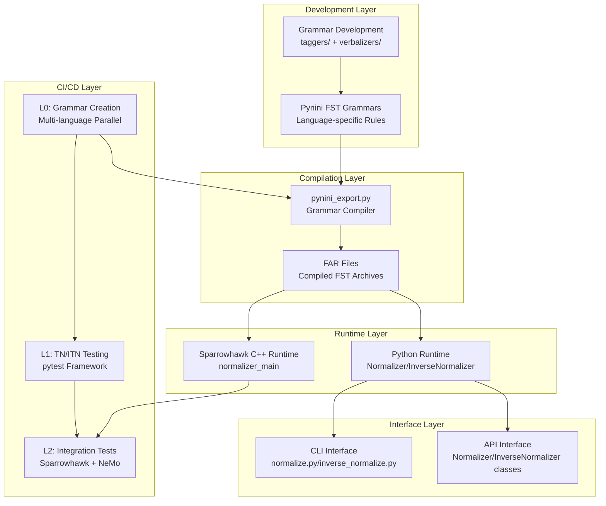

**Sources:** [Jenkinsfile:1-507](), [tools/text_processing_deployment/pynini_export.py:1-324](), [nemo_text_processing/text_normalization/en/taggers/tokenize_and_classify.py:1-242]()

## Grammar Development and Compilation Pipeline

The core of the system is built around Finite State Transducers (FSTs) that handle the two-stage text processing pipeline:

### Two-Stage Processing Architecture

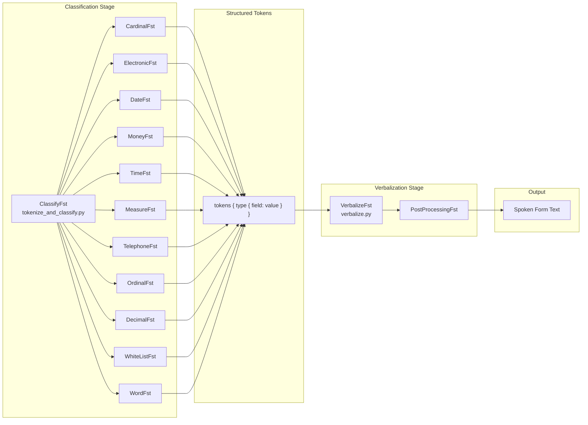

**Sources:** [nemo_text_processing/text_normalization/en/taggers/tokenize_and_classify.py:189-222](), [nemo_text_processing/text_normalization/en/taggers/electronic.py:33-178]()

### Grammar Compilation Process

The `pynini_export.py` script serves as the central compilation engine that transforms Pynini FST grammars into production-ready FAR files:

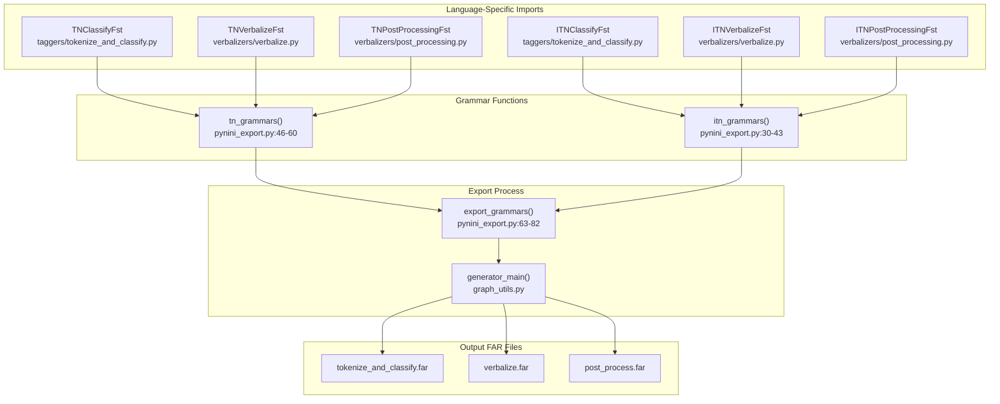

**Sources:** [tools/text_processing_deployment/pynini_export.py:46-82](), [tools/text_processing_deployment/pynini_export.py:144-324]()

## CI/CD and Testing Architecture

The Jenkins-based CI/CD pipeline implements a three-tier testing strategy:

### Jenkins Pipeline Structure

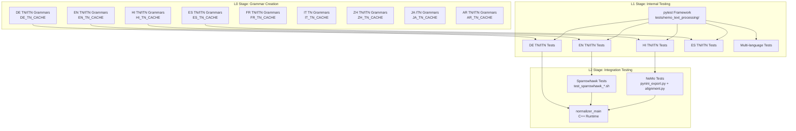

**Sources:** [Jenkinsfile:64-117](), [Jenkinsfile:325-410](), [Jenkinsfile:412-497]()

### Testing Framework Components

| Component | Purpose | Key Files |
|-----------|---------|-----------|
| **pytest Tests** | Internal grammar validation | `tests/nemo_text_processing/*/test_*.py` |
| **Sparrowhawk Tests** | C++ runtime integration | `tests/*/test_sparrowhawk_*.sh` |
| **Shell Tests** | Production environment validation | `tools/text_processing_deployment/sh_test.sh` |
| **Test Data** | Input/expected output pairs | `tests/*/data_*/test_cases_*.txt` |

**Sources:** [tests/nemo_text_processing/en/test_sparrowhawk_normalization.sh:1-122](), [tests/nemo_text_processing/en/test_sparrowhawk_inverse_text_normalization.sh:1-85]()

## Production Deployment Architecture

The production deployment system utilizes Docker containers with the Sparrowhawk C++ runtime for high-performance text processing:

### Sparrowhawk Runtime Environment

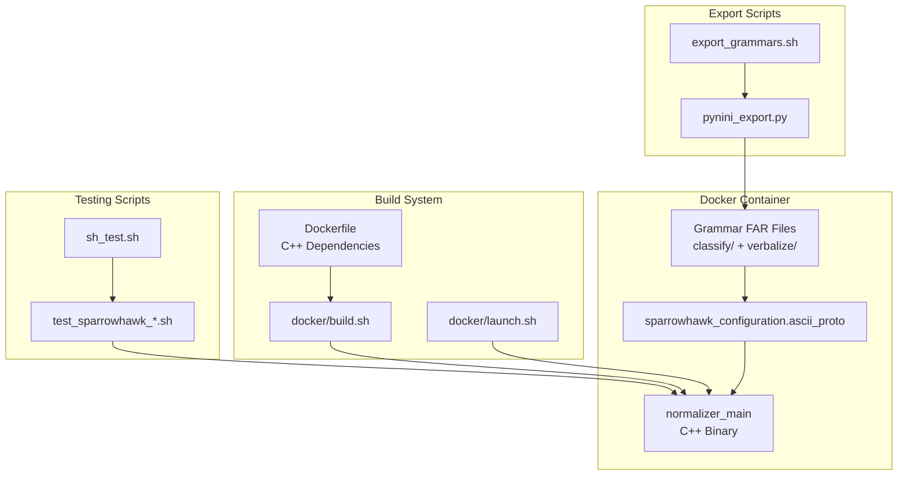

**Sources:** [tools/text_processing_deployment/Dockerfile:1-41](), [tools/text_processing_deployment/export_grammars.sh:1-109](), [tools/text_processing_deployment/docker/launch.sh:1-61]()

## Multi-Language Support Structure

The system supports multiple languages through a modular architecture where each language implements the same FST interface:

### Language Implementation Matrix

| Language | TN Support | ITN Support | Special Components |
|----------|------------|-------------|-------------------|
| **English** | ✓ | ✓ | `NormalizerWithAudio`, `PostProcessingFst` |
| **Hindi** | ✓ | ✓ | `PostProcessingFst` |
| **German** | ✓ | ✓ | Electronic text focus |
| **Spanish** | ✓ | ✓ | Ordinal processing |
| **French** | ✓ | ✓ | Date handling |
| **Italian** | ✓ | Partial | Sparrowhawk integration |
| **Chinese** | ✓ | ✓ | `PostProcessingFst` |
| **Japanese** | ✓ | ✓ | `PostProcessingFst` |
| **Arabic** | ✓ | ✓ | RTL text support |

### Language-Specific Architecture Pattern

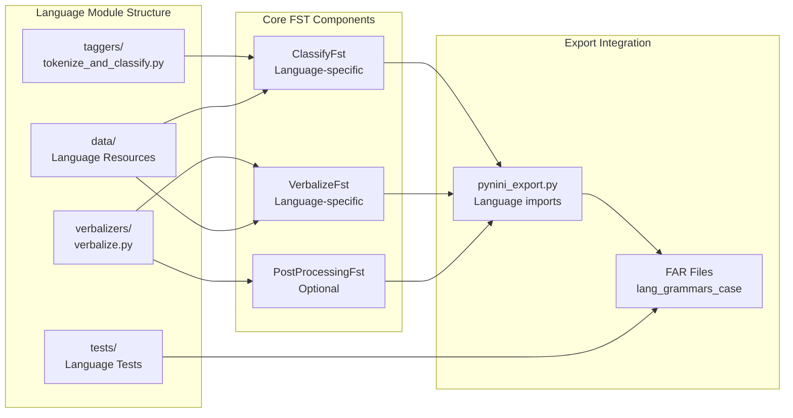

**Sources:** [tools/text_processing_deployment/pynini_export.py:140-324](), [tests/nemo_text_processing/hi/test_word.py:1-43](), [tests/nemo_text_processing/zh/data_text_normalization/test_cases_word.txt:1-26]()

---

# Page: Getting Started

# Getting Started

<details>
<summary>Relevant source files</summary>

The following files were used as context for generating this wiki page:

- [CHANGELOG.md](CHANGELOG.md)
- [MANIFEST.in](MANIFEST.in)
- [README.md](README.md)
- [nemo_text_processing/package_info.py](nemo_text_processing/package_info.py)
- [nemo_text_processing/text_normalization/en/graph_utils.py](nemo_text_processing/text_normalization/en/graph_utils.py)
- [requirements/requirements.txt](requirements/requirements.txt)
- [requirements/requirements_test.txt](requirements/requirements_test.txt)
- [setup.py](setup.py)

</details>


This document provides installation instructions, dependency information, and basic setup guidance for the NeMo Text Processing system. It covers the essential steps to get the system running and introduces the core components for text normalization and inverse text normalization. For detailed usage examples and API documentation, see [Quick Start Guide](#2.1). For information about specific language implementations, see [Language Support](#4).

## Installation

NeMo Text Processing can be installed through multiple methods depending on your use case and development needs.

### Prerequisites

The system requires Python 3.8+ and has specific platform requirements due to the Pynini dependency. Linux x86_64 is the primary supported platform, while macOS and Windows require additional configuration.

### Installation Methods

#### Pip Installation (Recommended for Users)

For the latest stable release:

```bash
pip install nemo_text_processing
```

#### Conda Environment Setup

Create a dedicated environment for optimal dependency management:

```bash
conda create --name nemo_tn python==3.10
conda activate nemo_tn
pip install nemo_text_processing
```

#### Development Installation

For contributors and developers:

```bash
git clone https://github.com/NVIDIA/NeMo-text-processing
cd NeMo-text-processing
./reinstall.sh
```

#### Platform-Specific Notes

For macOS and Windows users, install Pynini separately via conda-forge due to compilation requirements:

```bash
conda install -c conda-forge pynini=2.1.6.post1
```

*Sources: [README.md:28-81](), [setup.py:78-84]()*

## Dependencies

The system relies on several key dependencies for text processing and finite state transducer operations:

| Dependency | Version | Purpose |
|------------|---------|---------|
| pynini | 2.1.6.post1 | Finite State Transducer operations |
| inflect | - | Number and word inflection |
| pandas | - | Data manipulation |
| regex | - | Advanced pattern matching |
| transformers | - | Language model integration |
| sacremoses | >=0.0.43 | Text tokenization |
| editdistance | - | String similarity calculations |

### Core FST Dependencies

The system's finite state transducer functionality depends on:
- **OpenFst**: Backend for FST operations
- **Pynini**: Python binding for weighted finite-state transducers
- **FAR files**: Compiled grammar archives

*Sources: [requirements/requirements.txt:1-14](), [requirements/requirements_test.txt:1-14]()*

## System Overview

NeMo Text Processing implements a two-stage pipeline architecture for bidirectional text transformation:

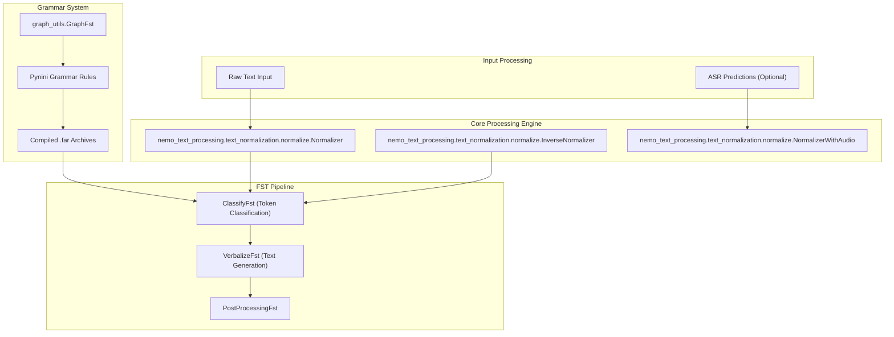

*Sources: [nemo_text_processing/text_normalization/en/graph_utils.py:271-338](), [README.md:7-12]()*

## Core Components

### Base Classes and Utilities

The system is built around several foundational classes:

#### GraphFst Base Class

The `GraphFst` class serves as the foundation for all grammar finite state transducers:

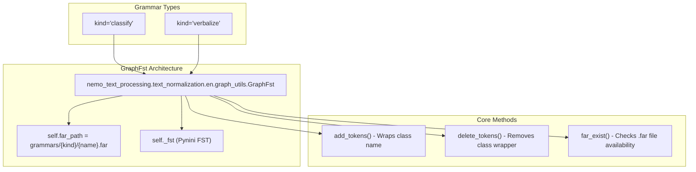

#### Essential FST Constants

The system defines critical FST building blocks in `graph_utils.py`:

| Constant | Purpose | Definition |
|----------|---------|------------|
| `NEMO_DIGIT` | Digit recognition | `byte.DIGIT` |
| `NEMO_ALPHA` | Alphabetic characters | Union of upper/lowercase |
| `NEMO_WHITE_SPACE` | Whitespace handling | Space, tab, newline, non-breaking space |
| `NEMO_SIGMA` | Universal character set | `pynini.closure(NEMO_CHAR)` |

*Sources: [nemo_text_processing/text_normalization/en/graph_utils.py:271-338](), [nemo_text_processing/text_normalization/en/graph_utils.py:30-47]()*

### Grammar Compilation Pipeline

The system uses a compilation process to convert Pynini grammars into optimized FAR archives:

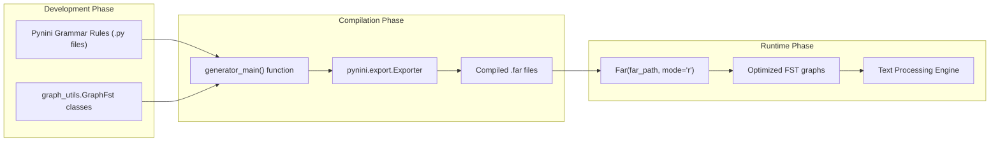

*Sources: [nemo_text_processing/text_normalization/en/graph_utils.py:174-187](), [nemo_text_processing/text_normalization/en/graph_utils.py:288-291]()*

## Package Information

The system maintains version and metadata information through a centralized configuration:

| Property | Value | Purpose |
|----------|-------|---------|
| `__version__` | 1.1.0 | Current release version |
| `__package_name__` | nemo_text_processing | PyPI package identifier |
| `__description__` | NeMo text processing for ASR and TTS | Package description |
| `__repository_url__` | https://github.com/nvidia/nemo-text-processing | Source repository |

*Sources: [nemo_text_processing/package_info.py:16-35](), [setup.py:30-44]()*

## Basic Usage Patterns

### Normalizer Class Integration

The core processing classes follow a consistent interface pattern:

```python
# Referenced from expected usage patterns
from nemo_text_processing.text_normalization.normalize import Normalizer

# Initialize with language support
normalizer = Normalizer(input_case='cased', lang='en')

# Process text through FST pipeline
normalized_text = normalizer.normalize(text_input)
```

### FST Graph Operations

The system provides utilities for common FST operations:

| Function | Purpose | Usage Pattern |
|----------|---------|---------------|
| `get_plurals()` | Singular to plural conversion | `SINGULAR_TO_PLURAL @ fst` |
| `get_singulars()` | Plural to singular conversion | `PLURAL_TO_SINGULAR @ fst` |
| `convert_space()` | Space normalization | Handle non-breaking spaces |
| `capitalized_input_graph()` | Case handling | Support capitalized inputs |

*Sources: [nemo_text_processing/text_normalization/en/graph_utils.py:189-211](), [nemo_text_processing/text_normalization/en/graph_utils.py:149-172]()*

## Next Steps

After completing the installation:

1. **Quick Start**: Follow the [Quick Start Guide](#2.1) for basic usage examples
2. **Language Selection**: Review [Language Support](#4) for your target language
3. **Development**: See [Development and Testing](#5) for contribution guidelines
4. **Production**: Consult [Deployment and Production](#6) for runtime optimization

For immediate testing, verify your installation by importing the core modules:

```python
from nemo_text_processing.text_normalization.normalize import Normalizer
from nemo_text_processing.text_normalization.normalize import InverseNormalizer
```

*Sources: [README.md:14-26](), [CHANGELOG.md:8-29]()*

---

# Page: Quick Start Guide

# Quick Start Guide

<details>
<summary>Relevant source files</summary>

The following files were used as context for generating this wiki page:

- [nemo_text_processing/inverse_text_normalization/inverse_normalize.py](nemo_text_processing/inverse_text_normalization/inverse_normalize.py)
- [nemo_text_processing/text_normalization/en/taggers/range.py](nemo_text_processing/text_normalization/en/taggers/range.py)
- [nemo_text_processing/text_normalization/en/verbalizers/measure.py](nemo_text_processing/text_normalization/en/verbalizers/measure.py)
- [nemo_text_processing/text_normalization/normalize.py](nemo_text_processing/text_normalization/normalize.py)
- [nemo_text_processing/text_normalization/normalize_with_audio.py](nemo_text_processing/text_normalization/normalize_with_audio.py)
- [nemo_text_processing/text_normalization/run_evaluate.py](nemo_text_processing/text_normalization/run_evaluate.py)
- [tests/nemo_text_processing/en/data_text_normalization/test_cases_normalize_with_audio.txt](tests/nemo_text_processing/en/data_text_normalization/test_cases_normalize_with_audio.txt)
- [tests/nemo_text_processing/en/test_normalization_with_audio.py](tests/nemo_text_processing/en/test_normalization_with_audio.py)
- [tests/nemo_text_processing/en/test_serial.py](tests/nemo_text_processing/en/test_serial.py)
- [tests/nemo_text_processing/en/test_word.py](tests/nemo_text_processing/en/test_word.py)

</details>


This guide provides simple examples of using the core text processing components for basic text normalization and inverse normalization tasks. For detailed information about the underlying FST grammars and language-specific implementations, see [Grammar Development](#5.2). For production deployment scenarios, see [Deployment and Production](#6).

## Overview

The NeMo Text Processing system provides three main classes for text processing:

- **`Normalizer`** - Converts written text to spoken form (Text Normalization)
- **`NormalizerWithAudio`** - Audio-guided normalization with multiple options 
- **`InverseNormalizer`** - Converts spoken text to written form (Inverse Text Normalization)

## Basic Text Normalization

### Simple Usage

```python
from nemo_text_processing.text_normalization.normalize import Normalizer

# Initialize normalizer
normalizer = Normalizer(input_case='cased', lang='en')

# Normalize single text
text = "I have $23.45 and will arrive at 9:30 AM"
result = normalizer.normalize(text)
# Output: "I have twenty three dollars and forty five cents and will arrive at nine thirty AM"
```

*Sources: [nemo_text_processing/text_normalization/normalize.py:70-82]()*

### Batch Processing

```python
# Normalize multiple texts
texts = ["$1.50", "2:15 PM", "Dec 25, 2023"]
results = normalizer.normalize_list(texts)
# Output: ["one dollar and fifty cents", "two fifteen PM", "december twenty five twenty twenty three"]
```

*Sources: [nemo_text_processing/text_normalization/normalize.py:197-256]()*

### Processing JSON Manifests

```python
# Process JSON manifest file
normalizer.normalize_manifest(
    manifest="input.json",
    n_jobs=-1,
    batch_size=300,
    output_filename="output.json",
    text_field="text",
    punct_pre_process=False,
    punct_post_process=True
)
```

*Sources: [nemo_text_processing/text_normalization/normalize.py:419-527]()*

## Audio-Enhanced Normalization

### Basic Audio-Guided Normalization

```python
from nemo_text_processing.text_normalization.normalize_with_audio import NormalizerWithAudio

# Initialize audio-enhanced normalizer
normalizer = NormalizerWithAudio(input_case='cased', lang='en')

# Normalize with audio prediction guidance
text = "I bought 5 books for $25"
pred_text = "i bought five books for twenty five dollars"  # ASR prediction

result = normalizer.normalize(
    text=text,
    pred_text=pred_text,
    n_tagged=30,
    punct_post_process=True
)
# Returns best matching normalization based on ASR prediction
```

*Sources: [nemo_text_processing/text_normalization/normalize_with_audio.py:118-192]()*

### Multiple Normalization Options

```python
# Get multiple normalization options (without audio)
options = normalizer.normalize(
    text="$1.50", 
    n_tagged=30,
    punct_post_process=True
)
# Returns set of possible normalizations: 
# {"one dollar and fifty cents", "one dollar fifty cents", ...}
```

*Sources: [nemo_text_processing/text_normalization/normalize_with_audio.py:194-266]()*

## Inverse Text Normalization

### Basic Inverse Normalization

```python
from nemo_text_processing.inverse_text_normalization.inverse_normalize import InverseNormalizer

# Initialize inverse normalizer
inverse_normalizer = InverseNormalizer(input_case='lower_cased', lang='en')

# Convert spoken to written form
spoken_text = "twenty three dollars and forty five cents"
written_text = inverse_normalizer.inverse_normalize(spoken_text, verbose=False)
# Output: "$23.45"
```

*Sources: [nemo_text_processing/inverse_text_normalization/inverse_normalize.py:155-166]()*

### Batch Inverse Normalization

```python
# Process multiple spoken texts
spoken_texts = [
    "twenty three dollars", 
    "nine thirty AM", 
    "december twenty fifth"
]
written_texts = inverse_normalizer.inverse_normalize_list(spoken_texts)
# Output: ["$23", "9:30 AM", "december 25th"]
```

*Sources: [nemo_text_processing/inverse_text_normalization/inverse_normalize.py:143-153]()*

## System Architecture Overview

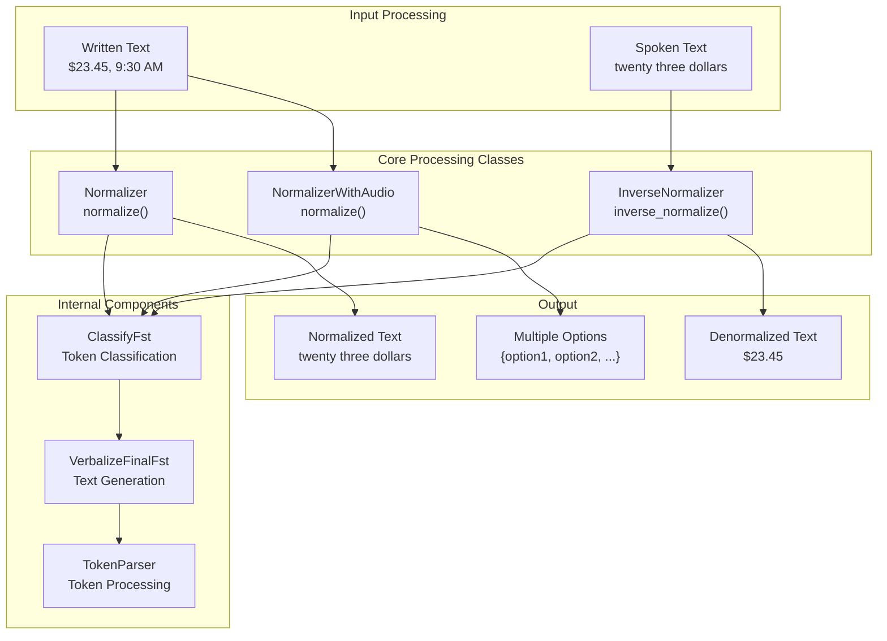

*Sources: [nemo_text_processing/text_normalization/normalize.py:85-196](), [nemo_text_processing/text_normalization/normalize_with_audio.py:58-117](), [nemo_text_processing/inverse_text_normalization/inverse_normalize.py:26-142]()*

## Configuration Parameters

### Common Parameters

| Parameter | Description | Default | Options |
|-----------|-------------|---------|---------|
| `input_case` | Input text capitalization | `'cased'` | `'cased'`, `'lower_cased'` |
| `lang` | Target language | `'en'` | `'en'`, `'de'`, `'es'`, `'fr'`, `'hi'`, etc. |
| `cache_dir` | Grammar cache directory | `None` | Path to cache directory |
| `overwrite_cache` | Rebuild grammar cache | `False` | `True`, `False` |
| `whitelist` | Custom replacements file | `None` | Path to whitelist file |
| `deterministic` | Single vs multiple outputs | `True` | `True`, `False` |

*Sources: [nemo_text_processing/text_normalization/normalize.py:104-115]()*

### Audio-Specific Parameters

| Parameter | Description | Default | Purpose |
|-----------|-------------|---------|---------|
| `n_tagged` | Number of normalization options | `30` | Controls output diversity |
| `pred_text` | ASR prediction | `None` | Guides best option selection |
| `cer_threshold` | Character error rate limit | `-1` | Fallback to deterministic |

*Sources: [nemo_text_processing/text_normalization/normalize_with_audio.py:118-144]()*

## Multi-Language Support

```mermaid
graph LR
    subgraph "Language Selection"
        LangParam["lang parameter"]
    end
    
    subgraph "Supported Languages"
        EN["English (en)"]
        DE["German (de)"]
        ES["Spanish (es)"]
        FR["French (fr)"]
        HI["Hindi (hi)"]
        IT["Italian (it)"]
        ZH["Chinese (zh)"]
        JA["Japanese (ja)"]
        Other["+ 10 more languages"]
    end
    
    subgraph "Language-Specific Components"
        ClassifyFstEN["en.taggers.tokenize_and_classify.ClassifyFst"]
        VerbalizeFstEN["en.verbalizers.verbalize_final.VerbalizeFinalFst"]
        ClassifyFstDE["de.taggers.tokenize_and_classify.ClassifyFst"]
        VerbalizeFstDE["de.verbalizers.verbalize_final.VerbalizeFinalFst"]
    end
    
    LangParam --> EN
    LangParam --> DE
    LangParam --> ES
    LangParam --> FR
    LangParam --> HI
    LangParam --> IT
    LangParam --> ZH
    LangParam --> JA
    LangParam --> Other
    
    EN --> ClassifyFstEN
    EN --> VerbalizeFstEN
    DE --> ClassifyFstDE
    DE --> VerbalizeFstDE
```

*Sources: [nemo_text_processing/text_normalization/normalize.py:120-178](), [nemo_text_processing/inverse_text_normalization/inverse_normalize.py:55-134]()*

## Performance Considerations

### Caching

```python
# Enable caching for better performance
normalizer = Normalizer(
    input_case='cased',
    lang='en',
    cache_dir='/path/to/cache',
    overwrite_cache=False  # Reuse existing cache
)
```

### Parallel Processing

```python
# Use parallel processing for large batches
normalizer.normalize_list(
    texts=large_text_list,
    n_jobs=-1,        # Use all CPU cores
    batch_size=300    # Process in batches
)
```

*Sources: [nemo_text_processing/text_normalization/normalize.py:197-256]()*

## Common Use Cases

### TTS Preprocessing

```python
# Text-to-Speech preprocessing
normalizer = Normalizer(input_case='cased', lang='en', post_process=True)
tts_text = normalizer.normalize("Call me at 555-1234 by 3:30 PM")
```

### ASR Postprocessing

```python
# Automatic Speech Recognition postprocessing
inverse_normalizer = InverseNormalizer(input_case='lower_cased', lang='en')
written_form = inverse_normalizer.inverse_normalize("twenty three dollars")
```

### Data Processing Pipeline

```python
# Process training data manifest
normalizer.normalize_manifest(
    manifest="training_data.json",
    text_field="raw_text",
    output_field="normalized_text",
    n_jobs=-1
)
```

*Sources: [nemo_text_processing/text_normalization/normalize.py:419-527](), [tests/nemo_text_processing/en/test_word.py:26-69](), [tests/nemo_text_processing/en/test_normalization_with_audio.py:23-37]()*

---

# Page: Core Text Processing Systems

# Core Text Processing Systems

<details>
<summary>Relevant source files</summary>

The following files were used as context for generating this wiki page:

- [nemo_text_processing/inverse_text_normalization/inverse_normalize.py](nemo_text_processing/inverse_text_normalization/inverse_normalize.py)
- [nemo_text_processing/text_normalization/normalize.py](nemo_text_processing/text_normalization/normalize.py)
- [nemo_text_processing/text_normalization/normalize_with_audio.py](nemo_text_processing/text_normalization/normalize_with_audio.py)
- [nemo_text_processing/text_normalization/run_evaluate.py](nemo_text_processing/text_normalization/run_evaluate.py)
- [tests/nemo_text_processing/en/test_normalization_with_audio.py](tests/nemo_text_processing/en/test_normalization_with_audio.py)

</details>


This page provides detailed documentation of the main text processing components and their interfaces within the NeMo Text Processing system. These core systems handle the fundamental operations of text normalization (TN) and inverse text normalization (ITN), with specialized support for audio-enhanced processing.

For information about grammar development and FST compilation, see [Grammar Development](#5.2). For language-specific implementations, see [Language Support](#4).

## System Architecture Overview

The core text processing systems are built around three main classes that handle different aspects of text transformation:

```mermaid
graph TB
    subgraph "Core Processing Classes"
        Normalizer["Normalizer<br/>normalize.py"]
        InverseNormalizer["InverseNormalizer<br/>inverse_normalize.py"]
        NormalizerWithAudio["NormalizerWithAudio<br/>normalize_with_audio.py"]
    end
    
    subgraph "FST Components"
        ClassifyFst["ClassifyFst<br/>tokenize_and_classify"]
        VerbalizeFinalFst["VerbalizeFinalFst<br/>verbalize_final"]
        PostProcessingFst["PostProcessingFst<br/>post_processing"]
    end
    
    subgraph "Processing Pipeline"
        InputText["Raw Text Input"]
        TaggedText["Tagged Tokens"]
        OutputText["Normalized Output"]
    end
    
    InputText --> ClassifyFst
    ClassifyFst --> TaggedText
    TaggedText --> VerbalizeFinalFst
    VerbalizeFinalFst --> PostProcessingFst
    PostProcessingFst --> OutputText
    
    Normalizer --> ClassifyFst
    Normalizer --> VerbalizeFinalFst
    Normalizer --> PostProcessingFst
    
    InverseNormalizer --> ClassifyFst
    InverseNormalizer --> VerbalizeFinalFst
    
    NormalizerWithAudio --> Normalizer
    NormalizerWithAudio --> ClassifyFst
    NormalizerWithAudio --> VerbalizeFinalFst
```

**Sources:** [nemo_text_processing/text_normalization/normalize.py:85-194](), [nemo_text_processing/inverse_text_normalization/inverse_normalize.py:26-142](), [nemo_text_processing/text_normalization/normalize_with_audio.py:58-117]()

## Text Normalization System

The `Normalizer` class converts text from written to spoken form, making it suitable for TTS preprocessing. It supports multiple languages and provides both deterministic and non-deterministic normalization modes.

### Class Interface

| Method | Purpose | Parameters |
|--------|---------|------------|
| `normalize(text, verbose, punct_pre_process, punct_post_process)` | Main normalization function | Text string, processing flags |
| `normalize_list(texts, verbose, punct_pre_process, punct_post_process, batch_size, n_jobs)` | Batch normalization | List of strings, parallel processing options |
| `normalize_manifest(manifest, n_jobs, punct_pre_process, punct_post_process, batch_size, output_filename)` | Process JSON manifest files | File paths, processing options |

### Initialization Parameters

```python
Normalizer(
    input_case: str,           # 'cased' or 'lower_cased'
    lang: str = 'en',          # Language code
    deterministic: bool = True, # Processing mode
    cache_dir: str = None,     # Grammar cache location
    overwrite_cache: bool = False,
    whitelist: str = None,     # Whitelist file path
    post_process: bool = True  # Enable post-processing
)
```

### Processing Pipeline

```mermaid
graph LR
    subgraph "Normalization Pipeline"
        InputText["Input Text"]
        PreProcess["pre_process()<br/>Punctuation Handling"]
        FindTags["find_tags()<br/>ClassifyFst.fst"]
        SelectTag["select_tag()<br/>shortest_path()"]
        ParseTokens["TokenParser.parse()"]
        GeneratePerms["generate_permutations()"]
        FindVerbalizer["find_verbalizer()<br/>VerbalizeFinalFst.fst"]
        SelectVerbalizer["select_verbalizer()<br/>shortest_path()"]
        PostProcess["post_process()<br/>PostProcessingFst.fst"]
        OutputText["Normalized Text"]
    end
    
    InputText --> PreProcess
    PreProcess --> FindTags
    FindTags --> SelectTag
    SelectTag --> ParseTokens
    ParseTokens --> GeneratePerms
    GeneratePerms --> FindVerbalizer
    FindVerbalizer --> SelectVerbalizer
    SelectVerbalizer --> PostProcess
    PostProcess --> OutputText
```

**Sources:** [nemo_text_processing/text_normalization/normalize.py:321-384](), [nemo_text_processing/text_normalization/normalize.py:622-674]()

## Inverse Text Normalization System

The `InverseNormalizer` class converts text from spoken to written form, useful for ASR postprocessing. It inherits from `Normalizer` but uses inverse grammar rules.

### Class Interface

| Method | Purpose | Input Format |
|--------|---------|-------------|
| `inverse_normalize(text, verbose)` | Main ITN function | Spoken form text |
| `inverse_normalize_list(texts, verbose)` | Batch ITN processing | List of spoken form texts |

### Supported Languages

The system supports ITN for multiple languages with language-specific grammar imports:

```python
# Language-specific imports in InverseNormalizer.__init__()
if lang == 'en':
    from nemo_text_processing.inverse_text_normalization.en.taggers.tokenize_and_classify import ClassifyFst
    from nemo_text_processing.inverse_text_normalization.en.verbalizers.verbalize_final import VerbalizeFinalFst
elif lang == 'es':
    from nemo_text_processing.inverse_text_normalization.es.taggers.tokenize_and_classify import ClassifyFst
    # ... additional language support
```

**Sources:** [nemo_text_processing/inverse_text_normalization/inverse_normalize.py:43-142](), [nemo_text_processing/inverse_text_normalization/inverse_normalize.py:155-166]()

## Audio-Enhanced Normalization System

The `NormalizerWithAudio` class extends the basic `Normalizer` to provide multiple normalization options and select the best one based on ASR predictions using Character Error Rate (CER) minimization.

### Key Features

- **Dual Mode Operation**: Maintains both deterministic and non-deterministic normalizers
- **CER-Based Selection**: Uses `editdistance` to calculate CER between normalization options and ASR predictions
- **Alignment System**: Employs `get_alignment()` function to map semiotic spans to prediction spans

### Processing Flow

```mermaid
graph TD
    subgraph "Audio-Enhanced Processing"
        InputText["Input Text"]
        PredText["ASR Prediction"]
        DetNorm["Deterministic Normalizer<br/>super().normalize()"]
        GetAlignment["get_alignment()<br/>Span Mapping"]
        NonDetNorm["Non-Deterministic Normalizer<br/>normalize_non_deterministic()"]
        SelectBest["select_best_match()<br/>CER Calculation"]
        CERCheck["CER < threshold?"]
        FinalOutput["Selected Output"]
    end
    
    InputText --> DetNorm
    InputText --> GetAlignment
    PredText --> GetAlignment
    DetNorm --> GetAlignment
    
    GetAlignment --> NonDetNorm
    NonDetNorm --> SelectBest
    PredText --> SelectBest
    SelectBest --> CERCheck
    CERCheck -->|Yes| FinalOutput
    CERCheck -->|No| DetNorm
    DetNorm --> FinalOutput
```

### CER Calculation

The `calculate_cer()` function computes Character Error Rate between normalization options and ASR predictions:

```python
def calculate_cer(normalized_texts: List[str], pred_text: str, remove_punct=False) -> List[Tuple[str, float]]:
    normalized_options = []
    for i, text in enumerate(normalized_texts):
        text_clean = text.replace('-', ' ').lower()
        if remove_punct:
            for punct in "!?:;,.-()*+-/<=>@^_":
                text_clean = text_clean.replace(punct, " ").replace("  ", " ")
        
        cer = editdistance.eval(pred_text, text_clean) * 100.0 / len(pred_text)
        normalized_options.append((text, cer, i))
    return normalized_options
```

**Sources:** [nemo_text_processing/text_normalization/normalize_with_audio.py:118-192](), [nemo_text_processing/text_normalization/normalize_with_audio.py:373-402](), [nemo_text_processing/text_normalization/normalize_with_audio.py:404-423]()

## FST Component Architecture

The core processing relies on Finite State Transducer (FST) components built with the Pynini library:

### Component Roles

| Component | Purpose | Input | Output |
|-----------|---------|-------|--------|
| `ClassifyFst` | Token classification and tagging | Raw text | Tagged tokens |
| `VerbalizeFinalFst` | Token verbalization | Tagged tokens | Spoken/written form |
| `PostProcessingFst` | Cleanup and formatting | Verbalized text | Final output |

### Language-Specific Loading

The system dynamically imports language-specific FST components:

```python
# Example from Normalizer.__init__()
if lang == "en":
    from nemo_text_processing.text_normalization.en.verbalizers.post_processing import PostProcessingFst
    from nemo_text_processing.text_normalization.en.verbalizers.verbalize_final import VerbalizeFinalFst
    
    if deterministic:
        from nemo_text_processing.text_normalization.en.taggers.tokenize_and_classify import ClassifyFst
    else:
        from nemo_text_processing.text_normalization.en.taggers.tokenize_and_classify_with_audio import ClassifyFst
```

### FST Operations

The core FST operations use Pynini's rewrite functions:

- `text @ self.tagger.fst` - Apply classification FST
- `pynini.shortestpath(lattice, nshortest=1, unique=True)` - Extract best path
- `tagged_text @ self.verbalizer.fst` - Apply verbalization FST
- `top_rewrite(normalized_text, self.post_processor.fst)` - Apply post-processing

**Sources:** [nemo_text_processing/text_normalization/normalize.py:120-178](), [nemo_text_processing/text_normalization/normalize.py:631-632](), [nemo_text_processing/text_normalization/normalize.py:657-658](), [nemo_text_processing/text_normalization/normalize.py:690-691]()

## Performance and Optimization

### Permutation Management

The system includes permutation control to handle complex token sequences:

- `max_number_of_permutations_per_split` parameter limits computational complexity
- `_split_tokens_to_reduce_number_of_permutations()` method breaks large token sequences
- `_estimate_number_of_permutations_in_nested_dict()` calculates permutation complexity

### Parallel Processing

Batch processing methods support parallel execution:

- `n_jobs` parameter controls parallel worker count
- `batch_size` parameter optimizes memory usage
- `Parallel(n_jobs=n_jobs)` from joblib handles parallel execution

### Caching System

Grammar compilation results are cached for performance:

- `cache_dir` parameter specifies cache location
- `overwrite_cache` parameter forces cache regeneration
- `.far` files store compiled FST grammars

**Sources:** [nemo_text_processing/text_normalization/normalize.py:258-319](), [nemo_text_processing/text_normalization/normalize.py:247-256](), [nemo_text_processing/text_normalization/normalize.py:104-115]()

---

# Page: Text Normalization

# Text Normalization

<details>
<summary>Relevant source files</summary>

The following files were used as context for generating this wiki page:

- [nemo_text_processing/inverse_text_normalization/inverse_normalize.py](nemo_text_processing/inverse_text_normalization/inverse_normalize.py)
- [nemo_text_processing/text_normalization/en/data/measure/unit.tsv](nemo_text_processing/text_normalization/en/data/measure/unit.tsv)
- [nemo_text_processing/text_normalization/en/data/money/per_unit.tsv](nemo_text_processing/text_normalization/en/data/money/per_unit.tsv)
- [nemo_text_processing/text_normalization/en/taggers/money.py](nemo_text_processing/text_normalization/en/taggers/money.py)
- [nemo_text_processing/text_normalization/en/verbalizers/money.py](nemo_text_processing/text_normalization/en/verbalizers/money.py)
- [nemo_text_processing/text_normalization/normalize.py](nemo_text_processing/text_normalization/normalize.py)
- [nemo_text_processing/text_normalization/normalize_with_audio.py](nemo_text_processing/text_normalization/normalize_with_audio.py)
- [nemo_text_processing/text_normalization/run_evaluate.py](nemo_text_processing/text_normalization/run_evaluate.py)
- [tests/nemo_text_processing/en/data_text_normalization/test_cases_address.txt](tests/nemo_text_processing/en/data_text_normalization/test_cases_address.txt)
- [tests/nemo_text_processing/en/data_text_normalization/test_cases_money.txt](tests/nemo_text_processing/en/data_text_normalization/test_cases_money.txt)
- [tests/nemo_text_processing/en/test_normalization_with_audio.py](tests/nemo_text_processing/en/test_normalization_with_audio.py)

</details>


This document covers the Text Normalization (TN) system, which converts written text into spoken form. This is the forward direction of text processing, transforming input like "12 kg" into "twelve kilograms" for Text-to-Speech (TTS) applications. For the reverse process (spoken to written form), see [Inverse Text Normalization](#3.2). For audio-enhanced normalization capabilities, see [Audio-Enhanced Normalization](#3.3).

## System Overview

The Text Normalization system is built around Finite State Transducers (FSTs) using the Pynini library. It operates through a two-stage pipeline: classification followed by verbalization. The system supports multiple languages and offers both deterministic and non-deterministic processing modes.

```mermaid
graph TB
    subgraph "Core Classes"
        Normalizer["Normalizer<br/>nemo_text_processing/text_normalization/normalize.py"]
        NormalizerWithAudio["NormalizerWithAudio<br/>nemo_text_processing/text_normalization/normalize_with_audio.py"]
        InverseNormalizer["InverseNormalizer<br/>nemo_text_processing/inverse_text_normalization/inverse_normalize.py"]
    end
    
    subgraph "FST Components"
        ClassifyFst["ClassifyFst<br/>Language-specific taggers"]
        VerbalizeFinalFst["VerbalizeFinalFst<br/>Language-specific verbalizers"]
        PostProcessingFst["PostProcessingFst<br/>Optional post-processing"]
    end
    
    subgraph "Language Support"
        EnglishTN["English TN<br/>en/taggers & en/verbalizers"]
        GermanTN["German TN<br/>de/taggers & de/verbalizers"]
        SpanishTN["Spanish TN<br/>es/taggers & es/verbalizers"]
        OtherLangs["French, Italian, Hindi, etc."]
    end
    
    Normalizer --> ClassifyFst
    Normalizer --> VerbalizeFinalFst
    Normalizer --> PostProcessingFst
    
    NormalizerWithAudio --> Normalizer
    
    ClassifyFst --> EnglishTN
    ClassifyFst --> GermanTN
    ClassifyFst --> SpanishTN
    ClassifyFst --> OtherLangs
    
    VerbalizeFinalFst --> EnglishTN
    VerbalizeFinalFst --> GermanTN
    VerbalizeFinalFst --> SpanishTN
    VerbalizeFinalFst --> OtherLangs
```

**Sources:** [nemo_text_processing/text_normalization/normalize.py:85-196](), [nemo_text_processing/text_normalization/normalize_with_audio.py:58-117](), [nemo_text_processing/inverse_text_normalization/inverse_normalize.py:26-141]()

## Core Components

### Normalizer Class

The `Normalizer` class is the primary interface for text normalization. It initializes language-specific FST components and provides methods for processing individual strings, lists of strings, and manifest files.

| Parameter | Type | Description |
|-----------|------|-------------|
| `input_case` | `str` | Input capitalization (`"lower_cased"` or `"cased"`) |
| `lang` | `str` | Language code (default: `"en"`) |
| `deterministic` | `bool` | Single output vs multiple options |
| `cache_dir` | `str` | Directory for compiled FST files |
| `whitelist` | `str` | Path to whitelist replacements |
| `post_process` | `bool` | Enable WFST-based post-processing |

**Sources:** [nemo_text_processing/text_normalization/normalize.py:104-196]()

### FST Pipeline Components

The system uses a modular FST architecture with distinct classification and verbalization stages:

```mermaid
graph LR
    subgraph "Classification Stage"
        ClassifyFst["ClassifyFst"]
        MoneyFst["MoneyFst"]
        CardinalFst["CardinalFst"]
        DateFst["DateFst"]
        TimeFst["TimeFst"]
        MeasureFst["MeasureFst"]
    end
    
    subgraph "Verbalization Stage"
        VerbalizeFinalFst["VerbalizeFinalFst"]
        MoneyVerbalizer["MoneyVerbalizer"]
        CardinalVerbalizer["CardinalVerbalizer"]
        DateVerbalizer["DateVerbalizer"]
    end
    
    ClassifyFst --> MoneyFst
    ClassifyFst --> CardinalFst
    ClassifyFst --> DateFst
    ClassifyFst --> TimeFst
    ClassifyFst --> MeasureFst
    
    VerbalizeFinalFst --> MoneyVerbalizer
    VerbalizeFinalFst --> CardinalVerbalizer
    VerbalizeFinalFst --> DateVerbalizer
    
    MoneyFst --> MoneyVerbalizer
    CardinalFst --> CardinalVerbalizer
    DateFst --> DateVerbalizer
```

**Sources:** [nemo_text_processing/text_normalization/normalize.py:120-179](), [nemo_text_processing/text_normalization/en/taggers/money.py:35-54](), [nemo_text_processing/text_normalization/en/verbalizers/money.py:30-42]()

## Processing Pipeline

The normalization process follows a structured pipeline that transforms input text through multiple stages:

```mermaid
graph TD
    InputText["Raw Input Text<br/>e.g., '$12.05'"]
    
    subgraph "Preprocessing"
        PunctPreProcess["Punctuation Pre-processing<br/>pre_process()"]
        EscapeText["Pynini Escape<br/>pynini.escape()"]
    end
    
    subgraph "Classification"
        FindTags["find_tags()<br/>text @ self.tagger.fst"]
        SelectTag["select_tag()<br/>pynini.shortestpath()"]
        ParseTokens["TokenParser.parse()"]
    end
    
    subgraph "Token Processing"
        SplitTokens["Split Tokens<br/>_split_tokens_to_reduce_<br/>number_of_permutations()"]
        GeneratePerms["Generate Permutations<br/>generate_permutations()"]
    end
    
    subgraph "Verbalization"
        FindVerbalizer["find_verbalizer()<br/>tagged_text @ self.verbalizer.fst"]
        SelectVerbalizer["select_verbalizer()<br/>pynini.shortestpath()"]
    end
    
    subgraph "Post-processing"
        PostProcess["Post-processing<br/>PostProcessingFst"]
        PunctPostProcess["Punctuation Post-processing<br/>MosesDetokenizer"]
    end
    
    OutputText["Normalized Output<br/>e.g., 'twelve dollars five cents'"]
    
    InputText --> PunctPreProcess
    PunctPreProcess --> EscapeText
    EscapeText --> FindTags
    FindTags --> SelectTag
    SelectTag --> ParseTokens
    ParseTokens --> SplitTokens
    SplitTokens --> GeneratePerms
    GeneratePerms --> FindVerbalizer
    FindVerbalizer --> SelectVerbalizer
    SelectVerbalizer --> PostProcess
    PostProcess --> PunctPostProcess
    PunctPostProcess --> OutputText
```

**Sources:** [nemo_text_processing/text_normalization/normalize.py:321-384](), [nemo_text_processing/text_normalization/normalize.py:622-674](), [nemo_text_processing/text_normalization/normalize.py:647-692]()

### Key Processing Methods

| Method | Purpose | Location |
|--------|---------|----------|
| `normalize()` | Main normalization function | [normalize.py:321-384]() |
| `find_tags()` | Apply classification FST | [normalize.py:622-632]() |
| `find_verbalizer()` | Apply verbalization FST | [normalize.py:647-658]() |
| `generate_permutations()` | Create token reorderings | [normalize.py:592-620]() |
| `post_process()` | Apply post-processing FST | [normalize.py:676-692]() |

**Sources:** [nemo_text_processing/text_normalization/normalize.py:321-692]()

## Language Support

The system supports multiple languages with language-specific FST implementations:

| Language | Code | TN Support | Features |
|----------|------|------------|----------|
| English | `en` | ✓ | Full TN/ITN, Audio-enhanced, Post-processing |
| German | `de` | ✓ | Electronic text processing |
| Spanish | `es` | ✓ | Ordinal handling |
| French | `fr` | ✓ | Date processing |
| Italian | `it` | ✓ | Sparrowhawk integration |
| Hindi | `hi` | ✓ | Complex number systems |
| Russian | `ru` | ✓ | Non-deterministic only |
| Chinese | `zh` | ✓ | Sentence-level processing |
| Japanese | `ja` | ✓ | Character-based processing |
| Arabic | `ar` | ✓ | RTL text support |

**Sources:** [nemo_text_processing/text_normalization/normalize.py:120-179]()

## Semiotic Classes

The system handles various semiotic classes with specialized FST components:

### Money Processing

The money class handles currency amounts with support for major/minor units and per-unit expressions:

```mermaid
graph LR
    subgraph "Money Input Examples"
        Input1["'$12.05'"]
        Input2["'£1.20'"]
        Input3["'$20/mo'"]
    end
    
    subgraph "Money Classification"
        CurrencyMaj["currency_maj: 'dollars'"]
        IntegerPart["integer_part: 'twelve'"]
        FractionalPart["fractional_part: 'five'"]
        CurrencyMin["currency_min: 'cents'"]
        PerUnit["morphosyntactic_features: 'per month'"]
    end
    
    subgraph "Money Verbalization"
        Output1["'twelve dollars five cents'"]
        Output2["'one pound twenty pence'"]
        Output3["'twenty dollars per month'"]
    end
    
    Input1 --> CurrencyMaj
    Input1 --> IntegerPart
    Input1 --> FractionalPart
    Input1 --> CurrencyMin
    
    Input3 --> PerUnit
    
    CurrencyMaj --> Output1
    IntegerPart --> Output1
    FractionalPart --> Output1
    CurrencyMin --> Output1
    
    PerUnit --> Output3
```

**Sources:** [nemo_text_processing/text_normalization/en/taggers/money.py:35-199](), [nemo_text_processing/text_normalization/en/verbalizers/money.py:30-85](), [tests/nemo_text_processing/en/data_text_normalization/test_cases_money.txt:1-71]()

### Currency and Per-Unit Support

The system includes comprehensive currency and per-unit processing:

- **Currency files**: Major/minor currency definitions
- **Per-unit file**: Common unit expressions like `/mo`, `/hr`, `/kg`
- **Morphosyntactic features**: Integration with grammatical features

**Sources:** [nemo_text_processing/text_normalization/en/data/money/per_unit.tsv:1-70]()

## Usage Examples

### Basic Usage

```python
from nemo_text_processing.text_normalization.normalize import Normalizer

# Initialize normalizer
normalizer = Normalizer(input_case='cased', lang='en')

# Normalize single text
result = normalizer.normalize("$12.05")
# Output: "twelve dollars five cents"

# Normalize list of texts
texts = ["$12.05", "3.14 kg", "Jan 1, 2023"]
results = normalizer.normalize_list(texts)
```

**Sources:** [nemo_text_processing/text_normalization/normalize.py:70-81]()

### Command Line Usage

```bash
# Normalize single text
python normalize.py --text="$12.05" --language=en

# Normalize file
python normalize.py --input_file=input.txt --output_file=output.txt --language=en

# Normalize JSON manifest
python normalize.py --input_file=manifest.json --output_file=normalized.json --n_jobs=-1
```

**Sources:** [nemo_text_processing/text_normalization/normalize.py:52-82](), [nemo_text_processing/text_normalization/normalize.py:695-774]()

### Advanced Configuration

| Parameter | Purpose | Default |
|-----------|---------|---------|
| `cache_dir` | FST cache directory | `None` |
| `overwrite_cache` | Regenerate FST files | `False` |
| `whitelist` | Custom replacements | `None` |
| `max_number_of_permutations_per_split` | Permutation limit | `729` |
| `punct_pre_process` | Punctuation preprocessing | `False` |
| `punct_post_process` | Punctuation postprocessing | `False` |

**Sources:** [nemo_text_processing/text_normalization/normalize.py:104-115]()

## Performance Considerations

The system includes several optimization strategies:

### Token Splitting

Large token sequences are split to manage permutation complexity:

```python
def _split_tokens_to_reduce_number_of_permutations(self, tokens):
    """Split tokens to keep permutations under max_number_of_permutations_per_split"""
```

This prevents exponential growth in processing time for complex inputs.

**Sources:** [nemo_text_processing/text_normalization/normalize.py:268-319]()

### Caching

FST compilation results are cached to improve startup time:

- `.far` files store compiled FSTs
- `cache_dir` parameter controls cache location
- `overwrite_cache` forces regeneration

**Sources:** [nemo_text_processing/text_normalization/normalize.py:94-95]()

### Parallel Processing

The system supports parallel processing for batch operations:

```python
normalizer.normalize_list(texts, n_jobs=-1, batch_size=300)
```

**Sources:** [nemo_text_processing/text_normalization/normalize.py:197-256]()

---

# Page: Inverse Text Normalization

# Inverse Text Normalization

<details>
<summary>Relevant source files</summary>

The following files were used as context for generating this wiki page:

- [nemo_text_processing/inverse_text_normalization/en/data/measurements.tsv](nemo_text_processing/inverse_text_normalization/en/data/measurements.tsv)
- [nemo_text_processing/inverse_text_normalization/en/data/whitelist.tsv](nemo_text_processing/inverse_text_normalization/en/data/whitelist.tsv)
- [nemo_text_processing/inverse_text_normalization/en/taggers/cardinal.py](nemo_text_processing/inverse_text_normalization/en/taggers/cardinal.py)
- [nemo_text_processing/inverse_text_normalization/en/taggers/date.py](nemo_text_processing/inverse_text_normalization/en/taggers/date.py)
- [nemo_text_processing/inverse_text_normalization/en/taggers/measure.py](nemo_text_processing/inverse_text_normalization/en/taggers/measure.py)
- [nemo_text_processing/inverse_text_normalization/en/taggers/telephone.py](nemo_text_processing/inverse_text_normalization/en/taggers/telephone.py)
- [nemo_text_processing/inverse_text_normalization/en/taggers/whitelist.py](nemo_text_processing/inverse_text_normalization/en/taggers/whitelist.py)
- [nemo_text_processing/inverse_text_normalization/inverse_normalize.py](nemo_text_processing/inverse_text_normalization/inverse_normalize.py)
- [nemo_text_processing/text_normalization/normalize.py](nemo_text_processing/text_normalization/normalize.py)
- [nemo_text_processing/text_normalization/normalize_with_audio.py](nemo_text_processing/text_normalization/normalize_with_audio.py)
- [nemo_text_processing/text_normalization/run_evaluate.py](nemo_text_processing/text_normalization/run_evaluate.py)
- [tests/nemo_text_processing/en/data_inverse_text_normalization/test_cases_date.txt](tests/nemo_text_processing/en/data_inverse_text_normalization/test_cases_date.txt)
- [tests/nemo_text_processing/en/data_inverse_text_normalization/test_cases_telephone.txt](tests/nemo_text_processing/en/data_inverse_text_normalization/test_cases_telephone.txt)
- [tests/nemo_text_processing/en/test_normalization_with_audio.py](tests/nemo_text_processing/en/test_normalization_with_audio.py)

</details>


## Purpose and Scope

This document covers the Inverse Text Normalization (ITN) system, which converts text from spoken form to written form. ITN is the reverse process of Text Normalization and is primarily used for ASR (Automatic Speech Recognition) postprocessing. For information about the forward Text Normalization process, see [Text Normalization](#3.1). For audio-enhanced normalization capabilities, see [Audio-Enhanced Normalization](#3.3).

The ITN system transforms spoken representations like "twelve kilograms" into written forms like "12 kg", and handles complex patterns such as telephone numbers, dates, and monetary amounts.

## System Overview

The ITN system follows a two-stage pipeline similar to Text Normalization but operates in reverse:

```mermaid
graph LR
    SpokenText["Spoken Text Input<br/>twelve kilograms"]
    ClassifyStage["Classification Stage<br/>ClassifyFst"]
    TokenizedForm["Tokenized Form<br/>measure { cardinal { integer: \"12\" } units: \"kg\" }"]
    VerbalizeStage["Verbalization Stage<br/>VerbalizeFinalFst"]
    WrittenText["Written Text Output<br/>12 kg"]
    
    SpokenText --> ClassifyStage
    ClassifyStage --> TokenizedForm
    TokenizedForm --> VerbalizeStage
    VerbalizeStage --> WrittenText
```

**Sources:** [nemo_text_processing/inverse_text_normalization/inverse_normalize.py:1-234]()

## InverseNormalizer Class Architecture

The `InverseNormalizer` class extends the base `Normalizer` class and provides the core ITN functionality:

```mermaid
graph TB
    subgraph "InverseNormalizer Class"
        Constructor["__init__()<br/>Language-specific FST loading"]
        InverseNormalize["inverse_normalize()<br/>Main processing method"]
        InverseNormalizeList["inverse_normalize_list()<br/>Batch processing"]
    end
    
    subgraph "Core Components"
        ClassifyFst["ClassifyFst<br/>Token classification"]
        VerbalizeFinalFst["VerbalizeFinalFst<br/>Written form generation"]
        TokenParser["TokenParser<br/>Intermediate parsing"]
    end
    
    subgraph "Language-Specific Taggers"
        CardinalFst["CardinalFst<br/>Number processing"]
        DateFst["DateFst<br/>Date processing"]
        TelephoneFst["TelephoneFst<br/>Phone number processing"]
        MeasureFst["MeasureFst<br/>Measurement processing"]
        WhiteListFst["WhiteListFst<br/>Direct replacements"]
    end
    
    Constructor --> ClassifyFst
    Constructor --> VerbalizeFinalFst
    Constructor --> TokenParser
    
    ClassifyFst --> CardinalFst
    ClassifyFst --> DateFst
    ClassifyFst --> TelephoneFst
    ClassifyFst --> MeasureFst
    ClassifyFst --> WhiteListFst
    
    InverseNormalize --> ClassifyFst
    InverseNormalize --> VerbalizeFinalFst
    InverseNormalize --> TokenParser
```

**Sources:** [nemo_text_processing/inverse_text_normalization/inverse_normalize.py:26-141]()

## Processing Pipeline

### Input Requirements

The ITN system expects input text with specific characteristics:
- No punctuation except apostrophe (') and dash (-)
- Lower case format (unless `input_case='cased'`)
- Spoken form representations

### Pipeline Stages

```mermaid
graph TD
    Input["Input Text<br/>july twenty fifth two thousand twelve"]
    
    subgraph "Stage 1: Classification"
        TokenizeClassify["tokenize_and_classify<br/>ClassifyFst.fst"]
        TaggedOutput["Tagged Output<br/>date { month: \"july\" day: \"25\" year: \"2012\" preserve_order: true }"]
    end
    
    subgraph "Stage 2: Parsing"
        TokenParsing["Token Parsing<br/>TokenParser.parse()"]
        ParsedTokens["Parsed Tokens<br/>List[dict]"]
    end
    
    subgraph "Stage 3: Verbalization"
        VerbalizeFinal["verbalize_final<br/>VerbalizeFinalFst.fst"]
        FinalOutput["Final Output<br/>july 25 2012"]
    end
    
    Input --> TokenizeClassify
    TokenizeClassify --> TaggedOutput
    TaggedOutput --> TokenParsing
    TokenParsing --> ParsedTokens
    ParsedTokens --> VerbalizeFinal
    VerbalizeFinal --> FinalOutput
```

**Sources:** [nemo_text_processing/inverse_text_normalization/inverse_normalize.py:155-166](), [nemo_text_processing/text_normalization/normalize.py:321-384]()

## Language Support

The ITN system supports multiple languages through language-specific FST implementations:

| Language | Code | ClassifyFst Path | VerbalizeFinalFst Path |
|----------|------|------------------|------------------------|
| English | `en` | `inverse_text_normalization.en.taggers.tokenize_and_classify` | `inverse_text_normalization.en.verbalizers.verbalize_final` |
| Spanish | `es` | `inverse_text_normalization.es.taggers.tokenize_and_classify` | `inverse_text_normalization.es.verbalizers.verbalize_final` |
| German | `de` | `inverse_text_normalization.de.taggers.tokenize_and_classify` | `inverse_text_normalization.de.verbalizers.verbalize_final` |
| French | `fr` | `inverse_text_normalization.fr.taggers.tokenize_and_classify` | `inverse_text_normalization.fr.verbalizers.verbalize_final` |
| Hindi | `hi` | `inverse_text_normalization.hi.taggers.tokenize_and_classify` | `inverse_text_normalization.hi.verbalizers.verbalize_final` |
| Japanese | `ja` | `inverse_text_normalization.ja.taggers.tokenize_and_classify` | `inverse_text_normalization.ja.verbalizers.verbalize_final` |

**Sources:** [nemo_text_processing/inverse_text_normalization/inverse_normalize.py:55-133]()

## Semiotic Class Processing

### Cardinal Numbers

The `CardinalFst` class handles spoken number conversion:

```mermaid
graph LR
    SpokenNumbers["Spoken Numbers<br/>twenty three<br/>one hundred fifty"]
    CardinalFst["CardinalFst<br/>Number classification"]
    CardinalOutput["Cardinal Output<br/>cardinal { integer: \"23\" }<br/>cardinal { integer: \"150\" }"]
    
    SpokenNumbers --> CardinalFst
    CardinalFst --> CardinalOutput
```

Key features:
- Handles numbers from zero to sextillions
- Supports negative numbers with `MINUS` prefix
- Excludes numbers below 13 by default
- Supports both international and Indian number systems

**Sources:** [nemo_text_processing/inverse_text_normalization/en/taggers/cardinal.py:34-256]()

### Date Processing

The `DateFst` class converts spoken dates to structured representations:

```mermaid
graph LR
    SpokenDate["Spoken Date<br/>january fifth twenty twelve"]
    DateFst["DateFst<br/>Date classification"]
    DateOutput["Date Output<br/>date { month: \"january\" day: \"5\" year: \"2012\" preserve_order: true }"]
    
    SpokenDate --> DateFst
    DateFst --> DateOutput
```

Supported formats:
- Month-day-year: "january fifth twenty twelve"
- Day-month-year: "the fifth of january twenty twelve"
- Year-only: "twenty twenty"
- Financial periods: "second quarter of twenty twenty two"

**Sources:** [nemo_text_processing/inverse_text_normalization/en/taggers/date.py:138-208]()

### Telephone Numbers

The `TelephoneFst` class handles various number formats:

```mermaid
graph LR
    SpokenPhone["Spoken Phone<br/>one two three one two three five six seven eight"]
    TelephoneFst["TelephoneFst<br/>Phone number classification"]
    PhoneOutput["Phone Output<br/>{ number_part: \"123-123-5678\" }"]
    
    SpokenPhone --> TelephoneFst
    TelephoneFst --> PhoneOutput
```

Supported formats:
- Phone numbers: "one two three one two three five six seven eight" → "123-123-5678"
- IP addresses: "one two three dot one two three dot o dot four o" → "123.123.0.40"
- Credit card numbers: Multi-digit sequences with spaces
- Serial numbers: Alphanumeric sequences

**Sources:** [nemo_text_processing/inverse_text_normalization/en/taggers/telephone.py:62-206]()

### Measurements

The `MeasureFst` class processes measurement expressions:

```mermaid
graph LR
    SpokenMeasure["Spoken Measure<br/>twelve kilograms"]
    MeasureFst["MeasureFst<br/>Measurement classification"]
    MeasureOutput["Measure Output<br/>measure { cardinal { integer: \"12\" } units: \"kg\" }"]
    
    SpokenMeasure --> MeasureFst
    MeasureFst --> MeasureOutput
```

Features:
- Handles both cardinal and decimal quantities
- Supports unit conversions through `measurements.tsv`
- Processes compound units with "per" constructions
- Handles negative measurements

**Sources:** [nemo_text_processing/inverse_text_normalization/en/taggers/measure.py:34-116]()

## Usage Examples

### Basic Usage

```python
from nemo_text_processing.inverse_text_normalization.inverse_normalize import InverseNormalizer

# Initialize for English
inverse_normalizer = InverseNormalizer(
    input_case='lower_cased',
    lang='en',
    cache_dir='./cache'
)

# Single text processing
result = inverse_normalizer.inverse_normalize(
    "twelve kilograms", 
    verbose=False
)
# Output: "12 kg"

# Batch processing
results = inverse_normalizer.inverse_normalize_list([
    "twenty three",
    "july twenty fifth two thousand twelve"
])
# Output: ["23", "july 25 2012"]
```

### Configuration Options

| Parameter | Description | Default |
|-----------|-------------|---------|
| `input_case` | Input capitalization: "lower_cased" or "cased" | "lower_cased" |
| `lang` | Language code | "en" |
| `whitelist` | Path to whitelist file | None |
| `cache_dir` | Grammar cache directory | None |
| `overwrite_cache` | Regenerate grammar files | False |
| `max_number_of_permutations_per_split` | Permutation limit | 729 |

**Sources:** [nemo_text_processing/inverse_text_normalization/inverse_normalize.py:43-51]()

## Command-Line Interface

The ITN system provides a command-line interface for processing text files:

```bash
# Process single text
python inverse_normalize.py --text "twelve kilograms" --language en

# Process file
python inverse_normalize.py --input_file input.txt --output_file output.txt --language en

# With custom whitelist
python inverse_normalize.py --input_file input.txt --whitelist custom_whitelist.tsv
```

**Sources:** [nemo_text_processing/inverse_text_normalization/inverse_normalize.py:169-234]()

## Whitelist System

The whitelist system provides direct spoken-to-written mappings through TSV files:

```mermaid
graph LR
    WhitelistTSV["whitelist.tsv<br/>mrs. → misses<br/>dr. → doctor"]
    WhiteListFst["WhiteListFst<br/>Direct mapping"]
    WhitelistOutput["Whitelist Output<br/>tokens { name: \"mrs.\" }"]
    
    WhitelistTSV --> WhiteListFst
    WhiteListFst --> WhitelistOutput
```

The whitelist has the highest priority among classifier grammars and supports:
- Abbreviations: "dr." ↔ "doctor"
- Technical terms: "CPU" ↔ "c p u"
- Brand names: "GeForce" ↔ "geforce"

**Sources:** [nemo_text_processing/inverse_text_normalization/en/taggers/whitelist.py:33-57](), [nemo_text_processing/inverse_text_normalization/en/data/whitelist.tsv:1-417]()

---

# Page: Audio-Enhanced Normalization

# Audio-Enhanced Normalization

<details>
<summary>Relevant source files</summary>

The following files were used as context for generating this wiki page:

- [nemo_text_processing/inverse_text_normalization/inverse_normalize.py](nemo_text_processing/inverse_text_normalization/inverse_normalize.py)
- [nemo_text_processing/text_normalization/normalize.py](nemo_text_processing/text_normalization/normalize.py)
- [nemo_text_processing/text_normalization/normalize_with_audio.py](nemo_text_processing/text_normalization/normalize_with_audio.py)
- [nemo_text_processing/text_normalization/run_evaluate.py](nemo_text_processing/text_normalization/run_evaluate.py)
- [tests/nemo_text_processing/en/test_normalization_with_audio.py](tests/nemo_text_processing/en/test_normalization_with_audio.py)

</details>


This document covers the Audio-Enhanced Normalization system, which provides ASR-guided text normalization capabilities for improved accuracy in speech-to-text processing workflows. The system generates multiple normalization options and selects the best match based on acoustic predictions from ASR models.

For standard deterministic text normalization, see [Text Normalization](#3.1). For inverse text normalization capabilities, see [Inverse Text Normalization](#3.2).

## Purpose and Scope

The Audio-Enhanced Normalization system extends the standard text normalization pipeline by incorporating Automatic Speech Recognition (ASR) predictions to guide the selection of normalization options. This approach addresses the inherent ambiguity in text normalization where multiple valid spoken forms exist for the same written text.

The system is particularly valuable for:
- TTS preprocessing where acoustic context improves normalization accuracy
- ASR post-processing workflows
- Multi-modal text processing pipelines
- Scenarios requiring high normalization quality over speed

## System Architecture

The audio-enhanced normalization system builds upon the standard normalization pipeline by adding ASR-guided selection capabilities:

```mermaid
graph TB
    subgraph "Input Processing"
        RawText["Raw Text Input"]
        ASRPred["ASR Prediction<br/>(pred_text)"]
    end
    
    subgraph "Dual Normalizer Architecture"
        DetNorm["Deterministic Normalizer<br/>(Normalizer)"]
        NonDetNorm["Non-Deterministic Normalizer<br/>(ClassifyFst + VerbalizeFst)"]
    end
    
    subgraph "Text Alignment System"
        AlignFunc["get_alignment()<br/>utils_audio_based"]
        SemioticSpans["Semiotic Spans"]
        PredSpans["Prediction Spans"]
        NormSpans["Normalization Spans"]
    end
    
    subgraph "Option Generation"
        TaggedOptions["_get_tagged_text()<br/>Multiple Tagged Options"]
        VerbOptions["_verbalize()<br/>Multiple Normalized Options"]
    end
    
    subgraph "Selection System"
        CERCalc["calculate_cer()<br/>Character Error Rate"]
        BestMatch["select_best_match()<br/>Lowest CER Option"]
        Threshold["CER Threshold<br/>Filtering"]
    end
    
    subgraph "Output Processing"
        SelectedNorm["Selected Normalization"]
        FallbackNorm["Fallback to Deterministic"]
    end
    
    RawText --> DetNorm
    RawText --> NonDetNorm
    ASRPred --> AlignFunc
    
    DetNorm --> AlignFunc
    NonDetNorm --> TaggedOptions
    
    AlignFunc --> SemioticSpans
    AlignFunc --> PredSpans
    AlignFunc --> NormSpans
    
    SemioticSpans --> TaggedOptions
    TaggedOptions --> VerbOptions
    
    VerbOptions --> CERCalc
    PredSpans --> CERCalc
    
    CERCalc --> BestMatch
    BestMatch --> Threshold
    
    Threshold --> SelectedNorm
    Threshold --> FallbackNorm
    
    style NonDetNorm fill:#e1f5fe
    style CERCalc fill:#f3e5f5
    style BestMatch fill:#e8f5e8
```

**Sources:** [nemo_text_processing/text_normalization/normalize_with_audio.py:1-554]()

## Core Components

### NormalizerWithAudio Class

The `NormalizerWithAudio` class serves as the main entry point for audio-enhanced normalization, extending the base `Normalizer` class with ASR-guided selection capabilities:

```mermaid
graph TB
    subgraph "Class Hierarchy"
        Normalizer["Normalizer<br/>(Base Class)"]
        NormWithAudio["NormalizerWithAudio<br/>(Enhanced Class)"]
    end
    
    subgraph "Core Methods"
        NormMethod["normalize()<br/>Main processing method"]
        NonDetMethod["normalize_non_deterministic()<br/>Multiple options generation"]
        SelectMethod["select_best_match()<br/>CER-based selection"]
        GetTagged["_get_tagged_text()<br/>Tagged text generation"]
        Verbalize["_verbalize()<br/>Text verbalization"]
    end
    
    subgraph "Internal Components"
        TaggerDet["tagger<br/>(Deterministic)"]
        TaggerNonDet["tagger_non_deterministic<br/>(Non-Deterministic)"]
        VerbalizerDet["verbalizer<br/>(Deterministic)"]
        VerbalizerNonDet["verbalizer_non_deterministic<br/>(Non-Deterministic)"]
    end
    
    subgraph "Configuration"
        LangSupport["Language Support<br/>(en, ru, de, es, sv)"]
        CacheDir["cache_dir<br/>(Grammar caching)"]
        LMMode["lm<br/>(Language Model mode)"]
    end
    
    Normalizer --> NormWithAudio
    NormWithAudio --> NormMethod
    NormWithAudio --> NonDetMethod
    NormWithAudio --> SelectMethod
    
    NormMethod --> GetTagged
    NonDetMethod --> GetTagged
    GetTagged --> Verbalize
    
    NormWithAudio --> TaggerDet
    NormWithAudio --> TaggerNonDet
    NormWithAudio --> VerbalizerDet
    NormWithAudio --> VerbalizerNonDet
    
    NormWithAudio --> LangSupport
    NormWithAudio --> CacheDir
    NormWithAudio --> LMMode
```

**Sources:** [nemo_text_processing/text_normalization/normalize_with_audio.py:58-117]()

### Initialization and Configuration

The system initializes with dual normalizer architectures:

| Parameter | Purpose | Default | Notes |
|-----------|---------|---------|-------|
| `input_case` | Input text capitalization | Required | "lower_cased" or "cased" |
| `lang` | Target language | "en" | Affects FST grammar selection |
| `cache_dir` | Grammar file caching | None | Improves initialization speed |
| `overwrite_cache` | Force cache regeneration | False | Used for development |
| `lm` | Language model mode | False | Enhanced scoring (English only) |
| `max_number_of_permutations_per_split` | Permutation limit | 729 | Controls computational complexity |

**Sources:** [nemo_text_processing/text_normalization/normalize_with_audio.py:75-117]()

## Normalization Pipeline

### Text Alignment Process

The system performs sophisticated text alignment to map input text segments to their corresponding ASR predictions and normalizations:

```mermaid
graph LR
    subgraph "Input Alignment"
        InputText["Input Text<br/>'In December 2015'"]
        ASRPred["ASR Prediction<br/>'in december two thousand fifteen'"]
        DetNorm["Deterministic Norm<br/>'In December two thousand fifteen'"]
    end
    
    subgraph "Alignment Processing"
        GetAlign["get_alignment()<br/>Text segmentation"]
        SemioticSpans["Semiotic Spans<br/>['December 2015']"]
        PredSpans["Prediction Spans<br/>['december two thousand fifteen']"]
        NormSpans["Normalization Spans<br/>['December two thousand fifteen']"]
    end
    
    subgraph "Span Processing"
        SpanNorm["Per-span Normalization<br/>normalize_non_deterministic()"]
        MultiOptions["Multiple Options<br/>['December two thousand fifteen',<br/>'December twenty fifteen']"]
        CERCalc["CER Calculation<br/>calculate_cer()"]
    end
    
    subgraph "Selection"
        BestMatch["Best Match Selection<br/>select_best_match()"]
        ThresholdCheck["CER Threshold Check<br/>cer_threshold"]
        FinalOutput["Final Normalized Text"]
    end
    
    InputText --> GetAlign
    ASRPred --> GetAlign
    DetNorm --> GetAlign
    
    GetAlign --> SemioticSpans
    GetAlign --> PredSpans
    GetAlign --> NormSpans
    
    SemioticSpans --> SpanNorm
    SpanNorm --> MultiOptions
    MultiOptions --> CERCalc
    PredSpans --> CERCalc
    
    CERCalc --> BestMatch
    BestMatch --> ThresholdCheck
    ThresholdCheck --> FinalOutput
```

**Sources:** [nemo_text_processing/text_normalization/normalize_with_audio.py:157-192]()

### Option Generation Process

The system generates multiple normalization options through non-deterministic FST processing:

```mermaid
graph TD
    subgraph "Tagged Text Generation"
        InputText["Input Text"]
        TaggedFST["tagger_non_deterministic.fst"]
        MultiTagged["Multiple Tagged Options<br/>_get_tagged_text()"]
    end
    
    subgraph "Verbalization Process"
        TaggedOption["Tagged Option"]
        TokenParser["TokenParser<br/>self.parser()"]
        Permutations["generate_permutations()<br/>Token reordering"]
        VerbalizerFST["verbalizer_non_deterministic.fst"]
        VerbOptions["Verbalized Options<br/>_verbalize()"]
    end
    
    subgraph "Language-Specific Processing"
        EnglishPath["English: Direct tagger→verbalizer"]
        OtherLangPath["Other Languages: Permutation-based"]
    end
    
    subgraph "Option Collection"
        AllOptions["All Normalization Options"]
        PostProcess["Post-processing<br/>self.post_process()"]
        FinalOptions["Final Option Set"]
    end
    
    InputText --> TaggedFST
    TaggedFST --> MultiTagged
    MultiTagged --> TaggedOption
    
    TaggedOption --> TokenParser
    TokenParser --> Permutations
    Permutations --> VerbalizerFST
    VerbalizerFST --> VerbOptions
    
    MultiTagged --> EnglishPath
    MultiTagged --> OtherLangPath
    
    VerbOptions --> AllOptions
    AllOptions --> PostProcess
    PostProcess --> FinalOptions
    
    style EnglishPath fill:#e1f5fe
    style OtherLangPath fill:#f3e5f5
```

**Sources:** [nemo_text_processing/text_normalization/normalize_with_audio.py:309-372]()

## CER-Based Selection

### Character Error Rate Calculation

The system uses Character Error Rate (CER) as the primary metric for selecting the best normalization option:

```mermaid
graph TB
    subgraph "CER Calculation Process"
        NormOptions["Normalization Options<br/>List[str]"]
        ASRPred["ASR Prediction<br/>str"]
        TextClean["Text Cleaning<br/>Lower case, dash handling"]
        PunctRemoval["Punctuation Removal<br/>(optional)"]
        EditDistance["Edit Distance<br/>editdistance.eval()"]
        CERScore["CER Score<br/>edit_distance * 100 / len(pred_text)"]
    end
    
    subgraph "Selection Logic"
        CERList["CER List<br/>List[Tuple[str, float, int]]"]
        SortByCER["Sort by CER<br/>sorted(key=lambda x: x[1])"]
        BestOption["Best Option<br/>Lowest CER"]
        ThresholdFilter["Threshold Filter<br/>cer_threshold check"]
        FallbackDet["Fallback to Deterministic<br/>if CER > threshold"]
    end
    
    subgraph "Output"
        SelectedText["Selected Normalization"]
        CERValue["CER Value"]
        OptionIndex["Option Index"]
    end
    
    NormOptions --> TextClean
    ASRPred --> TextClean
    TextClean --> PunctRemoval
    PunctRemoval --> EditDistance
    EditDistance --> CERScore
    
    CERScore --> CERList
    CERList --> SortByCER
    SortByCER --> BestOption
    BestOption --> ThresholdFilter
    ThresholdFilter --> FallbackDet
    
    BestOption --> SelectedText
    BestOption --> CERValue
    BestOption --> OptionIndex
```

**Sources:** [nemo_text_processing/text_normalization/normalize_with_audio.py:373-423]()

### Selection Algorithm

The selection process implements a sophisticated fallback mechanism:

| Step | Process | Fallback Condition |
|------|---------|-------------------|
| 1 | Generate deterministic normalization | Always available (except Russian) |
| 2 | Generate non-deterministic options | Multiple FST paths |
| 3 | Calculate CER for each option | Compare against ASR prediction |
| 4 | Select lowest CER option | Sort by CER score |
| 5 | Apply threshold filtering | If CER > `cer_threshold` |
| 6 | Fallback to deterministic | When quality insufficient |

**Sources:** [nemo_text_processing/text_normalization/normalize_with_audio.py:172-189]()

## Language Model Integration

### LM Mode Processing

The system supports enhanced processing with language model integration for English:

```mermaid
graph TB
    subgraph "LM Mode Configuration"
        LMFlag["lm=True<br/>Language Model mode"]
        LangCheck["Language Check<br/>Only English supported"]
        FSMSelect["FST Selection<br/>fst vs fst_no_digits"]
    end
    
    subgraph "Lattice Processing"
        RewriteLattice["rewrite_lattice()<br/>pynini.lib.rewrite"]
        LatticeNShortest["lattice_to_nshortest()<br/>Top N options"]
        WeightedPaths["Weighted Paths<br/>[(text, weight)]"]
        SortByWeight["Sort by Weight<br/>LM scores"]
    end
    
    subgraph "Output Processing"
        WeightedOptions["Weighted Options<br/>List[Tuple[str, float]]"]
        DuplicateRemoval["Duplicate Removal<br/>sorted(set(zip()))"]
        FinalWeighted["Final Weighted Results"]
    end
    
    LMFlag --> LangCheck
    LangCheck --> FSMSelect
    FSMSelect --> RewriteLattice
    
    RewriteLattice --> LatticeNShortest
    LatticeNShortest --> WeightedPaths
    WeightedPaths --> SortByWeight
    
    SortByWeight --> WeightedOptions
    WeightedOptions --> DuplicateRemoval
    DuplicateRemoval --> FinalWeighted
    
    style LMFlag fill:#e1f5fe
    style WeightedOptions fill:#f3e5f5
```

**Sources:** [nemo_text_processing/text_normalization/normalize_with_audio.py:215-260]()

## Advanced Features

### Batch Processing Support

The system inherits batch processing capabilities from the base `Normalizer` class with audio-specific extensions:

| Method | Purpose | Audio-Specific Parameters |
|--------|---------|---------------------------|
| `normalize_line()` | Single manifest line processing | `asr_pred_field`, `cer_threshold` |
| `normalize_manifest()` | Batch manifest processing | Inherited from base class |
| `normalize_list()` | List processing | Inherited from base class |

**Sources:** [nemo_text_processing/text_normalization/normalize_with_audio.py:268-307]()

### FST Selection Logic

The system implements intelligent FST selection based on input characteristics:

```mermaid
graph TB
    subgraph "FST Selection Logic"
        InputCheck["Input Text Check<br/>'[' and ']' presence"]
        ArpabetPath["Arpabet Path<br/>tagger.fst (full)"]
        StandardPath["Standard Path<br/>tagger.fst_no_digits"]
        ErrorFallback["Error Fallback<br/>pynini.lib.rewrite.Error"]
    end
    
    subgraph "Processing Options"
        AllRewrites["rewrites()<br/>n_tagged = -1"]
        TopRewrites["top_rewrites()<br/>n_tagged = N"]
        NShortest["nshortest parameter<br/>Limit option count"]
    end
    
    subgraph "Language-Specific Handling"
        EnglishFST["English: Dual FST support"]
        OtherLangFST["Other Languages: Single FST"]
    end
    
    InputCheck --> ArpabetPath
    InputCheck --> StandardPath
    StandardPath --> ErrorFallback
    ErrorFallback --> ArpabetPath
    
    ArpabetPath --> AllRewrites
    StandardPath --> AllRewrites
    AllRewrites --> TopRewrites
    TopRewrites --> NShortest
    
    InputCheck --> EnglishFST
    InputCheck --> OtherLangFST
    
    style EnglishFST fill:#e1f5fe
    style ErrorFallback fill:#f3e5f5
```

**Sources:** [nemo_text_processing/text_normalization/normalize_with_audio.py:316-345]()

## Usage Patterns

### Basic Audio-Enhanced Normalization

```python
# Initialize with audio support
normalizer = NormalizerWithAudio(
    input_case='cased',
    lang='en',
    cache_dir='/path/to/cache'
)

# Normalize with ASR guidance
result = normalizer.normalize(
    text="The price is $12.50",
    pred_text="the price is twelve dollars fifty cents",
    n_tagged=30,
    cer_threshold=50.0
)
```

**Sources:** [nemo_text_processing/text_normalization/normalize_with_audio.py:503-547]()

### Manifest Processing

The system supports batch processing of JSON manifests with ASR predictions:

```python
# Process manifest with audio guidance
normalizer.normalize_manifest(
    manifest='/path/to/manifest.json',
    n_jobs=-1,
    batch_size=200,
    text_field='text',
    asr_pred_field='pred_text',
    cer_threshold=100.0
)
```

**Sources:** [nemo_text_processing/text_normalization/normalize_with_audio.py:535-547]()

## Performance Considerations

### Computational Complexity

The audio-enhanced normalization system has higher computational requirements than deterministic normalization:

| Component | Complexity Factor | Mitigation Strategy |
|-----------|-------------------|-------------------|
| Non-deterministic FST | Multiple path exploration | `n_tagged` parameter limiting |
| CER calculation | O(n*m) edit distance | Parallel processing support |
| Option generation | Exponential with ambiguity | `max_number_of_permutations_per_split` |
| Text alignment | Linear with input length | Span-based processing |

### Caching and Optimization

The system supports several optimization mechanisms:

- **Grammar Caching**: FST compilation results cached in `cache_dir`
- **Batch Processing**: Parallel execution with `n_jobs` parameter
- **Option Limiting**: `n_tagged` parameter controls exploration depth
- **Threshold Filtering**: `cer_threshold` enables early termination

**Sources:** [nemo_text_processing/text_normalization/normalize_with_audio.py:75-117](), [tests/nemo_text_processing/en/test_normalization_with_audio.py:23-36]()

---

# Page: FST Alignment System

# FST Alignment System

<details>
<summary>Relevant source files</summary>

The following files were used as context for generating this wiki page:

- [.github/ISSUE_TEMPLATE/bug_report.md](.github/ISSUE_TEMPLATE/bug_report.md)
- [.github/ISSUE_TEMPLATE/feature_request.md](.github/ISSUE_TEMPLATE/feature_request.md)
- [.github/PULL_REQUEST_TEMPLATE.md](.github/PULL_REQUEST_TEMPLATE.md)
- [.github/workflows/close-inactive-issue-pr.yml](.github/workflows/close-inactive-issue-pr.yml)
- [.github/workflows/codeql.yml](.github/workflows/codeql.yml)
- [.pre-commit-config.yaml](.pre-commit-config.yaml)
- [nemo_text_processing/fst_alignment/alignment.cpp](nemo_text_processing/fst_alignment/alignment.cpp)
- [nemo_text_processing/fst_alignment/alignment.py](nemo_text_processing/fst_alignment/alignment.py)
- [nemo_text_processing/hybrid/model_utils.py](nemo_text_processing/hybrid/model_utils.py)
- [nemo_text_processing/text_normalization/en/taggers/punctuation.py](nemo_text_processing/text_normalization/en/taggers/punctuation.py)
- [nemo_text_processing/text_normalization/en/verbalizers/post_processing.py](nemo_text_processing/text_normalization/en/verbalizers/post_processing.py)
- [tests/nemo_text_processing/en/data_inverse_text_normalization/test_cases_ordinal.txt](tests/nemo_text_processing/en/data_inverse_text_normalization/test_cases_ordinal.txt)

</details>


## Purpose and Scope

The FST Alignment System provides precise input-to-output text mapping capabilities for Finite State Transducers (FSTs) used in text normalization and inverse text normalization. This system enables tracking how input text segments are transformed to output text segments, maintaining character-level and word-level alignment information essential for applications requiring substring mapping and span tracking.

For broader text processing capabilities, see [Text Normalization](#3.1) and [Inverse Text Normalization](#3.2). For FST grammar compilation, see [Grammar Compilation](#6.1).

## System Overview

The FST Alignment System operates as a post-processing layer that analyzes FST transduction paths to establish precise mappings between input and output text segments. It supports both Python and C++ implementations for different deployment scenarios.

### Core Architecture

```mermaid
graph TB
    subgraph "Input Processing"
        InputText["Input Text"]
        FARFile["FAR File (FST Archive)"]
        StartEnd["Start/End Indices (Optional)"]
    end
    
    subgraph "Alignment Engine"
        SymbolTable["create_symbol_table()"]
        ShortestPath["get_string_alignment()"]
        AlignmentVector["Alignment Vector"]
    end
    
    subgraph "Index Mapping"
        GetWordSegments["get_word_segments()"]
        IndexedMapping["indexed_map_to_output()"]
        AlignedIndex["_get_aligned_index()"]
        OriginalIndex["_get_original_index()"]
    end
    
    subgraph "Output Generation"
        OutputText["Output Text"]
        OutputIndices["Output Indices"]
        WordMappings["Word-level Mappings"]
    end
    
    InputText --> ShortestPath
    FARFile --> ShortestPath
    SymbolTable --> ShortestPath
    ShortestPath --> AlignmentVector
    
    AlignmentVector --> IndexedMapping
    StartEnd --> IndexedMapping
    InputText --> GetWordSegments
    GetWordSegments --> IndexedMapping
    
    IndexedMapping --> AlignedIndex
    IndexedMapping --> OriginalIndex
    
    AlignedIndex --> OutputIndices
    OriginalIndex --> OutputIndices
    ShortestPath --> OutputText
    IndexedMapping --> WordMappings
```

**Sources:** [nemo_text_processing/fst_alignment/alignment.py:1-268]()

## Core Components

### Python Implementation

The primary implementation provides comprehensive alignment functionality through several key components:

#### Symbol Table Management

The `create_symbol_table()` function establishes the character mapping framework:

```mermaid
graph LR
    AsciiRange["ASCII Range (34-200)"] --> SymbolTable["pynini.SymbolTable"]
    EpsSymbol["EPS Symbol (0)"] --> SymbolTable
    WhitespaceSymbol["WHITE_SPACE Symbol (32)"] --> SymbolTable
    
    SymbolTable --> AlignmentLabeling["Alignment Labeling"]
```

#### Alignment Generation

The `get_string_alignment()` function creates character-level alignments:

```mermaid
graph TB
    InputFst["Input FST"] --> Composition["input_text @ fst"]
    Composition --> ShortestPath["pynini.shortestpath()"]
    ShortestPath --> Lattice["Lattice Paths"]
    Lattice --> ILabels["Input Labels"]
    Lattice --> OLabels["Output Labels"]
    ILabels --> AlignmentTuples["List of (input_char, output_char)"]
    OLabels --> AlignmentTuples
```

#### Word Segmentation

The `get_word_segments()` function identifies word boundaries:

```mermaid
graph LR
    InputText["Input Text"] --> WhitespaceDetection["Whitespace Detection"]
    WhitespaceDetection --> SpanList["List of [start, end] spans"]
    SpanList --> WordBoundaries["Word Boundaries"]
```

**Sources:** [nemo_text_processing/fst_alignment/alignment.py:106-125](), [nemo_text_processing/fst_alignment/alignment.py:128-137](), [nemo_text_processing/fst_alignment/alignment.py:140-159]()

### C++ Implementation

The C++ implementation provides equivalent functionality with performance optimizations:

#### Core Processing Pipeline

```mermaid
graph TB
    GrmManager["thrax::GrmManager"] --> LoadArchive["LoadArchive()"]
    LoadArchive --> GetFst["GetFst()"]
    GetFst --> LookaheadFst["StdArcLookAheadFst"]
    
    InputString["Input String"] --> StringCompiler["fst::StringCompiler"]
    StringCompiler --> InputFst["Input FST"]
    
    InputFst --> Compose["fst::ComposeFst"]
    LookaheadFst --> Compose
    Compose --> ShortestPath["fst::ShortestPath"]
    ShortestPath --> AlignmentVector["vector<tuple<char, char>>"]
```

**Sources:** [nemo_text_processing/fst_alignment/alignment.cpp:132-194]()

## API and Usage

### Python API

The system provides both command-line and programmatic interfaces:

#### Command Line Interface

| Parameter | Description | Example |
|-----------|-------------|---------|
| `--fst` | Path to FAR file containing FST | `path/to/grammar.far` |
| `--rule` | Rule name in FAR file | `TOKENIZE_AND_CLASSIFY` |
| `--text` | Input text string | `"2615 Forest Av, 1 Aug 2016"` |
| `--start` | Start index of substring (optional) | `22` |
| `--end` | End index of substring (optional) | `26` |
| `--grammar` | Grammar type: `tn` or `itn` | `TN` |

#### Usage Examples

**Full text alignment:**
```bash
python alignment.py --fst=grammar.far --text="2615 Forest Av, 1 Aug 2016" --rule=TOKENIZE_AND_CLASSIFY
```

**Substring mapping:**
```bash
python alignment.py --fst=grammar.far --text="2615 Forest Av, 1 Aug 2016" --rule=TOKENIZE_AND_CLASSIFY --start=22 --end=26
```

#### Key Functions

| Function | Purpose | Input | Output |
|----------|---------|--------|--------|
| `get_string_alignment()` | Create FST alignment | FST, input text, symbol table | Alignment list, output string |
| `indexed_map_to_output()` | Map input indices to output | Alignment, start, end, mode | Output start/end indices |
| `get_word_segments()` | Extract word boundaries | Text string | List of [start, end] spans |

**Sources:** [nemo_text_processing/fst_alignment/alignment.py:74-95](), [nemo_text_processing/fst_alignment/alignment.py:24-71]()

### C++ API

The C++ implementation provides a compiled executable interface:

```bash
./alignment <fst_file> <rule_name> <input_text> <start_index> <end_index>
```

**Sources:** [nemo_text_processing/fst_alignment/alignment.cpp:27-50]()

## Implementation Details

### Alignment Algorithm

The system uses a heuristic algorithm based on monotonous alignment:

```mermaid
graph TB
    subgraph "Alignment Process"
        ShortestPath["FST Shortest Path"]
        CharAlignment["Character-level Alignment"]
        EpsHandling["EPS Transition Handling"]
        IndexMapping["Index Mapping"]
    end
    
    subgraph "Index Calculation"
        AlignedIndex["_get_aligned_index()"]
        OriginalIndex["_get_original_index()"]
        BoundaryExtension["Boundary Extension"]
    end
    
    ShortestPath --> CharAlignment
    CharAlignment --> EpsHandling
    EpsHandling --> IndexMapping
    IndexMapping --> AlignedIndex
    IndexMapping --> OriginalIndex
    IndexMapping --> BoundaryExtension
```

### Constants and Configuration

| Constant | Value | Purpose |
|----------|-------|---------|
| `EPS` | `"<eps>"` | Epsilon symbol for empty transitions |
| `WHITE_SPACE` | `"\u23b5"` | Whitespace representation |
| `TN_MODE` | `"tn"` | Text normalization mode |
| `ITN_MODE` | `"itn"` | Inverse text normalization mode |

### Special Character Handling

The system handles special characters through predefined sets:

```python
tn_item_special_chars = ["$", "\\", ":", "+", "-", "="]
tn_itn_symbols = list(string.ascii_letters + string.digits) + tn_item_special_chars
```

**Sources:** [nemo_text_processing/fst_alignment/alignment.py:98-104](), [nemo_text_processing/fst_alignment/alignment.py:162-242]()

## Limitations and Considerations

### Algorithm Limitations

The alignment system has known limitations in specific scenarios:

1. **Non-monotonic Alignments**: The heuristic algorithm can fail when FST reorders word pieces
2. **Complex Reordering**: Examples like `"$1"` → `"one dollar"` where `"$"` maps to `"one"` can produce incorrect alignments

### Example Failure Case

```
Input: "$1"
Expected: $ → dollar, 1 → one
Actual: $ → one, 1 → dollar
```

### Performance Considerations

- **Memory Usage**: Alignment vectors can become large for long input texts
- **Processing Time**: Shortest path computation scales with FST complexity
- **Character Encoding**: Limited to ASCII character range (34-200)

**Sources:** [nemo_text_processing/fst_alignment/alignment.py:62-71](), [nemo_text_processing/fst_alignment/alignment.cpp:42-49]()

## Integration with Text Processing Pipeline

The FST Alignment System integrates with the broader text processing framework:

```mermaid
graph LR
    subgraph "Text Processing Pipeline"
        ClassifyFst["ClassifyFst"]
        VerbalizeFst["VerbalizeFst"]
        AlignmentSystem["FST Alignment System"]
        PostProcessing["Post-processing"]
    end
    
    subgraph "Applications"
        SubstringMapping["Substring Mapping"]
        SpanTracking["Span Tracking"]
        ErrorAnalysis["Error Analysis"]
    end
    
    ClassifyFst --> AlignmentSystem
    VerbalizeFst --> AlignmentSystem
    AlignmentSystem --> PostProcessing
    AlignmentSystem --> SubstringMapping
    AlignmentSystem --> SpanTracking
    AlignmentSystem --> ErrorAnalysis
```

This system enables precise tracking of text transformations across the entire normalization pipeline, supporting applications that require detailed provenance of text changes.

**Sources:** [nemo_text_processing/fst_alignment/alignment.py:1-268](), [nemo_text_processing/fst_alignment/alignment.cpp:1-194]()

---

# Page: Language Support

# Language Support

<details>
<summary>Relevant source files</summary>

The following files were used as context for generating this wiki page:

- [nemo_text_processing/inverse_text_normalization/hi/taggers/date.py](nemo_text_processing/inverse_text_normalization/hi/taggers/date.py)
- [nemo_text_processing/inverse_text_normalization/hi/taggers/tokenize_and_classify.py](nemo_text_processing/inverse_text_normalization/hi/taggers/tokenize_and_classify.py)
- [nemo_text_processing/inverse_text_normalization/hi/verbalizers/date.py](nemo_text_processing/inverse_text_normalization/hi/verbalizers/date.py)
- [nemo_text_processing/inverse_text_normalization/hi/verbalizers/verbalize.py](nemo_text_processing/inverse_text_normalization/hi/verbalizers/verbalize.py)
- [nemo_text_processing/text_normalization/de/data/electronic/domain.tsv](nemo_text_processing/text_normalization/de/data/electronic/domain.tsv)
- [nemo_text_processing/text_normalization/de/data/electronic/server_name.tsv](nemo_text_processing/text_normalization/de/data/electronic/server_name.tsv)
- [nemo_text_processing/text_normalization/de/data/whitelist.tsv](nemo_text_processing/text_normalization/de/data/whitelist.tsv)
- [nemo_text_processing/text_normalization/de/taggers/electronic.py](nemo_text_processing/text_normalization/de/taggers/electronic.py)
- [nemo_text_processing/text_normalization/de/taggers/time.py](nemo_text_processing/text_normalization/de/taggers/time.py)
- [nemo_text_processing/text_normalization/de/taggers/tokenize_and_classify.py](nemo_text_processing/text_normalization/de/taggers/tokenize_and_classify.py)
- [nemo_text_processing/text_normalization/de/verbalizers/electronic.py](nemo_text_processing/text_normalization/de/verbalizers/electronic.py)
- [tests/nemo_text_processing/de/data_text_normalization/test_cases_date.txt](tests/nemo_text_processing/de/data_text_normalization/test_cases_date.txt)
- [tests/nemo_text_processing/de/data_text_normalization/test_cases_decimal.txt](tests/nemo_text_processing/de/data_text_normalization/test_cases_decimal.txt)
- [tests/nemo_text_processing/de/data_text_normalization/test_cases_electronic.txt](tests/nemo_text_processing/de/data_text_normalization/test_cases_electronic.txt)
- [tests/nemo_text_processing/de/data_text_normalization/test_cases_time.txt](tests/nemo_text_processing/de/data_text_normalization/test_cases_time.txt)
- [tests/nemo_text_processing/de/test_sparrowhawk_inverse_text_normalization.sh](tests/nemo_text_processing/de/test_sparrowhawk_inverse_text_normalization.sh)
- [tests/nemo_text_processing/de/test_sparrowhawk_normalization.sh](tests/nemo_text_processing/de/test_sparrowhawk_normalization.sh)
- [tests/nemo_text_processing/hi/data_inverse_text_normalization/test_cases_date.txt](tests/nemo_text_processing/hi/data_inverse_text_normalization/test_cases_date.txt)
- [tests/nemo_text_processing/hi/test_sparrowhawk_inverse_text_normalization.sh](tests/nemo_text_processing/hi/test_sparrowhawk_inverse_text_normalization.sh)

</details>


This document describes the multilingual text normalization and inverse text normalization capabilities of the NeMo Text Processing system. It covers the architecture for language-specific implementations, supported languages, and the framework for extending to new languages.

For information about the core text processing pipeline, see [Core Text Processing Systems](#3). For details on grammar development workflows, see [Grammar Development](#5.2).

## Multilingual Architecture

The system implements a modular architecture where each language has its own directory structure containing classification grammars, verbalization rules, and language-specific data files. All languages follow a consistent two-stage pipeline: classification followed by verbalization.

### Language Directory Structure

```mermaid
graph TD
    subgraph "Language Root Directory"
        TaggersDir["taggers/"]
        VerbalizersDir["verbalizers/"]
        DataDir["data/"]
        TestsDir["tests/"]
        UtilsFile["utils.py"]
    end
    
    subgraph "Classification Stage"
        TokenizeClassify["tokenize_and_classify.py"]
        CardinalTagger["cardinal.py"]
        DateTagger["date.py"]
        ElectronicTagger["electronic.py"]
        MoneyTagger["money.py"]
        OtherTaggers["time.py, measure.py, etc."]
    end
    
    subgraph "Verbalization Stage"
        VerbalizeFst["verbalize.py"]
        CardinalVerb["cardinal.py"]
        DateVerb["date.py"]
        ElectronicVerb["electronic.py"]
        MoneyVerb["money.py"]
        OtherVerbs["time.py, measure.py, etc."]
    end
    
    subgraph "Language Data"
        NumbersData["numbers/"]
        ElectronicData["electronic/"]
        DateData["date/"]
        WhitelistData["whitelist.tsv"]
    end
    
    TaggersDir --> TokenizeClassify
    TaggersDir --> CardinalTagger
    TaggersDir --> DateTagger
    TaggersDir --> ElectronicTagger
    TaggersDir --> MoneyTagger
    TaggersDir --> OtherTaggers
    
    VerbalizersDir --> VerbalizeFst
    VerbalizersDir --> CardinalVerb
    VerbalizersDir --> DateVerb
    VerbalizersDir --> ElectronicVerb
    VerbalizersDir --> MoneyVerb
    VerbalizersDir --> OtherVerbs
    
    DataDir --> NumbersData
    DataDir --> ElectronicData
    DataDir --> DateData
    DataDir --> WhitelistData
```

Sources: [nemo_text_processing/text_normalization/de/taggers/tokenize_and_classify.py:1-152](), [nemo_text_processing/inverse_text_normalization/hi/taggers/tokenize_and_classify.py:1-124](), [nemo_text_processing/inverse_text_normalization/hi/verbalizers/verbalize.py:1-67]()

### Core Language Components

Each language implementation contains two primary FST classes that orchestrate the text processing pipeline:

| Component | Purpose | Key Methods |
|-----------|---------|-------------|
| `ClassifyFst` | Token classification and tagging | `__init__()`, `.fst` property |
| `VerbalizeFst` | Token verbalization to output text | `__init__()`, `.fst` property |

The `ClassifyFst` class in each language combines domain-specific taggers with weighted priorities:

```mermaid
graph LR
    subgraph "ClassifyFst Composition"
        CardinalFst["CardinalFst"]
        DateFst["DateFst"]
        ElectronicFst["ElectronicFst"]
        MoneyFst["MoneyFst"]
        TimeFst["TimeFst"]
        MeasureFst["MeasureFst"]
        WhiteListFst["WhiteListFst"]
        WordFst["WordFst"]
    end
    
    subgraph "Weighted Union"
        WeightedUnion["pynutil.add_weight()"]
        FinalFst["Final ClassifyFst"]
    end
    
    CardinalFst --> WeightedUnion
    DateFst --> WeightedUnion
    ElectronicFst --> WeightedUnion
    MoneyFst --> WeightedUnion
    TimeFst --> WeightedUnion
    MeasureFst --> WeightedUnion
    WhiteListFst --> WeightedUnion
    WordFst --> WeightedUnion
    
    WeightedUnion --> FinalFst
```

Sources: [nemo_text_processing/text_normalization/de/taggers/tokenize_and_classify.py:121-136](), [nemo_text_processing/inverse_text_normalization/hi/taggers/tokenize_and_classify.py:96-108]()

## German Language Support

German implementation provides comprehensive text normalization with specialized support for electronic text processing, including emails, URLs, and social media tags.

### German Electronic Text Processing

The German `ElectronicFst` class handles multiple electronic text formats:

```mermaid
graph TB
    subgraph "Input Formats"
        Email["Email: abc@hotmail.com"]
        URL["URL: https://www.abc.com"]
        SocialTag["Social Tag: @jensen"]
        Domain["Domain: www.abc.com"]
    end
    
    subgraph "Classification"
        EmailClass["username + domain"]
        URLClass["protocol + domain"]
        TagClass["username only"]
        DomainClass["domain only"]
    end
    
    subgraph "Verbalization"
        EmailVerb["a b c at hotmail punkt com"]
        URLVerb["h t t p s doppelpunkt slash slash w w w punkt a b c punkt com"]
        TagVerb["at j e n s e n"]
        DomainVerb["w w w punkt a b c punkt com"]
    end
    
    Email --> EmailClass --> EmailVerb
    URL --> URLClass --> URLVerb
    SocialTag --> TagClass --> TagVerb
    Domain --> DomainClass --> DomainVerb
```

Sources: [nemo_text_processing/text_normalization/de/taggers/electronic.py:1-84](), [nemo_text_processing/text_normalization/de/verbalizers/electronic.py:1-83](), [tests/nemo_text_processing/de/data_text_normalization/test_cases_electronic.txt:1-19]()

### German Domain and Symbol Mapping

The system uses extensive TSV files for domain and symbol normalization:

| Data File | Purpose | Example Mappings |
|-----------|---------|------------------|
| `domain.tsv` | Domain extensions | `.com → punkt com`, `.de → punkt de` |
| `symbols.tsv` | Special characters | `@ → at`, `: → doppelpunkt` |
| `server_name.tsv` | Common server names | `gmail → g mail`, `amazon → amazon` |

Sources: [nemo_text_processing/text_normalization/de/data/electronic/domain.tsv:1-844](), [nemo_text_processing/text_normalization/de/data/electronic/server_name.tsv:1-17]()

## Hindi Language Support

Hindi implementation provides full bidirectional text normalization with support for Devanagari script and complex number systems.

### Hindi Classification Pipeline

The Hindi `ClassifyFst` implements a comprehensive classification system with weighted priorities:

```mermaid
graph TD
    subgraph "Hindi Taggers"
        CardinalTagger["CardinalFst - Numbers"]
        OrdinalTagger["OrdinalFst - Ordinals"]  
        DecimalTagger["DecimalFst - Decimals"]
        FractionTagger["FractionFst - Fractions"]
        DateTagger["DateFst - Dates"]
        TimeTagger["TimeFst - Time"]
        MeasureTagger["MeasureFst - Measurements"]
        MoneyTagger["MoneyFst - Currency"]
        TelephoneTagger["TelephoneFst - Phone Numbers"]
        WhitelistTagger["WhiteListFst - Whitelist"]
        WordTagger["WordFst - Words"]
    end
    
    subgraph "Weight Assignments"
        StandardWeight["Weight: 1.1"]
        WhitelistWeight["Weight: 1.01"]
        WordWeight["Weight: 100"]
    end
    
    CardinalTagger --> StandardWeight
    OrdinalTagger --> StandardWeight
    DecimalTagger --> StandardWeight
    FractionTagger --> StandardWeight
    DateTagger --> StandardWeight
    TimeTagger --> StandardWeight
    MeasureTagger --> StandardWeight
    MoneyTagger --> StandardWeight
    TelephoneTagger --> StandardWeight
    WhitelistTagger --> WhitelistWeight
    WordTagger --> WordWeight
```

Sources: [nemo_text_processing/inverse_text_normalization/hi/taggers/tokenize_and_classify.py:96-108]()

### Hindi Date Processing

The Hindi date system supports multiple formats including Devanagari numerals and complex temporal expressions:

| Input Format | Output Format | Example |
|-------------|---------------|---------|
| Day Month Year | `day month, year` | `पच्चीस मार्च दो हज़ार दस → २५ मार्च, २०१०` |
| Month Day | `month day` | `मार्च की दो → मार्च २` |
| Year Range | `year-year` | `उन्नीस सौ नब्बे से उन्नीस सौ इक्यानबे → १९९०-१९९१` |
| Era Notation | `year era` | `चौंतीस सौ ईसा पूर्व → ३४०० ई.पू.` |

Sources: [nemo_text_processing/inverse_text_normalization/hi/taggers/date.py:1-98](), [nemo_text_processing/inverse_text_normalization/hi/verbalizers/date.py:1-132](), [tests/nemo_text_processing/hi/data_inverse_text_normalization/test_cases_date.txt:1-36]()

## Testing and Validation Framework

The system implements comprehensive testing through Sparrowhawk integration and language-specific test suites.

### Sparrowhawk Test Integration

Each language implements shell-based tests that validate both TN and ITN through the Sparrowhawk runtime:

```mermaid
graph LR
    subgraph "Test Input"
        TestFile["test_cases_*.txt"]
        TestFormat["spoken~written"]
    end
    
    subgraph "Sparrowhawk Runtime"
        NormalizerMain["normalizer_main"]
        SparrowhawkConfig["sparrowhawk_configuration.ascii_proto"]
    end
    
    subgraph "Validation"
        CompareResults["assertEquals()"]
        TestOutput["Pass/Fail Results"]
    end
    
    TestFile --> NormalizerMain
    SparrowhawkConfig --> NormalizerMain
    NormalizerMain --> CompareResults
    CompareResults --> TestOutput
```

Sources: [tests/nemo_text_processing/hi/test_sparrowhawk_inverse_text_normalization.sh:1-84](), [tests/nemo_text_processing/de/test_sparrowhawk_inverse_text_normalization.sh:1-89](), [tests/nemo_text_processing/de/test_sparrowhawk_normalization.sh:1-87]()

### Language-Specific Test Categories

Each language implements standardized test categories covering all supported domains:

| Test Category | German | Hindi | Test File Pattern |
|---------------|---------|-------|-------------------|
| Cardinal Numbers | ✓ | ✓ | `test_cases_cardinal.txt` |
| Ordinal Numbers | ✓ | ✓ | `test_cases_ordinal.txt` |
| Decimals | ✓ | ✓ | `test_cases_decimal.txt` |
| Fractions | ✓ | ✓ | `test_cases_fraction.txt` |
| Dates | ✓ | ✓ | `test_cases_date.txt` |
| Time | ✓ | ✓ | `test_cases_time.txt` |
| Money | ✓ | ✓ | `test_cases_money.txt` |
| Measurements | ✓ | ✓ | `test_cases_measure.txt` |
| Telephone | ✓ | ✓ | `test_cases_telephone.txt` |
| Electronic | ✓ | ✗ | `test_cases_electronic.txt` |
| Whitelist | ✓ | ✓ | `test_cases_whitelist.txt` |

Sources: [tests/nemo_text_processing/de/test_sparrowhawk_normalization.sh:25-83](), [tests/nemo_text_processing/hi/test_sparrowhawk_inverse_text_normalization.sh:23-79]()

## Data Files and Localization

The system uses TSV files for language-specific data that can be easily modified for localization.

### Whitelist System

Each language maintains a whitelist file for common abbreviations and special cases:

```mermaid
graph TB
    subgraph "Whitelist Processing"
        WhitelistTSV["whitelist.tsv"]
        WhiteListFst["WhiteListFst"]
        TokenizeClassify["tokenize_and_classify.py"]
    end
    
    subgraph "German Examples"
        GermanEntries["z.B. → zum beispiel<br/>Dr. → doktor<br/>2D → zwei-D<br/>3D-Drucker → drei-D-Drucker"]
    end
    
    subgraph "Processing Priority"
        HighPriority["Weight: 1.01"]
        StandardPriority["Weight: 1.1"]
    end
    
    WhitelistTSV --> WhiteListFst
    WhiteListFst --> TokenizeClassify
    WhiteListFst --> HighPriority
    GermanEntries --> WhitelistTSV
```

Sources: [nemo_text_processing/text_normalization/de/data/whitelist.tsv:1-21](), [nemo_text_processing/text_normalization/de/taggers/tokenize_and_classify.py:117-122]()

### Number and Time Formatting

Language-specific number and time formatting follows localized conventions:

| Language | Time Format | Date Format | Number Format |
|----------|-------------|-------------|---------------|
| German | `08:00 Uhr` | `24. juli 2013` | `18 milliarden` |
| Hindi | Standard | `२५ मार्च, २०१०` | Devanagari numerals |

Sources: [tests/nemo_text_processing/de/data_text_normalization/test_cases_time.txt:1-28](), [tests/nemo_text_processing/de/data_text_normalization/test_cases_date.txt:1-15](), [tests/nemo_text_processing/de/data_text_normalization/test_cases_decimal.txt:1-10]()

---

# Page: English

# English

<details>
<summary>Relevant source files</summary>

The following files were used as context for generating this wiki page:

- [nemo_text_processing/inverse_text_normalization/en/data/measurements.tsv](nemo_text_processing/inverse_text_normalization/en/data/measurements.tsv)
- [nemo_text_processing/inverse_text_normalization/en/data/whitelist.tsv](nemo_text_processing/inverse_text_normalization/en/data/whitelist.tsv)
- [nemo_text_processing/inverse_text_normalization/en/taggers/cardinal.py](nemo_text_processing/inverse_text_normalization/en/taggers/cardinal.py)
- [nemo_text_processing/inverse_text_normalization/en/taggers/date.py](nemo_text_processing/inverse_text_normalization/en/taggers/date.py)
- [nemo_text_processing/inverse_text_normalization/en/taggers/measure.py](nemo_text_processing/inverse_text_normalization/en/taggers/measure.py)
- [nemo_text_processing/inverse_text_normalization/en/taggers/telephone.py](nemo_text_processing/inverse_text_normalization/en/taggers/telephone.py)
- [nemo_text_processing/inverse_text_normalization/en/taggers/whitelist.py](nemo_text_processing/inverse_text_normalization/en/taggers/whitelist.py)
- [nemo_text_processing/text_normalization/en/data/measure/unit.tsv](nemo_text_processing/text_normalization/en/data/measure/unit.tsv)
- [nemo_text_processing/text_normalization/en/data/money/per_unit.tsv](nemo_text_processing/text_normalization/en/data/money/per_unit.tsv)
- [nemo_text_processing/text_normalization/en/taggers/money.py](nemo_text_processing/text_normalization/en/taggers/money.py)
- [nemo_text_processing/text_normalization/en/taggers/range.py](nemo_text_processing/text_normalization/en/taggers/range.py)
- [nemo_text_processing/text_normalization/en/verbalizers/measure.py](nemo_text_processing/text_normalization/en/verbalizers/measure.py)
- [nemo_text_processing/text_normalization/en/verbalizers/money.py](nemo_text_processing/text_normalization/en/verbalizers/money.py)
- [tests/nemo_text_processing/en/data_inverse_text_normalization/test_cases_date.txt](tests/nemo_text_processing/en/data_inverse_text_normalization/test_cases_date.txt)
- [tests/nemo_text_processing/en/data_inverse_text_normalization/test_cases_telephone.txt](tests/nemo_text_processing/en/data_inverse_text_normalization/test_cases_telephone.txt)
- [tests/nemo_text_processing/en/data_text_normalization/test_cases_address.txt](tests/nemo_text_processing/en/data_text_normalization/test_cases_address.txt)
- [tests/nemo_text_processing/en/data_text_normalization/test_cases_money.txt](tests/nemo_text_processing/en/data_text_normalization/test_cases_money.txt)
- [tests/nemo_text_processing/en/data_text_normalization/test_cases_normalize_with_audio.txt](tests/nemo_text_processing/en/data_text_normalization/test_cases_normalize_with_audio.txt)
- [tests/nemo_text_processing/en/test_serial.py](tests/nemo_text_processing/en/test_serial.py)
- [tests/nemo_text_processing/en/test_word.py](tests/nemo_text_processing/en/test_word.py)

</details>


This document covers the comprehensive English text normalization and inverse text normalization capabilities in the NeMo text processing system. English is the most fully-featured language implementation, providing both text normalization (TN) and inverse text normalization (ITN) with specialized processing for money, dates, addresses, telephone numbers, measurements, and other domain-specific text types.

For information about the core text processing interfaces that English implements, see [Core Text Processing Systems](#3). For details about grammar compilation and deployment, see [Grammar Compilation](#6.1).

## Architecture Overview

The English text processing system implements a comprehensive two-stage pipeline with specialized finite state transducers (FSTs) for different text domains.

### English Text Processing Pipeline

```mermaid
graph TB
    subgraph "Input Processing"
        RawText["Raw Text Input"]
        AudioInput["ASR Audio Prediction (Optional)"]
    end
    
    subgraph "Classification Stage (Taggers)"
        ClassifyFst["ClassifyFst"]
        MoneyFst["MoneyFst"]
        DateFst["DateFst"]
        CardinalFst["CardinalFst"]
        TelephoneFst["TelephoneFst"]
        MeasureFst["MeasureFst"]
        RangeFst["RangeFst"]
        WhiteListFst["WhiteListFst"]
    end
    
    subgraph "Structured Representation"
        TokenStructure["tokens { type { field: value } }"]
    end
    
    subgraph "Verbalization Stage"
        VerbalizeFst["VerbalizeFst"]
        MoneyVerbalizer["MoneyFst Verbalizer"]
        MeasureVerbalizer["MeasureFst Verbalizer"]
        CardinalVerbalizer["CardinalFst Verbalizer"]
    end
    
    subgraph "Output Selection"
        DeterministicOutput["Single Best Output"]
        NonDeterministicOutput["Multiple Options"]
        AudioGuidedOutput["NormalizerWithAudio Selection"]
    end
    
    RawText --> ClassifyFst
    AudioInput --> AudioGuidedOutput
    
    ClassifyFst --> MoneyFst
    ClassifyFst --> DateFst
    ClassifyFst --> CardinalFst
    ClassifyFst --> TelephoneFst
    ClassifyFst --> MeasureFst
    ClassifyFst --> RangeFst
    ClassifyFst --> WhiteListFst
    
    MoneyFst --> TokenStructure
    DateFst --> TokenStructure
    CardinalFst --> TokenStructure
    TelephoneFst --> TokenStructure
    MeasureFst --> TokenStructure
    RangeFst --> TokenStructure
    WhiteListFst --> TokenStructure
    
    TokenStructure --> VerbalizeFst
    VerbalizeFst --> MoneyVerbalizer
    VerbalizeFst --> MeasureVerbalizer
    VerbalizeFst --> CardinalVerbalizer
    
    MoneyVerbalizer --> DeterministicOutput
    MeasureVerbalizer --> DeterministicOutput
    CardinalVerbalizer --> DeterministicOutput
    
    DeterministicOutput --> NonDeterministicOutput
    NonDeterministicOutput --> AudioGuidedOutput
```

Sources: [nemo_text_processing/text_normalization/en/taggers/money.py:35-199](), [nemo_text_processing/text_normalization/en/verbalizers/money.py:30-85](), [nemo_text_processing/inverse_text_normalization/en/taggers/date.py:138-208](), [nemo_text_processing/inverse_text_normalization/en/taggers/cardinal.py:34-246]()

### English Component Architecture

```mermaid
graph LR
    subgraph "Text Normalization Components"
        TN_MoneyFst["MoneyFst (TN)"]
        TN_MoneyVerbalizer["MoneyFst Verbalizer"]
        TN_MeasureFst["MeasureFst (TN)"]
        TN_MeasureVerbalizer["MeasureFst Verbalizer"]
        TN_RangeFst["RangeFst"]
    end
    
    subgraph "Inverse Text Normalization Components"
        ITN_CardinalFst["CardinalFst (ITN)"]
        ITN_DateFst["DateFst (ITN)"]
        ITN_TelephoneFst["TelephoneFst (ITN)"]
        ITN_MeasureFst["MeasureFst (ITN)"]
        ITN_WhiteListFst["WhiteListFst (ITN)"]
    end
    
    subgraph "Data Files"
        MoneyData["currency_major.tsv<br/>currency_minor_*.tsv<br/>per_unit.tsv"]
        MeasureData["unit.tsv<br/>measurements.tsv"]
        WhitelistData["whitelist.tsv"]
        NumberData["digit.tsv<br/>teen.tsv<br/>ties.tsv"]
    end
    
    subgraph "Test Infrastructure"
        TestCases["test_cases_*.txt"]
        TestWord["test_word.py"]
        TestSerial["test_serial.py"]
    end
    
    TN_MoneyFst --> MoneyData
    TN_MoneyVerbalizer --> MoneyData
    TN_MeasureFst --> MeasureData
    TN_MeasureVerbalizer --> MeasureData
    
    ITN_CardinalFst --> NumberData
    ITN_DateFst --> NumberData
    ITN_TelephoneFst --> NumberData
    ITN_MeasureFst --> MeasureData
    ITN_WhiteListFst --> WhitelistData
    
    TestCases --> TestWord
    TestCases --> TestSerial
```

Sources: [nemo_text_processing/text_normalization/en/data/money/per_unit.tsv:1-70](), [nemo_text_processing/text_normalization/en/data/measure/unit.tsv:1-135](), [nemo_text_processing/inverse_text_normalization/en/data/whitelist.tsv:1-417](), [tests/nemo_text_processing/en/test_word.py:26-69]()

## Core Components

### Money Processing

The English money processing system handles currency amounts with sophisticated support for major and minor currencies, fractional amounts, and per-unit expressions.

#### MoneyFst Tagger

The `MoneyFst` class in text normalization converts currency symbols and amounts into structured representations:

```
$12.05 -> money { integer_part: "twelve" currency_maj: "dollars" fractional_part: "five" currency_min: "cents" preserve_order: true }
$1 -> money { currency_maj: "dollar" integer_part: "one" }
$1.2 million -> money { currency_maj: "dollars" integer_part: "one" fractional_part: "two" quantity: "million" }
```

The system supports:
- **Currency symbols**: `$`, `£`, `¥`, `₩`, `yuan`
- **Fractional amounts**: Automatic handling of cents/pence with proper singular/plural forms
- **Per-unit expressions**: `$20/mo`, `£10/wk`, `$350/yr`
- **Quantity abbreviations**: `million`, `billion`, `trillion`

#### MoneyFst Verbalizer

The money verbalizer converts structured money tokens back to spoken form:

```
money { integer_part: "twelve" fractional_part: "o five" currency: "dollars" } -> twelve o five dollars
```

#### Per-Unit Support

The system includes comprehensive per-unit mappings for various contexts:

| Unit | Spoken Form |
|------|-------------|
| `/mo` | per month |
| `/hr` | per hour |
| `/gal` | per gallon |
| `/lb` | per pound |
| `/ft²` | per square foot |

Sources: [nemo_text_processing/text_normalization/en/taggers/money.py:35-199](), [nemo_text_processing/text_normalization/en/verbalizers/money.py:30-85](), [nemo_text_processing/text_normalization/en/data/money/per_unit.tsv:1-70](), [tests/nemo_text_processing/en/data_text_normalization/test_cases_money.txt:1-71]()

### Date Processing

The `DateFst` class handles date normalization with support for multiple date formats and historical dates.

#### Date Formats Supported

- **Month-Day-Year**: `january fifth twenty twelve` → `date { month: "january" day: "5" year: "2012" }`
- **Day-Month-Year**: `the fifth of january twenty twelve` → `date { day: "5" month: "january" year: "2012" }`
- **Year only**: `twenty twenty` → `date { year: "2020" }`
- **Financial periods**: `second quarter of twenty twenty two` → `date { text: "Q2" year: "2022" }`

#### Year Processing

The system handles various year formats:
- **Two-digit years**: `twenty twelve` → `2012`
- **Four-digit years**: `two thousand twelve` → `2012`
- **Historical dates**: `sixteen sixty five` → `1665`
- **AD/BC notation**: `seven fifty b c` → `750BC`

#### Range Support

Date ranges and decades are supported:
- **Decades**: `nineteen eighties` → `1980s`
- **Centuries**: `two thousands` → `2000s`
- **Millennia**: `two thousands` → `2000s`

Sources: [nemo_text_processing/inverse_text_normalization/en/taggers/date.py:138-208](), [tests/nemo_text_processing/en/data_inverse_text_normalization/test_cases_date.txt:1-37]()

### Cardinal Number Processing

The `CardinalFst` class provides comprehensive number processing for both international and Indian numbering systems.

#### International Format

Supports standard Western numbering:
- **Basic numbers**: `twenty three` → `23`
- **Hundreds**: `one hundred twenty three` → `123`
- **Thousands**: `one thousand two hundred thirty four` → `1234`
- **Large numbers**: `million`, `billion`, `trillion`, `quadrillion`, `quintillion`, `sextillion`

#### Indian Numbering System

Comprehensive support for Indian number words:
- **Lakh**: `one lakh` → `100000`
- **Crore**: `one crore` → `10000000`
- **Arab**: `one arab` → `1000000000`
- **Kharab**: `one kharab` → `100000000000`
- **Nil**: `one nil` → `10000000000000`
- **Padma**: `one padma` → `1000000000000000`
- **Shankh**: `one shankh` → `100000000000000000`

#### Exception Handling

Numbers below 13 are not converted to maintain natural speech patterns in most contexts.

Sources: [nemo_text_processing/inverse_text_normalization/en/taggers/cardinal.py:34-255]()

### Telephone and Serial Processing

The `TelephoneFst` class handles various types of structured number sequences.

#### Telephone Numbers

- **Standard format**: `one two three one two three five six seven eight` → `123-123-5678`
- **Country codes**: `plus nine one one two three...` → `+91 123-123-5678`
- **Area codes**: `four one two three...` → `4 123-123-5678`

#### Credit Card Numbers

- **Standard format**: `four three two double seven...` → `432 7732 143214 3005`
- **Various lengths**: Supports different card number formats

#### IP Addresses

- **Dot notation**: `one two three dot one two three dot o dot four o` → `123.123.0.40`
- **Double digits**: `double five` → `55`

#### Serial Numbers

The system includes advanced serial number processing that handles alphanumeric sequences:
- **Mixed format**: `five w k r a three one` → `5wkra31`
- **Technical codes**: `x eighty six` → `x86`
- **Model numbers**: `r t x forty fifty t i` → `RTX 4050ti`

Sources: [nemo_text_processing/inverse_text_normalization/en/taggers/telephone.py:62-206](), [tests/nemo_text_processing/en/data_inverse_text_normalization/test_cases_telephone.txt:1-23]()

### Measurement Processing

The English measurement system handles units, dimensions, and scientific notation.

#### Unit Categories

| Category | Examples |
|----------|----------|
| **Length** | `meter`, `kilometer`, `foot`, `inch` |
| **Weight** | `kilogram`, `pound`, `ounce`, `gram` |
| **Temperature** | `degree Celsius`, `degree Fahrenheit`, `kelvin` |
| **Time** | `second`, `minute`, `hour`, `day` |
| **Technology** | `gigahertz`, `megabit per second`, `terabyte` |

#### Measurement Formats

- **With decimals**: `twelve point five kilograms` → `measure { decimal { integer_part: "twelve" fractional_part: "five" } units: "kg" }`
- **With cardinals**: `twelve kilograms` → `measure { cardinal { integer: "12" } units: "kg" }`
- **Singular/plural**: Automatic handling based on quantity

#### Advanced Features

- **Per-unit expressions**: `per meter`, `per second`, `per kilogram`
- **Scientific notation**: Support for exponential formats
- **Abbreviated units**: `km`, `kg`, `MHz`, `GB`

Sources: [nemo_text_processing/inverse_text_normalization/en/taggers/measure.py:34-116](), [nemo_text_processing/text_normalization/en/verbalizers/measure.py:27-122](), [nemo_text_processing/text_normalization/en/data/measure/unit.tsv:1-135](), [nemo_text_processing/inverse_text_normalization/en/data/measurements.tsv:1-146]()

### Range Processing

The `RangeFst` class handles various types of ranges and mathematical expressions.

#### Range Types

- **Time ranges**: `2:30 - 4:45` → `two thirty to four forty five`
- **Date ranges**: `1970-2010` → `nineteen seventy to twenty ten`
- **Numeric ranges**: `10-20` → `ten to twenty`
- **Approximate values**: `~25` → `approximately twenty five`

#### Mathematical Operations

- **Addition**: `5 + 3` → `five plus three`
- **Multiplication**: `5 x 3` → `five times three`
- **Division**: `10/5` → `ten divided by five`
- **Percentages**: `10% to 20%` → `ten to twenty percent`

#### Special Patterns

- **Mid-year**: `mid-1990s` → `mid nineteen nineties`
- **Number sequences**: `No. 12` → `Number twelve`
- **Dimensions**: `25 x 7 m` → `twenty five by seven meters`

Sources: [nemo_text_processing/text_normalization/en/taggers/range.py:22-128]()

### Whitelist Processing

The `WhiteListFst` class handles predefined mappings for common abbreviations and special cases.

#### Categories

- **Technology**: `API` → `a p i`, `GPU` → `g p u`, `CPU` → `c p u`
- **Companies**: `AMD` → `a m d`, `NVIDIA` → `nvidia`
- **Standards**: `USB` → `u s b`, `HDMI` → `h d m i`
- **Titles**: `dr.` → `doctor`, `mr.` → `mister`, `mrs.` → `misses`

#### Special Cases

- **Gaming**: `RTX` → `r t x`, `GTX` → `g t x`
- **Programming**: `C++` → `c plus plus`, `C#` → `c sharp`
- **Protocols**: `HTTP` → `h t t p`, `TCP/IP` → `t c p i p`

The whitelist has the highest priority among all classifier grammars and is loaded from configurable data files.

Sources: [nemo_text_processing/inverse_text_normalization/en/taggers/whitelist.py:33-57](), [nemo_text_processing/inverse_text_normalization/en/data/whitelist.tsv:1-417]()

## Address Processing

The English system includes specialized address normalization capabilities.

### Address Components

- **Street numbers**: `2788 San Tomas Expy` → `twenty seven eighty eight San Tomas Expressway`
- **Directions**: `708 N 1st St` → `seven zero eight North first Street`
- **Street types**: `St` → `Street`, `Ave` → `Avenue`, `Ct` → `Court`
- **State abbreviations**: `CA` → `California`, `NY` → `New York`

### Context Sensitivity

The system maintains context awareness to avoid over-normalization:
- **Proper handling**: `Nancy lived at 1428 Elm St. It was a strange place.` → `Nancy lived at fourteen twenty eight Elm Street. It was a strange place.`
- **Boundary detection**: Prevents incorrect normalization across sentence boundaries

Sources: [tests/nemo_text_processing/en/data_text_normalization/test_cases_address.txt:1-11]()

## Audio-Enhanced Normalization

The English system supports `NormalizerWithAudio` for improved accuracy when ASR predictions are available.

### Multi-Option Generation

The system generates multiple normalization options:

```
123 →
- one two three
- one twenty three  
- one hundred twenty three
- one hundred and twenty three
```

### Audio-Guided Selection

When audio predictions are available, the system selects the most appropriate normalization:

```
$1.01 →
- one dollar and one cent
- one us dollar one cent
- one dollar one cent
```

### Complex Scenarios

The system handles ambiguous cases effectively:

```
1/24 →
- january twenty four
- the twenty fourth of january
- january twenty fourth
```

Sources: [tests/nemo_text_processing/en/data_text_normalization/test_cases_normalize_with_audio.txt:1-183]()

## Testing Framework

The English system includes comprehensive testing infrastructure.

### Test Categories

| Test Type | Purpose | Example Files |
|-----------|---------|---------------|
| **Unit Tests** | Component validation | `test_word.py`, `test_serial.py` |
| **Integration Tests** | End-to-end validation | `test_cases_money.txt` |
| **Audio Tests** | Multi-option validation | `test_cases_normalize_with_audio.txt` |

### Test Case Format

Test cases use the format `input~expected_output`:

```
$2.50~two dollars fifty cents
july twenty fifth twenty twelve~july 25 2012
one two three one two three five six seven eight~123-123-5678
```

### Parameterized Testing

The system uses parameterized tests for efficient validation:

```python
@parameterized.expand(parse_test_case_file('en/data_text_normalization/test_cases_money.txt'))
def test_norm(self, test_input, expected):
    pred = self.normalizer_en.normalize(test_input, verbose=False)
    assert pred == expected
```

Sources: [tests/nemo_text_processing/en/test_word.py:26-69](), [tests/nemo_text_processing/en/test_serial.py:24-45]()

---

# Page: Hindi

# Hindi

<details>
<summary>Relevant source files</summary>

The following files were used as context for generating this wiki page:

- [nemo_text_processing/inverse_text_normalization/hi/data/date/century.tsv](nemo_text_processing/inverse_text_normalization/hi/data/date/century.tsv)
- [nemo_text_processing/inverse_text_normalization/hi/data/telephone/__init__.py](nemo_text_processing/inverse_text_normalization/hi/data/telephone/__init__.py)
- [nemo_text_processing/inverse_text_normalization/hi/data/telephone/eng_to_hindi_digit.tsv](nemo_text_processing/inverse_text_normalization/hi/data/telephone/eng_to_hindi_digit.tsv)
- [nemo_text_processing/inverse_text_normalization/hi/data/telephone/teens_and_ties_eng_to_hin.tsv](nemo_text_processing/inverse_text_normalization/hi/data/telephone/teens_and_ties_eng_to_hin.tsv)
- [nemo_text_processing/inverse_text_normalization/hi/data/whitelist/whitelist.tsv](nemo_text_processing/inverse_text_normalization/hi/data/whitelist/whitelist.tsv)
- [nemo_text_processing/inverse_text_normalization/hi/taggers/date.py](nemo_text_processing/inverse_text_normalization/hi/taggers/date.py)
- [nemo_text_processing/inverse_text_normalization/hi/taggers/telephone.py](nemo_text_processing/inverse_text_normalization/hi/taggers/telephone.py)
- [nemo_text_processing/inverse_text_normalization/hi/taggers/tokenize_and_classify.py](nemo_text_processing/inverse_text_normalization/hi/taggers/tokenize_and_classify.py)
- [nemo_text_processing/inverse_text_normalization/hi/taggers/whitelist.py](nemo_text_processing/inverse_text_normalization/hi/taggers/whitelist.py)
- [nemo_text_processing/inverse_text_normalization/hi/verbalizers/date.py](nemo_text_processing/inverse_text_normalization/hi/verbalizers/date.py)
- [nemo_text_processing/inverse_text_normalization/hi/verbalizers/telephone.py](nemo_text_processing/inverse_text_normalization/hi/verbalizers/telephone.py)
- [nemo_text_processing/inverse_text_normalization/hi/verbalizers/verbalize.py](nemo_text_processing/inverse_text_normalization/hi/verbalizers/verbalize.py)
- [nemo_text_processing/text_normalization/hi/data/measure/unit.tsv](nemo_text_processing/text_normalization/hi/data/measure/unit.tsv)
- [nemo_text_processing/text_normalization/hi/data/money/currency.tsv](nemo_text_processing/text_normalization/hi/data/money/currency.tsv)
- [nemo_text_processing/text_normalization/hi/data/numbers/teens_and_ties.tsv](nemo_text_processing/text_normalization/hi/data/numbers/teens_and_ties.tsv)
- [nemo_text_processing/text_normalization/hi/data/time/hours.tsv](nemo_text_processing/text_normalization/hi/data/time/hours.tsv)
- [nemo_text_processing/text_normalization/hi/taggers/cardinal.py](nemo_text_processing/text_normalization/hi/taggers/cardinal.py)
- [nemo_text_processing/text_normalization/hi/taggers/date.py](nemo_text_processing/text_normalization/hi/taggers/date.py)
- [nemo_text_processing/text_normalization/hi/taggers/measure.py](nemo_text_processing/text_normalization/hi/taggers/measure.py)
- [nemo_text_processing/text_normalization/hi/taggers/money.py](nemo_text_processing/text_normalization/hi/taggers/money.py)
- [nemo_text_processing/text_normalization/hi/taggers/tokenize_and_classify.py](nemo_text_processing/text_normalization/hi/taggers/tokenize_and_classify.py)
- [nemo_text_processing/text_normalization/hi/verbalizers/date.py](nemo_text_processing/text_normalization/hi/verbalizers/date.py)
- [tests/nemo_text_processing/hi/data_inverse_text_normalization/test_cases_date.txt](tests/nemo_text_processing/hi/data_inverse_text_normalization/test_cases_date.txt)
- [tests/nemo_text_processing/hi/data_inverse_text_normalization/test_cases_whitelist.txt](tests/nemo_text_processing/hi/data_inverse_text_normalization/test_cases_whitelist.txt)
- [tests/nemo_text_processing/hi/data_inverse_text_normalization/test_cases_word.txt](tests/nemo_text_processing/hi/data_inverse_text_normalization/test_cases_word.txt)
- [tests/nemo_text_processing/hi/test_sparrowhawk_inverse_text_normalization.sh](tests/nemo_text_processing/hi/test_sparrowhawk_inverse_text_normalization.sh)

</details>


This document covers the Hindi language support in the NeMo Text Processing system, including both Text Normalization (TN) and Inverse Text Normalization (ITN) capabilities. The Hindi implementation provides comprehensive support for converting written Hindi text to spoken form and vice versa, with specialized handling for numbers, dates, money, measurements, and other structured data types.

For information about other language implementations, see the Language Support overview at [4](#4). For details about the core text processing architecture that underlies all languages, see [3](#3).

## System Architecture

The Hindi text processing system follows the standard two-stage pipeline architecture used throughout NeMo Text Processing, with language-specific implementations for classification and verbalization.

### Hindi Processing Pipeline

```mermaid
graph TB
    subgraph "Input Processing"
        RawHindi["Raw Hindi Text<br/>पाँच जनवरी दो हज़ार बारह"]
        SpokenHindi["Spoken Hindi Text<br/>५ जनवरी, २०१२"]
    end
    
    subgraph "Classification Stage (ITN)"
        ClassifyFst["ClassifyFst<br/>tokenize_and_classify.py"]
        CardinalFst["CardinalFst<br/>cardinal.py"]
        DateFst["DateFst<br/>date.py"]
        MoneyFst["MoneyFst<br/>money.py"]
        TelephoneFst["TelephoneFst<br/>telephone.py"]
        MeasureFst["MeasureFst<br/>measure.py"]
        DecimalFst["DecimalFst<br/>decimal.py"]
        FractionFst["FractionFst<br/>fraction.py"]
        TimeFst["TimeFst<br/>time.py"]
        OrdinalFst["OrdinalFst<br/>ordinal.py"]
        WhiteListFst["WhiteListFst<br/>whitelist.py"]
        WordFst["WordFst<br/>word.py"]
        PunctuationFst["PunctuationFst<br/>punctuation.py"]
    end
    
    subgraph "Structured Representation"
        TokenizedForm["tokens { date { month: \"जनवरी\" day: \"५\" year: \"२०१२\" } }"]
    end
    
    subgraph "Verbalization Stage (ITN)"
        VerbalizeFst["VerbalizeFst<br/>verbalize.py"]
        CardinalVerb["CardinalFst<br/>verbalizers/cardinal.py"]
        DateVerb["DateFst<br/>verbalizers/date.py"]
        MoneyVerb["MoneyFst<br/>verbalizers/money.py"]
        TelephoneVerb["TelephoneFst<br/>verbalizers/telephone.py"]
        MeasureVerb["MeasureFst<br/>verbalizers/measure.py"]
        DecimalVerb["DecimalFst<br/>verbalizers/decimal.py"]
        FractionVerb["FractionFst<br/>verbalizers/fraction.py"]
        TimeVerb["TimeFst<br/>verbalizers/time.py"]
        OrdinalVerb["OrdinalFst<br/>verbalizers/ordinal.py"]
        WhiteListVerb["WhiteListFst<br/>verbalizers/whitelist.py"]
        WordVerb["WordFst<br/>verbalizers/word.py"]
    end
    
    subgraph "Output"
        NormalizedText["Normalized Text<br/>५ जनवरी, २०१२"]
    end
    
    RawHindi --> ClassifyFst
    ClassifyFst --> CardinalFst
    ClassifyFst --> DateFst
    ClassifyFst --> MoneyFst
    ClassifyFst --> TelephoneFst
    ClassifyFst --> MeasureFst
    ClassifyFst --> DecimalFst
    ClassifyFst --> FractionFst
    ClassifyFst --> TimeFst
    ClassifyFst --> OrdinalFst
    ClassifyFst --> WhiteListFst
    ClassifyFst --> WordFst
    ClassifyFst --> PunctuationFst
    
    CardinalFst --> TokenizedForm
    DateFst --> TokenizedForm
    MoneyFst --> TokenizedForm
    TelephoneFst --> TokenizedForm
    MeasureFst --> TokenizedForm
    DecimalFst --> TokenizedForm
    FractionFst --> TokenizedForm
    TimeFst --> TokenizedForm
    OrdinalFst --> TokenizedForm
    WhiteListFst --> TokenizedForm
    WordFst --> TokenizedForm
    PunctuationFst --> TokenizedForm
    
    TokenizedForm --> VerbalizeFst
    VerbalizeFst --> CardinalVerb
    VerbalizeFst --> DateVerb
    VerbalizeFst --> MoneyVerb
    VerbalizeFst --> TelephoneVerb
    VerbalizeFst --> MeasureVerb
    VerbalizeFst --> DecimalVerb
    VerbalizeFst --> FractionVerb
    VerbalizeFst --> TimeVerb
    VerbalizeFst --> OrdinalVerb
    VerbalizeFst --> WhiteListVerb
    VerbalizeFst --> WordVerb
    
    CardinalVerb --> NormalizedText
    DateVerb --> NormalizedText
    MoneyVerb --> NormalizedText
    TelephoneVerb --> NormalizedText
    MeasureVerb --> NormalizedText
    DecimalVerb --> NormalizedText
    FractionVerb --> NormalizedText
    TimeVerb --> NormalizedText
    OrdinalVerb --> NormalizedText
    WhiteListVerb --> NormalizedText
    WordVerb --> NormalizedText
    
    SpokenHindi --> VerbalizeFst
```

**Sources:** [nemo_text_processing/inverse_text_normalization/hi/taggers/tokenize_and_classify.py:42-124](), [nemo_text_processing/inverse_text_normalization/hi/verbalizers/verbalize.py:30-66]()

## Classification Pipeline (ITN)

The classification pipeline converts spoken Hindi text into structured token representations. The main entry point is the `ClassifyFst` class which orchestrates all component classifiers.

### Main Classification Controller

```mermaid
graph TB
    subgraph "ClassifyFst - tokenize_and_classify.py"
        ClassifyInit["__init__()<br/>Lines 55-61"]
        WeightedClassifiers["Weighted Classifier Union<br/>Lines 96-108"]
        TokenWrapper["Token Wrapper<br/>Lines 110-116"]
        CachingLogic["FAR File Caching<br/>Lines 64-70, 121-123"]
    end
    
    subgraph "Component Classifiers"
        CardinalComponent["CardinalFst()<br/>Lines 73-74"]
        OrdinalComponent["OrdinalFst(cardinal)<br/>Lines 76-77"]
        DecimalComponent["DecimalFst(cardinal)<br/>Lines 78-79"]
        FractionComponent["FractionFst(cardinal)<br/>Lines 80-81"]
        DateComponent["DateFst(cardinal)<br/>Lines 82-83"]
        TimeComponent["TimeFst()<br/>Lines 84-85"]
        MeasureComponent["MeasureFst(cardinal, decimal)<br/>Lines 86-87"]
        MoneyComponent["MoneyFst(cardinal, decimal)<br/>Lines 88-89"]
        TelephoneComponent["TelephoneFst(cardinal)<br/>Lines 90-91"]
        PunctuationComponent["PunctuationFst().fst<br/>Lines 92"]
        WhitelistComponent["WhiteListFst().fst<br/>Lines 93"]
        WordComponent["WordFst().fst<br/>Lines 94"]
    end
    
    subgraph "Weighted Priority System"
        CardinalWeight["cardinal_graph weight: 1.1<br/>Line 97"]
        OrdinalWeight["ordinal_graph weight: 1.1<br/>Line 98"]
        DecimalWeight["decimal_graph weight: 1.1<br/>Line 99"]
        FractionWeight["fraction_graph weight: 1.1<br/>Line 100"]
        DateWeight["date_graph weight: 1.1<br/>Line 101"]
        TimeWeight["time_graph weight: 1.1<br/>Line 102"]
        MeasureWeight["measure_graph weight: 1.1<br/>Line 103"]
        MoneyWeight["money_graph weight: 1.1<br/>Line 104"]
        TelephoneWeight["telephone_graph weight: 1.1<br/>Line 105"]
        WordWeight["word_graph weight: 100<br/>Line 106"]
        WhitelistWeight["whitelist_graph weight: 1.01<br/>Line 107"]
    end
    
    ClassifyInit --> CardinalComponent
    ClassifyInit --> OrdinalComponent
    ClassifyInit --> DecimalComponent
    ClassifyInit --> FractionComponent
    ClassifyInit --> DateComponent
    ClassifyInit --> TimeComponent
    ClassifyInit --> MeasureComponent
    ClassifyInit --> MoneyComponent
    ClassifyInit --> TelephoneComponent
    ClassifyInit --> PunctuationComponent
    ClassifyInit --> WhitelistComponent
    ClassifyInit --> WordComponent
    
    CardinalComponent --> CardinalWeight
    OrdinalComponent --> OrdinalWeight
    DecimalComponent --> DecimalWeight
    FractionComponent --> FractionWeight
    DateComponent --> DateWeight
    TimeComponent --> TimeWeight
    MeasureComponent --> MeasureWeight
    MoneyComponent --> MoneyWeight
    TelephoneComponent --> TelephoneWeight
    WordComponent --> WordWeight
    WhitelistComponent --> WhitelistWeight
    
    CardinalWeight --> WeightedClassifiers
    OrdinalWeight --> WeightedClassifiers
    DecimalWeight --> WeightedClassifiers
    FractionWeight --> WeightedClassifiers
    DateWeight --> WeightedClassifiers
    TimeWeight --> WeightedClassifiers
    MeasureWeight --> WeightedClassifiers
    MoneyWeight --> WeightedClassifiers
    TelephoneWeight --> WeightedClassifiers
    WordWeight --> WeightedClassifiers
    WhitelistWeight --> WeightedClassifiers
    
    WeightedClassifiers --> TokenWrapper
    TokenWrapper --> CachingLogic
```

**Sources:** [nemo_text_processing/inverse_text_normalization/hi/taggers/tokenize_and_classify.py:55-124]()

## Verbalization Pipeline (ITN)

The verbalization pipeline converts structured tokens back into Hindi text. The `VerbalizeFst` class coordinates all component verbalizers.

### Main Verbalization Controller

```mermaid
graph TB
    subgraph "VerbalizeFst - verbalize.py"
        VerbInit["__init__()<br/>Lines 37-38"]
        GraphUnion["Graph Union<br/>Lines 53-65"]
        FstAssignment["self.fst = graph<br/>Line 66"]
    end
    
    subgraph "Component Verbalizers"
        CardinalVerb["CardinalFst()<br/>Lines 39-40"]
        OrdinalVerb["OrdinalFst().fst<br/>Line 41"]
        DecimalVerb["DecimalFst()<br/>Lines 42-43"]
        FractionVerb["FractionFst().fst<br/>Line 44"]
        DateVerb["DateFst().fst<br/>Line 45"]
        TimeVerb["TimeFst().fst<br/>Line 46"]
        MeasureVerb["MeasureFst(cardinal, decimal).fst<br/>Line 47"]
        MoneyVerb["MoneyFst(cardinal, decimal).fst<br/>Line 48"]
        TelephoneVerb["TelephoneFst(cardinal).fst<br/>Line 49"]
        WordVerb["WordFst().fst<br/>Line 50"]
        WhitelistVerb["WhiteListFst().fst<br/>Line 51"]
    end
    
    subgraph "Union Structure"
        CardinalGraphUnion["cardinal_graph<br/>Line 54"]
        WhitelistGraphUnion["whitelist_graph<br/>Line 55"]
        WordGraphUnion["word_graph<br/>Line 56"]
        OrdinalGraphUnion["ordinal_graph<br/>Line 57"]
        DecimalGraphUnion["decimal_graph<br/>Line 58"]
        FractionGraphUnion["fraction_graph<br/>Line 59"]
        DateGraphUnion["date_graph<br/>Line 60"]
        TimeGraphUnion["time_graph<br/>Line 61"]
        MeasureGraphUnion["measure_graph<br/>Line 62"]
        MoneyGraphUnion["money_graph<br/>Line 63"]
        TelephoneGraphUnion["telephone_graph<br/>Line 64"]
    end
    
    VerbInit --> CardinalVerb
    VerbInit --> OrdinalVerb
    VerbInit --> DecimalVerb
    VerbInit --> FractionVerb
    VerbInit --> DateVerb
    VerbInit --> TimeVerb
    VerbInit --> MeasureVerb
    VerbInit --> MoneyVerb
    VerbInit --> TelephoneVerb
    VerbInit --> WordVerb
    VerbInit --> WhitelistVerb
    
    CardinalVerb --> CardinalGraphUnion
    WhitelistVerb --> WhitelistGraphUnion
    WordVerb --> WordGraphUnion
    OrdinalVerb --> OrdinalGraphUnion
    DecimalVerb --> DecimalGraphUnion
    FractionVerb --> FractionGraphUnion
    DateVerb --> DateGraphUnion
    TimeVerb --> TimeGraphUnion
    MeasureVerb --> MeasureGraphUnion
    MoneyVerb --> MoneyGraphUnion
    TelephoneVerb --> TelephoneGraphUnion
    
    CardinalGraphUnion --> GraphUnion
    WhitelistGraphUnion --> GraphUnion
    WordGraphUnion --> GraphUnion
    OrdinalGraphUnion --> GraphUnion
    DecimalGraphUnion --> GraphUnion
    FractionGraphUnion --> GraphUnion
    DateGraphUnion --> GraphUnion
    TimeGraphUnion --> GraphUnion
    MeasureGraphUnion --> GraphUnion
    MoneyGraphUnion --> GraphUnion
    TelephoneGraphUnion --> GraphUnion
    
    GraphUnion --> FstAssignment
```

**Sources:** [nemo_text_processing/inverse_text_normalization/hi/verbalizers/verbalize.py:37-66]()

## Supported Data Types

The Hindi system supports comprehensive text normalization across multiple data types, each with specialized handling for Hindi linguistic patterns and numerical systems.

### Data Type Coverage

| Data Type | Tagger | Verbalizer | Example Input | Example Output |
|-----------|---------|------------|---------------|----------------|
| Cardinal | `CardinalFst` | `CardinalFst` | `बारह` | `१२` |
| Ordinal | `OrdinalFst` | `OrdinalFst` | `पहला` | `१st` |
| Decimal | `DecimalFst` | `DecimalFst` | `बारह दशमलव पांच` | `१२.५` |
| Fraction | `FractionFst` | `FractionFst` | `एक चौथाई` | `१/४` |
| Date | `DateFst` | `DateFst` | `पांच जनवरी` | `५ जनवरी` |
| Time | `TimeFst` | `TimeFst` | `डेढ़ बजे` | `१:३०` |
| Money | `MoneyFst` | `MoneyFst` | `पचास रुपए` | `₹५०` |
| Measure | `MeasureFst` | `MeasureFst` | `दस किलोग्राम` | `१० kg` |
| Telephone | `TelephoneFst` | `TelephoneFst` | `प्लस इक्यानवे` | `+९१` |
| Whitelist | `WhiteListFst` | `WhiteListFst` | `डॉक्टर` | `डॉ.` |
| Word | `WordFst` | `WordFst` | `संगीत` | `संगीत` |

### Date Processing Capabilities

The Hindi date system handles complex date patterns including:

```mermaid
graph TB
    subgraph "Date Input Patterns"
        DMY["Day Month Year<br/>पांच जनवरी दो हज़ार बारह"]
        MDY["Month Day Year<br/>जनवरी पांच दो हज़ार बारह"]
        MY["Month Year<br/>जनवरी दो हज़ार बारह"]
        YearOnly["Year Only<br/>दो हज़ार बारह"]
        YearRange["Year Range<br/>दो हज़ार पाँच से दो हज़ार उन्नीस"]
        Century["Century<br/>चौंतीस सौ ईसा पूर्व"]
        EraMarkers["Era Markers<br/>उन्नीस सौ बीस ईस्वी"]
    end
    
    subgraph "DateFst Processing"
        DateTagger["DateFst Tagger<br/>date.py Lines 38-97"]
        MonthGraph["month_graph<br/>Line 45"]
        DateDaysGraph["graph_date_days<br/>Line 46"]
        YearGraph["graph_year<br/>Lines 41-43"]
        CenturyGraph["graph_century<br/>Line 47"]
        YearRangeGraph["year_range<br/>Lines 52-61"]
    end
    
    subgraph "Output Token Structure"
        DateToken["date { month: \"जनवरी\" day: \"५\" year: \"२०१२\" preserve_order: true }"]
        YearToken["date { year: \"२०१२\" }"]
        RangeToken["date { year: \"२००५-२०१९\" }"]
        CenturyToken["date { year: \"३४००\" text: \"ई.पू.\" }"]
    end
    
    DMY --> DateTagger
    MDY --> DateTagger
    MY --> DateTagger
    YearOnly --> DateTagger
    YearRange --> DateTagger
    Century --> DateTagger
    EraMarkers --> DateTagger
    
    DateTagger --> MonthGraph
    DateTagger --> DateDaysGraph
    DateTagger --> YearGraph
    DateTagger --> CenturyGraph
    DateTagger --> YearRangeGraph
    
    MonthGraph --> DateToken
    DateDaysGraph --> DateToken
    YearGraph --> YearToken
    CenturyGraph --> CenturyToken
    YearRangeGraph --> RangeToken
```

**Sources:** [nemo_text_processing/inverse_text_normalization/hi/taggers/date.py:38-97](), [tests/nemo_text_processing/hi/data_inverse_text_normalization/test_cases_date.txt:1-36]()

### Telephone Processing

The Hindi telephone system handles both Hindi and English digit sequences for phone numbers:

```mermaid
graph TB
    subgraph "Telephone Input Types"
        MobileHindi["Mobile Numbers (Hindi)<br/>प्लस इक्यानवे नौ आठ सात छह पांच"]
        MobileEnglish["Mobile Numbers (English)<br/>plus ninety one nine eight seven six"]
        LandlineHindi["Landline with Extension<br/>शून्य ग्यारह एक दो तीन चार पांच छह सात"]
        PincodeHindi["Pincode<br/>एक दो तीन चार पांच छह"]
        CreditCardHindi["Credit Card Digits<br/>एक दो तीन चार"]
    end
    
    subgraph "TelephoneFst Processing"
        TelephoneTagger["TelephoneFst<br/>telephone.py Lines 31-158"]
        HindiDigitGraph["hindi_digit_graph<br/>Lines 34-35"]
        EnglishDigitGraph["english_digit_graph<br/>Line 37"]
        CountryCodeGraph["country_code_graph<br/>Lines 39-48, 69-74"]
        CityCodeGraph["city_code_hindi/english<br/>Lines 77-88"]
        NumberPartGraph["number_part processing<br/>Lines 50-62"]
    end
    
    subgraph "Output Token Structure"
        MobileToken["telephone { country_code: \"९१\" number_part: \"९८७६५४३२१\" }"]
        LandlineToken["telephone { extension: \"१११\" number_part: \"१२३४५६७\" }"]
        PincodeToken["telephone { number_part: \"१२३४५६\" }"]
        CreditToken["telephone { number_part: \"१२३४\" }"]
    end
    
    MobileHindi --> TelephoneTagger
    MobileEnglish --> TelephoneTagger
    LandlineHindi --> TelephoneTagger
    PincodeHindi --> TelephoneTagger
    CreditCardHindi --> TelephoneTagger
    
    TelephoneTagger --> HindiDigitGraph
    TelephoneTagger --> EnglishDigitGraph
    TelephoneTagger --> CountryCodeGraph
    TelephoneTagger --> CityCodeGraph
    TelephoneTagger --> NumberPartGraph
    
    HindiDigitGraph --> MobileToken
    EnglishDigitGraph --> MobileToken
    CountryCodeGraph --> MobileToken
    CityCodeGraph --> LandlineToken
    NumberPartGraph --> PincodeToken
    NumberPartGraph --> CreditToken
```

**Sources:** [nemo_text_processing/inverse_text_normalization/hi/taggers/telephone.py:31-158](), [nemo_text_processing/inverse_text_normalization/hi/data/telephone/eng_to_hindi_digit.tsv:1-11](), [nemo_text_processing/inverse_text_normalization/hi/data/telephone/teens_and_ties_eng_to_hin.tsv:1-91]()

### Whitelist Processing

The whitelist system handles common abbreviations and special cases:

```mermaid
graph TB
    subgraph "Whitelist Data Sources"
        WhitelistFile["whitelist.tsv<br/>Lines 1-13"]
        FractionMappings["Fraction Mappings<br/>१/४ → पाव, १/२ → आधा"]
        TimeMappings["Time Mappings<br/>१:३० → डेढ़ बजे, २:३० → ढाई बजे"]
        TitleMappings["Title Mappings<br/>डॉ. → डॉक्टर, स्मि. → श्रीमती"]
        DecimalMappings["Decimal Mappings<br/>१.५ → डेढ़, २.५ → ढाई"]
    end
    
    subgraph "WhiteListFst Processing"
        WhitelistTagger["WhiteListFst<br/>whitelist.py Lines 33-57"]
        StringMapCased["string_map_cased<br/>Line 55"]
        ConvertSpace["convert_space<br/>Line 56"]
        InputCaseHandling["input_case handling<br/>Line 46"]
    end
    
    subgraph "Output Token Structure"
        WhitelistToken["tokens { name: \"डॉ.\" }"]
        FractionToken["tokens { name: \"१/४\" }"]
        TimeToken["tokens { name: \"१:३०\" }"]
        DecimalToken["tokens { name: \"१.५\" }"]
    end
    
    WhitelistFile --> FractionMappings
    WhitelistFile --> TimeMappings
    WhitelistFile --> TitleMappings
    WhitelistFile --> DecimalMappings
    
    FractionMappings --> WhitelistTagger
    TimeMappings --> WhitelistTagger
    TitleMappings --> WhitelistTagger
    DecimalMappings --> WhitelistTagger
    
    WhitelistTagger --> StringMapCased
    StringMapCased --> ConvertSpace
    ConvertSpace --> InputCaseHandling
    
    InputCaseHandling --> WhitelistToken
    InputCaseHandling --> FractionToken
    InputCaseHandling --> TimeToken
    InputCaseHandling --> DecimalToken
```

**Sources:** [nemo_text_processing/inverse_text_normalization/hi/taggers/whitelist.py:33-57](), [nemo_text_processing/inverse_text_normalization/hi/data/whitelist/whitelist.tsv:1-13](), [tests/nemo_text_processing/hi/data_inverse_text_normalization/test_cases_whitelist.txt:1-12]()

## Testing Framework

The Hindi implementation includes comprehensive testing through both shell-based Sparrowhawk tests and test case files.

### Test Structure

```mermaid
graph TB
    subgraph "Test Organization"
        ShellTest["test_sparrowhawk_inverse_text_normalization.sh<br/>Lines 1-83"]
        TestCases["Test Case Files<br/>*.txt format"]
        TestRunner["runtest() function<br/>Lines 5-21"]
    end
    
    subgraph "Individual Test Functions"
        ITNCardinal["testITNCardinal<br/>Lines 23-26"]
        ITNDecimal["testITNDecimal<br/>Lines 29-32"]
        ITNOrdinal["testITNOrdinal<br/>Lines 34-37"]
        ITNFraction["testITNFraction<br/>Lines 40-43"]
        ITNDate["testITNDate<br/>Lines 46-49"]
        ITNTime["testITNTime<br/>Lines 51-54"]
        ITNMeasure["testITNMeasure<br/>Lines 56-59"]
        ITNMoney["testITNMoney<br/>Lines 61-64"]
        ITNTelephone["testITNTelephone<br/>Lines 66-69"]
        ITNWord["testITNWord<br/>Lines 71-74"]
        ITNWhiteList["testITNWhiteList<br/>Lines 76-79"]
    end
    
    subgraph "Test Data Files"
        CardinalData["test_cases_cardinal.txt"]
        DecimalData["test_cases_decimal.txt"]
        OrdinalData["test_cases_ordinal.txt"]
        FractionData["test_cases_fraction.txt"]
        DateData["test_cases_date.txt"]
        TimeData["test_cases_time.txt"]
        MeasureData["test_cases_measure.txt"]
        MoneyData["test_cases_money.txt"]
        TelephoneData["test_cases_telephone.txt"]
        WordData["test_cases_word.txt"]
        WhiteListData["test_cases_whitelist.txt"]
    end
    
    subgraph "Test Execution Flow"
        NormalizerMain["normalizer_main<br/>Line 12"]
        SparrowhawkConfig["sparrowhawk_configuration.ascii_proto<br/>Line 12"]
        AssertEquals["assertEquals<br/>Line 19"]
    end
    
    ShellTest --> TestRunner
    TestRunner --> ITNCardinal
    TestRunner --> ITNDecimal
    TestRunner --> ITNOrdinal
    TestRunner --> ITNFraction
    TestRunner --> ITNDate
    TestRunner --> ITNTime
    TestRunner --> ITNMeasure
    TestRunner --> ITNMoney
    TestRunner --> ITNTelephone
    TestRunner --> ITNWord
    TestRunner --> ITNWhiteList
    
    ITNCardinal --> CardinalData
    ITNDecimal --> DecimalData
    ITNOrdinal --> OrdinalData
    ITNFraction --> FractionData
    ITNDate --> DateData
    ITNTime --> TimeData
    ITNMeasure --> MeasureData
    ITNMoney --> MoneyData
    ITNTelephone --> TelephoneData
    ITNWord --> WordData
    ITNWhiteList --> WhiteListData
    
    CardinalData --> NormalizerMain
    DecimalData --> NormalizerMain
    DateData --> NormalizerMain
    WhiteListData --> NormalizerMain
    
    NormalizerMain --> SparrowhawkConfig
    SparrowhawkConfig --> AssertEquals
```

**Sources:** [tests/nemo_text_processing/hi/test_sparrowhawk_inverse_text_normalization.sh:1-83]()

### Test Case Format

Test cases follow a simple format with input and expected output separated by `~`:

| Test Type | Example Test Case | Description |
|-----------|-------------------|-------------|
| Date | `छः मई~६ मई` | Basic day-month format |
| Date | `पच्चीस मार्च दो हज़ार दस~२५ मार्च, २०१०` | Full date with year |
| Whitelist | `डॉक्टर~डॉ.` | Title abbreviation |
| Whitelist | `डेढ़ बजे~१:३०` | Time expression |
| Word | `नींद~नींद` | Pass-through word |
| Word | `कच्चा-पक्का~कच्चा-पक्का` | Hyphenated compound |

**Sources:** [tests/nemo_text_processing/hi/data_inverse_text_normalization/test_cases_date.txt:1-36](), [tests/nemo_text_processing/hi/data_inverse_text_normalization/test_cases_whitelist.txt:1-12](), [tests/nemo_text_processing/hi/data_inverse_text_normalization/test_cases_word.txt:1-15]()

## Data Files and Configuration

The Hindi system relies on extensive data files for linguistic mappings and configuration:

### Data File Organization

```mermaid
graph TB
    subgraph "Core Number System"
        DigitTSV["data/numbers/digit.tsv<br/>Basic digit mappings"]
        ZeroTSV["data/numbers/zero.tsv<br/>Zero variants"]
        TeensTiesTSV["data/numbers/teens_and_ties.tsv<br/>10-99 mappings"]
    end
    
    subgraph "Date System"
        MonthsTSV["data/date/months.tsv<br/>Month names"]
        DateDaysTSV["data/date/date_days.tsv<br/>Day numbers"]
        CenturyTSV["data/date/century.tsv<br/>Era markers"]
        SuffixesTSV["data/date/suffixes.tsv<br/>Year suffixes"]
        PrefixesTSV["data/date/prefixes.tsv<br/>Year prefixes"]
    end
    
    subgraph "Measurement System"
        UnitTSV["data/measure/unit.tsv<br/>Unit mappings"]
        QuarterlyUnitsTSV["data/measure/quarterly_units.tsv<br/>Fractional units"]
    end
    
    subgraph "Currency System"
        CurrencyTSV["data/money/currency.tsv<br/>Currency symbols"]
    end
    
    subgraph "Time System"
        HoursTSV["data/time/hours.tsv<br/>Hour mappings"]
    end
    
    subgraph "Telephone System"
        EngToHindiDigitTSV["data/telephone/eng_to_hindi_digit.tsv<br/>English digit mappings"]
        TeensEngToHinTSV["data/telephone/teens_and_ties_eng_to_hin.tsv<br/>English teens/ties"]
    end
    
    subgraph "Whitelist System"
        WhitelistTSV["data/whitelist/whitelist.tsv<br/>Abbreviation mappings"]
    end
    
    subgraph "FST Components Using Data"
        CardinalFst["CardinalFst uses digit, zero, teens_and_ties"]
        DateFst["DateFst uses months, date_days, century"]
        MeasureFst["MeasureFst uses unit, quarterly_units"]
        MoneyFst["MoneyFst uses currency"]
        TimeFst["TimeFst uses hours"]
        TelephoneFst["TelephoneFst uses eng_to_hindi_digit, teens_eng_to_hin"]
        WhiteListFst["WhiteListFst uses whitelist"]
    end
    
    DigitTSV --> CardinalFst
    ZeroTSV --> CardinalFst
    TeensTiesTSV --> CardinalFst
    
    MonthsTSV --> DateFst
    DateDaysTSV --> DateFst
    CenturyTSV --> DateFst
    SuffixesTSV --> DateFst
    PrefixesTSV --> DateFst
    
    UnitTSV --> MeasureFst
    QuarterlyUnitsTSV --> MeasureFst
    
    CurrencyTSV --> MoneyFst
    
    HoursTSV --> TimeFst
    
    EngToHindiDigitTSV --> TelephoneFst
    TeensEngToHinTSV --> TelephoneFst
    
    WhitelistTSV --> WhiteListFst
```

**Sources:** [nemo_text_processing/inverse_text_normalization/hi/data/whitelist/whitelist.tsv:1-13](), [nemo_text_processing/inverse_text_normalization/hi/data/telephone/eng_to_hindi_digit.tsv:1-11](), [nemo_text_processing/inverse_text_normalization/hi/data/telephone/teens_and_ties_eng_to_hin.tsv:1-91](), [nemo_text_processing/inverse_text_normalization/hi/data/date/century.tsv:1-4](), [nemo_text_processing/text_normalization/hi/data/time/hours.tsv:1-26](), [nemo_text_processing/text_normalization/hi/data/measure/unit.tsv:1-157](), [nemo_text_processing/text_normalization/hi/data/money/currency.tsv:1-9](), [nemo_text_processing/text_normalization/hi/data/numbers/teens_and_ties.tsv:1-91]()

---

# Page: German

# German

<details>
<summary>Relevant source files</summary>

The following files were used as context for generating this wiki page:

- [nemo_text_processing/text_normalization/de/data/electronic/domain.tsv](nemo_text_processing/text_normalization/de/data/electronic/domain.tsv)
- [nemo_text_processing/text_normalization/de/data/electronic/server_name.tsv](nemo_text_processing/text_normalization/de/data/electronic/server_name.tsv)
- [nemo_text_processing/text_normalization/de/data/whitelist.tsv](nemo_text_processing/text_normalization/de/data/whitelist.tsv)
- [nemo_text_processing/text_normalization/de/taggers/electronic.py](nemo_text_processing/text_normalization/de/taggers/electronic.py)
- [nemo_text_processing/text_normalization/de/taggers/time.py](nemo_text_processing/text_normalization/de/taggers/time.py)
- [nemo_text_processing/text_normalization/de/taggers/tokenize_and_classify.py](nemo_text_processing/text_normalization/de/taggers/tokenize_and_classify.py)
- [nemo_text_processing/text_normalization/de/verbalizers/electronic.py](nemo_text_processing/text_normalization/de/verbalizers/electronic.py)
- [tests/nemo_text_processing/de/data_text_normalization/test_cases_date.txt](tests/nemo_text_processing/de/data_text_normalization/test_cases_date.txt)
- [tests/nemo_text_processing/de/data_text_normalization/test_cases_decimal.txt](tests/nemo_text_processing/de/data_text_normalization/test_cases_decimal.txt)
- [tests/nemo_text_processing/de/data_text_normalization/test_cases_electronic.txt](tests/nemo_text_processing/de/data_text_normalization/test_cases_electronic.txt)
- [tests/nemo_text_processing/de/data_text_normalization/test_cases_time.txt](tests/nemo_text_processing/de/data_text_normalization/test_cases_time.txt)
- [tests/nemo_text_processing/de/test_sparrowhawk_inverse_text_normalization.sh](tests/nemo_text_processing/de/test_sparrowhawk_inverse_text_normalization.sh)
- [tests/nemo_text_processing/de/test_sparrowhawk_normalization.sh](tests/nemo_text_processing/de/test_sparrowhawk_normalization.sh)

</details>


This document covers the German text normalization capabilities in the NeMo Text Processing system, including electronic text processing (emails, URLs, social media), numerical text normalization, and other German-specific text processing components. For general text normalization concepts, see [Core Concepts](#1.1). For overall system architecture, see [System Architecture](#1.2).

## System Architecture

The German text normalization system follows the standard two-stage classification and verbalization pipeline, with specialized components for German language processing.

### German TN Pipeline Architecture

```mermaid
graph TB
    subgraph "Input Processing"
        GermanText["German Text Input"]
        CaseNorm["Case Normalization"]
    end
    
    subgraph "Classification Stage"
        ClassifyFst["ClassifyFst"]
        CardinalFst["CardinalFst"]
        DateFst["DateFst"] 
        DecimalFst["DecimalFst"]
        ElectronicFst["ElectronicFst"]
        FractionFst["FractionFst"]
        MeasureFst["MeasureFst"]
        MoneyFst["MoneyFst"]
        OrdinalFst["OrdinalFst"]
        TelephoneFst["TelephoneFst"]
        TimeFst["TimeFst"]
        WhiteListFst["WhiteListFst"]
        WordFst["WordFst"]
    end
    
    subgraph "Verbalization Stage"
        VerbalizeFst["VerbalizeFst"]
        ElectronicVerb["ElectronicFst (Verbalize)"]
        CardinalVerb["CardinalFst (Verbalize)"]
        DateVerb["DateFst (Verbalize)"]
        OtherVerb["Other Verbalizers"]
    end
    
    subgraph "Output"
        SpokenGerman["Spoken German Text"]
    end
    
    GermanText --> CaseNorm
    CaseNorm --> ClassifyFst
    
    ClassifyFst --> CardinalFst
    ClassifyFst --> DateFst
    ClassifyFst --> DecimalFst
    ClassifyFst --> ElectronicFst
    ClassifyFst --> FractionFst
    ClassifyFst --> MeasureFst
    ClassifyFst --> MoneyFst
    ClassifyFst --> OrdinalFst
    ClassifyFst --> TelephoneFst
    ClassifyFst --> TimeFst
    ClassifyFst --> WhiteListFst
    ClassifyFst --> WordFst
    
    ElectronicFst --> VerbalizeFst
    CardinalFst --> VerbalizeFst
    DateFst --> VerbalizeFst
    
    VerbalizeFst --> ElectronicVerb
    VerbalizeFst --> CardinalVerb
    VerbalizeFst --> DateVerb
    VerbalizeFst --> OtherVerb
    
    ElectronicVerb --> SpokenGerman
    CardinalVerb --> SpokenGerman
    DateVerb --> SpokenGerman
    OtherVerb --> SpokenGerman
```

Sources: [nemo_text_processing/text_normalization/de/taggers/tokenize_and_classify.py:44-152]()

### Classification Priority System

The German classification system uses weighted priorities to determine the most appropriate classification for ambiguous inputs:

| Component | Weight | Priority |
|-----------|--------|----------|
| `WhiteListFst` | 1.01 | Highest |
| `TimeFst` | 1.1 | High |
| `MeasureFst` | 1.1 | High |
| `CardinalFst` | 1.1 | High |
| `FractionFst` | 1.1 | High |
| `DateFst` | 1.1 | High |
| `OrdinalFst` | 1.1 | High |
| `DecimalFst` | 1.1 | High |
| `MoneyFst` | 1.1 | High |
| `TelephoneFst` | 1.1 | High |
| `ElectronicFst` | 1.11 | Medium |
| `WordFst` | 100 | Lowest |

Sources: [nemo_text_processing/text_normalization/de/taggers/tokenize_and_classify.py:121-135]()

## Electronic Text Processing

The electronic text processing system handles emails, URLs, and social media tags, converting them to spoken German forms.

### Electronic Text Processing Pipeline

```mermaid
graph TB
    subgraph "Input Types"
        Email["Email Addresses<br/>abc@hotmail.com"]
        URL["URLs<br/>https://www.abc.com"]
        SocialTag["Social Media Tags<br/>@jensen"]
        Domain["Domain Names<br/>www.abc.com"]
    end
    
    subgraph "ElectronicFst Tagger"
        EmailTagger["Email Pattern<br/>username + @ + domain"]
        URLTagger["URL Pattern<br/>protocol + domain"]
        TagTagger["Tag Pattern<br/>@ + username"]
        DomainTagger["Domain Pattern<br/>name + TLD"]
    end
    
    subgraph "Structured Output"
        EmailStruct["username: \"abc\"<br/>domain: \"hotmail.com\""]
        URLStruct["protocol: \"https://\"<br/>domain: \"www.abc.com\""]
        TagStruct["username: \"jensen\""]
        DomainStruct["domain: \"abc.com\""]
    end
    
    subgraph "ElectronicFst Verbalizer"
        CharSpacing["Character Spacing<br/>a b c"]
        SymbolMapping["Symbol Mapping<br/>@ → at<br/>. → punkt"]
        DomainMapping["Domain Mapping<br/>.com → punkt com"]
        ProtocolMapping["Protocol Mapping<br/>https:// → h t t p s doppelpunkt slash slash"]
    end
    
    subgraph "Spoken Output"
        SpokenEmail["a b c at hotmail punkt com"]
        SpokenURL["h t t p s doppelpunkt slash slash w w w punkt a b c punkt com"]
        SpokenTag["at j e n s e n"]
        SpokenDomain["w w w punkt a b c punkt com"]
    end
    
    Email --> EmailTagger
    URL --> URLTagger
    SocialTag --> TagTagger
    Domain --> DomainTagger
    
    EmailTagger --> EmailStruct
    URLTagger --> URLStruct
    TagTagger --> TagStruct
    DomainTagger --> DomainStruct
    
    EmailStruct --> CharSpacing
    URLStruct --> CharSpacing
    TagStruct --> CharSpacing
    DomainStruct --> CharSpacing
    
    CharSpacing --> SymbolMapping
    SymbolMapping --> DomainMapping
    DomainMapping --> ProtocolMapping
    
    ProtocolMapping --> SpokenEmail
    ProtocolMapping --> SpokenURL
    ProtocolMapping --> SpokenTag
    ProtocolMapping --> SpokenDomain
```

Sources: [nemo_text_processing/text_normalization/de/taggers/electronic.py:23-84](), [nemo_text_processing/text_normalization/de/verbalizers/electronic.py:30-83]()

### Electronic Text Classification

The `ElectronicFst` tagger identifies and classifies different types of electronic text:

**Email Addresses**: Patterns like `username@domain.com` are classified with separate username and domain components.

**URLs**: Supports protocols (`http://`, `https://`) and www prefixes, with domain extraction.

**Social Media Tags**: Handles `@username` patterns for social media mentions.

**Domain Names**: Recognizes standalone domain names with optional trailing periods.

Sources: [nemo_text_processing/text_normalization/de/taggers/electronic.py:59-80]()

### Electronic Text Verbalization

The `ElectronicFst` verbalizer converts classified electronic text to spoken German:

**Character Spacing**: Individual characters are separated by spaces (`abc` → `a b c`).

**Symbol Mapping**: Special characters are converted to German words:
- `@` → `at`
- `.` → `punkt`
- `:` → `doppelpunkt`
- `/` → `slash`
- `?` → `fragezeichen`
- `=` → `gleichheitszeichen`
- `-` → `bindestrich`

**Domain Mapping**: Common domains are mapped to spoken forms (`.com` → `punkt com`).

**Server Name Mapping**: Common server names like `gmail` are converted to spaced forms (`g mail`).

Sources: [nemo_text_processing/text_normalization/de/verbalizers/electronic.py:49-75]()

### Domain and Server Data

The system uses extensive mapping files for domain and server name normalization:

**Domain Mappings**: Over 800 top-level domains are mapped to spoken forms in [nemo_text_processing/text_normalization/de/data/electronic/domain.tsv:1-844]().

**Server Names**: Common email providers and services are mapped in [nemo_text_processing/text_normalization/de/data/electronic/server_name.tsv:1-17]().

Examples from domain mappings:
- `.com` → `punkt com`
- `.de` → `punkt de`
- `.org` → `punkt org`
- `.edu` → `punkt edu`

Examples from server mappings:
- `gmail` → `g mail`
- `outlook` → `outlook`
- `amazon` → `amazon`

Sources: [nemo_text_processing/text_normalization/de/data/electronic/domain.tsv:1-844](), [nemo_text_processing/text_normalization/de/data/electronic/server_name.tsv:1-17]()

## Whitelist Processing

The German system includes a whitelist for common abbreviations and special cases:

### Whitelist Mappings

| Input | Output |
|-------|--------|
| `z.B.` | `zum beispiel` |
| `d.h.` | `dass heißt` |
| `Dr.` | `doktor` |
| `Nr.` | `nummer` |
| `2D` | `zwei-D` |
| `3D` | `drei-D` |
| `2D-Mammogram` | `zwei-D-Mammogram` |
| `3D-Drucker` | `drei-D-Drucker` |

Sources: [nemo_text_processing/text_normalization/de/data/whitelist.tsv:1-21]()

## Other German Text Processing Components

### Numerical Processing

The German system includes specialized components for various numerical types:

**Cardinal Numbers**: Handles German number words and digit sequences.

**Decimal Numbers**: Processes decimal notation with German comma usage (`komma` for decimal point).

**Ordinal Numbers**: Converts ordinal numbers to spoken German forms.

**Fractions**: Handles fractional expressions in German.

**Money**: Processes currency amounts in German format.

**Measures**: Handles units of measurement with German conventions.

Sources: [nemo_text_processing/text_normalization/de/taggers/tokenize_and_classify.py:84-116]()

### Temporal Processing

**Time**: Converts time expressions to spoken German (`08:00 Uhr` → `acht uhr`).

**Date**: Handles German date formats and month names.

Sources: [nemo_text_processing/text_normalization/de/taggers/time.py:23-99]()

### Communication Processing

**Telephone**: Normalizes German telephone number formats.

Sources: [nemo_text_processing/text_normalization/de/taggers/tokenize_and_classify.py:107-108]()

## Testing Framework

The German text normalization system uses comprehensive testing through both Python and Sparrowhawk integration.

### Test Structure

```mermaid
graph TB
    subgraph "Test Types"
        TNTests["Text Normalization Tests"]
        ITNTests["Inverse Text Normalization Tests"]
    end
    
    subgraph "Test Components"
        CardinalTest["Cardinal Tests"]
        DateTest["Date Tests"]
        DecimalTest["Decimal Tests"]
        ElectronicTest["Electronic Tests"]
        FractionTest["Fraction Tests"]
        MeasureTest["Measure Tests"]
        MoneyTest["Money Tests"]
        OrdinalTest["Ordinal Tests"]
        TelephoneTest["Telephone Tests"]
        TimeTest["Time Tests"]
        WhitelistTest["Whitelist Tests"]
        WordTest["Word Tests"]
    end
    
    subgraph "Test Execution"
        SparrowhawkTN["test_sparrowhawk_normalization.sh"]
        SparrowhawkITN["test_sparrowhawk_inverse_text_normalization.sh"]
        PythonTests["Python Test Suite"]
    end
    
    subgraph "Test Data"
        TNData["TN Test Cases<br/>written~spoken"]
        ITNData["ITN Test Cases<br/>spoken~written"]
    end
    
    TNTests --> CardinalTest
    TNTests --> DateTest
    TNTests --> DecimalTest
    TNTests --> ElectronicTest
    ITNTests --> CardinalTest
    ITNTests --> DateTest
    ITNTests --> DecimalTest
    ITNTests --> ElectronicTest
    
    CardinalTest --> SparrowhawkTN
    DateTest --> SparrowhawkTN
    ElectronicTest --> SparrowhawkTN
    CardinalTest --> SparrowhawkITN
    DateTest --> SparrowhawkITN
    ElectronicTest --> SparrowhawkITN
    
    SparrowhawkTN --> TNData
    SparrowhawkITN --> ITNData
    
    CardinalTest --> PythonTests
    DateTest --> PythonTests
    ElectronicTest --> PythonTests
```

Sources: [tests/nemo_text_processing/de/test_sparrowhawk_normalization.sh:1-87](), [tests/nemo_text_processing/de/test_sparrowhawk_inverse_text_normalization.sh:1-89]()

### Electronic Test Cases

The electronic text processing system includes comprehensive test cases covering various scenarios:

**Email Normalization**:
- `cdf@abc.edu` → `c d f at a b c punkt edu`
- `abc@gmail.abc` → `a b c at g mail punkt a b c`
- `asdf123@abc.com` → `a s d f eins zwei drei at a b c punkt com`

**URL Normalization**:
- `https://www.abc.com` → `h t t p s doppelpunkt slash slash w w w punkt a b c punkt com`
- `www.abc.com` → `w w w punkt a b c punkt com`

**Social Media Tags**:
- `@jensen` → `at j e n s e n`
- `@jensen.me` → `at j e n s e n punkt m e`
- `@wezyr1986` → `at w e z y r eins neun acht sechs`

**Complex URLs**:
- `https://www.abc.com/ab?=3-/abs/1` → `h t t p s doppelpunkt slash slash w w w punkt a b c punkt com slash a b fragezeichen gleichheitszeichen drei bindestrich slash a b s slash eins`

Sources: [tests/nemo_text_processing/de/data_text_normalization/test_cases_electronic.txt:1-19]()

---

# Page: Spanish

# Spanish

<details>
<summary>Relevant source files</summary>

The following files were used as context for generating this wiki page:

- [nemo_text_processing/inverse_text_normalization/run_evaluate.py](nemo_text_processing/inverse_text_normalization/run_evaluate.py)
- [nemo_text_processing/text_normalization/data_loader_utils.py](nemo_text_processing/text_normalization/data_loader_utils.py)
- [nemo_text_processing/text_normalization/es/data/ordinals/roman_exceptions.tsv](nemo_text_processing/text_normalization/es/data/ordinals/roman_exceptions.tsv)
- [nemo_text_processing/text_normalization/es/data/whitelist.tsv](nemo_text_processing/text_normalization/es/data/whitelist.tsv)
- [nemo_text_processing/text_normalization/es/graph_utils.py](nemo_text_processing/text_normalization/es/graph_utils.py)
- [nemo_text_processing/text_normalization/es/taggers/ordinal.py](nemo_text_processing/text_normalization/es/taggers/ordinal.py)
- [tests/nemo_text_processing/es/data_text_normalization/test_cases_ordinal.txt](tests/nemo_text_processing/es/data_text_normalization/test_cases_ordinal.txt)

</details>


This document covers the Spanish text processing capabilities within the NeMo Text Processing system. It provides comprehensive documentation of Spanish-specific text normalization (TN) and inverse text normalization (ITN) features, including ordinal number handling, Roman numeral processing, gender-aware number processing, and evaluation frameworks.

For general text normalization concepts, see [Core Concepts](#1.1). For English text processing, see [English](#4.1). For development and testing procedures, see [Development and Testing](#5).

## Overview

The Spanish text processing system provides language-specific implementations for converting written Spanish text to spoken form and vice versa. The system handles complex linguistic features unique to Spanish, including:

- Gender-aware number processing with masculine/feminine forms
- Comprehensive ordinal number processing up to millions
- Roman numeral conversion with ambiguity resolution
- Accent handling and normalization
- Localization support for different Spanish-speaking regions
- Extensive abbreviation expansion

```mermaid
graph TD
    subgraph "Spanish Text Processing Pipeline"
        InputText["Spanish Input Text"]
        
        subgraph "Classification Stage"
            OrdinalFst["OrdinalFst<br/>Ordinal Classification"]
            CardinalFst["CardinalFst<br/>Cardinal Classification"]
            RomanProcessor["roman_to_int()<br/>Roman Numeral Processing"]
            WhitelistFst["WhitelistFst<br/>Abbreviation Expansion"]
        end
        
        subgraph "Gender Processing"
            GenderShift["shift_cardinal_gender()<br/>Gender Conversion"]
            FemHundreds["fem_hundreds<br/>Feminine Hundreds"]
            FemOnes["fem_ones<br/>Feminine Ones"]
        end
        
        subgraph "Verbalization Stage"
            Verbalization["Spanish Verbalization"]
            AccentStrip["strip_accent()<br/>Accent Normalization"]
            Apocope["strip_cardinal_apocope()<br/>Apocope Handling"]
        end
        
        subgraph "Output"
            SpokenForm["Spanish Spoken Form"]
        end
    end
    
    InputText --> OrdinalFst
    InputText --> CardinalFst
    InputText --> RomanProcessor
    InputText --> WhitelistFst
    
    OrdinalFst --> GenderShift
    CardinalFst --> GenderShift
    
    GenderShift --> FemHundreds
    GenderShift --> FemOnes
    
    FemHundreds --> Verbalization
    FemOnes --> Verbalization
    RomanProcessor --> Verbalization
    WhitelistFst --> Verbalization
    
    Verbalization --> AccentStrip
    AccentStrip --> Apocope
    Apocope --> SpokenForm
```

**Sources:** [nemo_text_processing/text_normalization/es/graph_utils.py:1-219](), [nemo_text_processing/text_normalization/es/taggers/ordinal.py:1-173]()

## Ordinal Number Processing

The Spanish ordinal processing system handles complex ordinal number transformations including gender agreement, morphological features, and Roman numeral conversion. The `OrdinalFst` class provides comprehensive ordinal classification up to the millionth order.

### Core Ordinal Features

| Feature | Description | Example |
|---------|-------------|---------|
| **Gender Agreement** | Masculine/feminine forms | `21.º` → `vigésimo primero` (masc)<br/>`21.ª` → `vigésimo primera` (fem) |
| **Morphological Features** | Tracks gender and apocope | `morphosyntactic_features: "gender_masc"` |
| **Roman Numerals** | Converts Roman to ordinals | `V` → `quinto` |
| **Compound Numbers** | Handles complex ordinals | `1248.º` → `milésimo ducentésimo cuadragésimo octavo` |

```mermaid
graph TB
    subgraph "Ordinal Processing Components"
        Input["Input: 21.º, 1.ª, V, 1248.º"]
        
        subgraph "OrdinalFst Processing"
            DigitOrd["digit.tsv<br/>Basic Ordinals"]
            TeensOrd["teens.tsv<br/>Teen Ordinals"]
            TiesOrd["ties.tsv<br/>Tens Ordinals"]
            HundredsOrd["hundreds.tsv<br/>Hundreds Ordinals"]
            GenderSuffix["gender_suffix.tsv<br/>Gender Markers"]
        end
        
        subgraph "Roman Processing"
            RomanExceptions["roman_exceptions.tsv<br/>Ambiguous Words"]
            RomanToInt["roman_to_int()<br/>Roman Converter"]
        end
        
        subgraph "Output Generation"
            IntegerField["integer: \"vigésimo primero\""]
            MorphField["morphosyntactic_features: \"gender_masc\""]
            FinalOutput["ordinal { integer: \"vigésimo primero\" morphosyntactic_features: \"gender_masc\" }"]
        end
    end
    
    Input --> DigitOrd
    Input --> TeensOrd
    Input --> TiesOrd
    Input --> HundredsOrd
    Input --> RomanToInt
    
    DigitOrd --> IntegerField
    TeensOrd --> IntegerField
    TiesOrd --> IntegerField
    HundredsOrd --> IntegerField
    RomanToInt --> IntegerField
    
    GenderSuffix --> MorphField
    RomanExceptions --> RomanToInt
    
    IntegerField --> FinalOutput
    MorphField --> FinalOutput
```

**Sources:** [nemo_text_processing/text_normalization/es/taggers/ordinal.py:49-173](), [tests/nemo_text_processing/es/data_text_normalization/test_cases_ordinal.txt:1-120]()

### Gender and Morphological Processing

The ordinal system includes sophisticated gender handling and morphological feature tracking:

```mermaid
graph LR
    subgraph "Gender Processing Pipeline"
        MascInput["1.º (masculine)"]
        FemInput["1.ª (feminine)"]
        ApocopeInput["1.ᵉʳ (apocope)"]
        
        subgraph "Gender Classification"
            GenderSuffix["gender_suffix.tsv<br/>º → gender_masc<br/>ª → gender_fem<br/>ᵉʳ → apocope"]
        end
        
        subgraph "Ordinal Generation"
            MascOrd["\"primero\""]
            FemOrd["\"primera\""]
            ApocopeOrd["\"primer\""]
        end
        
        subgraph "Final Output"
            MascOut["morphosyntactic_features: \"gender_masc\""]
            FemOut["morphosyntactic_features: \"gender_fem\""]
            ApocopeOut["morphosyntactic_features: \"apocope\""]
        end
    end
    
    MascInput --> GenderSuffix
    FemInput --> GenderSuffix
    ApocopeInput --> GenderSuffix
    
    GenderSuffix --> MascOrd
    GenderSuffix --> FemOrd
    GenderSuffix --> ApocopeOrd
    
    MascOrd --> MascOut
    FemOrd --> FemOut
    ApocopeOrd --> ApocopeOut
```

**Sources:** [nemo_text_processing/text_normalization/es/taggers/ordinal.py:130-172](), [nemo_text_processing/text_normalization/es/data/ordinals/roman_exceptions.tsv:1-10]()

## Cardinal Number Processing

The Spanish cardinal processing system handles gender agreement, apocope, and localization features. The system includes specialized functions for managing Spanish number morphology.

### Gender Conversion Functions

| Function | Purpose | Example |
|----------|---------|---------|
| `shift_cardinal_gender()` | Converts cardinals to feminine | `doscientos` → `doscientas` |
| `shift_number_gender()` | Gender shift across all numbers | `doscientos millones` → `doscientas millones` |
| `strip_cardinal_apocope()` | Removes apocope from cardinals | `un` → `uno` |
| `add_cardinal_apocope_fem()` | Adds feminine apocope | `una` → `un` |

```mermaid
graph TD
    subgraph "Cardinal Gender Processing"
        CardinalInput["Input: doscientos, un, una"]
        
        subgraph "Gender Shift Operations"
            FemHundreds["fem_hundreds<br/>ientos → ientas"]
            FemOnes["fem_ones<br/>un/uno → una"]
            MascApocope["strip_cardinal_apocope<br/>un → uno"]
            FemApocope["add_cardinal_apocope_fem<br/>una → un"]
        end
        
        subgraph "Context Analysis"
            BeforeMil["before_mil<br/>Context before 'mil'"]
            BeforeDouble["before_double_digits<br/>Context before EOS"]
            DecimalSep["decimal_separator<br/>Context analysis"]
        end
        
        subgraph "Output"
            FemOutput["doscientas, una, uno"]
        end
    end
    
    CardinalInput --> FemHundreds
    CardinalInput --> FemOnes
    CardinalInput --> MascApocope
    CardinalInput --> FemApocope
    
    FemHundreds --> BeforeMil
    FemHundreds --> BeforeDouble
    FemOnes --> DecimalSep
    
    BeforeMil --> FemOutput
    BeforeDouble --> FemOutput
    DecimalSep --> FemOutput
```

**Sources:** [nemo_text_processing/text_normalization/es/graph_utils.py:57-151]()

### Localization Support

The system includes localization features for different Spanish-speaking regions:

```python
# From graph_utils.py
if LOCALIZATION == "am":  # Central and Northern America formatting
    cardinal_separator = pynini.string_map([",", NEMO_SPACE])
    decimal_separator = pynini.accep(".")
else:  # European/South American formatting
    cardinal_separator = pynini.string_map([".", NEMO_SPACE])
    decimal_separator = pynini.accep(",")
```

**Sources:** [nemo_text_processing/text_normalization/es/graph_utils.py:30-35]()

## Roman Numeral Processing

The Spanish system includes comprehensive Roman numeral processing with ambiguity resolution to prevent conversion of Spanish words that coincidentally match Roman patterns.

### Roman Numeral Components

```mermaid
graph TB
    subgraph "Roman Numeral Processing"
        RomanInput["Input: V, XI, MCMXC"]
        
        subgraph "Roman Data Files"
            RomanDigit["roman/digit.tsv<br/>I, V, X → 1, 5, 10"]
            RomanTies["roman/ties.tsv<br/>X, L, C → 10, 50, 100"]
            RomanHundreds["roman/hundreds.tsv<br/>C, D, M → 100, 500, 1000"]
            RomanThousands["roman/thousands.tsv<br/>M, MM → 1000, 2000"]
        end
        
        subgraph "Exception Handling"
            RomanExceptions["roman_exceptions.tsv<br/>di, mi, vi, i, v, x, l, c, d, m"]
            ExceptionFilter["Exception Filter<br/>Prevents word conversion"]
        end
        
        subgraph "Case Handling"
            UpperCase["Upper Case Roman<br/>V, XI, MCMXC"]
            LowerCase["Lower Case Roman<br/>v, xi, mcmxc"]
        end
        
        subgraph "Output"
            ArabicNumbers["Arabic Numbers<br/>5, 11, 1990"]
        end
    end
    
    RomanInput --> RomanDigit
    RomanInput --> RomanTies
    RomanInput --> RomanHundreds
    RomanInput --> RomanThousands
    
    RomanDigit --> ExceptionFilter
    RomanTies --> ExceptionFilter
    RomanHundreds --> ExceptionFilter
    RomanThousands --> ExceptionFilter
    
    ExceptionFilter --> UpperCase
    ExceptionFilter --> LowerCase
    
    RomanExceptions --> ExceptionFilter
    
    UpperCase --> ArabicNumbers
    LowerCase --> ArabicNumbers
```

**Sources:** [nemo_text_processing/text_normalization/es/graph_utils.py:153-218](), [nemo_text_processing/text_normalization/es/data/ordinals/roman_exceptions.tsv:1-10]()

## Abbreviation Processing

The Spanish system includes a comprehensive whitelist for common abbreviations and their expansions.

### Abbreviation Categories

| Category | Examples | Expansions |
|----------|----------|------------|
| **Titles** | `Dr.`, `Dra.`, `Sr.`, `Sra.` | `Doctor`, `Doctora`, `señor`, `señora` |
| **Addresses** | `Av.`, `c/`, `pza.`, `carr.ª` | `avenida`, `calle`, `plaza`, `carrera` |
| **Formal** | `ud.`, `Ud.`, `EE. UU.` | `usted`, `Estados Unidos` |
| **Geographical** | `S`, `N`, `arr.º` | `sur`, `norte`, `arrollo` |

```mermaid
graph LR
    subgraph "Abbreviation Processing"
        WhitelistInput["Input: Dr., Av., EE. UU."]
        
        subgraph "Whitelist Categories"
            Titles["Titles<br/>Dr. → Doctor<br/>Sra. → señora"]
            Addresses["Addresses<br/>Av. → avenida<br/>c/ → calle"]
            Formal["Formal<br/>ud. → usted<br/>EE. UU. → Estados Unidos"]
            Geo["Geographical<br/>S → sur<br/>N → norte"]
        end
        
        subgraph "Output"
            ExpandedForm["Expanded Form<br/>Doctor, avenida, Estados Unidos"]
        end
    end
    
    WhitelistInput --> Titles
    WhitelistInput --> Addresses
    WhitelistInput --> Formal
    WhitelistInput --> Geo
    
    Titles --> ExpandedForm
    Addresses --> ExpandedForm
    Formal --> ExpandedForm
    Geo --> ExpandedForm
```

**Sources:** [nemo_text_processing/text_normalization/es/data/whitelist.tsv:1-63]()

## Evaluation Framework

The Spanish text processing system includes comprehensive evaluation capabilities supporting both sentence-level and token-level assessment.

### Evaluation Components

```mermaid
graph TB
    subgraph "Spanish Evaluation System"
        EvalInput["Input: Test Data"]
        
        subgraph "run_evaluate.py"
            LangSupport["Language Support<br/>--lang=es"]
            CategoryFilter["Category Filter<br/>--cat=ORDINAL, CARDINAL, etc."]
            CaseHandling["Case Handling<br/>--input_case, --output_case"]
            DataFilter["Data Filter<br/>--filter for ITN cleanup"]
        end
        
        subgraph "InverseNormalizer"
            ESInverseNorm["InverseNormalizer(lang='es')<br/>Spanish ITN Processing"]
            BatchProcess["inverse_normalize_list()<br/>Batch Processing"]
        end
        
        subgraph "Evaluation Metrics"
            SentenceEval["Sentence Level<br/>Full sentence accuracy"]
            TokenEval["Token Level<br/>Per-token accuracy"]
            TypeAccuracy["Type Accuracy<br/>Per semiotic class"]
        end
        
        subgraph "Output"
            AccuracyReport["Accuracy Report<br/>Class | Num Tokens | Accuracy"]
            ResultLog["result.log<br/>Detailed Results"]
        end
    end
    
    EvalInput --> LangSupport
    LangSupport --> CategoryFilter
    CategoryFilter --> CaseHandling
    CaseHandling --> DataFilter
    
    DataFilter --> ESInverseNorm
    ESInverseNorm --> BatchProcess
    
    BatchProcess --> SentenceEval
    BatchProcess --> TokenEval
    BatchProcess --> TypeAccuracy
    
    SentenceEval --> AccuracyReport
    TokenEval --> AccuracyReport
    TypeAccuracy --> AccuracyReport
    
    AccuracyReport --> ResultLog
```

**Sources:** [nemo_text_processing/inverse_text_normalization/run_evaluate.py:1-128](), [nemo_text_processing/text_normalization/data_loader_utils.py:1-360]()

### Test Data Format

The Spanish evaluation system uses standardized test data formats:

```
# Test case format from test_cases_ordinal.txt
1.ᵉʳ~primer
21.º~vigesimoprimero
1248.º~milésimo ducentésimo cuadragésimo octavo
V~quinto
maría vii~maría séptima~maría séptimo
```

**Sources:** [tests/nemo_text_processing/es/data_text_normalization/test_cases_ordinal.txt:1-120]()

## Integration with Core System

The Spanish text processing system integrates seamlessly with the core NeMo Text Processing architecture:

```mermaid
graph TB
    subgraph "Spanish Integration Architecture"
        subgraph "Core System"
            Normalizer["Normalizer(lang='es')<br/>Main TN Interface"]
            InverseNormalizer["InverseNormalizer(lang='es')<br/>Main ITN Interface"]
            AudioNormalizer["NormalizerWithAudio(lang='es')<br/>ASR-guided Processing"]
        end
        
        subgraph "Spanish Components"
            ESClassify["es.ClassifyFst<br/>Spanish Classification"]
            ESVerbalize["es.VerbalizeFst<br/>Spanish Verbalization"]
            ESInverse["es.InverseFst<br/>Spanish ITN"]
        end
        
        subgraph "Spanish Taggers"
            OrdinalFst["es.taggers.OrdinalFst"]
            CardinalFst["es.taggers.CardinalFst"]
            WhitelistFst["es.taggers.WhitelistFst"]
            ElectronicFst["es.taggers.ElectronicFst"]
        end
        
        subgraph "Spanish Verbalizers"
            OrdinalVerb["es.verbalizers.OrdinalFst"]
            CardinalVerb["es.verbalizers.CardinalFst"]
            WhitelistVerb["es.verbalizers.WhitelistFst"]
        end
    end
    
    Normalizer --> ESClassify
    ESClassify --> OrdinalFst
    ESClassify --> CardinalFst
    ESClassify --> WhitelistFst
    ESClassify --> ElectronicFst
    
    ESClassify --> ESVerbalize
    ESVerbalize --> OrdinalVerb
    ESVerbalize --> CardinalVerb
    ESVerbalize --> WhitelistVerb
    
    InverseNormalizer --> ESInverse
    AudioNormalizer --> ESClassify
```

**Sources:** [nemo_text_processing/text_normalization/es/graph_utils.py:1-219](), [nemo_text_processing/text_normalization/es/taggers/ordinal.py:1-173]()

---

# Page: Italian

# Italian

<details>
<summary>Relevant source files</summary>

The following files were used as context for generating this wiki page:

- [nemo_text_processing/text_normalization/it/data/electronic/domain.tsv](nemo_text_processing/text_normalization/it/data/electronic/domain.tsv)
- [nemo_text_processing/text_normalization/it/data/measure/measurements.tsv](nemo_text_processing/text_normalization/it/data/measure/measurements.tsv)
- [nemo_text_processing/text_normalization/it/taggers/electronic.py](nemo_text_processing/text_normalization/it/taggers/electronic.py)
- [nemo_text_processing/text_normalization/it/taggers/tokenize_and_classify.py](nemo_text_processing/text_normalization/it/taggers/tokenize_and_classify.py)
- [nemo_text_processing/text_normalization/it/verbalizers/electronic.py](nemo_text_processing/text_normalization/it/verbalizers/electronic.py)
- [tests/nemo_text_processing/it/data_text_normalization/test_cases_electronic.txt](tests/nemo_text_processing/it/data_text_normalization/test_cases_electronic.txt)
- [tests/nemo_text_processing/it/data_text_normalization/test_cases_measure.txt](tests/nemo_text_processing/it/data_text_normalization/test_cases_measure.txt)
- [tests/nemo_text_processing/it/data_text_normalization/test_cases_whitelist.txt](tests/nemo_text_processing/it/data_text_normalization/test_cases_whitelist.txt)
- [tests/nemo_text_processing/it/test_sparrowhawk_normalization.sh](tests/nemo_text_processing/it/test_sparrowhawk_normalization.sh)

</details>


The Italian text processing system provides comprehensive text normalization (TN) capabilities for Italian language content, with primary focus on converting written text to its spoken form. This system implements finite state transducers (FSTs) for handling various text types including numbers, electronic addresses, measurements, monetary values, and time expressions.

For inverse text normalization capabilities, see [Japanese](#4.7). For other European language implementations, see [German](#4.3), [Spanish](#4.4), and [French](#4.6).

## Overview and Scope

The Italian text processing system is integrated with the Sparrowhawk runtime environment and supports the following core functionalities:

- **Text Normalization**: Converting written Italian text to spoken form
- **Electronic Text Processing**: Handling emails, URLs, and social media tags
- **Numerical Processing**: Cardinals, decimals, measurements, and monetary values
- **Time Expressions**: Time format normalization
- **Whitelist Support**: Custom abbreviation and acronym expansion
- **Production Deployment**: Sparrowhawk integration for runtime processing

## System Architecture

The Italian text processing system follows the standard two-stage pipeline architecture with classification and verbalization components:

```mermaid
graph TB
    subgraph "Input Processing"
        RawText["Raw Italian Text"]
        InputCase["Input Case Handler<br/>(lower_cased/cased)"]
    end
    
    subgraph "Classification Stage"
        ClassifyFst["ClassifyFst<br/>(tokenize_and_classify.py)"]
        CardinalFst["CardinalFst<br/>(cardinal.py)"]
        DecimalFst["DecimalFst<br/>(decimals.py)"]
        ElectronicFst["ElectronicFst<br/>(electronic.py)"]
        MeasureFst["MeasureFst<br/>(measure.py)"]
        MoneyFst["MoneyFst<br/>(money.py)"]
        TimeFst["TimeFst<br/>(time.py)"]
        WhiteListFst["WhiteListFst<br/>(whitelist.py)"]
        WordFst["WordFst<br/>(word.py)"]
        PunctuationFst["PunctuationFst<br/>(en/punctuation.py)"]
    end
    
    subgraph "Structured Tokens"
        TokenOutput["tokens { type { field: value } }"]
    end
    
    subgraph "Verbalization Stage"
        VerbalizeFst["VerbalizeFst<br/>(verbalize.py)"]
        ElectronicVerbalizer["ElectronicFst<br/>(verbalizers/electronic.py)"]
    end
    
    subgraph "Output"
        SpokenText["Spoken Italian Text"]
    end
    
    RawText --> InputCase
    InputCase --> ClassifyFst
    
    ClassifyFst --> CardinalFst
    ClassifyFst --> DecimalFst
    ClassifyFst --> ElectronicFst
    ClassifyFst --> MeasureFst
    ClassifyFst --> MoneyFst
    ClassifyFst --> TimeFst
    ClassifyFst --> WhiteListFst
    ClassifyFst --> WordFst
    ClassifyFst --> PunctuationFst
    
    CardinalFst --> TokenOutput
    DecimalFst --> TokenOutput
    ElectronicFst --> TokenOutput
    MeasureFst --> TokenOutput
    MoneyFst --> TokenOutput
    TimeFst --> TokenOutput
    WhiteListFst --> TokenOutput
    WordFst --> TokenOutput
    PunctuationFst --> TokenOutput
    
    TokenOutput --> VerbalizeFst
    VerbalizeFst --> ElectronicVerbalizer
    ElectronicVerbalizer --> SpokenText
```

**Sources:** [nemo_text_processing/text_normalization/it/taggers/tokenize_and_classify.py:41-139](), [nemo_text_processing/text_normalization/it/taggers/electronic.py:40-108](), [nemo_text_processing/text_normalization/it/verbalizers/electronic.py:40-89]()

## Supported Text Types

The Italian system processes the following text categories with specific weight assignments in the classification pipeline:

| Text Type | Weight | Description | Example Input | Example Output |
|-----------|--------|-------------|---------------|----------------|
| Whitelist | 0.0 | Abbreviations and acronyms | `avv.` | `avvocato` |
| Cardinal | 1.1 | Integer numbers | `123` | `cento ventitre` |
| Decimal | 1.1 | Decimal numbers | `4,3` | `quattro virgola tre` |
| Electronic | 1.1 | Emails, URLs, social media | `abc@test.it` | `a b c chiocciola test punto IT` |
| Measure | 1.1 | Units of measurement | `5 km/s` | `cinque chilometri per secondo` |
| Money | 1.1 | Monetary values | `€15,50` | `quindici euro e cinquanta centesimi` |
| Time | 1.1 | Time expressions | `15:30` | `quindici e trenta` |
| Punctuation | 1.1 | Punctuation marks | `.` | `punto` |
| Word | 100 | Default word processing | `ciao` | `ciao` |

**Sources:** [nemo_text_processing/text_normalization/it/taggers/tokenize_and_classify.py:111-120](), [tests/nemo_text_processing/it/data_text_normalization/test_cases_whitelist.txt:1-4](), [tests/nemo_text_processing/it/data_text_normalization/test_cases_measure.txt:1-7]()

## Classification Pipeline

The `ClassifyFst` class orchestrates the token classification process through a unified interface:

```mermaid
graph TD
    subgraph "ClassifyFst Construction"
        Constructor["ClassifyFst.__init__()"]
        CacheCheck["Check FAR Cache<br/>_{input_case}_it_tn_{deterministic}_deterministic{whitelist}.far"]
        GrammarCreation["Create Individual FSTs"]
    end
    
    subgraph "Individual FST Creation"
        CreateCardinal["self.cardinal = CardinalFst(deterministic)"]
        CreateDecimal["self.decimal = DecimalFst(cardinal, deterministic)"]
        CreateElectronic["self.electronic = ElectronicFst(deterministic)"]
        CreateMeasure["self.measure = MeasureFst(cardinal, decimal, deterministic)"]
        CreateMoney["self.money = MoneyFst(cardinal, decimal, deterministic)"]
        CreateTime["self.time = TimeFst(deterministic)"]
        CreateWhitelist["self.whitelist = WhiteListFst(input_case, deterministic, input_file)"]
        CreateWord["word_graph = WordFst(deterministic).fst"]
        CreatePunct["punct_graph = PunctuationFst(deterministic).fst"]
    end
    
    subgraph "Graph Composition"
        WeightedUnion["pynutil.add_weight() for each FST"]
        TokenWrapping["pynutil.insert('tokens { ') + classify + pynutil.insert(' }')"]
        FinalGraph["graph.optimize()"]
    end
    
    Constructor --> CacheCheck
    CacheCheck --> GrammarCreation
    GrammarCreation --> CreateCardinal
    GrammarCreation --> CreateDecimal
    GrammarCreation --> CreateElectronic
    GrammarCreation --> CreateMeasure
    GrammarCreation --> CreateMoney
    GrammarCreation --> CreateTime
    GrammarCreation --> CreateWhitelist
    GrammarCreation --> CreateWord
    GrammarCreation --> CreatePunct
    
    CreateCardinal --> WeightedUnion
    CreateDecimal --> WeightedUnion
    CreateElectronic --> WeightedUnion
    CreateMeasure --> WeightedUnion
    CreateMoney --> WeightedUnion
    CreateTime --> WeightedUnion
    CreateWhitelist --> WeightedUnion
    CreateWord --> WeightedUnion
    CreatePunct --> WeightedUnion
    
    WeightedUnion --> TokenWrapping
    TokenWrapping --> FinalGraph
```

**Sources:** [nemo_text_processing/text_normalization/it/taggers/tokenize_and_classify.py:55-139](), [nemo_text_processing/text_normalization/it/taggers/tokenize_and_classify.py:78-107]()

## Electronic Text Processing

The Italian system provides comprehensive electronic text processing capabilities for emails, URLs, and social media content:

### Classification Process

The `ElectronicFst` tagger handles four main electronic text types:

```mermaid
graph TB
    subgraph "Electronic Text Types"
        EmailInput["Email: abc.def@studente.università.it"]
        URLInput["URL: https://www.nvidia.com/abc/ciao.html"]
        SocialInput["Social: @jensen"]
        DomainInput["Domain: www.nvidia.com"]
    end
    
    subgraph "Classification Components"
        UsernameGraph["username_graph<br/>all_characters"]
        DomainGraph["domain_graph<br/>accepted_characters + domain"]
        ProtocolGraph["protocol_graph<br/>https://, http://, www."]
        TagGraph["tag_graph<br/>@ + username"]
    end
    
    subgraph "Structured Output"
        EmailToken["electronic { username: 'abc.def' domain: 'studente.università.it' preserve_order: true }"]
        URLToken["electronic { protocol: 'https://' domain: 'www.nvidia.com/abc/ciao.html' preserve_order: true }"]
        SocialToken["electronic { username: 'jensen' preserve_order: true }"]
        DomainToken["electronic { domain: 'www.nvidia.com' preserve_order: true }"]
    end
    
    EmailInput --> UsernameGraph
    EmailInput --> DomainGraph
    URLInput --> ProtocolGraph
    URLInput --> DomainGraph
    SocialInput --> TagGraph
    DomainInput --> DomainGraph
    
    UsernameGraph --> EmailToken
    DomainGraph --> EmailToken
    ProtocolGraph --> URLToken
    DomainGraph --> URLToken
    TagGraph --> SocialToken
    DomainGraph --> DomainToken
```

**Sources:** [nemo_text_processing/text_normalization/it/taggers/electronic.py:40-108](), [nemo_text_processing/text_normalization/it/taggers/electronic.py:70-102]()

### Verbalization Process

The electronic verbalizer converts structured tokens to spoken Italian:

| Input Token | Verbalization Rule | Output |
|-------------|-------------------|--------|
| `abc.def@test.it` | Character spacing + domain mapping | `a b c punto d e f chiocciola test punto IT` |
| `https://www.nvidia.com` | Protocol expansion + domain spelling | `h t t p s due punti slash slash w w w punto nvidia punto com` |
| `@jensen` | Social media prefix | `chiocciola j e n s e n` |
| `file.py` | File extension mapping | `f i l e punto python` |

**Sources:** [nemo_text_processing/text_normalization/it/verbalizers/electronic.py:40-89](), [nemo_text_processing/text_normalization/it/data/electronic/domain.tsv:1-14](), [tests/nemo_text_processing/it/data_text_normalization/test_cases_electronic.txt:1-14]()

## Measurement and Unit Processing

The Italian system handles comprehensive measurement units through the `MeasureFst` tagger:

### Supported Measurement Categories

| Category | Units | Example | Verbalization |
|----------|-------|---------|---------------|
| Length | `m`, `km`, `cm`, `mm` | `1 m` | `un metro` |
| Weight | `g`, `kg`, `mg` | `2 kg` | `due chilogrammi` |
| Time | `s`, `min`, `h` | `155 d` | `cento cinquantacinque giorni` |
| Volume | `l`, `ml`, `dl` | `4,3 l` | `quattro virgola tre litri` |
| Electrical | `A`, `V`, `W` | `15 A` | `quindici ampere` |
| Percentage | `%` | `18%` | `diciotto percento` |

**Sources:** [nemo_text_processing/text_normalization/it/data/measure/measurements.tsv:1-64](), [tests/nemo_text_processing/it/data_text_normalization/test_cases_measure.txt:1-7]()

## Sparrowhawk Integration

The Italian system is validated through Sparrowhawk integration testing using the `normalizer_main` executable:

```mermaid
graph LR
    subgraph "Test Pipeline"
        TestScript["test_sparrowhawk_normalization.sh"]
        TestCases["Test Case Files<br/>*.txt"]
        SparrowhawkConfig["sparrowhawk_configuration.ascii_proto"]
    end
    
    subgraph "Sparrowhawk Runtime"
        NormalizerMain["normalizer_main"]
        GrammarsFAR["Compiled FAR Files"]
        SparrowhawkCore["Sparrowhawk C++ Runtime"]
    end
    
    subgraph "Test Categories"
        TimeTests["testTNTime()"]
        CardinalTests["testTNCardinal()"]
        DecimalTests["testTNDecimal()"]
        ElectronicTests["testTNElectronic()"]
        WhitelistTests["testTNWhitelist()"]
        MeasureTests["testTNMeasure()"]
        MoneyTests["testTNMoney()"]
    end
    
    subgraph "Validation"
        TestComparison["assertEquals written spoken denorm_pred"]
        TestResults["Pass/Fail Results"]
    end
    
    TestScript --> TestCases
    TestScript --> SparrowhawkConfig
    TestCases --> TimeTests
    TestCases --> CardinalTests
    TestCases --> DecimalTests
    TestCases --> ElectronicTests
    TestCases --> WhitelistTests
    TestCases --> MeasureTests
    TestCases --> MoneyTests
    
    TimeTests --> NormalizerMain
    CardinalTests --> NormalizerMain
    DecimalTests --> NormalizerMain
    ElectronicTests --> NormalizerMain
    WhitelistTests --> NormalizerMain
    MeasureTests --> NormalizerMain
    MoneyTests --> NormalizerMain
    
    NormalizerMain --> GrammarsFAR
    GrammarsFAR --> SparrowhawkCore
    SparrowhawkCore --> TestComparison
    TestComparison --> TestResults
```

**Sources:** [tests/nemo_text_processing/it/test_sparrowhawk_normalization.sh:1-66](), [tests/nemo_text_processing/it/test_sparrowhawk_normalization.sh:30-63]()

## Whitelist Processing

The Italian system supports custom abbreviation expansion through whitelist functionality:

### Whitelist Examples

| Abbreviation | Expansion | Context |
|-------------|-----------|---------|
| `avv.` | `avvocato` | Professional title |
| `dip. di Fisica` | `dipartimento di Fisica` | Academic department |
| `sig.na Sonia` | `signorina Sonia` | Personal title |
| `p.za Grande` | `piazza Grande` | Location abbreviation |

The whitelist system uses the `WhiteListFst` class with configurable input files and case handling, receiving the highest priority (weight 0.0) in the classification pipeline.

**Sources:** [tests/nemo_text_processing/it/data_text_normalization/test_cases_whitelist.txt:1-4](), [nemo_text_processing/text_normalization/it/taggers/tokenize_and_classify.py:86-87](), [nemo_text_processing/text_normalization/it/taggers/tokenize_and_classify.py:112]()

## Caching and Performance

The Italian system implements FST caching for improved performance:

- **Cache Directory**: Configurable cache directory for storing compiled FAR files
- **Cache Naming**: `_{input_case}_it_tn_{deterministic}_deterministic{whitelist_file}.far`
- **Cache Validation**: Automatic cache restoration when available
- **Overwrite Control**: `overwrite_cache` parameter for forcing regeneration

**Sources:** [nemo_text_processing/text_normalization/it/taggers/tokenize_and_classify.py:64-74](), [nemo_text_processing/text_normalization/it/taggers/tokenize_and_classify.py:137-138]()

---

# Page: French

# French

<details>
<summary>Relevant source files</summary>

The following files were used as context for generating this wiki page:

- [nemo_text_processing/text_normalization/fr/data/dates/__init__.py](nemo_text_processing/text_normalization/fr/data/dates/__init__.py)
- [nemo_text_processing/text_normalization/fr/data/dates/eras.tsv](nemo_text_processing/text_normalization/fr/data/dates/eras.tsv)
- [nemo_text_processing/text_normalization/fr/data/dates/months.tsv](nemo_text_processing/text_normalization/fr/data/dates/months.tsv)
- [nemo_text_processing/text_normalization/fr/data/measures/__init__.py](nemo_text_processing/text_normalization/fr/data/measures/__init__.py)
- [nemo_text_processing/text_normalization/fr/data/measures/measurements.tsv](nemo_text_processing/text_normalization/fr/data/measures/measurements.tsv)
- [nemo_text_processing/text_normalization/fr/data/whitelist.tsv](nemo_text_processing/text_normalization/fr/data/whitelist.tsv)
- [nemo_text_processing/text_normalization/fr/taggers/date.py](nemo_text_processing/text_normalization/fr/taggers/date.py)
- [nemo_text_processing/text_normalization/fr/taggers/tokenize_and_classify.py](nemo_text_processing/text_normalization/fr/taggers/tokenize_and_classify.py)
- [nemo_text_processing/text_normalization/fr/verbalizers/date.py](nemo_text_processing/text_normalization/fr/verbalizers/date.py)
- [nemo_text_processing/text_normalization/fr/verbalizers/verbalize.py](nemo_text_processing/text_normalization/fr/verbalizers/verbalize.py)
- [tests/nemo_text_processing/fr/data_text_normalization/test_cases_date.txt](tests/nemo_text_processing/fr/data_text_normalization/test_cases_date.txt)
- [tests/nemo_text_processing/fr/data_text_normalization/test_cases_whitelist.txt](tests/nemo_text_processing/fr/data_text_normalization/test_cases_whitelist.txt)
- [tests/nemo_text_processing/fr/data_text_normalization/test_cases_word.txt](tests/nemo_text_processing/fr/data_text_normalization/test_cases_word.txt)
- [tests/nemo_text_processing/fr/test_date.py](tests/nemo_text_processing/fr/test_date.py)
- [tests/nemo_text_processing/fr/test_sparrowhawk_normalization.sh](tests/nemo_text_processing/fr/test_sparrowhawk_normalization.sh)
- [tests/nemo_text_processing/fr/test_whitelist.py](tests/nemo_text_processing/fr/test_whitelist.py)
- [tests/nemo_text_processing/fr/test_word.py](tests/nemo_text_processing/fr/test_word.py)

</details>


This document covers the French text processing capabilities in the NeMo text processing system. The French implementation provides text normalization (TN) functionality that converts written text to spoken form, with support for cardinal numbers, ordinals, decimals, fractions, dates, and whitelist-based replacements. The system includes both Pynini-based FST grammars and Sparrowhawk integration for production deployment.

For information about the overall text processing architecture, see [Core Text Processing Systems](#3). For details about grammar compilation and deployment, see [Grammar Compilation](#6.1) and [Sparrowhawk Runtime](#6.2).

## Architecture Overview

The French text processing system follows the standard two-stage pipeline used throughout the NeMo text processing framework: classification followed by verbalization. The system is built using finite state transducers (FSTs) implemented with Pynini.

### French Text Processing Pipeline

```mermaid
graph TB
    subgraph "Input Processing"
        RawText["Raw French Text"]
        InputCase["Input Case Processing<br/>(cased/lower_cased)"]
    end
    
    subgraph "Classification Stage"
        ClassifyFst["ClassifyFst<br/>(tokenize_and_classify.py)"]
        CardinalFst["CardinalFst"]
        DateFst["DateFst"]
        DecimalFst["DecimalFst"]
        FractionFst["FractionFst"]
        OrdinalFst["OrdinalFst"]
        WhiteListFst["WhiteListFst"]
        WordFst["WordFst"]
        PunctuationFst["PunctuationFst"]
    end
    
    subgraph "Structured Tokens"
        TokenStructure["tokens { type { field: value } }"]
    end
    
    subgraph "Verbalization Stage"
        VerbalizeFst["VerbalizeFst<br/>(verbalize.py)"]
        CardinalVerb["CardinalFst verbalizer"]
        DateVerb["DateFst verbalizer"]
        DecimalVerb["DecimalFst verbalizer"]
        FractionVerb["FractionFst verbalizer"]
        OrdinalVerb["OrdinalFst verbalizer"]
        WhiteListVerb["WhiteListFst verbalizer"]
    end
    
    subgraph "Output"
        SpokenText["Spoken French Text"]
    end
    
    RawText --> InputCase
    InputCase --> ClassifyFst
    
    ClassifyFst --> CardinalFst
    ClassifyFst --> DateFst
    ClassifyFst --> DecimalFst
    ClassifyFst --> FractionFst
    ClassifyFst --> OrdinalFst
    ClassifyFst --> WhiteListFst
    ClassifyFst --> WordFst
    ClassifyFst --> PunctuationFst
    
    CardinalFst --> TokenStructure
    DateFst --> TokenStructure
    DecimalFst --> TokenStructure
    FractionFst --> TokenStructure
    OrdinalFst --> TokenStructure
    WhiteListFst --> TokenStructure
    WordFst --> TokenStructure
    PunctuationFst --> TokenStructure
    
    TokenStructure --> VerbalizeFst
    
    VerbalizeFst --> CardinalVerb
    VerbalizeFst --> DateVerb
    VerbalizeFst --> DecimalVerb
    VerbalizeFst --> FractionVerb
    VerbalizeFst --> OrdinalVerb
    VerbalizeFst --> WhiteListVerb
    
    CardinalVerb --> SpokenText
    DateVerb --> SpokenText
    DecimalVerb --> SpokenText
    FractionVerb --> SpokenText
    OrdinalVerb --> SpokenText
    WhiteListVerb --> SpokenText
```

Sources: [nemo_text_processing/text_normalization/fr/taggers/tokenize_and_classify.py:38-127](), [nemo_text_processing/text_normalization/fr/verbalizers/verbalize.py:23-49]()

## Classification System

The `ClassifyFst` class serves as the main entry point for French text normalization, orchestrating multiple specialized classification FSTs. The system supports both deterministic and non-deterministic modes, with caching capabilities for improved performance.

### ClassifyFst Implementation

```mermaid
graph TB
    subgraph "ClassifyFst Construction"
        Constructor["ClassifyFst.__init__()"]
        CacheCheck["Cache Check<br/>(.far file)"]
        GrammarCreation["Grammar Creation"]
    end
    
    subgraph "Individual Classifiers"
        CardinalFst["CardinalFst<br/>(weight: 1.1)"]
        OrdinalFst["OrdinalFst<br/>(weight: 1.1)"]
        DecimalFst["DecimalFst<br/>(weight: 1.1)"]
        FractionFst["FractionFst<br/>(weight: 1.09)"]
        DateFst["DateFst<br/>(weight: 1.1)"]
        WhiteListFst["WhiteListFst<br/>(weight: 1.01)"]
        WordFst["WordFst<br/>(weight: 200)"]
        PunctuationFst["PunctuationFst<br/>(weight: 2.1)"]
    end
    
    subgraph "Composition Logic"
        WeightedUnion["Weighted Union<br/>(pynutil.add_weight)"]
        TokenWrapping["Token Wrapping<br/>('tokens { ... }')"]
        PunctHandling["Punctuation Handling"]
        FinalGraph["Final Optimized FST"]
    end
    
    subgraph "Caching"
        FARGeneration["FAR File Generation<br/>(generator_main)"]
        CacheStorage["Cache Storage<br/>(cache_dir)"]
    end
    
    Constructor --> CacheCheck
    CacheCheck --> GrammarCreation
    
    GrammarCreation --> CardinalFst
    GrammarCreation --> OrdinalFst
    GrammarCreation --> DecimalFst
    GrammarCreation --> FractionFst
    GrammarCreation --> DateFst
    GrammarCreation --> WhiteListFst
    GrammarCreation --> WordFst
    GrammarCreation --> PunctuationFst
    
    CardinalFst --> WeightedUnion
    OrdinalFst --> WeightedUnion
    DecimalFst --> WeightedUnion
    FractionFst --> WeightedUnion
    DateFst --> WeightedUnion
    WhiteListFst --> WeightedUnion
    WordFst --> WeightedUnion
    
    WeightedUnion --> TokenWrapping
    PunctuationFst --> PunctHandling
    TokenWrapping --> FinalGraph
    PunctHandling --> FinalGraph
    
    FinalGraph --> FARGeneration
    FARGeneration --> CacheStorage
```

Sources: [nemo_text_processing/text_normalization/fr/taggers/tokenize_and_classify.py:52-127]()

The classification weights determine processing priority:
- `WhiteListFst`: 1.01 (highest priority for exact matches)
- `FractionFst`: 1.09 (high priority for fractions)
- `CardinalFst`, `OrdinalFst`, `DecimalFst`, `DateFst`: 1.1 (standard priority)
- `PunctuationFst`: 2.1 (lower priority)
- `WordFst`: 200 (lowest priority, fallback for unmatched text)

## Whitelist System

The French whitelist system provides exact string replacements for common abbreviations and special terms. The system uses a tab-separated value file for mapping written forms to spoken forms.

### Whitelist Data Structure

| Written Form | Spoken Form |
|--------------|-------------|
| `Mᵐᵉ` | `madame` |
| `Mᵐᵉˢ` | `mesdames` |
| `Mˡˡᵉ` | `mademoiselle` |
| `Mˡˡᵉˢ` | `mademoiselles` |
| `Dʳ` | `docteur` |
| `Dʳˢ` | `docteurs` |
| `Dʳᵉ` | `docteure` |
| `Dʳᵉˢ` | `docteures` |
| `apr. J.-C.` | `après jésus-christ` |
| `av. J.-C.` | `avant Jésus-Christ` |
| `le hon.` | `l'honorable` |
| `le très hon.` | `le très hononrable` |
| `%` | `pour cent` |

Sources: [nemo_text_processing/text_normalization/fr/data/whitelist.tsv:1-13]()

The whitelist system supports both cased and lower-cased input modes and can be extended with custom whitelist files during initialization.

## Date Processing

The French date processing system handles various date formats including numeric dates, written months, and era expressions. The system supports both complete dates and partial date expressions.

### Date Classification Components

```mermaid
graph TB
    subgraph "Date Input Formats"
        NumericDate["Numeric Dates<br/>'02.03.2003'<br/>'02/03/2003'<br/>'02-03-2003'"]
        NamedDate["Named Dates<br/>'17 janvier'<br/>'10 mars 2023'"]
        EraDate["Era Expressions<br/>'les 80s'"]
        RangeDate["Date Ranges<br/>'17-18-19 juin'"]
    end
    
    subgraph "Date Components"
        DayGraph["day_graph<br/>('1' -> 'premier'<br/>'2' -> 'deux')"]
        MonthGraph["month_graph<br/>('1' -> 'janvier'<br/>'3' -> 'mars')"]
        YearGraph["year_graph<br/>('2003' -> 'deux mille trois')"]
        EraGraph["era_graph<br/>('80s' -> 'eighties')"]
    end
    
    subgraph "Data Sources"
        MonthsData["months.tsv<br/>(month numbers to names)"]
        ErasData["eras.tsv<br/>(decade expressions)"]
        CardinalGraph["cardinal.all_nums_no_tokens<br/>(number conversion)"]
    end
    
    subgraph "Output Structure"
        DateToken["date {<br/>  day: 'deux'<br/>  month: 'mars'<br/>  year: 'deux mille trois'<br/>  preserve_order: true<br/>}"]
    end
    
    NumericDate --> DayGraph
    NumericDate --> MonthGraph
    NumericDate --> YearGraph
    
    NamedDate --> DayGraph
    NamedDate --> MonthGraph
    NamedDate --> YearGraph
    
    EraDate --> EraGraph
    RangeDate --> DayGraph
    RangeDate --> MonthGraph
    
    MonthsData --> MonthGraph
    ErasData --> EraGraph
    CardinalGraph --> DayGraph
    CardinalGraph --> YearGraph
    
    DayGraph --> DateToken
    MonthGraph --> DateToken
    YearGraph --> DateToken
    EraGraph --> DateToken
```

Sources: [nemo_text_processing/text_normalization/fr/taggers/date.py:1-98](), [nemo_text_processing/text_normalization/fr/data/dates/months.tsv:1-12](), [nemo_text_processing/text_normalization/fr/data/dates/eras.tsv:1-8]()

### Date Processing Examples

The system handles various date formats:

- **Numeric dates**: `02.03.2003` → `deux mars deux mille trois`
- **Named dates**: `17 janvier` → `dix-sept janvier`
- **Date ranges**: `17-18-19 juin` → `dix-sept dix-huit dix-neuf juin`
- **Era expressions**: `les 80s` → `les eighties`

Sources: [tests/nemo_text_processing/fr/data_text_normalization/test_cases_date.txt:1-13]()

## Verbalization System

The `VerbalizeFst` class composes individual verbalizer grammars to convert structured tokens back to spoken text. The system supports the same token types as the classification stage.

### Verbalization Flow

The verbalization process takes structured tokens and converts them to natural speech:

```mermaid
graph LR
    subgraph "Token Types"
        CardinalToken["cardinal { integer: 'vingt-trois' }"]
        DateToken["date { day: 'deux' month: 'mars' year: 'deux mille trois' }"]
        DecimalToken["decimal { integer_part: 'trois' fractional_part: 'quatorze' }"]
        OrdinalToken["ordinal { integer: 'troisième' }"]
        FractionToken["fraction { numerator: 'un' denominator: 'deux' }"]
        WhitelistToken["whitelist { 'docteur' }"]
    end
    
    subgraph "Verbalizers"
        CardinalVerb["CardinalFst"]
        DateVerb["DateFst"]
        DecimalVerb["DecimalFst"]
        OrdinalVerb["OrdinalFst"]
        FractionVerb["FractionFst"]
        WhiteListVerb["WhiteListFst"]
    end
    
    subgraph "Output"
        SpokenOutput["Spoken French Text"]
    end
    
    CardinalToken --> CardinalVerb
    DateToken --> DateVerb
    DecimalToken --> DecimalVerb
    OrdinalToken --> OrdinalVerb
    FractionToken --> FractionVerb
    WhitelistToken --> WhiteListVerb
    
    CardinalVerb --> SpokenOutput
    DateVerb --> SpokenOutput
    DecimalVerb --> SpokenOutput
    OrdinalVerb --> SpokenOutput
    FractionVerb --> SpokenOutput
    WhiteListVerb --> SpokenOutput
```

Sources: [nemo_text_processing/text_normalization/fr/verbalizers/verbalize.py:33-49]()

## Testing Framework

The French text processing system includes comprehensive testing infrastructure with both Python-based unit tests and shell-based Sparrowhawk integration tests.

### Test Structure

| Test Category | Python Tests | Sparrowhawk Tests | Test Data Format |
|---------------|-------------|-------------------|------------------|
| Cardinal Numbers | `test_cardinal.py` | `testTNCardinal()` | `test_cases_cardinal.txt` |
| Dates | `test_date.py` | `testTNDate()` | `test_cases_date.txt` |
| Decimals | `test_decimal.py` | `testTNDecimal()` | `test_cases_decimal.txt` |
| Fractions | `test_fraction.py` | `testTNFraction()` | `test_cases_fraction.txt` |
| Ordinals | `test_ordinal.py` | `testTNOrdinal()` | `test_cases_ordinal.txt` |
| Whitelist | `test_whitelist.py` | `testTNWhitelist()` | `test_cases_whitelist.txt` |
| Words | `test_word.py` | `testTNWord()` | `test_cases_word.txt` |

### Test Data Format

Test cases use the format: `input~expected_output`

Examples from whitelist tests:
- `Dʳ~docteur`
- `Mᵐᵉ~madame`
- `18%~dix-huit pour cent`

Sources: [tests/nemo_text_processing/fr/test_sparrowhawk_normalization.sh:1-61](), [tests/nemo_text_processing/fr/data_text_normalization/test_cases_whitelist.txt:1-7](), [tests/nemo_text_processing/fr/test_whitelist.py:1-43]()

### Sparrowhawk Integration

The shell-based testing framework validates compatibility with the Sparrowhawk C++ runtime:

```bash
# Test execution pattern
written="input_text"
denorm_pred=$(echo $written | normalizer_main --config=sparrowhawk_configuration.ascii_proto 2>&1 | tail -n 1)
assertEquals "$written" "$spoken" "$denorm_pred"
```

Sources: [tests/nemo_text_processing/fr/test_sparrowhawk_normalization.sh:14-21]()

## Supported Features

The French text processing system supports the following normalization categories:

- **Cardinal Numbers**: Basic number conversion to French words
- **Ordinal Numbers**: Ordinal number processing with proper French forms
- **Decimal Numbers**: Decimal point handling with French conventions
- **Fractions**: Fraction processing with numerator/denominator verbalization
- **Dates**: Comprehensive date format support with French month names
- **Whitelist**: Abbreviation and special term replacement
- **Words**: Fallback processing for unmatched text
- **Punctuation**: Punctuation mark handling

The system includes both deterministic and non-deterministic processing modes, with caching support for improved performance in production environments.

Sources: [nemo_text_processing/text_normalization/fr/taggers/tokenize_and_classify.py:98-106](), [nemo_text_processing/text_normalization/fr/verbalizers/verbalize.py:47-48]()

---

# Page: Japanese

# Japanese

<details>
<summary>Relevant source files</summary>

The following files were used as context for generating this wiki page:

- [nemo_text_processing/inverse_text_normalization/ja/graph_utils.py](nemo_text_processing/inverse_text_normalization/ja/graph_utils.py)
- [nemo_text_processing/inverse_text_normalization/ja/taggers/fraction.py](nemo_text_processing/inverse_text_normalization/ja/taggers/fraction.py)
- [nemo_text_processing/inverse_text_normalization/ja/taggers/tokenize_and_classify.py](nemo_text_processing/inverse_text_normalization/ja/taggers/tokenize_and_classify.py)
- [nemo_text_processing/inverse_text_normalization/ja/taggers/word.py](nemo_text_processing/inverse_text_normalization/ja/taggers/word.py)
- [nemo_text_processing/inverse_text_normalization/ja/utils.py](nemo_text_processing/inverse_text_normalization/ja/utils.py)
- [nemo_text_processing/inverse_text_normalization/ja/verbalizers/fraction.py](nemo_text_processing/inverse_text_normalization/ja/verbalizers/fraction.py)
- [nemo_text_processing/inverse_text_normalization/ja/verbalizers/post_processing.py](nemo_text_processing/inverse_text_normalization/ja/verbalizers/post_processing.py)

</details>


This document covers the Japanese language support in the NeMo text processing system. The Japanese implementation provides inverse text normalization (ITN) capabilities, converting spoken Japanese text into written form. Unlike some other languages in the system, Japanese currently supports only ITN and not text normalization (TN).

For information about other language implementations, see the language-specific sections under [Language Support](#4). For details about the core ITN system architecture that Japanese implements, see [Inverse Text Normalization](#3.2).

## System Architecture

The Japanese ITN system follows the standard two-stage pipeline used throughout the NeMo text processing system: classification followed by verbalization. The system is implemented entirely using Pynini finite state transducers (FSTs) and supports caching of compiled grammar files for improved performance.

### Classification Pipeline

The Japanese classification system processes input text through multiple specialized FSTs that identify and classify different types of tokens. The main entry point is the `ClassifyFst` class, which orchestrates the entire classification process.

```mermaid
graph TD
    subgraph "Japanese ITN Classification Pipeline"
        Input["Input Japanese Text"]
        ClassifyFst["ClassifyFst"]
        
        subgraph "Token Classification FSTs"
            CardinalFst["CardinalFst"]
            OrdinalFst["OrdinalFst"]  
            DateFst["DateFst"]
            DecimalFst["DecimalFst"]
            FractionFst["FractionFst"]
            TimeFst["TimeFst"]
            WordFst["WordFst"]
            WhiteListFst["WhiteListFst"]
            PunctuationFst["PunctuationFst"]
        end
        
        subgraph "Weighted Token Output"
            TokenOutput["tokens { type { field: value } }"]
        end
        
        Input --> ClassifyFst
        ClassifyFst --> CardinalFst
        ClassifyFst --> OrdinalFst
        ClassifyFst --> DateFst
        ClassifyFst --> DecimalFst
        ClassifyFst --> FractionFst
        ClassifyFst --> TimeFst
        ClassifyFst --> WordFst
        ClassifyFst --> WhiteListFst
        ClassifyFst --> PunctuationFst
        
        CardinalFst --> TokenOutput
        OrdinalFst --> TokenOutput
        DateFst --> TokenOutput
        DecimalFst --> TokenOutput
        FractionFst --> TokenOutput
        TimeFst --> TokenOutput
        WordFst --> TokenOutput
        WhiteListFst --> TokenOutput
        PunctuationFst --> TokenOutput
    end
```

Sources: [nemo_text_processing/inverse_text_normalization/ja/taggers/tokenize_and_classify.py:39-111]()

### Weight Configuration

The Japanese classification system assigns different weights to each token type to control priority during ambiguous cases. The weights are configured in the `ClassifyFst` constructor:

| Token Type | Weight | Priority |
|------------|---------|----------|
| WhiteListFst | 1.01 | Highest |
| CardinalFst | 1.0 | High |
| FractionFst | 1.0 | High |
| TimeFst | 1.0 | High |
| OrdinalFst | 1.1 | Medium |
| DateFst | 1.1 | Medium |
| DecimalFst | 1.1 | Medium |
| PunctuationFst | 1.1 | Medium |
| WordFst | 100 | Lowest (fallback) |

Sources: [nemo_text_processing/inverse_text_normalization/ja/taggers/tokenize_and_classify.py:92-102]()

## Token Classification Components

### Cardinal Numbers
The `CardinalFst` class handles Japanese cardinal number recognition and conversion to numeric form. It serves as a foundation for other numeric processing components.

### Fraction Processing
The Japanese fraction system demonstrates sophisticated handling of Japanese mathematical expressions. The `FractionFst` tagger converts Japanese fraction expressions into structured tokens, while the corresponding verbalizer converts these tokens back to standard mathematical notation.

#### Fraction Classification Examples

```mermaid
graph LR
    subgraph "Japanese Fraction Classification"
        JA1["四分の三"] --> TOK1["fraction { denominator: \"4\" numerator: \"3\" }"]
        JA2["一と四分の三"] --> TOK2["fraction { integer: \"1\" denominator: \"4\" numerator: \"3\" }"]
        JA3["ルート三分の一"] --> TOK3["fraction { denominator: \"√3\" numerator: \"1\" }"]
        JA4["一点六五分の五十"] --> TOK4["fraction { denominator: \"1.65\" numerator: \"50\" }"]
        JA5["二ルート六分の三"] --> TOK5["fraction { denominator: \"2√6\" numerator: \"3\" }"]
    end
```

Sources: [nemo_text_processing/inverse_text_normalization/ja/taggers/fraction.py:25-33]()

#### Fraction Verbalization Examples

```mermaid
graph LR
    subgraph "Japanese Fraction Verbalization"
        TOK1["fraction { denominator: \"4\" numerator: \"3\" }"] --> OUT1["3/4"]
        TOK2["fraction { integer: \"1\" denominator: \"4\" numerator: \"3\" }"] --> OUT2["1 3/4"]
        TOK3["fraction { denominator: \"√3\" numerator: \"1\" }"] --> OUT3["1/√3"]
        TOK4["fraction { denominator: \"1.65\" numerator: \"50\" }"] --> OUT4["50/1.65"]
        TOK5["fraction { denominator: \"2√6\" numerator: \"3\" }"] --> OUT5["3/2√6"]
    end
```

Sources: [nemo_text_processing/inverse_text_normalization/ja/verbalizers/fraction.py:29-37]()

### Word Processing
The `WordFst` class handles the default case for tokens that don't match any specialized patterns. It creates a simple name-value pair structure for plain text tokens.

```mermaid
graph LR
    subgraph "Japanese Word Classification"
        Input["sleep"] --> WordFst["WordFst"] 
        WordFst --> Output["tokens { name: \"sleep\" }"]
    end
```

Sources: [nemo_text_processing/inverse_text_normalization/ja/taggers/word.py:20-29]()

## Verbalization Pipeline

The verbalization stage converts the structured tokens produced by classification back into normalized text. Each token type has a corresponding verbalizer that handles the conversion from the structured representation to the final output format.

### Post-Processing
The Japanese system includes a `PostProcessingFst` that handles final cleanup operations, particularly around punctuation and spacing. The post-processor applies several transformations:

1. **Narrow Space Handling**: Converts regular spaces to narrow non-breaking spaces between digits in fraction contexts
2. **Space Normalization**: Removes and reapplies spaces around punctuation marks
3. **Quote Processing**: Handles various quote character variants

Sources: [nemo_text_processing/inverse_text_normalization/ja/verbalizers/post_processing.py:32-133]()

## Grammar Compilation and Caching

The Japanese ITN system supports grammar compilation and caching through the FAR (Finite State Archive) format. The `ClassifyFst` class can automatically save and load compiled grammars to improve startup performance.

### Cache Management

```mermaid
graph TD
    subgraph "Japanese Grammar Caching"
        CacheDir["cache_dir"]
        FARFile["jp_itn_lower_cased.far"]
        ClassifyFst["ClassifyFst"]
        
        subgraph "Cache Decision Logic"
            CacheExists{"Cache Exists?"}
            OverwriteCache{"overwrite_cache?"}
            LoadCache["Load from FAR"]
            BuildGrammar["Build Grammar"]
            SaveCache["Save to FAR"]
        end
        
        CacheDir --> FARFile
        ClassifyFst --> CacheExists
        CacheExists -->|Yes| OverwriteCache
        CacheExists -->|No| BuildGrammar
        OverwriteCache -->|No| LoadCache
        OverwriteCache -->|Yes| BuildGrammar
        BuildGrammar --> SaveCache
        SaveCache --> FARFile
    end
```

Sources: [nemo_text_processing/inverse_text_normalization/ja/taggers/tokenize_and_classify.py:61-111]()

## Core Infrastructure

### GraphFst Base Class
All Japanese FST components inherit from the `GraphFst` base class, which provides common functionality for token wrapping, FST management, and FAR file handling.

The base class provides two key methods:
- `add_tokens()`: Wraps FST output with token structure
- `delete_tokens()`: Removes token structure wrapper during verbalization

### Utility Functions
The Japanese implementation includes utility functions for path resolution and common operations:

- `get_abs_path()`: Resolves relative paths to absolute paths for resource files

Sources: [nemo_text_processing/inverse_text_normalization/ja/utils.py:18-35](), [nemo_text_processing/inverse_text_normalization/ja/graph_utils.py:226-293]()

## Integration Points

The Japanese ITN system integrates with the broader NeMo text processing infrastructure through standardized interfaces. The main integration points include:

1. **InverseNormalizer**: The Japanese `ClassifyFst` plugs into the main inverse normalization pipeline
2. **Grammar Export**: Japanese grammars can be exported using the `generator_main` function for production deployment
3. **Testing Framework**: Japanese implementations follow the standard testing patterns used across all languages

Sources: [nemo_text_processing/inverse_text_normalization/ja/graph_utils.py:135-148]()

---

# Page: Development and Testing

# Development and Testing

<details>
<summary>Relevant source files</summary>

The following files were used as context for generating this wiki page:

- [Jenkinsfile](Jenkinsfile)
- [nemo_text_processing/text_normalization/en/data/electronic/domain.tsv](nemo_text_processing/text_normalization/en/data/electronic/domain.tsv)
- [nemo_text_processing/text_normalization/en/taggers/electronic.py](nemo_text_processing/text_normalization/en/taggers/electronic.py)
- [nemo_text_processing/text_normalization/en/taggers/tokenize_and_classify.py](nemo_text_processing/text_normalization/en/taggers/tokenize_and_classify.py)
- [tests/nemo_text_processing/en/data_text_normalization/test_cases_electronic.txt](tests/nemo_text_processing/en/data_text_normalization/test_cases_electronic.txt)
- [tests/nemo_text_processing/en/data_text_normalization/test_cases_punctuation.txt](tests/nemo_text_processing/en/data_text_normalization/test_cases_punctuation.txt)
- [tests/nemo_text_processing/en/data_text_normalization/test_cases_punctuation_match_input.txt](tests/nemo_text_processing/en/data_text_normalization/test_cases_punctuation_match_input.txt)
- [tests/nemo_text_processing/en/data_text_normalization/test_cases_range.txt](tests/nemo_text_processing/en/data_text_normalization/test_cases_range.txt)

</details>


This document covers the development workflow, continuous integration/continuous deployment (CI/CD) pipeline, and testing framework for the NeMo Text Processing system. It focuses on the technical aspects of grammar development, automated testing, and deployment validation processes.

For information about grammar compilation and production deployment, see [Grammar Compilation](#6.1) and [Sparrowhawk Runtime](#6.2). For details on the core text processing algorithms, see [Core Text Processing Systems](#3).

## CI/CD Pipeline Architecture

The development and testing infrastructure is built around a comprehensive Jenkins-based CI/CD pipeline that orchestrates grammar building, testing, and validation across multiple languages and deployment targets.

### Pipeline Stages Overview

```mermaid
graph TB
    subgraph "L0_Stage"["L0: Grammar Creation"]
        L0_EN["EN_TN_ITN_Creation"]
        L0_HI["HI_TN_ITN_Creation"]
        L0_DE_ES["DE_ES_TN_ITN_Creation"]
        L0_AR["AR_TN_ITN_Creation"]
        L0_FR_VI_HU_IT["FR_VI_HU_IT_Creation"]
        L0_RU_SV_PT["RU_SV_PT_Creation"]
        L0_HY_MR["HY_MR_Creation"]
        L0_ZH["ZH_TN_ITN_Creation"]
        L0_JA["JA_ITN_Creation"]
        L0_Utils["Test_Utils"]
    end
    
    subgraph "L1_Stage"["L1: TN/ITN CPU Tests"]
        L1_EN["pytest_EN_tests"]
        L1_HI["pytest_HI_tests"]
        L1_DE["pytest_DE_tests"]
        L1_ES["pytest_ES_tests"]
        L1_AR["pytest_AR_tests"]
        L1_FR["pytest_FR_tests"]
        L1_Others["pytest_Other_Languages"]
    end
    
    subgraph "L2_Stage"["L2: Integration Tests"]
        L2_Sparrowhawk["Sparrowhawk_Tests"]
        L2_NeMo["NeMo_Text_Processing"]
        L2_Alignment["FST_Alignment_Tests"]
        L2_Export["Grammar_Export_Tests"]
    end
    
    subgraph "Cache_Management"["Cache System"]
        EN_TN_CACHE["EN_TN_CACHE"]
        HI_TN_CACHE["HI_TN_CACHE"]
        DE_TN_CACHE["DE_TN_CACHE"]
        DEFAULT_TN_CACHE["DEFAULT_TN_CACHE"]
    end
    
    L0_EN --> L1_EN
    L0_HI --> L1_HI
    L0_DE_ES --> L1_DE
    L0_DE_ES --> L1_ES
    L0_AR --> L1_AR
    L0_FR_VI_HU_IT --> L1_FR
    
    L1_EN --> L2_Sparrowhawk
    L1_EN --> L2_NeMo
    L1_HI --> L2_NeMo
    
    EN_TN_CACHE --> L0_EN
    HI_TN_CACHE --> L0_HI
    DE_TN_CACHE --> L0_DE_ES
    DEFAULT_TN_CACHE --> L0_RU_SV_PT
    
    L2_Sparrowhawk --> L2_Alignment
    L2_NeMo --> L2_Export
```

The pipeline consists of three main stages that execute sequentially, with parallel execution within each stage to optimize build times.

**Sources:** [Jenkinsfile:33-498]()

### Grammar Creation Commands

The L0 stage executes grammar creation commands for each supported language, using cached grammar files when available:

```mermaid
graph LR
    subgraph "Grammar_Creation_Commands"["Grammar Creation Commands"]
        normalize_py["normalize.py"]
        normalize_with_audio_py["normalize_with_audio.py"]
        inverse_normalize_py["inverse_normalize.py"]
    end
    
    subgraph "Language_Specific_Execution"["Language-Specific Execution"]
        EN_TN["python normalize.py --text=1 --cache_dir ${EN_TN_CACHE}"]
        EN_TN_NonDet["python normalize_with_audio.py --text=1 --cache_dir ${EN_TN_CACHE}"]
        EN_ITN["python inverse_normalize.py --language en --text=twenty --cache_dir ${EN_TN_CACHE}"]
        HI_TN["python normalize.py --lang=hi --text=१ --cache_dir ${HI_TN_CACHE}"]
        HI_ITN["python inverse_normalize.py --lang=hi --text=एक --cache_dir ${HI_TN_CACHE}"]
    end
    
    subgraph "Cache_Directories"["Cache Directories"]
        EN_Cache["/home/jenkinsci/TestData/text_norm/ci/grammars/09-04-24-0"]
        HI_Cache["/home/jenkinsci/TestData/text_norm/ci/grammars/04-22-25-0"]
        DE_Cache["/home/jenkinsci/TestData/text_norm/ci/grammars/10-23-24-0"]
    end
    
    normalize_py --> EN_TN
    normalize_with_audio_py --> EN_TN_NonDet
    inverse_normalize_py --> EN_ITN
    normalize_py --> HI_TN
    inverse_normalize_py --> HI_ITN
    
    EN_TN --> EN_Cache
    EN_TN_NonDet --> EN_Cache
    EN_ITN --> EN_Cache
    HI_TN --> HI_Cache
    HI_ITN --> HI_Cache
```

**Sources:** [Jenkinsfile:64-320]()

## Testing Framework

The testing framework combines pytest-based unit tests with shell-based integration tests, covering both Python API functionality and Sparrowhawk compatibility.

### Test Execution Strategy

```mermaid
graph TB
    subgraph "Test_Types"["Test Types"]
        PyTest["pytest_tests"]
        ShellTest["shell_tests"]
        SparrowhawkTest["sparrowhawk_tests"]
    end
    
    subgraph "Test_Execution"["Test Execution Pattern"]
        L1_Pattern["pytest tests/nemo_text_processing/{lang}/ -m 'not pleasefixme' --cpu --tn_cache_dir ${CACHE}"]
        L2_SH_Pattern["bash sh_test.sh --MODE=test_itn_grammars --OVERWRITE_CACHE=False"]
        L2_Export_Pattern["python pynini_export.py --output=$OUTPUT_DIR --grammars=tn_grammars"]
    end
    
    subgraph "Test_Data_Format"["Test Data Format"]
        TestCase["input~expected_output"]
        TestFiles["test_cases_electronic.txt"]
        TestFiles_Punct["test_cases_punctuation.txt"]
        TestFiles_Range["test_cases_range.txt"]
    end
    
    PyTest --> L1_Pattern
    ShellTest --> L2_SH_Pattern
    SparrowhawkTest --> L2_Export_Pattern
    
    L1_Pattern --> TestCase
    TestCase --> TestFiles
    TestCase --> TestFiles_Punct
    TestCase --> TestFiles_Range
```

**Sources:** [Jenkinsfile:325-497](), [tests/nemo_text_processing/en/data_text_normalization/test_cases_electronic.txt:1-44]()

### Test Data Structure

Test cases follow a standardized format with input and expected output separated by `~`:

| Component | Example Input | Expected Output |
|-----------|---------------|-----------------|
| Electronic | `cdf@abc.edu` | `cdf at abc dot edu` |
| Punctuation | `$150-$200` | `one hundred and fifty dollars to two hundred dollars` |
| Range | `1980-1986` | `nineteen eighty to nineteen eighty six` |

**Sources:** [tests/nemo_text_processing/en/data_text_normalization/test_cases_electronic.txt:7](), [tests/nemo_text_processing/en/data_text_normalization/test_cases_range.txt:19]()

## Grammar Development Workflow

The grammar development process involves creating FST-based classifiers and verbalizers that are integrated into the main tokenization pipeline.

### FST Component Integration

```mermaid
graph TB
    subgraph "ClassifyFst_Construction"["ClassifyFst Construction"]
        CardinalFst["CardinalFst"]
        OrdinalFst["OrdinalFst"]
        DecimalFst["DecimalFst"]
        ElectronicFst["ElectronicFst"]
        MoneyFst["MoneyFst"]
        TimeFst["TimeFst"]
        DateFst["DateFst"]
        MeasureFst["MeasureFst"]
    end
    
    subgraph "Weight_Assignment"["Weight Assignment"]
        Weight_Whitelist["whitelist_graph: 1.01"]
        Weight_Time["time_graph: 1.1"]
        Weight_Date["date_graph: 1.09"]
        Weight_Electronic["electronic_graph: 1.11"]
        Weight_Serial["serial_graph: 1.12"]
        Weight_Word["word_graph: 100"]
    end
    
    subgraph "Final_Graph"["Final Graph Assembly"]
        TokenizeAndClassify["tokenize_and_classify.fst"]
        FARFile["en_tn_True_deterministic_cased__tokenize.far"]
    end
    
    CardinalFst --> Weight_Time
    ElectronicFst --> Weight_Electronic
    Weight_Whitelist --> TokenizeAndClassify
    Weight_Time --> TokenizeAndClassify
    Weight_Electronic --> TokenizeAndClassify
    Weight_Serial --> TokenizeAndClassify
    Weight_Word --> TokenizeAndClassify
    
    TokenizeAndClassify --> FARFile
```

**Sources:** [nemo_text_processing/text_normalization/en/taggers/tokenize_and_classify.py:189-241]()

### Electronic FST Development Example

The `ElectronicFst` class demonstrates the grammar development pattern:

```mermaid
graph TB
    subgraph "ElectronicFst_Components"["ElectronicFst Components"]
        DataFiles["data/electronic/*.tsv"]
        CCCues["cc_cues.tsv"]
        DomainFile["domain.tsv"]
        SymbolFile["symbol.tsv"]
        WordsFile["words.tsv"]
    end
    
    subgraph "FST_Construction"["FST Construction"]
        Username["username_fst"]
        Domain["domain_fst"]
        Protocol["protocol_fst"]
        EmailPattern["email_pattern"]
        URLPattern["url_pattern"]
    end
    
    subgraph "Output_Format"["Output Format"]
        ClassTags["tokens { electronic { username: 'value' domain: 'value' } }"]
    end
    
    DataFiles --> Username
    DomainFile --> Domain
    SymbolFile --> Protocol
    
    Username --> EmailPattern
    Domain --> EmailPattern
    Protocol --> URLPattern
    
    EmailPattern --> ClassTags
    URLPattern --> ClassTags
```

**Sources:** [nemo_text_processing/text_normalization/en/taggers/electronic.py:44-178](), [nemo_text_processing/text_normalization/en/data/electronic/domain.tsv:1-13]()

## Cache Management System

The CI/CD pipeline uses a sophisticated cache management system to optimize build times by reusing compiled grammar files across builds.

### Cache Directory Structure

```mermaid
graph TB
    subgraph "Cache_Environment_Variables"["Cache Environment Variables"]
        AR_TN_CACHE["AR_TN_CACHE: /home/jenkinsci/TestData/text_norm/ci/grammars/04-24-24-0"]
        DE_TN_CACHE["DE_TN_CACHE: /home/jenkinsci/TestData/text_norm/ci/grammars/10-23-24-0"]
        EN_TN_CACHE["EN_TN_CACHE: /home/jenkinsci/TestData/text_norm/ci/grammars/09-04-24-0"]
        HI_TN_CACHE["HI_TN_CACHE: /home/jenkinsci/TestData/text_norm/ci/grammars/04-22-25-0"]
        DEFAULT_TN_CACHE["DEFAULT_TN_CACHE: /home/jenkinsci/TestData/text_norm/ci/grammars/06-08-23-0"]
    end
    
    subgraph "Cache_Usage_Pattern"["Cache Usage Pattern"]
        CacheCheck["Check if .far files exist"]
        CacheRestore["Restore from cache"]
        CacheRebuild["Rebuild grammars"]
        CacheStore["Store compiled .far files"]
    end
    
    subgraph "FAR_Files"["FAR Files"]
        TNGrammar["en_tn_True_deterministic_cased__tokenize.far"]
        ITNGrammar["en_itn_lower_cased.far"]
        SHGrammar["SH_ITN/classify.far"]
    end
    
    EN_TN_CACHE --> CacheCheck
    CacheCheck --> CacheRestore
    CacheCheck --> CacheRebuild
    CacheRebuild --> CacheStore
    CacheStore --> TNGrammar
    CacheStore --> ITNGrammar
    CacheStore --> SHGrammar
```

**Sources:** [Jenkinsfile:14-31]()

## Sparrowhawk Integration Testing

The L2 stage includes comprehensive Sparrowhawk integration testing to validate grammar compatibility with the C++ runtime environment.

### Sparrowhawk Test Flow

```mermaid
graph TB
    subgraph "Sparrowhawk_Test_Stages"["Sparrowhawk Test Stages"]
        SHTestScript["sh_test.sh"]
        GrammarCopy["cp grammars to test directory"]
        TestExecution["bash test_sparrowhawk_*.sh"]
    end
    
    subgraph "Test_Modes"["Test Modes"]
        ITNLowerCase["test_itn_grammars (lower_cased)"]
        ITNCased["test_itn_grammars (cased)"]
        TNGrammars["test_tn_grammars"]
    end
    
    subgraph "Test_Parameters"["Test Parameters"]
        MODE["--MODE=test_itn_grammars"]
        OVERWRITE_CACHE["--OVERWRITE_CACHE=False"]
        FAR_PATH["--FAR_PATH=${EN_TN_CACHE}/SH_ITN"]
        LANGUAGE["--LANGUAGE=en"]
        INPUT_CASE["--INPUT_CASE=cased"]
    end
    
    SHTestScript --> ITNLowerCase
    SHTestScript --> ITNCased
    SHTestScript --> TNGrammars
    
    MODE --> SHTestScript
    OVERWRITE_CACHE --> SHTestScript
    FAR_PATH --> SHTestScript
    LANGUAGE --> SHTestScript
    INPUT_CASE --> SHTestScript
    
    GrammarCopy --> TestExecution
```

**Sources:** [Jenkinsfile:421-442]()

## Deployment Validation

The L2 stage includes comprehensive deployment validation through grammar export testing and alignment verification.

### Export and Alignment Testing

```mermaid
graph TB
    subgraph "Export_Testing"["Export Testing"]
        PyniniExport["pynini_export.py"]
        FARGeneration["Generate .far files"]
        OutputValidation["Validate output against gold standard"]
    end
    
    subgraph "Alignment_Testing"["Alignment Testing"]
        AlignmentPy["alignment.py"]
        TNAlignment["TN alignment test"]
        ITNAlignment["ITN alignment test"]
    end
    
    subgraph "Test_Commands"["Test Commands"]
        ExportCmd["python pynini_export.py --output=$OUTPUT_DIR --grammars=tn_grammars --cache_dir ${EN_TN_CACHE}"]
        AlignTNCmd["python alignment.py --text='2615 Forest Av' --grammar=tn --rule=tokenize_and_classify"]
        AlignITNCmd["python alignment.py --text='one million' --grammar=itn --rule=tokenize_and_classify"]
    end
    
    subgraph "Validation_Files"["Validation Files"]
        TestGoalPy["test_goal_py.txt"]
        AlignmentGold["alignment_gold.txt"]
    end
    
    PyniniExport --> ExportCmd
    AlignmentPy --> AlignTNCmd
    AlignmentPy --> AlignITNCmd
    
    ExportCmd --> TestGoalPy
    AlignTNCmd --> AlignmentGold
    AlignITNCmd --> AlignmentGold
```

**Sources:** [Jenkinsfile:454-494]()

---

# Page: CI/CD Pipeline

# CI/CD Pipeline

<details>
<summary>Relevant source files</summary>

The following files were used as context for generating this wiki page:

- [Jenkinsfile](Jenkinsfile)
- [nemo_text_processing/text_normalization/en/data/electronic/domain.tsv](nemo_text_processing/text_normalization/en/data/electronic/domain.tsv)
- [nemo_text_processing/text_normalization/en/taggers/electronic.py](nemo_text_processing/text_normalization/en/taggers/electronic.py)
- [nemo_text_processing/text_normalization/en/taggers/tokenize_and_classify.py](nemo_text_processing/text_normalization/en/taggers/tokenize_and_classify.py)
- [tests/nemo_text_processing/en/data_text_normalization/test_cases_electronic.txt](tests/nemo_text_processing/en/data_text_normalization/test_cases_electronic.txt)
- [tests/nemo_text_processing/en/data_text_normalization/test_cases_punctuation.txt](tests/nemo_text_processing/en/data_text_normalization/test_cases_punctuation.txt)
- [tests/nemo_text_processing/en/data_text_normalization/test_cases_punctuation_match_input.txt](tests/nemo_text_processing/en/data_text_normalization/test_cases_punctuation_match_input.txt)
- [tests/nemo_text_processing/en/data_text_normalization/test_cases_range.txt](tests/nemo_text_processing/en/data_text_normalization/test_cases_range.txt)

</details>


This document describes the Jenkins-based continuous integration and continuous deployment (CI/CD) pipeline for the NeMo Text Processing system. The pipeline orchestrates grammar compilation, testing, and validation across multiple languages through a three-stage process.

For information about grammar development workflows, see [Grammar Development](#5.2). For testing methodologies and procedures, see [Testing Framework](#5.3). For production deployment processes, see [Sparrowhawk Runtime](#6.2).

## Pipeline Overview

The CI/CD pipeline is implemented using Jenkins and configured through the [Jenkinsfile](Jenkinsfile:1-507). The pipeline operates in a Docker environment using the `tnitn_ci:py310` image and implements a multi-stage validation process with parallel execution for efficiency.

## Pipeline Architecture

```mermaid
flowchart TD
    GitTrigger["Git Branch/PR Trigger"] --> Setup["Setup Stage"]
    Setup --> PyTorch["PyTorch Version Check"]
    PyTorch --> InstallReqs["Install Test Requirements"]
    InstallReqs --> NeMoInstall["NeMo Installation"]
    
    NeMoInstall --> L0["L0: Grammar Creation"]
    L0 --> L1["L1: CPU Testing"]
    L1 --> L2Sparrow["L2: Sparrowhawk Tests"]
    L1 --> L2NeMo["L2: NeMo Text Processing"]
    
    L0 --> L0EN["EN TN/ITN Grammars"]
    L0 --> L0HI["HI TN/ITN Grammars"]
    L0 --> L0DE["DE/ES TN/ITN Grammars"]
    L0 --> L0AR["AR TN/ITN Grammars"]
    L0 --> L0FR["FR/VI/HU/IT Grammars"]
    L0 --> L0RU["RU/SV/PT Grammars"]
    L0 --> L0HY["HY/MR Grammars"]
    L0 --> L0ZH["ZH TN/ITN Grammars"]
    L0 --> L0JA["JA ITN Grammars"]
    
    L1 --> L1Tests["pytest Execution"]
    L2Sparrow --> SparrowTests["Sparrowhawk Integration Tests"]
    L2NeMo --> NeMoTests["End-to-End NeMo Tests"]
```

Sources: [Jenkinsfile:1-507]()

## Stage Structure

### L0: Grammar Creation Stage

The L0 stage handles grammar compilation and caching for all supported languages. This stage runs in parallel across multiple language groups to optimize build time.

```mermaid
flowchart LR
    subgraph L0_Stage["L0: Grammar Creation Stage"]
        subgraph EN_Group["English Group"]
            EN_TN["normalize.py --text='1'"]
            EN_ITN["inverse_normalize.py --text='twenty'"]
            EN_Audio["normalize_with_audio.py --text='1'"]
            EN_Utils["pytest audio_based_utils/"]
        end
        
        subgraph HI_Group["Hindi Group"]
            HI_TN["normalize.py --lang=hi --text='१'"]
            HI_ITN["inverse_normalize.py --lang=hi --text='एक'"]
        end
        
        subgraph DE_ES_Group["German/Spanish Group"]
            DE_TN["normalize.py --lang=de --text='1'"]
            DE_ITN["inverse_normalize.py --lang=de --text='ein hundert'"]
            ES_TN["normalize.py --lang=es --text='1'"]
            ES_ITN["inverse_normalize.py --lang=es --text='ciento uno'"]
            ES_EN_ITN["inverse_normalize.py --lang=es_en"]
        end
        
        subgraph Other_Groups["Other Language Groups"]
            AR_Group["Arabic TN/ITN"]
            FR_Group["French/Vietnamese/Hungarian/Italian"]
            RU_Group["Russian/Swedish/Portuguese"]
            HY_Group["Armenian/Marathi"]
            ZH_Group["Chinese TN/ITN"]
            JA_Group["Japanese ITN"]
        end
    end
    
    L0_Stage --> CacheStorage["Cache Storage"]
    CacheStorage --> L1_Stage["L1: CPU Testing"]
```

Sources: [Jenkinsfile:64-320]()

### L1: CPU Testing Stage

The L1 stage executes comprehensive CPU-based tests using the `pytest` framework. Tests restore grammars from cache and validate TN/ITN functionality across all languages.

| Language | Test Command | Cache Directory |
|----------|-------------|----------------|
| English | `pytest tests/nemo_text_processing/en/` | `${EN_TN_CACHE}` |
| German | `pytest tests/nemo_text_processing/de/` | `${DE_TN_CACHE}` |
| Spanish | `pytest tests/nemo_text_processing/es/` | `${ES_TN_CACHE}` |
| Hindi | `pytest tests/nemo_text_processing/hi/` | `${HI_TN_CACHE}` |
| Arabic | `pytest tests/nemo_text_processing/ar/` | `${AR_TN_CACHE}` |
| French | `pytest tests/nemo_text_processing/fr/` | `${FR_TN_CACHE}` |
| Chinese | `pytest tests/nemo_text_processing/zh/` | `${ZH_TN_CACHE}` |
| Japanese | `pytest tests/nemo_text_processing/ja/` | `${JA_TN_CACHE}` |

Sources: [Jenkinsfile:325-409]()

### L2: External Validation Stage

The L2 stage performs integration testing with external tools and end-to-end validation.

```mermaid
flowchart TB
    subgraph L2_Tests["L2: External Validation"]
        subgraph Sparrowhawk_Tests["Sparrowhawk Integration"]
            SH_ITN_Lower["EN ITN Lower Cased Input"]
            SH_ITN_Cased["EN ITN Cased Input"]
            SH_TN_Test["EN TN Test"]
        end
        
        subgraph NeMo_Tests["NeMo Text Processing"]
            NeMo_TN["pynini_export.py TN Grammars"]
            NeMo_ITN["pynini_export.py ITN Grammars"]
            Alignment_TN["alignment.py TN Testing"]
            Alignment_ITN["alignment.py ITN Testing"]
        end
    end
    
    SH_ITN_Lower --> SparrowScript["test_sparrowhawk_inverse_text_normalization.sh"]
    SH_ITN_Cased --> SparrowScriptCased["test_sparrowhawk_inverse_text_normalization_cased.sh"]
    SH_TN_Test --> SparrowTNScript["test_sparrowhawk_normalization.sh"]
    
    NeMo_TN --> FARExport["FAR File Creation"]
    NeMo_ITN --> FARExport
    Alignment_TN --> AlignmentValidation["Alignment Gold Standard Comparison"]
    Alignment_ITN --> AlignmentValidation
```

Sources: [Jenkinsfile:412-497]()

## Cache Management System

The pipeline utilizes a sophisticated caching system to optimize build times and ensure consistent grammar artifacts across stages.

### Cache Directory Structure

```mermaid
flowchart LR
    subgraph CacheRoot["/home/jenkinsci/TestData/text_norm/ci/grammars/"]
        subgraph Versioned_Caches["Versioned Cache Directories"]
            AR_Cache["04-24-24-0 (Arabic)"]
            DE_Cache["10-23-24-0 (German)"]
            EN_Cache["09-04-24-0 (English)"]
            ES_Cache["09-25-24-0 (Spanish)"]
            FR_Cache["04-07-25-0 (French)"]
            HI_Cache["04-22-25-0 (Hindi)"]
            IT_Cache["08-22-24-0 (Italian)"]
            ZH_Cache["11-13-24-0 (Chinese)"]
            JA_Cache["10-17-24-1 (Japanese)"]
        end
        
        Default_Cache["06-08-23-0 (Default)"]
    end
    
    Versioned_Caches --> L0_Stage["L0: Grammar Creation"]
    Default_Cache --> L0_Stage
    L0_Stage --> L1_Stage["L1: Testing"]
    L1_Stage --> L2_Stage["L2: Validation"]
```

Sources: [Jenkinsfile:14-32]()

### Cache Environment Variables

The pipeline defines cache directories through environment variables:

- `EN_TN_CACHE`: `/home/jenkinsci/TestData/text_norm/ci/grammars/09-04-24-0`
- `HI_TN_CACHE`: `/home/jenkinsci/TestData/text_norm/ci/grammars/04-22-25-0`
- `DE_TN_CACHE`: `/home/jenkinsci/TestData/text_norm/ci/grammars/10-23-24-0`
- `ES_TN_CACHE`: `/home/jenkinsci/TestData/text_norm/ci/grammars/09-25-24-0`
- `FR_TN_CACHE`: `/home/jenkinsci/TestData/text_norm/ci/grammars/04-07-25-0`
- `ZH_TN_CACHE`: `/home/jenkinsci/TestData/text_norm/ci/grammars/11-13-24-0`
- `JA_TN_CACHE`: `/home/jenkinsci/TestData/text_norm/ci/grammars/10-17-24-1`

Sources: [Jenkinsfile:14-32]()

## Language Support Matrix

The pipeline supports different combinations of Text Normalization (TN) and Inverse Text Normalization (ITN) across languages:

| Language | TN Support | ITN Support | Audio Support | Cache Version |
|----------|------------|-------------|---------------|---------------|
| English | ✅ | ✅ | ✅ | 09-04-24-0 |
| Hindi | ✅ | ✅ | ❌ | 04-22-25-0 |
| German | ✅ | ✅ | ❌ | 10-23-24-0 |
| Spanish | ✅ | ✅ | ❌ | 09-25-24-0 |
| Arabic | ✅ | ✅ | ❌ | 04-24-24-0 |
| French | ✅ | ✅ | ❌ | 04-07-25-0 |
| Chinese | ✅ | ✅ | ❌ | 11-13-24-0 |
| Japanese | ❌ | ✅ | ❌ | 10-17-24-1 |
| Italian | ✅ | ❌ | ❌ | 08-22-24-0 |
| Hungarian | ✅ | ❌ | ❌ | 07-16-24-0 |
| Russian | ✅ | ✅ | ✅ | 06-08-23-0 |
| Vietnamese | ❌ | ✅ | ❌ | 06-08-23-0 |
| Portuguese | ❌ | ✅ | ❌ | 06-08-23-0 |
| Swedish | ✅ | ❌ | ❌ | 06-08-23-0 |
| Armenian | ✅ | ✅ | ❌ | 03-12-24-0 |
| Marathi | ❌ | ✅ | ❌ | 03-12-24-1 |

Sources: [Jenkinsfile:14-32](), [Jenkinsfile:64-320]()

## Testing Framework Integration

The pipeline integrates with multiple testing frameworks and validation tools:

### pytest Integration

The L1 stage uses `pytest` with specific markers and configurations:
- `pytest tests/nemo_text_processing/{lang}/ -m "not pleasefixme" --cpu --tn_cache_dir {cache}`
- Tests exclude items marked with `pleasefixme`
- CPU-only execution with `--cpu` flag
- Cache directory specification with `--tn_cache_dir`

### Sparrowhawk Integration

The L2 stage includes Sparrowhawk integration testing through shell scripts:
- `test_sparrowhawk_inverse_text_normalization.sh`
- `test_sparrowhawk_inverse_text_normalization_cased.sh`
- `test_sparrowhawk_normalization.sh`

### Alignment Testing

The pipeline includes FST alignment validation:
- `alignment.py --grammar=tn --rule=tokenize_and_classify`
- `alignment.py --grammar=itn --rule=tokenize_and_classify`
- Gold standard comparison with `cmp --silent`

Sources: [Jenkinsfile:325-497]()

## Deployment Integration

The pipeline integrates with deployment processes through:

### Grammar Export

The `pynini_export.py` tool creates FAR files for production deployment:
- `pynini_export.py --output=$OUTPUT_DIR --grammars=tn_grammars --cache_dir $CACHE`
- `pynini_export.py --output=$OUTPUT_DIR --grammars=itn_grammars --cache_dir $CACHE`

### Docker Environment

The pipeline runs in a controlled Docker environment:
- Image: `tnitn_ci:py310`
- Volume mounts: `/home/jenkinsci:/home/jenkinsci`
- Cache volume: `$HOME/.cache:/root/.cache`
- Shared memory: `--shm-size=4g`

### Cleanup and Security

Post-build cleanup ensures proper permissions:
- `chmod -R 777 .` for permission normalization
- `cleanWs()` for workspace cleanup

Sources: [Jenkinsfile:1-10](), [Jenkinsfile:454-497](), [Jenkinsfile:501-507]()

---

# Page: Grammar Development

# Grammar Development

<details>
<summary>Relevant source files</summary>

The following files were used as context for generating this wiki page:

- [README.md](README.md)
- [nemo_text_processing/inverse_text_normalization/ja/verbalizers/word.py](nemo_text_processing/inverse_text_normalization/ja/verbalizers/word.py)
- [nemo_text_processing/text_normalization/en/graph_utils.py](nemo_text_processing/text_normalization/en/graph_utils.py)
- [requirements/requirements.txt](requirements/requirements.txt)
- [requirements/requirements_test.txt](requirements/requirements_test.txt)
- [setup.py](setup.py)
- [tests/nemo_text_processing/hi/test_whitelist.py](tests/nemo_text_processing/hi/test_whitelist.py)
- [tests/nemo_text_processing/hi/test_word.py](tests/nemo_text_processing/hi/test_word.py)
- [tools/text_processing_deployment/export_grammars.sh](tools/text_processing_deployment/export_grammars.sh)
- [tools/text_processing_deployment/pynini_export.py](tools/text_processing_deployment/pynini_export.py)

</details>


This document provides a comprehensive guide for developing and modifying Finite State Transducer (FST) grammars within the NeMo Text Processing system. It covers the grammar architecture, development workflow, data file formats, testing procedures, and compilation processes. For information about the CI/CD pipeline that builds and tests grammars, see [CI/CD Pipeline](#5.1). For details about the runtime deployment of compiled grammars, see [Grammar Compilation](#6.1).

## Grammar Architecture Overview

The NeMo Text Processing system uses a two-stage FST architecture where grammars are organized into classification and verbalization components. Each language implements both Text Normalization (TN) and Inverse Text Normalization (ITN) grammars following this pattern.

### Grammar Class Hierarchy

```mermaid
graph TB
    GraphFst["GraphFst<br/>Base Class"]
    
    subgraph "Classification Stage"
        ClassifyFst["ClassifyFst<br/>TokenizeAndClassify"]
        CardinalFst["CardinalFst<br/>Number Classification"]
        DateFst["DateFst<br/>Date Classification"]
        MoneyFst["MoneyFst<br/>Money Classification"]
        TimeFst["TimeFst<br/>Time Classification"]
        WordFst["WordFst<br/>Word Classification"]
        WhiteListFst["WhiteListFst<br/>Whitelist Classification"]
    end
    
    subgraph "Verbalization Stage"
        VerbalizeFst["VerbalizeFst<br/>Main Verbalizer"]
        CardinalVerbalizer["CardinalVerbalizer<br/>Number Verbalization"]
        DateVerbalizer["DateVerbalizer<br/>Date Verbalization"]
        MoneyVerbalizer["MoneyVerbalizer<br/>Money Verbalization"]
        PostProcessingFst["PostProcessingFst<br/>Post Processing"]
    end
    
    GraphFst --> ClassifyFst
    GraphFst --> VerbalizeFst
    ClassifyFst --> CardinalFst
    ClassifyFst --> DateFst
    ClassifyFst --> MoneyFst
    ClassifyFst --> TimeFst
    ClassifyFst --> WordFst
    ClassifyFst --> WhiteListFst
    VerbalizeFst --> CardinalVerbalizer
    VerbalizeFst --> DateVerbalizer
    VerbalizeFst --> MoneyVerbalizer
    VerbalizeFst --> PostProcessingFst
```

Sources: [nemo_text_processing/text_normalization/en/graph_utils.py:271-338]()

### Grammar Components by Language

```mermaid
graph TB
    subgraph "English Grammar Components"
        en_tn["TNClassifyFst<br/>TNVerbalizeFst<br/>TNPostProcessingFst"]
        en_itn["ITNClassifyFst<br/>ITNVerbalizeFst"]
    end
    
    subgraph "German Grammar Components"
        de_tn["TNClassifyFst<br/>TNVerbalizeFst"]
        de_itn["ITNClassifyFst<br/>ITNVerbalizeFst"]
    end
    
    subgraph "Hindi Grammar Components"
        hi_tn["TNClassifyFst<br/>TNVerbalizeFst<br/>TNPostProcessingFst"]
        hi_itn["ITNClassifyFst<br/>ITNVerbalizeFst"]
    end
    
    subgraph "Spanish Grammar Components"
        es_tn["TNClassifyFst<br/>TNVerbalizeFst"]
        es_itn["ITNClassifyFst<br/>ITNVerbalizeFst"]
    end
    
    subgraph "Japanese Grammar Components"
        ja_tn["TNClassifyFst<br/>TNVerbalizeFst<br/>TNPostProcessingFst"]
        ja_itn["ITNClassifyFst<br/>ITNVerbalizeFst<br/>ITNPostProcessingFst"]
    end
    
    subgraph "Compilation Target"
        FARFiles["tokenize_and_classify.far<br/>verbalize.far<br/>post_process integrated"]
    end
    
    en_tn --> FARFiles
    en_itn --> FARFiles
    de_tn --> FARFiles
    de_itn --> FARFiles
    hi_tn --> FARFiles
    hi_itn --> FARFiles
    es_tn --> FARFiles
    es_itn --> FARFiles
    ja_tn --> FARFiles
    ja_itn --> FARFiles
```

Sources: [tools/text_processing_deployment/pynini_export.py:144-324]()

## Development Workflow

### Grammar Development Process

The grammar development process follows a standardized workflow from Python FST definitions to compiled FAR files used in production.

```mermaid
graph LR
    subgraph "Development Phase"
        PythonFST["Python FST Definition<br/>GraphFst Classes"]
        DataFiles["Data Files<br/>*.tsv, *.txt"]
        TestCases["Test Cases<br/>test_cases_*.txt"]
    end
    
    subgraph "Build Phase"
        pynini_export["pynini_export.py<br/>Grammar Compiler"]
        export_grammars["export_grammars.sh<br/>Build Script"]
    end
    
    subgraph "Validation Phase"
        LocalTesting["Local Testing<br/>pytest Framework"]
        CITesting["CI Testing<br/>Jenkins Pipeline"]
    end
    
    subgraph "Output Phase"
        FARFiles["FAR Files<br/>tokenize_and_classify.far<br/>verbalize.far"]
        CacheDir["Cache Directory<br/>{lang}_{grammar}_{case}"]
    end
    
    PythonFST --> pynini_export
    DataFiles --> pynini_export
    TestCases --> LocalTesting
    pynini_export --> export_grammars
    export_grammars --> FARFiles
    FARFiles --> CacheDir
    LocalTesting --> CITesting
    CITesting --> FARFiles
```

Sources: [tools/text_processing_deployment/pynini_export.py:1-324](), [tools/text_processing_deployment/export_grammars.sh:1-109]()

### Base Grammar Class Structure

All grammar components inherit from the `GraphFst` base class which provides standardized functionality for FST management and token wrapping.

| Method | Purpose | Usage |
|--------|---------|-------|
| `__init__()` | Initialize grammar with name, kind, and deterministic flag | Base constructor for all grammars |
| `add_tokens()` | Wrap FST output with grammar class tokens | Used in classification stage |
| `delete_tokens()` | Remove grammar class tokens from FST input | Used in verbalization stage |
| `fst` property | Access to the underlying FST | Main interface for grammar usage |
| `far_exist()` | Check if precompiled FAR file exists | Used for caching optimization |

Sources: [nemo_text_processing/text_normalization/en/graph_utils.py:271-338]()

## Data File Formats

### TSV Data Files

Grammar data files use tab-separated values (TSV) format with specific column structures depending on the grammar type.

#### Whitelist Files
```
written_form	spoken_form	[weight]
BMW	b m w
CEO	c e o
etc.	etcetera	0.1
```

#### Suppletive Forms
```
singular	plural
child	children
person	people
mouse	mice
```

#### Number Mappings
```
digit	word_form
0	zero
1	one
2	two
```

Sources: [nemo_text_processing/text_normalization/en/graph_utils.py:103-268]()

### Test Case Files

Test cases follow a standardized format with input and expected output separated by a tab character.

```
input_text	expected_output
$2.50	two dollars fifty cents
Jan 1, 2023	january first twenty twenty three
123-456-7890	one two three four five six seven eight nine zero
```

Sources: [tests/nemo_text_processing/hi/test_word.py:30-42](), [tests/nemo_text_processing/hi/test_whitelist.py:30-42]()

## Grammar Compilation Process

### Compilation Pipeline

The compilation process transforms Python FST definitions into optimized FAR files for production use.

```mermaid
graph TD
    subgraph "Input Processing"
        PythonGrammar["Python Grammar Classes<br/>ClassifyFst, VerbalizeFst"]
        ConfigArgs["Configuration Arguments<br/>--language, --grammars, --input_case"]
        CacheDir["Cache Directory<br/>--cache_dir, --overwrite_cache"]
    end
    
    subgraph "Grammar Loading"
        LanguageSwitch["Language Switch<br/>if args.language == 'en'"]
        ImportGrammars["Import Grammar Classes<br/>from nemo_text_processing.text_normalization.{lang}"]
        InstantiateGrammars["Instantiate Grammar Objects<br/>TNClassifyFst(), TNVerbalizeFst()"]
    end
    
    subgraph "FST Generation"
        tn_grammars["tn_grammars()<br/>Generate TN FSTs"]
        itn_grammars["itn_grammars()<br/>Generate ITN FSTs"]
        OptimizeFST["Optimize FST<br/>graph.optimize()"]
    end
    
    subgraph "Export Process"
        export_grammars["export_grammars()<br/>FAR File Generation"]
        generator_main["generator_main()<br/>Pynini Export"]
        FAROutput["FAR Files<br/>tokenize_and_classify.far<br/>verbalize.far"]
    end
    
    PythonGrammar --> LanguageSwitch
    ConfigArgs --> LanguageSwitch
    CacheDir --> InstantiateGrammars
    LanguageSwitch --> ImportGrammars
    ImportGrammars --> InstantiateGrammars
    InstantiateGrammars --> tn_grammars
    InstantiateGrammars --> itn_grammars
    tn_grammars --> OptimizeFST
    itn_grammars --> OptimizeFST
    OptimizeFST --> export_grammars
    export_grammars --> generator_main
    generator_main --> FAROutput
```

Sources: [tools/text_processing_deployment/pynini_export.py:30-82](), [tools/text_processing_deployment/pynini_export.py:137-324]()

### Compilation Configuration

| Parameter | Purpose | Values | Default |
|-----------|---------|---------|---------|
| `--language` | Target language | `en`, `de`, `es`, `hi`, `ja`, etc. | `en` |
| `--grammars` | Grammar type | `tn_grammars`, `itn_grammars` | Required |
| `--input_case` | Input capitalization | `cased`, `lower_cased` | `cased` |
| `--cache_dir` | Cache directory path | File path or `None` | `None` |
| `--overwrite_cache` | Force grammar rebuild | Boolean flag | `False` |
| `--whitelist` | Custom whitelist file | File path or `None` | `None` |

Sources: [tools/text_processing_deployment/pynini_export.py:84-134]()

## Testing and Validation

### Test File Structure

Test cases are organized by language and grammar component, following a standardized directory structure.

```
tests/nemo_text_processing/
├── {lang}/
│   ├── test_word.py
│   ├── test_whitelist.py
│   ├── test_cardinal.py
│   └── data_text_normalization/
│       ├── test_cases_word.txt
│       ├── test_cases_whitelist.txt
│       └── test_cases_cardinal.txt
```

### Test Implementation Pattern

```python
class TestWord:
    normalizer = Normalizer(
        input_case='cased', 
        lang='hi', 
        cache_dir=CACHE_DIR, 
        overwrite_cache=False
    )
    
    @parameterized.expand(parse_test_case_file('hi/data_text_normalization/test_cases_word.txt'))
    def test_norm(self, test_input, expected):
        pred = self.normalizer.normalize(test_input, verbose=False)
        assert pred == expected
```

Sources: [tests/nemo_text_processing/hi/test_word.py:24-35]()

### Validation Modes

The export script supports multiple validation modes for testing grammar functionality.

| Mode | Purpose | Command |
|------|---------|---------|
| `export` | Generate FAR files only | `bash export_grammars.sh --MODE=export` |
| `test` | Run validation tests | `bash export_grammars.sh --MODE=test` |
| `interactive` | Interactive testing prompt | `bash export_grammars.sh --MODE=interactive` |
| `ci` | CI/CD pipeline mode | `bash export_grammars.sh --MODE=ci` |

Sources: [tools/text_processing_deployment/export_grammars.sh:36-109]()

## Grammar Utilities and Helpers

### Core Utilities

The `graph_utils.py` module provides essential utilities for FST construction and manipulation.

| Utility | Purpose | Usage |
|---------|---------|-------|
| `NEMO_CHAR` | Valid UTF-8 character set | FST character validation |
| `NEMO_DIGIT` | Digit character set | Number processing |
| `NEMO_ALPHA` | Alphabetic character set | Text processing |
| `NEMO_SPACE` | Space character handling | Whitespace management |
| `delete_space` | Space deletion utility | Token boundary handling |
| `insert_space` | Space insertion utility | Output formatting |

Sources: [nemo_text_processing/text_normalization/en/graph_utils.py:30-84]()

### String Mapping Functions

```python
def string_map_cased(input_file: str, input_case: str = INPUT_LOWER_CASED):
    """Creates case-sensitive string mappings from TSV files"""
    
def capitalized_input_graph(graph: "pynini.FstLike", 
                           original_graph_weight: float = None,
                           capitalized_graph_weight: float = None):
    """Allows graph input to be capitalized for ITN"""
```

Sources: [nemo_text_processing/text_normalization/en/graph_utils.py:227-268](), [nemo_text_processing/text_normalization/en/graph_utils.py:149-172]()

## Dependencies and Requirements

### Core Dependencies

The grammar development system relies on several key dependencies for FST operations.

| Package | Version | Purpose |
|---------|---------|---------|
| `pynini` | 2.1.6.post1 | FST library and operations |
| `setuptools` | >=65.5.1 | Package management |
| `pytest` | Latest | Testing framework |
| `parameterized` | Latest | Test parameterization |

Sources: [requirements/requirements.txt:1-14](), [requirements/requirements_test.txt:1-14]()

### Development Environment Setup

```bash
# Create conda environment
conda create --name nemo_tn python==3.10
conda activate nemo_tn

# Install dependencies
pip install -r requirements/requirements.txt
pip install -r requirements/requirements_test.txt

# Install from source
git clone https://github.com/NVIDIA/NeMo-text-processing
cd NeMo-text-processing
./reinstall.sh
```

Sources: [README.md:31-81]()

---

# Page: Testing Framework

# Testing Framework

<details>
<summary>Relevant source files</summary>

The following files were used as context for generating this wiki page:

- [nemo_text_processing/inverse_text_normalization/run_evaluate.py](nemo_text_processing/inverse_text_normalization/run_evaluate.py)
- [nemo_text_processing/text_normalization/data_loader_utils.py](nemo_text_processing/text_normalization/data_loader_utils.py)
- [nemo_text_processing/text_normalization/es/data/ordinals/roman_exceptions.tsv](nemo_text_processing/text_normalization/es/data/ordinals/roman_exceptions.tsv)
- [nemo_text_processing/text_normalization/es/data/whitelist.tsv](nemo_text_processing/text_normalization/es/data/whitelist.tsv)
- [nemo_text_processing/text_normalization/es/graph_utils.py](nemo_text_processing/text_normalization/es/graph_utils.py)
- [nemo_text_processing/text_normalization/es/taggers/ordinal.py](nemo_text_processing/text_normalization/es/taggers/ordinal.py)
- [nemo_text_processing/text_normalization/it/data/electronic/domain.tsv](nemo_text_processing/text_normalization/it/data/electronic/domain.tsv)
- [nemo_text_processing/text_normalization/it/data/measure/measurements.tsv](nemo_text_processing/text_normalization/it/data/measure/measurements.tsv)
- [nemo_text_processing/text_normalization/it/taggers/electronic.py](nemo_text_processing/text_normalization/it/taggers/electronic.py)
- [nemo_text_processing/text_normalization/it/taggers/tokenize_and_classify.py](nemo_text_processing/text_normalization/it/taggers/tokenize_and_classify.py)
- [nemo_text_processing/text_normalization/it/verbalizers/electronic.py](nemo_text_processing/text_normalization/it/verbalizers/electronic.py)
- [tests/nemo_text_processing/es/data_text_normalization/test_cases_ordinal.txt](tests/nemo_text_processing/es/data_text_normalization/test_cases_ordinal.txt)
- [tests/nemo_text_processing/it/data_text_normalization/test_cases_electronic.txt](tests/nemo_text_processing/it/data_text_normalization/test_cases_electronic.txt)
- [tests/nemo_text_processing/it/data_text_normalization/test_cases_measure.txt](tests/nemo_text_processing/it/data_text_normalization/test_cases_measure.txt)
- [tests/nemo_text_processing/it/data_text_normalization/test_cases_whitelist.txt](tests/nemo_text_processing/it/data_text_normalization/test_cases_whitelist.txt)
- [tests/nemo_text_processing/it/test_sparrowhawk_normalization.sh](tests/nemo_text_processing/it/test_sparrowhawk_normalization.sh)

</details>


The testing framework provides comprehensive validation mechanisms for text normalization and inverse text normalization across multiple languages. This system includes test case formats, evaluation scripts, shell-based Sparrowhawk integration tests, and Python-based evaluation utilities that support both token-level and sentence-level accuracy measurements.

For information about the CI/CD pipeline that orchestrates these tests, see [CI/CD Pipeline](#5.1). For details about grammar development workflows, see [Grammar Development](#5.2).

## Test Case Format and Structure

The testing framework uses a standardized test case format across all languages and semiotic classes. Test cases are stored in language-specific directories under `tests/nemo_text_processing/` and follow a consistent `input~expected_output` format.

### Test Case File Format

```mermaid
graph TB
    TestFile["Test Case File<br/>*.txt"] --> Line1["1.ᵉʳ~primer"]
    TestFile --> Line2["2.º~segundo"]
    TestFile --> Line3["www.nvidia.com~w w w punto nvidia punto com"]
    
    Line1 --> Input1["Input: 1.ᵉʳ"]
    Line1 --> Output1["Expected: primer"]
    
    Line2 --> Input2["Input: 2.º"]
    Line2 --> Output2["Expected: segundo"]
    
    Line3 --> Input3["Input: www.nvidia.com"]
    Line3 --> Output3["Expected: w w w punto nvidia punto com"]
```

Test cases are organized by semiotic class and language, with each file containing input-output pairs separated by the `~` delimiter. The format supports multiple expected outputs for non-deterministic cases by using additional `~` separators.

Sources: [tests/nemo_text_processing/es/data_text_normalization/test_cases_ordinal.txt:1-120](), [tests/nemo_text_processing/it/data_text_normalization/test_cases_electronic.txt:1-14]()

### Test Data Organization

```mermaid
graph TB
    TestsRoot["tests/nemo_text_processing/"] --> LangDir["<language>/"]
    LangDir --> DataDir["data_text_normalization/"]
    DataDir --> Cardinal["test_cases_cardinal.txt"]
    DataDir --> Decimal["test_cases_decimal.txt"]
    DataDir --> Electronic["test_cases_electronic.txt"]
    DataDir --> Measure["test_cases_measure.txt"]
    DataDir --> Money["test_cases_money.txt"]
    DataDir --> Time["test_cases_time.txt"]
    DataDir --> Ordinal["test_cases_ordinal.txt"]
    DataDir --> Whitelist["test_cases_whitelist.txt"]
    
    LangDir --> ShellTest["test_sparrowhawk_normalization.sh"]
```

Each language directory contains test cases organized by semiotic class, with standardized naming conventions for test files and corresponding shell test scripts.

Sources: [tests/nemo_text_processing/it/test_sparrowhawk_normalization.sh:30-63]()

## Shell-Based Sparrowhawk Testing

The shell-based testing system provides integration tests for Sparrowhawk normalization using the `normalizer_main` executable. These tests validate the complete normalization pipeline including grammar compilation and runtime execution.

### Sparrowhawk Test Runner

```mermaid
graph LR
    ShellScript["test_sparrowhawk_normalization.sh"] --> RunTest["runtest()"]
    RunTest --> ReadFile["Read test case file"]
    ReadFile --> ParseCase["Parse input~expected"]
    ParseCase --> NormalizerMain["normalizer_main --config"]
    NormalizerMain --> CompareOutput["assertEquals()"]
    CompareOutput --> TestReport["Test Results"]
    
    TestFunctions["testTNCardinal()<br/>testTNDecimal()<br/>testTNElectronic()<br/>testTNMeasure()<br/>testTNMoney()<br/>testTNTime()<br/>testTNWhitelist()"] --> RunTest
```

The shell testing framework implements a `runtest()` function that processes test case files, executes normalization through `normalizer_main`, and compares results using the `assertEquals()` function from the shUnit2 testing framework.

Sources: [tests/nemo_text_processing/it/test_sparrowhawk_normalization.sh:6-28](), [tests/nemo_text_processing/it/test_sparrowhawk_normalization.sh:30-66]()

### Test Execution Flow

The shell tests follow a standardized execution pattern:

1. **Test File Processing**: Read test cases from category-specific files
2. **Input Parsing**: Split each line on `~` delimiter to extract input and expected output
3. **Normalization**: Execute `normalizer_main` with Sparrowhawk configuration
4. **Output Processing**: Clean whitespace and handle non-breaking spaces
5. **Validation**: Compare actual output with expected output using `assertEquals()`

The test runner handles multiple test categories automatically, with each category having its own dedicated test function (`testTNCardinal()`, `testTNDecimal()`, etc.).

Sources: [tests/nemo_text_processing/it/test_sparrowhawk_normalization.sh:12-27]()

## Python-Based Evaluation System

The Python evaluation system provides comprehensive accuracy measurement capabilities for both text normalization and inverse text normalization across multiple languages and semiotic classes.

### Evaluation Script Architecture

```mermaid
graph TB
    RunEvaluate["run_evaluate.py"] --> ParseArgs["parse_args()"]
    ParseArgs --> InverseNormalizer["InverseNormalizer(lang, input_case)"]
    InverseNormalizer --> LoadFiles["load_files()"]
    LoadFiles --> FilterData["filter_loaded_data()"]
    FilterData --> TokenLevel["Token Level Evaluation"]
    FilterData --> SentenceLevel["Sentence Level Evaluation"]
    
    TokenLevel --> TrainingDataToTokens["training_data_to_tokens()"]
    TrainingDataToTokens --> InverseNormalizeList["inverse_normalize_list()"]
    InverseNormalizeList --> EvaluateTokens["evaluate()"]
    
    SentenceLevel --> TrainingDataToSentences["training_data_to_sentences()"]
    TrainingDataToSentences --> InverseNormalizeListSent["inverse_normalize_list()"]
    InverseNormalizeListSent --> EvaluateSentences["evaluate()"]
```

The evaluation system supports both token-level and sentence-level accuracy measurements, with filtering capabilities for specific semiotic classes and data cleaning for inverse normalization purposes.

Sources: [nemo_text_processing/inverse_text_normalization/run_evaluate.py:32-53](), [nemo_text_processing/inverse_text_normalization/run_evaluate.py:76-106]()

### Data Loading and Processing

The evaluation framework uses standardized data loading utilities that handle the Kaggle text normalization format:

| Component | Purpose | Format |
|-----------|---------|---------|
| `load_files()` | Load test data from file paths | List of file paths → List of instances |
| `training_data_to_tokens()` | Convert instances to token-level data | Instances → Dict[token_type, (unnormalized, normalized)] |
| `training_data_to_sentences()` | Convert instances to sentence-level data | Instances → (unnormalized_sentences, normalized_sentences, categories) |
| `evaluate()` | Calculate accuracy metrics | (predictions, labels) → accuracy_score |

The system supports the Kaggle format with tab-separated values: `<semiotic_class>\t<unnormalized_text>\t<normalized_text>`.

Sources: [nemo_text_processing/text_normalization/data_loader_utils.py:51-89](), [nemo_text_processing/text_normalization/data_loader_utils.py:149-199]()

## Test Data Validation and Utilities

The framework provides comprehensive utilities for test data validation, accuracy measurement, and post-processing of normalized outputs.

### Evaluation Metrics and Accuracy Calculation

```mermaid
graph LR
    Predictions["predictions: List[str]"] --> Evaluate["evaluate()"]
    Labels["labels: List[str]"] --> Evaluate
    InputData["input: List[str]"] --> Evaluate
    
    Evaluate --> CleanGeneric["clean_generic()"]
    CleanGeneric --> StringComparison["pred_norm == label_norm"]
    StringComparison --> AccuracyScore["accuracy: float"]
    StringComparison --> VerboseOutput["Print mismatches"]
```

The evaluation system implements character-level accuracy measurement with text normalization through the `clean_generic()` function, which strips whitespace and converts text to lowercase for consistent comparison.

Sources: [nemo_text_processing/text_normalization/data_loader_utils.py:122-146]()

### Known Semiotic Classes

The testing framework supports validation across standardized semiotic classes:

```python
known_types = [
    "PLAIN", "DATE", "CARDINAL", "LETTERS", "VERBATIM", 
    "MEASURE", "DECIMAL", "ORDINAL", "DIGIT", "MONEY", 
    "TELEPHONE", "ELECTRONIC", "FRACTION", "TIME", "ADDRESS"
]
```

Each semiotic class has corresponding test case files and evaluation metrics, with token-level and sentence-level accuracy reporting.

Sources: [nemo_text_processing/text_normalization/data_loader_utils.py:32-48]()

## Integration with Grammar Development

The testing framework integrates closely with the grammar development workflow, providing validation for FST grammars and normalization rules.

### Grammar Validation Flow

```mermaid
graph TB
    GrammarFiles["Pynini Grammar Files"] --> TestCases["Test Case Files"]
    TestCases --> ShellTests["Shell-based Tests"]
    TestCases --> PythonTests["Python-based Tests"]
    
    ShellTests --> SparrowhawkRuntime["Sparrowhawk Runtime"]
    PythonTests --> NemoTextProcessing["NeMo Text Processing"]
    
    SparrowhawkRuntime --> ValidationResults["Validation Results"]
    NemoTextProcessing --> ValidationResults
    
    ValidationResults --> GrammarIteration["Grammar Iteration"]
    GrammarIteration --> GrammarFiles
```

The testing framework supports iterative grammar development by providing immediate feedback on normalization accuracy across different semiotic classes and languages.

Sources: [nemo_text_processing/text_normalization/it/taggers/tokenize_and_classify.py:41-139]()

### Test Case Generation and Maintenance

Test cases are maintained in language-specific directories with standardized formats that support:

- **Multiple output options**: Non-deterministic cases with multiple valid normalizations
- **Whitelist validation**: Domain-specific abbreviations and proper nouns
- **Cross-language consistency**: Standardized test formats across all supported languages
- **Semiotic class coverage**: Comprehensive test coverage for all supported text types

The framework enables efficient test case maintenance and validation across the entire multilingual normalization system.

Sources: [nemo_text_processing/text_normalization/es/data/whitelist.tsv:1-63](), [tests/nemo_text_processing/it/data_text_normalization/test_cases_whitelist.txt:1-4]()

---

# Page: Deployment and Production

# Deployment and Production

<details>
<summary>Relevant source files</summary>

The following files were used as context for generating this wiki page:

- [nemo_text_processing/inverse_text_normalization/ja/verbalizers/word.py](nemo_text_processing/inverse_text_normalization/ja/verbalizers/word.py)
- [nemo_text_processing/text_normalization/zh/taggers/money.py](nemo_text_processing/text_normalization/zh/taggers/money.py)
- [tests/nemo_text_processing/en/test_sparrowhawk_inverse_text_normalization.sh](tests/nemo_text_processing/en/test_sparrowhawk_inverse_text_normalization.sh)
- [tests/nemo_text_processing/en/test_sparrowhawk_inverse_text_normalization_cased.sh](tests/nemo_text_processing/en/test_sparrowhawk_inverse_text_normalization_cased.sh)
- [tests/nemo_text_processing/en/test_sparrowhawk_normalization.sh](tests/nemo_text_processing/en/test_sparrowhawk_normalization.sh)
- [tests/nemo_text_processing/hi/test_whitelist.py](tests/nemo_text_processing/hi/test_whitelist.py)
- [tests/nemo_text_processing/hi/test_word.py](tests/nemo_text_processing/hi/test_word.py)
- [tests/nemo_text_processing/mr/test_cardinal.py](tests/nemo_text_processing/mr/test_cardinal.py)
- [tests/nemo_text_processing/mr/test_date.py](tests/nemo_text_processing/mr/test_date.py)
- [tests/nemo_text_processing/zh/data_text_normalization/test_cases_word.txt](tests/nemo_text_processing/zh/data_text_normalization/test_cases_word.txt)
- [tests/nemo_text_processing/zh/test_sparrowhawk_normalization.sh](tests/nemo_text_processing/zh/test_sparrowhawk_normalization.sh)
- [tools/text_processing_deployment/Dockerfile](tools/text_processing_deployment/Dockerfile)
- [tools/text_processing_deployment/docker/launch.sh](tools/text_processing_deployment/docker/launch.sh)
- [tools/text_processing_deployment/export_grammars.sh](tools/text_processing_deployment/export_grammars.sh)
- [tools/text_processing_deployment/pynini_export.py](tools/text_processing_deployment/pynini_export.py)
- [tools/text_processing_deployment/sh_test.sh](tools/text_processing_deployment/sh_test.sh)

</details>


This document covers the deployment and production aspects of the NeMo Text Processing system. It describes how Pynini-based finite state grammars are compiled, packaged, and deployed for production use through the Sparrowhawk C++ runtime environment.

For information about grammar development and testing during development, see [Development and Testing](#5). For details about the specific compilation process, see [Grammar Compilation](#6.1). For information about the Sparrowhawk runtime configuration, see [Sparrowhawk Runtime](#6.2).

## Overview

The NeMo Text Processing system provides a two-stage deployment pipeline that transforms Python-based Pynini grammars into production-ready finite state transducers (FSTs) that can be executed efficiently in C++ runtime environments. This deployment process is essential for production use cases where performance and resource efficiency are critical.

The deployment pipeline consists of grammar compilation, Docker containerization, and integration testing phases. The system supports both Text Normalization (TN) and Inverse Text Normalization (ITN) grammars across multiple languages.

## Deployment Architecture

The deployment architecture transforms development grammars into production-ready components through a multi-stage process:

```mermaid
graph TB
    subgraph "Development Environment"
        PyniniGrammars["Pynini Grammar Classes<br/>ClassifyFst, VerbalizeFst"]
        PythonRuntime["Python Runtime<br/>Normalizer, InverseNormalizer"]
    end
    
    subgraph "Compilation Stage"
        PyniniExport["pynini_export.py<br/>Grammar Compiler"]
        FARFiles["FAR Files<br/>tokenize_and_classify.far<br/>verbalize.far"]
    end
    
    subgraph "Production Environment"
        DockerContainer["Docker Container<br/>Sparrowhawk Runtime"]
        NormalizerMain["normalizer_main<br/>C++ Executable"]
        SparrowhawkConfig["sparrowhawk_configuration.ascii_proto<br/>Runtime Configuration"]
    end
    
    subgraph "Testing Framework"
        ShellTests["Shell Test Scripts<br/>test_sparrowhawk_*.sh"]
        TestData["Test Case Files<br/>test_cases_*.txt"]
    end
    
    PyniniGrammars --> PyniniExport
    PyniniExport --> FARFiles
    FARFiles --> DockerContainer
    DockerContainer --> NormalizerMain
    NormalizerMain --> SparrowhawkConfig
    
    FARFiles --> ShellTests
    ShellTests --> TestData
    TestData --> NormalizerMain
```

Sources: [tools/text_processing_deployment/pynini_export.py:1-325](), [tools/text_processing_deployment/export_grammars.sh:1-109](), [tools/text_processing_deployment/Dockerfile:1-41]()

## Deployment Pipeline Process

The deployment process follows a structured pipeline managed by the `export_grammars.sh` script:

```mermaid
graph TD
    subgraph "Grammar Export Stage"
        ExportScript["export_grammars.sh<br/>Main Orchestration"]
        PyniniExportPy["pynini_export.py<br/>--output_dir --language --grammars"]
        CacheDir["Cache Directory<br/>${LANGUAGE}_${GRAMMARS}_${INPUT_CASE}"]
    end
    
    subgraph "Docker Build Stage"
        DockerBuild["docker/build.sh<br/>Sparrowhawk Container"]
        Dockerfile["Dockerfile<br/>Dependencies & Runtime"]
        SparrowhawkRepo["Sparrowhawk Repository<br/>github.com/anand-nv/sparrowhawk"]
    end
    
    subgraph "Runtime Configuration"
        FARDeployment["FAR File Deployment<br/>classify/tokenize_and_classify.far<br/>verbalize/verbalize.far"]
        ConfigGeneration["Configuration Generation<br/>sparrowhawk_configuration.ascii_proto"]
    end
    
    subgraph "Testing & Validation"
        LaunchScript["docker/launch.sh<br/>Test Runner"]
        TestExecution["Test Execution<br/>normalizer_main --config"]
        TestValidation["Test Validation<br/>assertEquals assertions"]
    end
    
    ExportScript --> PyniniExportPy
    PyniniExportPy --> CacheDir
    CacheDir --> DockerBuild
    DockerBuild --> Dockerfile
    Dockerfile --> SparrowhawkRepo
    
    SparrowhawkRepo --> FARDeployment
    FARDeployment --> ConfigGeneration
    ConfigGeneration --> LaunchScript
    LaunchScript --> TestExecution
    TestExecution --> TestValidation
```

Sources: [tools/text_processing_deployment/export_grammars.sh:33-109](), [tools/text_processing_deployment/docker/launch.sh:1-61]()

## Key Deployment Components

### Grammar Compilation Process

The `pynini_export.py` script serves as the primary compilation tool, transforming Pynini grammar classes into FAR (Finite State Archive) files:

| Component | Function | Output |
|-----------|----------|--------|
| `itn_grammars()` | Compiles ITN ClassifyFst and VerbalizeFst | classify/tokenize_and_classify.far, verbalize/verbalize.far |
| `tn_grammars()` | Compiles TN ClassifyFst and VerbalizeFst | classify/tokenize_and_classify.far, verbalize/verbalize.far |
| `export_grammars()` | Orchestrates FAR file generation | Directory structure with FAR files |

The compilation process supports multiple languages and handles both cased and lower-cased input configurations.

Sources: [tools/text_processing_deployment/pynini_export.py:30-82]()

### Docker Runtime Environment

The production runtime uses a specialized Docker container built with the Sparrowhawk C++ framework:

```mermaid
graph TB
    subgraph "Docker Container Components"
        BaseImage["continuumio/miniconda3<br/>Base Runtime"]
        Dependencies["System Dependencies<br/>build-essential, git, protobuf"]
        ThraxLib["Thrax Library<br/>conda-forge thrax=1.3.4"]
        RE2Lib["RE2 Library<br/>github.com/google/re2"]
        ProtobufLib["Protobuf 2.5.0<br/>Protocol Buffers"]
        SparrowhawkBinary["Sparrowhawk Binary<br/>normalizer_main executable"]
    end
    
    subgraph "Runtime Configuration"
        GrammarMount["Grammar Mount<br/>FAR files → /workspace/sparrowhawk/documentation/grammars"]
        ConfigFile["Configuration File<br/>sparrowhawk_configuration.ascii_proto"]
        TestMount["Test Mount<br/>Test scripts → /workspace/tests"]
    end
    
    BaseImage --> Dependencies
    Dependencies --> ThraxLib
    ThraxLib --> RE2Lib
    RE2Lib --> ProtobufLib
    ProtobufLib --> SparrowhawkBinary
    
    SparrowhawkBinary --> GrammarMount
    GrammarMount --> ConfigFile
    ConfigFile --> TestMount
```

Sources: [tools/text_processing_deployment/Dockerfile:19-40]()

## Production Runtime Execution

The production system executes through the `normalizer_main` executable, which processes text using the compiled FAR files:

### Command Line Interface

The basic production usage pattern follows this structure:

```bash
echo "input text" | normalizer_main --config=sparrowhawk_configuration.ascii_proto
```

### Test Execution Framework

The testing framework validates deployed grammars through shell scripts that interface with the `normalizer_main` executable:

```mermaid
graph LR
    subgraph "Test Input Processing"
        TestFile["test_cases_*.txt<br/>input~expected_output"]
        TestParser["Shell Script Parser<br/>IFS='~' read"]
    end
    
    subgraph "Sparrowhawk Execution"
        NormalizerMain["normalizer_main<br/>--config=sparrowhawk_configuration.ascii_proto"]
        OutputCapture["Output Capture<br/>tail -n 1"]
        OutputCleaning["Output Cleaning<br/>sed whitespace trimming"]
    end
    
    subgraph "Validation"
        AssertEquals["assertEquals<br/>input expected actual"]
        TestResult["Test Result<br/>Pass/Fail"]
    end
    
    TestFile --> TestParser
    TestParser --> NormalizerMain
    NormalizerMain --> OutputCapture
    OutputCapture --> OutputCleaning
    OutputCleaning --> AssertEquals
    AssertEquals --> TestResult
```

Sources: [tests/nemo_text_processing/en/test_sparrowhawk_normalization.sh:11-25](), [tests/nemo_text_processing/en/test_sparrowhawk_inverse_text_normalization.sh:12-22]()

## Language Support and Configuration

The deployment system supports multiple languages with configurable input case handling:

| Language | TN Support | ITN Support | Special Features |
|----------|------------|-------------|------------------|
| English (`en`) | ✓ | ✓ | PostProcessingFst support |
| German (`de`) | ✓ | ✓ | Electronic text processing |
| Spanish (`es`) | ✓ | ✓ | Ordinal handling |
| French (`fr`) | ✓ | ✓ | Date processing |
| Hindi (`hi`) | ✓ | ✓ | PostProcessingFst support |
| Chinese (`zh`) | ✓ | ✓ | PostProcessingFst support |
| Italian (`it`) | ✓ | - | TN only |
| Japanese (`ja`) | ✓ | ✓ | PostProcessingFst support |

The system handles both `lower_cased` and `cased` input configurations through the `--input_case` parameter.

Sources: [tools/text_processing_deployment/pynini_export.py:90-111](), [tools/text_processing_deployment/pynini_export.py:140-314]()

## Cache Management and Performance

The deployment system implements caching mechanisms to optimize build times and resource usage:

- **Cache Directory Structure**: `${LANGUAGE}_${GRAMMARS}_${INPUT_CASE}/`
- **FAR File Caching**: Compiled grammars stored as `.far` files
- **Overwrite Control**: `--overwrite_cache` flag controls cache regeneration
- **Validation**: Automatic cache validation checks for missing FAR files

The cache system significantly reduces deployment time by reusing previously compiled grammars when source code hasn't changed.

Sources: [tools/text_processing_deployment/export_grammars.sh:54-87]()

---

# Page: Grammar Compilation

# Grammar Compilation

<details>
<summary>Relevant source files</summary>

The following files were used as context for generating this wiki page:

- [nemo_text_processing/inverse_text_normalization/ja/verbalizers/word.py](nemo_text_processing/inverse_text_normalization/ja/verbalizers/word.py)
- [tests/nemo_text_processing/hi/test_whitelist.py](tests/nemo_text_processing/hi/test_whitelist.py)
- [tests/nemo_text_processing/hi/test_word.py](tests/nemo_text_processing/hi/test_word.py)
- [tools/text_processing_deployment/export_grammars.sh](tools/text_processing_deployment/export_grammars.sh)
- [tools/text_processing_deployment/pynini_export.py](tools/text_processing_deployment/pynini_export.py)

</details>


This document covers the grammar compilation process that transforms Pynini-based finite state transducers (FSTs) into OpenFst FAR (Finite-state ARchive) files for production deployment. The compilation process is essential for preparing text normalization and inverse text normalization grammars for use in the Sparrowhawk runtime environment.

For information about the Sparrowhawk runtime environment that consumes these compiled grammars, see [Sparrowhawk Runtime](#6.2). For details about grammar development and testing, see [Grammar Development](#5.2).

## Purpose and Scope

Grammar compilation converts language-specific Pynini FST grammars into optimized FAR files that can be efficiently loaded by production systems. This process bridges the gap between development-time Python-based grammars and runtime C++ components, enabling high-performance text processing in production environments.

## Compilation Architecture

The grammar compilation system centers around the `pynini_export.py` script, which orchestrates the transformation of Pynini FSTs into FAR files through a structured pipeline.

```mermaid
graph TB
    subgraph "Input Sources"
        PyniniTN["Pynini TN Grammars<br/>ClassifyFst, VerbalizeFst"]
        PyniniITN["Pynini ITN Grammars<br/>ClassifyFst, VerbalizeFst"]
        PostProcess["PostProcessingFst<br/>Language-specific"]
        Whitelist["Whitelist Files<br/>Custom replacements"]
    end
    
    subgraph "Compilation Process"
        pynini_export["pynini_export.py<br/>Main compilation script"]
        tn_grammars["tn_grammars()<br/>TN grammar builder"]
        itn_grammars["itn_grammars()<br/>ITN grammar builder"]
        export_grammars["export_grammars()<br/>FAR file generator"]
    end
    
    subgraph "Output Structure"
        ClassifyFAR["classify/<br/>tokenize_and_classify.far"]
        VerbalizeFAR["verbalize/<br/>verbalize.far"]
        PostProcessFAR["verbalize/<br/>POSTPROCESSOR in FAR"]
        CacheDir["Cache Directory<br/>Language-specific storage"]
    end
    
    PyniniTN --> tn_grammars
    PyniniITN --> itn_grammars
    PostProcess --> tn_grammars
    PostProcess --> itn_grammars
    Whitelist --> tn_grammars
    Whitelist --> itn_grammars
    
    tn_grammars --> pynini_export
    itn_grammars --> pynini_export
    pynini_export --> export_grammars
    
    export_grammars --> ClassifyFAR
    export_grammars --> VerbalizeFAR
    export_grammars --> PostProcessFAR
    export_grammars --> CacheDir
```

Sources: [tools/text_processing_deployment/pynini_export.py:1-325]()

## Grammar Dictionary Structure

The compilation process organizes grammars into standardized dictionary structures that separate classification, verbalization, and post-processing components.

```mermaid
graph LR
    subgraph "TN Grammar Dictionary"
        TNClassify["classify:<br/>TOKENIZE_AND_CLASSIFY: TNClassifyFst"]
        TNVerbalize["verbalize:<br/>ALL: TNVerbalizeFst<br/>REDUP: accep('REDUP')"]
        TNPost["post_process:<br/>POSTPROCESSOR: TNPostProcessingFst"]
    end
    
    subgraph "ITN Grammar Dictionary"
        ITNClassify["classify:<br/>TOKENIZE_AND_CLASSIFY: ITNClassifyFst"]
        ITNVerbalize["verbalize:<br/>ALL: ITNVerbalizeFst<br/>REDUP: accep('REDUP')"]
        ITNPost["post_process:<br/>POSTPROCESSOR: ITNPostProcessingFst"]
    end
    
    subgraph "FAR File Export"
        TokenizeFAR["tokenize_and_classify.far"]
        VerbalizeFAR["verbalize.far"]
    end
    
    TNClassify --> TokenizeFAR
    ITNClassify --> TokenizeFAR
    TNVerbalize --> VerbalizeFAR
    ITNVerbalize --> VerbalizeFAR
    TNPost --> VerbalizeFAR
    ITNPost --> VerbalizeFAR
```

Sources: [tools/text_processing_deployment/pynini_export.py:30-61]()

## Language Support Matrix

The compilation system supports multiple languages with varying levels of TN and ITN capability. The language-specific imports are dynamically loaded based on the target language.

| Language | TN Support | ITN Support | Post-processing | Special Features |
|----------|------------|-------------|-----------------|------------------|
| English (en) | ✓ | ✓ | TN, ITN | Full feature set |
| German (de) | ✓ | ✓ | - | Electronic text processing |
| Spanish (es) | ✓ | ✓ | - | Ordinal support |
| French (fr) | ✓ | ✓ | - | Date handling |
| Hindi (hi) | ✓ | ✓ | TN | Complex numbers |
| Chinese (zh) | ✓ | ✓ | TN | Sentence-level processing |
| Japanese (ja) | ✓ | ✓ | TN, ITN | Comprehensive post-processing |
| Portuguese (pt) | - | ✓ | - | ITN only |
| Russian (ru) | - | ✓ | - | ITN only |
| Italian (it) | ✓ | - | - | TN only |
| Arabic (ar) | ✓ | ✓ | - | Basic support |

Sources: [tools/text_processing_deployment/pynini_export.py:140-314]()

## Compilation Process Flow

The compilation process follows a systematic approach to transform Pynini grammars into production-ready FAR files.

```mermaid
graph TD
    subgraph "Initialization"
        ParseArgs["parse_args()<br/>Command line parsing"]
        ValidateLanguage["Language validation<br/>Check TN/ITN support"]
        ImportModules["Dynamic imports<br/>Language-specific FSTs"]
    end
    
    subgraph "Grammar Building"
        BuildTN["tn_grammars()<br/>Create TN dictionary"]
        BuildITN["itn_grammars()<br/>Create ITN dictionary"]
        ApplyConfig["Apply configuration<br/>cache_dir, whitelist, input_case"]
    end
    
    subgraph "FST Processing"
        InitializeFST["Initialize FST classes<br/>ClassifyFst, VerbalizeFst"]
        OptimizeFST["FST optimization<br/>Pynini internal optimization"]
        CreateDictionary["Create grammar dictionary<br/>classify, verbalize, post_process"]
    end
    
    subgraph "Export Process"
        CreateDirectories["Create output directories<br/>classify/, verbalize/"]
        GenerateFAR["generator_main()<br/>FAR file generation"]
        CacheManagement["Cache management<br/>Store compiled grammars"]
    end
    
    ParseArgs --> ValidateLanguage
    ValidateLanguage --> ImportModules
    ImportModules --> BuildTN
    ImportModules --> BuildITN
    
    BuildTN --> ApplyConfig
    BuildITN --> ApplyConfig
    ApplyConfig --> InitializeFST
    InitializeFST --> OptimizeFST
    OptimizeFST --> CreateDictionary
    
    CreateDictionary --> CreateDirectories
    CreateDirectories --> GenerateFAR
    GenerateFAR --> CacheManagement
```

Sources: [tools/text_processing_deployment/pynini_export.py:84-134](), [tools/text_processing_deployment/pynini_export.py:315-324]()

## Output Directory Structure

The compilation process generates a structured directory hierarchy that organizes FAR files by language, grammar type, and input case configuration.

```mermaid
graph TD
    subgraph "Root Output Directory"
        Root["output_dir/"]
        
        subgraph "Language-specific Directory"
            LangDir["${LANGUAGE}_${GRAMMARS}_${INPUT_CASE}/"]
            
            subgraph "Classification Components"
                ClassifyDir["classify/"]
                TokenizeClassifyFAR["tokenize_and_classify.far"]
            end
            
            subgraph "Verbalization Components"
                VerbalizeDir["verbalize/"]
                VerbalizeFAR["verbalize.far"]
                PostProcessorFAR["POSTPROCESSOR (embedded)"]
            end
        end
    end
    
    Root --> LangDir
    LangDir --> ClassifyDir
    LangDir --> VerbalizeDir
    ClassifyDir --> TokenizeClassifyFAR
    VerbalizeDir --> VerbalizeFAR
    VerbalizeDir --> PostProcessorFAR
```

Sources: [tools/text_processing_deployment/pynini_export.py:63-82](), [tools/text_processing_deployment/pynini_export.py:315]()

## Caching Mechanism

The compilation system implements a sophisticated caching mechanism to avoid expensive recompilation of unchanged grammars.

```mermaid
graph LR
    subgraph "Cache Check Process"
        CheckCache["Check cache_dir<br/>for existing FAR files"]
        CacheExists{"FAR files exist?"}
        OverwriteFlag{"--overwrite_cache?"}
        UseCache["Use cached FAR files"]
        Recompile["Recompile grammars"]
    end
    
    subgraph "Cache Storage"
        CacheDir["${cache_dir}/<br/>Language-specific cache"]
        ClassifyCache["classify/<br/>tokenize_and_classify.far"]
        VerbalizeCache["verbalize/<br/>verbalize.far"]
    end
    
    CheckCache --> CacheExists
    CacheExists -->|Yes| OverwriteFlag
    CacheExists -->|No| Recompile
    OverwriteFlag -->|No| UseCache
    OverwriteFlag -->|Yes| Recompile
    
    UseCache --> ClassifyCache
    UseCache --> VerbalizeCache
    Recompile --> CacheDir
    CacheDir --> ClassifyCache
    CacheDir --> VerbalizeCache
```

Sources: [tools/text_processing_deployment/export_grammars.sh:74-87]()

## Command Line Interface

The `pynini_export.py` script provides a comprehensive command-line interface for grammar compilation with extensive configuration options.

### Core Parameters

| Parameter | Description | Options | Default |
|-----------|-------------|---------|---------|
| `--output_dir` | Output directory for FAR files | Directory path | Required |
| `--language` | Target language | en, de, es, fr, hi, zh, ja, etc. | en |
| `--grammars` | Grammar type to export | tn_grammars, itn_grammars | Required |
| `--input_case` | Input text capitalization | lower_cased, cased | cased |
| `--cache_dir` | Cache directory for FAR files | Directory path | None |
| `--overwrite_cache` | Force recompilation | Boolean flag | False |
| `--whitelist` | Custom whitelist file path | File path | None |

### Usage Examples

```bash
# Export English TN grammars with caching
python3 pynini_export.py --output_dir=/tmp/grammars --language=en --grammars=tn_grammars --cache_dir=/tmp/cache

# Export Hindi ITN grammars with custom whitelist
python3 pynini_export.py --output_dir=/tmp/grammars --language=hi --grammars=itn_grammars --whitelist=/path/to/whitelist.txt

# Force recompilation of Spanish grammars
python3 pynini_export.py --output_dir=/tmp/grammars --language=es --grammars=tn_grammars --overwrite_cache
```

Sources: [tools/text_processing_deployment/pynini_export.py:84-134]()

## Integration with Build Pipeline

The grammar compilation integrates with the broader CI/CD pipeline through the `export_grammars.sh` wrapper script, which provides additional orchestration and Docker integration.

```mermaid
graph TB
    subgraph "Shell Script Layer"
        ExportScript["export_grammars.sh<br/>Wrapper script"]
        ConfigValidation["Parameter validation<br/>GRAMMARS, LANGUAGE, MODE"]
        CacheCheck["Cache validation<br/>Check for existing FAR files"]
    end
    
    subgraph "Python Compilation"
        PyniniExport["pynini_export.py<br/>Core compilation"]
        GrammarGeneration["Grammar generation<br/>Language-specific FSTs"]
        FARGeneration["FAR file generation<br/>OpenFst archive creation"]
    end
    
    subgraph "Docker Integration"
        DockerBuild["docker/build.sh<br/>Sparrowhawk container"]
        DockerLaunch["docker/launch.sh<br/>Runtime environment"]
        TestMode["Test mode execution<br/>Validation pipeline"]
    end
    
    ExportScript --> ConfigValidation
    ConfigValidation --> CacheCheck
    CacheCheck --> PyniniExport
    PyniniExport --> GrammarGeneration
    GrammarGeneration --> FARGeneration
    
    FARGeneration --> DockerBuild
    DockerBuild --> DockerLaunch
    DockerLaunch --> TestMode
```

Sources: [tools/text_processing_deployment/export_grammars.sh:1-109]()

## Error Handling and Validation

The compilation system implements comprehensive error handling and validation to ensure robust grammar deployment.

### Language-Grammar Compatibility

The system validates that the requested grammar type is supported for the target language:

```python
# ITN-only language validation
if args.language in ['pt', 'ru', 'vi', 'es_en', 'mr'] and args.grammars == 'tn_grammars':
    raise ValueError('Only ITN grammars could be deployed in Sparrowhawk for the selected languages.')
```

### FST Initialization Validation

Each language requires specific FST classes to be available:

- `ClassifyFst` for tokenization and classification
- `VerbalizeFst` for verbalization
- `PostProcessingFst` for post-processing (optional)

### Cache Validation

The system validates cache directory accessibility and FAR file integrity before attempting to use cached grammars.

Sources: [tools/text_processing_deployment/pynini_export.py:140-142](), [tools/text_processing_deployment/export_grammars.sh:83-87]()

---

# Page: Sparrowhawk Runtime

# Sparrowhawk Runtime

<details>
<summary>Relevant source files</summary>

The following files were used as context for generating this wiki page:

- [nemo_text_processing/text_normalization/zh/taggers/money.py](nemo_text_processing/text_normalization/zh/taggers/money.py)
- [tests/nemo_text_processing/en/test_sparrowhawk_inverse_text_normalization.sh](tests/nemo_text_processing/en/test_sparrowhawk_inverse_text_normalization.sh)
- [tests/nemo_text_processing/en/test_sparrowhawk_inverse_text_normalization_cased.sh](tests/nemo_text_processing/en/test_sparrowhawk_inverse_text_normalization_cased.sh)
- [tests/nemo_text_processing/en/test_sparrowhawk_normalization.sh](tests/nemo_text_processing/en/test_sparrowhawk_normalization.sh)
- [tests/nemo_text_processing/mr/test_cardinal.py](tests/nemo_text_processing/mr/test_cardinal.py)
- [tests/nemo_text_processing/mr/test_date.py](tests/nemo_text_processing/mr/test_date.py)
- [tests/nemo_text_processing/zh/data_text_normalization/test_cases_word.txt](tests/nemo_text_processing/zh/data_text_normalization/test_cases_word.txt)
- [tests/nemo_text_processing/zh/test_sparrowhawk_normalization.sh](tests/nemo_text_processing/zh/test_sparrowhawk_normalization.sh)
- [tools/text_processing_deployment/Dockerfile](tools/text_processing_deployment/Dockerfile)
- [tools/text_processing_deployment/docker/launch.sh](tools/text_processing_deployment/docker/launch.sh)
- [tools/text_processing_deployment/sh_test.sh](tools/text_processing_deployment/sh_test.sh)

</details>


This document covers the Sparrowhawk C++ runtime environment used for production text normalization and inverse text normalization. It includes Docker deployment, runtime components, configuration, and integration with the compiled FST grammars. For information about compiling grammars into the format used by Sparrowhawk, see [Grammar Compilation](#6.1).

## Overview

Sparrowhawk is a C++ runtime system that provides high-performance text normalization and inverse text normalization capabilities. It serves as the production deployment target for the FST grammars compiled in the grammar compilation pipeline. The runtime is containerized using Docker and integrates with the broader NeMo text processing ecosystem through testing frameworks and CI/CD pipelines.

```mermaid
graph TB
    subgraph "Grammar Sources"
        PyniniGrammars["Pynini FST Grammars"]
        FARFiles["Compiled .far Files"]
    end
    
    subgraph "Sparrowhawk Runtime"
        DockerContainer["sparrowhawk:latest Docker Image"]
        NormalizerMain["normalizer_main executable"]
        ConfigFiles["Configuration Files"]
        GrammarsDirs["Grammar Directories"]
    end
    
    subgraph "Testing Framework"
        TestScripts["Shell Test Scripts"]
        TestData["Test Case Files"]
        ShUnit2["shUnit2 Framework"]
    end
    
    PyniniGrammars --> FARFiles
    FARFiles --> GrammarsDirs
    GrammarsDirs --> NormalizerMain
    ConfigFiles --> NormalizerMain
    
    DockerContainer --> NormalizerMain
    TestScripts --> NormalizerMain
    TestData --> TestScripts
    ShUnit2 --> TestScripts
```

Sources: [tools/text_processing_deployment/Dockerfile:1-41](), [tests/nemo_text_processing/en/test_sparrowhawk_normalization.sh:1-122]()

## Docker Environment

The Sparrowhawk runtime is deployed using a Docker container that provides all necessary dependencies and build tools. The container is based on `continuumio/miniconda3` and includes the complete build chain for the Sparrowhawk C++ application.

### Docker Build Components

The Docker image includes several key components:

| Component | Version | Purpose |
|-----------|---------|---------|
| `thrax` | 1.3.4 | FST grammar compilation toolkit |
| `re2` | 2022-02-01 | Regular expression library |
| `protobuf` | 2.5.0 | Protocol buffer serialization |
| `sparrowhawk` | nemo_tests branch | C++ text normalization engine |
| `shunit2` | latest | Shell unit testing framework |

```mermaid
graph TB
    subgraph "Base Image"
        Miniconda["continuumio/miniconda3"]
    end
    
    subgraph "Build Dependencies"
        BuildEssential["build-essential"]
        PkgConfig["pkg-config"]
        Git["git"]
        Make["make"]
        Wget["wget"]
    end
    
    subgraph "Core Libraries"
        Thrax["thrax=1.3.4"]
        RE2["re2 (2022-02-01)"]
        Protobuf["protobuf-2.5.0"]
    end
    
    subgraph "Runtime Components"
        SparrowhawkBinary["sparrowhawk binary"]
        NormalizerMainExe["normalizer_main executable"]
        ShUnit2Framework["shunit2 testing framework"]
    end
    
    Miniconda --> BuildEssential
    BuildEssential --> Thrax
    Thrax --> RE2
    RE2 --> Protobuf
    Protobuf --> SparrowhawkBinary
    SparrowhawkBinary --> NormalizerMainExe
    Git --> ShUnit2Framework
```

Sources: [tools/text_processing_deployment/Dockerfile:18-41]()

### Environment Configuration

The Docker container configures specific environment variables and library paths to ensure proper compilation and runtime operation:

- `CPPFLAGS="-I/opt/conda/include"` - Include path for conda headers
- `LDFLAGS="-L/opt/conda/lib"` - Library path for conda libraries
- Custom `ld.so.conf.d` configuration for conda library resolution

Sources: [tools/text_processing_deployment/Dockerfile:35-38]()

## Runtime Components

### normalizer_main Executable

The core runtime component is the `normalizer_main` executable, which processes text input through the compiled FST grammars. It accepts text via stdin and outputs normalized results via stdout.

```mermaid
graph LR
    subgraph "Input Processing"
        TextInput["Text Input via stdin"]
        ConfigFile["Configuration File"]
    end
    
    subgraph "normalizer_main Process"
        NormalizerMain["normalizer_main executable"]
        ClassifyFAR["classify/tokenize_and_classify.far"]
        VerbalizeFAR["verbalize/verbalize.far"]
    end
    
    subgraph "Output"
        NormalizedText["Normalized Text via stdout"]
        ErrorOutput["Error Messages via stderr"]
    end
    
    TextInput --> NormalizerMain
    ConfigFile --> NormalizerMain
    ClassifyFAR --> NormalizerMain
    VerbalizeFAR --> NormalizerMain
    NormalizerMain --> NormalizedText
    NormalizerMain --> ErrorOutput
```

Sources: [tests/nemo_text_processing/en/test_sparrowhawk_normalization.sh:14-17](), [tests/nemo_text_processing/en/test_sparrowhawk_inverse_text_normalization.sh:14]()

### Grammar Directory Structure

The runtime expects grammars to be organized in a specific directory structure:

```
/workspace/sparrowhawk/documentation/grammars/
├── en_toy/
│   ├── classify/
│   │   └── tokenize_and_classify.far
│   └── verbalize/
│       └── verbalize.far
└── sparrowhawk_configuration.ascii_proto
```

Sources: [tools/text_processing_deployment/sh_test.sh:65-66](), [tools/text_processing_deployment/docker/launch.sh:32-33]()

## Configuration System

### Configuration Files

Sparrowhawk uses protocol buffer-based configuration files to define runtime behavior:

- `sparrowhawk_configuration.ascii_proto` - Standard configuration
- `sparrowhawk_configuration_pp.ascii_proto` - Configuration with post-processing

The configuration files specify paths to grammar files, processing options, and output formatting preferences.

```mermaid
graph TB
    subgraph "Configuration Types"
        StandardConfig["sparrowhawk_configuration.ascii_proto"]
        PostProcessConfig["sparrowhawk_configuration_pp.ascii_proto"]
    end
    
    subgraph "Configuration Elements"
        GrammarPaths["Grammar File Paths"]
        ProcessingOptions["Processing Options"]
        OutputFormatting["Output Formatting"]
    end
    
    subgraph "Runtime Application"
        NormalizerExecution["normalizer_main --config=CONFIG_FILE"]
        TextProcessing["Text Processing Pipeline"]
    end
    
    StandardConfig --> GrammarPaths
    PostProcessConfig --> GrammarPaths
    GrammarPaths --> ProcessingOptions
    ProcessingOptions --> OutputFormatting
    OutputFormatting --> NormalizerExecution
    NormalizerExecution --> TextProcessing
```

Sources: [tests/nemo_text_processing/en/test_sparrowhawk_normalization.sh:15-17](), [tests/nemo_text_processing/zh/test_sparrowhawk_normalization.sh:15]()

## Testing Integration

### Shell-based Testing Framework

The Sparrowhawk runtime integrates with a comprehensive shell-based testing framework using `shunit2`. Tests are organized by language and processing type (TN/ITN).

```mermaid
graph TB
    subgraph "Test Scripts"
        TNTestScript["test_sparrowhawk_normalization.sh"]
        ITNTestScript["test_sparrowhawk_inverse_text_normalization.sh"]
        ITNCasedScript["test_sparrowhawk_inverse_text_normalization_cased.sh"]
    end
    
    subgraph "Test Data"
        CardinalTests["test_cases_cardinal.txt"]
        DateTests["test_cases_date.txt"]
        MoneyTests["test_cases_money.txt"]
        ElectronicTests["test_cases_electronic.txt"]
    end
    
    subgraph "Test Execution"
        RunTestFunction["runtest() function"]
        AssertEquals["assertEquals validation"]
        ShUnit2["shUnit2 framework"]
    end
    
    TNTestScript --> CardinalTests
    ITNTestScript --> DateTests
    ITNCasedScript --> MoneyTests
    CardinalTests --> RunTestFunction
    DateTests --> RunTestFunction
    MoneyTests --> RunTestFunction
    ElectronicTests --> RunTestFunction
    RunTestFunction --> AssertEquals
    AssertEquals --> ShUnit2
```

Sources: [tests/nemo_text_processing/en/test_sparrowhawk_normalization.sh:5-26](), [tests/nemo_text_processing/en/test_sparrowhawk_inverse_text_normalization.sh:6-23]()

### Test Case Format

Test cases follow a standardized format with tilde-separated input and expected output:

```
written_text~spoken_text
```

The test framework parses these files and validates that the `normalizer_main` executable produces the expected output.

Sources: [tests/nemo_text_processing/en/test_sparrowhawk_normalization.sh:11-25]()

## Deployment Pipeline

### Grammar Deployment Process

The deployment process involves several coordinated steps to prepare grammars for the Sparrowhawk runtime:

1. **Grammar Compilation**: Pynini grammars are compiled to FAR format
2. **File Organization**: FAR files are copied to the expected directory structure
3. **Container Launch**: Docker container is launched with appropriate volume mounts
4. **Testing Execution**: Comprehensive test suites validate functionality

```mermaid
graph TB
    subgraph "Grammar Preparation"
        CompileGrammars["export_grammars.sh compilation"]
        ClassifyFAR["classify/tokenize_and_classify.far"]
        VerbalizeFAR["verbalize/verbalize.far"]
    end
    
    subgraph "Deployment Process"
        CopyFiles["Copy FAR files to container paths"]
        MountVolumes["Mount volumes for grammar access"]
        LaunchContainer["Launch sparrowhawk:latest container"]
    end
    
    subgraph "Validation"
        ExecuteTests["Execute test suites"]
        ValidateOutput["Validate normalization results"]
        ReportResults["Report test results"]
    end
    
    CompileGrammars --> ClassifyFAR
    CompileGrammars --> VerbalizeFAR
    ClassifyFAR --> CopyFiles
    VerbalizeFAR --> CopyFiles
    CopyFiles --> MountVolumes
    MountVolumes --> LaunchContainer
    LaunchContainer --> ExecuteTests
    ExecuteTests --> ValidateOutput
    ValidateOutput --> ReportResults
```

Sources: [tools/text_processing_deployment/sh_test.sh:56-66](), [tools/text_processing_deployment/docker/launch.sh:31-60]()

### Container Launch Configuration

The `launch.sh` script provides a standardized way to launch Sparrowhawk containers with proper configuration:

| Parameter | Default | Purpose |
|-----------|---------|---------|
| `MODE` | "interactive" | Execution mode (interactive, test_tn_grammars, test_itn_grammars) |
| `LANGUAGE` | "en" | Target language for processing |
| `INPUT_CASE` | "lower_cased" | Input text casing (lower_cased, cased) |
| `GRAMMARS` | "tn_grammars" | Grammar type (tn_grammars, itn_grammars) |

The script automatically configures volume mounts and working directories based on these parameters.

Sources: [tools/text_processing_deployment/docker/launch.sh:19-50]()

## Multi-Language Support

The Sparrowhawk runtime supports multiple languages through language-specific grammar configurations and test suites. Each language maintains its own set of compiled grammars and test cases.

### Language-Specific Testing

Different languages may have different test script configurations:

- **English**: Full TN and ITN support with comprehensive test suites
- **Chinese**: Specialized handling with post-processing configuration
- **Other Languages**: Varying levels of support based on grammar availability

```mermaid
graph TB
    subgraph "Language Support"
        EnglishGrammars["English TN/ITN Grammars"]
        ChineseGrammars["Chinese TN Grammars"]
        OtherLanguages["Other Language Grammars"]
    end
    
    subgraph "Test Configurations"
        StandardTests["Standard Test Configuration"]
        PostProcessTests["Post-processing Test Configuration"]
        CasedTests["Cased Input Test Configuration"]
    end
    
    subgraph "Runtime Execution"
        NormalizerStandard["normalizer_main --config=standard"]
        NormalizerPostProcess["normalizer_main --config=post_process"]
    end
    
    EnglishGrammars --> StandardTests
    ChineseGrammars --> PostProcessTests
    OtherLanguages --> StandardTests
    StandardTests --> NormalizerStandard
    PostProcessTests --> NormalizerPostProcess
    CasedTests --> NormalizerStandard
```

Sources: [tests/nemo_text_processing/zh/test_sparrowhawk_normalization.sh:15](), [tests/nemo_text_processing/en/test_sparrowhawk_inverse_text_normalization_cased.sh:1-85]()