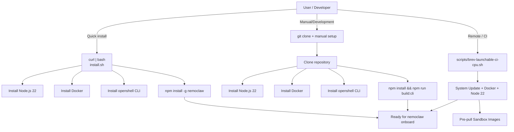
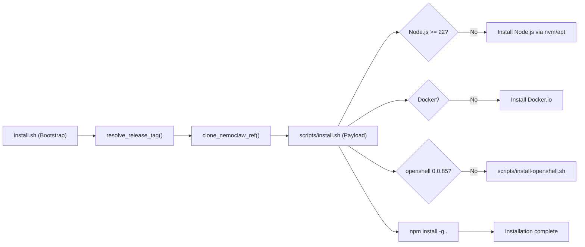
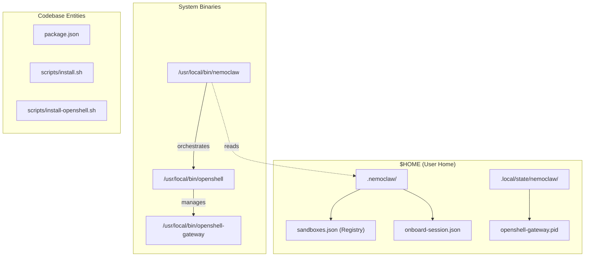

<!-- source: DeepWiki mcp.deepwiki.com · repo NVIDIA/NemoClaw · page 2.1 Installation · fetched 2026-10-26 -->

# Installation

<details>
<summary>Relevant source files</summary>

The following files were used as context for generating this wiki page:

- [.github/dco-bypass.txt](.github/dco-bypass.txt)
- [.github/workflows/dco-check.yaml](.github/workflows/dco-check.yaml)
- [.github/workflows/installer-hash-check.yaml](.github/workflows/installer-hash-check.yaml)
- [README.md](README.md)
- [bin/nemoclaw.js](bin/nemoclaw.js)
- [install.sh](install.sh)
- [nemoclaw-blueprint/blueprint.yaml](nemoclaw-blueprint/blueprint.yaml)
- [scripts/brev-launchable-ci-cpu.sh](scripts/brev-launchable-ci-cpu.sh)
- [scripts/check-installer-hash.sh](scripts/check-installer-hash.sh)
- [scripts/checks/extract-installer-pins.mts](scripts/checks/extract-installer-pins.mts)
- [scripts/install-openshell.sh](scripts/install-openshell.sh)
- [scripts/install.sh](scripts/install.sh)
- [scripts/start-services.sh](scripts/start-services.sh)
- [src/lib/onboard/docker-cdi.test.ts](src/lib/onboard/docker-cdi.test.ts)
- [src/lib/onboard/docker-cdi.ts](src/lib/onboard/docker-cdi.ts)
- [src/lib/onboard/fatal-runtime-preflight.test.ts](src/lib/onboard/fatal-runtime-preflight.test.ts)
- [src/lib/onboard/preflight-cdi.test.ts](src/lib/onboard/preflight-cdi.test.ts)
- [src/lib/onboard/preflight-messages.test.ts](src/lib/onboard/preflight-messages.test.ts)
- [src/lib/onboard/preflight-messages.ts](src/lib/onboard/preflight-messages.ts)
- [src/lib/onboard/preflight-podman-compat.test.ts](src/lib/onboard/preflight-podman-compat.test.ts)
- [src/lib/onboard/preflight.test.ts](src/lib/onboard/preflight.test.ts)
- [src/lib/onboard/preflight.ts](src/lib/onboard/preflight.ts)
- [src/lib/runner.ts](src/lib/runner.ts)
- [test/brev-launchable-ci-cpu-checksum.test.ts](test/brev-launchable-ci-cpu-checksum.test.ts)
- [test/dependency-pins-check.test.ts](test/dependency-pins-check.test.ts)
- [test/install-onboard-yes.test.ts](test/install-onboard-yes.test.ts)
- [test/install-openshell-version-check.test.ts](test/install-openshell-version-check.test.ts)
- [test/install-preflight.test.ts](test/install-preflight.test.ts)
- [test/installer-hash-check.test.ts](test/installer-hash-check.test.ts)
- [test/runner.test.ts](test/runner.test.ts)
- [uninstall.sh](uninstall.sh)

</details>


This page covers installing NemoClaw and its prerequisites. For first-time setup and configuration after installation, see [Configuration and Onboarding](#2.3). For running your first agent task, see [Quick Start Guide](#2.2).

## Installation Methods

NemoClaw supports three installation paths depending on your use case:

Title: Installation Decision Flow


**Sources**: [install.sh:65-76](), [scripts/install.sh:7-9](), [scripts/brev-launchable-ci-cpu.sh:10-15]()

## Prerequisites

NemoClaw requires the following components:

| Component | Minimum Version | Purpose |
|-----------|----------------|---------|
| Node.js | 22.x | Runtime for `nemoclaw` CLI and agent plugins [scripts/install.sh:7-9]() |
| Docker | Native | Container runtime for OpenShell gateway and sandboxes [src/lib/onboard/preflight.ts:124-125]() |
| OpenShell CLI | 0.0.85 | Sandbox orchestration and policy enforcement [scripts/install-openshell.sh:40-43]() |
| API Key | — | NVIDIA Cloud inference access [nemoclaw-blueprint/blueprint.yaml:61-66]() |

### OpenShell Compatibility
NemoClaw requires OpenShell `0.0.85` specifically to support advanced credential rewriting and policy features:
- `request-body-credential-rewrite`: For injecting keys into REST bodies [scripts/install-openshell.sh:36-39]().
- `websocket-credential-rewrite`: For secure WebSocket connections [scripts/install-openshell.sh:36-39]().
- `allow_all_known_mcp_methods`: MCP/JSON-RPC L7 enforcement [scripts/install-openshell.sh:38-40]().

On macOS, the installer verifies the architecture; Apple Silicon (aarch64) is required [install.sh:108-117]().

**Sources**: [scripts/install-openshell.sh:40-48](), [scripts/install-openshell.sh:143-163](), [nemoclaw-blueprint/blueprint.yaml:5-7]()

## Quick Installation

The fastest way to install NemoClaw is via the hosted bootstrap script:

```console
$ curl -fsSL https://www.nvidia.com/nemoclaw.sh | bash
```

This bootstrap script (`install.sh`) performs the following operations:

Title: Automated Installation Data Flow


**Sources**: [install.sh:65-106](), [scripts/install.sh:173-182](), [scripts/install-openshell.sh:40-48]()

### Component Installation Details

#### Bootstrap Logic
The root `install.sh` acts as a thin bootstrap. It clones the repository to a temporary directory and executes the versioned payload from `scripts/install.sh` [install.sh:78-106](). It supports options like `--non-interactive` and `--yes-i-accept-third-party-software` [install.sh:129-135]().

#### Version Resolution
The installer determines the version to install by checking environment variables (`NEMOCLAW_INSTALL_REF`), git tags, or the `.version` file [scripts/install.sh:62-98]().

**Sources**: [install.sh:23-29](), [scripts/install.sh:145-154]()

## Manual Installation

### Step 1: Install Node.js 22
NemoClaw is a Node.js application. The installer checks for a minimum version of Node.js and attempts an upgrade if `nvm` is present [test/install-preflight.test.ts:130-185]().

### Step 2: Install Docker
Ensure Docker is running. The host assessment logic verifies the presence of the Docker binary and the running daemon [src/lib/onboard/preflight.ts:121-125]().

### Step 3: Install NemoClaw from Source
```console
$ git clone https://github.com/NVIDIA/NemoClaw.git
$ cd NemoClaw
$ npm install
$ npm run build
```
The entry point for the CLI is located at `bin/nemoclaw.js`, which requires the compiled distribution in `dist/nemoclaw` [bin/nemoclaw.js:1-12]().

## Remote and CI Deployment

For remote GPU instances (e.g., Brev.dev) or CI runners, use the launchable scripts.

### CI Ready CPU Setup
The script `scripts/brev-launchable-ci-cpu.sh` pre-bakes a VM with:
1. Docker and Node.js 22 [scripts/brev-launchable-ci-cpu.sh:132-159]().
2. Pinned OpenShell CLI (v0.0.85) [scripts/brev-launchable-ci-cpu.sh:43-43]().
3. Pre-pulled Docker images for the sandbox base defined in the blueprint [nemoclaw-blueprint/blueprint.yaml:35-35]().

**Sources**: [scripts/brev-launchable-ci-cpu.sh:1-60]()

## Uninstallation

To remove NemoClaw while preserving system tools, use the compatibility wrapper:

```console
$ ./uninstall.sh --yes
```

The uninstaller maps to the internal command: `nemoclaw internal uninstall run-plan` [uninstall.sh:23-26](). It targets:
1. Active sandboxes and the OpenShell gateway.
2. The `~/.nemoclaw` registry and onboard session state [test/install-preflight.test.ts:52-66]().
3. Optionally, local model weights if `--delete-models` is provided [uninstall.sh:7-7]().

**Sources**: [uninstall.sh:1-27]()

## File System Layout

Title: NemoClaw Host-Side Entities


**Sources**: [test/install-preflight.test.ts:52-56](), [bin/nemoclaw.js:1-12](), [src/lib/runner.ts:19-20]()

## Verification

After installation, verify the setup by checking the version of both NemoClaw and the underlying OpenShell:

```bash
# Check NemoClaw version
nemoclaw --version

# Check OpenShell version and capabilities
openshell --version
```

The OpenShell version should be `0.0.85` to ensure compatibility with current NemoClaw release features [scripts/install-openshell.sh:40-43]().

**Sources**: [scripts/install-openshell.sh:40-43](), [test/install-openshell-version-check.test.ts:105-107]()

---

