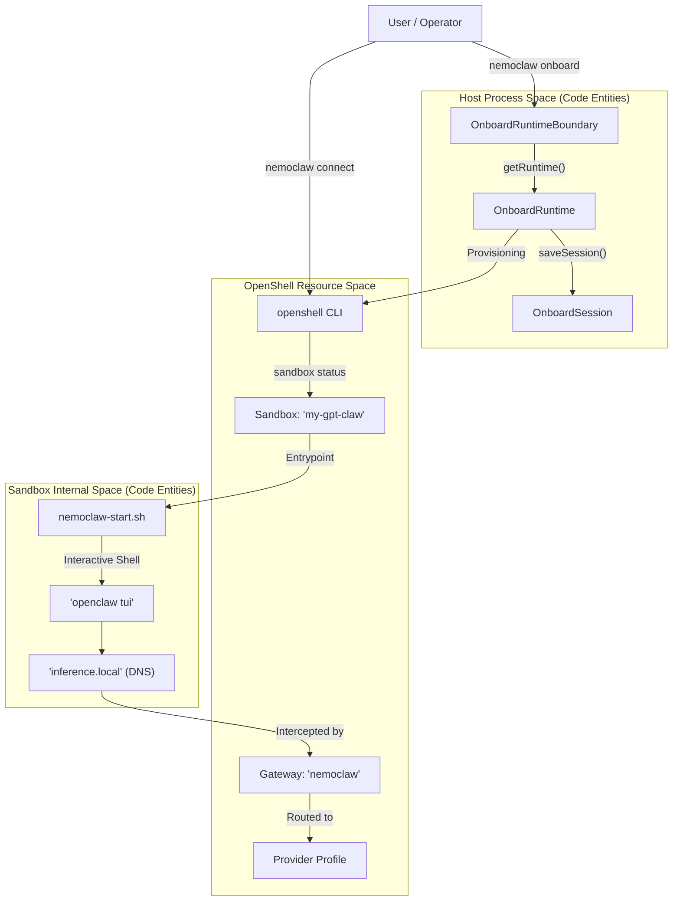
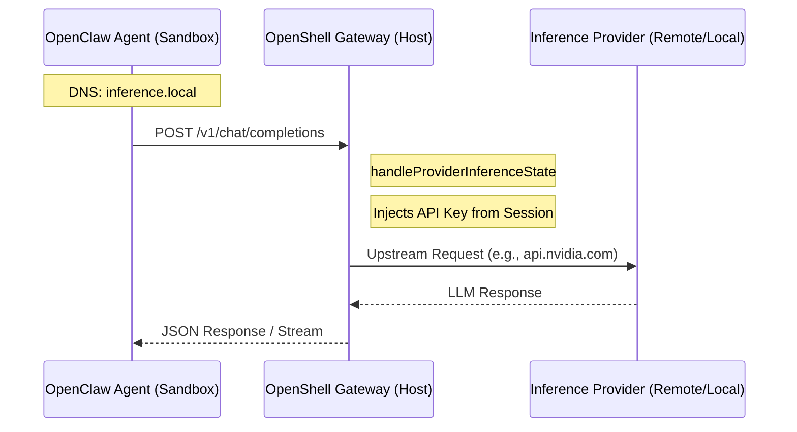

<!-- source: DeepWiki mcp.deepwiki.com · repo NVIDIA/NemoClaw · page 2.2 Quick Start Guide · fetched 2026-10-26 -->

# Quick Start Guide

<details>
<summary>Relevant source files</summary>

The following files were used as context for generating this wiki page:

- [ci/platform-matrix.json](ci/platform-matrix.json)
- [docs/about/ecosystem-deepagents.mdx](docs/about/ecosystem-deepagents.mdx)
- [docs/about/ecosystem-hermes.mdx](docs/about/ecosystem-hermes.mdx)
- [docs/about/ecosystem.mdx](docs/about/ecosystem.mdx)
- [docs/about/overview.mdx](docs/about/overview.mdx)
- [docs/get-started/dgx-station-preparation.mdx](docs/get-started/dgx-station-preparation.mdx)
- [docs/get-started/prerequisites.mdx](docs/get-started/prerequisites.mdx)
- [docs/get-started/quickstart-hermes.mdx](docs/get-started/quickstart-hermes.mdx)
- [docs/get-started/quickstart.mdx](docs/get-started/quickstart.mdx)
- [docs/index.mdx](docs/index.mdx)
- [docs/reference/platform-support.mdx](docs/reference/platform-support.mdx)
- [src/lib/onboard/__test-helpers__/machine-recorders.ts](src/lib/onboard/__test-helpers__/machine-recorders.ts)
- [src/lib/onboard/exit-step-failure.test.ts](src/lib/onboard/exit-step-failure.test.ts)
- [src/lib/onboard/exit-step-failure.ts](src/lib/onboard/exit-step-failure.ts)
- [src/lib/onboard/finalization-deps.ts](src/lib/onboard/finalization-deps.ts)
- [src/lib/onboard/lifecycle-contracts.md](src/lib/onboard/lifecycle-contracts.md)
- [src/lib/onboard/machine/core-flow-phases.test.ts](src/lib/onboard/machine/core-flow-phases.test.ts)
- [src/lib/onboard/machine/core-flow-phases.ts](src/lib/onboard/machine/core-flow-phases.ts)
- [src/lib/onboard/machine/final-flow-phases.runtime.test.ts](src/lib/onboard/machine/final-flow-phases.runtime.test.ts)
- [src/lib/onboard/machine/final-flow-phases.test.ts](src/lib/onboard/machine/final-flow-phases.test.ts)
- [src/lib/onboard/machine/final-flow-phases.ts](src/lib/onboard/machine/final-flow-phases.ts)
- [src/lib/onboard/machine/handlers/finalization.test.ts](src/lib/onboard/machine/handlers/finalization.test.ts)
- [src/lib/onboard/machine/handlers/finalization.ts](src/lib/onboard/machine/handlers/finalization.ts)
- [src/lib/onboard/machine/initial-flow-phases.test.ts](src/lib/onboard/machine/initial-flow-phases.test.ts)
- [src/lib/onboard/machine/initial-flow-phases.ts](src/lib/onboard/machine/initial-flow-phases.ts)
- [src/lib/onboard/machine/live-flow-slice.test.ts](src/lib/onboard/machine/live-flow-slice.test.ts)
- [src/lib/onboard/machine/live-flow-slice.ts](src/lib/onboard/machine/live-flow-slice.ts)
- [src/lib/onboard/machine/runtime.test.ts](src/lib/onboard/machine/runtime.test.ts)
- [src/lib/onboard/machine/runtime.ts](src/lib/onboard/machine/runtime.ts)
- [src/lib/onboard/machine/transitions.ts](src/lib/onboard/machine/transitions.ts)
- [src/lib/onboard/runtime-boundary-record-only.test.ts](src/lib/onboard/runtime-boundary-record-only.test.ts)
- [src/lib/onboard/runtime-boundary.test.ts](src/lib/onboard/runtime-boundary.test.ts)
- [src/lib/onboard/runtime-boundary.ts](src/lib/onboard/runtime-boundary.ts)
- [src/lib/sandbox/create-stream-process-group.test.ts](src/lib/sandbox/create-stream-process-group.test.ts)
- [src/lib/sandbox/create-stream.ts](src/lib/sandbox/create-stream.ts)
- [src/lib/state/onboard-session.test.ts](src/lib/state/onboard-session.test.ts)
- [src/lib/state/onboard-session.ts](src/lib/state/onboard-session.ts)
- [src/lib/state/onboard-step-mutation.test.ts](src/lib/state/onboard-step-mutation.test.ts)
- [src/lib/state/onboard-step-mutation.ts](src/lib/state/onboard-step-mutation.ts)
- [src/lib/state/onboard-step-state.ts](src/lib/state/onboard-step-state.ts)
- [test/helpers/onboard-final-flow-phases.ts](test/helpers/onboard-final-flow-phases.ts)
- [test/helpers/onboard-legacy-step-mutation.ts](test/helpers/onboard-legacy-step-mutation.ts)
- [test/helpers/rebuild-flow-target-image-cases.ts](test/helpers/rebuild-flow-target-image-cases.ts)
- [test/onboard-exit-handler.test.ts](test/onboard-exit-handler.test.ts)
- [test/onboard-sandbox-recreation.test.ts](test/onboard-sandbox-recreation.test.ts)
- [test/repro-1751-extra.test.ts](test/repro-1751-extra.test.ts)
- [test/station-doc-ownership.test.ts](test/station-doc-ownership.test.ts)

</details>


This guide provides a hands-on walkthrough to launch your first NemoClaw sandbox, configure inference, and interact with the OpenClaw agent. It assumes you have already completed the initial installation.

## Prerequisites

Before starting this guide, verify your environment meets the hardware and software requirements:

- **Hardware**: Minimum 4 vCPU, 8 GB RAM (16 GB recommended), and 20 GB free disk space [docs/get-started/prerequisites.mdx:16-20]().
- **Node.js**: Version 22.19 or later [docs/get-started/prerequisites.mdx:32]().
- **Container Runtime**: Docker Engine, Docker Desktop, or Colima must be running [docs/get-started/prerequisites.mdx:35](), [docs/get-started/quickstart.mdx:145]().
- **Credentials**: An API key for your chosen inference provider (e.g., `NVIDIA_API_KEY`) [docs/get-started/quickstart.mdx:110]().

**Sources**: [docs/get-started/prerequisites.mdx:16-35](), [docs/get-started/quickstart.mdx:110-145]()

---

## Interaction and Code Mapping

The following diagram maps the Natural Language commands used in this guide to the underlying Code Entities and OpenShell resources they invoke.

### Interaction Flow: Host to Sandbox

**Sources**: [src/lib/onboard/runtime-boundary.ts:41-57](), [src/lib/onboard/machine/runtime.ts:1-20](), [src/lib/state/onboard-session.ts:154-200](), [docs/get-started/quickstart.mdx:37-78]()

---

## Launching Your First Sandbox

Run the interactive onboarding wizard to configure your environment. This process handles gateway setup, inference registration, and sandbox creation.

```bash
export NEMOCLAW_SANDBOX_NAME=my-gpt-claw
curl -fsSL https://www.nvidia.com/nemoclaw.sh | bash
```
[docs/get-started/quickstart.mdx:41-42]()

### Onboarding Workflow
The onboarding process is managed by a state machine defined in the `OnboardRuntime` [src/lib/onboard/machine/runtime.ts:23](). It transitions through several key phases:

1. **Inference Selection**: Choose from providers like NVIDIA Endpoints, OpenRouter, or local vLLM/Ollama [docs/get-started/quickstart.mdx:132]().
2. **Credentialing**: Provide API keys. The wizard tracks progress in `SandboxPromptProgress` [src/lib/state/onboard-session.ts:142-147]().
3. **Sandbox Provisioning**: Creates the isolated environment using OpenShell. The state is recorded in the `Session` object [src/lib/state/onboard-session.ts:154-200]().
4. **Policy Assignment**: Select a network policy tier to define the agent's boundary [docs/get-started/quickstart.mdx:53]().

For non-interactive or CI environments, you can bypass the wizard by providing environment variables:
```bash
NEMOCLAW_NON_INTERACTIVE=1 \
NEMOCLAW_ACCEPT_THIRD_PARTY_SOFTWARE=1 \
NEMOCLAW_AGENT=openclaw \
NEMOCLAW_PROVIDER=build \
NVIDIA_INFERENCE_API_KEY=<your-key> \
bash nemoclaw.sh
```
[docs/get-started/quickstart.mdx:105-112]()

**Sources**: [src/lib/onboard/machine/runtime.ts:23](), [src/lib/state/onboard-session.ts:142-200](), [docs/get-started/quickstart.mdx:41-112]()

---

## Verify Sandbox Status

Verify that your sandbox is running and check its configuration:

```bash
nemoclaw my-gpt-claw status
```
[docs/get-started/quickstart.mdx:60]()

This command inspects the `OnboardMachineSnapshot` which tracks the durable state of the deployment [src/lib/state/onboard-session.ts:134-140]().

| Attribute | Description | Code Reference |
|-------|-------------|----------------|
| **State** | Current machine phase (e.g., `complete`) | `state` [src/lib/state/onboard-session.ts:136]() |
| **Provider** | The active inference endpoint | `provider` [src/lib/state/onboard-session.ts:167]() |
| **Model** | The LLM assigned to the sandbox | `model` [src/lib/state/onboard-session.ts:168]() |
| **Revision** | Version of the current state snapshot | `revision` [src/lib/state/onboard-session.ts:138]() |

**Sources**: [docs/get-started/quickstart.mdx:60](), [src/lib/state/onboard-session.ts:134-168]()

---

## Connect and Interact

### Connect to the Sandbox Shell
Establish an interactive SSH session into the isolated environment:

```bash
nemoclaw my-gpt-claw connect
```
[docs/get-started/quickstart.mdx:74]()

### Use the OpenClaw TUI
Inside the sandbox, launch the terminal user interface to chat with the agent:

```bash
openclaw tui
```
[docs/get-started/quickstart.mdx:75]()

### Dashboard Access
Alternatively, you can interact via the web dashboard. Retrieve the URL using:

```bash
nemoclaw my-gpt-claw dashboard-url --quiet
```
[docs/get-started/quickstart.mdx:68]()

**Sources**: [docs/get-started/quickstart.mdx:68-75]()

---

## Inference Data Flow

NemoClaw utilizes the OpenShell gateway to route inference requests. The agent inside the sandbox communicates with a local DNS alias, which the gateway intercepts and proxies to the configured provider.

### Inference Request Path

**Sources**: [src/lib/onboard/machine/core-flow-phases.ts:137-169](), [src/lib/state/onboard-session.ts:173-178](), [docs/get-started/quickstart.mdx:132-134]()

---

