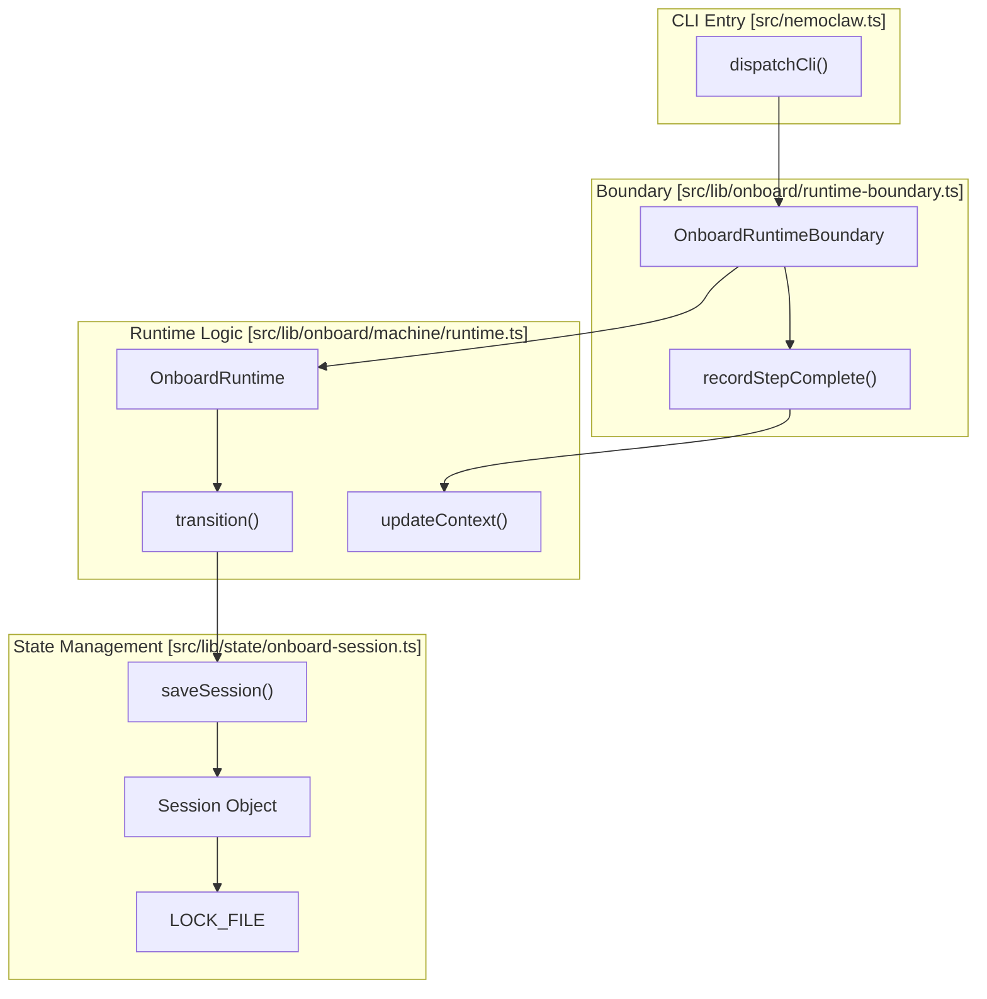
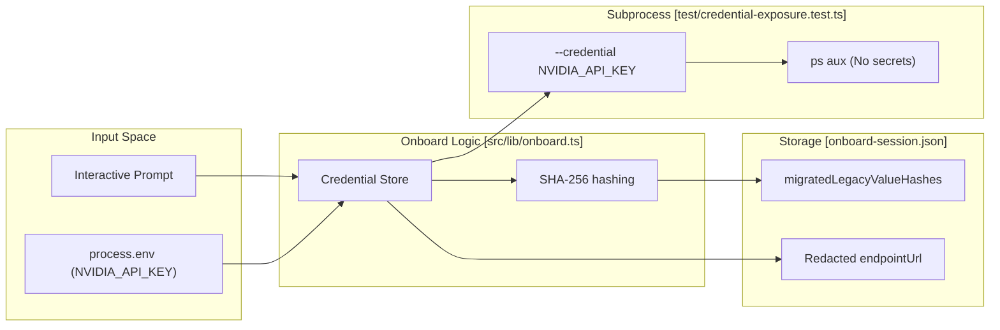

<!-- source: DeepWiki mcp.deepwiki.com · repo NVIDIA/NemoClaw · page 2.3 Configuration and Onboarding · fetched 2026-10-26 -->

# Configuration and Onboarding

Relevant source files

The following files were used as context for generating this wiki page:

- [ci/env-var-doc-allowlist.json](ci/env-var-doc-allowlist.json)
- [ci/test-file-size-budget.json](ci/test-file-size-budget.json)
- [scripts/lib/entrypoint-env-wrapper.sh](scripts/lib/entrypoint-env-wrapper.sh)
- [src/lib/actions/sandbox/rebuild-preflight-target-phase.test.ts](src/lib/actions/sandbox/rebuild-preflight-target-phase.test.ts)
- [src/lib/actions/sandbox/rebuild-recreate-phase.ts](src/lib/actions/sandbox/rebuild-recreate-phase.ts)
- [src/lib/actions/sandbox/rebuild-recreate-reasoning.test.ts](src/lib/actions/sandbox/rebuild-recreate-reasoning.test.ts)
- [src/lib/messaging/applier/build/messaging-build-applier.mts](src/lib/messaging/applier/build/messaging-build-applier.mts)
- [src/lib/messaging/post-agent-install-selection.ts](src/lib/messaging/post-agent-install-selection.ts)
- [src/lib/onboard.ts](src/lib/onboard.ts)
- [src/lib/onboard/authoritative-rebuild-target.test.ts](src/lib/onboard/authoritative-rebuild-target.test.ts)
- [src/lib/onboard/authoritative-rebuild-target.ts](src/lib/onboard/authoritative-rebuild-target.ts)
- [src/lib/onboard/machine/handlers/provider-inference-authoritative-recovery.test.ts](src/lib/onboard/machine/handlers/provider-inference-authoritative-recovery.test.ts)
- [src/lib/onboard/machine/handlers/provider-inference-recovery-gating.test.ts](src/lib/onboard/machine/handlers/provider-inference-recovery-gating.test.ts)
- [src/lib/onboard/machine/handlers/provider-inference-recovery.ts](src/lib/onboard/machine/handlers/provider-inference-recovery.ts)
- [src/lib/onboard/machine/handlers/provider-inference-route-containment.test.ts](src/lib/onboard/machine/handlers/provider-inference-route-containment.test.ts)
- [src/lib/onboard/machine/handlers/provider-inference.test-support.ts](src/lib/onboard/machine/handlers/provider-inference.test-support.ts)
- [src/lib/onboard/machine/handlers/provider-inference.test.ts](src/lib/onboard/machine/handlers/provider-inference.test.ts)
- [src/lib/onboard/machine/handlers/provider-inference.ts](src/lib/onboard/machine/handlers/provider-inference.ts)
- [src/lib/onboard/managed-startup-agent-environment.test.ts](src/lib/onboard/managed-startup-agent-environment.test.ts)
- [src/lib/onboard/managed-startup-image-runtime.test.ts](src/lib/onboard/managed-startup-image-runtime.test.ts)
- [src/lib/onboard/managed-startup-onboard-profile.test.ts](src/lib/onboard/managed-startup-onboard-profile.test.ts)
- [src/lib/onboard/managed-startup-profile-builder.test.ts](src/lib/onboard/managed-startup-profile-builder.test.ts)
- [src/lib/onboard/managed-startup-profile.test.ts](src/lib/onboard/managed-startup-profile.test.ts)
- [src/lib/onboard/managed-startup/agent-environment.ts](src/lib/onboard/managed-startup/agent-environment.ts)
- [src/lib/onboard/managed-startup/image-runtime.ts](src/lib/onboard/managed-startup/image-runtime.ts)
- [src/lib/onboard/managed-startup/onboard-profile.ts](src/lib/onboard/managed-startup/onboard-profile.ts)
- [src/lib/onboard/managed-startup/profile-builder.ts](src/lib/onboard/managed-startup/profile-builder.ts)
- [src/lib/onboard/managed-startup/profile.ts](src/lib/onboard/managed-startup/profile.ts)
- [src/lib/onboard/provider-recovery.test.ts](src/lib/onboard/provider-recovery.test.ts)
- [src/lib/onboard/provider-recovery.ts](src/lib/onboard/provider-recovery.ts)
- [src/lib/onboard/rebuild-route-handoff.test.ts](src/lib/onboard/rebuild-route-handoff.test.ts)
- [src/lib/onboard/rebuild-route-handoff.ts](src/lib/onboard/rebuild-route-handoff.ts)
- [src/lib/onboard/session-updates.test.ts](src/lib/onboard/session-updates.test.ts)
- [src/lib/onboard/session-updates.ts](src/lib/onboard/session-updates.ts)
- [src/lib/onboard/setup-inference-route-containment.test.ts](src/lib/onboard/setup-inference-route-containment.test.ts)
- [src/lib/onboard/setup-inference.ts](src/lib/onboard/setup-inference.ts)
- [src/lib/onboard/setup-nim-flow.test.ts](src/lib/onboard/setup-nim-flow.test.ts)
- [src/lib/onboard/setup-nim-flow.ts](src/lib/onboard/setup-nim-flow.ts)
- [src/lib/policy/index.ts](src/lib/policy/index.ts)
- [src/nemoclaw.ts](src/nemoclaw.ts)
- [test/entrypoint-env-wrapper.test.ts](test/entrypoint-env-wrapper.test.ts)
- [test/messaging-build-applier.test.ts](test/messaging-build-applier.test.ts)
- [test/onboard-resume-provider-recovery.test.ts](test/onboard-resume-provider-recovery.test.ts)
- [test/onboard-selection.test.ts](test/onboard-selection.test.ts)
- [test/onboard.test.ts](test/onboard.test.ts)
- [test/policies.test.ts](test/policies.test.ts)

This page explains the NemoClaw onboarding process, which configures inference endpoints, manages API credentials, and sets up the OpenShell provider routing. After installation (see [Installation]()), onboarding is the next step before launching a sandbox (see [Quick Start Guide]()).

Onboarding creates the necessary OpenShell providers, validates credentials against the selected inference backend, and stores the configuration for future use. The process is governed by a state machine that supports both interactive (wizard-driven) and non-interactive (CLI flag) modes.

---

## Onboarding Workflow

NemoClaw provides an interactive onboarding wizard implemented in `src/lib/onboard.ts` [src/lib/onboard.ts:4-7](). This wizard guides the user through steps from zero to a running sandbox, including host assessments and inference configuration.

### State Machine and Runtime Boundary
The onboarding logic is decoupled from the UI via the `OnboardRuntime` and `OnboardRuntimeBoundary` classes.
*   **OnboardRuntime**: Manages the transitions between machine states (e.g., `init` -> `preflight` -> `gateway`) and ensures valid state transitions [src/lib/onboard/machine/runtime.ts:100-105](). It uses `assertValidOnboardMachineTransition` to enforce the FSM (Finite State Machine) logic [src/lib/onboard/machine/runtime.ts:165]().
*   **OnboardRuntimeBoundary**: Acts as a bridge between the legacy step-based onboarding and the new state machine. It records step completion while ensuring the machine snapshot remains synchronized [src/lib/onboard/runtime-boundary.ts:29-32]().
*   **Event System**: Transitions and context updates emit events (e.g., `state.entered`, `context.updated`) via `emitOnboardMachineEvent` for observability [src/lib/onboard/machine/runtime.ts:182-183]().

### Session Management and Resumption
To ensure robustness, the onboarding process is managed as a **Session** via `src/lib/state/onboard-session.ts` [src/lib/state/onboard-session.ts:80-133]().
*   **Persistence**: State is saved to `~/.nemoclaw/onboard-session.json` to allow resumption if the process is interrupted [src/lib/state/onboard-session.ts:34-35]().
*   **Locking**: A file-based lock (`onboard.lock`) prevents concurrent onboarding processes from corrupting the state [src/lib/state/onboard-session.ts:36]().
*   **Revision Tracking**: Every session includes a `revision` number and `stateEnteredAt` timestamp to track machine progress [src/lib/state/onboard-session.ts:73-78]().

### Technical Data Flow
The following diagram bridges the natural language onboarding steps to the underlying code entities.

**Sources**: [src/lib/onboard/machine/runtime.ts:100-200](), [src/lib/onboard/runtime-boundary.ts:29-64](), [src/lib/state/onboard-session.ts:32-133](), [src/nemoclaw.ts:9-16]()

---

## Inference Endpoint Selection

NemoClaw supports several inference backends, categorized into Remote (Cloud) and Local providers. Selection is stored in the session context under `provider` and `model` [src/lib/state/onboard-session.ts:93-94]().

### Supported Providers and Credentials
The `ProviderInferenceSetupOptions` and `ProviderSelectionResult` interfaces define the structure for inference provider configuration [src/lib/onboard/machine/handlers/provider-inference.ts:69-91]().

| Endpoint Type | Provider Name | Credential Env | Validation Helper |
| :--- | :--- | :--- | :--- |
| Remote | `nvidia-prod` | `NVIDIA_INFERENCE_API_KEY` | `createNvidiaFeaturedModelSession` [src/lib/onboard.ts:26]() |
| Remote | `openai-api` | `OPENAI_API_KEY` | `validateOpenAiLikeModel` [test/onboard-selection.test.ts:23]() |
| Remote | `anthropic-prod` | `ANTHROPIC_API_KEY` | `validateAnthropicModel` [test/onboard-selection.test.ts:22]() |
| Remote | `gemini-api` | `GEMINI_API_KEY` | `promptCloudModel` [test/onboard-selection.test.ts:14]() |
| Local | `ollama-local` | `OLLAMA_PROXY_TOKEN` | `detectWindowsHostOllama` [test/onboard-selection.test.ts:55]() |
| Local | `vllm-local` | `VLLM_API_KEY` | `handleVllmSelection` [src/lib/onboard/setup-nim-flow.test.ts:131]() |
| Remote | `openrouter-api` | `OPENROUTER_API_KEY` | `openrouterSelection` [src/lib/onboard.ts:31]() |
| Remote | `compatible-endpoint` | `COMPATIBLE_API_KEY` | `createRemoteModelValidator` [src/lib/onboard.ts:27]() |
| Remote | `compatible-anthropic-endpoint` | `ANTHROPIC_COMPATIBLE_API_KEY` | `createRemoteModelValidator` [src/lib/onboard.ts:27]() |

**Sources**: [src/lib/onboard.ts:26-31](), [src/lib/onboard/machine/handlers/provider-inference.ts:69-91](), [src/lib/onboard/setup-nim-flow.test.ts:14-57](), [test/onboard-selection.test.ts:22-23](), [test/onboard-selection.test.ts:14](), [test/onboard-selection.test.ts:55]()

### Model Validation and Probing
NemoClaw performs active probing to ensure the selected model exists and credentials are valid.
*   **Auth Retry Logic**: The onboarding test suite simulates auth failures (403 Forbidden) to verify that the wizard correctly prompts for credential re-entry [test/onboard-selection.test.ts:67-70](). The `CREDENTIAL_RETRY_PROMPT` constant defines the expected prompt text [test/onboard-selection.test.ts:67-68]().
*   **Gemini Special Handling**: Unlike Bearer tokens, Gemini authentication is validated by extracting the `key=` query parameter from the URL [test/onboard-selection.test.ts:118-120]().
*   **Local Inference Timeouts**: Local providers (Ollama/vLLM) use a specific timeout defined by `LOCAL_INFERENCE_TIMEOUT_SECS` [src/lib/onboard.ts:7]().

**Sources**: [src/lib/onboard.ts:7](), [test/onboard-selection.test.ts:67-70](), [test/onboard-selection.test.ts:118-120]()

---

## API Key Management and Credential Storage

### Secure Storage and Redaction
Credentials are treated as sensitive material throughout the onboarding lifecycle.
1.  **Redaction**: The `redactUrl` and `redactSensitiveText` utilities in `src/lib/security/redact.ts` strip sensitive keys from URLs and session files before they are written to disk [src/lib/state/onboard-session.ts:28]().
2.  **Command Line Safety**: The system ensures that API keys are never passed as CLI arguments to `openshell`. Instead, it uses `--credential` flags that pass only the **environment variable name**, forcing the subprocess to read the value from its own environment [test/credential-exposure.test.ts:32-45]().
3.  **Migration Hashes**: To safely migrate legacy credentials, NemoClaw stores SHA-256 hex digests of successfully written credentials in `migratedLegacyValueHashes`. This allows the system to detect if a value was changed out-of-band [src/lib/state/onboard-session.ts:115-126]().

### Credential Flow Diagram
This diagram shows how credentials move from user input to the OpenShell execution environment without being exposed in process listings.

**Sources**: [src/lib/state/onboard-session.ts:115-126](), [test/credential-exposure.test.ts:32-45](), [src/lib/security/redact.ts:1-10]()

---

## Non-Interactive Onboarding

For CI/CD and automated environments, onboarding can be performed without user intervention.
*   **Activation**: Triggered by the `--non-interactive` flag or the `NEMOCLAW_NON_INTERACTIVE=1` environment variable [src/lib/onboard.ts:9-10]().
*   **Abort Logic**: If the system requires user input (e.g., a choice between multiple GPUs) while in non-interactive mode, it calls `abortNonInteractive` to fail gracefully [src/lib/onboard.ts:43-44]().
*   **Proxy Propagation**: In automated environments, host proxy settings (`HTTP_PROXY`, `HTTPS_PROXY`, `NO_PROXY`) are automatically detected and injected into the sandbox environment via `appendHostProxyEnvArgs` [test/onboard.test.ts:10-11](). This ensures that the sandbox can access external resources through the host's proxy configuration.

**Sources**: [src/lib/onboard.ts:9-10](), [src/lib/onboard.ts:43-44](), [test/onboard.test.ts:10-11](), [test/onboard.test.ts:103-119]()

---

## Initial Policy and GPU Configuration

During onboarding, NemoClaw prepares the initial sandbox security policy.
*   **Policy Presets**: The `applyPresets` function merges built-in policy presets (e.g., for messaging channels like Telegram, Discord, Slack, WeChat) into the sandbox's policy [src/lib/policy/index.ts:139-157](). The `arePolicyPresetsApplied` helper checks if a given set of presets has already been applied [test/onboard.test.ts:55-56]().
*   **GPU Integration**:
    *   **CDI Specs**: The system parses Docker CDI (Container Device Interface) specifications to identify NVIDIA GPUs using `findReadableNvidiaCdiSpecFiles` and `parseDockerCdiSpecDirs` [src/lib/onboard.ts:83-84]().
    *   **GPU Arguments**: `buildSandboxGpuCreateArgs` generates the necessary Docker flags to passthrough the GPU to the sandbox container [src/lib/onboard.ts:87-88]().
    *   **Direct GPU Policy**: If a GPU is requested, `buildDirectGpuPolicyYaml` creates a Landlock/seccomp policy that allows the sandbox to access GPU device nodes [src/lib/onboard.ts:108-111]().

**Sources**: [src/lib/onboard.ts:83-84](), [src/lib/onboard.ts:87-88](), [src/lib/onboard.ts:108-111](), [src/lib/policy/index.ts:139-157](), [test/onboard.test.ts:55-56]()

---

