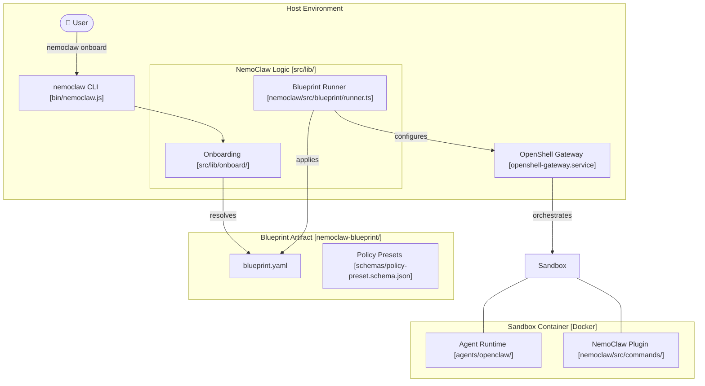
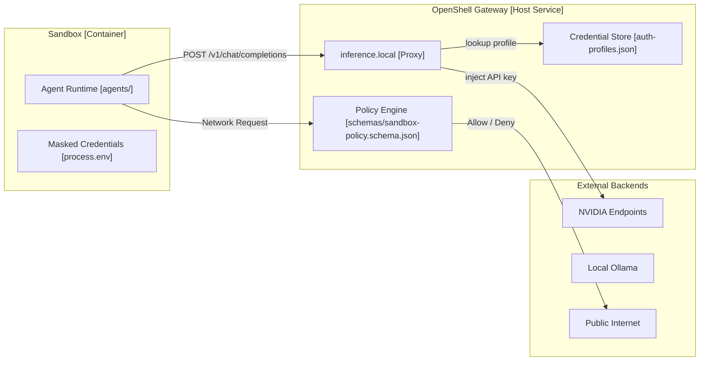

<!-- source: DeepWiki mcp.deepwiki.com · repo NVIDIA/NemoClaw · page 3 Core Concepts · fetched 2026-10-26 -->

# Core Concepts

Relevant source files

The following files were used as context for generating this wiki page:

- [.agents/skills/_shared/controlled-words.md](.agents/skills/_shared/controlled-words.md)
- [.agents/skills/_shared/documentation-writing-review.md](.agents/skills/_shared/documentation-writing-review.md)
- [.agents/skills/_shared/pr-follow-up.md](.agents/skills/_shared/pr-follow-up.md)
- [.agents/skills/nemoclaw-contributor-create-pr/SKILL.md](.agents/skills/nemoclaw-contributor-create-pr/SKILL.md)
- [.agents/skills/nemoclaw-contributor-onboard-messaging-channel/SKILL.md](.agents/skills/nemoclaw-contributor-onboard-messaging-channel/SKILL.md)
- [.agents/skills/nemoclaw-contributor-update-docs/SKILL.md](.agents/skills/nemoclaw-contributor-update-docs/SKILL.md)
- [.agents/skills/nemoclaw-maintainer-day/PR-REVIEW-PRIORITIES.md](.agents/skills/nemoclaw-maintainer-day/PR-REVIEW-PRIORITIES.md)
- [.agents/skills/nemoclaw-maintainer-day/SALVAGE-PR.md](.agents/skills/nemoclaw-maintainer-day/SALVAGE-PR.md)
- [.agents/skills/nemoclaw-maintainer-day/TEST-GAPS.md](.agents/skills/nemoclaw-maintainer-day/TEST-GAPS.md)
- [.agents/skills/nemoclaw-maintainer-policies/SKILL.md](.agents/skills/nemoclaw-maintainer-policies/SKILL.md)
- [.agents/skills/nemoclaw-maintainer-refactor-docs/SKILL.md](.agents/skills/nemoclaw-maintainer-refactor-docs/SKILL.md)
- [.agents/skills/nemoclaw-maintainer-release-notes/SKILL.md](.agents/skills/nemoclaw-maintainer-release-notes/SKILL.md)
- [.github/PULL_REQUEST_TEMPLATE.md](.github/PULL_REQUEST_TEMPLATE.md)
- [.pre-commit-config.yaml](.pre-commit-config.yaml)
- [AGENTS.md](AGENTS.md)
- [CONTRIBUTING.md](CONTRIBUTING.md)
- [WRITING.md](WRITING.md)
- [ci/platform-matrix.json](ci/platform-matrix.json)
- [docs/AGENTS.md](docs/AGENTS.md)
- [docs/CONTRIBUTING.md](docs/CONTRIBUTING.md)
- [docs/about/ecosystem-deepagents.mdx](docs/about/ecosystem-deepagents.mdx)
- [docs/about/ecosystem-hermes.mdx](docs/about/ecosystem-hermes.mdx)
- [docs/about/ecosystem.mdx](docs/about/ecosystem.mdx)
- [docs/about/overview.mdx](docs/about/overview.mdx)
- [docs/get-started/dgx-station-preparation.mdx](docs/get-started/dgx-station-preparation.mdx)
- [docs/get-started/prerequisites.mdx](docs/get-started/prerequisites.mdx)
- [docs/get-started/quickstart-hermes.mdx](docs/get-started/quickstart-hermes.mdx)
- [docs/get-started/quickstart.mdx](docs/get-started/quickstart.mdx)
- [docs/index.mdx](docs/index.mdx)
- [docs/reference/architecture.mdx](docs/reference/architecture.mdx)
- [docs/reference/platform-support.mdx](docs/reference/platform-support.mdx)
- [fern/AGENTS.md](fern/AGENTS.md)
- [nemoclaw-blueprint/provider-profiles/entra-runtime-v1.yaml](nemoclaw-blueprint/provider-profiles/entra-runtime-v1.yaml)
- [nemoclaw-blueprint/provider-profiles/okta-runtime-v1.yaml](nemoclaw-blueprint/provider-profiles/okta-runtime-v1.yaml)
- [nemoclaw/src/blueprint/runner-identity.test.ts](nemoclaw/src/blueprint/runner-identity.test.ts)
- [nemoclaw/src/blueprint/runner.test.ts](nemoclaw/src/blueprint/runner.test.ts)
- [nemoclaw/src/blueprint/runner.ts](nemoclaw/src/blueprint/runner.ts)
- [nemoclaw/src/blueprint/runtime-identity.test.ts](nemoclaw/src/blueprint/runtime-identity.test.ts)
- [nemoclaw/src/blueprint/runtime-identity.ts](nemoclaw/src/blueprint/runtime-identity.ts)
- [nemoclaw/src/blueprint/ssrf.test.ts](nemoclaw/src/blueprint/ssrf.test.ts)
- [nemoclaw/src/blueprint/ssrf.ts](nemoclaw/src/blueprint/ssrf.ts)
- [package-lock.json](package-lock.json)
- [package.json](package.json)
- [schemas/blueprint.schema.json](schemas/blueprint.schema.json)
- [src/lib/actions/inference-set-endpoint-security.test.ts](src/lib/actions/inference-set-endpoint-security.test.ts)
- [src/lib/sandbox/config-format.test.ts](src/lib/sandbox/config-format.test.ts)
- [src/lib/sandbox/config-format.ts](src/lib/sandbox/config-format.ts)
- [src/lib/sandbox/config-get.test.ts](src/lib/sandbox/config-get.test.ts)
- [test/blueprint-runtime-identity-lifecycle.test.ts](test/blueprint-runtime-identity-lifecycle.test.ts)
- [test/blueprint-runtime-identity-schema.test.ts](test/blueprint-runtime-identity-schema.test.ts)
- [test/e2e/live/inference-routing.test.ts](test/e2e/live/inference-routing.test.ts)
- [test/e2e/live/runtime-identity-oauth-server.ts](test/e2e/live/runtime-identity-oauth-server.ts)
- [test/station-doc-ownership.test.ts](test/station-doc-ownership.test.ts)

This page explains the fundamental concepts and architecture of the NemoClaw system. It describes how NemoClaw integrates with OpenShell to provide a secure, orchestrated environment for AI agents like OpenClaw and Hermes.

---

## Overview

NemoClaw is a reference stack designed to run always-on AI agents inside [NVIDIA OpenShell](https://github.com/NVIDIA/OpenShell) sandboxes [AGENTS.md:6-9](). It follows a **plugin-blueprint model**, where a host-side CLI orchestrates sandboxed environments using versioned blueprints [docs/reference/architecture.mdx:12-13]().

### Component Roles

| Component | Code Entity / Path | Responsibility |
| :--- | :--- | :--- |
| **Host CLI** | `src/lib/` | User-facing commands (`nemoclaw`, `nemohermes`), onboarding, and credential management [AGENTS.md:31](). |
| **Plugin** | `nemoclaw/src/` | In-sandbox TUI integration, slash commands, and migration logic [AGENTS.md:32-35](). |
| **Blueprint** | `nemoclaw-blueprint/` | YAML-defined sandbox image, network policies, and model registries [AGENTS.md:36-37](). |
| **Gateway** | `openshell-gateway` | A host-level service providing credential storage, inference proxying, and policy enforcement [docs/reference/architecture.mdx:48-49](). |
| **Agent** | `agents/` | The AI runtime (e.g., OpenClaw, Hermes, or Deep Agents) executing within the sandbox [docs/reference/platform-support.mdx:63-69](). |

**Sources:** [AGENTS.md:28-43](), [docs/reference/architecture.mdx:12-18](), [docs/reference/platform-support.mdx:63-69]()

---

## Plugin-Blueprint Architecture

NemoClaw separates the stable CLI interface from the evolving infrastructure requirements of AI agents. The **Plugin** handles the user interface and high-level state, while the **Blueprint** defines the technical "shape" of the sandbox.

### System Architecture: Host to Sandbox
This diagram shows the relationship between the NemoClaw CLI, the OpenShell gateway, and the resulting agent sandbox.

**Sources:** [AGENTS.md:28-38](), [docs/reference/architecture.mdx:20-75](), [nemoclaw/src/blueprint/runner.ts:1-20]()

For details, see [System Architecture](#3.1).

---

## OpenShell Integration

NemoClaw relies on OpenShell for the security and isolation layer. OpenShell provides a "hard shell" around the agent, ensuring that all external interactions (inference, network, tools) are proxied and governed by policy.

### Data Flow: Inference and Security Enforcement
This diagram bridges the natural language concepts of "Inference" and "Security" to the specific code entities that handle them.

**Sources:** [docs/reference/architecture.mdx:67-74](), [ci/platform-matrix.json:81-98](), [docs/get-started/quickstart.mdx:108-115]()

### Sandboxing and Security
The sandbox is the primary unit of isolation. It utilizes Docker, and on supported platforms, adds layers like Landlock and seccomp to restrict the agent's ability to touch the host filesystem or escalate privileges [ci/platform-matrix.json:34, 69]().

For details, see [Sandboxing and Security](#3.2).

---

## Inference Routing

Agents do not store API keys directly. Instead, they point to a local endpoint (`inference.local`). The OpenShell Gateway intercepts these requests, identifies the intended provider (e.g., NVIDIA, OpenAI, or a local NIM), and injects the appropriate credentials from the host-side store [docs/reference/architecture.mdx:67-68]().

NemoClaw supports a variety of providers defined in the platform matrix, including:
*   **NVIDIA Endpoints** (integrate.api.nvidia.com) [ci/platform-matrix.json:83-87]()
*   **OpenRouter** [ci/platform-matrix.json:89-93]()
*   **Local Inference** (vLLM, Ollama) [ci/platform-matrix.json:110-116]()

For details, see [Inference Routing](#3.3).

---

## Policy and Blueprint Systems

### Policy System
Policies define what an agent is allowed to do. NemoClaw uses a **deny-by-default** stance for network egress. Users can apply different policy tiers (e.g., "baseline" vs "session") to grant specific access to tools or messaging channels [docs/get-started/quickstart.mdx:53-54]().

For details, see [Policy System](#3.4).

### Blueprint System
The blueprint is the source of truth for the sandbox configuration. It includes the Dockerfile, network policy presets, and model-specific setup registries [AGENTS.md:36-37](). The `blueprint.yaml` manifest pins specific versions of these components to ensure reproducible and secure deployments [docs/reference/architecture.mdx:12]().

For details, see [Blueprint System](#3.5).

---

## Summary of Child Pages

*   **[System Architecture](#3.1)**: Deep dive into the relationship between the CLI, the plugin, and the OpenShell runtime.
*   **[Sandboxing and Security](#3.2)**: Details on container isolation, filesystem protection, and the security model.
*   **[Inference Routing](#3.3)**: How the gateway handles model requests and credential injection.
*   **[Policy System](#3.4)**: Explanation of policy schemas, presets, and enforcement.
*   **[Blueprint System](#3.5)**: The lifecycle of blueprint artifacts and orchestration logic.

**Sources:** [package.json:1-11](), [AGENTS.md:1-43](), [docs/reference/architecture.mdx:1-75](), [ci/platform-matrix.json:1-120]()

---

