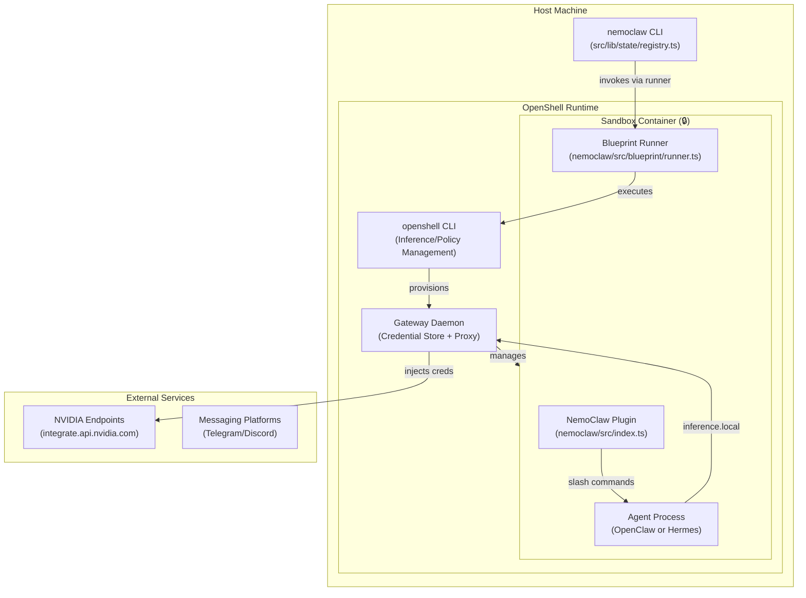
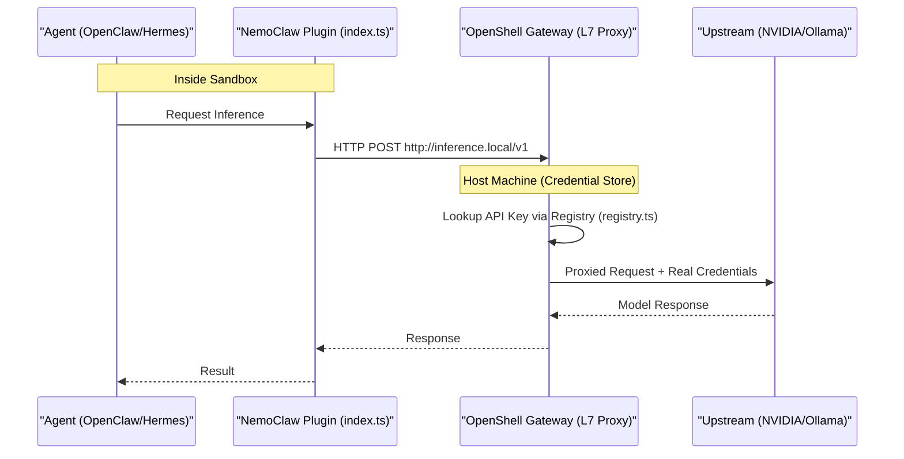

<!-- source: DeepWiki mcp.deepwiki.com · repo NVIDIA/NemoClaw · page 3.1 System Architecture · fetched 2026-10-26 -->

# System Architecture

Relevant source files

The following files were used as context for generating this wiki page:

- [agents/hermes/manifest.yaml](agents/hermes/manifest.yaml)
- [agents/langchain-deepagents-code/manifest.yaml](agents/langchain-deepagents-code/manifest.yaml)
- [agents/openclaw/manifest.yaml](agents/openclaw/manifest.yaml)
- [docs/reference/architecture.mdx](docs/reference/architecture.mdx)
- [nemoclaw-blueprint/provider-profiles/entra-runtime-v1.yaml](nemoclaw-blueprint/provider-profiles/entra-runtime-v1.yaml)
- [nemoclaw-blueprint/provider-profiles/okta-runtime-v1.yaml](nemoclaw-blueprint/provider-profiles/okta-runtime-v1.yaml)
- [nemoclaw/src/blueprint/runner-identity.test.ts](nemoclaw/src/blueprint/runner-identity.test.ts)
- [nemoclaw/src/blueprint/runner.test.ts](nemoclaw/src/blueprint/runner.test.ts)
- [nemoclaw/src/blueprint/runner.ts](nemoclaw/src/blueprint/runner.ts)
- [nemoclaw/src/blueprint/runtime-identity.test.ts](nemoclaw/src/blueprint/runtime-identity.test.ts)
- [nemoclaw/src/blueprint/runtime-identity.ts](nemoclaw/src/blueprint/runtime-identity.ts)
- [nemoclaw/src/blueprint/ssrf.test.ts](nemoclaw/src/blueprint/ssrf.test.ts)
- [nemoclaw/src/blueprint/ssrf.ts](nemoclaw/src/blueprint/ssrf.ts)
- [nemoclaw/src/index.ts](nemoclaw/src/index.ts)
- [nemoclaw/src/register.test.ts](nemoclaw/src/register.test.ts)
- [nemoclaw/src/runtime-context.test.ts](nemoclaw/src/runtime-context.test.ts)
- [nemoclaw/src/runtime-context.ts](nemoclaw/src/runtime-context.ts)
- [nemoclaw/src/security/safe-resolve-path.test.ts](nemoclaw/src/security/safe-resolve-path.test.ts)
- [nemoclaw/src/security/safe-resolve-path.ts](nemoclaw/src/security/safe-resolve-path.ts)
- [nemoclaw/src/security/secret-scanner.test.ts](nemoclaw/src/security/secret-scanner.test.ts)
- [nemoclaw/src/security/secret-scanner.ts](nemoclaw/src/security/secret-scanner.ts)
- [schemas/blueprint.schema.json](schemas/blueprint.schema.json)
- [src/lib/actions/inference-set-endpoint-security.test.ts](src/lib/actions/inference-set-endpoint-security.test.ts)
- [src/lib/actions/sandbox/rebuild-flow-helpers.test.ts](src/lib/actions/sandbox/rebuild-flow-helpers.test.ts)
- [src/lib/actions/sandbox/rebuild-flow-helpers.ts](src/lib/actions/sandbox/rebuild-flow-helpers.ts)
- [src/lib/actions/sandbox/rebuild-gateway-drift.test.ts](src/lib/actions/sandbox/rebuild-gateway-drift.test.ts)
- [src/lib/actions/sandbox/rebuild-prepared-recovery.ts](src/lib/actions/sandbox/rebuild-prepared-recovery.ts)
- [src/lib/agent/defs.test.ts](src/lib/agent/defs.test.ts)
- [src/lib/agent/defs.ts](src/lib/agent/defs.ts)
- [src/lib/agent/hermes-recovery-boundary-fixtures.ts](src/lib/agent/hermes-recovery-boundary-fixtures.ts)
- [src/lib/agent/onboard.test.ts](src/lib/agent/onboard.test.ts)
- [src/lib/agent/onboard.ts](src/lib/agent/onboard.ts)
- [src/lib/agent/runtime-recovery-preload.test.ts](src/lib/agent/runtime-recovery-preload.test.ts)
- [src/lib/agent/runtime-recovery-preload.ts](src/lib/agent/runtime-recovery-preload.ts)
- [src/lib/agent/runtime.test.ts](src/lib/agent/runtime.test.ts)
- [src/lib/agent/runtime.ts](src/lib/agent/runtime.ts)
- [src/lib/onboard/sandbox-registration.test.ts](src/lib/onboard/sandbox-registration.test.ts)
- [src/lib/onboard/sandbox-registration.ts](src/lib/onboard/sandbox-registration.ts)
- [src/lib/state/registry-entry-view.ts](src/lib/state/registry-entry-view.ts)
- [src/lib/state/registry.ts](src/lib/state/registry.ts)
- [src/lib/state/registry/lock.ts](src/lib/state/registry/lock.ts)
- [src/lib/state/registry/persistence.ts](src/lib/state/registry/persistence.ts)
- [src/lib/state/registry/types.ts](src/lib/state/registry/types.ts)
- [test/Dockerfile.sandbox](test/Dockerfile.sandbox)
- [test/blueprint-runtime-identity-lifecycle.test.ts](test/blueprint-runtime-identity-lifecycle.test.ts)
- [test/blueprint-runtime-identity-schema.test.ts](test/blueprint-runtime-identity-schema.test.ts)
- [test/e2e-test.sh](test/e2e-test.sh)
- [test/e2e/live/inference-routing.test.ts](test/e2e/live/inference-routing.test.ts)
- [test/e2e/live/runtime-identity-oauth-server.ts](test/e2e/live/runtime-identity-oauth-server.ts)
- [test/helpers/runtime-recovery-preload-test-helpers.ts](test/helpers/runtime-recovery-preload-test-helpers.ts)
- [test/install-agent-alias-parity.test.ts](test/install-agent-alias-parity.test.ts)
- [test/openclaw-tool-catalog-patch.test.ts](test/openclaw-tool-catalog-patch.test.ts)
- [test/registry.test.ts](test/registry.test.ts)

This page provides a detailed technical overview of NemoClaw's architecture, focusing on the plugin-blueprint model, multi-agent support, and integration with OpenShell. NemoClaw acts as an opinionated reference stack built on top of the NVIDIA OpenShell runtime.

## Architecture Overview

NemoClaw implements a three-layer architecture with clear separation between host operations, sandbox execution, and external services. The system is designed around a "Thin Plugin, Versioned Blueprint" model to ensure stable interfaces while allowing orchestration logic to evolve independently.

| Component | Type | Location | Purpose |
|-----------|------|----------|---------|
| **CLI / Plugin** | TypeScript package | `nemoclaw/` | Host CLI commands, in-sandbox plugin API, and blueprint orchestration. |
| **Blueprint** | YAML/TS artifact | `nemoclaw-blueprint/` | Declarative definitions for OpenShell resources, policies, and sandbox images. |
| **Agent Manifests** | YAML/Docker | `agents/` | Definitions for specific agent types like `OpenClaw` and `Hermes`. |

**Sources:** [docs/reference/architecture.mdx:12-18](), [nemoclaw/src/index.ts:4-12](), [agents/openclaw/manifest.yaml:1-10](), [agents/hermes/manifest.yaml:1-10]()

## System Components and Code Entities

The following diagram maps high-level system components to the specific code entities that implement them, bridging the gap between natural language concepts and the implementation files.

**Diagram: NemoClaw Component Topology**

**Sources:** [docs/reference/architecture.mdx:20-75](), [nemoclaw/src/blueprint/runner.ts:5-13](), [src/lib/state/registry.ts:108-115](), [nemoclaw/src/index.ts:16-23]()

## Multi-Agent Architecture

NemoClaw supports multiple agent types through standardized manifests located in the `agents/` directory. This allows for both Node.js (OpenClaw) and Python-based (Hermes) assistants to run in a unified security model.

### Supported Agents

1.  **OpenClaw**: The primary agent, running as a Node.js application. It uses the NemoClaw TypeScript plugin to register inference providers and handle slash commands.
    *   **Manifest**: Defined in `agents/openclaw/manifest.yaml` [agents/openclaw/manifest.yaml:10-24]().
    *   **Persistence**: Manages state in `.openclaw/` with specific directories for `workspace`, `skills`, and `memory` [agents/openclaw/manifest.yaml:42-58]().
2.  **Hermes**: A Python-based agent developed by Nous Research.
    *   **Manifest**: Defined in `agents/hermes/manifest.yaml` [agents/hermes/manifest.yaml:7-25]().
    *   **Health Probe**: Uses a specialized health check on port 8642 [agents/hermes/manifest.yaml:27-33]().
    *   **State Management**: Utilizes `sqlite_backup` strategy for `state.db` and `cron-executions.db` [agents/hermes/manifest.yaml:97-108]().

### Agent Lifecycle and Registry

The host-side `registry.ts` manages the metadata for every provisioned agent sandbox.
*   **Registration**: The `registerSandbox` function stores inference metadata, GPU status, and agent versions [src/lib/state/registry.ts:108-160]().
*   **Persistence**: Data is stored in `~/.nemoclaw/sandboxes.json` [src/lib/state/registry.ts:64-64]().
*   **Normalization**: The registry ensures baseline exclusions and policy tiers are normalized across different agent types [src/lib/state/registry.ts:127-131]().

**Sources:** [src/lib/state/registry.ts:88-106](), [agents/openclaw/manifest.yaml:1-16](), [agents/hermes/manifest.yaml:1-14]()

## Plugin-Blueprint Model

The core architectural pattern separates the **Plugin** (interface/API) from the **Blueprint** (infrastructure orchestration).

### Blueprint System
The blueprint defines the "desired state" of the OpenShell environment. The `blueprint/runner.ts` orchestrates the lifecycle:
*   **Resolve**: Validates endpoint URLs and SSRF protections [nemoclaw/src/blueprint/runner.ts:47-47]().
*   **Plan**: Generates a run ID (e.g., `nc-YYYYMMDD-HHMMSS-XXXXXXXX`) and calculates required changes [nemoclaw/src/blueprint/runner.ts:158-166]().
*   **Apply**: Executes `openshell` CLI commands to create sandboxes, configure inference, and apply policies [nemoclaw/src/blueprint/runner.ts:65-66]().

### Plugin Architecture
The NemoClaw plugin (`nemoclaw/src/index.ts`) acts as the runtime bridge inside the sandbox.
*   **Slash Commands**: Implements `handleSlashCommand` for in-chat interaction [nemoclaw/src/index.ts:16-16]().
*   **Inference Provider**: Registers a custom provider in the agent's ecosystem that routes to the OpenShell gateway [nemoclaw/src/index.ts:191-193]().
*   **Secret Scanning**: Includes a `secret-scanner.ts` to prevent accidental disclosure of credentials in workspace files [nemoclaw/src/index.ts:25-25]().

**Sources:** [nemoclaw/src/blueprint/runner.ts:5-13](), [nemoclaw/src/index.ts:4-12](), [test/e2e-test.sh:118-126]()

## Data Flow: Inference and Credentials

NemoClaw ensures that sensitive credentials never enter the sandbox environment by utilizing the OpenShell Gateway as a secure proxy.

**Diagram: Secure Inference Data Flow**

*   **Credential Isolation**: The agent uses `inference.local` inside the sandbox; real credentials stay on the host [docs/reference/architecture.mdx:67-75]().
*   **Inference Selection**: The registry tracks the `preferredInferenceApi` and `endpointUrl` for each sandbox [src/lib/state/registry.ts:117-117]().
*   **SSRF Protection**: The blueprint runner validates that inference endpoints do not point to restricted internal metadata services [nemoclaw/src/blueprint/ssrf.ts:1-20]().

**Sources:** [nemoclaw/src/blueprint/runner.ts:47-47](), [src/lib/state/registry.ts:72-90](), [test/registry.test.ts:72-90]()

## State and Persistence

NemoClaw manages complex state transitions, especially during agent migrations and rebuilds.

| Feature | Implementation | Code Pointer |
| :--- | :--- | :--- |
| **Sandbox Registry** | JSON persistence with file locking | [src/lib/state/registry.ts:109-110]() |
| **Workload Receipts** | Tracking of provisioned container state | [src/lib/state/registry.ts:167-167]() |
| **Messaging State** | Channel configuration and auth modes | [src/lib/state/registry.ts:170-170]() |
| **Migration** | Snapshot creation and state transfer | [docs/reference/architecture.mdx:43-43]() |

**Sources:** [src/lib/state/registry.ts:1-25](), [test/registry.test.ts:57-70](), [test/Dockerfile.sandbox:13-29]()

---

