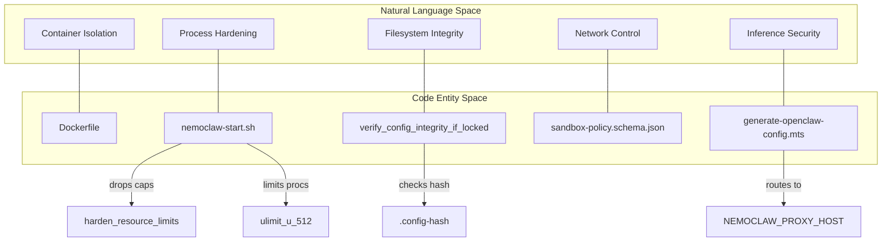
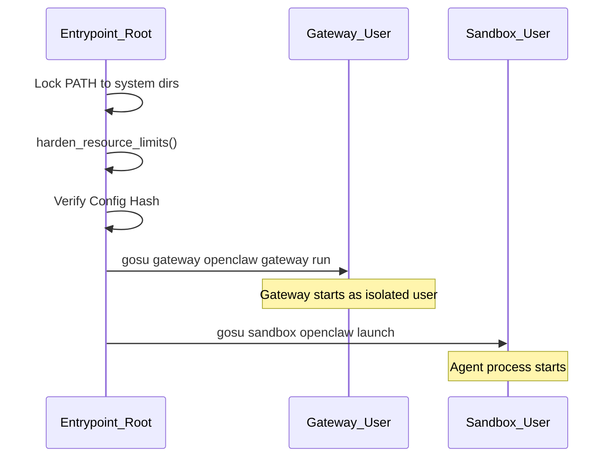
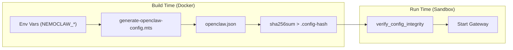

<!-- source: DeepWiki mcp.deepwiki.com · repo NVIDIA/NemoClaw · page 3.2 Sandboxing and Security · fetched 2026-10-26 -->

# Sandboxing and Security

Relevant source files

The following files were used as context for generating this wiki page:

- [Dockerfile](Dockerfile)
- [Dockerfile.base](Dockerfile.base)
- [agents/hermes/runtime-config-guard.py](agents/hermes/runtime-config-guard.py)
- [agents/hermes/validate-env-secret-boundary.py](agents/hermes/validate-env-secret-boundary.py)
- [docs/deployment/sandbox-hardening.mdx](docs/deployment/sandbox-hardening.mdx)
- [docs/network-policy/apply-policy-presets.mdx](docs/network-policy/apply-policy-presets.mdx)
- [docs/network-policy/approve-network-requests.mdx](docs/network-policy/approve-network-requests.mdx)
- [docs/network-policy/change-baseline-network-policy.mdx](docs/network-policy/change-baseline-network-policy.mdx)
- [docs/network-policy/create-custom-policy-presets.mdx](docs/network-policy/create-custom-policy-presets.mdx)
- [docs/network-policy/customize-network-policy.mdx](docs/network-policy/customize-network-policy.mdx)
- [docs/network-policy/integration-policy-examples.mdx](docs/network-policy/integration-policy-examples.mdx)
- [docs/reference/cli-selection-guide.mdx](docs/reference/cli-selection-guide.mdx)
- [docs/reference/network-policies.mdx](docs/reference/network-policies.mdx)
- [docs/security/best-practices.mdx](docs/security/best-practices.mdx)
- [docs/security/openclaw-2026.6.10-dependency-review.md](docs/security/openclaw-2026.6.10-dependency-review.md)
- [docs/security/sandbox-base-libexpat-jq-2026-07-24-dependency-review.md](docs/security/sandbox-base-libexpat-jq-2026-07-24-dependency-review.md)
- [nemoclaw/src/lib/subprocess-env.ts](nemoclaw/src/lib/subprocess-env.ts)
- [scripts/lib/sandbox-init.sh](scripts/lib/sandbox-init.sh)
- [scripts/lib/sandbox-rlimits.sh](scripts/lib/sandbox-rlimits.sh)
- [scripts/nemoclaw-start.sh](scripts/nemoclaw-start.sh)
- [scripts/patch-openclaw-issue-4434-diagnostics.mts](scripts/patch-openclaw-issue-4434-diagnostics.mts)
- [src/lib/onboard/http-proxy-preflight.test.ts](src/lib/onboard/http-proxy-preflight.test.ts)
- [src/lib/onboard/http-proxy-preflight.ts](src/lib/onboard/http-proxy-preflight.ts)
- [src/lib/sandbox/build-context.ts](src/lib/sandbox/build-context.ts)
- [src/lib/shields/flow.test.ts](src/lib/shields/flow.test.ts)
- [src/lib/shields/index.test.ts](src/lib/shields/index.test.ts)
- [src/lib/shields/index.ts](src/lib/shields/index.ts)
- [src/lib/shields/legacy-hermes-compat.test.ts](src/lib/shields/legacy-hermes-compat.test.ts)
- [src/lib/shields/legacy-hermes-transition.test.ts](src/lib/shields/legacy-hermes-transition.test.ts)
- [src/lib/shields/policy-transition.test.ts](src/lib/shields/policy-transition.test.ts)
- [src/lib/shields/seal.test.ts](src/lib/shields/seal.test.ts)
- [src/lib/shields/seal.ts](src/lib/shields/seal.ts)
- [src/lib/shields/timer.test.ts](src/lib/shields/timer.test.ts)
- [src/lib/shields/timer.ts](src/lib/shields/timer.ts)
- [src/lib/shields/verify-lock.test.ts](src/lib/shields/verify-lock.test.ts)
- [src/lib/shields/verify-lock.ts](src/lib/shields/verify-lock.ts)
- [src/lib/subprocess-env.test.ts](src/lib/subprocess-env.test.ts)
- [src/lib/subprocess-env.ts](src/lib/subprocess-env.ts)
- [test/credential-exposure.test.ts](test/credential-exposure.test.ts)
- [test/deepagents-monitoring-published-routes.test.ts](test/deepagents-monitoring-published-routes.test.ts)
- [test/e2e-gateway-isolation.sh](test/e2e-gateway-isolation.sh)
- [test/e2e/live/hermes-shields-config.test.ts](test/e2e/live/hermes-shields-config.test.ts)
- [test/fetch-guard-patch-regression.test.ts](test/fetch-guard-patch-regression.test.ts)
- [test/generate-openclaw-config.test.ts](test/generate-openclaw-config.test.ts)
- [test/helpers/base-apt-security-functions.ts](test/helpers/base-apt-security-functions.ts)
- [test/hermes-runtime-config-guard-topology.test.ts](test/hermes-runtime-config-guard-topology.test.ts)
- [test/host-proxy-inference-local-e2e.test.ts](test/host-proxy-inference-local-e2e.test.ts)
- [test/issue-4434-error-fields.test.ts](test/issue-4434-error-fields.test.ts)
- [test/nemoclaw-start.test.ts](test/nemoclaw-start.test.ts)
- [test/network-policies-published-routes.test.ts](test/network-policies-published-routes.test.ts)
- [test/openclaw-dependency-review.test.ts](test/openclaw-dependency-review.test.ts)
- [test/openclaw-integrity-pin-suite.ts](test/openclaw-integrity-pin-suite.ts)
- [test/openclaw-issue-4434-diagnostics-patch.test.ts](test/openclaw-issue-4434-diagnostics-patch.test.ts)
- [test/openclaw-real-patched-dist-harness.test.ts](test/openclaw-real-patched-dist-harness.test.ts)
- [test/perl-critical-cve-remediation.test.ts](test/perl-critical-cve-remediation.test.ts)
- [test/policy-roundtrip-docs.test.ts](test/policy-roundtrip-docs.test.ts)
- [test/repro-2681-group-writable.test.ts](test/repro-2681-group-writable.test.ts)
- [test/sandbox-base-security-packages.test.ts](test/sandbox-base-security-packages.test.ts)
- [test/sandbox-build-context.test.ts](test/sandbox-build-context.test.ts)
- [test/sandbox-init.test.ts](test/sandbox-init.test.ts)
- [test/sandbox-provisioning.test.ts](test/sandbox-provisioning.test.ts)
- [test/sandbox-rlimit-hooks.test.ts](test/sandbox-rlimit-hooks.test.ts)
- [test/service-env.test.ts](test/service-env.test.ts)

This page describes NemoClaw's security architecture, including the sandbox container structure, multi-layer protection model, policy enforcement mechanisms, and operator control workflows. It covers the technical implementation of isolation layers, hardened container entrypoints, and the lifecycle of security policies.

For information about configuring specific network policies and endpoint groups, see [Network Policy Reference](). For details on the blueprint system that orchestrates sandbox creation, see [Blueprint System]().

---

## Security Model Overview

NemoClaw implements a **defense-in-depth** security model with five distinct protection layers: **Network**, **Filesystem**, **Process**, **Gateway Authentication**, and **Inference** [docs/security/best-practices.mdx:25-28](). The sandbox executes OpenClaw agents in a restricted environment where every system call, file access, network connection, and inference request is subject to policy enforcement.

### Protection Layers Implementation Mapping

The following diagram maps high-level security concepts to the specific code entities and files that implement them.

**Title: Security Layer Implementation Mapping**

**Sources:** [Dockerfile:1-125](), [scripts/nemoclaw-start.sh:1-170](), [test/e2e-gateway-isolation.sh:5-193](), [docs/security/best-practices.mdx:27-90](), [scripts/generate-openclaw-config.mts:29-30]()

---

## Sandbox Container Architecture

The sandbox is a hardened Docker container managed by OpenShell. It uses a multi-stage build process to ensure that build-time secrets and tools do not leak into the runtime image.

### Container Build Structure

The sandbox image is defined in `Dockerfile`, which layers NemoClaw-specific logic onto a pre-built base image [Dockerfile:1-12]().

| Component | Purpose | Implementation Detail |
|-----------|---------|-----------------------|
| **Base Image** | Minimal runtime | `ghcr.io/nvidia/nemoclaw/sandbox-base:latest` [Dockerfile:12]() |
| **Hardening** | Tool purging | Native security package builds [Dockerfile.base:75-84]() |
| **Privilege Sep** | Multi-user | `gateway` vs `sandbox` users [scripts/nemoclaw-start.sh:8-10]() |
| **Integrity** | Config pinning | Verification of `openclaw.json` hash [scripts/nemoclaw-start.sh:10-11]() |
| **Environment** | Cache isolation | `AWS_EC2_METADATA_DISABLED=true` [Dockerfile:119]() |

### Multi-User Isolation

A critical security feature is the separation of the **Gateway** and the **Agent**.
*   **Gateway User:** Runs the OpenClaw gateway process.
*   **Sandbox User:** Runs the agent and user-defined commands.

The gateway runs as a separate user so the sandboxed agent cannot kill it or restart it with a tampered configuration (mitigating the "fake-HOME" bypass) [scripts/nemoclaw-start.sh:8-10](). 

**Sources:** [Dockerfile:1-145](), [scripts/nemoclaw-start.sh:5-10](), [test/e2e-gateway-isolation.sh:60-72](), [Dockerfile.base:23-24]()

---

## Protection Layers

### Layer 1: Process and Resource Hardening

The entrypoint script `nemoclaw-start.sh` applies several kernel-level restrictions immediately upon container startup:

1.  **Resource Limits:** Calls `harden_resource_limits` (from `sandbox-rlimits.sh`) as root PID 1 to lock down `nproc` and `nofile` [scripts/nemoclaw-start.sh:135-137]().
2.  **Capability Dropping:** Uses `capsh` to drop dangerous Linux capabilities before dropping privileges to the gateway or sandbox user [scripts/nemoclaw-start.sh:135-140]().
3.  **PATH Locking:** Explicitly locks `PATH` to system directories (`/usr/local/bin`, etc.) at the very top of the script to prevent binary hijacking [scripts/nemoclaw-start.sh:37-39]().
4.  **Tool Cache Redirects:** Redirects tool caches (npm, XDG, bash history) to `/tmp` via `_TOOL_REDIRECTS` to ensure transient state stays outside the durable workspace [scripts/nemoclaw-start.sh:150-165]().

**Sources:** [scripts/nemoclaw-start.sh:35-165](), [docs/security/best-practices.mdx:84-90](), [scripts/lib/sandbox-rlimits.sh:1-10]()

### Layer 2: Filesystem Policy and Integrity

NemoClaw enforces strict filesystem boundaries. While OpenShell uses Landlock LSM for runtime path whitelisting [docs/security/best-practices.mdx:84](), NemoClaw adds an additional layer of **DAC (Discretionary Access Control)** hardening:

*   **Config Integrity:** The entrypoint call verifies the config hash to detect tampering before startup [scripts/nemoclaw-start.sh:10-11]().
*   **Secure File Creation:** Uses `_nemoclaw_safe_replace_tmp_file` to write files in `/tmp` with restricted permissions (e.g., 600) to protect diagnostics and tokens [scripts/nemoclaw-start.sh:72-100]().
*   **Permission Normalization:** NemoClaw ensures that the image remains readable to the root entrypoint while maintaining the gateway/sandbox group separation [test/sandbox-provisioning.test.ts:161-165]().
*   **Shields System:** The `shields up` command locks the configuration and applies a restrictive network policy, while `shields down` returns it to a mutable state [src/lib/shields/index.ts:6-11]().

**Sources:** [scripts/nemoclaw-start.sh:10-100](), [test/sandbox-provisioning.test.ts:161-165](), [src/lib/shields/index.ts:6-11]()

### Layer 3: Network and Inference Security

All outbound traffic is intercepted by the OpenShell L7 gateway.

1.  **Deny-by-Default:** All egress is blocked unless explicitly allowed in the policy [docs/security/best-practices.mdx:99-105]().
2.  **SSRF Guard:** Network policy allowlists do not disable OpenShell's SSRF guard; internal-address blocking remains active even when an endpoint matches an egress rule [docs/security/best-practices.mdx:92]().
3.  **Binary-Scoped Rules:** Policy entries can restrict access to specific calling binaries (e.g., restricting HTTP methods for specific tools) [docs/security/best-practices.mdx:83-91]().
4.  **Inference Isolation:** The sandbox receives a narrow `inference.local` interface rather than host credentials, preventing credential exposure [docs/security/best-practices.mdx:115]().

**Sources:** [docs/security/best-practices.mdx:83-115](), [Dockerfile:117-119]()

---

## Security Workflows

### Entrypoint Execution Flow

The entrypoint manages the transition from a high-privilege setup state to a low-privilege execution state.

**Title: nemoclaw-start.sh Execution Sequence**

**Sources:** [scripts/nemoclaw-start.sh:5-170](), [test/e2e-gateway-isolation.sh:175-189]()

### Config Generation Integrity

NemoClaw uses a TypeScript script `generate-openclaw-config.mts` to bake the agent configuration. This script is designed to prevent shell injection and ensure environment-driven configuration [test/generate-openclaw-config.test.ts:25-40]().

**Title: Configuration Lifecycle**

**Sources:** [scripts/generate-openclaw-config.mts:1-40](), [test/generate-openclaw-config.test.ts:106-112](), [test/nemoclaw-start.test.ts:143-160]()

---

## Security Hardening Summary

| Feature | Implementation | File Reference |
|---------|----------------|----------------|
| **Fork Bomb Protection** | `ulimit -u 512` | [scripts/nemoclaw-start.sh:58-60]() |
| **Capability Drop** | `harden_resource_limits` | [scripts/nemoclaw-start.sh:137]() |
| **Config Integrity** | `.config-hash` verification | [scripts/nemoclaw-start.sh:10]() |
| **SSRF Protection** | OpenShell Gateway + SSRF Guard | [docs/security/best-practices.mdx:92]() |
| **Credential Masking** | `inference.local` interface | [docs/security/best-practices.mdx:115]() |
| **Path Locking** | Strict system `PATH` | [scripts/nemoclaw-start.sh:39]() |
| **Tool Cache Isolation** | `/tmp` tool redirects | [scripts/nemoclaw-start.sh:150-165]() |

**Sources:** [Dockerfile:1-125](), [scripts/nemoclaw-start.sh:1-170](), [docs/security/best-practices.mdx:14-132]()

---

