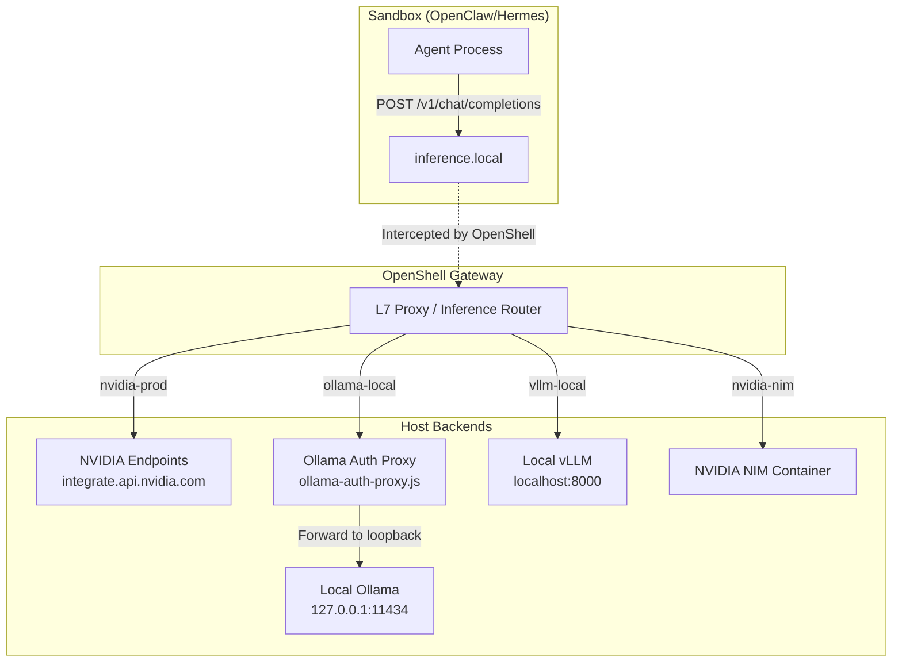
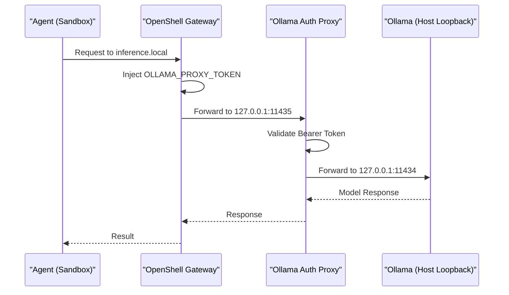

<!-- source: DeepWiki mcp.deepwiki.com · repo NVIDIA/NemoClaw · page 3.3 Inference Routing · fetched 2026-10-26 -->

# Inference Routing

Relevant source files

The following files were used as context for generating this wiki page:

- [docs/changelog/2026-07-31.mdx](docs/changelog/2026-07-31.mdx)
- [docs/inference/declarative-agents-manifest.mdx](docs/inference/declarative-agents-manifest.mdx)
- [docs/inference/set-up-sub-agent.mdx](docs/inference/set-up-sub-agent.mdx)
- [docs/inference/set-up-vllm.mdx](docs/inference/set-up-vllm.mdx)
- [docs/inference/switch-providers.mdx](docs/inference/switch-providers.mdx)
- [docs/inference/understand-provider-validation.mdx](docs/inference/understand-provider-validation.mdx)
- [docs/monitoring/monitor-sandbox-activity.mdx](docs/monitoring/monitor-sandbox-activity.mdx)
- [src/lib/actions/inference-set-compatible-provider.test.ts](src/lib/actions/inference-set-compatible-provider.test.ts)
- [src/lib/actions/inference-set-degraded-state.test.ts](src/lib/actions/inference-set-degraded-state.test.ts)
- [src/lib/actions/inference-set-gateway-route-containment.test.ts](src/lib/actions/inference-set-gateway-route-containment.test.ts)
- [src/lib/actions/inference-set-provider-alias.test.ts](src/lib/actions/inference-set-provider-alias.test.ts)
- [src/lib/actions/inference-set-provider.test.ts](src/lib/actions/inference-set-provider.test.ts)
- [src/lib/actions/inference-set-provider.ts](src/lib/actions/inference-set-provider.ts)
- [src/lib/actions/inference-set-route-containment.ts](src/lib/actions/inference-set-route-containment.ts)
- [src/lib/actions/inference-set.test-support.ts](src/lib/actions/inference-set.test-support.ts)
- [src/lib/actions/inference-set.ts](src/lib/actions/inference-set.ts)
- [src/lib/actions/sandbox/status.test.ts](src/lib/actions/sandbox/status.test.ts)
- [src/lib/adapters/http/curl-args.ts](src/lib/adapters/http/curl-args.ts)
- [src/lib/adapters/http/probe.test.ts](src/lib/adapters/http/probe.test.ts)
- [src/lib/adapters/http/probe.ts](src/lib/adapters/http/probe.ts)
- [src/lib/inference/gpu-trust.ts](src/lib/inference/gpu-trust.ts)
- [src/lib/inference/health.test.ts](src/lib/inference/health.test.ts)
- [src/lib/inference/health.ts](src/lib/inference/health.ts)
- [src/lib/inference/local.test.ts](src/lib/inference/local.test.ts)
- [src/lib/inference/local.ts](src/lib/inference/local.ts)
- [src/lib/inference/nim.test.ts](src/lib/inference/nim.test.ts)
- [src/lib/inference/nim.ts](src/lib/inference/nim.ts)
- [src/lib/inference/ollama-runtime-context.test.ts](src/lib/inference/ollama-runtime-context.test.ts)
- [src/lib/inference/ollama-runtime-context.ts](src/lib/inference/ollama-runtime-context.ts)
- [src/lib/inference/ollama-version.ts](src/lib/inference/ollama-version.ts)
- [src/lib/inference/ollama/model-size.ts](src/lib/inference/ollama/model-size.ts)
- [src/lib/inference/onboard-probes.test.ts](src/lib/inference/onboard-probes.test.ts)
- [src/lib/inference/onboard-probes.ts](src/lib/inference/onboard-probes.ts)
- [src/lib/inference/openai-validation-session.test.ts](src/lib/inference/openai-validation-session.test.ts)
- [src/lib/inference/openai-validation-session.ts](src/lib/inference/openai-validation-session.ts)
- [src/lib/inference/probe-http-helpers.test.ts](src/lib/inference/probe-http-helpers.test.ts)
- [src/lib/inference/probe-http-helpers.ts](src/lib/inference/probe-http-helpers.ts)
- [src/lib/inference/vllm-models.test.ts](src/lib/inference/vllm-models.test.ts)
- [src/lib/inference/vllm-models.ts](src/lib/inference/vllm-models.ts)
- [src/lib/inference/vllm-storage.test.ts](src/lib/inference/vllm-storage.test.ts)
- [src/lib/inference/vllm-storage.ts](src/lib/inference/vllm-storage.ts)
- [src/lib/inference/vllm.test.ts](src/lib/inference/vllm.test.ts)
- [src/lib/inference/vllm.ts](src/lib/inference/vllm.ts)
- [src/lib/onboard/inference-capability-cache.test.ts](src/lib/onboard/inference-capability-cache.test.ts)
- [src/lib/onboard/inference-capability-cache.ts](src/lib/onboard/inference-capability-cache.ts)
- [src/lib/onboard/inference-selection-validation.test.ts](src/lib/onboard/inference-selection-validation.test.ts)
- [src/lib/onboard/inference-selection-validation.ts](src/lib/onboard/inference-selection-validation.ts)
- [src/lib/onboard/ollama-systemd.test.ts](src/lib/onboard/ollama-systemd.test.ts)
- [src/lib/onboard/ollama-systemd.ts](src/lib/onboard/ollama-systemd.ts)
- [src/lib/onboard/setup-nim-selection.test.ts](src/lib/onboard/setup-nim-selection.test.ts)
- [src/lib/onboard/setup-nim-selection.ts](src/lib/onboard/setup-nim-selection.ts)
- [test/agent-variant-docs.test.ts](test/agent-variant-docs.test.ts)
- [test/detect-vllm-profile.test.ts](test/detect-vllm-profile.test.ts)
- [test/helpers/onboard-smoke-verifier-harness.ts](test/helpers/onboard-smoke-verifier-harness.ts)
- [test/inference-options-docs.test.ts](test/inference-options-docs.test.ts)
- [test/onboard-smoke-verifier.test.ts](test/onboard-smoke-verifier.test.ts)

Inference routing in NemoClaw manages how model API requests from the OpenClaw or Hermes agents reach Large Language Model (LLM) backends. To ensure security and flexibility, all inference requests are intercepted by the **OpenShell Gateway** and routed to configured providers based on active profiles. The agent inside the sandbox interacts only with a virtualized endpoint, `inference.local`, while actual credentials and upstream URLs remain on the host.

---

## Architecture Overview

The routing system operates at the gateway layer. When an agent makes a completion request, it targets `http://inference.local/v1` or `https://inference.local/v1`. The OpenShell gateway intercepts this traffic and redirects it to the provider selected during onboarding.

### Natural Language to Code Entity Mapping

| System Concept | Code Entity / Symbol | File Reference |
|:---|:---|:---|
| **Inference Endpoint** | `inference.local` | [src/lib/actions/inference-set.ts:71-71]() |
| **Local Proxy Script** | `ollama-auth-proxy.js` | [src/lib/inference/ollama/proxy.ts:137-137]() |
| **Model Switcher** | `runInferenceSet` | [src/lib/actions/inference-set.ts:34-34]() |
| **Provider Config** | `getSandboxInferenceConfig` | [src/lib/inference/config.ts:11-13]() |
| **Inference Fix** | `nemotron-inference-fix.js` | [nemoclaw-blueprint/scripts/nemotron-inference-fix.js:1-1]() |

### System Component Diagram

**Sources:** [src/lib/actions/inference-set.ts:84-96](), [src/lib/inference/local.ts:67-68](), [src/lib/inference/ollama/proxy.ts:14-15]()

---

## Routed Provider Model

NemoClaw implements a "Routed Provider" where credentials (API Keys) are kept on the host and never exposed to the sandbox. The `runInferenceSet` function manages the synchronization between the host state and the sandbox agent configuration [src/lib/actions/inference-set.ts:34-46]().

### Data Flow and Request Lifecycle

1.  **Onboarding/Set**: The `handleProviderInferenceState` orchestrator probes the selected endpoint and configures the OpenShell route [src/lib/onboard/machine/handlers/provider-inference.ts:152-164]().
2.  **Inference Interception**: The agent calls `inference.local`. The gateway identifies the request and injects host-side credentials using the provider mapping [src/lib/actions/inference-set.ts:218-220]().
3.  **Local Auth Proxy**: For local Ollama, a token-gated proxy validates requests before they reach the model server [src/lib/inference/ollama/proxy.ts:135-147]().

**Sources:** [src/lib/inference/ollama/proxy.ts:177-202](), [src/lib/inference/local.ts:56-62](), [src/lib/actions/inference-set.ts:332-345]()

---

## Inference Providers

NemoClaw supports several provider families, defined in the `SUPPORTED_PROVIDER_NAMES` constant [src/lib/actions/inference-set.ts:84-96]().

| Provider | Endpoint Type | Credential Env | Notes |
|:---|:---|:---|:---|
| **nvidia-prod** | OpenAI-compatible | `NVIDIA_API_KEY` | Hosted NVIDIA API Catalog |
| **openai-api** | Native OpenAI | `OPENAI_API_KEY` | Routes to api.openai.com |
| **anthropic-prod** | Native Anthropic | `ANTHROPIC_API_KEY` | Uses Anthropic Messages API |
| **ollama-local** | Local Ollama API | N/A (Internal Token) | Managed proxy on port 11435 [src/lib/core/ports.ts]() |
| **vllm-local** | OpenAI-compatible | N/A (Local) | Self-hosted vLLM container [src/lib/inference/vllm.ts:28-50]() |
| **nvidia-nim** | NIM API | N/A (Local) | Local NVIDIA NIM deployment [src/lib/inference/nim.ts:4-5]() |

**Sources:** [src/lib/actions/inference-set.ts:84-96](), [src/lib/inference/vllm.ts:121-137](), [src/lib/inference/nim.ts:38-42]()

---

## Local Inference Routing

### Ollama Auth Proxy
On non-WSL hosts, NemoClaw keeps Ollama bound to `127.0.0.1:11434` and starts a token-gated reverse proxy on `0.0.0.0:11435` [src/lib/inference/ollama/proxy.ts:13-14](). 
- **Token Management**: A random 24-byte hex token is generated and stored [src/lib/inference/ollama/proxy.ts:181-182]().
- **Authentication**: The proxy script `ollama-auth-proxy.js` validates the `Authorization: Bearer` header [src/lib/inference/ollama/proxy.ts:82-85]().
- **Container Reachability**: The `getOllamaContainerPort` helper determines if a container should hit the proxy (port 11435) or direct loopback (port 11434) based on platform capabilities [src/lib/inference/local.ts:57-62]().

### vLLM and NIM Profiles
NemoClaw provides specialized profiles for local GPU inference based on detected hardware [src/lib/inference/vllm.ts:180-195]().
- **DGX Spark/Station**: Uses `nvcr.io/nvidia/vllm:26.05.post1-py3` with high-performance models like Qwen-35B [src/lib/inference/vllm.ts:121-145](). The `VLLM_IMAGES` constant defines specific image tags and their download sizes for different platforms and architectures [src/lib/inference/vllm.ts:138-159]().
- **Generic Linux**: Falls back to `Nemotron-3-Nano-4B` for standard NVIDIA GPUs [src/lib/inference/vllm.ts:170-178]().
- **GPU Grouping**: NIM logic groups GPUs by model name to determine if specific images (like H100 optimized) should be pulled [src/lib/inference/nim.ts:133-147](). The `groupGpusByName` function normalizes GPU names and aggregates them into `GpuGroup` objects [src/lib/inference/nim.ts:133-147]().

**Sources:** [src/lib/inference/ollama/proxy.ts:13-14](), [src/lib/inference/ollama/proxy.ts:181-182](), [src/lib/inference/ollama/proxy.ts:82-85](), [src/lib/inference/local.ts:57-62](), [src/lib/inference/vllm.ts:180-195](), [src/lib/inference/vllm.ts:121-145](), [src/lib/inference/vllm.ts:138-159](), [src/lib/inference/vllm.ts:170-178](), [src/lib/inference/nim.ts:133-147]()

---

## Runtime Switching

The active model or provider can be changed using `runInferenceSet`, which updates both the OpenShell route and the agent's internal configuration [src/lib/actions/inference-set.ts:34-46]().

### Switching Logic
- **OpenClaw**: The `patchOpenClawInferenceConfig` function updates the JSON config, modifying provider base URLs and primary model references [src/lib/actions/inference-set.ts:218-235]().
- **Hermes**: The `patchHermesInferenceConfig` function updates YAML configuration, specifically the `model` block and `auth_method` [src/lib/actions/inference-set.ts:286-310]().
- **Verification**: Unless `--no-verify` is passed, the system performs a health check on the new provider before finalizing the switch [src/lib/actions/inference-set.ts:347-350](). The `validateOpenAiLikeSelection` and `validateAnthropicSelectionWithRetryMessage` functions handle endpoint validation, including SSRF preflight checks for custom endpoints [src/lib/onboard/inference-selection-validation.ts:99-126]().

### Dynamic Parameter Injection
NemoClaw uses scripts to fix common inference issues for specific models:
- **Nemotron Fix**: Injects `chat_template_kwargs` into requests to ensure "thinking" tokens are handled correctly [nemoclaw-blueprint/scripts/nemotron-inference-fix.js:1-1]().
- **Context Window Auto-detection**: For Ollama, the system probes the runtime to resolve the actual context window supported by the loaded model [src/lib/inference/ollama-runtime-context.ts:23-24](). The `resolveContextWindowForModel` function determines the appropriate context window based on the provider and model [src/lib/inference/config.ts:11-13]().

**Sources:** [src/lib/actions/inference-set.ts:162-217](), [src/lib/inference/local.ts:17-24](), [src/lib/inference/vllm.ts:180-195](), [src/lib/onboard/inference-selection-validation.ts:99-126](), [src/lib/inference/ollama-runtime-context.ts:23-24](), [src/lib/inference/config.ts:11-13]()

---

