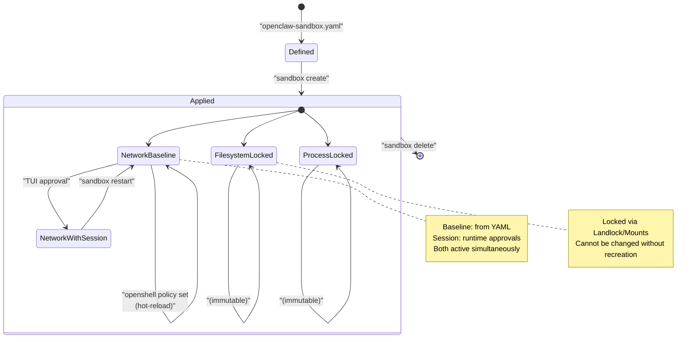
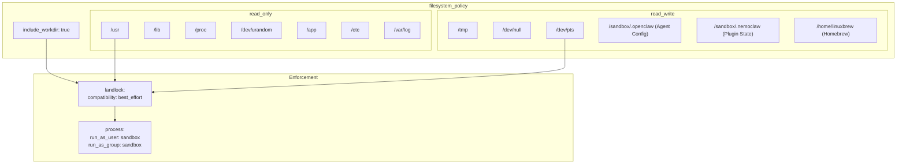
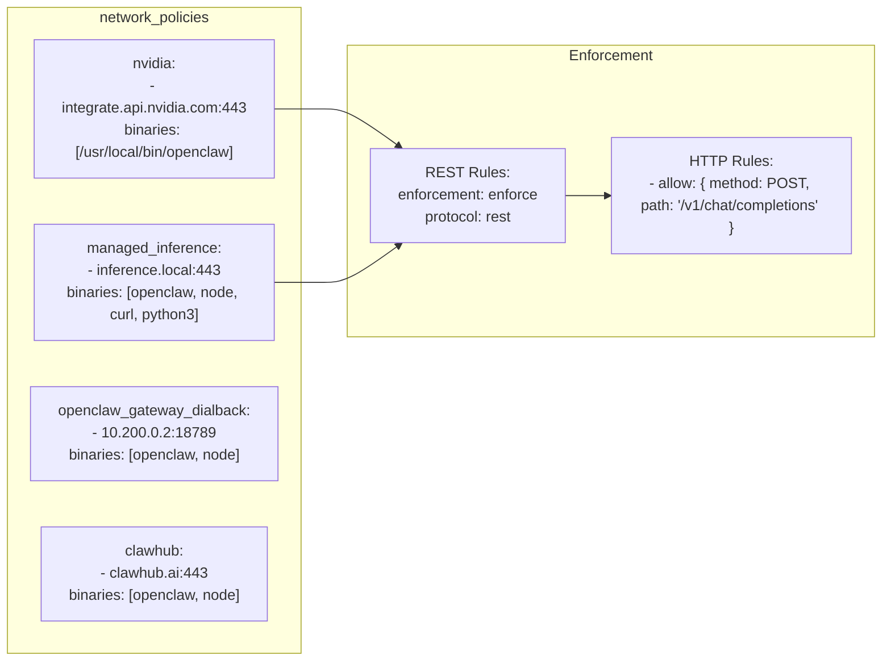
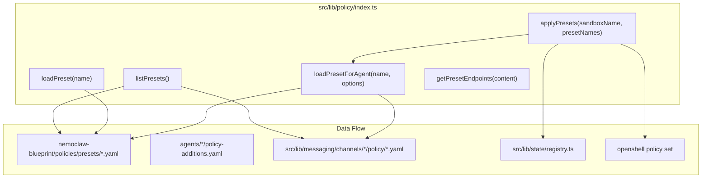
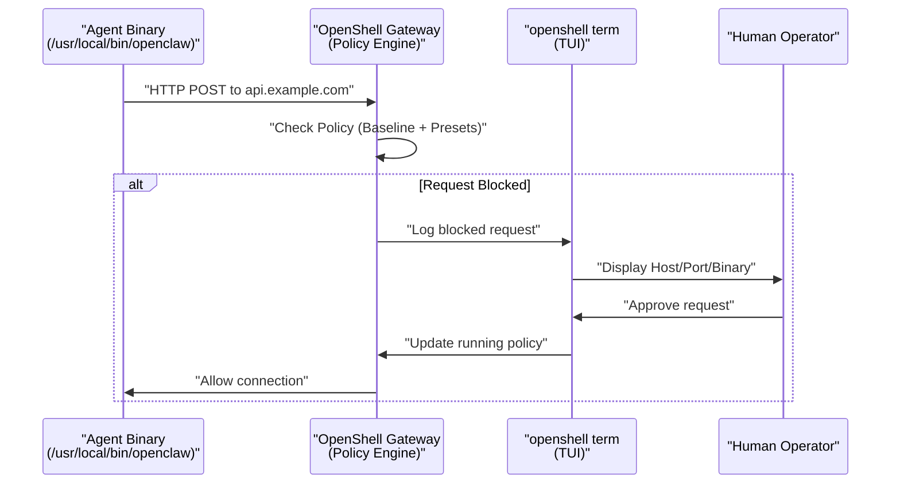

<!-- source: DeepWiki mcp.deepwiki.com · repo NVIDIA/NemoClaw · page 3.4 Policy System · fetched 2026-10-26 -->

# Policy System

Relevant source files

The following files were used as context for generating this wiki page:

- [agents/hermes/policy-additions.yaml](agents/hermes/policy-additions.yaml)
- [agents/hermes/policy-permissive.yaml](agents/hermes/policy-permissive.yaml)
- [agents/openclaw/policy-permissive.yaml](agents/openclaw/policy-permissive.yaml)
- [ci/test-file-size-budget.json](ci/test-file-size-budget.json)
- [docs/deployment/sandbox-hardening.mdx](docs/deployment/sandbox-hardening.mdx)
- [docs/network-policy/apply-policy-presets.mdx](docs/network-policy/apply-policy-presets.mdx)
- [docs/network-policy/approve-network-requests.mdx](docs/network-policy/approve-network-requests.mdx)
- [docs/network-policy/change-baseline-network-policy.mdx](docs/network-policy/change-baseline-network-policy.mdx)
- [docs/network-policy/create-custom-policy-presets.mdx](docs/network-policy/create-custom-policy-presets.mdx)
- [docs/network-policy/customize-network-policy.mdx](docs/network-policy/customize-network-policy.mdx)
- [docs/network-policy/integration-policy-examples.mdx](docs/network-policy/integration-policy-examples.mdx)
- [docs/reference/cli-selection-guide.mdx](docs/reference/cli-selection-guide.mdx)
- [docs/reference/network-policies.mdx](docs/reference/network-policies.mdx)
- [docs/security/best-practices.mdx](docs/security/best-practices.mdx)
- [nemoclaw-blueprint/policies/openclaw-sandbox-permissive.yaml](nemoclaw-blueprint/policies/openclaw-sandbox-permissive.yaml)
- [nemoclaw-blueprint/policies/openclaw-sandbox.yaml](nemoclaw-blueprint/policies/openclaw-sandbox.yaml)
- [nemoclaw-blueprint/policies/presets/github.yaml](nemoclaw-blueprint/policies/presets/github.yaml)
- [nemoclaw-blueprint/policies/presets/huggingface.yaml](nemoclaw-blueprint/policies/presets/huggingface.yaml)
- [nemoclaw-blueprint/policies/presets/jira.yaml](nemoclaw-blueprint/policies/presets/jira.yaml)
- [nemoclaw-blueprint/policies/presets/npm.yaml](nemoclaw-blueprint/policies/presets/npm.yaml)
- [nemoclaw-blueprint/policies/presets/openclaw-pricing.yaml](nemoclaw-blueprint/policies/presets/openclaw-pricing.yaml)
- [nemoclaw-blueprint/policies/presets/outlook.yaml](nemoclaw-blueprint/policies/presets/outlook.yaml)
- [nemoclaw-blueprint/policies/presets/public-reference.yaml](nemoclaw-blueprint/policies/presets/public-reference.yaml)
- [nemoclaw-blueprint/policies/presets/pypi.yaml](nemoclaw-blueprint/policies/presets/pypi.yaml)
- [nemoclaw-blueprint/policies/presets/weather.yaml](nemoclaw-blueprint/policies/presets/weather.yaml)
- [nemoclaw-blueprint/policies/tiers.yaml](nemoclaw-blueprint/policies/tiers.yaml)
- [scripts/lib/sandbox-init.sh](scripts/lib/sandbox-init.sh)
- [scripts/lib/sandbox-rlimits.sh](scripts/lib/sandbox-rlimits.sh)
- [src/lib/actions/sandbox/policy-list-render.test.ts](src/lib/actions/sandbox/policy-list-render.test.ts)
- [src/lib/onboard.ts](src/lib/onboard.ts)
- [src/lib/onboard/agent-policy-presets.ts](src/lib/onboard/agent-policy-presets.ts)
- [src/lib/onboard/hermes-managed-tools.ts](src/lib/onboard/hermes-managed-tools.ts)
- [src/lib/onboard/messaging-policy-presets.test.ts](src/lib/onboard/messaging-policy-presets.test.ts)
- [src/lib/onboard/messaging-policy-presets.ts](src/lib/onboard/messaging-policy-presets.ts)
- [src/lib/onboard/openclaw-otel-policy-presets.test.ts](src/lib/onboard/openclaw-otel-policy-presets.test.ts)
- [src/lib/onboard/policy-preset-persistence.test.ts](src/lib/onboard/policy-preset-persistence.test.ts)
- [src/lib/onboard/policy-preset-sync.ts](src/lib/onboard/policy-preset-sync.ts)
- [src/lib/onboard/policy-presets.ts](src/lib/onboard/policy-presets.ts)
- [src/lib/onboard/policy-resume-selection.ts](src/lib/onboard/policy-resume-selection.ts)
- [src/lib/onboard/policy-selection.ts](src/lib/onboard/policy-selection.ts)
- [src/lib/policy/index.ts](src/lib/policy/index.ts)
- [src/nemoclaw.ts](src/nemoclaw.ts)
- [test/deepagents-monitoring-published-routes.test.ts](test/deepagents-monitoring-published-routes.test.ts)
- [test/e2e-gateway-isolation.sh](test/e2e-gateway-isolation.sh)
- [test/e2e/live/brave-search.test.ts](test/e2e/live/brave-search.test.ts)
- [test/e2e/live/common-egress-agent.test.ts](test/e2e/live/common-egress-agent.test.ts)
- [test/e2e/live/cron-preflight-inference-local.test.ts](test/e2e/live/cron-preflight-inference-local.test.ts)
- [test/network-policies-published-routes.test.ts](test/network-policies-published-routes.test.ts)
- [test/onboard-policy-suggestions.test.ts](test/onboard-policy-suggestions.test.ts)
- [test/onboard-preset-diff.test.ts](test/onboard-preset-diff.test.ts)
- [test/onboard-selection.test.ts](test/onboard-selection.test.ts)
- [test/onboard.test.ts](test/onboard.test.ts)
- [test/policies.test.ts](test/policies.test.ts)
- [test/policy-preset-sync.test.ts](test/policy-preset-sync.test.ts)
- [test/policy-roundtrip-docs.test.ts](test/policy-roundtrip-docs.test.ts)
- [test/policy-tiers-onboard.test.ts](test/policy-tiers-onboard.test.ts)
- [test/policy-tiers.test.ts](test/policy-tiers.test.ts)
- [test/rebuild-policy-presets.test.ts](test/rebuild-policy-presets.test.ts)
- [test/sandbox-init.test.ts](test/sandbox-init.test.ts)
- [test/sandbox-rlimit-hooks.test.ts](test/sandbox-rlimit-hooks.test.ts)
- [test/validate-blueprint.test.ts](test/validate-blueprint.test.ts)

The Policy System governs network egress, filesystem access, and process capabilities within NemoClaw sandboxes. It implements a defense-in-depth model with three distinct policy types: **network**, **filesystem**, and **process**. Each policy type has different enforcement characteristics—some are locked at sandbox creation, while others can be hot-reloaded at runtime. The system distinguishes between **baseline policies** (defined in configuration files), **policy presets** (reusable YAML templates), and **session policies** (created by operator approvals during runtime).

---

## Policy Types and Enforcement Characteristics

NemoClaw enforces three policy types with different mutability constraints:

| Policy Type | What It Controls | Enforcement Timing | Modifiable at Runtime |
|-------------|------------------|-------------------|----------------------|
| **Network** | Outbound connections to external hosts | Hot-reloadable | Yes, via `openshell policy set` |
| **Filesystem** | Read/write permissions to paths | Locked at creation | No, requires sandbox recreation |
| **Process** | User/group context, syscall restrictions | Locked at creation | No, requires sandbox recreation |

### Policy Lifecycle

**Sources:**
- [nemoclaw-blueprint/policies/openclaw-sandbox.yaml:4-14]()
- [docs/security/best-practices.mdx:81-87]()

---

## Baseline Policy Structure

The baseline policy is defined in `openclaw-sandbox.yaml` and applied when the sandbox is created. It consists of three sections: `filesystem_policy`, `landlock`/`process`, and `network_policies`.

### Filesystem Policy

The filesystem policy defines read-only and read-write path sets. It ensures that critical system directories are immutable while providing the agent with writable space for configuration and state.

**Sources:**
- [nemoclaw-blueprint/policies/openclaw-sandbox.yaml:18-54]()
- [docs/security/best-practices.mdx:81-87]()

### Network Policy Structure

Network policies are organized into **endpoint groups**. Each group specifies allowed hosts, ports, protocols, and the binaries permitted to access them. NemoClaw follows a "deny-by-default" principle [docs/security/best-practices.mdx:97-99]().

**Endpoint group anatomy:**

| Field | Purpose | Example |
|-------|---------|---------|
| `name` | Policy identifier | `"nvidia"` |
| `endpoints[]` | Allowed hosts and ports | `host: integrate.api.nvidia.com`, `port: 443` |
| `endpoints[].protocol` | Protocol type | `"rest"` or `"websocket"` |
| `endpoints[].enforcement` | Enforcement level | `"enforce"` |
| `endpoints[].rules[]` | HTTP path/method restrictions | `{ method: POST, path: "/v1/chat/completions" }` |
| `binaries[]` | Executables allowed to access | `{ path: /usr/local/bin/openclaw }` |

**Sources:**
- [nemoclaw-blueprint/policies/openclaw-sandbox.yaml:72-179]()
- [test/validate-blueprint.test.ts:68-90]()
- [docs/security/best-practices.mdx:97-106]()

---

## Policy Preset System

NemoClaw includes a **policy preset system** for managing reusable policy configurations located in `nemoclaw-blueprint/policies/presets/` [src/lib/policy/index.ts:65]() and agent-specific policy additions [src/lib/agent/defs.ts:10-10](). These are typically applied during onboarding or via the `policy add` command.

### Preset Implementation and Logic

The `src/lib/policy/index.ts` file manages the lifecycle of presets, including listing, loading, and merging them with agent-specific policies.

**Key Presets Available:**
- `pypi`: Allows Python package installation via `pip` and `uv` [nemoclaw-blueprint/policies/presets/pypi.yaml:9-37]().
- `github`: Provides access to `github.com` and `api.github.com` [nemoclaw-blueprint/policies/presets/github.yaml]().
- `discord`, `slack`, `telegram`: Messaging channel egress [docs/network-policy/integration-policy-examples.mdx:142-142]().
- `local-inference`: Allows the sandbox to reach the host gateway for local models [docs/network-policy/integration-policy-examples.mdx:58-58]().

**Sources:**
- [src/lib/policy/index.ts:103-128]()
- [src/lib/policy/index.ts:148-152]()
- [src/lib/policy/index.ts:154-156]()
- [src/lib/policy/index.ts:300-300]()
- [docs/network-policy/integration-policy-examples.mdx:50-72]()

---

## Session Policies and Operator Approval

Session policies are **ephemeral policy additions** created when an operator approves a blocked network request in real-time.

### Approval Workflow

**Sources:**
- [docs/security/best-practices.mdx:97-106]()
- [docs/network-policy/integration-policy-examples.mdx:36-45]()

---

## Policy Tiers

During onboarding, the wizard prompts for a policy tier that determines the default set of presets applied on top of the baseline policy [docs/security/best-practices.mdx:81-87]().

| Tier | Presets included | Description |
|------|------------------|-------------|
| **Restricted** | None | Base sandbox only. Minimum for core agent operation. |
| **Balanced** | npm, pypi, huggingface, brew, brave, weather | Default. Full dev tooling and web search. |
| **Open** | Balanced + messaging, productivity, Jira, Outlook | Broadest access across third-party services. |

**Sources:**
- [nemoclaw-blueprint/policies/tiers.yaml:1-1]()
- [test/policy-tiers-onboard.test.ts:126-151]()

---

## Hot-Reloadable vs Locked Policies

The system enforces a strict boundary between what can be changed at runtime and what requires a sandbox rebuild.

### Runtime Updates (Network)
Network policies support dynamic updates via `openshell policy update` or `nemoclaw policy add`. NemoClaw's `policy add` can apply presets to a running sandbox without a restart [docs/network-policy/apply-policy-presets.mdx:1-1]().

### Locked Policies (Filesystem/Process)
Filesystem and Process policies are baked into the sandbox blueprint. 
1. **Static Edit**: Modify `nemoclaw-blueprint/policies/openclaw-sandbox.yaml` [docs/network-policy/change-baseline-network-policy.mdx:1-1]().
2. **Apply**: Re-run the onboarding process or `nemoclaw onboard` to recreate the sandbox with the new static rules [docs/network-policy/change-baseline-network-policy.mdx:1-1]().

**Sources:**
- [nemoclaw-blueprint/policies/openclaw-sandbox.yaml:6-14]()
- [docs/security/best-practices.mdx:81-87]()
- [docs/network-policy/apply-policy-presets.mdx:1-1]()
- [docs/network-policy/change-baseline-network-policy.mdx:1-1]()

---

