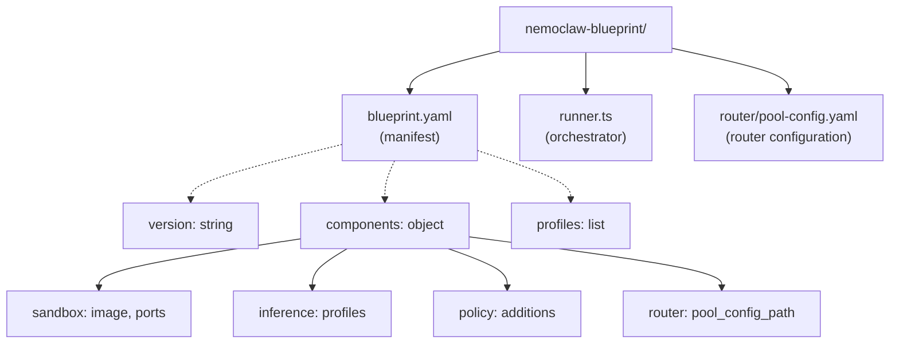
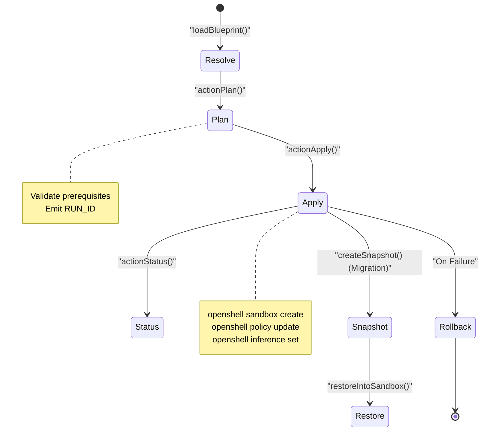
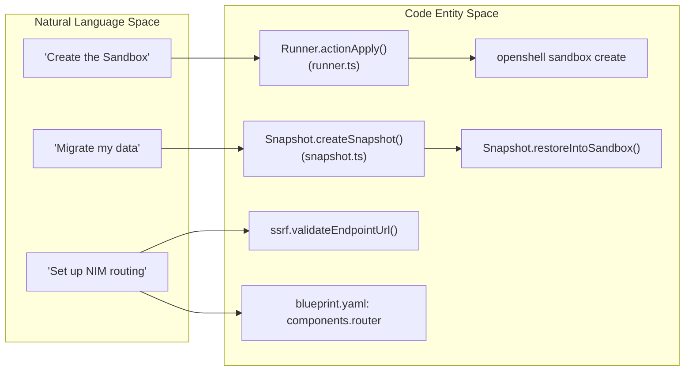

<!-- source: DeepWiki mcp.deepwiki.com · repo NVIDIA/NemoClaw · page 3.5 Blueprint System · fetched 2026-10-26 -->

# Blueprint System

Relevant source files

The following files were used as context for generating this wiki page:

- [.github/dco-bypass.txt](.github/dco-bypass.txt)
- [.github/workflows/dco-check.yaml](.github/workflows/dco-check.yaml)
- [.github/workflows/installer-hash-check.yaml](.github/workflows/installer-hash-check.yaml)
- [docs/reference/architecture.mdx](docs/reference/architecture.mdx)
- [nemoclaw-blueprint/blueprint.yaml](nemoclaw-blueprint/blueprint.yaml)
- [nemoclaw-blueprint/provider-profiles/entra-runtime-v1.yaml](nemoclaw-blueprint/provider-profiles/entra-runtime-v1.yaml)
- [nemoclaw-blueprint/provider-profiles/okta-runtime-v1.yaml](nemoclaw-blueprint/provider-profiles/okta-runtime-v1.yaml)
- [nemoclaw/src/blueprint/runner-identity.test.ts](nemoclaw/src/blueprint/runner-identity.test.ts)
- [nemoclaw/src/blueprint/runner-name-validation.test.ts](nemoclaw/src/blueprint/runner-name-validation.test.ts)
- [nemoclaw/src/blueprint/runner.test.ts](nemoclaw/src/blueprint/runner.test.ts)
- [nemoclaw/src/blueprint/runner.ts](nemoclaw/src/blueprint/runner.ts)
- [nemoclaw/src/blueprint/runtime-identity.test.ts](nemoclaw/src/blueprint/runtime-identity.test.ts)
- [nemoclaw/src/blueprint/runtime-identity.ts](nemoclaw/src/blueprint/runtime-identity.ts)
- [nemoclaw/src/blueprint/snapshot.test.ts](nemoclaw/src/blueprint/snapshot.test.ts)
- [nemoclaw/src/blueprint/snapshot.ts](nemoclaw/src/blueprint/snapshot.ts)
- [nemoclaw/src/blueprint/ssrf.test.ts](nemoclaw/src/blueprint/ssrf.test.ts)
- [nemoclaw/src/blueprint/ssrf.ts](nemoclaw/src/blueprint/ssrf.ts)
- [nemoclaw/src/shared/sandbox-name.cts](nemoclaw/src/shared/sandbox-name.cts)
- [nemoclaw/src/shared/sandbox-name.test.ts](nemoclaw/src/shared/sandbox-name.test.ts)
- [schemas/blueprint.schema.json](schemas/blueprint.schema.json)
- [scripts/brev-launchable-ci-cpu.sh](scripts/brev-launchable-ci-cpu.sh)
- [scripts/check-installer-hash.sh](scripts/check-installer-hash.sh)
- [scripts/checks/extract-installer-pins.mts](scripts/checks/extract-installer-pins.mts)
- [scripts/install-openshell.sh](scripts/install-openshell.sh)
- [src/lib/actions/inference-set-endpoint-security.test.ts](src/lib/actions/inference-set-endpoint-security.test.ts)
- [src/lib/name-validation.ts](src/lib/name-validation.ts)
- [src/lib/runner.ts](src/lib/runner.ts)
- [test/blueprint-runtime-identity-lifecycle.test.ts](test/blueprint-runtime-identity-lifecycle.test.ts)
- [test/blueprint-runtime-identity-schema.test.ts](test/blueprint-runtime-identity-schema.test.ts)
- [test/brev-launchable-ci-cpu-checksum.test.ts](test/brev-launchable-ci-cpu-checksum.test.ts)
- [test/dependency-pins-check.test.ts](test/dependency-pins-check.test.ts)
- [test/e2e/live/inference-routing.test.ts](test/e2e/live/inference-routing.test.ts)
- [test/e2e/live/runtime-identity-oauth-server.ts](test/e2e/live/runtime-identity-oauth-server.ts)
- [test/install-openshell-version-check.test.ts](test/install-openshell-version-check.test.ts)
- [test/installer-hash-check.test.ts](test/installer-hash-check.test.ts)
- [test/runner.test.ts](test/runner.test.ts)

The blueprint system is NemoClaw's infrastructure-as-code layer. It orchestrates sandbox creation, migration, policy application, and inference configuration through the OpenShell CLI. While the NemoClaw plugin handles user interaction and agent lifecycle, the blueprint defines the technical specification of the environment.

---

## Blueprint Artifact Structure

The blueprint is a versioned artifact defined in the `nemoclaw-blueprint/` directory. It contains the declaration of components, inference profiles, and security policies required to run an OpenClaw agent securely.

**Blueprint Directory Structure**

| Component | Path | Purpose |
|-----------|------|---------|
| **Manifest** | `nemoclaw-blueprint/blueprint.yaml` | Declares versions, components, and inference profiles. [nemoclaw-blueprint/blueprint.yaml:1-109]() |
| **Orchestrator** | `nemoclaw/src/blueprint/runner.ts` | TypeScript logic for `plan`, `apply`, `status`, and `rollback`. [nemoclaw/src/blueprint/runner.ts:5-27]() |
| **Snapshot Logic** | `nemoclaw/src/blueprint/snapshot.ts` | Handles host-to-sandbox migration of agent data. [nemoclaw/src/blueprint/snapshot.ts:4-12]() |
| **State Store** | `nemoclaw/src/blueprint/state.ts` | Manages persistence of run IDs and deployment status. [nemoclaw/src/blueprint/state.ts:1-29]()

**Sources:** [nemoclaw-blueprint/blueprint.yaml:1-109](), [nemoclaw/src/blueprint/runner.ts:5-27](), [nemoclaw/src/blueprint/snapshot.ts:4-12](), [nemoclaw/src/blueprint/state.ts:1-29]()

---

## Blueprint Manifest Schema

The `blueprint.yaml` file is the source of truth for the environment configuration. It includes pinning for security and definitions for multi-profile inference routing.

| Field | Type | Description |
|-------|------|-------------|
| `version` | string | Semantic version of the blueprint. [nemoclaw-blueprint/blueprint.yaml:4]() |
| `digest` | string | SHA256 digest of the pinned sandbox image for verification. [nemoclaw-blueprint/blueprint.yaml:14]() |
| `components.sandbox.image` | string | Pinned image digest for `openclaw` sandbox. [nemoclaw-blueprint/blueprint.yaml:34]() |
| `components.inference.profiles` | object | Mapping of profiles to provider types, endpoints, and models. [nemoclaw-blueprint/blueprint.yaml:52-94]() |
| `components.router` | object | Configuration for the inference load-balancer/router. [nemoclaw-blueprint/blueprint.yaml:95-98]() |
| `components.policy.additions` | object | Network policy additions for services like `nim_service`. [nemoclaw-blueprint/blueprint.yaml:100-109]()

**Sources:** [nemoclaw-blueprint/blueprint.yaml:1-109]()

---

## Blueprint Runner Lifecycle

The blueprint runner implements a lifecycle consisting of four primary actions: `plan`, `apply`, `status`, and `rollback`.

**Blueprint Lifecycle Flow**

### 1. Resolve & Verify
The runner loads the manifest using `loadBlueprint()`, which defaults to `blueprint.yaml` in the current directory [nemoclaw/src/blueprint/runner.ts:220-224](). It validates the structure against internal interfaces like `isBlueprint` to ensure all required components (sandbox, inference, policy) are present [nemoclaw/src/blueprint/runner.ts:178-216]().

### 2. Plan Phase
The `actionPlan` function performs a dry-run of the deployment.
- **Run ID Generation**: `emitRunId()` generates a unique identifier matching the pattern `nc-YYYYMMDD-HHMMSS-<hex8>` [nemoclaw/src/blueprint/runner.ts:81-82]().
- **SSRF Validation**: All endpoint URLs in the blueprint are passed through `validateEndpointUrl` to prevent access to internal networks [nemoclaw/src/blueprint/runner.ts:23]().

### 3. Apply Phase (and Migration)
The `actionApply` function executes the plan by invoking the OpenShell CLI.
- **Sandbox Provisioning**: Calls `openshell sandbox create` [nemoclaw/src/blueprint/runner.ts:241-250]().
- **Host Migration**: If a host `~/.openclaw` directory exists, `createSnapshot()` captures the config, workspace, and skills [nemoclaw/src/blueprint/snapshot.ts:108-143](). This is then pushed into the sandbox via `restoreIntoSandbox()` using `openshell sandbox cp` [nemoclaw/src/blueprint/snapshot.ts:145-163]().
- **Ownership Repair**: Because files copied via OpenShell land as root, the runner executes a `chown -R sandbox:sandbox` inside the container [nemoclaw/src/blueprint/snapshot.ts:214-224]().

**Sources:** [nemoclaw/src/blueprint/runner.ts:81-82](), [nemoclaw/src/blueprint/snapshot.ts:108-224](), [nemoclaw/src/blueprint/runner.ts:220-250]()

---

## Security: SSRF Validation and DNS Pinning

To prevent Server-Side Request Forgery (SSRF) and DNS rebinding attacks, the blueprint runner validates all endpoints.

- **Private IP Blocking**: `isPrivateIp` (within `ssrf.ts`) detects and rejects loopback, private CIDRs (10/8, 192.168/16), and cloud metadata endpoints (169.254.169.254). [nemoclaw/src/blueprint/ssrf.test.ts:19-49]()
- **DNS Pinning**: The `validateEndpointUrl` function performs a DNS lookup and returns a `pinnedUrl` where the hostname is replaced by the resolved IP. This prevents "Time-of-Check to Time-of-Use" attacks where a hostname resolves to a public IP during validation but a private IP during the actual request. [nemoclaw/src/blueprint/runner.test.ts:74-79]()

**Sources:** [nemoclaw/src/blueprint/ssrf.test.ts:19-49](), [nemoclaw/src/blueprint/runner.test.ts:74-79]()

---

## Orchestration Logic (Code Entity Mapping)

The blueprint system bridges the gap between high-level user intent and low-level OpenShell/Docker commands.

**Natural Language to Code Entity Space**

| Logic Step | Code Entity | Implementation Detail |
|------------|-------------|-----------------------|
| **Validation** | `validateEndpointUrl` | Uses `node:dns` to resolve and check against private IP ranges. [nemoclaw/src/blueprint/runner.ts:23]() |
| **Snapshot** | `createSnapshot` | Copies `~/.openclaw` to `~/.nemoclaw/snapshots/<timestamp>`. [nemoclaw/src/blueprint/snapshot.ts:120-128]() |
| **Restore** | `restoreIntoSandbox` | Uses `openshell sandbox cp` and repairs legacy symlinks. [nemoclaw/src/blueprint/snapshot.ts:156-198]() |
| **Runner** | `actionApply` | Orchestrates the sequence of `openshell` CLI calls. [nemoclaw/src/blueprint/runner.ts:241-300]() |

**Sources:** [nemoclaw/src/blueprint/runner.ts:241-300](), [nemoclaw/src/blueprint/snapshot.ts:120-198](), [nemoclaw/src/blueprint/runner.ts:23]()

---

