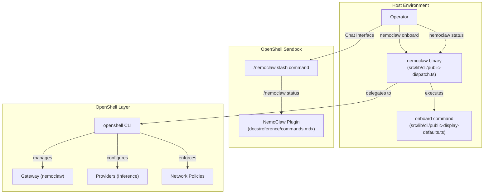
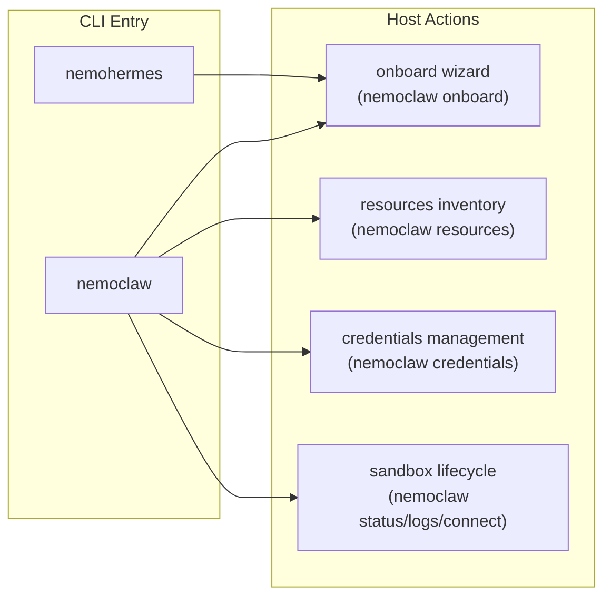

<!-- source: DeepWiki mcp.deepwiki.com · repo NVIDIA/NemoClaw · page 4 Command-Line Interface · fetched 2026-10-26 -->

# Command-Line Interface

Relevant source files

The following files were used as context for generating this wiki page:

- [.gitignore](.gitignore)
- [docs/DORI_SETUP.md](docs/DORI_SETUP.md)
- [docs/changelog/2026-07-30.mdx](docs/changelog/2026-07-30.mdx)
- [docs/configure-agents/configure-memory-search.mdx](docs/configure-agents/configure-memory-search.mdx)
- [docs/index.yml](docs/index.yml)
- [docs/inference/set-up-vllm-on-two-dgx-stations.mdx](docs/inference/set-up-vllm-on-two-dgx-stations.mdx)
- [docs/manage-sandboxes/run-deep-agents-code.mdx](docs/manage-sandboxes/run-deep-agents-code.mdx)
- [docs/reference/commands.mdx](docs/reference/commands.mdx)
- [docs/reference/configure-runtime-identity.mdx](docs/reference/configure-runtime-identity.mdx)
- [docs/reference/troubleshooting.mdx](docs/reference/troubleshooting.mdx)
- [docs/resources/engineer-agentic-documentation.mdx](docs/resources/engineer-agentic-documentation.mdx)
- [scripts/check-docs-published-routes.mts](scripts/check-docs-published-routes.mts)
- [src/commands/sandbox/status.ts](src/commands/sandbox/status.ts)
- [src/commands/status.ts](src/commands/status.ts)
- [src/lib/actions/root-help.ts](src/lib/actions/root-help.ts)
- [src/lib/cli/bare-connect-routing.ts](src/lib/cli/bare-connect-routing.ts)
- [src/lib/cli/public-dispatch.ts](src/lib/cli/public-dispatch.ts)
- [src/lib/cli/public-display-defaults.ts](src/lib/cli/public-display-defaults.ts)
- [test/check-docs-published-routes.test.ts](test/check-docs-published-routes.test.ts)
- [test/cli-oclif-compatibility.test.ts](test/cli-oclif-compatibility.test.ts)
- [test/cli/dispatch-basics.test.ts](test/cli/dispatch-basics.test.ts)
- [test/cli/status-routing.test.ts](test/cli/status-routing.test.ts)
- [test/cli/unknown-sandbox-action.test.ts](test/cli/unknown-sandbox-action.test.ts)
- [test/package-contract/cli/command-registry.test.ts](test/package-contract/cli/command-registry.test.ts)
- [test/package-contract/cli/public-argv-translation.test.ts](test/package-contract/cli/public-argv-translation.test.ts)
- [test/repro-4538-raw-doctor-perms.test.ts](test/repro-4538-raw-doctor-perms.test.ts)
- [test/root-help.test.ts](test/root-help.test.ts)
- [test/support/public-dispatch-test-harness.ts](test/support/public-dispatch-test-harness.ts)

NemoClaw provides three command interfaces for different operational contexts. The `nemoclaw` binary (and its agent-specific alias `nemohermes`) handles host-level setup, deployment, and service management. The in-sandbox commands run within the agent environment for runtime operations. The `openshell` CLI provides low-level control over the gateway, providers, and policies. This page documents all three interfaces and their interactions.

For configuration options and environment variables used by these commands, see [Configuration Files](#8.3) and [Environment Variables](#8.4).

---

## Command Architecture

NemoClaw implements a three-tier command architecture that separates host operations, sandbox operations, and infrastructure primitives. The `nemoclaw` binary acts as a high-level orchestrator, delegating infrastructure tasks to the `openshell` CLI and managing sandbox lifecycles.

### CLI Context and Delegation
Title: "NemoClaw Command Execution Flow"

**Sources:** [src/lib/cli/public-dispatch.ts:1-20](), [docs/reference/commands.mdx:75-115](), [src/lib/cli/public-display-defaults.ts:102-114]()

The architecture enforces clean separation of concerns:

| Tier | Entry Point | Context | Typical Operations |
|------|-------------|---------|-------------------|
| **Host Commands** | `nemoclaw` / `nemohermes` | Host machine | Onboarding, hardware inventory, credentials, lifecycle |
| **Plugin Commands** | `/nemoclaw` | Inside OpenClaw | Status check, onboarding guidance, eject/rollback |
| **Infrastructure** | `openshell` | Host machine | Gateway lifecycle, port forwards, low-level policy edits |

---

## Host Commands (`nemoclaw` / `nemohermes`)

The `nemoclaw` binary is the primary interface for host-side operations. It is responsible for the interactive onboarding wizard, hardware resource inventory, and checking the health of the OpenShell gateway and sandboxes. For the Hermes agent, the `nemohermes` alias provides the same functionality with Hermes-specific defaults [docs/reference/commands.mdx:21-31]().

### Command Dispatch and Routing
Title: "Host CLI Command Routing"

**Sources:** [docs/reference/commands.mdx:117-128](), [src/lib/cli/public-display-defaults.ts:133-138](), [src/lib/cli/public-display-defaults.ts:35-57]()

### Key Host Commands

#### `nemoclaw onboard`
The primary entry point for setup. It runs an interactive wizard that configures an inference endpoint and credentials, with an option to choose the agent runtime [src/lib/cli/public-display-defaults.ts:102-107](). It also supports using a custom Dockerfile for the sandbox image [src/lib/cli/public-display-defaults.ts:108-112]().
**Sources:** [src/lib/cli/public-display-defaults.ts:102-112]()

#### `nemoclaw resources`
Displays host hardware inventory, including CPU cores, RAM, and GPU VRAM [src/lib/cli/public-display-defaults.ts:133-138]().
**Sources:** [src/lib/cli/public-display-defaults.ts:133-138]()

#### `nemoclaw credentials`
Manages provider credentials. `credentials:add` registers a provider credential, `credentials:list` lists stored credential keys, and `credentials:reset` removes a stored credential [src/lib/cli/public-display-defaults.ts:35-57]().
**Sources:** [src/lib/cli/public-display-defaults.ts:35-57]()

#### `nemoclaw list`
Lists all registered sandboxes, showing their names and other relevant information [src/lib/cli/public-display-defaults.ts:95-100]().
**Sources:** [src/lib/cli/public-display-defaults.ts:95-100]()

#### `nemoclaw status`
Provides a summary of the current system status, including the gateway and any running sandboxes [src/commands/status.ts:1-3]().
**Sources:** [src/commands/status.ts:1-3]()

For details, see [Host Commands (nemoclaw)](#4.1).

---

## In-Sandbox Commands

In-sandbox commands provide immediate feedback and control from within the agent's environment.

- **OpenClaw Slash Commands**: The `/nemoclaw` command is available inside the OpenClaw chat interface for quick actions like showing sandbox and inference state (`/nemoclaw status`), explaining shields status (`/nemoclaw shields [status]`), or providing onboarding status and reconfiguration guidance (`/nemoclaw onboard`) [docs/reference/commands.mdx:77-88]().
- **Hermes Plugin**: Hermes does not use the OpenClaw chat slash command. Instead, it uses host-side `nemohermes` commands for lifecycle, status, policy, and inference operations. The in-sandbox Hermes integration installs a NemoClaw Hermes plugin that exposes tools for status, environment information, and skill reload support [docs/reference/commands.mdx:92-98]().
- **Deep Agents Commands**: Deep Agents also does not use the OpenClaw chat slash command. Inside the sandbox, `dcode` is used for the interactive TUI and `dcode -n` for explicit headless automation. The `--json` flag can be added for managed, versioned result envelopes [docs/reference/commands.mdx:101-112]().

For details, see [Plugin Commands (openclaw nemoclaw)](#4.2).

**Sources:** [docs/reference/commands.mdx:77-112]()

---

## OpenShell Commands

NemoClaw utilizes the `openshell` CLI as its underlying infrastructure engine. While `nemoclaw` handles the "Agent" layer, `openshell` handles the "Sandbox" and "Gateway" layers. NemoClaw may suggest using `openshell` directly for certain operations [src/lib/cli/public-dispatch.ts:151-193]().

| Command | Role in NemoClaw |
|---------|------------------|
| `openshell gateway` | Manages the core OpenShell gateway service, including stopping it (`openshell gateway stop -g nemoclaw`) [src/lib/cli/public-dispatch.ts:173-177](). |
| `openshell provider` | Low-level registration of inference endpoints. |
| `openshell policy` | Enforces and updates the network egress rules. For setting policies, NemoClaw suggests `openshell policy set --policy <policy-file> --wait <sandbox-name>` [src/lib/cli/public-dispatch.ts:166-171](). |
| `openshell forward` | Manages dashboard port forwards from the host to the sandbox. |
| `openshell sandbox` | Directly manages container creation and connectivity. |
| `openshell term` | Used to monitor gateway logs and policy approval prompts [src/lib/cli/public-dispatch.ts:160-164](). |

For details, see [OpenShell Commands](#4.3).

**Sources:** [src/lib/cli/public-dispatch.ts:151-193]()

---

