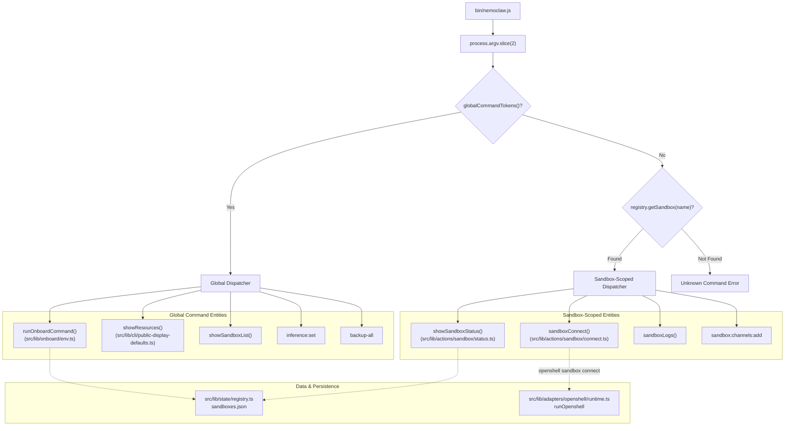
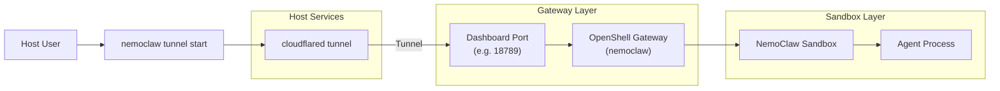

<!-- source: DeepWiki mcp.deepwiki.com · repo NVIDIA/NemoClaw · page 4.1 Host Commands (nemoclaw) · fetched 2026-10-26 -->

# Host Commands (nemoclaw)

Relevant source files

The following files were used as context for generating this wiki page:

- [.gitignore](.gitignore)
- [agents/hermes/build-mcp-digest.py](agents/hermes/build-mcp-digest.py)
- [docs/DORI_SETUP.md](docs/DORI_SETUP.md)
- [docs/changelog/2026-07-30.mdx](docs/changelog/2026-07-30.mdx)
- [docs/configure-agents/configure-memory-search.mdx](docs/configure-agents/configure-memory-search.mdx)
- [docs/index.yml](docs/index.yml)
- [docs/inference/set-up-vllm-on-two-dgx-stations.mdx](docs/inference/set-up-vllm-on-two-dgx-stations.mdx)
- [docs/inference/verify-inference-route.mdx](docs/inference/verify-inference-route.mdx)
- [docs/manage-sandboxes/run-deep-agents-code.mdx](docs/manage-sandboxes/run-deep-agents-code.mdx)
- [docs/reference/commands.mdx](docs/reference/commands.mdx)
- [docs/reference/configure-runtime-identity.mdx](docs/reference/configure-runtime-identity.mdx)
- [docs/reference/troubleshooting.mdx](docs/reference/troubleshooting.mdx)
- [docs/resources/engineer-agentic-documentation.mdx](docs/resources/engineer-agentic-documentation.mdx)
- [scripts/check-docs-published-routes.mts](scripts/check-docs-published-routes.mts)
- [scripts/gateway-control.sh](scripts/gateway-control.sh)
- [scripts/lib/gateway-supervisor.sh](scripts/lib/gateway-supervisor.sh)
- [src/commands/sandbox/status.ts](src/commands/sandbox/status.ts)
- [src/commands/status.ts](src/commands/status.ts)
- [src/lib/actions/root-help.ts](src/lib/actions/root-help.ts)
- [src/lib/actions/sandbox/connect-boundary-refusal.ts](src/lib/actions/sandbox/connect-boundary-refusal.ts)
- [src/lib/actions/sandbox/connect-flow-dcode-probe-preamble.test.ts](src/lib/actions/sandbox/connect-flow-dcode-probe-preamble.test.ts)
- [src/lib/actions/sandbox/connect-flow-hermes-boundary.test.ts](src/lib/actions/sandbox/connect-flow-hermes-boundary.test.ts)
- [src/lib/actions/sandbox/connect-flow.test.ts](src/lib/actions/sandbox/connect-flow.test.ts)
- [src/lib/actions/sandbox/connect-inference-route-probe.test.ts](src/lib/actions/sandbox/connect-inference-route-probe.test.ts)
- [src/lib/actions/sandbox/connect-inference-route-probe.ts](src/lib/actions/sandbox/connect-inference-route-probe.ts)
- [src/lib/actions/sandbox/connect.ts](src/lib/actions/sandbox/connect.ts)
- [src/lib/actions/sandbox/gateway-failure-classifier.test.ts](src/lib/actions/sandbox/gateway-failure-classifier.test.ts)
- [src/lib/actions/sandbox/gateway-failure-classifier.ts](src/lib/actions/sandbox/gateway-failure-classifier.ts)
- [src/lib/actions/sandbox/gateway-restart-quarantine-repair.test.ts](src/lib/actions/sandbox/gateway-restart-quarantine-repair.test.ts)
- [src/lib/actions/sandbox/gateway-restart.ts](src/lib/actions/sandbox/gateway-restart.ts)
- [src/lib/actions/sandbox/inference-route-health.test.ts](src/lib/actions/sandbox/inference-route-health.test.ts)
- [src/lib/actions/sandbox/inference-route-health.ts](src/lib/actions/sandbox/inference-route-health.ts)
- [src/lib/actions/sandbox/mcp-bridge-adapter-hermes.ts](src/lib/actions/sandbox/mcp-bridge-adapter-hermes.ts)
- [src/lib/actions/sandbox/sandbox-container-owner.ts](src/lib/actions/sandbox/sandbox-container-owner.ts)
- [src/lib/actions/sandbox/status-flow.test.ts](src/lib/actions/sandbox/status-flow.test.ts)
- [src/lib/actions/sandbox/status-preflight.ts](src/lib/actions/sandbox/status-preflight.ts)
- [src/lib/actions/sandbox/status-snapshot-inference-health.test.ts](src/lib/actions/sandbox/status-snapshot-inference-health.test.ts)
- [src/lib/actions/sandbox/status-snapshot.ts](src/lib/actions/sandbox/status-snapshot.ts)
- [src/lib/actions/sandbox/status-text.ts](src/lib/actions/sandbox/status-text.ts)
- [src/lib/actions/sandbox/status.ts](src/lib/actions/sandbox/status.ts)
- [src/lib/cli/bare-connect-routing.ts](src/lib/cli/bare-connect-routing.ts)
- [src/lib/cli/public-dispatch.ts](src/lib/cli/public-dispatch.ts)
- [src/lib/cli/public-display-defaults.ts](src/lib/cli/public-display-defaults.ts)
- [src/lib/inventory/index.test.ts](src/lib/inventory/index.test.ts)
- [src/lib/inventory/index.ts](src/lib/inventory/index.ts)
- [src/lib/status-command-deps.ts](src/lib/status-command-deps.ts)
- [src/lib/tunnel/services.test.ts](src/lib/tunnel/services.test.ts)
- [test/check-docs-published-routes.test.ts](test/check-docs-published-routes.test.ts)
- [test/cli-oclif-compatibility.test.ts](test/cli-oclif-compatibility.test.ts)
- [test/cli/dispatch-basics.test.ts](test/cli/dispatch-basics.test.ts)
- [test/cli/list-inference.test.ts](test/cli/list-inference.test.ts)
- [test/cli/status-routing.test.ts](test/cli/status-routing.test.ts)
- [test/cli/unknown-sandbox-action.test.ts](test/cli/unknown-sandbox-action.test.ts)
- [test/e2e/e2e-cloud-experimental/checks/06-deepagents-code-python-egress.sh](test/e2e/e2e-cloud-experimental/checks/06-deepagents-code-python-egress.sh)
- [test/gateway-failure-classifier.test.ts](test/gateway-failure-classifier.test.ts)
- [test/openclaw-managed-restart-respawn.test.ts](test/openclaw-managed-restart-respawn.test.ts)
- [test/package-contract/cli/command-registry.test.ts](test/package-contract/cli/command-registry.test.ts)
- [test/package-contract/cli/public-argv-translation.test.ts](test/package-contract/cli/public-argv-translation.test.ts)
- [test/repro-2666-silent-list-status.test.ts](test/repro-2666-silent-list-status.test.ts)
- [test/repro-4538-raw-doctor-perms.test.ts](test/repro-4538-raw-doctor-perms.test.ts)
- [test/root-help.test.ts](test/root-help.test.ts)
- [test/support/connect-flow-test-harness.ts](test/support/connect-flow-test-harness.ts)
- [test/support/public-dispatch-test-harness.ts](test/support/public-dispatch-test-harness.ts)
- [test/support/status-flow-test-harness.ts](test/support/status-flow-test-harness.ts)

The `nemoclaw` binary provides host-level commands for managing the NemoClaw infrastructure. These commands run outside the sandbox on the host system and handle setup, deployment, sandbox management, and auxiliary services. For Hermes agent variants, the `nemohermes` alias is provided, which selects the Hermes agent by default [docs/reference/commands.mdx:16-27]().

For in-sandbox plugin commands that run within the agent context, see [Plugin Commands (openclaw nemoclaw)](4.2). For direct OpenShell primitives that `nemoclaw` delegates to, see [OpenShell Commands](4.3).

---

## Command Architecture

The `nemoclaw` CLI implements a two-tier command dispatch model: **global commands** that operate on the entire system, and **sandbox-scoped commands** that target a specific sandbox by name.

### Logic Flow Diagram: Code Entity Space
This diagram maps the CLI entry point to specific internal functions and state managers.

**Command Dispatch Logic**
The CLI follows this dispatch flow:
1. **Parse arguments**: Extract command and arguments. `globalCommandTokens()` returns the set of 24 tokens matching global dispatch commands including `onboard`, `list`, `status`, and `resources` [test/package-contract/cli/command-registry.test.ts:182-209]().
2. **Check Registry**: If not a global command, it attempts to resolve the first argument as a sandbox name via `registry.getSandbox(name)` [src/lib/actions/sandbox/status.ts:66-66]().
3. **Route to handler**: Execute the logic associated with the matched command or sandbox action.

**Sources**: [test/package-contract/cli/command-registry.test.ts:182-209](), [src/lib/cli/public-display-defaults.ts:11-208](), [src/lib/actions/sandbox/status.ts:66-66]()

---

## Global Operations

### `nemoclaw onboard`
Interactive setup wizard that creates the OpenShell gateway, registers inference providers, and builds the sandbox image [docs/reference/commands.mdx:108-112]().

- **Resume and Fresh**: NemoClaw records progress; `--resume` continues an interrupted session, while `--fresh` discards saved state [docs/reference/commands.mdx:129-145]().
- **Inference Setup**: Detects local providers like Ollama or NIM. For Ollama, it can perform host-side installs or upgrades (e.g., via `brew` on macOS or `install.sh` on Linux) [docs/inference/set-up-ollama.mdx:35-51]().
- **Agent Selection**: Defaults to OpenClaw but can be switched via `--agent hermes` [docs/reference/commands.mdx:35-37]().

**Sources**: [docs/reference/commands.mdx:108-145](), [docs/inference/set-up-ollama.mdx:35-51]()

### `nemoclaw resources`
Displays host hardware inventory including CPU cores, RAM, and GPU VRAM. It also shows Kubernetes allocatable capacity if the gateway is running [src/lib/cli/public-display-defaults.ts:133-138]().

### `nemoclaw inference set`
Allows switching the active model or provider at runtime without rebuilding the sandbox image [src/lib/cli/public-display-defaults.ts:87-92]().

**Sources**: [src/lib/cli/public-display-defaults.ts:87-92](), [src/lib/cli/public-display-defaults.ts:133-138]()

---

## Sandbox-Scoped Operations

### `nemoclaw <name> connect`
Opens an interactive SSH shell into the sandbox.

**Implementation**: [src/lib/actions/sandbox/connect.ts:173-181]()
1. **Preflight**: Runs `checkAndRecoverSandboxProcesses` to ensure the agent gateway is running inside the container [src/lib/actions/sandbox/connect.ts:79-79]().
2. **Inference Route**: Executes `ensureSandboxInferenceRoute` to verify the OpenShell route is healthy before connecting [src/lib/actions/sandbox/connect.ts:110-110]().
3. **Recovery**: If the gateway is down, it attempts automatic recovery and restores dashboard port forwards [src/lib/actions/sandbox/connect.ts:79-83]().

**Terminal Restoration**: When the SSH connection disconnects, `connectSandbox` restores the terminal to a sane state by calling `process.stdin.setRawMode(false)` and `stty sane` [src/lib/actions/sandbox/connect-flow.test.ts:74-138](). This ensures the user's terminal is usable after the SSH session ends.

### `nemoclaw <name> status`
Provides a detailed health report of the sandbox and its environment.

**Implementation**: [src/lib/actions/sandbox/status.ts:66-138]()
1. **Snapshot Collection**: `collectSandboxStatusSnapshot` gathers state from the registry, gateway, and inference probes [src/lib/actions/sandbox/status.ts:73-75]().
2. **GPU Verification**: Shows whether sandbox CUDA usability is `verified`, `unverified`, or `failed` based on the last `SandboxGpuProofResult` [src/lib/actions/sandbox/status-text.ts:100-109]().
3. **Inference Health**: Probes multi-hop providers (e.g., local Ollama + auth proxy) and surfaces individual hop failures [src/lib/actions/sandbox/status-snapshot.ts:100-124]().
4. **Route Drift Warning**: If the live gateway inference route differs from the sandbox's recorded route, a warning is displayed with commands to realign it [src/lib/actions/sandbox/status-flow.test.ts:27-52]().

### `nemoclaw <name> channels`
Manages messaging integrations (Telegram, Discord, Slack, etc.) from the host.
- **Add/Remove**: `channels add <channel>` saves credentials to the gateway and triggers a sandbox rebuild to bake configuration [src/lib/cli/public-display-defaults.ts:158-164]().
- **Status**: `channels status` provides runtime diagnostics for messaging delivery [src/lib/cli/public-display-defaults.ts:199-206]().

**Sources**: [src/lib/actions/sandbox/connect.ts:79-181](), [src/lib/actions/sandbox/connect-flow.test.ts:74-138](), [src/lib/actions/sandbox/status.ts:66-138](), [src/lib/actions/sandbox/status-flow.test.ts:27-52](), [src/lib/actions/sandbox/status-snapshot.ts:100-124](), [src/lib/actions/sandbox/status-text.ts:100-109](), [src/lib/cli/public-display-defaults.ts:158-164](), [src/lib/cli/public-display-defaults.ts:199-206]()

---

## Service Orchestration

NemoClaw manages auxiliary host-side services, primarily the Cloudflared tunnel for remote access.

### Data Flow: External Access to Sandbox
This diagram illustrates how `nemoclaw tunnel` commands interact with the OpenShell Gateway to expose the sandbox dashboard.

### `nemoclaw tunnel start` / `stop`
Exposes the sandbox dashboard to the internet via Cloudflare.
- **Start**: Launches the tunnel if the `cloudflared` binary is present on the host [docs/manage-sandboxes/messaging-channels.mdx:37-44]().
- **Status**: `nemoclaw tunnel status` reports the live state of the Cloudflare tunnel directly [docs/changelog/2026-07-30.mdx:23-23]().

**Sources**: [docs/manage-sandboxes/messaging-channels.mdx:37-44](), [docs/changelog/2026-07-30.mdx:23-23]()

---

## Summary of Key Entities

| Code Entity | Source Path | Role |
| :--- | :--- | :--- |
| `showSandboxStatus` | [src/lib/actions/sandbox/status.ts:66]() | Main entry for per-sandbox health reporting and diagnostics. |
| `runConnectAutoPairApprovalPass` | [src/lib/actions/sandbox/connect.ts:89]() | Ensures container and agent processes are healthy before SSH attachment. |
| `collectSandboxStatusSnapshot` | [src/lib/actions/sandbox/status.ts:73]() | Aggregates data from Docker, OpenShell, and Registry for status reports. |
| `assertSandboxGatewayRouteCompatible` | [src/lib/actions/sandbox/connect.ts:64]() | Reconciles the OpenShell inference route with the sandbox's expected provider. |
| `PUBLIC_DISPLAY_LAYOUT` | [src/lib/cli/public-display-defaults.ts:11]() | Defines the CLI help structure, grouping, and command metadata. |

**Sources**: [src/lib/actions/sandbox/status.ts:66-73](), [src/lib/actions/sandbox/connect.ts:64-89](), [src/lib/cli/public-display-defaults.ts:11-34]()

---

